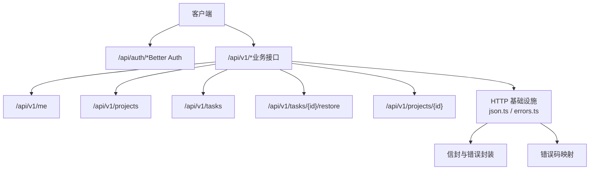
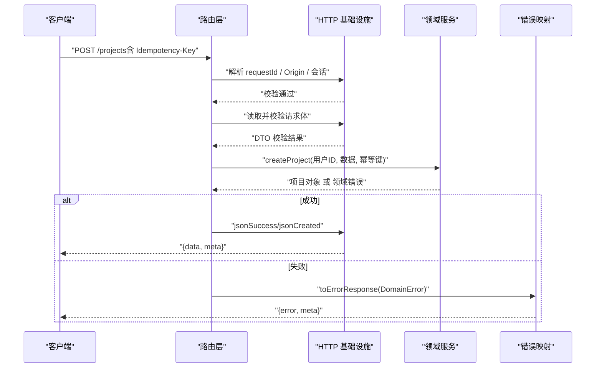
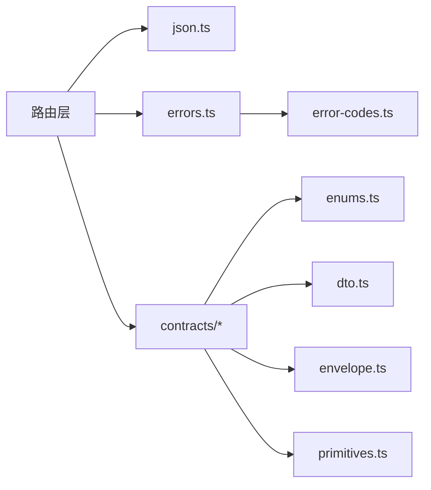

# API 参考

<cite>
**本文引用的文件**
- [openapi.json](file://contracts/openapi.json)
- [05-API-CONTRACT.md](file://docs/05-API-CONTRACT.md)
- [route.ts（认证）](file://src/app/api/auth/[...all]/route.ts)
- [route.ts（/me）](file://src/app/api/v1/me/route.ts)
- [route.ts（/projects）](file://src/app/api/v1/projects/route.ts)
- [route.ts（/projects/{projectId}）](file://src/app/api/v1/projects/[projectId]/route.ts)
- [route.ts（/tasks/{taskId}）](file://src/app/api/v1/tasks/[taskId]/route.ts)
- [route.ts（/tasks/{taskId}/restore）](file://src/app/api/v1/tasks/[taskId]/restore/route.ts)
- [dto.ts](file://src/contracts/dto.ts)
- [envelope.ts](file://src/contracts/envelope.ts)
- [error-codes.ts](file://src/contracts/error-codes.ts)
- [primitives.ts](file://src/contracts/primitives.ts)
- [enums.ts](file://src/contracts/enums.ts)
- [errors.ts](file://src/server/http/errors.ts)
- [json.ts](file://src/server/http/json.ts)
</cite>

## 目录
1. [简介](#简介)
2. [项目结构](#项目结构)
3. [核心组件](#核心组件)
4. [架构总览](#架构总览)
5. [详细接口说明](#详细接口说明)
6. [依赖关系分析](#依赖关系分析)
7. [性能与最佳实践](#性能与最佳实践)
8. [故障排查指南](#故障排查指南)
9. [结论](#结论)
10. [附录：版本管理与兼容性](#附录：版本管理与兼容性)

## 简介
本 API 参考基于 OpenAPI 规范与契约文档，系统化说明 Orbit V1 业务接口。覆盖认证、账户信息、项目、任务等公共端点，提供请求/响应约定、错误码、状态码、分页与幂等策略、以及客户端集成建议。所有接口统一使用 JSON 信封格式，并遵循严格的字段白名单与校验规则。

## 项目结构
- 契约层：OpenAPI 定义位于 contracts/openapi.json；运行时 DTO、枚举、信封、错误码在 src/contracts 中实现，确保前后端类型与校验一致。
- 路由层：Next.js App Router 的 /api/v1/* 暴露业务接口；/api/auth/* 由 Better Auth 托管认证流程。
- HTTP 基础设施：统一的请求体读取、信封构造、错误映射、缓存控制与请求 ID 透传。

图表来源
- [openapi.json:1-12](file://contracts/openapi.json#L1-L12)
- [route.ts（认证）:1-22](file://src/app/api/auth/[...all]/route.ts#L1-L22)
- [route.ts（/me）:1-91](file://src/app/api/v1/me/route.ts#L1-L91)
- [route.ts（/projects）:1-93](file://src/app/api/v1/projects/route.ts#L1-L93)
- [route.ts（/projects/{projectId}）:1-80](file://src/app/api/v1/projects/[projectId]/route.ts#L1-L80)
- [route.ts（/tasks/{taskId}）:1-112](file://src/app/api/v1/tasks/[taskId]/route.ts#L1-L112)
- [route.ts（/tasks/{taskId}/restore）:1-70](file://src/app/api/v1/tasks/[taskId]/restore/route.ts#L1-L70)
- [json.ts:1-149](file://src/server/http/json.ts#L1-L149)
- [errors.ts:1-136](file://src/server/http/errors.ts#L1-L136)

章节来源
- [openapi.json:1-12](file://contracts/openapi.json#L1-L12)
- [05-API-CONTRACT.md:1-21](file://docs/05-API-CONTRACT.md#L1-L21)

## 核心组件
- 统一信封：成功响应为 {data, meta}，列表响应 meta 包含 nextCursor 与 hasMore；错误响应为 {error, meta}，error 包含 code、message、可选 fieldErrors 与冲突版本信息。
- 请求体与参数校验：通过 Zod schema 严格校验，禁止未知字段；查询参数支持布尔字符串转换与游标分页。
- 错误体系：领域错误 DomainError 携带 ErrorCode，HTTP 层自动映射到对应 HTTP 状态码，并输出标准错误信封。
- 幂等性：关键写操作要求 Idempotency-Key（UUID），服务端按 userId+method+routeKey+key 去重并重放结果。
- 安全与隐私：非 GET 接口强制 Origin 校验；私有响应设置 Cache-Control: private, no-store；不泄露敏感字段。

章节来源
- [envelope.ts:1-94](file://src/contracts/envelope.ts#L1-L94)
- [dto.ts:1-476](file://src/contracts/dto.ts#L1-L476)
- [error-codes.ts:1-137](file://src/contracts/error-codes.ts#L1-L137)
- [json.ts:1-149](file://src/server/http/json.ts#L1-L149)
- [errors.ts:1-136](file://src/server/http/errors.ts#L1-L136)
- [05-API-CONTRACT.md:1-21](file://docs/05-API-CONTRACT.md#L1-L21)

## 架构总览
以下序列图展示典型写操作的完整生命周期：请求进入路由 → 解析请求 ID → Origin 校验 → 会话校验 → 请求体验证 → 领域服务处理 → 返回统一信封或错误信封。

图表来源
- [route.ts（/projects）:1-93](file://src/app/api/v1/projects/route.ts#L1-L93)
- [json.ts:1-149](file://src/server/http/json.ts#L1-L149)
- [errors.ts:1-136](file://src/server/http/errors.ts#L1-L136)

## 详细接口说明

### 认证接口（/api/auth/*）
- 说明：由 Better Auth 管理，挂载于 /api/auth/*，包含注册、登录、会话、邮箱验证、重置密码等。
- 安全：使用库内置 CSRF 与 trustedOrigins；不走业务 Origin 层，避免破坏回调。
- 运行时：Node.js 环境。

章节来源
- [route.ts（认证）:1-22](file://src/app/api/auth/[...all]/route.ts#L1-L22)

### 账户接口（/api/v1/me）
- GET /api/v1/me
  - 功能：读取当前账户档案。
  - 认证：需要会话。
  - 响应：{data: User, meta: Meta}。
  - 缓存：私有响应，禁止共享缓存。
- PATCH /api/v1/me
  - 功能：修改姓名或时区。
  - 认证：需要会话；需 Origin 校验。
  - 请求体：UpdateMe（至少一个可修改字段）。
  - 响应：{data: User, meta: Meta}。
  - 错误：非法时区返回 400 VALIDATION_ERROR 并附带 fieldErrors.timezone。

章节来源
- [openapi.json:49-208](file://contracts/openapi.json#L49-L208)
- [route.ts（/me）:1-91](file://src/app/api/v1/me/route.ts#L1-L91)
- [dto.ts:56-84](file://src/contracts/dto.ts#L56-L84)

### 项目接口（/api/v1/projects）
- GET /api/v1/projects
  - 功能：列出我拥有和参与的项目。
  - 认证：需要会话。
  - 查询参数：cursor、limit、scope（all/owned/joined）、archived（exclude/only）。
  - 响应：{data: Project[], meta: PageMeta}。
- POST /api/v1/projects
  - 功能：创建项目（当前用户为 owner）。
  - 认证：需要会话；需 Origin 校验。
  - 请求头：Idempotency-Key（必填，UUID）。
  - 请求体：CreateProject（name、key 必填）。
  - 响应：新建 201；幂等重放 200（同原结果）。

章节来源
- [openapi.json:209-458](file://contracts/openapi.json#L209-L458)
- [route.ts（/projects）:1-93](file://src/app/api/v1/projects/route.ts#L1-L93)
- [dto.ts:86-128](file://src/contracts/dto.ts#L86-L128)

### 项目详情（/api/v1/projects/{projectId}）
- GET /api/v1/projects/{projectId}
  - 功能：读取项目（成员可见；非成员/不存在返回 404）。
  - 认证：需要会话。
  - 路径参数：projectId（UUID）。
  - 响应：{data: Project, meta: Meta}。
- PATCH /api/v1/projects/{projectId}
  - 功能：更新项目资料/归档/恢复（仅 owner）。
  - 认证：需要会话；需 Origin 校验。
  - 请求体：UpdateProject（expectedVersion 必填，至少一个可修改字段）。
  - 响应：{data: Project, meta: Meta}；版本冲突返回 409 VERSION_CONFLICT。

章节来源
- [openapi.json:459-640](file://contracts/openapi.json#L459-L640)
- [route.ts（/projects/{projectId}）:1-80](file://src/app/api/v1/projects/[projectId]/route.ts#L1-L80)
- [dto.ts:116-128](file://src/contracts/dto.ts#L116-L128)

### 任务接口（/api/v1/tasks/{taskId}）
- GET /api/v1/tasks/{taskId}
  - 功能：读取任务详情（成员可见；非成员/不存在/已软删除返回 404）。
  - 认证：需要会话。
  - 路径参数：taskId（UUID）。
  - 响应：{data: Task, meta: Meta}。
- PATCH /api/v1/tasks/{taskId}
  - 功能：更新任务字段（成员可改）。
  - 认证：需要会话；需 Origin 校验。
  - 请求体：UpdateTask（expectedVersion 必填，至少一个可修改字段）。
  - 响应：{data: Task, meta: Meta}；版本冲突返回 409 VERSION_CONFLICT。
- DELETE /api/v1/tasks/{taskId}
  - 功能：软删除任务（owner 或创建者可删）。
  - 认证：需要会话；需 Origin 校验。
  - 查询参数：expectedVersion（必填，整数 ≥ 1）。
  - 响应：{data: DeletedTask, meta: Meta}。

章节来源
- [openapi.json:800-...（任务相关路径）:800-1200](file://contracts/openapi.json#L800-L1200)
- [route.ts（/tasks/{taskId}）:1-112](file://src/app/api/v1/tasks/[taskId]/route.ts#L1-L112)
- [dto.ts:188-278](file://src/contracts/dto.ts#L188-L278)

### 任务恢复（/api/v1/tasks/{taskId}/restore）
- POST /api/v1/tasks/{taskId}/restore
  - 功能：恢复软删除的任务。
  - 认证：需要会话；需 Origin 校验。
  - 请求头：Idempotency-Key（必填，UUID）。
  - 请求体：VersionInput（expectedVersion）。
  - 响应：{data: Task, meta: Meta}；幂等重放 200。

章节来源
- [openapi.json:任务恢复路径:1200-1600](file://contracts/openapi.json#L1200-L1600)
- [route.ts（/tasks/{taskId}/restore）:1-70](file://src/app/api/v1/tasks/[taskId]/restore/route.ts#L1-L70)
- [dto.ts:250-254](file://src/contracts/dto.ts#L250-L254)

### 通用数据模型与枚举
- 基础类型：RequestId、Cursor、Uuid、UserId、IsoDateTime、IsoDate、Version、NullableIsoDateTime。
- 枚举：项目颜色、角色、任务状态/优先级/排序、邀请状态、附件状态、活动实体类型/动作、元数据字段。
- DTO：User、Project、Member、Invitation、Task、Board、Subtask、Comment、Attachment、Activity、Overview 等。

章节来源
- [primitives.ts:1-42](file://src/contracts/primitives.ts#L1-L42)
- [enums.ts:1-130](file://src/contracts/enums.ts#L1-L130)
- [dto.ts:1-476](file://src/contracts/dto.ts#L1-L476)

## 依赖关系分析
- 路由层依赖 HTTP 基础设施进行请求体读取、信封构造与错误映射。
- 契约层（DTO/枚举/信封/错误码）被路由层与测试共同复用，保证一致性。
- 错误码与状态码映射集中维护，便于扩展与维护。

图表来源
- [route.ts（/projects）:1-93](file://src/app/api/v1/projects/route.ts#L1-L93)
- [json.ts:1-149](file://src/server/http/json.ts#L1-L149)
- [errors.ts:1-136](file://src/server/http/errors.ts#L1-L136)
- [error-codes.ts:1-137](file://src/contracts/error-codes.ts#L1-L137)
- [dto.ts:1-476](file://src/contracts/dto.ts#L1-L476)
- [envelope.ts:1-94](file://src/contracts/envelope.ts#L1-L94)
- [primitives.ts:1-42](file://src/contracts/primitives.ts#L1-L42)
- [enums.ts:1-130](file://src/contracts/enums.ts#L1-L130)

章节来源
- [json.ts:1-149](file://src/server/http/json.ts#L1-L149)
- [errors.ts:1-136](file://src/server/http/errors.ts#L1-L136)
- [error-codes.ts:1-137](file://src/contracts/error-codes.ts#L1-L137)

## 性能与最佳实践
- 分页：使用 cursor 分页，默认 30，上限 100；列表可能因并发产生重复，客户端按 id 去重。
- 幂等：对写操作务必提供 Idempotency-Key（UUID），网络重试复用相同 key 与 body。
- 并发：更新/移动使用 expectedVersion；看板拖拽需同时考虑 boardVersion，冲突时清空列并重新获取。
- 请求体：最大 64KiB；超大请求在解析前拒绝，避免内存占用。
- 缓存：私有响应一律 no-store；避免浏览器/CDN 缓存导致的数据泄露。
- 错误处理：根据 error.code 分支处理；409 保留草稿并重新获取；429 遵循 Retry-After。

章节来源
- [05-API-CONTRACT.md:52-73](file://docs/05-API-CONTRACT.md#L52-L73)
- [json.ts:26-30](file://src/server/http/json.ts#L26-L30)
- [errors.ts:18-23](file://src/server/http/errors.ts#L18-L23)

## 故障排查指南
- 常见错误码与行为：
  - 400 VALIDATION_ERROR / INVALID_CURSOR：检查请求体与游标格式。
  - 401 UNAUTHENTICATED：确认会话有效。
  - 403 FORBIDDEN / EMAIL_UNVERIFIED / ORIGIN_NOT_ALLOWED：检查权限与同源策略。
  - 404 NOT_FOUND：资源不存在或不可见。
  - 409 VERSION_CONFLICT / BOARD_CONFLICT：重新获取最新数据后重试。
  - 413 PAYLOAD_TOO_LARGE：减小请求体大小。
  - 422 LIMIT_EXCEEDED / ASSIGNEE_NOT_MEMBER / INVALID_BOARD_TARGET：修正业务输入。
  - 429 RATE_LIMITED：等待 Retry-After 秒数。
  - 500 INTERNAL_ERROR：记录 requestId 并稍后重试。
  - 503 STORAGE_UNAVAILABLE / SERVICE_UNAVAILABLE：稍后重试。
- 调试要点：
  - 关注响应头 x-request-id，便于日志追踪。
  - 错误信封中的 fieldErrors 用于定位具体字段问题。
  - 409 错误会附带 currentVersion/currentBoardVersion，用于客户端刷新。

章节来源
- [error-codes.ts:18-137](file://src/contracts/error-codes.ts#L18-L137)
- [errors.ts:24-136](file://src/server/http/errors.ts#L24-L136)
- [05-API-CONTRACT.md:22-42](file://docs/05-API-CONTRACT.md#L22-L42)

## 结论
Orbit V1 API 以 OpenAPI 契约为核心，结合 Zod 运行时校验与统一信封，提供稳定、安全、易用的 RESTful 接口。通过幂等、乐观并发、游标分页与严格的错误体系，保障高可用与良好用户体验。开发者应严格遵循契约与最佳实践，确保集成正确性与稳定性。

## 附录：版本管理与兼容性
- 版本标识：V1 基路径为 /api/v1；认证接口位于 /api/auth/*。
- 向后兼容：新增字段采用可选策略；旧字段保持兼容；废弃字段通过弃用策略逐步移除。
- 变更策略：任何破坏性变更需升级主版本号；现有客户端不受影响。
- 兼容性保证：契约测试确保 OpenAPI、DTO、枚举与错误码一致；路由实现严格遵循契约。

章节来源
- [openapi.json:1-12](file://contracts/openapi.json#L1-L12)
- [05-API-CONTRACT.md:1-8](file://docs/05-API-CONTRACT.md#L1-L8)