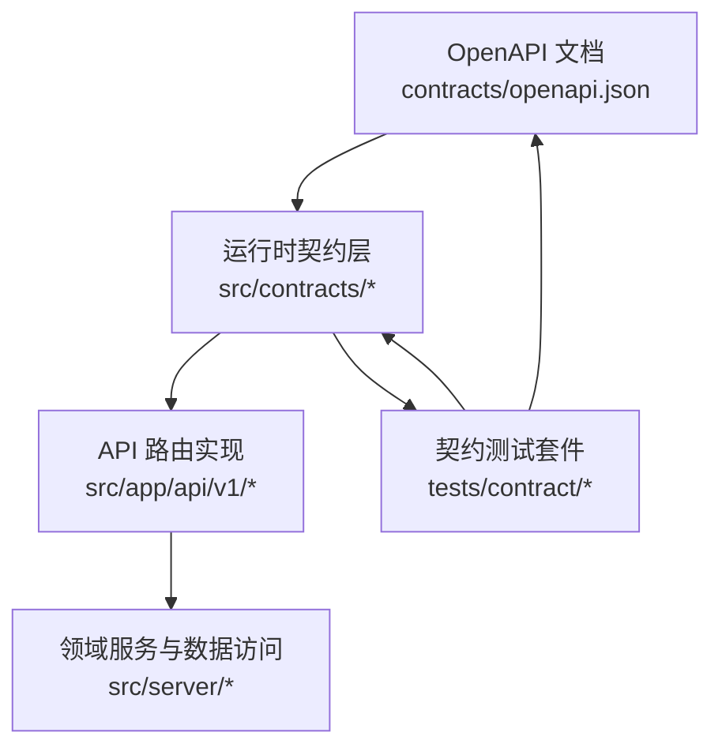
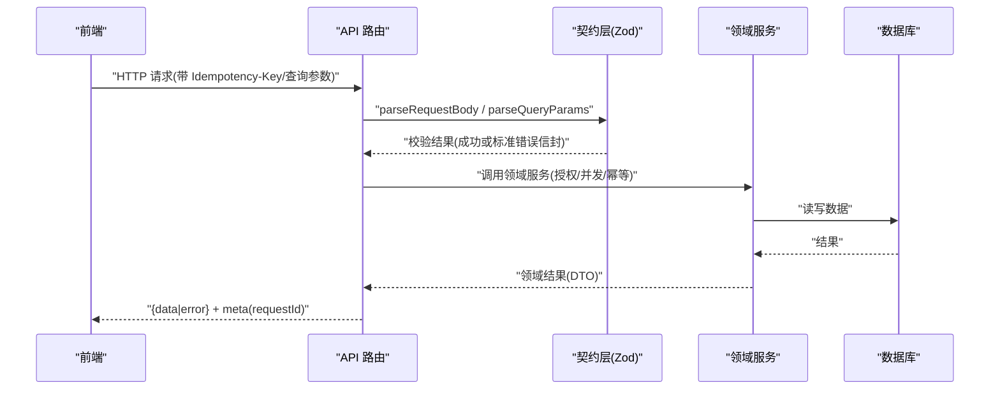
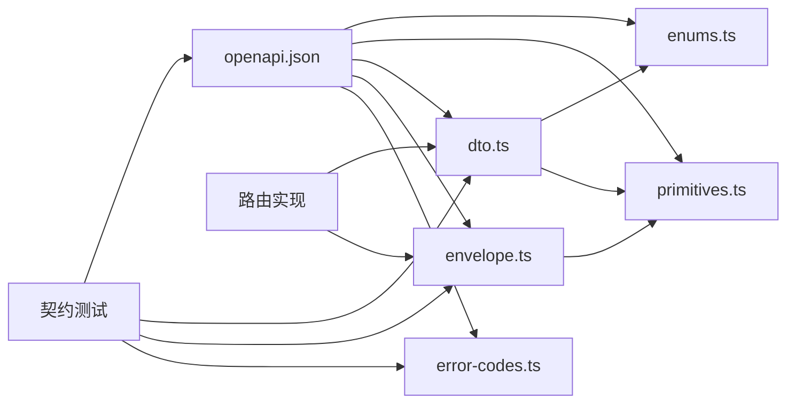

# API 契约

<cite>
**本文引用的文件**
- [openapi.json](file://contracts/openapi.json)
- [05-API-CONTRACT.md](file://docs/05-API-CONTRACT.md)
- [index.ts](file://src/contracts/index.ts)
- [dto.ts](file://src/contracts/dto.ts)
- [enums.ts](file://src/contracts/enums.ts)
- [error-codes.ts](file://src/contracts/error-codes.ts)
- [primitives.ts](file://src/contracts/primitives.ts)
- [envelope.ts](file://src/contracts/envelope.ts)
- [helpers.ts](file://src/contracts/helpers.ts)
- [route.ts（/me）](file://src/app/api/v1/me/route.ts)
- [route.ts（/projects）](file://src/app/api/v1/projects/route.ts)
- [openapi.test.ts](file://tests/contract/openapi.test.ts)
- [dto.test.ts](file://tests/contract/dto.test.ts)
- [envelope.test.ts](file://tests/contract/envelope.test.ts)
- [error-codes.test.ts](file://tests/contract/error-codes.test.ts)
- [helpers.test.ts](file://tests/contract/helpers.test.ts)
</cite>

## 目录
1. [简介](#简介)
2. [项目结构](#项目结构)
3. [核心组件](#核心组件)
4. [架构总览](#架构总览)
5. [详细组件分析](#详细组件分析)
6. [依赖关系分析](#依赖关系分析)
7. [性能与兼容性考虑](#性能与兼容性考虑)
8. [故障排查指南](#故障排查指南)
9. [结论](#结论)
10. [附录：版本迁移、回归测试与工具链集成](#附录版本迁移回归测试与工具链集成)

## 简介
本文件为 Orbit 项目的 API 契约文档，围绕 OpenAPI 规范与运行时 Zod 校验，说明 V1 业务 API 的版本管理、向后兼容性与弃用策略；定义数据类型、枚举值、错误码与响应信封约定；阐述契约测试的实现原理与执行方式；并提供版本迁移、兼容性检查、回归测试策略以及契约驱动开发的实践方法与工具链集成建议，确保前后端在契约约束下一致演进。

## 项目结构
Orbit 的 API 契约由“机器可读的 OpenAPI 文档”和“可共享的运行时契约层”两部分组成：
- 机器可读契约：位于 contracts/openapi.json，描述路径、参数、请求体、响应体、标签与安全等。
- 运行时契约：位于 src/contracts，提供 Zod schema、DTO 类型、错误码映射、统一信封与解析辅助函数，供前端与服务端共享使用。
- 路由实现：位于 src/app/api/v1，将 HTTP 请求编排为领域服务调用，并严格遵循契约的输入输出与错误格式。
- 契约测试：位于 tests/contract，覆盖 OpenAPI 结构、DTO 正反例、信封形状、错误码一致性与帮助函数行为。

图表来源
- [openapi.json:1-12](file://contracts/openapi.json#L1-L12)
- [index.ts:1-18](file://src/contracts/index.ts#L1-L18)
- [route.ts（/me）:1-91](file://src/app/api/v1/me/route.ts#L1-L91)
- [route.ts（/projects）:1-93](file://src/app/api/v1/projects/route.ts#L1-L93)

章节来源
- [openapi.json:1-12](file://contracts/openapi.json#L1-L12)
- [05-API-CONTRACT.md:1-8](file://docs/05-API-CONTRACT.md#L1-L8)
- [index.ts:1-18](file://src/contracts/index.ts#L1-L18)

## 核心组件
- 基础原语：RequestId、Cursor、Uuid、UserId、IsoDateTime、IsoDate、Version、NullableIsoDateTime，保证跨 DTO 字段约束一致。
- 枚举集合：项目颜色/角色、任务状态/优先级/排序、邀请状态、附件状态、活动实体类型与动作、元数据字段白名单等，全部以只读元组 + Zod enum + 联合类型三件套导出。
- DTO 模型：User、Project、Task、Board、Comment、Attachment、Activity、Overview 等，严格对齐 OpenAPI components/schemas，并使用 strictObject 拒绝未知字段。
- 统一信封：成功 {data, meta}、列表 {data[], PageMeta}、错误 {error, meta}，meta 包含 requestId，列表 meta 含 nextCursor 与 hasMore。
- 错误码体系：ERROR_CODES、ERROR_CODE_STATUS、ERROR_CODES_BY_STATUS、httpStatusForErrorCode，形成类型安全的错误码到 HTTP 状态码映射。
- 解析辅助：parseRequestBody、parseQueryParams、buildSuccessResponse、buildListResponse、buildErrorResponse，统一输入校验与响应构造，避免吞错。

章节来源
- [primitives.ts:1-42](file://src/contracts/primitives.ts#L1-L42)
- [enums.ts:1-130](file://src/contracts/enums.ts#L1-L130)
- [dto.ts:1-476](file://src/contracts/dto.ts#L1-L476)
- [envelope.ts:1-94](file://src/contracts/envelope.ts#L1-L94)
- [error-codes.ts:1-137](file://src/contracts/error-codes.ts#L1-L137)
- [helpers.ts:1-150](file://src/contracts/helpers.ts#L1-L150)

## 架构总览
API 契约贯穿“声明—实现—验证”闭环：
- 声明：OpenAPI 文档定义接口形态与约束。
- 实现：Zod schema 与 DTO 作为运行时契约，路由层通过 helpers 进行强校验与信封封装。
- 验证：契约测试对 OpenAPI 结构、DTO 正反面用例、信封形状、错误码一致性进行断言，确保三者同步。

图表来源
- [route.ts（/me）:32-91](file://src/app/api/v1/me/route.ts#L32-L91)
- [route.ts（/projects）:35-93](file://src/app/api/v1/projects/route.ts#L35-L93)
- [helpers.ts:96-144](file://src/contracts/helpers.ts#L96-L144)

## 详细组件分析

### 版本管理与向后兼容性
- 基路径与版本：OpenAPI 指定服务器基路径为 /api/v1，标题明确为 “Orbit V1 Business API”，版本号 1.0.0。
- 向后兼容原则：
  - 新增可选字段：保持 additionalProperties:false 的 DTO 仍可通过 strictObject 校验，但需确保服务端不强制写入敏感字段。
  - 新增枚举值：需在 enums.ts 中扩展，并在 DTO 与 OpenAPI 中同步，避免客户端收到未知枚举导致校验失败。
  - 新增分页参数：保持默认行为不变，新增 cursor/limit 等参数时需提供默认值与边界约束。
- 弃用策略：
  - 废弃字段/参数应保留至少一个版本周期，并通过文档标记；服务端继续接受旧字段但不返回新字段。
  - 对于破坏性变更（如移除必填字段、改变枚举值含义），应发布新版本路径（如 /api/v2）而非直接修改 v1。
- 版本迁移指引：
  - 任何对 OpenAPI 的改动必须同步更新 src/contracts 中的 Zod schema 与 DTO，并补充契约测试用例。
  - 若引入新的 required 字段或收紧约束，需评估客户端影响，优先采用渐进式兼容（先允许空值再逐步收紧）。

章节来源
- [openapi.json:1-12](file://contracts/openapi.json#L1-L12)
- [05-API-CONTRACT.md:1-8](file://docs/05-API-CONTRACT.md#L1-L8)
- [dto.ts:27-38](file://src/contracts/dto.ts#L27-L38)

### 数据类型与枚举
- 基础类型：
  - UUID：用于所有业务实体 id。
  - UserId：认证库字符串 ID，长度限制。
  - IsoDateTime/IsoDate：UTC ISO 8601 日期时间/date-only。
  - Version：乐观并发版本号，≥1 的整数。
  - Cursor：不透明游标，长度限制，绑定过滤指纹。
- 枚举值：
  - 项目：颜色、角色、列表范围 scope、归档可见性。
  - 任务：状态、优先级、排序方式。
  - 邀请：状态、预览角色。
  - 附件：上传状态。
  - 活动：实体类型、动作、元数据字段白名单。
- 约束要点：
  - 所有 DTO 使用 strictObject，禁止未知字段，防止越权或泄露敏感字段。
  - 列表 DTO（如 TaskSummary）不包含大段 description，详情 DTO（Task）才包含。

章节来源
- [primitives.ts:16-42](file://src/contracts/primitives.ts#L16-L42)
- [enums.ts:15-130](file://src/contracts/enums.ts#L15-L130)
- [dto.ts:56-137](file://src/contracts/dto.ts#L56-L137)
- [dto.ts:188-278](file://src/contracts/dto.ts#L188-L278)
- [dto.ts:280-397](file://src/contracts/dto.ts#L280-L397)

### 错误码与响应格式
- 错误码全表：ERROR_CODES 为唯一真源，按 HTTP 状态码分组便于阅读与 diff。
- 状态码映射：ERROR_CODE_STATUS 提供类型安全映射，httpStatusForErrorCode 用于运行时转换。
- 错误信封：{error:{code,message,fieldErrors?,currentVersion?,currentBoardVersion?}, meta:{requestId}}，message 面向用户，code 供程序分支判断。
- 成功信封：{data, meta:{requestId}}；列表 meta 增加 nextCursor、hasMore。
- 约定：
  - 不使用 200 携带 error 假装成功。
  - 私有响应 Cache-Control: private, no-store；Vary 正确处理 Cookie。
  - PATCH 仅接受显式字段，缺失表示不改，null 仅在字段允许清空时有效。

章节来源
- [error-codes.ts:18-137](file://src/contracts/error-codes.ts#L18-L137)
- [envelope.ts:21-94](file://src/contracts/envelope.ts#L21-L94)
- [05-API-CONTRACT.md:9-42](file://docs/05-API-CONTRACT.md#L9-L42)

### 幂等与并发控制
- 需要 Idempotency-Key 的操作：创建项目、创建任务、创建邀请、创建子任务、发布评论、恢复任务。
- 幂等记录：按 userId+method+routeKey+key 唯一，保存规范化请求 SHA-256 与响应，24 小时有效；同 key 同内容重放返回原始结果，不同内容返回 409 IDEMPOTENCY_CONFLICT。
- 邀请明文 token：首次 201 返回 token，重放 200 返回同邀请元数据且 token=null；幂等记录不保存明文 token。
- 乐观并发：更新/移动使用 expectedVersion；看板移动同时校验 expectedBoardVersion；冲突返回 409 VERSION_CONFLICT/BOARD_CONFLICT。

章节来源
- [05-API-CONTRACT.md:52-63](file://docs/05-API-CONTRACT.md#L52-L63)
- [route.ts（/projects）:56-93](file://src/app/api/v1/projects/route.ts#L56-L93)

### 分页与列表
- 游标分页：默认 30，上限 100；cursor 必须携带排序字段与 id，绑定过滤指纹；服务端校验类型与当前过滤。
- 列表顺序：评论按 createdAt,id 升序；活动按 createdAt,id 降序；项目/任务默认 updatedAt,id 降序。
- 看板：初次返回三列及 boardVersion，每列最多 limit；status+cursor 加载单列；boardVersion 变化返回 409 BOARD_CONFLICT。
- 去重与快照：分页期间更新可能导致重复，客户端按 id 去重；不承诺跨请求数据库快照。

章节来源
- [05-API-CONTRACT.md:64-73](file://docs/05-API-CONTRACT.md#L64-L73)
- [dto.ts:439-476](file://src/contracts/dto.ts#L439-L476)

### 文件上传协议
- multipart/form-data：uploadId、declaredSizeBytes、sha256、file；服务端重新计算摘要，不信任客户端结果。
- 幂等上传：相同 uploadId 与元信息返回既有附件；UPLOADING 返回 409 UPLOAD_IN_PROGRESS；FAILED/DELETED 要求新 uploadId；元信息或摘要不同返回 409 IDEMPOTENCY_CONFLICT。
- 下载：返回 {url,expiresAt,fileName}，先重新鉴权，signed URL 不进入持久日志。

章节来源
- [05-API-CONTRACT.md:112-119](file://docs/05-API-CONTRACT.md#L112-L119)
- [dto.ts:359-397](file://src/contracts/dto.ts#L359-L397)

### 路由实现与契约对齐
- GET/PATCH /me：会话校验、Origin 校验（写操作）、UpdateMeSchema 校验、返回 User 信封；私有响应缓存头由 HTTP 层处理。
- GET/POST /projects：会话校验、Origin 校验（写操作）、Idempotency-Key 校验、CreateProjectSchema 校验、返回 Project 信封；新建 201，幂等重放 200。

章节来源
- [route.ts（/me）:32-91](file://src/app/api/v1/me/route.ts#L32-L91)
- [route.ts（/projects）:35-93](file://src/app/api/v1/projects/route.ts#L35-L93)

## 依赖关系分析
- 路由层依赖契约层的解析辅助与 DTO schema，确保输入输出一致。
- 契约层依赖基础原语与枚举，保证字段约束与取值范围一致。
- 测试套件依赖 OpenAPI 文档与契约层，交叉校验三者一致性。

图表来源
- [openapi.json:1-12](file://contracts/openapi.json#L1-L12)
- [enums.ts:1-130](file://src/contracts/enums.ts#L1-L130)
- [primitives.ts:1-42](file://src/contracts/primitives.ts#L1-L42)
- [dto.ts:1-476](file://src/contracts/dto.ts#L1-L476)
- [envelope.ts:1-94](file://src/contracts/envelope.ts#L1-L94)
- [error-codes.ts:1-137](file://src/contracts/error-codes.ts#L1-L137)
- [route.ts（/me）:1-91](file://src/app/api/v1/me/route.ts#L1-L91)
- [route.ts（/projects）:1-93](file://src/app/api/v1/projects/route.ts#L1-L93)

章节来源
- [openapi.json:1-12](file://contracts/openapi.json#L1-L12)
- [index.ts:1-18](file://src/contracts/index.ts#L1-L18)

## 性能与兼容性考虑
- 请求体大小：业务 JSON payload 最大 64KiB（附件接口另设上限），过大请求在完整解析前拒绝。
- 列表性能：游标分页避免深翻页；看板列内分页减少首屏负载；客户端对重复项去重。
- 幂等与并发：Idempotency-Key 降低重试风暴影响；乐观并发减少锁竞争；看板版本冲突提示客户端刷新。
- 缓存与隐私：私有响应设置 Cache-Control: private, no-store；Vary 正确处理 Cookie，避免跨账户数据泄露。

章节来源
- [05-API-CONTRACT.md:126-133](file://docs/05-API-CONTRACT.md#L126-L133)
- [route.ts（/me）:19-27](file://src/app/api/v1/me/route.ts#L19-L27)

## 故障排查指南
- 校验失败：检查请求体/查询参数是否符合 DTO schema；关注 fieldErrors 定位具体字段。
- 权限问题：确认会话与会话用户；写操作需 Origin 校验通过。
- 并发冲突：遇到 VERSION_CONFLICT/BOARD_CONFLICT，客户端应保留草稿并重新获取最新数据。
- 幂等冲突：IDEMPOTENCY_CONFLICT 表示同 key 不同 body；请生成新的 Idempotency-Key。
- 上传失败：检查 uploadId、declaredSizeBytes、sha256 顺序与合法性；服务端会重新计算摘要。

章节来源
- [helpers.ts:48-110](file://src/contracts/helpers.ts#L48-L110)
- [error-codes.test.ts:42-83](file://tests/contract/error-codes.test.ts#L42-L83)
- [dto.test.ts:184-227](file://tests/contract/dto.test.ts#L184-L227)

## 结论
Orbit 的 API 契约通过 OpenAPI 与 Zod 双轨保障“声明即实现、实现即验证”。统一的信封、错误码与 DTO 约束，配合严格的契约测试，确保前后端在版本演进中保持一致性与稳定性。建议在每次变更时同步更新 OpenAPI、运行时契约与测试，并遵循向后兼容与弃用策略，以降低升级成本与风险。

## 附录：版本迁移、回归测试与工具链集成

### 版本迁移指南
- 新增字段：优先设为可选，保持 strictObject 校验通过；服务端逐步过渡到必填。
- 新增枚举值：在 enums.ts 与 DTO 中扩展，OpenAPI 同步；客户端需适配未知枚举时的降级展示。
- 破坏性变更：发布新路径（如 /api/v2），v1 保留至少一个版本周期；通过文档与测试标记弃用。
- 迁移脚本：对历史数据进行兼容处理，确保新旧字段共存期正常读写。

章节来源
- [05-API-CONTRACT.md:1-8](file://docs/05-API-CONTRACT.md#L1-L8)
- [dto.ts:27-38](file://src/contracts/dto.ts#L27-L38)

### 兼容性检查
- 静态检查：TypeScript 编译阶段利用 DTO 类型推导，确保调用方与契约类型一致。
- 动态检查：契约测试覆盖 DTO 正反面用例、信封形状、错误码映射；OpenAPI 结构测试确保文档有效性。
- 交叉校验：错误码表与映射表、分组视图之间相互验证，避免遗漏或多余。

章节来源
- [openapi.test.ts:27-55](file://tests/contract/openapi.test.ts#L27-L55)
- [dto.test.ts:73-410](file://tests/contract/dto.test.ts#L73-L410)
- [envelope.test.ts:27-183](file://tests/contract/envelope.test.ts#L27-L183)
- [error-codes.test.ts:42-99](file://tests/contract/error-codes.test.ts#L42-L99)

### 回归测试策略
- 关键接口覆盖：创建/更新/移动任务、项目成员管理、附件上传/下载、活动记录等。
- 边界用例：空对象、超长字段、非法枚举、非法日期、游标越界、并发冲突、幂等重放。
- 端到端场景：认证流程、权限切换、软删除与恢复、看板拖拽与版本冲突。

章节来源
- [helpers.test.ts:19-133](file://tests/contract/helpers.test.ts#L19-L133)
- [dto.test.ts:184-227](file://tests/contract/dto.test.ts#L184-L227)

### 契约驱动开发实践与工具链集成
- 设计先行：先编写 OpenAPI，再实现 Zod schema 与路由，最后补充契约测试。
- 代码生成：基于 OpenAPI 生成客户端 SDK 或类型定义，减少手写误差。
- CI 集成：在流水线中运行契约测试，阻断 OpenAPI 与运行时不一致的合并。
- 文档同步：使用 OpenAPI 文档生成 API 文档站点，确保对外文档与实现一致。

章节来源
- [05-API-CONTRACT.md:1-8](file://docs/05-API-CONTRACT.md#L1-L8)
- [openapi.test.ts:27-55](file://tests/contract/openapi.test.ts#L27-L55)