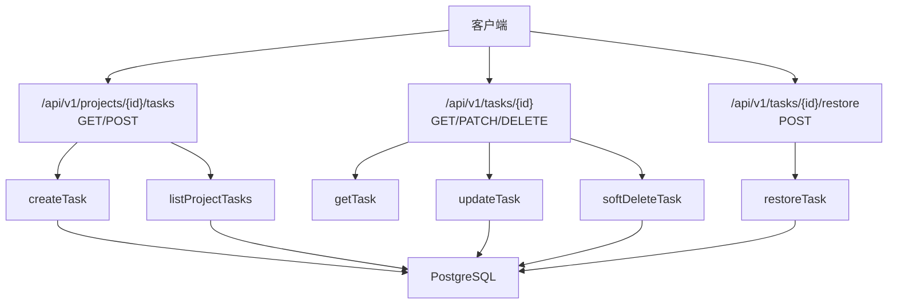
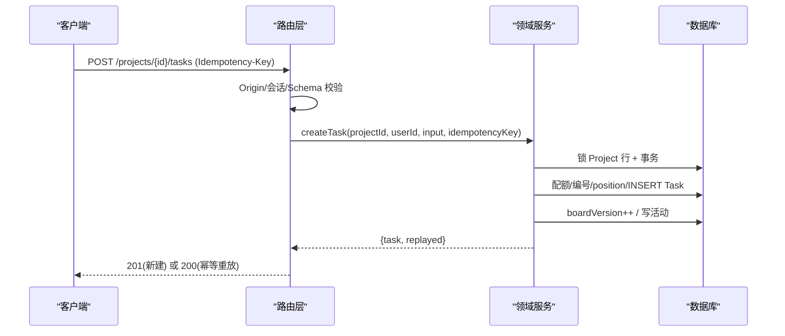
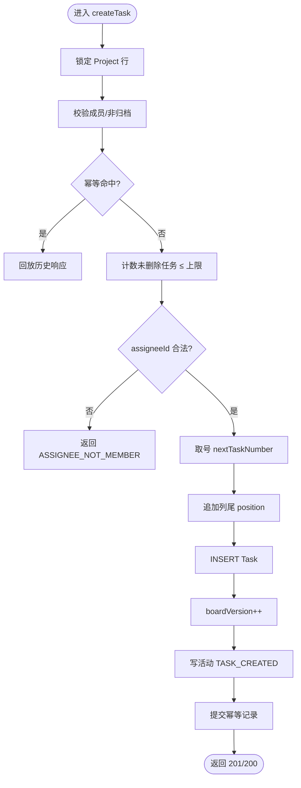
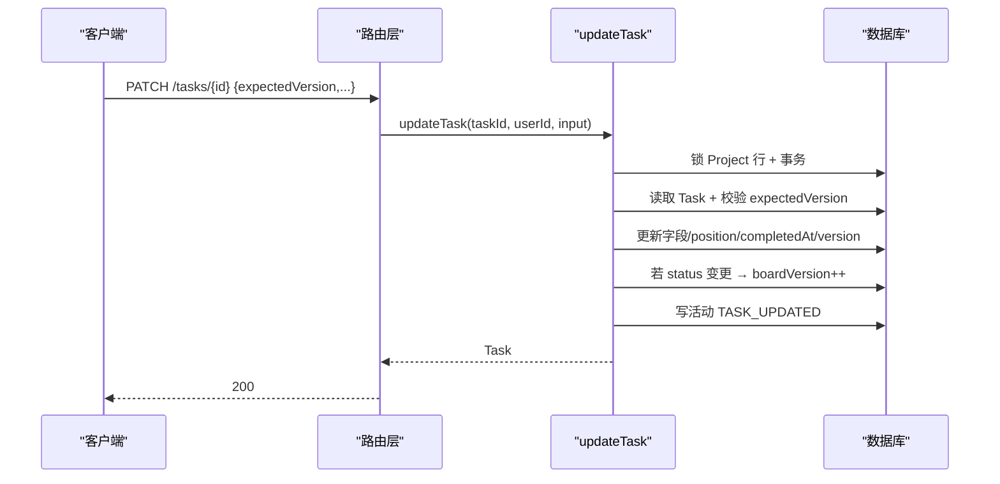
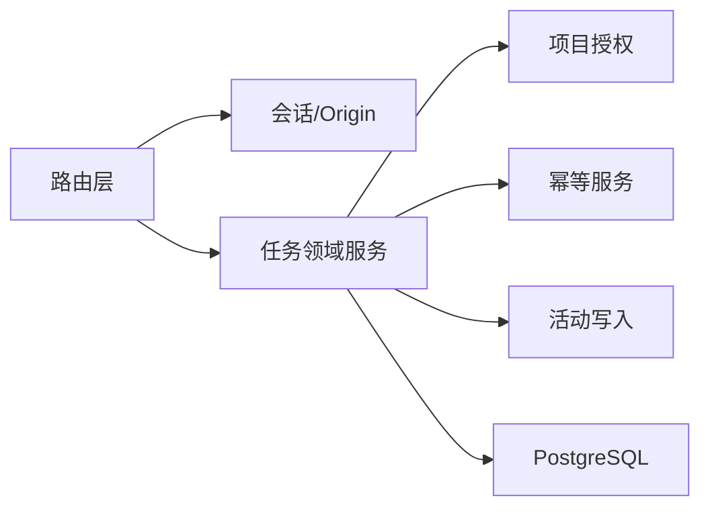

# 任务 API

<cite>
**本文引用的文件**
- [openapi.json](file://contracts/openapi.json)
- [schema.prisma](file://prisma/schema.prisma)
- [dto.ts](file://src/contracts/dto.ts)
- [enums.ts](file://src/contracts/enums.ts)
- [task/index.ts](file://src/server/modules/task/index.ts)
- [task/create.ts](file://src/server/modules/task/create.ts)
- [task/read.ts](file://src/server/modules/task/read.ts)
- [task/update.ts](file://src/server/modules/task/update.ts)
- [task/soft-delete.ts](file://src/server/modules/task/soft-delete.ts)
- [task/restore.ts](file://src/server/modules/task/restore.ts)
- [task/access.ts](file://src/server/modules/task/access.ts)
- [projects/[projectId]/tasks/route.ts](file://src/app/api/v1/projects/[projectId]/tasks/route.ts)
- [tasks/[taskId]/route.ts](file://src/app/api/v1/tasks/[taskId]/route.ts)
- [tasks/[taskId]/restore/route.ts](file://src/app/api/v1/tasks/[taskId]/restore/route.ts)
- [board-view.tsx](file://src/features/board/board-view.tsx)
</cite>

## 目录
1. [简介](#简介)
2. [项目结构](#项目结构)
3. [核心组件](#核心组件)
4. [架构总览](#架构总览)
5. [详细组件分析](#详细组件分析)
6. [依赖关系分析](#依赖关系分析)
7. [性能考虑](#性能考虑)
8. [故障排查指南](#故障排查指南)
9. [结论](#结论)
10. [附录：端点与数据模型速查](#附录端点与数据模型速查)

## 简介
本文件为 Orbit 项目的“任务管理 API”提供完整、可操作的文档。内容覆盖任务的创建、读取、更新、软删除与恢复，状态与优先级、截止日期等字段管理；看板视图的数据同步机制、拖拽实现原理与实时更新策略；协作场景（分配、进度跟踪、批量操作）的端到端示例；以及错误处理、数据一致性与性能优化建议。所有端点均遵循 OpenAPI 契约与 Zod DTO 校验，并通过领域服务保证事务、幂等、权限与活动审计。

## 项目结构
- API 路由层位于 Next.js App Router 下，按资源划分：
  - /api/v1/projects/[projectId]/tasks：列出与创建任务
  - /api/v1/tasks/[taskId]：读取、更新、软删除任务
  - /api/v1/tasks/[taskId]/restore：恢复已软删除的任务
- 领域服务集中在 src/server/modules/task/*，封装业务规则、事务、幂等、授权与活动写入。
- 数据模型与枚举在 Prisma schema 与 contracts/enums.ts、contracts/dto.ts 中统一定义，前后端共享。
- 看板前端在 features/board 中提供布局与交互样例（M0 使用 fixture 数据，真实数据接入后对接上述 API）。

图表来源
- [projects/[projectId]/tasks/route.ts:44-103](file://src/app/api/v1/projects/[projectId]/tasks/route.ts#L44-L103)
- [tasks/[taskId]/route.ts:44-111](file://src/app/api/v1/tasks/[taskId]/route.ts#L44-L111)
- [tasks/[taskId]/restore/route.ts:42-69](file://src/app/api/v1/tasks/[taskId]/restore/route.ts#L42-L69)
- [task/create.ts:77-201](file://src/server/modules/task/create.ts#L77-L201)
- [task/read.ts:149-249](file://src/server/modules/task/read.ts#L149-L249)
- [task/update.ts:64-190](file://src/server/modules/task/update.ts#L64-L190)
- [task/soft-delete.ts:47-99](file://src/server/modules/task/soft-delete.ts#L47-L99)
- [task/restore.ts:85-197](file://src/server/modules/task/restore.ts#L85-L197)

章节来源
- [projects/[projectId]/tasks/route.ts:21-33](file://src/app/api/v1/projects/[projectId]/tasks/route.ts#L21-L33)
- [tasks/[taskId]/route.ts:10-25](file://src/app/api/v1/tasks/[taskId]/route.ts#L10-L25)
- [tasks/[taskId]/restore/route.ts:14-27](file://src/app/api/v1/tasks/[taskId]/restore/route.ts#L14-L27)

## 核心组件
- 路由层：负责请求 ID、Origin 校验、会话鉴权、参数与请求体验证、统一信封响应。
- 领域服务：封装任务 CRUD 的业务规则、事务、行锁、幂等、配额、活动记录与看板版本更新。
- 数据模型：Prisma 定义 Task/Project/User 等实体及枚举；DTO/Enum 用于契约校验与类型安全。
- 看板视图：前端展示三列（TODO/IN_PROGRESS/DONE），支持筛选与详情面板；M0 使用 fixture，后续对接 API。

章节来源
- [dto.ts:188-296](file://src/contracts/dto.ts#L188-L296)
- [enums.ts:34-54](file://src/contracts/enums.ts#L34-L54)
- [schema.prisma:216-267](file://prisma/schema.prisma#L216-L267)
- [board-view.tsx:41-48](file://src/features/board/board-view.tsx#L41-L48)

## 架构总览
任务 API 采用“路由编排 + 领域服务 + 数据库”的分层架构。写操作通过项目行锁与事务保证一致性；列表读操作使用 keyset 游标分页；幂等键保障重复提交安全；活动日志记录关键变更；看板版本 boardVersion 驱动前端增量刷新。

图表来源
- [projects/[projectId]/tasks/route.ts:71-103](file://src/app/api/v1/projects/[projectId]/tasks/route.ts#L71-L103)
- [task/create.ts:77-201](file://src/server/modules/task/create.ts#L77-L201)

## 详细组件分析

### 端点：列出项目任务
- HTTP 方法与 URL
  - GET /api/v1/projects/{projectId}/tasks
- 认证与权限
  - 需要登录会话；仅项目成员可见；非成员/不存在 → 404
- 查询参数
  - cursor: 字符串游标（keyset）
  - limit: 1–100，默认 30
  - q: 标题模糊搜索（转义通配符）
  - status: TODO | IN_PROGRESS | DONE
  - priority: NONE | LOW | MEDIUM | HIGH
  - assigneeId: 指定负责人
  - unassigned: true/false（与 assigneeId 互斥）
  - overdue: true/false（基于用户时区计算“今天”，仅未完成的逾期）
  - deleted: exclude | only
  - sort: updated_desc | due_asc | priority_desc
- 响应格式
  - data: TaskSummary[]
  - meta: { requestId, nextCursor, hasMore }
- 行为要点
  - 过滤指纹与游标绑定，排序/过滤变化需重新获取
  - due_asc 将 null 截止日排尾
  - priority_desc 按声明序降序（HIGH→NONE）

章节来源
- [projects/[projectId]/tasks/route.ts:44-63](file://src/app/api/v1/projects/[projectId]/tasks/route.ts#L44-L63)
- [task/read.ts:149-228](file://src/server/modules/task/read.ts#L149-L228)
- [dto.ts:439-476](file://src/contracts/dto.ts#L439-L476)
- [enums.ts:34-54](file://src/contracts/enums.ts#L34-L54)

### 端点：创建任务
- HTTP 方法与 URL
  - POST /api/v1/projects/{projectId}/tasks
- 必需头
  - Idempotency-Key: UUID（幂等键）
- 请求体（CreateTask）
  - title: 必填，1–120 字符
  - description: 可选，最多 10000 字符
  - status: 可选，默认 TODO
  - priority: 可选，默认 MEDIUM
  - assigneeId: 可选，null 表示无负责人；若提供则必须为项目 owner/成员
  - dueDate: 可选，日期字符串（服务端映射到 date）
- 响应
  - 201 新建成功：{data: Task, meta}
  - 200 幂等重放：同原结果
- 业务约束
  - 项目未删除任务数上限（MAX_OPEN_TASKS）
  - 新任务 position 追加至目标列尾
  - 看板 boardVersion++
  - 写活动 TASK_CREATED

图表来源
- [task/create.ts:77-201](file://src/server/modules/task/create.ts#L77-L201)
- [projects/[projectId]/tasks/route.ts:71-103](file://src/app/api/v1/projects/[projectId]/tasks/route.ts#L71-L103)

章节来源
- [task/create.ts:32-56](file://src/server/modules/task/create.ts#L32-L56)
- [task/create.ts:113-188](file://src/server/modules/task/create.ts#L113-L188)
- [dto.ts:223-232](file://src/contracts/dto.ts#L223-L232)

### 端点：读取任务详情
- HTTP 方法与 URL
  - GET /api/v1/tasks/{taskId}
- 权限
  - 仅项目成员可见；不存在/非法 UUID/已软删除 → 404
- 响应
  - data: Task（含 description）
- 行为要点
  - 先定位最小 projectId，再验成员关系与软删除

章节来源
- [tasks/[taskId]/route.ts:44-54](file://src/app/api/v1/tasks/[taskId]/route.ts#L44-L54)
- [task/read.ts:230-249](file://src/server/modules/task/read.ts#L230-L249)

### 端点：更新任务
- HTTP 方法与 URL
  - PATCH /api/v1/tasks/{taskId}
- 请求体（UpdateTask）
  - expectedVersion: 必填（乐观并发）
  - 至少一个可修改字段：title/description/status/priority/assigneeId/dueDate
- 响应
  - 200 成功：{data: Task, meta}
  - 409 版本冲突：包含 currentVersion
- 业务约束
  - 白名单字段更新；规范化后无语义变化不 bump version
  - 改 status 会设置 completedAt（DONE 时 now，否则 null）并追加列尾 position
  - 看板 boardVersion++
  - 写活动 TASK_UPDATED（含 fields/fromStatus/toStatus）

图表来源
- [task/update.ts:64-190](file://src/server/modules/task/update.ts#L64-L190)
- [tasks/[taskId]/route.ts:56-86](file://src/app/api/v1/tasks/[taskId]/route.ts#L56-L86)

章节来源
- [task/update.ts:20-34](file://src/server/modules/task/update.ts#L20-L34)
- [task/update.ts:89-188](file://src/server/modules/task/update.ts#L89-L188)
- [dto.ts:234-248](file://src/contracts/dto.ts#L234-L248)

### 端点：软删除任务
- HTTP 方法与 URL
  - DELETE /api/v1/tasks/{taskId}?expectedVersion={n}
- 权限
  - 仅项目 owner 或任务创建者可删；其余成员 → 403
- 响应
  - 200：{data: DeletedTask, meta}
- 行为要点
  - 置 deletedAt=now，version++，boardVersion++
  - 已删除任务再次删除 → 404

章节来源
- [tasks/[taskId]/route.ts:88-111](file://src/app/api/v1/tasks/[taskId]/route.ts#L88-L111)
- [task/soft-delete.ts:16-28](file://src/server/modules/task/soft-delete.ts#L16-L28)
- [task/soft-delete.ts:47-99](file://src/server/modules/task/soft-delete.ts#L47-L99)

### 端点：恢复任务
- HTTP 方法与 URL
  - POST /api/v1/tasks/{taskId}/restore
- 必需头
  - Idempotency-Key: UUID
- 请求体（VersionInput）
  - expectedVersion: 必填
- 权限
  - 仅项目 owner 或任务创建者可恢复；其余成员 → 403
- 响应
  - 200：{data: Task, meta}（幂等重放亦为 200）
- 行为要点
  - 仅已软删除任务可恢复；首次操作要求当前处于回收站
  - 配额检查（恢复占用名额）
  - 原负责人若已退出项目则取消分配
  - 放回原 status 列尾，boardVersion++，写活动 TASK_RESTORED

章节来源
- [tasks/[taskId]/restore/route.ts:14-27](file://src/app/api/v1/tasks/[taskId]/restore/route.ts#L14-L27)
- [tasks/[taskId]/restore/route.ts:42-69](file://src/app/api/v1/tasks/[taskId]/restore/route.ts#L42-L69)
- [task/restore.ts:31-48](file://src/server/modules/task/restore.ts#L31-L48)
- [task/restore.ts:85-197](file://src/server/modules/task/restore.ts#L85-L197)

### 看板视图与数据同步
- 视图结构
  - 三列固定（TODO/IN_PROGRESS/DONE），桌面网格布局；移动端按状态 Tabs 切换
  - 筛选行：关键词、负责人、优先级、仅逾期
  - 详情侧面板：由 ?task=id 控制
- 数据源
  - M0 使用 fixture 数据；真实数据接入后通过 listProjectTasks 拉取并按 status 分组
- 同步机制
  - 列表使用 keyset 游标分页，避免偏移量翻页抖动
  - 写操作（创建/移动/删除/恢复）会递增 boardVersion；前端可通过轮询或事件订阅比较 boardVersion 触发增量刷新
- 拖拽实现原理（规划）
  - 拖拽本质是“移动到目标列 + 指定 beforeTaskId”的位置调整；后端通过 appendToColumnEnd 或位置算法维护 position
  - 每次移动导致 boardVersion++，前端据此刷新对应列
  - 当前 M0 未实现真实拖拽，保留视觉分隔与状态切换入口

章节来源
- [board-view.tsx:41-48](file://src/features/board/board-view.tsx#L41-L48)
- [board-view.tsx:121-218](file://src/features/board/board-view.tsx#L121-L218)
- [task/create.ts:154-166](file://src/server/modules/task/create.ts#L154-L166)
- [task/update.ts:154-165](file://src/server/modules/task/update.ts#L154-L165)
- [task/soft-delete.ts:74-91](file://src/server/modules/task/soft-delete.ts#L74-L91)
- [task/restore.ts:141-165](file://src/server/modules/task/restore.ts#L141-L165)

### 任务数据模型与状态流转
- 数据模型
  - Task：id/projectId/number/creatorId/assigneeId/title/description/status/priority/dueDate/position/completedAt/version/deletedAt/createdAt/updatedAt
  - 关联：Project、User（creator/assignee）
  - 索引：按 projectId+deletedAt+status+position+id 等优化查询
- 状态与优先级
  - 状态：TODO | IN_PROGRESS | DONE
  - 优先级：NONE | LOW | MEDIUM | HIGH（排序权重 HIGH→NONE）
- 状态流转规则
  - 创建默认 TODO；设置 DONE 时 completedAt=now，离开 DONE 时置空
  - 状态变更会追加到目标列尾并改变看板顺序集合
- 业务约束
  - 项目未删除任务数上限（MAX_OPEN_TASKS）
  - assigneeId 必须为项目 owner/成员
  - 软删除任务不可见，恢复仅对已删除态有效

章节来源
- [schema.prisma:216-267](file://prisma/schema.prisma#L216-L267)
- [enums.ts:34-54](file://src/contracts/enums.ts#L34-L54)
- [task/create.ts:123-133](file://src/server/modules/task/create.ts#L123-L133)
- [task/update.ts:137-165](file://src/server/modules/task/update.ts#L137-L165)
- [task/soft-delete.ts:74-91](file://src/server/modules/task/soft-delete.ts#L74-L91)
- [task/restore.ts:135-156](file://src/server/modules/task/restore.ts#L135-L156)

### 协作场景示例
- 任务分配
  - 创建或更新任务时设置 assigneeId；服务端校验是否为项目成员
  - 若成员退出项目，恢复任务时将自动取消分配
- 进度跟踪
  - 通过更新 status 推进任务（TODO→IN_PROGRESS→DONE）
  - 看板 boardVersion 递增，前端据此刷新
- 批量操作
  - 列表支持按状态/优先级/负责人/逾期筛选，便于批量选择
  - 结合幂等键与重试逻辑，确保批量更新的一致性
- 活动审计
  - 所有写操作记录活动日志（TASK_CREATED/UPDATED/MOVED/DELETED/RESTORED），便于追踪协作过程

章节来源
- [task/create.ts:126-133](file://src/server/modules/task/create.ts#L126-L133)
- [task/update.ts:137-182](file://src/server/modules/task/update.ts#L137-L182)
- [task/restore.ts:135-165](file://src/server/modules/task/restore.ts#L135-L165)
- [task/read.ts:185-197](file://src/server/modules/task/read.ts#L185-L197)

## 依赖关系分析
- 路由层依赖：会话鉴权、Origin 校验、JSON 解析、统一信封、请求 ID
- 领域服务依赖：项目授权、幂等服务、活动写入、分页游标、位置计算、日期工具、DTO 映射
- 数据层依赖：Prisma 客户端、PostgreSQL（事务、行锁、索引）

图表来源
- [projects/[projectId]/tasks/route.ts:44-103](file://src/app/api/v1/projects/[projectId]/tasks/route.ts#L44-L103)
- [tasks/[taskId]/route.ts:44-111](file://src/app/api/v1/tasks/[taskId]/route.ts#L44-L111)
- [tasks/[taskId]/restore/route.ts:42-69](file://src/app/api/v1/tasks/[taskId]/restore/route.ts#L42-L69)
- [task/create.ts:77-201](file://src/server/modules/task/create.ts#L77-L201)
- [task/read.ts:149-249](file://src/server/modules/task/read.ts#L149-L249)
- [task/update.ts:64-190](file://src/server/modules/task/update.ts#L64-L190)
- [task/soft-delete.ts:47-99](file://src/server/modules/task/soft-delete.ts#L47-L99)
- [task/restore.ts:85-197](file://src/server/modules/task/restore.ts#L85-L197)

章节来源
- [task/index.ts:1-31](file://src/server/modules/task/index.ts#L1-L31)
- [task/access.ts:11-20](file://src/server/modules/task/access.ts#L11-L20)

## 性能考虑
- 列表分页
  - 使用 keyset 游标（updated_desc/due_asc/priority_desc），避免 OFFSET 翻页开销
  - 过滤指纹确保排序/过滤变化时游标失效，防止不一致
- 索引利用
  - 任务表针对 projectId+deletedAt+status+position+id 建立复合索引，优化看板与列表查询
  - 逾期查询基于用户时区计算 today，减少跨时区误差
- 事务与行锁
  - 写操作锁定 Project 行，串行化编号、配额、position 与 boardVersion，避免竞争
- 幂等与重试
  - 幂等键记录请求哈希与响应，网络重试不会重复创建/恢复
- 活动与看板版本
  - 活动写入与 boardVersion++ 分离于主事务外（或轻量执行），降低写放大

章节来源
- [task/read.ts:40-70](file://src/server/modules/task/read.ts#L40-L70)
- [task/read.ts:161-228](file://src/server/modules/task/read.ts#L161-L228)
- [schema.prisma:262-267](file://prisma/schema.prisma#L262-L267)
- [task/create.ts:93-166](file://src/server/modules/task/create.ts#L93-L166)
- [task/update.ts:78-165](file://src/server/modules/task/update.ts#L78-L165)
- [task/restore.ts:103-165](file://src/server/modules/task/restore.ts#L103-L165)

## 故障排查指南
- 常见错误码与含义
  - NOT_FOUND：任务不存在、非法 UUID、非成员或已软删除
  - FORBIDDEN：非 owner/创建者尝试删除/恢复
  - PROJECT_ARCHIVED：归档项目禁止写操作
  - LIMIT_EXCEEDED：未删除任务数达到上限
  - ASSIGNEE_NOT_MEMBER：负责人不是项目成员
  - VERSION_CONFLICT：乐观并发失败，需携带最新 expectedVersion
  - VALIDATION_ERROR：请求体或查询参数校验失败
  - PAYLOAD_TOO_LARGE：请求体过大
- 排查步骤
  - 确认会话与 Origin 校验是否通过
  - 检查 Idempotency-Key 与请求体是否符合 DTO 约束
  - 核对 expectedVersion 与当前版本是否一致
  - 查看活动日志定位变更来源
  - 检查项目是否归档、成员关系是否有效
  - 对于列表异常，检查 cursor 与过滤指纹是否匹配

章节来源
- [task/access.ts:22-46](file://src/server/modules/task/access.ts#L22-L46)
- [task/update.ts:41-49](file://src/server/modules/task/update.ts#L41-L49)
- [task/soft-delete.ts:30-38](file://src/server/modules/task/soft-delete.ts#L30-L38)
- [task/restore.ts:61-69](file://src/server/modules/task/restore.ts#L61-L69)
- [projects/[projectId]/tasks/route.ts:71-103](file://src/app/api/v1/projects/[projectId]/tasks/route.ts#L71-L103)
- [tasks/[taskId]/route.ts:61-111](file://src/app/api/v1/tasks/[taskId]/route.ts#L61-L111)
- [tasks/[taskId]/restore/route.ts:42-69](file://src/app/api/v1/tasks/[taskId]/restore/route.ts#L42-L69)

## 结论
Orbit 任务 API 以清晰的契约、严格的 DTO 校验与领域服务为核心，提供了健壮的 CRUD、状态管理、优先级与截止日期能力；通过项目行锁、事务、幂等与活动审计保障数据一致性与可追溯性；看板视图借助 boardVersion 与 keyset 分页实现高效同步。未来可在前端实现拖拽与实时推送，进一步提升协作体验。

## 附录：端点与数据模型速查
- 端点清单
  - GET /api/v1/projects/{projectId}/tasks：列出任务（游标分页、过滤、排序）
  - POST /api/v1/projects/{projectId}/tasks：创建任务（需 Idempotency-Key）
  - GET /api/v1/tasks/{taskId}：读取任务详情
  - PATCH /api/v1/tasks/{taskId}：更新任务（expectedVersion）
  - DELETE /api/v1/tasks/{taskId}?expectedVersion={n}：软删除任务
  - POST /api/v1/tasks/{taskId}/restore：恢复任务（需 Idempotency-Key）
- 数据模型要点
  - Task 字段：id/projectId/number/creatorId/assigneeId/title/description/status/priority/dueDate/position/completedAt/version/deletedAt/createdAt/updatedAt
  - 枚举：TaskStatus(TODO/IN_PROGRESS/DONE)、TaskPriority(NONE/LOW/MEDIUM/HIGH)
  - 索引：按 projectId+deletedAt+status+position+id 等优化
- 看板同步
  - 写操作递增 boardVersion；前端比较版本触发增量刷新
  - 列表使用 keyset 游标，避免翻页抖动

章节来源
- [openapi.json:1-800](file://contracts/openapi.json#L1-L800)
- [dto.ts:188-296](file://src/contracts/dto.ts#L188-L296)
- [enums.ts:34-54](file://src/contracts/enums.ts#L34-L54)
- [schema.prisma:216-267](file://prisma/schema.prisma#L216-L267)