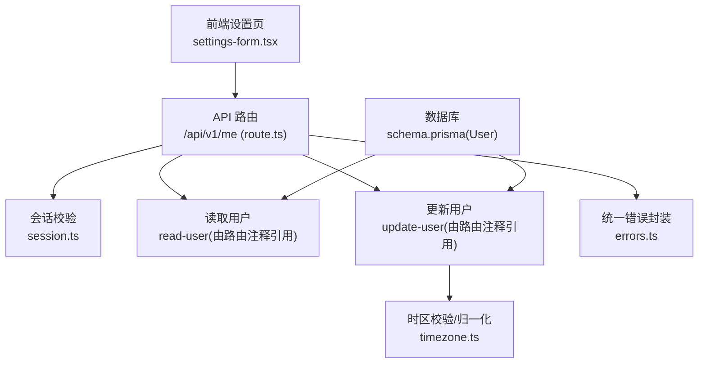
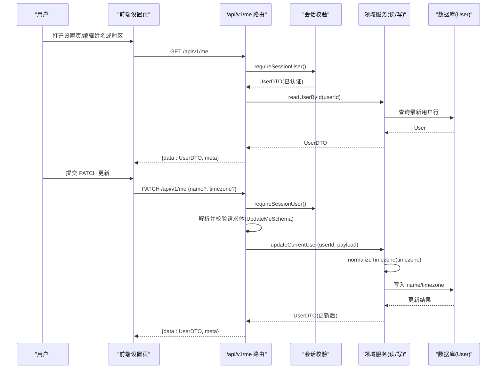
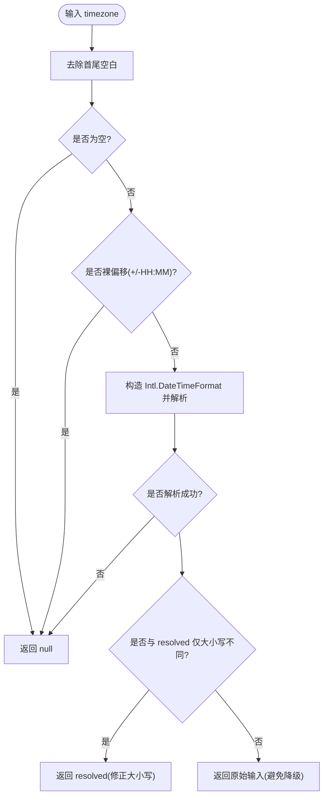
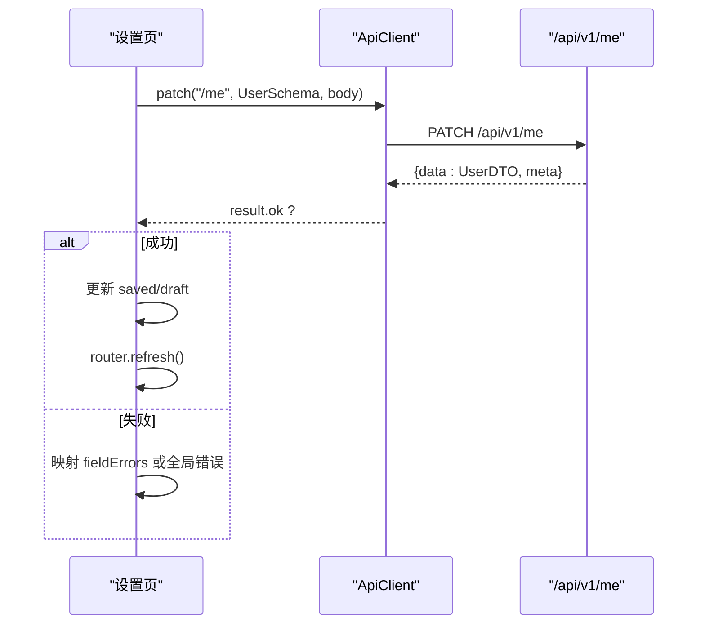
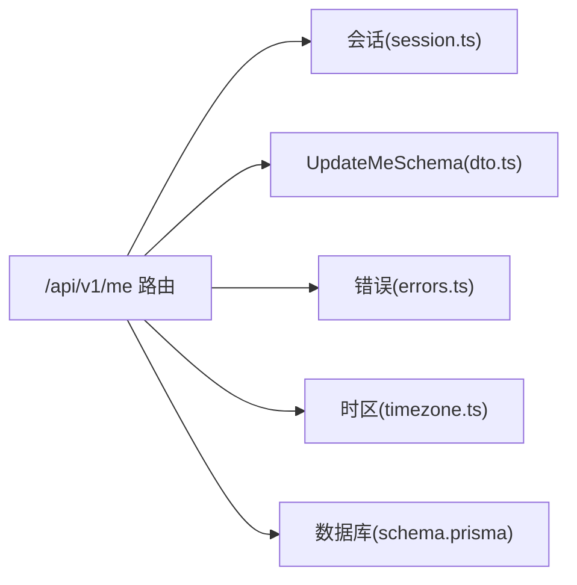

# 用户 API

<cite>
**本文引用的文件**
- [src/app/api/v1/me/route.ts](file://src/app/api/v1/me/route.ts)
- [contracts/openapi.json](file://contracts/openapi.json)
- [src/contracts/dto.ts](file://src/contracts/dto.ts)
- [prisma/schema.prisma](file://prisma/schema.prisma)
- [src/server/auth/session.ts](file://src/server/auth/session.ts)
- [src/server/http/errors.ts](file://src/server/http/errors.ts)
- [src/features/settings/settings-form.tsx](file://src/features/settings/settings-form.tsx)
- [src/features/shell/user-menu.tsx](file://src/features/shell/user-menu.tsx)
- [src/server/me/timezone.ts](file://src/server/me/timezone.ts)
</cite>

## 目录
1. [简介](#简介)
2. [项目结构](#项目结构)
3. [核心组件](#核心组件)
4. [架构总览](#架构总览)
5. [详细组件分析](#详细组件分析)
6. [依赖关系分析](#依赖关系分析)
7. [性能考虑](#性能考虑)
8. [故障排查指南](#故障排查指南)
9. [结论](#结论)
10. [附录：请求与响应示例](#附录请求与响应示例)

## 简介
本文件为 Orbit 项目的“用户信息 API”提供完整文档，覆盖获取与更新当前用户信息的端点、数据模型、验证规则、权限控制、前端集成与实时更新策略，以及错误处理与示例。该能力聚焦于账户私有数据的读取与更新（姓名与时区），并保证跨会话安全与缓存隔离。

## 项目结构
围绕“用户信息 API”的关键路径与职责如下：
- 路由层：/api/v1/me 的 GET/PATCH 处理器，负责 HTTP 编排、认证、校验、调用领域服务与统一信封封装。
- 领域服务：读取/更新当前用户（读库直取最新数据；写库前进行 IANA 时区校验与字段归一化）。
- 契约与 DTO：定义 User、UpdateMe 等数据结构与约束，前后端共享。
- 数据库模型：User 表包含业务扩展字段 timezone，默认 Asia/Shanghai。
- 前端集成：设置页表单提交 PATCH /me，成功后刷新服务端渲染视图；用户菜单展示当前用户信息。

图表来源
- [src/app/api/v1/me/route.ts:10-27](file://src/app/api/v1/me/route.ts#L10-L27)
- [src/server/auth/session.ts:20-42](file://src/server/auth/session.ts#L20-L42)
- [src/server/me/timezone.ts:41-68](file://src/server/me/timezone.ts#L41-L68)
- [src/server/http/errors.ts:10-20](file://src/server/http/errors.ts#L10-L20)
- [prisma/schema.prisma:27-47](file://prisma/schema.prisma#L27-L47)

章节来源
- [src/app/api/v1/me/route.ts:10-27](file://src/app/api/v1/me/route.ts#L10-L27)
- [src/server/auth/session.ts:20-42](file://src/server/auth/session.ts#L20-L42)
- [src/server/me/timezone.ts:41-68](file://src/server/me/timezone.ts#L41-L68)
- [src/server/http/errors.ts:10-20](file://src/server/http/errors.ts#L10-L20)
- [prisma/schema.prisma:27-47](file://prisma/schema.prisma#L27-L47)

## 核心组件
- API 路由 /api/v1/me
  - GET：返回当前登录用户的档案（UserDTO）。
  - PATCH：更新姓名与时区（至少一项），返回更新后的 UserDTO。
- 会话与授权
  - requireSessionUser：未认证抛 UNAUTHENTICATED（401）。
- 数据模型与契约
  - UserDTO：id、name、email、emailVerified、timezone。
  - UpdateMe：name、timezone（均为可选，但整体至少提供一个）。
- 时区校验
  - normalizeTimezone/isValidTimezone：基于 ICU 的 IANA 时区校验与大小写修正，拒绝裸偏移格式。
- 错误与缓存
  - 所有成功/错误响应均带 Cache-Control: private, no-store，避免共享缓存泄露隐私。
  - 统一错误信封：code、message、fieldErrors、requestId。

章节来源
- [src/app/api/v1/me/route.ts:32-90](file://src/app/api/v1/me/route.ts#L32-L90)
- [src/contracts/dto.ts:58-84](file://src/contracts/dto.ts#L58-L84)
- [src/server/me/timezone.ts:41-68](file://src/server/me/timezone.ts#L41-L68)
- [src/server/http/errors.ts:10-20](file://src/server/http/errors.ts#L10-L20)

## 架构总览
下图展示了从前端到后端的完整调用链，包括认证、校验、领域服务与数据库交互。

图表来源
- [src/app/api/v1/me/route.ts:38-90](file://src/app/api/v1/me/route.ts#L38-L90)
- [src/server/auth/session.ts:20-42](file://src/server/auth/session.ts#L20-L42)
- [src/server/me/timezone.ts:41-68](file://src/server/me/timezone.ts#L41-L68)
- [prisma/schema.prisma:27-47](file://prisma/schema.prisma#L27-L47)

## 详细组件分析

### 端点：GET /api/v1/me
- 方法：GET
- URL：/api/v1/me
- 鉴权：需要有效会话（Cookie）
- 请求参数：无
- 响应体：{ data: UserDTO, meta: Meta }
- 行为：
  - 未认证 → 401 UNAUTHENTICATED
  - 已认证 → 直接查库获取最新用户记录，确保 PATCH 后立即可读
  - 响应头：Cache-Control: private, no-store（隐私保护）

章节来源
- [src/app/api/v1/me/route.ts:32-47](file://src/app/api/v1/me/route.ts#L32-L47)
- [contracts/openapi.json:48-123](file://contracts/openapi.json#L48-L123)
- [src/server/http/errors.ts:10-20](file://src/server/http/errors.ts#L10-L20)

### 端点：PATCH /api/v1/me
- 方法：PATCH
- URL：/api/v1/me
- 鉴权：需要有效会话（Cookie）
- 请求体：UpdateMe（name?、timezone?，至少提供一项）
- 响应体：{ data: UserDTO, meta: Meta }
- 行为：
  - Origin 校验（仅同源浏览器请求）
  - 会话校验
  - 请求体验证（JSON 形状 + UpdateMeSchema）
  - 领域服务：时区 IANA 校验与归一化、姓名归一化、白名单写入
  - 非法时区 → 400 VALIDATION_ERROR，fieldErrors.timezone
  - 响应头：Cache-Control: private, no-store

章节来源
- [src/app/api/v1/me/route.ts:49-90](file://src/app/api/v1/me/route.ts#L49-L90)
- [contracts/openapi.json:124-207](file://contracts/openapi.json#L124-L207)
- [src/server/me/timezone.ts:41-68](file://src/server/me/timezone.ts#L41-L68)

### 数据模型与字段说明
- UserDTO（GET /me 与 PATCH /me 的 data）
  - id：字符串标识
  - name：1–40 字符
  - email：邮箱格式
  - emailVerified：布尔值
  - timezone：IANA 时区标识（1–100 字符）
- UpdateMe（PATCH /me 的请求体）
  - name：可选，1–40 字符
  - timezone：可选，1–100 字符
  - 约束：至少提供一个可修改字段

章节来源
- [src/contracts/dto.ts:58-84](file://src/contracts/dto.ts#L58-L84)
- [contracts/openapi.json:62-84](file://contracts/openapi.json#L62-L84)
- [contracts/openapi.json:197-207](file://contracts/openapi.json#L197-L207)

### 数据库模型与默认值
- 用户表（User）
  - 包含业务扩展字段 timezone，默认值为 Asia/Shanghai
  - 其他字段遵循 Better Auth 模型约定（id、name、email、emailVerified 等）

章节来源
- [prisma/schema.prisma:27-47](file://prisma/schema.prisma#L27-L47)

### 时区校验与归一化
- 使用 ICU（Intl.DateTimeFormat）判定 IANA 时区合法性
- 拒绝裸偏移格式（如 +08:00）
- 修正大小写（例如 asia/shanghai → Asia/Shanghai）
- 当输入已是合法标识但 ICU 返回历史别名时，保留原始输入以避免降级

图表来源
- [src/server/me/timezone.ts:41-68](file://src/server/me/timezone.ts#L41-L68)

章节来源
- [src/server/me/timezone.ts:41-68](file://src/server/me/timezone.ts#L41-L68)

### 权限与安全
- 会话校验：requireSessionUser 在未认证时抛出 UNAUTHENTICATED（401）
- Origin 校验：PATCH 仅接受同源浏览器请求
- 缓存策略：所有响应（含错误）带 Cache-Control: private, no-store，防止共享缓存泄露
- 最小暴露：UserDTO 不包含密码、token 等敏感字段

章节来源
- [src/server/auth/session.ts:20-42](file://src/server/auth/session.ts#L20-L42)
- [src/app/api/v1/me/route.ts:56-63](file://src/app/api/v1/me/route.ts#L56-L63)
- [src/server/http/errors.ts:10-20](file://src/server/http/errors.ts#L10-L20)

### 前端集成与实时更新
- 设置页（settings-form.tsx）
  - 通过 createApiClient().patch("/me", UserSchema, body) 提交变更
  - 只提交变更字段（符合 PATCH 语义与 minProperties:1）
  - 成功后更新本地基线、显示 toast，并调用 router.refresh() 让服务端组件重新加载最新数据
- 用户菜单（user-menu.tsx）
  - 展示当前用户姓名、邮箱与时区
  - 退出登录采用硬跳转以清除客户端内存态与会话 Cookie

图表来源
- [src/features/settings/settings-form.tsx:97-159](file://src/features/settings/settings-form.tsx#L97-L159)
- [src/app/api/v1/me/route.ts:56-90](file://src/app/api/v1/me/route.ts#L56-L90)

章节来源
- [src/features/settings/settings-form.tsx:97-159](file://src/features/settings/settings-form.tsx#L97-L159)
- [src/features/shell/user-menu.tsx:18-32](file://src/features/shell/user-menu.tsx#L18-L32)

## 依赖关系分析
- 路由层依赖
  - 会话：requireSessionUser
  - 请求体：readJsonBody + UpdateMeSchema
  - 领域服务：readUserById、updateCurrentUser（由路由注释引用）
  - 错误封装：toErrorResponse、errorResponse
  - Origin 校验：verifyRequestOrigin
- 契约与 DTO
  - UserDTO、UpdateMe 在 contracts/dto.ts 中定义，openapi.json 与之对齐
- 数据库
  - User 表包含 timezone 字段，默认 Asia/Shanghai

图表来源
- [src/app/api/v1/me/route.ts:1-9](file://src/app/api/v1/me/route.ts#L1-L9)
- [src/contracts/dto.ts:58-84](file://src/contracts/dto.ts#L58-L84)
- [src/server/http/errors.ts:10-20](file://src/server/http/errors.ts#L10-L20)
- [src/server/me/timezone.ts:41-68](file://src/server/me/timezone.ts#L41-L68)
- [prisma/schema.prisma:27-47](file://prisma/schema.prisma#L27-L47)

章节来源
- [src/app/api/v1/me/route.ts:1-9](file://src/app/api/v1/me/route.ts#L1-L9)
- [src/contracts/dto.ts:58-84](file://src/contracts/dto.ts#L58-L84)
- [src/server/http/errors.ts:10-20](file://src/server/http/errors.ts#L10-L20)
- [src/server/me/timezone.ts:41-68](file://src/server/me/timezone.ts#L41-L68)
- [prisma/schema.prisma:27-47](file://prisma/schema.prisma#L27-L47)

## 性能考虑
- 读取路径直接查库，避免会话快照带来的延迟，确保 PATCH 后立即可读
- 时区校验使用 ICU，避免维护静态清单；仅在必要时构造 Intl 对象
- 前端仅在 dirty 时提交，减少无效写库与限流消耗
- 统一信封与错误封装复用，降低重复逻辑

[本节为通用指导，不直接分析具体文件]

## 故障排查指南
- 401 UNAUTHENTICATED
  - 原因：未携带有效会话 Cookie
  - 处理：检查登录状态与 Cookie 传递（same-origin）
- 400 VALIDATION_ERROR
  - 原因：请求体非 JSON 或 UpdateMe 校验失败（如缺少可修改字段、时区非法）
  - 处理：查看 fieldErrors.timezone 或 message，修正后再试
- 413 PAYLOAD_TOO_LARGE
  - 原因：请求体过大
  - 处理：减小请求体或调整限制
- 500 INTERNAL_ERROR
  - 原因：服务器内部异常
  - 处理：查看 requestId 与服务端日志，避免重试频繁请求

章节来源
- [src/app/api/v1/me/route.ts:56-90](file://src/app/api/v1/me/route.ts#L56-L90)
- [src/server/http/errors.ts:91-135](file://src/server/http/errors.ts#L91-L135)

## 结论
Orbit 的用户信息 API 通过清晰的层次划分（路由/会话/领域/契约/数据库）实现了安全的账户私有数据读写。GET /me 提供权威用户档案，PATCH /me 支持姓名与时区的部分更新，并以 IANA 时区校验与统一错误信封保障健壮性。前端通过设置页与用户菜单完成交互与实时刷新，配合 private, no-store 缓存策略确保多账号环境下的数据安全。

## 附录：请求与响应示例
以下为典型请求与响应示例（基于契约与实现）：

- GET /api/v1/me
  - 请求：无
  - 响应 200：
    - data：UserDTO（id、name、email、emailVerified、timezone）
    - meta：Meta（包含 requestId）
  - 响应 401：
    - code：UNAUTHENTICATED
    - message：请先登录后再访问该资源
    - requestId：本次请求 ID

- PATCH /api/v1/me
  - 请求体：
    - name：可选，1–40 字符
    - timezone：可选，1–100 字符（IANA 时区）
    - 至少提供一个字段
  - 响应 200：
    - data：更新后的 UserDTO
    - meta：Meta（包含 requestId）
  - 响应 400：
    - code：VALIDATION_ERROR
    - message：请求体必须是合法的 JSON 对象 或 至少提供一个可修改字段
    - fieldErrors：可能包含 timezone 字段级错误
  - 响应 413：
    - code：PAYLOAD_TOO_LARGE
    - message：请求体超过大小限制

章节来源
- [contracts/openapi.json:48-207](file://contracts/openapi.json#L48-L207)
- [src/contracts/dto.ts:58-84](file://src/contracts/dto.ts#L58-L84)
- [src/app/api/v1/me/route.ts:56-90](file://src/app/api/v1/me/route.ts#L56-L90)
- [src/server/http/errors.ts:91-135](file://src/server/http/errors.ts#L91-L135)