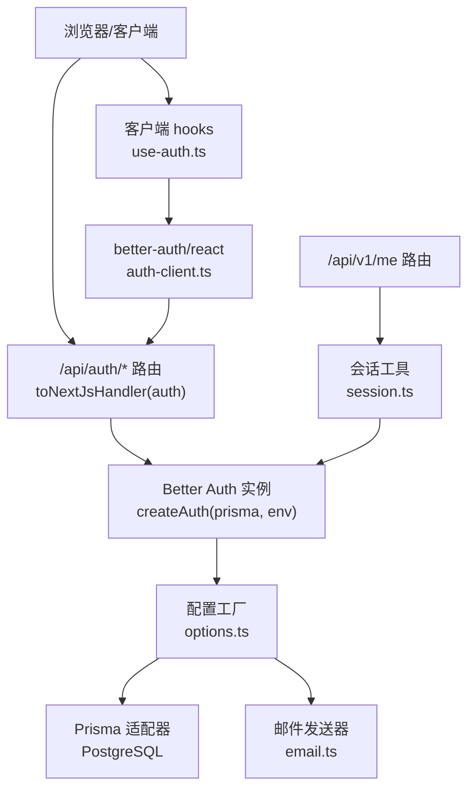
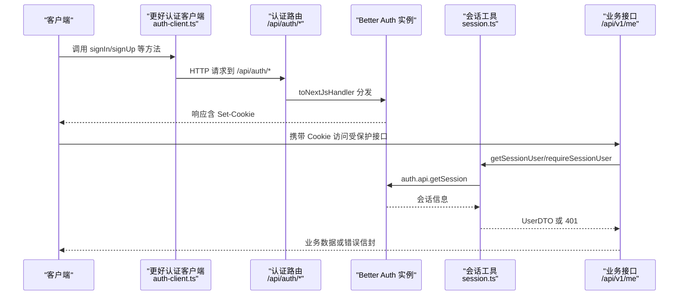
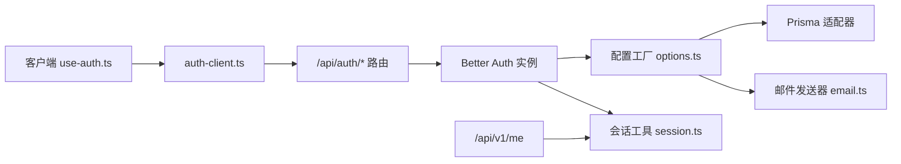
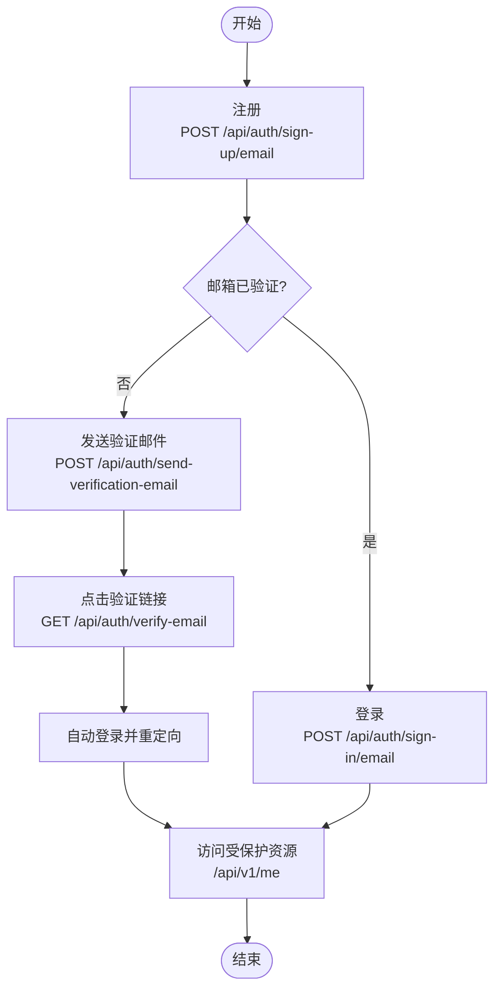

# 认证 API

<cite>
**本文引用的文件**
- [src/app/api/auth/[...all]/route.ts](file://src/app/api/auth/[...all]/route.ts)
- [src/server/auth/index.ts](file://src/server/auth/index.ts)
- [src/server/auth/options.ts](file://src/server/auth/options.ts)
- [src/server/auth/session.ts](file://src/server/auth/session.ts)
- [src/server/auth/email.ts](file://src/server/auth/email.ts)
- [src/server/auth/user-fields.ts](file://src/server/auth/user-fields.ts)
- [src/features/auth/auth-client.ts](file://src/features/auth/auth-client.ts)
- [src/features/auth/use-auth.ts](file://src/features/auth/use-auth.ts)
- [src/features/auth/login-form.tsx](file://src/features/auth/login-form.tsx)
- [src/features/auth/register-form.tsx](file://src/features/auth/register-form.tsx)
- [src/app/api/v1/me/route.ts](file://src/app/api/v1/me/route.ts)
- [contracts/openapi.json](file://contracts/openapi.json)
- [tests/integration/auth.test.ts](file://tests/integration/auth.test.ts)
- [src/server/env.ts](file://src/server/env.ts)
</cite>

## 目录
1. [简介](#简介)
2. [项目结构](#项目结构)
3. [核心组件](#核心组件)
4. [架构总览](#架构总览)
5. [详细端点与流程说明](#详细端点与流程说明)
6. [依赖关系分析](#依赖关系分析)
7. [性能与安全考量](#性能与安全考量)
8. [故障排查指南](#故障排查指南)
9. [结论](#结论)
10. [附录：客户端集成与调试](#附录客户端集成与调试)

## 简介
本文件为 Orbit 项目的认证 API 文档，基于 Better Auth 框架实现。内容覆盖用户注册、登录、登出、邮箱验证、密码重置等认证相关能力；说明会话管理机制、令牌刷新策略、安全最佳实践；提供错误处理、状态码说明、常见问题解决方案；并给出客户端集成示例与调试技巧。

## 项目结构
认证能力由“服务端路由 + 配置工厂 + 邮件发送 + 会话工具 + 客户端 SDK”组成：
- 服务端入口：Next.js catch-all 路由将 /api/auth/* 全部转发给 Better Auth。
- 配置工厂：集中管理数据库适配器、邮箱/密码策略、会话策略、限流、可信来源等。
- 邮件发送：封装 nodemailer，发送验证与重置邮件，链接构造遵循库约定与应用页面。
- 会话工具：在服务端读取会话并转换为业务 DTO，提供“要求已登录”的守卫。
- 客户端 SDK：React hooks 封装常用认证动作（登录、注册、登出、找回密码、重发验证）。
- 业务接口：/api/v1/me 使用会话工具进行资源访问控制。

图表来源
- [src/app/api/auth/[...all]/route.ts:1-22](file://src/app/api/auth/[...all]/route.ts#L1-L22)
- [src/server/auth/index.ts:1-29](file://src/server/auth/index.ts#L1-L29)
- [src/server/auth/options.ts:44-141](file://src/server/auth/options.ts#L44-L141)
- [src/server/auth/email.ts:189-218](file://src/server/auth/email.ts#L189-L218)
- [src/features/auth/auth-client.ts:1-32](file://src/features/auth/auth-client.ts#L1-L32)
- [src/features/auth/use-auth.ts:1-186](file://src/features/auth/use-auth.ts#L1-L186)
- [src/app/api/v1/me/route.ts:1-91](file://src/app/api/v1/me/route.ts#L1-L91)

章节来源
- [src/app/api/auth/[...all]/route.ts:1-22](file://src/app/api/auth/[...all]/route.ts#L1-L22)
- [src/server/auth/index.ts:1-29](file://src/server/auth/index.ts#L1-L29)
- [src/server/auth/options.ts:44-141](file://src/server/auth/options.ts#L44-L141)
- [src/server/auth/email.ts:189-218](file://src/server/auth/email.ts#L189-L218)
- [src/features/auth/auth-client.ts:1-32](file://src/features/auth/auth-client.ts#L1-L32)
- [src/features/auth/use-auth.ts:1-186](file://src/features/auth/use-auth.ts#L1-L186)
- [src/app/api/v1/me/route.ts:1-91](file://src/app/api/v1/me/route.ts#L1-L91)

## 核心组件
- 认证单例与类型导出：创建并暴露 Better Auth 实例与会话/用户类型，供服务端模块复用。
- 配置工厂：集中定义应用名、基础路径、密钥、可信来源、数据库、邮箱/密码策略、会话过期与刷新、限流规则、Cookie 安全策略等。
- 会话工具：从请求头解析会话，返回业务 DTO；提供“必须已登录”的守卫函数。
- 邮件发送器：按环境绑定 SMTP，发送验证与重置邮件，构造回调链接，脱敏日志。
- 客户端 SDK：通过 better-auth/react 暴露的客户端方法映射到 /api/auth/* 端点，并提供 React hooks 封装。
- 业务接口 /me：结合会话工具与契约校验，提供只读当前账户与更新姓名/时区的能力。

章节来源
- [src/server/auth/index.ts:1-29](file://src/server/auth/index.ts#L1-L29)
- [src/server/auth/options.ts:44-141](file://src/server/auth/options.ts#L44-L141)
- [src/server/auth/session.ts:1-43](file://src/server/auth/session.ts#L1-L43)
- [src/server/auth/email.ts:189-218](file://src/server/auth/email.ts#L189-L218)
- [src/features/auth/auth-client.ts:1-32](file://src/features/auth/auth-client.ts#L1-L32)
- [src/app/api/v1/me/route.ts:1-91](file://src/app/api/v1/me/route.ts#L1-L91)

## 架构总览
下图展示认证在请求生命周期中的位置：客户端通过 better-auth/react 调用，统一进入 /api/auth/*，由 Better Auth 根据方法名路由到具体端点；服务端会话校验通过 session.ts 完成；业务接口通过 requireSessionUser 保护。

图表来源
- [src/features/auth/auth-client.ts:1-32](file://src/features/auth/auth-client.ts#L1-L32)
- [src/app/api/auth/[...all]/route.ts:1-22](file://src/app/api/auth/[...all]/route.ts#L1-L22)
- [src/server/auth/session.ts:1-43](file://src/server/auth/session.ts#L1-L43)
- [src/app/api/v1/me/route.ts:1-91](file://src/app/api/v1/me/route.ts#L1-L91)

## 详细端点与流程说明
说明：以下端点由 Better Auth 在 /api/auth 下自动提供，HTTP 方法与路径由库约定，客户端通过 better-auth/react 的方法名映射调用。

- 邮箱注册
  - 方法：POST
  - 路径：/api/auth/sign-up/email
  - 请求体：包含 email、password、name（以及可选 timezone 扩展字段）
  - 行为：创建用户，默认未验证邮箱；不建立会话；触发验证邮件
  - 响应：成功/失败信封（由库与 HTTP 层统一）
  - 参考：客户端调用与表单逻辑见 use-auth 与 register-form

- 邮箱登录
  - 方法：POST
  - 路径：/api/auth/sign-in/email
  - 请求体：email、password
  - 行为：校验密码后检查邮箱是否验证；若未验证则拒绝并引导验证；通过后设置会话 Cookie
  - 响应：成功/失败信封；失败可能包含 EMAIL_NOT_VERIFIED 等 code
  - 参考：客户端错误描述与跳转逻辑见 use-auth 与 login-form

- 登出
  - 方法：POST
  - 路径：/api/auth/sign-out
  - 行为：清除会话 Cookie；客户端 useSession 自动失效
  - 参考：useSignOut

- 请求密码重置
  - 方法：POST
  - 路径：/api/auth/request-password-reset
  - 请求体：email（可选 redirectTo）
  - 行为：生成一次性重置令牌，发送邮件至邮箱
  - 响应：成功/失败信封（不泄露邮箱是否存在）
  - 参考：useRequestPasswordReset

- 重置密码
  - 方法：POST
  - 路径：/api/auth/reset-password
  - 请求体：token、newPassword
  - 行为：校验令牌并更新密码；成功后撤销该用户所有既有会话
  - 响应：成功/失败信封
  - 参考：useResetPassword

- 发送验证邮件
  - 方法：POST
  - 路径：/api/auth/send-verification-email
  - 请求体：email（可选 callbackURL）
  - 行为：重新发送验证邮件；点击链接后跳转到应用自有验证页
  - 响应：成功/失败信封
  - 参考：useResendVerification

- 验证邮箱
  - 方法：GET
  - 路径：/api/auth/verify-email?token=...&callbackURL=/auth/verify
  - 行为：校验 token，标记邮箱已验证；根据配置自动登录并重定向到 callbackURL
  - 响应：重定向到应用验证结果页
  - 参考：邮件发送器中链接构造与回调覆写

- 获取会话
  - 方法：GET
  - 路径：/api/auth/get-session
  - 行为：根据 Cookie 返回当前会话（user、session）
  - 用途：客户端 useSession 订阅；服务端 requireSessionUser 内部也调用
  - 参考：session.ts 与 use-auth

- 其他端点
  - 更多标准端点（如第三方 OAuth 等）由 Better Auth 自动挂载于 /api/auth/*，遵循相同的安全与限流策略。

章节来源
- [src/features/auth/auth-client.ts:1-32](file://src/features/auth/auth-client.ts#L1-L32)
- [src/features/auth/use-auth.ts:1-186](file://src/features/auth/use-auth.ts#L1-L186)
- [src/server/auth/email.ts:149-163](file://src/server/auth/email.ts#L149-L163)
- [src/server/auth/options.ts:56-71](file://src/server/auth/options.ts#L56-L71)
- [src/server/auth/options.ts:107-129](file://src/server/auth/options.ts#L107-L129)

## 依赖关系分析
- 路由层：/api/auth/* 仅做转发，不重复实现认证逻辑。
- 配置层：options.ts 集中管理认证策略，依赖 Prisma 适配器与环境变量。
- 会话层：session.ts 依赖 auth.api.getSession 并转换为业务 DTO。
- 邮件层：email.ts 依赖环境变量与 nodemailer，构造链接并发送。
- 客户端层：auth-client.ts 声明插件以扩展用户字段；use-auth.ts 封装交互与错误文案。
- 业务层：/api/v1/me 使用会话工具保护资源，遵循统一信封与 Origin 校验。

图表来源
- [src/app/api/auth/[...all]/route.ts:1-22](file://src/app/api/auth/[...all]/route.ts#L1-L22)
- [src/server/auth/options.ts:44-141](file://src/server/auth/options.ts#L44-L141)
- [src/server/auth/email.ts:189-218](file://src/server/auth/email.ts#L189-L218)
- [src/server/auth/session.ts:1-43](file://src/server/auth/session.ts#L1-L43)
- [src/features/auth/auth-client.ts:1-32](file://src/features/auth/auth-client.ts#L1-L32)
- [src/features/auth/use-auth.ts:1-186](file://src/features/auth/use-auth.ts#L1-L186)
- [src/app/api/v1/me/route.ts:1-91](file://src/app/api/v1/me/route.ts#L1-L91)

章节来源
- [src/server/auth/options.ts:44-141](file://src/server/auth/options.ts#L44-L141)
- [src/server/auth/session.ts:1-43](file://src/server/auth/session.ts#L1-L43)
- [src/server/auth/email.ts:189-218](file://src/server/auth/email.ts#L189-L218)
- [src/features/auth/auth-client.ts:1-32](file://src/features/auth/auth-client.ts#L1-L32)
- [src/app/api/v1/me/route.ts:1-91](file://src/app/api/v1/me/route.ts#L1-L91)

## 性能与安全考量
- 会话机制
  - 数据库会话：会话落库，默认 7 天过期，每 1 天刷新（updateAge），减少频繁鉴权开销。
  - Cookie 安全：HttpOnly + SameSite=Lax；仅在 HTTPS 基础地址下启用 Secure。
  - 会话撤销：重置密码后撤销该用户所有会话，防止旧令牌继续生效。
- 限流保护
  - 敏感端点启用内置限流（test 环境关闭以便测试）；自定义规则针对登录、注册、重置、验证等端点设定更严格阈值。
  - 超限返回 429，并附带重试提示。
- 可信来源
  - trustedOrigins 精确来自环境变量，禁止通配符；Origin 校验失败返回 403。
- 输入校验
  - 用户名长度限制与时区 IANA 校验；密码长度 12–128；注册后需邮箱验证方可登录。
- 隐私与日志
  - 邮件正文不含明文密码与完整会话令牌；日志仅记录用途与用户 ID，避免凭证泄露。
- 缓存策略
  - 私有资源响应带 private/no-store，避免共享缓存泄漏。

章节来源
- [src/server/auth/options.ts:107-129](file://src/server/auth/options.ts#L107-L129)
- [src/server/auth/options.ts:130-134](file://src/server/auth/options.ts#L130-L134)
- [src/server/auth/email.ts:15-21](file://src/server/auth/email.ts#L15-L21)
- [src/server/auth/email.ts:165-184](file://src/server/auth/email.ts#L165-L184)
- [src/server/auth/user-fields.ts:1-26](file://src/server/auth/user-fields.ts#L1-L26)
- [src/app/api/v1/me/route.ts:10-27](file://src/app/api/v1/me/route.ts#L10-L27)

## 故障排查指南
- 无法登录
  - 检查邮箱是否已验证；未验证会收到特定错误码并引导重发验证邮件。
  - 检查 Origin 校验是否通过；非同源请求会被拒绝。
  - 检查是否命中限流；429 表示尝试过于频繁。
- 重置密码无效
  - 确认链接中的 token 仍有效且未被使用；重置成功后旧会话将被撤销。
- 邮件未送达
  - 检查 SMTP 配置与网络连通性；本地开发可使用 Mailpit。
  - 查看服务日志中脱敏信息（kind、userId）确认发送流程。
- 会话异常
  - 确认 Cookie 是否正确下发（Secure 仅在 HTTPS 启用）；跨域场景确保 trustedOrigins 正确。
  - 使用 /api/auth/get-session 验证会话是否存在。
- 常见状态码
  - 200：成功
  - 400：请求参数非法（如用户名/时区格式错误）
  - 401：未认证
  - 403：请求被拒绝（如 Origin 校验失败或未验证邮箱）
  - 429：限流
  - 5xx：服务器错误

章节来源
- [src/features/auth/use-auth.ts:32-52](file://src/features/auth/use-auth.ts#L32-L52)
- [src/server/auth/options.ts:112-129](file://src/server/auth/options.ts#L112-L129)
- [src/server/auth/email.ts:165-184](file://src/server/auth/email.ts#L165-L184)
- [src/server/auth/session.ts:20-43](file://src/server/auth/session.ts#L20-L43)

## 结论
Orbit 的认证体系以 Better Auth 为核心，通过统一的配置工厂、会话工具与邮件发送器，实现了安全的注册、登录、验证与密码重置流程。配合严格的限流、可信来源与 Cookie 安全策略，保障生产可用性与安全性。客户端通过 better-auth/react 简化集成，服务端通过会话工具保护业务接口。建议在生产环境开启 HTTPS、合理配置 trustedOrigins、监控限流与邮件发送成功率，并定期审计日志与凭据管理。

## 附录：客户端集成与调试
- 客户端集成要点
  - 使用 createAuthClient 初始化客户端，并通过 useSignIn/useSignUp/useSignOut 等方法调用后端端点。
  - 注册时传入设备时区作为扩展字段；登录失败时根据错误码区分未验证与其他错误。
  - 登录后通过 window.location.assign 跳转到经校验的同源路径，确保服务端读到新会话。
- 调试技巧
  - 使用浏览器开发者工具查看 /api/auth/* 的请求与响应头（特别是 Set-Cookie）。
  - 使用 /api/auth/get-session 验证会话是否存在与内容。
  - 检查 Origin 与 trustedOrigins 配置，避免 403 误判。
  - 观察控制台日志中的脱敏信息，确认邮件发送流程。
- 端到端流程示例（注册→验证→登录）
  - 注册：调用 signUp.email，成功后等待验证邮件。
  - 验证：点击邮件链接，库校验 token 并自动登录，重定向到应用验证页。
  - 登录：调用 signIn.email，成功后设置会话 Cookie，可访问受保护资源。

图表来源
- [src/features/auth/auth-client.ts:1-32](file://src/features/auth/auth-client.ts#L1-L32)
- [src/features/auth/use-auth.ts:78-104](file://src/features/auth/use-auth.ts#L78-L104)
- [src/server/auth/email.ts:149-163](file://src/server/auth/email.ts#L149-L163)
- [src/app/api/v1/me/route.ts:32-47](file://src/app/api/v1/me/route.ts#L32-L47)

章节来源
- [src/features/auth/auth-client.ts:1-32](file://src/features/auth/auth-client.ts#L1-L32)
- [src/features/auth/use-auth.ts:54-104](file://src/features/auth/use-auth.ts#L54-L104)
- [src/features/auth/login-form.tsx:12-43](file://src/features/auth/login-form.tsx#L12-L43)
- [src/features/auth/register-form.tsx:11-78](file://src/features/auth/register-form.tsx#L11-L78)
- [src/server/auth/email.ts:149-163](file://src/server/auth/email.ts#L149-L163)
- [src/app/api/v1/me/route.ts:32-47](file://src/app/api/v1/me/route.ts#L32-L47)