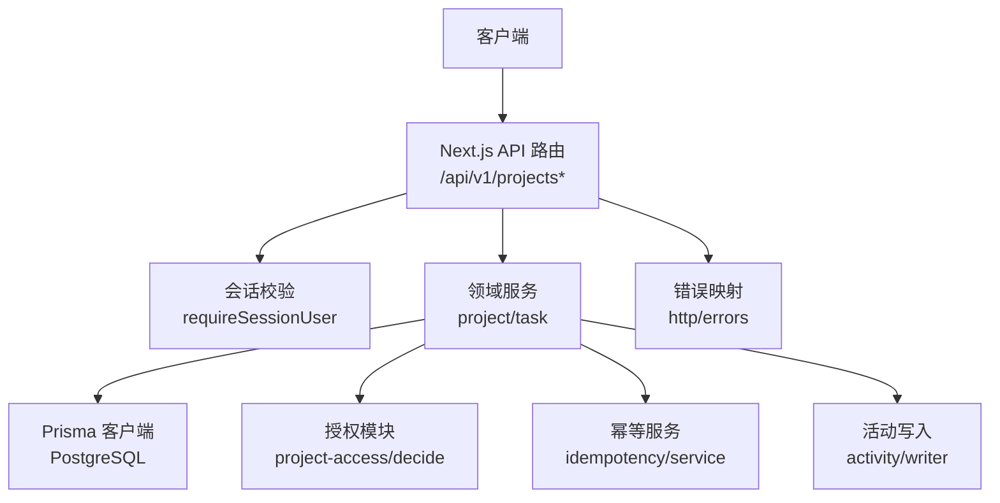
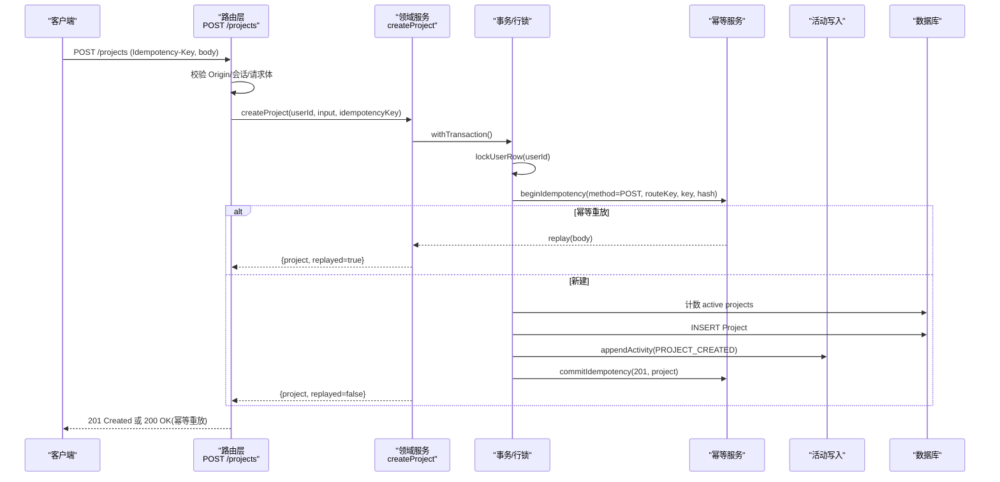
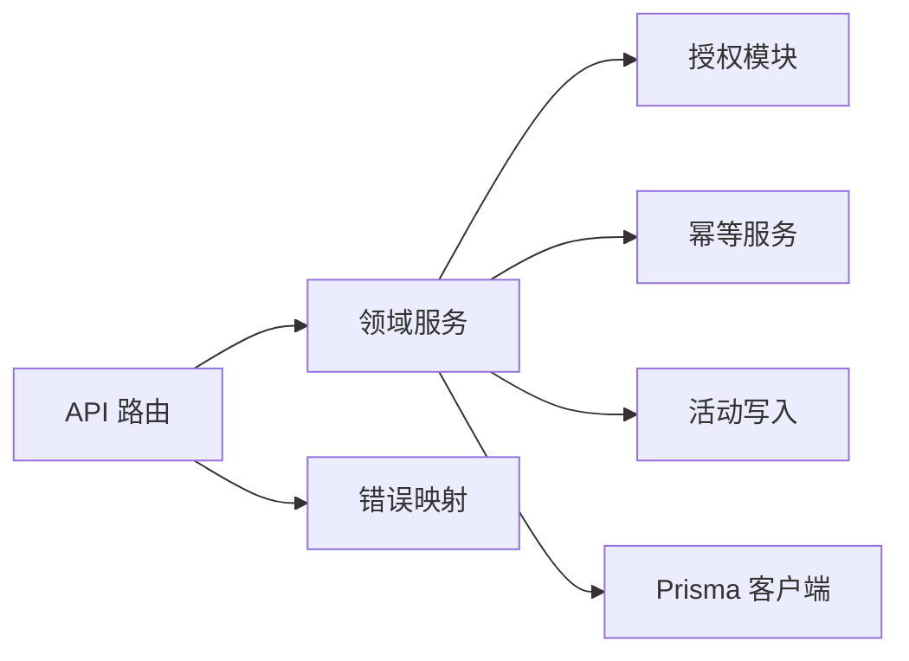

# 项目 API

<cite>
**本文引用的文件**
- [openapi.json](file://contracts/openapi.json)
- [schema.prisma](file://prisma/schema.prisma)
- [projects 路由（列表/创建）](file://src/app/api/v1/projects/route.ts)
- [项目路由（读取/更新）](file://src/app/api/v1/projects/[projectId]/route.ts)
- [项目成员路由（列出）](file://src/app/api/v1/projects/[projectId]/members/route.ts)
- [项目任务路由（列表/创建）](file://src/app/api/v1/projects/[projectId]/tasks/route.ts)
- [项目模块入口](file://src/server/modules/project/index.ts)
- [项目创建服务](file://src/server/modules/project/create.ts)
- [项目读取服务](file://src/server/modules/project/read.ts)
- [项目更新服务](file://src/server/modules/project/update.ts)
- [项目授权 IO 层](file://src/server/modules/authorization/project-access.ts)
- [项目授权判定函数](file://src/server/modules/authorization/decide.ts)
- [合同枚举定义](file://src/contracts/enums.ts)
- [合同 DTO 定义](file://src/contracts/dto.ts)
- [错误处理基础设施](file://src/server/http/errors.ts)
- [业务常量与配额](file://src/server/modules/limits.ts)
</cite>

## 目录
1. [简介](#简介)
2. [项目结构](#项目结构)
3. [核心组件](#核心组件)
4. [架构总览](#架构总览)
5. [详细组件分析](#详细组件分析)
6. [依赖关系分析](#依赖关系分析)
7. [性能考虑](#性能考虑)
8. [故障排查指南](#故障排查指南)
9. [结论](#结论)
10. [附录：API 端点清单](#附录api-端点清单)

## 简介
本文件为 Orbit 项目的“项目管理 API”技术文档，覆盖项目 CRUD、成员管理、权限控制、数据模型、角色定义、访问控制规则、创建流程、幂等与并发控制、以及协作场景示例。所有端点遵循统一信封响应格式，并基于 OpenAPI 契约进行约束。认证由 /api/auth/* 管理，业务 API 位于 /api/v1。

## 项目结构
后端采用 Next.js App Router 的 API Routes 作为 HTTP 入口，调用 server/modules 下的领域服务完成业务逻辑；数据模型通过 Prisma schema 定义；错误与响应体通过 contracts 与 http 基础设施统一封装。

图示来源
- [projects 路由（列表/创建）:1-93](file://src/app/api/v1/projects/route.ts#L1-L93)
- [项目路由（读取/更新）:1-80](file://src/app/api/v1/projects/[projectId]/route.ts#L1-L80)
- [项目模块入口:1-24](file://src/server/modules/project/index.ts#L1-L24)
- [项目授权 IO 层:1-121](file://src/server/modules/authorization/project-access.ts#L1-L121)
- [错误处理基础设施:1-136](file://src/server/http/errors.ts#L1-L136)

章节来源
- [openapi.json:209-458](file://contracts/openapi.json#L209-L458)
- [schema.prisma:144-179](file://prisma/schema.prisma#L144-L179)

## 核心组件
- 路由层：负责请求解析、会话校验、参数校验、调用领域服务、统一信封响应与错误映射。
- 领域服务：实现项目/任务的创建、读取、更新、列表、成员管理等业务不变量与并发控制。
- 授权模块：纯函数判定角色与写权限，IO 层将判定结果转为领域错误。
- 幂等服务：在事务内记录请求哈希与响应，支持幂等重放。
- 活动写入：记录项目/任务变更的活动日志。
- 错误处理：统一 DomainError 到标准 ErrorResponse，附带 requestId 与 no-store 缓存策略。

章节来源
- [项目模块入口:1-24](file://src/server/modules/project/index.ts#L1-L24)
- [项目创建服务:1-181](file://src/server/modules/project/create.ts#L1-L181)
- [项目读取服务:1-192](file://src/server/modules/project/read.ts#L1-L192)
- [项目更新服务:1-204](file://src/server/modules/project/update.ts#L1-L204)
- [项目授权 IO 层:1-121](file://src/server/modules/authorization/project-access.ts#L1-L121)
- [错误处理基础设施:1-136](file://src/server/http/errors.ts#L1-L136)

## 架构总览
下图展示一次“创建项目”的请求从路由到数据库的完整调用链，包括幂等、配额、活动写入与响应封装。

图示来源
- [projects 路由（列表/创建）:56-93](file://src/app/api/v1/projects/route.ts#L56-L93)
- [项目创建服务:71-181](file://src/server/modules/project/create.ts#L71-L181)
- [错误处理基础设施:91-136](file://src/server/http/errors.ts#L91-L136)

## 详细组件分析

### 项目数据模型与角色
- 实体
  - Project：项目主表，包含名称、标识 key、描述、颜色、归档时间、版本、看板版本、任务编号、字节预留/使用等。
  - ProjectMember：项目成员关联表，唯一键(projectId, userId)。
  - User：用户表，含时区扩展字段。
  - Task：任务表，含状态、优先级、负责人、截止日期、位置、版本、软删除等。
  - ActivityLog：活动日志，记录实体类型、动作与元数据。
  - IdempotencyRecord：幂等记录，按用户+方法+路由key+key去重。
- 角色与权限
  - 计算角色：OWNER（ownerId 匹配）、MEMBER（存在成员记录）。
  - 写操作：仅 OWNER 可执行 update/archive/restore；归档项目只读，恢复除外。
  - 非成员与不存在统一返回 NOT_FOUND，不泄露资源是否存在。

章节来源
- [schema.prisma:27-47](file://prisma/schema.prisma#L27-L47)
- [schema.prisma:144-179](file://prisma/schema.prisma#L144-L179)
- [schema.prisma:181-214](file://prisma/schema.prisma#L181-L214)
- [schema.prisma:240-267](file://prisma/schema.prisma#L240-L267)
- [项目授权判定函数:13-67](file://src/server/modules/authorization/decide.ts#L13-L67)
- [项目授权 IO 层:55-121](file://src/server/modules/authorization/project-access.ts#L55-L121)

### 项目 CRUD 端点

#### 列出项目 GET /api/v1/projects
- 功能：列出当前用户拥有或参与的项目，支持 scope（all/owned/joined）、archived（exclude/only）、游标分页（cursor）、limit（默认 30，上限 100）。
- 成功响应：{ data: Project[], meta: PageMeta }
- 错误：400/401/403/404/409/410/413/415/422/429/500/503（BusinessError 信封）
- 关键逻辑：应用单例查询，过滤指纹 + keyset 游标；计算 openTaskCount、memberCount。

章节来源
- [openapi.json:209-338](file://contracts/openapi.json#L209-L338)
- [项目读取服务:65-135](file://src/server/modules/project/read.ts#L65-L135)
- [项目模块入口:11-23](file://src/server/modules/project/index.ts#L11-L23)

#### 创建项目 POST /api/v1/projects
- 功能：以当前会话用户为 owner 创建项目；需 Idempotency-Key（UUID）。
- 成功响应：201 Created → { data: Project, meta }；幂等重放 200 OK → 同原结果。
- 不变量：每用户未归档项目数 ≤ MAX_ACTIVE_PROJECTS；key 全局唯一；重放前重新授权。
- 错误：400/401/403/404/409/410/413/415/422/429/500/503。

章节来源
- [openapi.json:339-458](file://contracts/openapi.json#L339-L458)
- [projects 路由（列表/创建）:56-93](file://src/app/api/v1/projects/route.ts#L56-L93)
- [项目创建服务:71-181](file://src/server/modules/project/create.ts#L71-L181)

#### 读取项目 GET /api/v1/projects/{projectId}
- 功能：读取单个项目；非成员或不存在 → 404。
- 成功响应：{ data: Project, meta:{requestId} }

章节来源
- [openapi.json:459-544](file://contracts/openapi.json#L459-L544)
- [项目路由（读取/更新）:36-47](file://src/app/api/v1/projects/[projectId]/route.ts#L36-L47)
- [项目读取服务:137-150](file://src/server/modules/project/read.ts#L137-L150)

#### 更新/归档/恢复项目 PATCH /api/v1/projects/{projectId}
- 功能：仅 owner 可更新资料、归档或恢复；需 expectedVersion 乐观并发；归档项目只读（恢复除外）。
- 成功响应：{ data: Project, meta }
- 错误：409 VERSION_CONFLICT（回传 currentVersion）、409 PROJECT_ARCHIVED、403 FORBIDDEN、404 NOT_FOUND。

章节来源
- [openapi.json:545-640](file://contracts/openapi.json#L545-L640)
- [项目路由（读取/更新）:49-80](file://src/app/api/v1/projects/[projectId]/route.ts#L49-L80)
- [项目更新服务:73-204](file://src/server/modules/project/update.ts#L73-L204)

### 成员管理端点

#### 列出成员 GET /api/v1/projects/{projectId}/members
- 功能：列出项目成员（含 owner），非成员/不存在 → 404；不返回 email。
- 排序：owner 首位（role=OWNER），其后按 joinedAt 升序（role=MEMBER）。
- 成功响应：{ data: Member[], meta:{requestId} }

章节来源
- [openapi.json:641-730](file://contracts/openapi.json#L641-L730)
- [项目成员路由（列出）:26-38](file://src/app/api/v1/projects/[projectId]/members/route.ts#L26-L38)
- [项目读取服务:152-192](file://src/server/modules/project/read.ts#L152-L192)

#### 移除成员 DELETE /api/v1/projects/{projectId}/members/{userId}
- 功能：Owner 移除成员，或 Member 退出；无响应体。
- 成功响应：204 No Content
- 错误：400/401/403/404/409/410/413/415/422/429/500/503。

章节来源
- [openapi.json:731-800](file://contracts/openapi.json#L731-L800)

### 任务相关端点（项目下）

#### 列出任务 GET /api/v1/projects/{projectId}/tasks
- 功能：列出项目任务，支持过滤（status/priority/assigneeId/unassigned/overdue/deleted）、排序（updated_desc/due_asc/priority_desc）、游标分页。
- 成功响应：{ data: TaskSummary[], meta: PageMeta }

章节来源
- [项目任务路由（列表/创建）:43-63](file://src/app/api/v1/projects/[projectId]/tasks/route.ts#L43-L63)
- [合同 DTO 定义:461-476](file://src/contracts/dto.ts#L461-L476)

#### 创建任务 POST /api/v1/projects/{projectId}/tasks
- 功能：在当前项目下创建任务；需 Idempotency-Key；creator 由会话确定。
- 成功响应：201 Created → { data: Task, meta }；幂等重放 200 OK。
- 不变量：项目任务数 ≤ MAX_OPEN_TASKS；负责人必须是 owner/成员；DONE⇔completedAt。

章节来源
- [项目任务路由（列表/创建）:65-104](file://src/app/api/v1/projects/[projectId]/tasks/route.ts#L65-L104)
- [任务创建服务:77-202](file://src/server/modules/task/create.ts#L77-L202)

### 权限控制与访问规则
- 读访问：resolveProjectAccess 判定角色（OWNER/MEMBER/NOT_FOUND）。
- 写访问：requireWritableProject 要求 OWNER，并根据归档态决定 ALLOWED/FORBIDDEN/ARCHIVED。
- 安全原则：非成员与不存在统一 404，避免信息泄露；写权限不足 403；归档项目只读。

章节来源
- [项目授权 IO 层:55-121](file://src/server/modules/authorization/project-access.ts#L55-L121)
- [项目授权判定函数:33-67](file://src/server/modules/authorization/decide.ts#L33-L67)

### 项目创建流程与幂等
- 流程：Origin 校验 → 会话 → Idempotency-Key → 请求体验证 → 领域服务（配额/唯一性/幂等/授权）→ DTO → 信封。
- 幂等：beginIdempotency 记录请求哈希；commitIdempotency 记录响应；冲突时外部重试并复查。
- 重放前重新授权：确保退出成员无法借旧缓存读取。

章节来源
- [projects 路由（列表/创建）:56-93](file://src/app/api/v1/projects/route.ts#L56-L93)
- [项目创建服务:71-181](file://src/server/modules/project/create.ts#L71-L181)

### 成员邀请机制（设计说明）
- 契约中定义了 Invitation/CreatedInvitation/InviteToken/InvitePreview/AcceptedInvitation 等 DTO，用于后续成员邀请与接受流程。
- M2 阶段尚未提供成员增删端点；邀请能力将在后续迭代引入，届时将结合权限与配额在锁内生效。

章节来源
- [合同 DTO 定义:141-186](file://src/contracts/dto.ts#L141-L186)
- [业务常量与配额:1-27](file://src/server/modules/limits.ts#L1-L27)

### 权限继承与可见性
- 项目级权限：成员可见项目与成员列表；owner 可修改/归档/恢复。
- 任务级权限：仅项目成员可创建/查看任务；负责人必须为项目成员。
- 活动日志：记录项目/任务变更，便于审计与协作追踪。

章节来源
- [项目读取服务:137-192](file://src/server/modules/project/read.ts#L137-L192)
- [任务创建服务:77-202](file://src/server/modules/task/create.ts#L77-L202)

### 协作场景示例（任务分配与进度跟踪）
- 场景：项目经理创建项目 → 邀请成员（未来）→ 创建任务并分配给成员 → 成员更新任务状态 → 看板视图同步。
- 关键点：
  - 创建项目需幂等键，防止重复提交。
  - 创建任务需在项目行锁内取号与定位 position，保证顺序一致。
  - 任务状态变更触发活动日志，便于协作追踪。
  - 看板 boardVersion 独立递增，避免与 Project.updatedAt 耦合。

章节来源
- [项目创建服务:71-181](file://src/server/modules/project/create.ts#L71-L181)
- [任务创建服务:77-202](file://src/server/modules/task/create.ts#L77-L202)
- [项目读取服务:137-192](file://src/server/modules/project/read.ts#L137-L192)

## 依赖关系分析

图示来源
- [项目模块入口:1-24](file://src/server/modules/project/index.ts#L1-L24)
- [项目授权 IO 层:1-121](file://src/server/modules/authorization/project-access.ts#L1-L121)
- [错误处理基础设施:1-136](file://src/server/http/errors.ts#L1-L136)

章节来源
- [项目模块入口:1-24](file://src/server/modules/project/index.ts#L1-L24)
- [项目授权 IO 层:1-121](file://src/server/modules/authorization/project-access.ts#L1-L121)
- [错误处理基础设施:1-136](file://src/server/http/errors.ts#L1-L136)

## 性能考虑
- 游标分页：使用 keyset 游标（updatedAt,id）减少深翻页开销。
- 行锁串行化：项目/用户行锁保证配额、编号、position 与 boardVersion 的一致性。
- 最小化响应体：列表返回摘要（如 TaskSummary），详情再加载大字段。
- 缓存策略：授权/私有响应设置 Cache-Control: private, no-store。
- 批量计数：在事务内一次性计数 memberCount/openTaskCount，避免多次往返。

[本节为通用指导，无需具体文件引用]

## 故障排查指南
- 常见错误码
  - VALIDATION_ERROR：请求体验证失败（字段级提示）。
  - LIMIT_EXCEEDED：达到配额上限（项目/任务）。
  - PROJECT_KEY_TAKEN：项目标识冲突。
  - VERSION_CONFLICT：乐观并发冲突（回传 currentVersion）。
  - PROJECT_ARCHIVED：归档项目只读。
  - NOT_FOUND：项目不存在或不可见。
  - FORBIDDEN：权限不足。
- 排查步骤
  - 检查 requestId 与错误信封中的 fieldErrors/details。
  - 确认 Idempotency-Key 是否合法 UUID。
  - 核对 expectedVersion 与当前版本。
  - 查看活动日志定位变更来源。

章节来源
- [错误处理基础设施:91-136](file://src/server/http/errors.ts#L91-L136)
- [项目创建服务:45-62](file://src/server/modules/project/create.ts#L45-L62)
- [项目更新服务:109-113](file://src/server/modules/project/update.ts#L109-L113)

## 结论
本项目 API 以清晰的层次划分（路由/服务/授权/基础设施）实现了稳健的项目管理与协作能力。通过幂等、行锁、配额与活动日志，保证了数据一致性与可追溯性。后续迭代将完善成员邀请与更丰富的协作功能。

[本节为总结，无需具体文件引用]

## 附录：API 端点清单
- GET /api/v1/projects
  - 查询参数：cursor、limit、scope、archived
  - 响应：{ data: Project[], meta: PageMeta }
- POST /api/v1/projects
  - 请求头：Idempotency-Key（UUID）
  - 请求体：CreateProject
  - 响应：201 Created 或 200 OK（幂等重放）
- GET /api/v1/projects/{projectId}
  - 路径参数：projectId（UUID）
  - 响应：{ data: Project, meta:{requestId} }
- PATCH /api/v1/projects/{projectId}
  - 路径参数：projectId（UUID）
  - 请求体：UpdateProject（expectedVersion + 至少一个可改字段）
  - 响应：{ data: Project, meta }
- GET /api/v1/projects/{projectId}/members
  - 路径参数：projectId（UUID）
  - 响应：{ data: Member[], meta:{requestId} }
- DELETE /api/v1/projects/{projectId}/members/{userId}
  - 路径参数：projectId、userId（UUID）
  - 响应：204 No Content
- GET /api/v1/projects/{projectId}/tasks
  - 查询参数：cursor、limit、q、status、priority、assigneeId、unassigned、overdue、deleted、sort
  - 响应：{ data: TaskSummary[], meta: PageMeta }
- POST /api/v1/projects/{projectId}/tasks
  - 请求头：Idempotency-Key（UUID）
  - 请求体：CreateTask
  - 响应：201 Created 或 200 OK（幂等重放）

章节来源
- [openapi.json:209-800](file://contracts/openapi.json#L209-L800)
- [项目路由（读取/更新）:1-80](file://src/app/api/v1/projects/[projectId]/route.ts#L1-L80)
- [项目成员路由（列出）:1-38](file://src/app/api/v1/projects/[projectId]/members/route.ts#L1-L38)
- [项目任务路由（列表/创建）:1-104](file://src/app/api/v1/projects/[projectId]/tasks/route.ts#L1-L104)