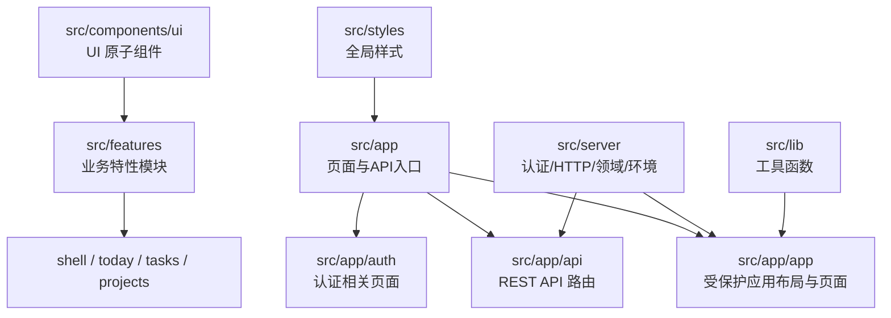
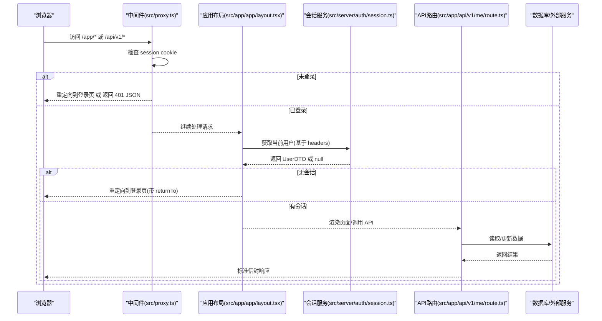
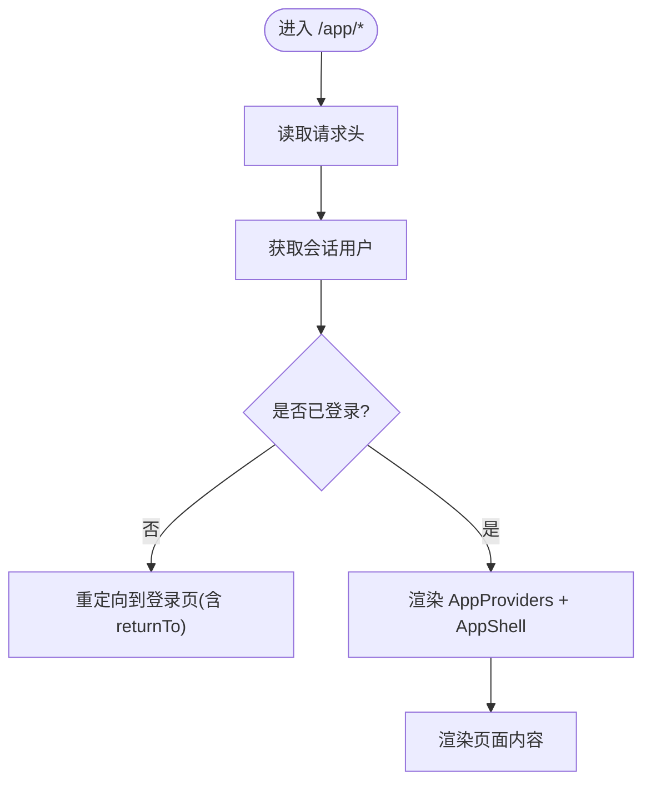
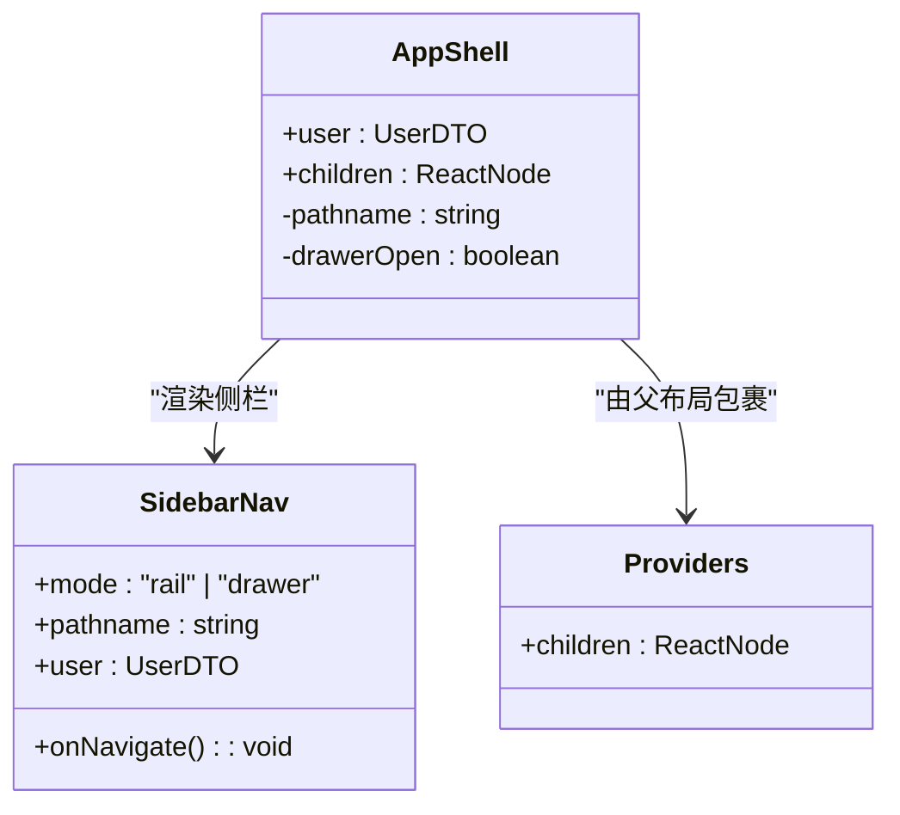
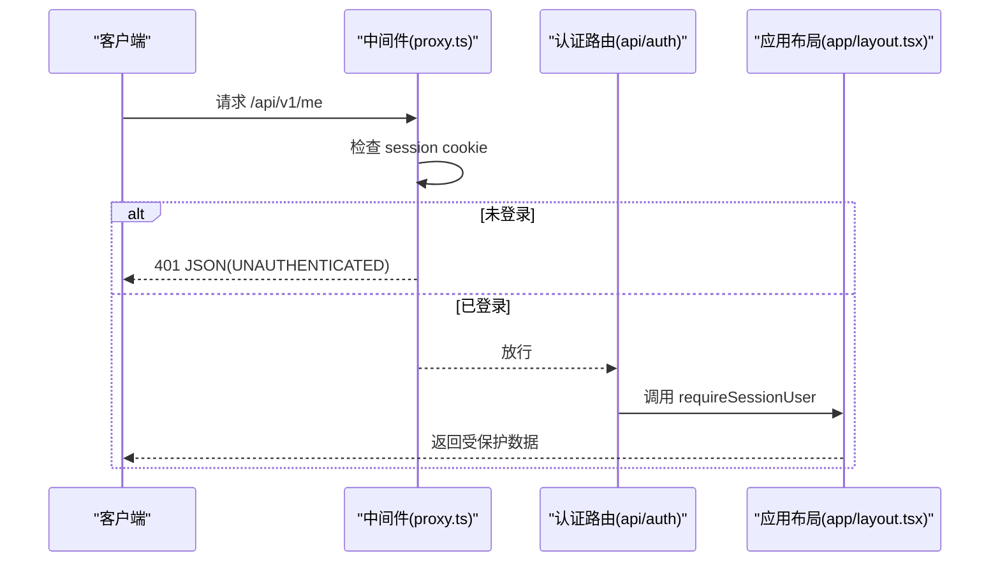
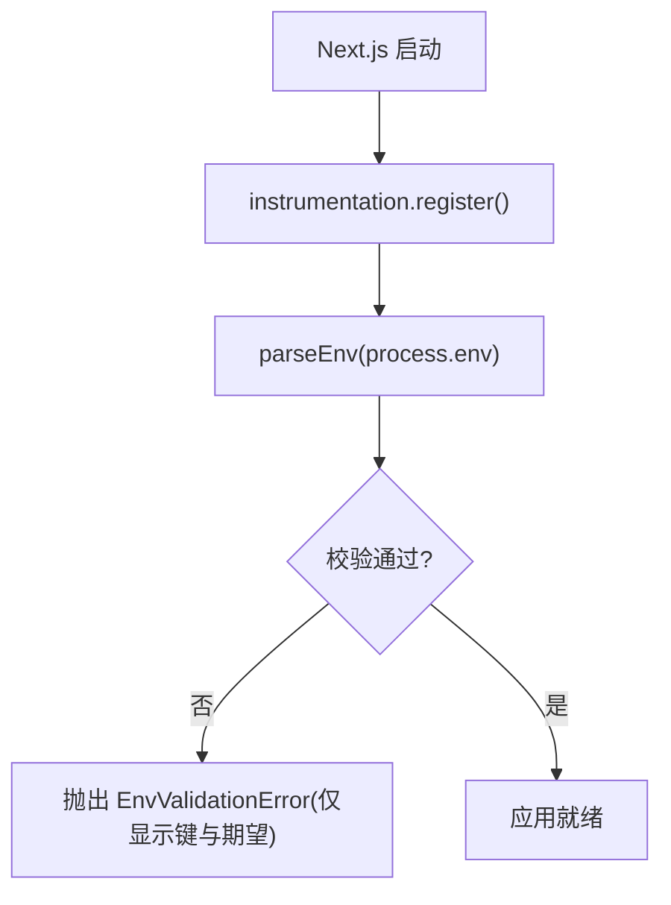
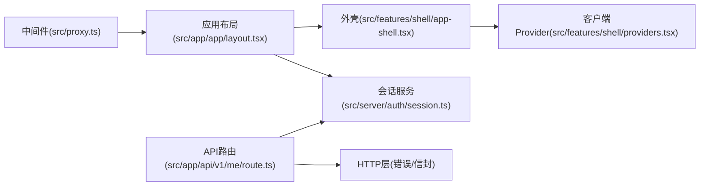

# Next.js 应用结构

<cite>
**本文引用的文件**
- [src/app/layout.tsx](file://src/app/layout.tsx)
- [src/app/page.tsx](file://src/app/page.tsx)
- [src/app/app/layout.tsx](file://src/app/app/layout.tsx)
- [src/app/app/today/page.tsx](file://src/app/app/today/page.tsx)
- [src/proxy.ts](file://src/proxy.ts)
- [next.config.ts](file://next.config.ts)
- [package.json](file://package.json)
- [src/instrumentation.ts](file://src/instrumentation.ts)
- [src/server/env.ts](file://src/server/env.ts)
- [src/features/shell/app-shell.tsx](file://src/features/shell/app-shell.tsx)
- [src/features/shell/providers.tsx](file://src/features/shell/providers.tsx)
- [src/app/api/auth/[...all]/route.ts](file://src/app/api/auth/[...all]/route.ts)
- [src/app/api/v1/me/route.ts](file://src/app/api/v1/me/route.ts)
- [src/server/auth/session.ts](file://src/server/auth/session.ts)
</cite>

## 目录
1. [简介](#简介)
2. [项目结构](#项目结构)
3. [核心组件](#核心组件)
4. [架构总览](#架构总览)
5. [详细组件分析](#详细组件分析)
6. [依赖关系分析](#依赖关系分析)
7. [性能考虑](#性能考虑)
8. [故障排查指南](#故障排查指南)
9. [结论](#结论)
10. [附录](#附录)

## 简介
本文件为 Orbit 项目的 Next.js 应用结构文档，聚焦基于 Next.js App Router 的目录组织、路由策略、服务器/客户端组件分工、布局系统（根布局与嵌套布局）、中间件与代理、环境变量校验与启动期检查、构建优化与运行时配置。同时提供页面、布局与组件的组织方式示例，以及服务端渲染与客户端交互的最佳实践和调试技巧。

## 项目结构
Orbit 采用 Next.js App Router 的典型分层：
- src/app：页面与 API 路由入口，按功能划分子目录（如 app、auth、api）。
- src/features：按业务域组织可复用特性模块（如 shell、tasks、today、projects）。
- src/components/ui：基础 UI 原子组件。
- src/server：服务端逻辑（认证、HTTP 层、领域模块、环境校验等）。
- src/lib：通用工具函数与常量。
- src/styles：全局样式与 tokens。

图表来源
- [src/app/layout.tsx:1-21](file://src/app/layout.tsx#L1-L21)
- [src/app/app/layout.tsx:1-48](file://src/app/app/layout.tsx#L1-L48)
- [src/app/api/auth/[...all]/route.ts:1-22](file://src/app/api/auth/[...all]/route.ts#L1-L22)
- [src/app/api/v1/me/route.ts:1-91](file://src/app/api/v1/me/route.ts#L1-L91)

章节来源
- [src/app/layout.tsx:1-21](file://src/app/layout.tsx#L1-L21)
- [src/app/page.tsx:1-101](file://src/app/page.tsx#L1-L101)
- [src/app/app/layout.tsx:1-48](file://src/app/app/layout.tsx#L1-L48)
- [src/app/app/today/page.tsx:1-25](file://src/app/app/today/page.tsx#L1-L25)
- [src/app/api/auth/[...all]/route.ts:1-22](file://src/app/api/auth/[...all]/route.ts#L1-L22)
- [src/app/api/v1/me/route.ts:1-91](file://src/app/api/v1/me/route.ts#L1-L91)

## 核心组件
- 根布局：定义站点元信息、语言与 body 容器，挂载全局样式。
- 应用外壳：响应式侧栏 + 顶栏 + 内容区，支持桌面/平板/手机三种导航形态，并注入会话用户信息。
- 客户端 Provider：组合 TooltipProvider 与 ToastProvider，作为 /app 布局下的全局上下文。
- 认证路由：通过 Better Auth 的 Next.js 适配器统一暴露认证端点。
- 受保护 API：以 /api/v1/* 形式暴露业务接口，配合中间件进行快速门禁与服务端会话校验。

章节来源
- [src/app/layout.tsx:1-21](file://src/app/layout.tsx#L1-L21)
- [src/features/shell/app-shell.tsx:1-389](file://src/features/shell/app-shell.tsx#L1-L389)
- [src/features/shell/providers.tsx:1-20](file://src/features/shell/providers.tsx#L1-L20)
- [src/app/api/auth/[...all]/route.ts:1-22](file://src/app/api/auth/[...all]/route.ts#L1-L22)
- [src/app/api/v1/me/route.ts:1-91](file://src/app/api/v1/me/route.ts#L1-L91)

## 架构总览
下图展示从浏览器到服务端的请求路径：中间件快速门禁 → 页面/布局的服务端会话校验 → 业务 API → 数据库/外部服务。

图表来源
- [src/proxy.ts:1-78](file://src/proxy.ts#L1-L78)
- [src/app/app/layout.tsx:1-48](file://src/app/app/layout.tsx#L1-L48)
- [src/server/auth/session.ts:1-43](file://src/server/auth/session.ts#L1-L43)
- [src/app/api/v1/me/route.ts:1-91](file://src/app/api/v1/me/route.ts#L1-L91)

## 详细组件分析

### 根布局与元信息
- 根布局负责站点标题、描述与语言设置，挂载全局样式，作为所有页面的最外层容器。
- 首页提供开发样例入口，仅在开发环境下显示布局样例链接。

章节来源
- [src/app/layout.tsx:1-21](file://src/app/layout.tsx#L1-L21)
- [src/app/page.tsx:1-101](file://src/app/page.tsx#L1-L101)

### 应用布局与受保护区域
- /app 布局强制动态渲染，避免缓存私有数据；在服务端读取请求头并校验会话，未登录则重定向至登录页并携带 returnTo。
- 通过 AppProviders 注入 Tooltip/Toast 上下文，AppShell 提供响应式外壳与导航。

图表来源
- [src/app/app/layout.tsx:1-48](file://src/app/app/layout.tsx#L1-L48)
- [src/features/shell/providers.tsx:1-20](file://src/features/shell/providers.tsx#L1-L20)
- [src/features/shell/app-shell.tsx:1-389](file://src/features/shell/app-shell.tsx#L1-L389)

章节来源
- [src/app/app/layout.tsx:1-48](file://src/app/app/layout.tsx#L1-L48)
- [src/features/shell/providers.tsx:1-20](file://src/features/shell/providers.tsx#L1-L20)
- [src/features/shell/app-shell.tsx:1-389](file://src/features/shell/app-shell.tsx#L1-L389)

### 响应式外壳组件（AppShell）
- 桌面：固定左侧栏（宽 224px），顶栏高度固定，内容区内边距较大。
- 平板：侧栏收窄（72px），保留图标与 tooltip。
- 手机：隐藏侧栏，使用抽屉导航；汉堡按钮打开 Drawer，关闭后恢复焦点。
- 根据当前路径判断是否为“真实数据页”，决定是否显示“M0 布局样例”横幅。

图表来源
- [src/features/shell/app-shell.tsx:1-389](file://src/features/shell/app-shell.tsx#L1-L389)
- [src/features/shell/providers.tsx:1-20](file://src/features/shell/providers.tsx#L1-L20)

章节来源
- [src/features/shell/app-shell.tsx:1-389](file://src/features/shell/app-shell.tsx#L1-L389)

### 页面与布局示例
- 今日工作台页面：Server Component 读取 searchParams，解析演示态，渲染客户端 TodayView。
- 该模式体现了“服务端读取参数 + 客户端渲染交互”的分层策略。

章节来源
- [src/app/app/today/page.tsx:1-25](file://src/app/app/today/page.tsx#L1-L25)

### 认证与中间件
- 认证路由：Better Auth 全路由挂载，统一处理 GET/POST/PATCH/PUT/DELETE，运行于 Node 运行时。
- 中间件：对 /app/* 与 /api/v1/* 进行快速门禁；未登录时分别重定向或返回 401 JSON；向后续请求注入 returnTo 头。

图表来源
- [src/proxy.ts:1-78](file://src/proxy.ts#L1-L78)
- [src/app/api/auth/[...all]/route.ts:1-22](file://src/app/api/auth/[...all]/route.ts#L1-L22)
- [src/app/api/v1/me/route.ts:1-91](file://src/app/api/v1/me/route.ts#L1-L91)

章节来源
- [src/proxy.ts:1-78](file://src/proxy.ts#L1-L78)
- [src/app/api/auth/[...all]/route.ts:1-22](file://src/app/api/auth/[...all]/route.ts#L1-L22)

### 环境变量管理与启动期校验
- 环境变量通过 Zod 严格校验，禁止将秘密变量暴露给客户端；失败时仅输出变量名与预期格式。
- Next.js instrumentation 在服务端启动时执行一次校验，失败即进程退出，确保“快速失败”。

图表来源
- [src/instrumentation.ts:1-21](file://src/instrumentation.ts#L1-L21)
- [src/server/env.ts:1-238](file://src/server/env.ts#L1-L238)

章节来源
- [src/instrumentation.ts:1-21](file://src/instrumentation.ts#L1-L21)
- [src/server/env.ts:1-238](file://src/server/env.ts#L1-L238)

### 构建与运行时配置
- Next.js 配置启用 StrictMode、关闭 poweredByHeader、外部化 pg 驱动、允许本地回环 origin 用于开发。
- 脚本命令包含 prisma generate、dev/build/start、lint/typecheck/test:*、db:* 等完整工作流。

章节来源
- [next.config.ts:1-21](file://next.config.ts#L1-L21)
- [package.json:1-76](file://package.json#L1-L76)

## 依赖关系分析
- 页面与布局依赖 AppShell 与 Providers，后者提供 Tooltip/Toast 上下文。
- 应用布局依赖会话服务获取当前用户，未登录则重定向。
- API 路由依赖会话服务与 HTTP 层工具，统一错误与信封格式。
- 中间件在请求早期拦截，减少不必要的下游处理。

图表来源
- [src/proxy.ts:1-78](file://src/proxy.ts#L1-L78)
- [src/app/app/layout.tsx:1-48](file://src/app/app/layout.tsx#L1-L48)
- [src/features/shell/app-shell.tsx:1-389](file://src/features/shell/app-shell.tsx#L1-L389)
- [src/features/shell/providers.tsx:1-20](file://src/features/shell/providers.tsx#L1-L20)
- [src/server/auth/session.ts:1-43](file://src/server/auth/session.ts#L1-L43)
- [src/app/api/v1/me/route.ts:1-91](file://src/app/api/v1/me/route.ts#L1-L91)

章节来源
- [src/proxy.ts:1-78](file://src/proxy.ts#L1-L78)
- [src/app/app/layout.tsx:1-48](file://src/app/app/layout.tsx#L1-L48)
- [src/features/shell/app-shell.tsx:1-389](file://src/features/shell/app-shell.tsx#L1-L389)
- [src/features/shell/providers.tsx:1-20](file://src/features/shell/providers.tsx#L1-L20)
- [src/server/auth/session.ts:1-43](file://src/server/auth/session.ts#L1-L43)
- [src/app/api/v1/me/route.ts:1-91](file://src/app/api/v1/me/route.ts#L1-L91)

## 性能考虑
- 动态渲染控制：关键布局与 API 显式设置为 force-dynamic，避免缓存私有数据。
- 构建期优化：关闭 poweredByHeader 减少信息泄露；serverExternalPackages 保持原生驱动在 Node 运行时加载，不进入客户端 bundle。
- 开发体验：allowedDevOrigins 允许本地回环访问 dev server，避免 HMR 与资源加载失败。
- 响应隐私：API 响应统一添加 private, no-store，防止共享缓存泄露账户数据。

[本节为通用指导，无需具体文件引用]

## 故障排查指南
- 环境变量校验失败：查看启动日志中的变量名与预期格式提示，修正 .env 后重启。
- 未登录访问受保护页面：确认中间件与布局的会话校验流程；检查 Cookie 与后端会话有效性。
- API 401：确认中间件放行与会话服务 requireSessionUser 的行为；检查 Origin 与请求头。
- 开发环境跨域/HMR 问题：调整 allowedDevOrigins，确保测试客户端主机在允许列表中。

章节来源
- [src/instrumentation.ts:1-21](file://src/instrumentation.ts#L1-L21)
- [src/server/env.ts:1-238](file://src/server/env.ts#L1-L238)
- [src/proxy.ts:1-78](file://src/proxy.ts#L1-L78)
- [src/app/api/v1/me/route.ts:1-91](file://src/app/api/v1/me/route.ts#L1-L91)

## 结论
Orbit 的 Next.js 应用结构以 App Router 为核心，通过清晰的目录分层、严格的会话校验与环境变量管理、响应式外壳与统一的 API 信封，实现了安全、可维护且高性能的前后端一体化方案。建议在后续里程碑中逐步替换样例数据为真实数据，并保持“服务端授权优先”的原则，确保数据安全与用户体验的一致性。

## 附录
- 创建页面：在 src/app 下新增目录与 page.tsx，按需设置 metadata 与 searchParams。
- 创建布局：在对应目录新增 layout.tsx，组合 Providers 与 Shell，必要时设置 dynamic。
- 创建组件：在 src/features 或 src/components/ui 中实现可复用组件，遵循“服务端渲染 + 客户端交互”的边界。
- 处理 SSR 与客户端交互：页面组件负责数据获取与状态初始化，交互逻辑下沉到客户端组件。

[本节为通用指导，无需具体文件引用]