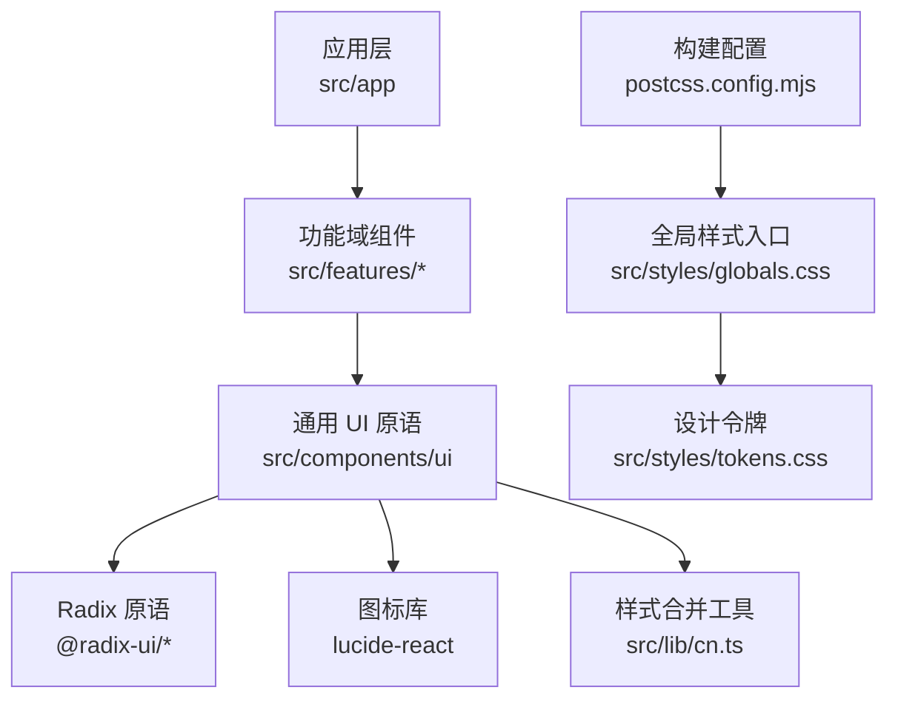
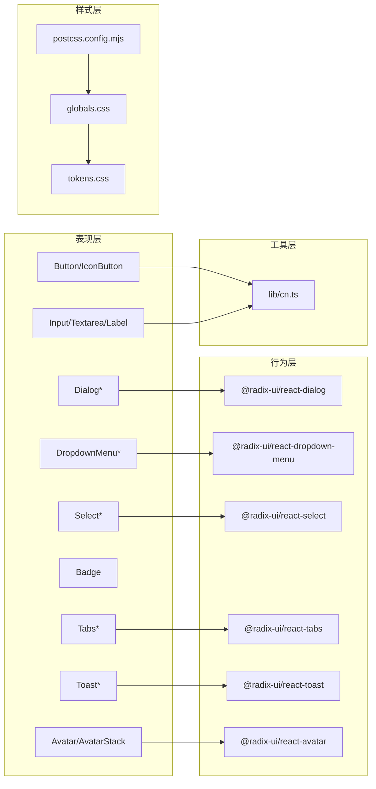
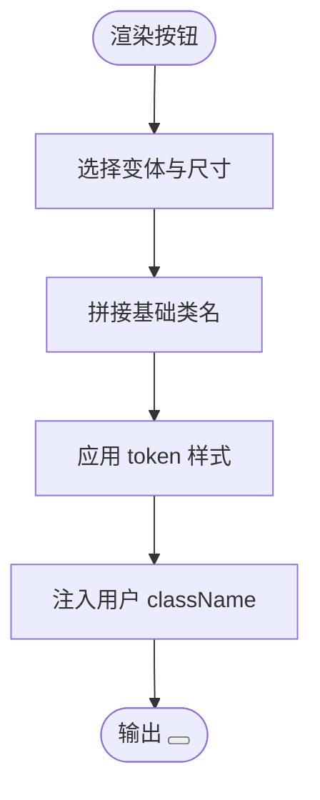
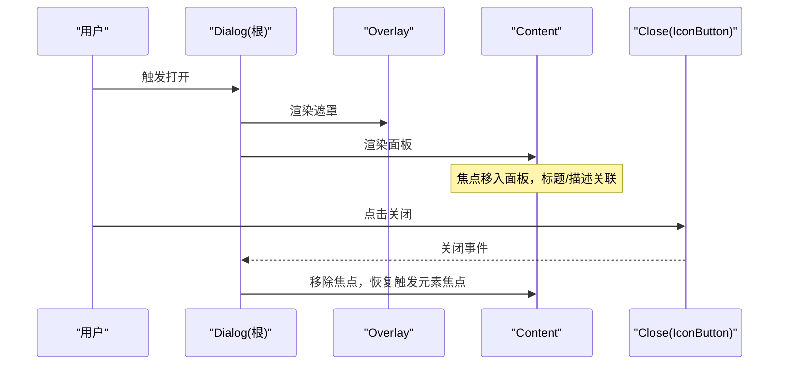
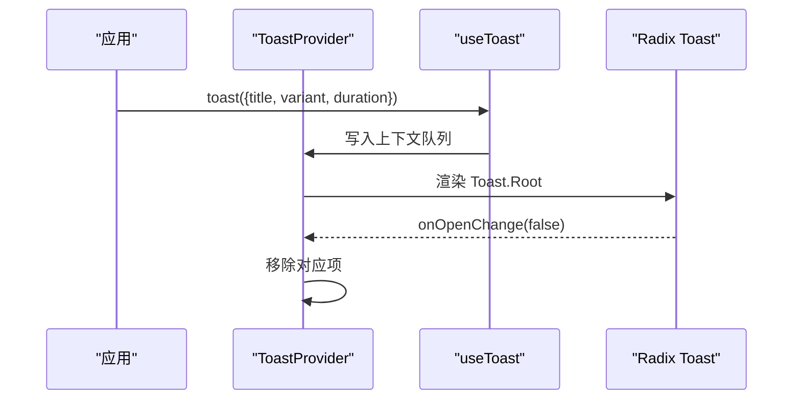
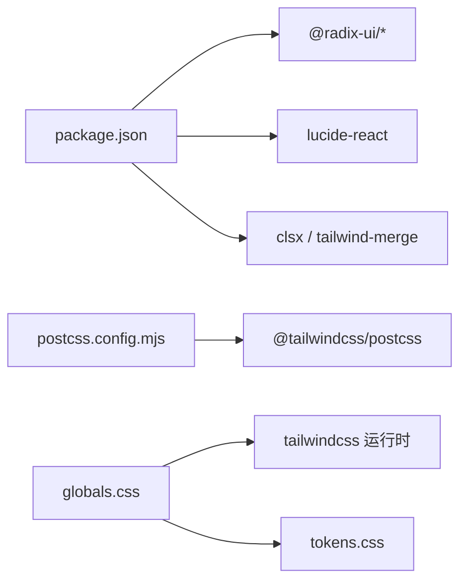

# UI 组件系统

<cite>
**本文引用的文件**
- [src/components/ui/README.md](file://src/components/ui/README.md)
- [src/components/ui/index.ts](file://src/components/ui/index.ts)
- [package.json](file://package.json)
- [postcss.config.mjs](file://postcss.config.mjs)
- [src/styles/globals.css](file://src/styles/globals.css)
- [src/styles/tokens.css](file://src/styles/tokens.css)
- [src/lib/cn.ts](file://src/lib/cn.ts)
- [src/components/ui/button.tsx](file://src/components/ui/button.tsx)
- [src/components/ui/input.tsx](file://src/components/ui/input.tsx)
- [src/components/ui/dialog.tsx](file://src/components/ui/dialog.tsx)
- [src/components/ui/dropdown-menu.tsx](file://src/components/ui/dropdown-menu.tsx)
- [src/components/ui/avatar.tsx](file://src/components/ui/avatar.tsx)
- [src/components/ui/badge.tsx](file://src/components/ui/badge.tsx)
- [src/components/ui/select.tsx](file://src/components/ui/select.tsx)
- [src/components/ui/tabs.tsx](file://src/components/ui/tabs.tsx)
- [src/components/ui/toast.tsx](file://src/components/ui/toast.tsx)
</cite>

## 目录
1. [简介](#简介)
2. [项目结构](#项目结构)
3. [核心组件](#核心组件)
4. [架构总览](#架构总览)
5. [详细组件分析](#详细组件分析)
6. [依赖关系分析](#依赖关系分析)
7. [性能考量](#性能考量)
8. [故障排查指南](#故障排查指南)
9. [结论](#结论)
10. [附录](#附录)

## 简介
本文件为 Orbit 项目的 UI 组件系统文档，聚焦基于 Radix UI 的组件封装策略、样式系统与开发规范。内容涵盖：
- 基础组件设计原则与组合模式
- TypeScript 类型定义、Props 接口、事件处理与可访问性实现
- 组件命名约定、文件组织与导出模式
- 样式系统（Tailwind CSS 4 配置、设计令牌使用、响应式）
- 组件使用示例、最佳实践与常见问题
- 组件测试策略与文档生成方法

## 项目结构
UI 组件位于 src/components/ui，采用“单一原语体系”策略：统一基于 Radix primitives + Lucide 图标，所有视觉通过设计令牌（tokens）驱动，不自行实现不可访问的弹窗/菜单/下拉等复杂交互。业务组件按领域放在 src/features。

图表来源
- [src/components/ui/index.ts:1-25](file://src/components/ui/index.ts#L1-L25)
- [postcss.config.mjs:1-9](file://postcss.config.mjs#L1-L9)
- [src/styles/globals.css:1-13](file://src/styles/globals.css#L1-L13)
- [src/styles/tokens.css:1-169](file://src/styles/tokens.css#L1-L169)

章节来源
- [src/components/ui/README.md:1-7](file://src/components/ui/README.md#L1-L7)
- [src/components/ui/index.ts:1-25](file://src/components/ui/index.ts#L1-L25)
- [postcss.config.mjs:1-9](file://postcss.config.mjs#L1-L9)
- [src/styles/globals.css:1-13](file://src/styles/globals.css#L1-L13)
- [src/styles/tokens.css:1-169](file://src/styles/tokens.css#L1-L169)

## 核心组件
- Button / IconButton：提供主按钮、次按钮、幽灵按钮、危险按钮及仅图标按钮；尺寸 sm/md/lg；焦点环由全局规则保障；无障碍名称强制要求。
- Input / Textarea / Label：表单输入控件，统一高度与圆角，错误态切换 danger 边框与背景；标签语义化。
- Dialog：基于 Radix Dialog 的对话框，包含 Overlay、Content、Header、Title、Description、Footer；焦点陷阱、初始焦点、恢复焦点、Escape 关闭均由 Radix 保证。
- DropdownMenu：基于 Radix Dropdown Menu，提供键盘导航与高亮状态；用于任务卡更多操作等场景。
- Avatar / AvatarStack：头像与成员头像叠加展示，无图时以首字母占位并提供可访问名称。
- Badge：轻量标签，支持 neutral/brand/success/warning/danger 语义色。
- Select：基于 Radix Select，提供触发器、内容区、选项、分隔符与标签；键盘导航完善。
- Tabs：基于 Radix Tabs，用于二级导航与视图切换，方向键/Home/End 支持。
- Toast：基于 Radix Toast 的轻量通知，配合 Provider/useToast 管理队列与自动消失；错误需同时以 InlineError 驻留提示。

章节来源
- [src/components/ui/button.tsx:1-118](file://src/components/ui/button.tsx#L1-L118)
- [src/components/ui/input.tsx:1-64](file://src/components/ui/input.tsx#L1-L64)
- [src/components/ui/dialog.tsx:1-118](file://src/components/ui/dialog.tsx#L1-L118)
- [src/components/ui/dropdown-menu.tsx:1-80](file://src/components/ui/dropdown-menu.tsx#L1-L80)
- [src/components/ui/avatar.tsx:1-109](file://src/components/ui/avatar.tsx#L1-L109)
- [src/components/ui/badge.tsx:1-57](file://src/components/ui/badge.tsx#L1-L57)
- [src/components/ui/select.tsx:1-108](file://src/components/ui/select.tsx#L1-L108)
- [src/components/ui/tabs.tsx:1-60](file://src/components/ui/tabs.tsx#L1-L60)
- [src/components/ui/toast.tsx:1-131](file://src/components/ui/toast.tsx#L1-L131)

## 架构总览
UI 组件系统遵循“Radix 原语 + Tailwind 4 + 设计令牌”的分层架构：
- 表现层：各 UI 组件通过 className 消费 tokens，保持外观一致且可定制。
- 行为层：Radix 负责可访问性与交互逻辑（焦点、键盘、ARIA）。
- 样式层：全局样式入口引入 Tailwind 运行时与设计令牌；统一焦点环与动效约束。
- 工具层：cn 工具合并类名，避免冲突并允许覆盖。

图表来源
- [src/components/ui/button.tsx:1-118](file://src/components/ui/button.tsx#L1-L118)
- [src/components/ui/dialog.tsx:1-118](file://src/components/ui/dialog.tsx#L1-L118)
- [src/components/ui/dropdown-menu.tsx:1-80](file://src/components/ui/dropdown-menu.tsx#L1-L80)
- [src/components/ui/select.tsx:1-108](file://src/components/ui/select.tsx#L1-L108)
- [src/components/ui/tabs.tsx:1-60](file://src/components/ui/tabs.tsx#L1-L60)
- [src/components/ui/toast.tsx:1-131](file://src/components/ui/toast.tsx#L1-L131)
- [src/components/ui/avatar.tsx:1-109](file://src/components/ui/avatar.tsx#L1-L109)
- [src/styles/globals.css:1-13](file://src/styles/globals.css#L1-L13)
- [src/styles/tokens.css:1-169](file://src/styles/tokens.css#L1-L169)
- [postcss.config.mjs:1-9](file://postcss.config.mjs#L1-L9)
- [src/lib/cn.ts:1-14](file://src/lib/cn.ts#L1-L14)

## 详细组件分析

### 按钮组件（Button / IconButton）
- 设计要点
  - 变体：primary/secondary/ghost/danger；尺寸：sm/md/lg。
  - 样式全部消费 tokens（颜色、字号、间距、圆角），禁用态与过渡动画统一。
  - IconButton 强制 label 作为 aria-label，确保屏幕阅读器可读。
- 可访问性
  - 焦点环由全局 :focus-visible 规则提供，无需在组件内重复设置。
- 组合模式
  - 暴露 buttonVariants 函数供其他元素复用按钮外观。

图表来源
- [src/components/ui/button.tsx:12-49](file://src/components/ui/button.tsx#L12-L49)
- [src/components/ui/button.tsx:51-118](file://src/components/ui/button.tsx#L51-L118)

章节来源
- [src/components/ui/button.tsx:1-118](file://src/components/ui/button.tsx#L1-L118)

### 表单输入（Input / Textarea / Label）
- 设计要点
  - 统一高度与圆角，边界色满足控件边界对比度要求。
  - 错误态通过 aria-invalid 切换 danger 边框与浅底。
- 可访问性
  - 标签与输入关联由调用方布局控制；焦点环由全局规则保障。

章节来源
- [src/components/ui/input.tsx:1-64](file://src/components/ui/input.tsx#L1-L64)

### 对话框（Dialog）
- 设计要点
  - 基于 Radix Dialog，Overlay/Content/Header/Title/Description/Footer 拆分清晰。
  - 弹层圆角与阴影来自 tokens；关闭按钮使用 IconButton。
- 可访问性
  - 焦点陷阱、初始焦点、恢复焦点、Escape 关闭、标题/描述关联均由 Radix 保证。

图表来源
- [src/components/ui/dialog.tsx:17-73](file://src/components/ui/dialog.tsx#L17-L73)
- [src/components/ui/dialog.tsx:76-118](file://src/components/ui/dialog.tsx#L76-L118)

章节来源
- [src/components/ui/dialog.tsx:1-118](file://src/components/ui/dialog.tsx#L1-L118)

### 下拉菜单（DropdownMenu）
- 设计要点
  - 基于 Radix Dropdown Menu，提供 Content/Item/Label/Separator。
  - 高亮态与禁用态样式统一；键盘导航完整。
- 使用建议
  - 与 TaskCard 等结合时，hover 显示更多菜单的同时，键盘焦点也应可见（由上层组件保证）。

章节来源
- [src/components/ui/dropdown-menu.tsx:1-80](file://src/components/ui/dropdown-menu.tsx#L1-L80)

### 头像（Avatar / AvatarStack）
- 设计要点
  - 无图时使用姓名首字母占位；尺寸 sm/md/lg。
  - AvatarStack 支持叠加展示与溢出计数，提供完整成员列表的可访问名称。
- 可访问性
  - 图片 alt 与 fallback aria-label 均使用 name，确保可识别。

章节来源
- [src/components/ui/avatar.tsx:1-109](file://src/components/ui/avatar.tsx#L1-L109)

### 徽章（Badge）
- 设计要点
  - 语义色 tone：neutral/brand/success/warning/danger；软底+深色文字，满足对比度。
  - 可选图标，用于优先级、状态、计数等小标签。

章节来源
- [src/components/ui/badge.tsx:1-57](file://src/components/ui/badge.tsx#L1-L57)

### 选择器（Select）
- 设计要点
  - 基于 Radix Select，提供 Trigger/Content/Item/Label/Separator。
  - 触发器高度与边界色符合触控与对比度要求；内容区使用 popper 定位。
- 可访问性
  - 键盘导航（方向键/Home/End/输入跳转）、ARIA 角色与焦点管理由 Radix 保证。

章节来源
- [src/components/ui/select.tsx:1-108](file://src/components/ui/select.tsx#L1-L108)

### 标签页（Tabs）
- 设计要点
  - 基于 Radix Tabs，用于二级导航与视图切换。
  - 激活态与悬停态样式统一，支持横向滚动。
- 可访问性
  - 方向键切换、Home/End、aria-selected/role=tablist 由 Radix 提供。

章节来源
- [src/components/ui/tabs.tsx:1-60](file://src/components/ui/tabs.tsx#L1-L60)

### 提示（Toast）
- 设计要点
  - 基于 Radix Toast，配合 Provider/useToast 管理队列与自动消失。
  - 三种变体 info/success/danger，带图标与关闭按钮。
- 约束
  - 错误反馈不能仅依赖 Toast，需同时以 InlineError 驻留展示；Toast 用于瞬时提示。

图表来源
- [src/components/ui/toast.tsx:42-77](file://src/components/ui/toast.tsx#L42-L77)
- [src/components/ui/toast.tsx:80-131](file://src/components/ui/toast.tsx#L80-L131)

章节来源
- [src/components/ui/toast.tsx:1-131](file://src/components/ui/toast.tsx#L1-L131)

## 依赖关系分析
- 运行时依赖
  - Radix UI 系列：dialog、dropdown-menu、select、tabs、toast、avatar。
  - 图标库：lucide-react。
  - 样式工具：clsx + tailwind-merge（通过 cn 工具）。
- 构建与样式
  - PostCSS 插件 @tailwindcss/postcss 接入 Tailwind CSS 4（CSS-first，无 tailwind.config.js）。
  - 全局样式入口引入 Tailwind 运行时与设计令牌。

图表来源
- [package.json:29-65](file://package.json#L29-L65)
- [postcss.config.mjs:1-9](file://postcss.config.mjs#L1-L9)
- [src/styles/globals.css:1-13](file://src/styles/globals.css#L1-L13)

章节来源
- [package.json:1-76](file://package.json#L1-L76)
- [postcss.config.mjs:1-9](file://postcss.config.mjs#L1-L9)
- [src/styles/globals.css:1-13](file://src/styles/globals.css#L1-L13)

## 性能考量
- 样式合并
  - 使用 cn 工具合并 className，避免 Tailwind 类冲突，提升渲染稳定性。
- 组件体积
  - 按需导入 Radix 子模块，减少打包体积。
- 可访问性与交互
  - 将复杂交互与焦点管理交给 Radix，降低自定义实现带来的性能与维护成本。
- 动效与主题
  - 统一使用 tokens 中的缓动与时长变量，保持一致的视觉节奏与更低的维护成本。

[本节为通用指导，不直接分析具体文件]

## 故障排查指南
- 焦点环不可见
  - 原因：部分组件使用 outline-none 覆盖了 base 层的焦点环。
  - 解决：项目在全局样式中放置了高于 @layer 的规则，确保 :focus-visible 时焦点环必定生效。
- 使用 useToast 报错
  - 现象：抛出“必须在 ToastProvider 内使用”。
  - 解决：确保组件树中包含 ToastProvider。
- 表单错误态异常
  - 现象：未显示 danger 边框或背景。
  - 解决：确保为输入元素设置 aria-invalid 为 true。
- 对话框焦点问题
  - 现象：打开后焦点不在面板或关闭后焦点未恢复。
  - 解决：确认使用 Radix Dialog 的子组件，不要手动接管焦点逻辑。

章节来源
- [src/styles/tokens.css:157-169](file://src/styles/tokens.css#L157-L169)
- [src/components/ui/toast.tsx:123-131](file://src/components/ui/toast.tsx#L123-L131)
- [src/components/ui/input.tsx:12-17](file://src/components/ui/input.tsx#L12-L17)
- [src/components/ui/dialog.tsx:9-15](file://src/components/ui/dialog.tsx#L9-L15)

## 结论
Orbit 的 UI 组件系统以 Radix 原语为核心，结合 Tailwind CSS 4 的设计令牌与统一的样式合并工具，实现了高可访问性、强一致性、易扩展的组件体系。通过清晰的导出模式与文件组织，业务组件可按领域独立演进，同时保持视觉与交互的一致性。

[本节为总结性内容，不直接分析具体文件]

## 附录

### 组件命名约定与导出模式
- 命名
  - 组件文件名与导出名一致（如 button.tsx 导出 Button、IconButton）。
  - 复合组件拆分为多个导出（如 Dialog/DialogTrigger/DialogContent 等）。
- 导出
  - 统一通过 index.ts 聚合导出，便于上层按包引用。
- 类型
  - Props 使用 ComponentProps 扩展，显式声明 variant/size/tone 等枚举类型。

章节来源
- [src/components/ui/index.ts:1-25](file://src/components/ui/index.ts#L1-L25)
- [src/components/ui/button.tsx:12-54](file://src/components/ui/button.tsx#L12-L54)
- [src/components/ui/dialog.tsx:17-26](file://src/components/ui/dialog.tsx#L17-L26)
- [src/components/ui/badge.tsx:11-30](file://src/components/ui/badge.tsx#L11-L30)

### 样式系统与响应式设计
- 配置
  - PostCSS 使用 @tailwindcss/postcss，无 tailwind.config.js，配置走 CSS。
- 令牌
  - 颜色、字号、间距、圆角、阴影、动效、断点均在 tokens.css 中集中定义。
- 响应式
  - 断点与默认 Tailwind 一致（md/xl），通过工具类实现不同视口适配。
- 全局焦点环
  - 置于 @layer 之外，确保优先级高于 utilities，避免被 outline-none 覆盖。

章节来源
- [postcss.config.mjs:1-9](file://postcss.config.mjs#L1-L9)
- [src/styles/globals.css:1-13](file://src/styles/globals.css#L1-L13)
- [src/styles/tokens.css:23-107](file://src/styles/tokens.css#L23-L107)
- [src/styles/tokens.css:157-169](file://src/styles/tokens.css#L157-L169)

### 组件使用示例（路径指引）
- 按钮
  - 参考：[src/components/ui/button.tsx:51-118](file://src/components/ui/button.tsx#L51-L118)
- 表单
  - 参考：[src/components/ui/input.tsx:18-64](file://src/components/ui/input.tsx#L18-L64)
- 对话框
  - 参考：[src/components/ui/dialog.tsx:17-118](file://src/components/ui/dialog.tsx#L17-L118)
- 下拉菜单
  - 参考：[src/components/ui/dropdown-menu.tsx:15-80](file://src/components/ui/dropdown-menu.tsx#L15-L80)
- 头像
  - 参考：[src/components/ui/avatar.tsx:20-109](file://src/components/ui/avatar.tsx#L20-L109)
- 徽章
  - 参考：[src/components/ui/badge.tsx:26-57](file://src/components/ui/badge.tsx#L26-L57)
- 选择器
  - 参考：[src/components/ui/select.tsx:16-108](file://src/components/ui/select.tsx#L16-L108)
- 标签页
  - 参考：[src/components/ui/tabs.tsx:14-60](file://src/components/ui/tabs.tsx#L14-L60)
- 提示
  - 参考：[src/components/ui/toast.tsx:58-131](file://src/components/ui/toast.tsx#L58-L131)

### 最佳实践
- 始终使用 Radix 原语完成复杂交互，不自造不可访问的基础组件。
- 所有样式通过 tokens 与 Tailwind 工具类实现，避免硬编码颜色/尺寸。
- 使用 cn 工具合并 className，允许调用方安全覆盖。
- 对无文本的交互元素（如 IconButton）必须提供可访问名称。
- 错误反馈应同时提供驻留信息（InlineError）与瞬时提示（Toast）。

[本节为通用指导，不直接分析具体文件]

### 测试策略
- 单元测试
  - 针对纯函数与工具（如 cn）进行断言。
- 契约测试
  - 验证 API 契约与数据模型一致性。
- 集成测试
  - 验证关键流程（认证、权限、项目/任务 CRUD）。
- 端到端测试
  - 使用 Playwright 验证页面交互与可访问性。
- UI 测试
  - 使用 playwright.ui.config.ts 运行 UI 相关用例。

章节来源
- [package.json:12-27](file://package.json#L12-L27)

### 文档生成方法
- 代码注释即文档
  - 组件文件顶部包含设计意图、可访问性与样式说明，便于阅读与自动生成。
- 设计文档
  - 设计令牌与 UX 规范在 docs 目录中维护，与 tokens.css 一一对应。
- 统一入口
  - 通过 index.ts 聚合导出，便于外部引用与文档站点扫描。

章节来源
- [src/components/ui/README.md:1-7](file://src/components/ui/README.md#L1-L7)
- [src/components/ui/index.ts:1-25](file://src/components/ui/index.ts#L1-L25)
- [src/styles/tokens.css:1-21](file://src/styles/tokens.css#L1-L21)