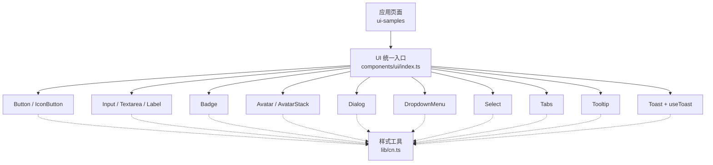
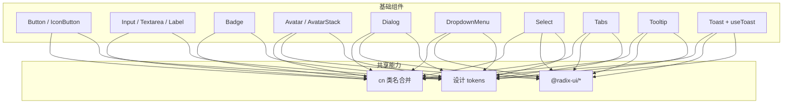
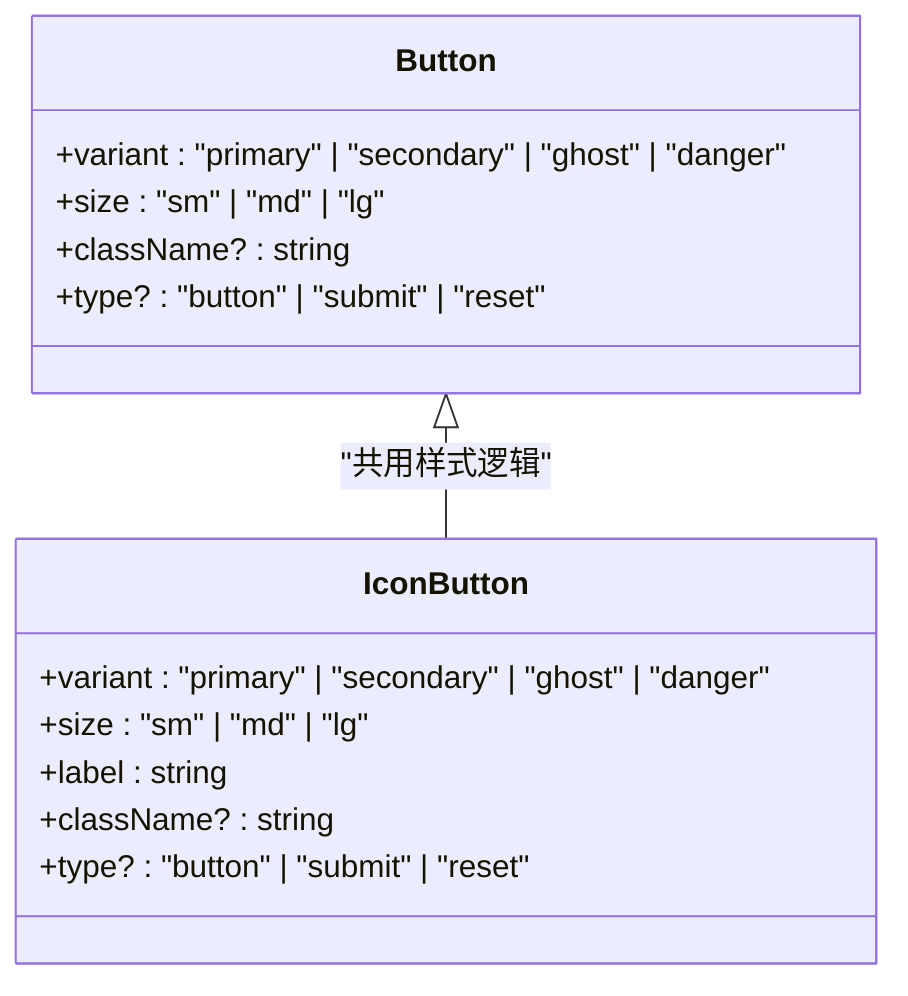
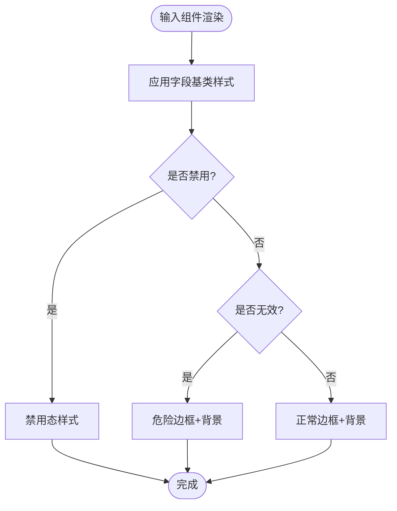
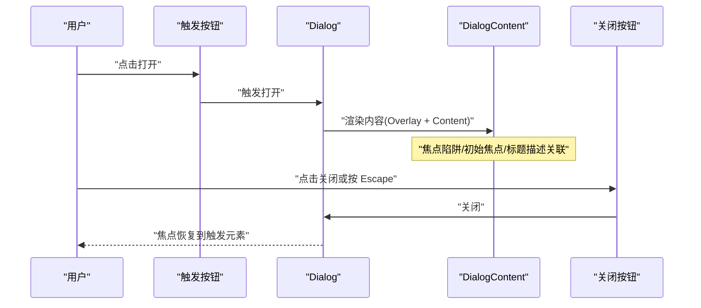
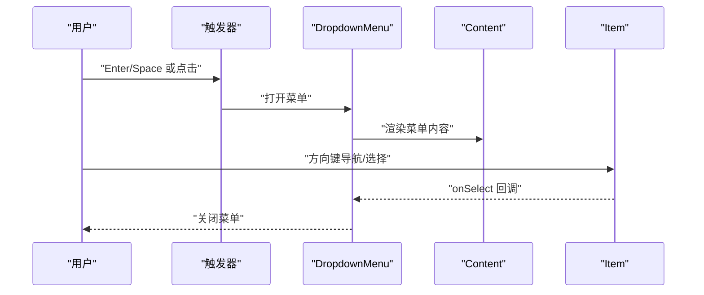
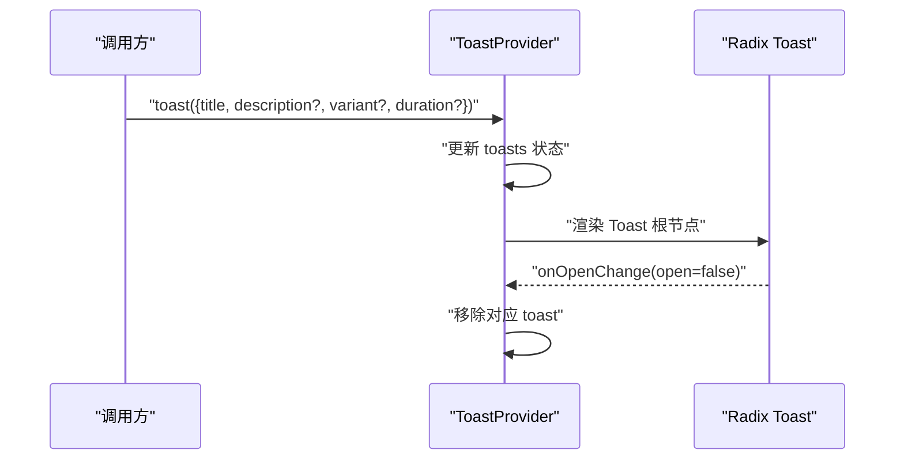
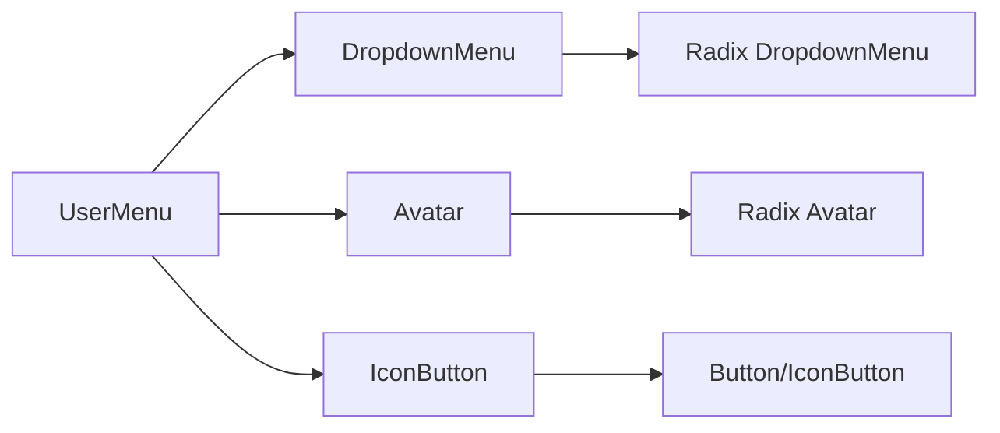

# 基础组件封装

<cite>
**本文引用的文件**
- [src/components/ui/README.md](file://src/components/ui/README.md)
- [src/components/ui/index.ts](file://src/components/ui/index.ts)
- [src/lib/cn.ts](file://src/lib/cn.ts)
- [src/components/ui/button.tsx](file://src/components/ui/button.tsx)
- [src/components/ui/input.tsx](file://src/components/ui/input.tsx)
- [src/components/ui/badge.tsx](file://src/components/ui/badge.tsx)
- [src/components/ui/avatar.tsx](file://src/components/ui/avatar.tsx)
- [src/components/ui/dialog.tsx](file://src/components/ui/dialog.tsx)
- [src/components/ui/dropdown-menu.tsx](file://src/components/ui/dropdown-menu.tsx)
- [src/components/ui/select.tsx](file://src/components/ui/select.tsx)
- [src/components/ui/tabs.tsx](file://src/components/ui/tabs.tsx)
- [src/components/ui/toast.tsx](file://src/components/ui/toast.tsx)
- [src/components/ui/tooltip.tsx](file://src/components/ui/tooltip.tsx)
- [src/app/app/ui-samples/page.tsx](file://src/app/app/ui-samples/page.tsx)
- [src/features/shell/user-menu.tsx](file://src/features/shell/user-menu.tsx)
</cite>

## 目录
1. [简介](#简介)
2. [项目结构](#项目结构)
3. [核心组件](#核心组件)
4. [架构总览](#架构总览)
5. [详细组件分析](#详细组件分析)
6. [依赖关系分析](#依赖关系分析)
7. [性能考量](#性能考量)
8. [故障排查指南](#故障排查指南)
9. [结论](#结论)
10. [附录](#附录)

## 简介
本文件系统化梳理 Orbit 项目的基础 UI 组件封装策略与实现细节。所有组件遵循“基于 Radix primitives + Lucide，样式消费设计 tokens”的原则，统一通过 `@/components/ui` 导出，确保可访问性、主题一致性与可组合性。文档覆盖 Button、Input、Badge、Avatar、Dialog、DropdownMenu、Select、Tabs、Tooltip、Toast 等核心组件的 Props 接口、事件处理、状态管理、可访问性、组合模式、样式定制与主题支持，并提供使用示例、最佳实践与常见问题解决方案，同时给出 TypeScript 类型定义要点、测试策略与性能优化建议。

## 项目结构
- 组件集中位于 `src/components/ui`，并通过 `index.ts` 统一再导出，便于业务模块按需引入。
- 样式全部消费设计 tokens（颜色、尺寸、圆角、阴影等），避免在组件内硬编码视觉值。
- 交互与可访问性由 Radix primitives 提供，组件仅负责样式与组合。
- 工具函数 `cn` 用于安全合并 Tailwind 类名，保证组件默认样式可被调用方覆盖。

图表来源
- [src/components/ui/index.ts:1-25](file://src/components/ui/index.ts#L1-L25)
- [src/lib/cn.ts:1-14](file://src/lib/cn.ts#L1-L14)

章节来源
- [src/components/ui/README.md:1-7](file://src/components/ui/README.md#L1-L7)
- [src/components/ui/index.ts:1-25](file://src/components/ui/index.ts#L1-L25)

## 核心组件
本节概述各组件的职责、Props 设计与可访问性要点。

- Button / IconButton
  - 职责：通用按钮与图标按钮；IconButton 强制 label 作为可访问名称。
  - Props：variant（primary/secondary/ghost/danger）、size（sm/md/lg）、标准 button 属性透传；IconButton 额外要求 label。
  - 可访问性：禁用态、焦点环由全局规则提供；IconButton 通过 aria-label/title 提供可访问名称。
  - 组合：buttonVariants 可复用外观类名给非 button 元素。
  - 参考路径
    - [src/components/ui/button.tsx:12-69](file://src/components/ui/button.tsx#L12-L69)
    - [src/components/ui/button.tsx:72-118](file://src/components/ui/button.tsx#L72-L118)

- Input / Textarea / Label
  - 职责：表单输入控件与标签；错误态切换 danger 边界。
  - Props：透传原生 input/textarea/label 属性；Textarea 默认行数。
  - 可访问性：aria-invalid 驱动错误样式；Label 配合 htmlFor 建立关联。
  - 参考路径
    - [src/components/ui/input.tsx:12-32](file://src/components/ui/input.tsx#L12-L32)
    - [src/components/ui/input.tsx:34-64](file://src/components/ui/input.tsx#L34-L64)

- Badge
  - 职责：优先级、状态、计数等小标签。
  - Props：tone（neutral/brand/success/warning/danger）、icon、children。
  - 可访问性：图标使用 aria-hidden 避免重复朗读。
  - 参考路径
    - [src/components/ui/badge.tsx:11-57](file://src/components/ui/badge.tsx#L11-L57)

- Avatar / AvatarStack
  - 职责：头像展示与成员堆叠；无图时以首字母占位。
  - Props：name、src、size；AvatarStack 支持 names、max、size。
  - 可访问性：Fallback 设置 aria-label；堆叠整体提供完整成员列表的可访问标签。
  - 参考路径
    - [src/components/ui/avatar.tsx:20-65](file://src/components/ui/avatar.tsx#L20-L65)
    - [src/components/ui/avatar.tsx:71-109](file://src/components/ui/avatar.tsx#L71-L109)

- Dialog
  - 职责：对话框弹层；包含 Overlay、Content、Header、Title、Description、Footer。
  - Props：透传 Radix 属性；DialogContent 支持 closeLabel。
  - 可访问性：Radix 提供焦点陷阱、初始焦点、关闭恢复、Escape 关闭、标题描述关联。
  - 参考路径
    - [src/components/ui/dialog.tsx:17-74](file://src/components/ui/dialog.tsx#L17-L74)
    - [src/components/ui/dialog.tsx:76-118](file://src/components/ui/dialog.tsx#L76-L118)

- DropdownMenu
  - 职责：下拉菜单；含 Content、Item、Label、Separator。
  - Props：透传 Radix 属性；Content 支持 sideOffset。
  - 可访问性：键盘导航、焦点管理、禁用态。
  - 参考路径
    - [src/components/ui/dropdown-menu.tsx:15-80](file://src/components/ui/dropdown-menu.tsx#L15-L80)

- Select
  - 职责：选择器；含 Trigger、Content、Item、Label、Separator。
  - Props：透传 Radix 属性；Content 支持 position。
  - 可访问性：方向键/Home/End/输入跳转、aria 角色与焦点管理。
  - 参考路径
    - [src/components/ui/select.tsx:16-108](file://src/components/ui/select.tsx#L16-L108)

- Tabs
  - 职责：标签页；含 List、Trigger、Content。
  - Props：透传 Radix 属性。
  - 可访问性：方向键切换、Home/End、aria-selected、role=tablist。
  - 参考路径
    - [src/components/ui/tabs.tsx:14-60](file://src/components/ui/tabs.tsx#L14-L60)

- Tooltip
  - 职责：提示框；含 Provider、Trigger、Content、Arrow。
  - Props：content、side、触发器属性透传。
  - 可访问性：hover 与 focus 均可触发；Provider 在应用级挂载一次。
  - 参考路径
    - [src/components/ui/tooltip.tsx:14-66](file://src/components/ui/tooltip.tsx#L14-L66)

- Toast + useToast
  - 职责：轻量通知；Context 管理 toast 队列与渲染。
  - Props：toast({ title, description?, variant?, duration? })。
  - 可访问性：Radix Toast 管理 aria-live、自动消失、不影响焦点。
  - 参考路径
    - [src/components/ui/toast.tsx:23-131](file://src/components/ui/toast.tsx#L23-L131)

章节来源
- [src/components/ui/button.tsx:12-118](file://src/components/ui/button.tsx#L12-L118)
- [src/components/ui/input.tsx:12-64](file://src/components/ui/input.tsx#L12-L64)
- [src/components/ui/badge.tsx:11-57](file://src/components/ui/badge.tsx#L11-L57)
- [src/components/ui/avatar.tsx:20-109](file://src/components/ui/avatar.tsx#L20-L109)
- [src/components/ui/dialog.tsx:17-118](file://src/components/ui/dialog.tsx#L17-L118)
- [src/components/ui/dropdown-menu.tsx:15-80](file://src/components/ui/dropdown-menu.tsx#L15-L80)
- [src/components/ui/select.tsx:16-108](file://src/components/ui/select.tsx#L16-L108)
- [src/components/ui/tabs.tsx:14-60](file://src/components/ui/tabs.tsx#L14-L60)
- [src/components/ui/tooltip.tsx:14-66](file://src/components/ui/tooltip.tsx#L14-L66)
- [src/components/ui/toast.tsx:23-131](file://src/components/ui/toast.tsx#L23-L131)

## 架构总览
组件采用“Radix 原语 + 样式封装”的组合模式：每个复杂组件由多个 Radix 子组件拼装而成，样式通过 cn 合并 Tailwind 类名，并消费设计 tokens。可访问性由 Radix 保障，组件层不重复实现。

图表来源
- [src/components/ui/button.tsx:12-69](file://src/components/ui/button.tsx#L12-L69)
- [src/components/ui/dialog.tsx:17-74](file://src/components/ui/dialog.tsx#L17-L74)
- [src/components/ui/dropdown-menu.tsx:15-80](file://src/components/ui/dropdown-menu.tsx#L15-L80)
- [src/components/ui/select.tsx:16-108](file://src/components/ui/select.tsx#L16-L108)
- [src/components/ui/tabs.tsx:14-60](file://src/components/ui/tabs.tsx#L14-L60)
- [src/components/ui/tooltip.tsx:14-66](file://src/components/ui/tooltip.tsx#L14-L66)
- [src/components/ui/toast.tsx:23-131](file://src/components/ui/toast.tsx#L23-L131)
- [src/components/ui/avatar.tsx:20-65](file://src/components/ui/avatar.tsx#L20-L65)
- [src/lib/cn.ts:1-14](file://src/lib/cn.ts#L1-L14)

## 详细组件分析

### Button / IconButton
- 设计要点
  - 通过 buttonVariants 生成统一外观类名，支持 variant 与 size 组合。
  - IconButton 强制 label 作为 aria-label 与 title，确保无障碍可读。
- 事件处理
  - 透传原生 button 事件（onClick 等）。
- 状态管理
  - 无内部状态；disabled 由父级控制。
- 可访问性
  - 禁用态不可聚焦；焦点环由全局 :focus-visible 提供。
- 组合与样式
  - 可通过 className 覆盖默认样式；尺寸与变体通过 props 控制。
- 使用示例路径
  - [src/app/app/ui-samples/page.tsx:159-237](file://src/app/app/ui-samples/page.tsx#L159-L237)

图表来源
- [src/components/ui/button.tsx:12-69](file://src/components/ui/button.tsx#L12-L69)
- [src/components/ui/button.tsx:72-118](file://src/components/ui/button.tsx#L72-L118)

章节来源
- [src/components/ui/button.tsx:12-118](file://src/components/ui/button.tsx#L12-L118)
- [src/app/app/ui-samples/page.tsx:159-237](file://src/app/app/ui-samples/page.tsx#L159-L237)

### Input / Textarea / Label
- 设计要点
  - 字段基类 fieldBase 统一边框、背景、过渡与禁用态；aria-invalid 切换危险边框与背景。
- 事件处理
  - 透传原生 onChange/onFocus 等事件。
- 状态管理
  - 无内部状态；错误态由父级通过 aria-invalid 控制。
- 可访问性
  - Label 通过 htmlFor 与 Input id 关联；错误信息通过 aria-describedby 关联。
- 使用示例路径
  - [src/app/app/ui-samples/page.tsx:239-279](file://src/app/app/ui-samples/page.tsx#L239-L279)

图表来源
- [src/components/ui/input.tsx:12-32](file://src/components/ui/input.tsx#L12-L32)
- [src/components/ui/input.tsx:34-64](file://src/components/ui/input.tsx#L34-L64)

章节来源
- [src/components/ui/input.tsx:12-64](file://src/components/ui/input.tsx#L12-L64)
- [src/app/app/ui-samples/page.tsx:239-279](file://src/app/app/ui-samples/page.tsx#L239-L279)

### Badge
- 设计要点
  - tone 决定语义配色；支持可选 icon。
- 可访问性
  - 图标使用 aria-hidden 避免重复朗读。
- 使用示例路径
  - [src/app/app/ui-samples/page.tsx:530-566](file://src/app/app/ui-samples/page.tsx#L530-L566)

章节来源
- [src/components/ui/badge.tsx:11-57](file://src/components/ui/badge.tsx#L11-L57)
- [src/app/app/ui-samples/page.tsx:530-566](file://src/app/app/ui-samples/page.tsx#L530-L566)

### Avatar / AvatarStack
- 设计要点
  - 无图时显示姓名首字母；支持尺寸 sm/md/lg。
  - AvatarStack 叠加头像并显示 +N，提供完整成员列表的可访问标签。
- 可访问性
  - Fallback 设置 aria-label；堆叠整体提供 aria-label 列出成员。
- 使用示例路径
  - [src/app/app/ui-samples/page.tsx:568-588](file://src/app/app/ui-samples/page.tsx#L568-L588)

章节来源
- [src/components/ui/avatar.tsx:20-109](file://src/components/ui/avatar.tsx#L20-L109)
- [src/app/app/ui-samples/page.tsx:568-588](file://src/app/app/ui-samples/page.tsx#L568-L588)

### Dialog
- 设计要点
  - 将 Radix Dialog 的子组件进行样式封装；右上角关闭按钮复用 IconButton。
- 可访问性
  - 焦点陷阱、打开移入焦点、关闭后恢复焦点、Escape 关闭、标题与描述关联。
- 使用示例路径
  - [src/app/app/ui-samples/page.tsx:325-362](file://src/app/app/ui-samples/page.tsx#L325-L362)

图表来源
- [src/components/ui/dialog.tsx:17-74](file://src/components/ui/dialog.tsx#L17-L74)
- [src/components/ui/dialog.tsx:76-118](file://src/components/ui/dialog.tsx#L76-L118)
- [src/app/app/ui-samples/page.tsx:325-362](file://src/app/app/ui-samples/page.tsx#L325-L362)

章节来源
- [src/components/ui/dialog.tsx:17-118](file://src/components/ui/dialog.tsx#L17-L118)
- [src/app/app/ui-samples/page.tsx:325-362](file://src/app/app/ui-samples/page.tsx#L325-L362)

### DropdownMenu
- 设计要点
  - 封装 Content、Item、Label、Separator；支持 disabled 项。
- 可访问性
  - 键盘导航、焦点管理、禁用态。
- 使用示例路径
  - [src/app/app/ui-samples/page.tsx:447-493](file://src/app/app/ui-samples/page.tsx#L447-L493)
  - [src/features/shell/user-menu.tsx:90-133](file://src/features/shell/user-menu.tsx#L90-L133)

图表来源
- [src/components/ui/dropdown-menu.tsx:15-80](file://src/components/ui/dropdown-menu.tsx#L15-L80)
- [src/app/app/ui-samples/page.tsx:447-493](file://src/app/app/ui-samples/page.tsx#L447-L493)
- [src/features/shell/user-menu.tsx:90-133](file://src/features/shell/user-menu.tsx#L90-L133)

章节来源
- [src/components/ui/dropdown-menu.tsx:15-80](file://src/components/ui/dropdown-menu.tsx#L15-L80)
- [src/app/app/ui-samples/page.tsx:447-493](file://src/app/app/ui-samples/page.tsx#L447-L493)
- [src/features/shell/user-menu.tsx:90-133](file://src/features/shell/user-menu.tsx#L90-L133)

### Select
- 设计要点
  - 封装 Trigger、Content、Item、Label、Separator；支持 popper 定位。
- 可访问性
  - 方向键/Home/End/输入跳转、aria 角色与焦点管理。
- 使用示例路径
  - [src/app/app/ui-samples/page.tsx:281-323](file://src/app/app/ui-samples/page.tsx#L281-L323)

章节来源
- [src/components/ui/select.tsx:16-108](file://src/components/ui/select.tsx#L16-L108)
- [src/app/app/ui-samples/page.tsx:281-323](file://src/app/app/ui-samples/page.tsx#L281-L323)

### Tabs
- 设计要点
  - 封装 List、Trigger、Content；active 态高亮。
- 可访问性
  - 方向键切换、Home/End、aria-selected、role=tablist。
- 使用示例路径
  - [src/app/app/ui-samples/page.tsx:495-528](file://src/app/app/ui-samples/page.tsx#L495-L528)

章节来源
- [src/components/ui/tabs.tsx:14-60](file://src/components/ui/tabs.tsx#L14-L60)
- [src/app/app/ui-samples/page.tsx:495-528](file://src/app/app/ui-samples/page.tsx#L495-L528)

### Tooltip
- 设计要点
  - 封装 Provider、Trigger、Content、Arrow；支持多方向。
- 可访问性
  - hover 与 focus 均可触发；Provider 在应用级挂载一次。
- 使用示例路径
  - [src/app/app/ui-samples/page.tsx:415-445](file://src/app/app/ui-samples/page.tsx#L415-L445)

章节来源
- [src/components/ui/tooltip.tsx:14-66](file://src/components/ui/tooltip.tsx#L14-L66)
- [src/app/app/ui-samples/page.tsx:415-445](file://src/app/app/ui-samples/page.tsx#L415-L445)

### Toast + useToast
- 设计要点
  - Context 管理 toast 队列；支持 info/success/danger 三种变体；自动消失。
- 可访问性
  - Radix Toast 管理 aria-live、自动消失、不影响焦点。
- 使用示例路径
  - [src/app/app/ui-samples/page.tsx:611-661](file://src/app/app/ui-samples/page.tsx#L611-L661)

图表来源
- [src/components/ui/toast.tsx:58-131](file://src/components/ui/toast.tsx#L58-L131)
- [src/app/app/ui-samples/page.tsx:611-661](file://src/app/app/ui-samples/page.tsx#L611-L661)

章节来源
- [src/components/ui/toast.tsx:23-131](file://src/components/ui/toast.tsx#L23-L131)
- [src/app/app/ui-samples/page.tsx:611-661](file://src/app/app/ui-samples/page.tsx#L611-L661)

## 依赖关系分析
- 组件对 Radix 的依赖集中在弹窗、菜单、选择器、标签页、提示、头像、通知等需要复杂交互与可访问性的场景。
- 样式依赖统一的 cn 工具与 Tailwind 类名；视觉完全消费 tokens。
- 业务组件（如 UserMenu）组合基础组件形成更高层的交互单元。

图表来源
- [src/features/shell/user-menu.tsx:90-133](file://src/features/shell/user-menu.tsx#L90-L133)
- [src/components/ui/dropdown-menu.tsx:15-80](file://src/components/ui/dropdown-menu.tsx#L15-L80)
- [src/components/ui/avatar.tsx:20-65](file://src/components/ui/avatar.tsx#L20-L65)
- [src/components/ui/button.tsx:12-118](file://src/components/ui/button.tsx#L12-L118)

章节来源
- [src/features/shell/user-menu.tsx:90-133](file://src/features/shell/user-menu.tsx#L90-L133)
- [src/components/ui/index.ts:1-25](file://src/components/ui/index.ts#L1-L25)

## 性能考量
- 避免不必要的重渲染：基础组件多为无状态或受控组件，尽量将状态提升到业务层。
- 使用 cn 合并类名可减少冲突与重复计算；Tailwind 类名在构建期优化。
- 弹窗/菜单等复杂组件由 Radix 管理 DOM 与事件，注意合理拆分与懒加载（例如按需导入）。
- 图片资源（Avatar）应提供合适的 src 与 alt，避免阻塞与闪烁；fallback 快速回退。
- Toast 数量过多会影响性能，建议在业务层限制并发显示数量与持续时间。

## 故障排查指南
- 图标按钮不可读
  - 现象：屏幕阅读器无法识别意图。
  - 原因：未提供 label。
  - 解决：为 IconButton 传入 label，确保映射到 aria-label 与 title。
  - 参考路径
    - [src/components/ui/button.tsx:78-118](file://src/components/ui/button.tsx#L78-L118)

- 输入框错误样式不生效
  - 现象：错误时无红色边框与背景。
  - 原因：未设置 aria-invalid。
  - 解决：在父级根据校验结果设置 aria-invalid="true"，并配合 InlineError 说明。
  - 参考路径
    - [src/components/ui/input.tsx:12-32](file://src/components/ui/input.tsx#L12-L32)
    - [src/app/app/ui-samples/page.tsx:258-268](file://src/app/app/ui-samples/page.tsx#L258-L268)

- 对话框焦点异常
  - 现象：打开后焦点不在内容区或关闭后焦点丢失。
  - 原因：未正确使用 Dialog 组件组合。
  - 解决：使用 Dialog/DialogTrigger/DialogContent/DialogTitle/DialogDescription/DialogClose 组合，让 Radix 管理焦点。
  - 参考路径
    - [src/components/ui/dialog.tsx:17-74](file://src/components/ui/dialog.tsx#L17-L74)
    - [src/app/app/ui-samples/page.tsx:325-362](file://src/app/app/ui-samples/page.tsx#L325-L362)

- Toast 未在上下文中使用
  - 现象：useToast 抛出错误。
  - 原因：未在 ToastProvider 内调用。
  - 解决：在应用或页面层级包裹 ToastProvider。
  - 参考路径
    - [src/components/ui/toast.tsx:123-131](file://src/components/ui/toast.tsx#L123-L131)

章节来源
- [src/components/ui/button.tsx:78-118](file://src/components/ui/button.tsx#L78-L118)
- [src/components/ui/input.tsx:12-32](file://src/components/ui/input.tsx#L12-L32)
- [src/components/ui/dialog.tsx:17-74](file://src/components/ui/dialog.tsx#L17-L74)
- [src/components/ui/toast.tsx:123-131](file://src/components/ui/toast.tsx#L123-L131)
- [src/app/app/ui-samples/page.tsx:258-268](file://src/app/app/ui-samples/page.tsx#L258-L268)
- [src/app/app/ui-samples/page.tsx:325-362](file://src/app/app/ui-samples/page.tsx#L325-L362)

## 结论
Orbit 的基础 UI 组件以 Radix primitives 为核心，结合设计 tokens 与统一的样式工具，实现了高可访问性、强一致性、易组合的组件体系。通过明确的 Props 接口、事件透传与状态外置，组件既满足业务需求又保持简洁。配合 ui-samples 样例页与业务组件（如 UserMenu）的实际用法，开发者可以快速上手并扩展新的组合形态。

## 附录
- 使用示例汇总
  - 按钮与图标按钮：[src/app/app/ui-samples/page.tsx:159-237](file://src/app/app/ui-samples/page.tsx#L159-L237)
  - 输入与文本域：[src/app/app/ui-samples/page.tsx:239-279](file://src/app/app/ui-samples/page.tsx#L239-L279)
  - 选择器：[src/app/app/ui-samples/page.tsx:281-323](file://src/app/app/ui-samples/page.tsx#L281-L323)
  - 对话框：[src/app/app/ui-samples/page.tsx:325-362](file://src/app/app/ui-samples/page.tsx#L325-L362)
  - 提示：[src/app/app/ui-samples/page.tsx:415-445](file://src/app/app/ui-samples/page.tsx#L415-L445)
  - 下拉菜单：[src/app/app/ui-samples/page.tsx:447-493](file://src/app/app/ui-samples/page.tsx#L447-L493)
  - 标签页：[src/app/app/ui-samples/page.tsx:495-528](file://src/app/app/ui-samples/page.tsx#L495-L528)
  - 徽章：[src/app/app/ui-samples/page.tsx:530-566](file://src/app/app/ui-samples/page.tsx#L530-L566)
  - 头像与堆叠：[src/app/app/ui-samples/page.tsx:568-588](file://src/app/app/ui-samples/page.tsx#L568-L588)
  - 通知：[src/app/app/ui-samples/page.tsx:611-661](file://src/app/app/ui-samples/page.tsx#L611-L661)
- 最佳实践
  - 始终使用 Radix 提供的可访问性能力，不自造不可访问的弹窗/菜单/下拉。
  - 通过 cn 合并类名，避免覆盖失败与样式冲突。
  - 表单错误使用 aria-invalid 与 InlineError 配合，确保可访问性与一致性。
  - 图标按钮必须提供 label，保证屏幕阅读器可读。
  - 弹窗/菜单等复杂组件保持最小化样式封装，把交互交给 Radix。
- 测试策略建议
  - 单元测试：验证 Props 类型、默认值、类名合并结果（使用 vitest）。
  - 可访问性测试：检查 aria-* 属性、焦点顺序、键盘导航（结合 axe-core）。
  - 集成测试：模拟用户操作（打开/关闭对话框、选择选项、触发菜单）并断言 UI 变化（Playwright）。
  - 快照测试：对复杂组合组件（如 Dialog、DropdownMenu）进行快照比对，防止意外变更。
- 性能优化建议
  - 将大段内容放入懒加载组件，减少首屏体积。
  - 合理使用 React.memo 与 useMemo，避免不必要重渲染。
  - 图片资源使用合适尺寸与格式，启用浏览器缓存。
  - 控制 Toast 并发数量与持续时间，避免频繁创建销毁。