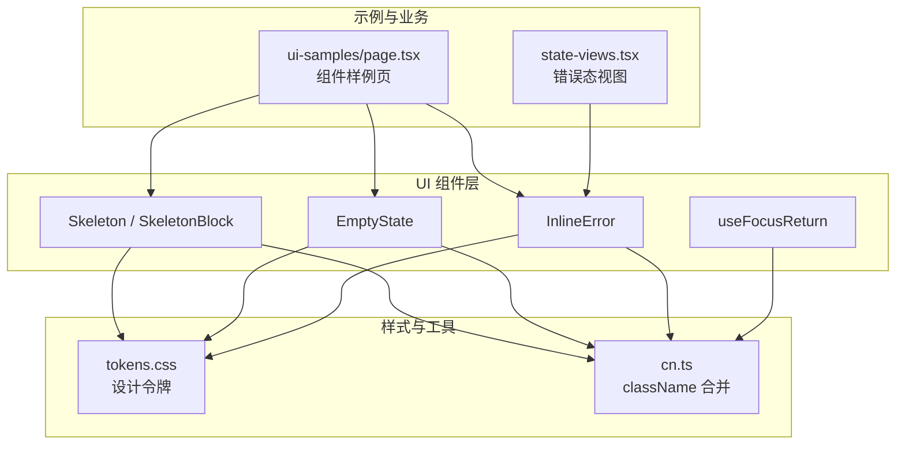
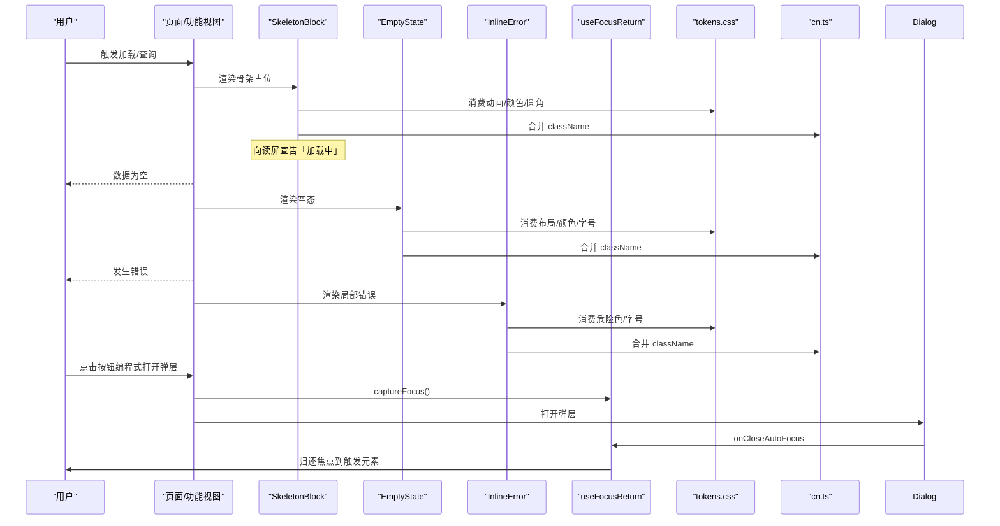
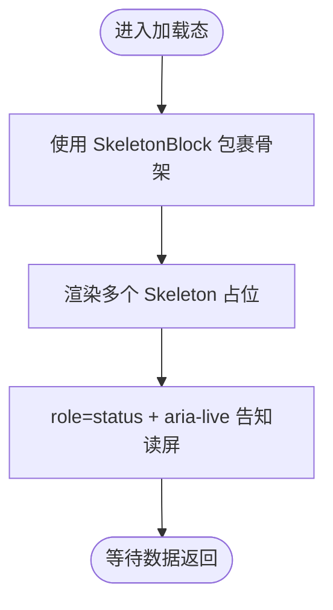
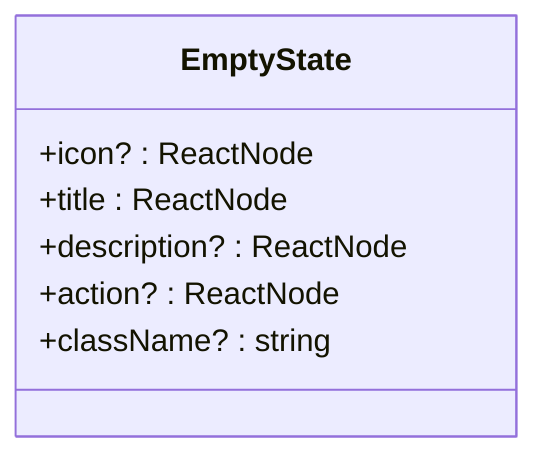
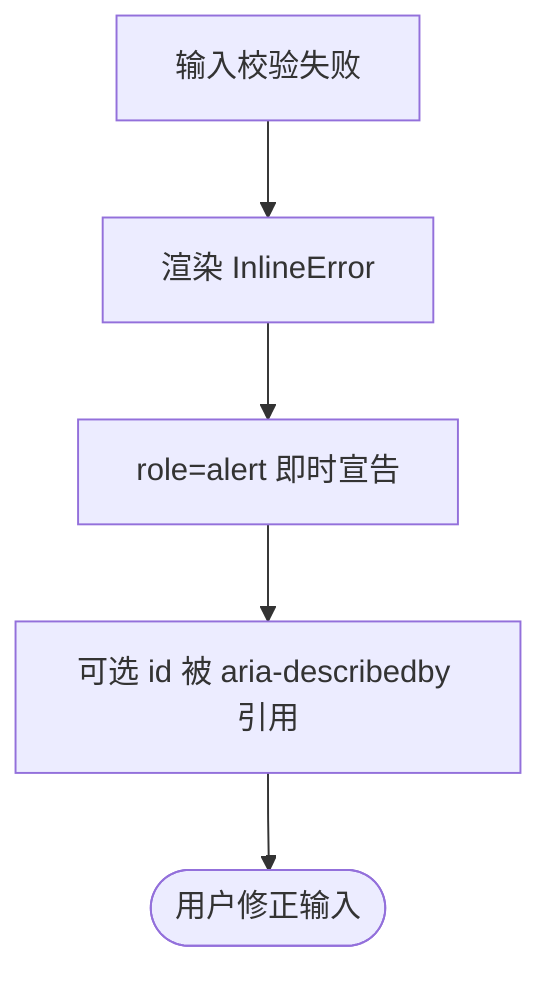
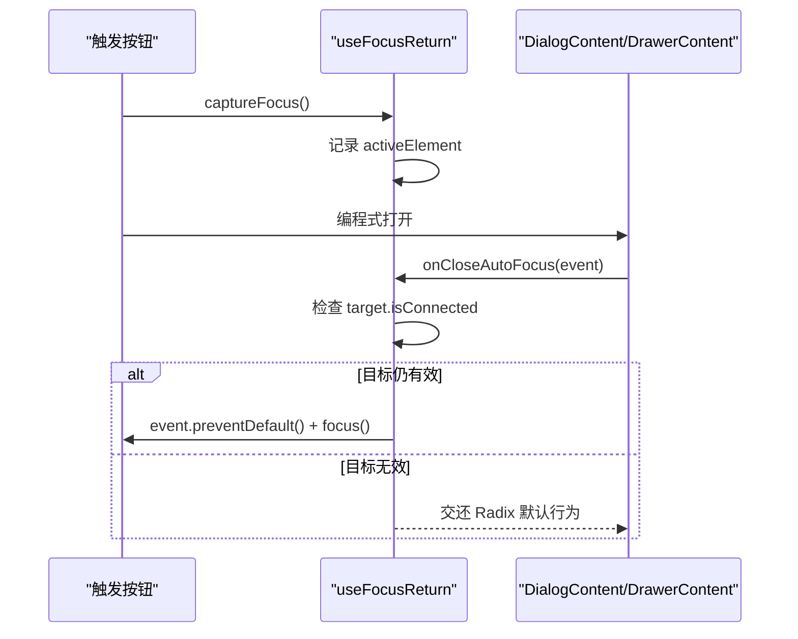
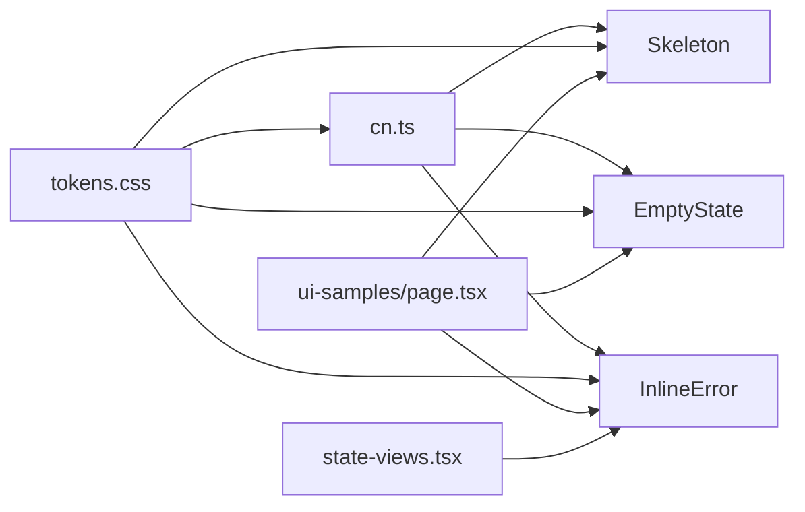

# 工具组件

<cite>
**本文引用的文件**
- [skeleton.tsx](file://src/components/ui/skeleton.tsx)
- [empty-state.tsx](file://src/components/ui/empty-state.tsx)
- [inline-error.tsx](file://src/components/ui/inline-error.tsx)
- [use-focus-return.ts](file://src/components/ui/use-focus-return.ts)
- [index.ts](file://src/components/ui/index.ts)
- [cn.ts](file://src/lib/cn.ts)
- [tokens.css](file://src/styles/tokens.css)
- [ui-samples/page.tsx](file://src/app/app/ui-samples/page.tsx)
- [state-views.tsx](file://src/features/shell/state-views.tsx)
</cite>

## 目录
1. [简介](#简介)
2. [项目结构](#项目结构)
3. [核心组件](#核心组件)
4. [架构总览](#架构总览)
5. [详细组件分析](#详细组件分析)
6. [依赖关系分析](#依赖关系分析)
7. [性能考虑](#性能考虑)
8. [故障排查指南](#故障排查指南)
9. [结论](#结论)
10. [附录：使用示例与集成模式](#附录使用示例与集成模式)

## 简介
本文件聚焦 Orbit 项目的工具类 UI 组件，覆盖加载占位、空数据展示、局部错误提示以及弹层焦点恢复等关键体验环节。目标包括：
- 解释 Skeleton、EmptyState、InlineError 的职责、配置项、样式定制与可访问性实现。
- 说明 useFocusReturn 自定义 Hook 的实现原理与在编程式打开弹层时的焦点恢复流程。
- 总结这些组件在用户体验优化中的作用：避免布局抖动、提供明确状态与下一步操作、确保错误可被读屏即时感知。
- 给出具体使用示例、集成模式与性能注意事项。

## 项目结构
这些工具组件集中在 src/components/ui 下，并通过统一入口 index.ts 导出，便于业务模块按需引入。UI 样式基于设计 tokens（颜色、字号、圆角、动效等），并通过 cn 工具安全合并 className，保证组件内建样式与调用方覆盖的兼容性。

图表来源
- [index.ts:9-24](file://src/components/ui/index.ts#L9-L24)
- [tokens.css:23-107](file://src/styles/tokens.css#L23-L107)
- [cn.ts:1-14](file://src/lib/cn.ts#L1-L14)
- [ui-samples/page.tsx:591-701](file://src/app/app/ui-samples/page.tsx#L591-L701)
- [state-views.tsx:1-37](file://src/features/shell/state-views.tsx#L1-L37)

章节来源
- [index.ts:1-25](file://src/components/ui/index.ts#L1-L25)
- [tokens.css:1-169](file://src/styles/tokens.css#L1-L169)
- [cn.ts:1-14](file://src/lib/cn.ts#L1-L14)

## 核心组件
- Skeleton / SkeletonBlock：用于加载阶段的骨架占位，保持布局稳定；SkeletonBlock 为屏幕阅读器提供“加载中”语义。
- EmptyState：真正无数据或筛选无结果时展示，包含图标、标题、描述与可选操作，引导用户下一步。
- InlineError：字段旁或局部区域的驻留错误提示，默认 role=alert，配合危险色与图标传达错误信息。
- useFocusReturn：在编程式打开弹层时捕获当前焦点元素，并在关闭后归还焦点，提升键盘可达性与可访问性。

章节来源
- [skeleton.tsx:1-46](file://src/components/ui/skeleton.tsx#L1-L46)
- [empty-state.tsx:1-54](file://src/components/ui/empty-state.tsx#L1-L54)
- [inline-error.tsx:1-40](file://src/components/ui/inline-error.tsx#L1-L40)
- [use-focus-return.ts:1-46](file://src/components/ui/use-focus-return.ts#L1-L46)

## 架构总览
这些组件遵循统一的样式与可访问性策略：
- 样式层：通过 tokens.css 定义颜色、字号、圆角、动效等设计令牌；组件内部使用 Tailwind 类名消费这些令牌。
- 工具层：cn.ts 将 clsx 与 tailwind-merge 结合，使组件既能内建样式，又能被调用方 className 安全覆盖。
- 可访问性：SkeletonBlock 使用 role="status" + aria-live 告知加载；InlineError 使用 role="alert" 即时宣告错误；全局 :focus-visible 规则确保焦点环可见。
- 交互层：useFocusReturn 解决编程式打开弹层的焦点回归问题，保障键盘导航一致性。

图表来源
- [skeleton.tsx:13-45](file://src/components/ui/skeleton.tsx#L13-L45)
- [empty-state.tsx:19-53](file://src/components/ui/empty-state.tsx#L19-L53)
- [inline-error.tsx:18-39](file://src/components/ui/inline-error.tsx#L18-L39)
- [use-focus-return.ts:23-45](file://src/components/ui/use-focus-return.ts#L23-L45)
- [tokens.css:144-168](file://src/styles/tokens.css#L144-L168)
- [cn.ts:11-13](file://src/lib/cn.ts#L11-L13)

## 详细组件分析

### Skeleton / SkeletonBlock
- 职责
  - Skeleton：轻量骨架块，用于模拟真实内容尺寸，避免整屏 spinner，减少布局抖动。
  - SkeletonBlock：包裹一组骨架，提供 role="status" 与 aria-live="polite"，并支持 sr-only 文本，让读屏器感知“加载中”。
- 配置选项
  - Skeleton：接受标准 div 属性与 className，用于控制尺寸、圆角等。
  - SkeletonBlock：label（读屏文本）、className、children（骨架子节点）。
- 样式定制
  - 使用 tokens 中的背景、圆角与动画类；pulse 动画在 prefers-reduced-motion 下自动降级。
- 可访问性
  - Skeleton 本身为装饰性，设置 aria-hidden="true"。
  - SkeletonBlock 通过 role="status" 与 aria-live 告知加载状态；sr-only 文本提供可读名称。
- 使用建议
  - 用与真实布局同形的骨架块替换内容区域，保持外壳尺寸稳定。
  - 列表、卡片、表单字段均可用 Skeleton 模拟高度与宽度。

图表来源
- [skeleton.tsx:13-45](file://src/components/ui/skeleton.tsx#L13-L45)
- [tokens.css:144-154](file://src/styles/tokens.css#L144-L154)

章节来源
- [skeleton.tsx:1-46](file://src/components/ui/skeleton.tsx#L1-L46)
- [tokens.css:144-154](file://src/styles/tokens.css#L144-L154)

### EmptyState
- 职责
  - 在真正无数据或筛选无结果时展示，提供标题、描述与可选操作，帮助用户理解现状并采取下一步。
- 配置选项
  - icon：可选图标节点（由调用方传入 lucide 图标）。
  - title：必填标题，说明现状。
  - description：可选描述，解释意义。
  - action：可选操作区，放置按钮等下一步动作。
  - className：用于覆盖或扩展样式。
- 样式定制
  - 使用 tokens 的颜色、字号、圆角与间距；居中布局，边框与背景区分层级。
- 可访问性
  - 图标容器设置 aria-hidden="true"，避免干扰读屏。
  - 标题与描述采用合适的语义层级，便于辅助技术解析。
- 使用建议
  - 仅用于“真正无数据”的场景；若只是未开始使用，应提供引导文案与操作。
  - 避免庆祝动画，保持简洁线形图标风格。

图表来源
- [empty-state.tsx:12-53](file://src/components/ui/empty-state.tsx#L12-L53)

章节来源
- [empty-state.tsx:1-54](file://src/components/ui/empty-state.tsx#L1-L54)

### InlineError
- 职责
  - 在字段旁或局部区域内显示驻留错误提示，不依赖 Toast 作为唯一反馈。
- 配置选项
  - children：错误文案。
  - id：可选 id，供控件的 aria-describedby 引用。
  - className：用于覆盖或扩展样式。
- 样式定制
  - 使用 tokens 的危险色与背景，搭配图标与文字排版，确保对比度达标。
- 可访问性
  - 默认 role="alert"，让屏幕阅读器即时宣告错误。
  - 图标设置 aria-hidden="true"，避免重复朗读。
- 使用建议
  - 与表单控件配合，使用 aria-invalid 与 aria-describedby 建立关联。
  - 错误文案需清晰、可操作，避免只靠颜色传达信息。

图表来源
- [inline-error.tsx:18-39](file://src/components/ui/inline-error.tsx#L18-L39)

章节来源
- [inline-error.tsx:1-40](file://src/components/ui/inline-error.tsx#L1-L40)

### useFocusReturn
- 职责
  - 在编程式打开弹层（无 Trigger 元素）时记录当前焦点元素，并在关闭时归还焦点，避免焦点掉回 body。
- 实现要点
  - captureFocus：在打开前同步读取 document.activeElement 并保存。
  - handleCloseAutoFocus：在 onCloseAutoFocus 中判断目标元素是否仍在文档中且可聚焦，若是则阻止默认行为并 focus。
- 使用方式
  - 在打开弹层前调用 captureFocus，并将 handleCloseAutoFocus 传给 DialogContent/DrawerContent。
- 可访问性
  - 确保键盘用户在使用弹层后能回到触发位置，维持导航连续性。

图表来源
- [use-focus-return.ts:23-45](file://src/components/ui/use-focus-return.ts#L23-L45)

章节来源
- [use-focus-return.ts:1-46](file://src/components/ui/use-focus-return.ts#L1-L46)

## 依赖关系分析
- 组件对样式的依赖
  - 所有组件通过 cn.ts 合并 className，确保内建样式与外部覆盖兼容。
  - 样式来源于 tokens.css，涵盖颜色、字号、圆角、动效与焦点环。
- 组件对可访问性的依赖
  - 全局 :focus-visible 规则确保焦点环可见，避免 outline-none 覆盖导致不可见。
  - 各组件通过 role、aria-* 与 sr-only 增强读屏体验。
- 组件对示例与业务的依赖
  - ui-samples/page.tsx 展示了 Skeleton、InlineError、EmptyState 的实际用法。
  - state-views.tsx 展示了 InlineError 在错误态视图中的集成模式。

图表来源
- [tokens.css:23-107](file://src/styles/tokens.css#L23-L107)
- [cn.ts:11-13](file://src/lib/cn.ts#L11-L13)
- [ui-samples/page.tsx:591-701](file://src/app/app/ui-samples/page.tsx#L591-L701)
- [state-views.tsx:1-37](file://src/features/shell/state-views.tsx#L1-L37)

章节来源
- [tokens.css:1-169](file://src/styles/tokens.css#L1-L169)
- [cn.ts:1-14](file://src/lib/cn.ts#L1-L14)
- [ui-samples/page.tsx:1-745](file://src/app/app/ui-samples/page.tsx#L1-L745)
- [state-views.tsx:1-37](file://src/features/shell/state-views.tsx#L1-L37)

## 性能考虑
- 骨架占位
  - 使用轻量 div 与 CSS 动画，避免复杂 DOM 与重绘；在 prefers-reduced-motion 下自动降级，降低动画开销。
- 空态与错误态
  - 仅在必要时渲染，避免不必要的重排；EmptyState 与 InlineError 结构简单，渲染成本低。
- 焦点管理
  - useFocusReturn 仅在打开/关闭弹层时执行少量 DOM 查询与事件处理，开销极低。
- 样式合并
  - cn.ts 使用 tailwind-merge 避免类名冲突，减少重复计算；建议在大型列表中谨慎使用过多动态 className。

[本节为通用指导，不直接分析具体文件]

## 故障排查指南
- 读屏未播报加载状态
  - 确认使用了 SkeletonBlock 而非裸 Skeleton；检查 role="status" 与 aria-live 是否正确应用。
- 错误提示未被读屏宣告
  - 确认 InlineError 的 role="alert" 生效；若被外层覆盖，检查是否有样式或库覆盖了该属性。
- 弹层关闭后焦点丢失
  - 确认在打开弹层前调用了 captureFocus，并将 handleCloseAutoFocus 正确传入 Content 组件。
- 样式覆盖失效
  - 检查 className 合并顺序；确保调用方 className 在后，以便 tailwind-merge 优先覆盖。
- 焦点环不可见
  - 检查是否存在 outline-none 覆盖全局 :focus-visible；必要时调整样式优先级或使用 tokens 提供的焦点环变量。

章节来源
- [skeleton.tsx:13-45](file://src/components/ui/skeleton.tsx#L13-L45)
- [inline-error.tsx:18-39](file://src/components/ui/inline-error.tsx#L18-L39)
- [use-focus-return.ts:23-45](file://src/components/ui/use-focus-return.ts#L23-L45)
- [tokens.css:157-168](file://src/styles/tokens.css#L157-L168)

## 结论
Orbit 的工具组件围绕“稳定布局、明确状态、可访问反馈”展开：
- Skeleton/SkeletonBlock 以骨架占位避免布局抖动，并通过读屏语义提升可访问性。
- EmptyState 在无数据时提供清晰的现状说明与下一步操作，引导用户继续任务。
- InlineError 提供驻留错误提示，结合图标与颜色，确保错误信息不被忽略。
- useFocusReturn 解决编程式弹层的焦点回归问题，保障键盘用户的连续体验。
这些组件共同提升了加载、空态与错误场景的用户体验，同时遵循设计令牌与可访问性规范，易于集成与定制。

[本节为总结，不直接分析具体文件]

## 附录：使用示例与集成模式
- 骨架占位
  - 在列表或卡片加载时使用 SkeletonBlock 包裹多个 Skeleton，模拟真实布局。
  - 参考路径：[ui-samples/page.tsx:591-609](file://src/app/app/ui-samples/page.tsx#L591-L609)
- 空数据展示
  - 当查询结果为空或筛选无匹配时，使用 EmptyState 展示标题、描述与操作按钮。
  - 参考路径：[ui-samples/page.tsx:680-701](file://src/app/app/ui-samples/page.tsx#L680-L701)
- 局部错误提示
  - 在表单字段下方或区域顶部使用 InlineError，并与控件的 aria-describedby 关联。
  - 参考路径：[ui-samples/page.tsx:665-676](file://src/app/app/ui-samples/page.tsx#L665-L676)、[state-views.tsx:16-37](file://src/features/shell/state-views.tsx#L16-L37)
- 弹层焦点恢复
  - 在打开弹层前调用 captureFocus，并将 handleCloseAutoFocus 传入 Content。
  - 参考路径：[use-focus-return.ts:16-22](file://src/components/ui/use-focus-return.ts#L16-L22)

章节来源
- [ui-samples/page.tsx:591-701](file://src/app/app/ui-samples/page.tsx#L591-L701)
- [state-views.tsx:1-37](file://src/features/shell/state-views.tsx#L1-L37)
- [use-focus-return.ts:1-46](file://src/components/ui/use-focus-return.ts#L1-L46)