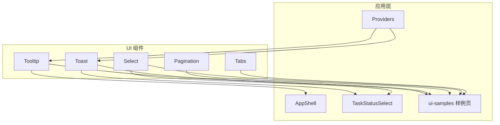
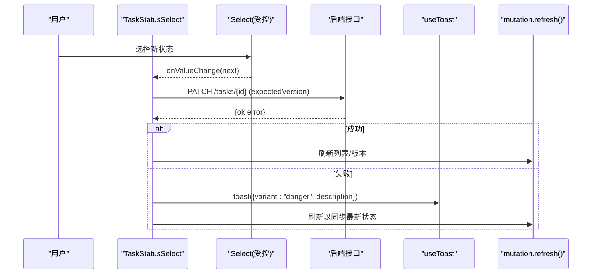
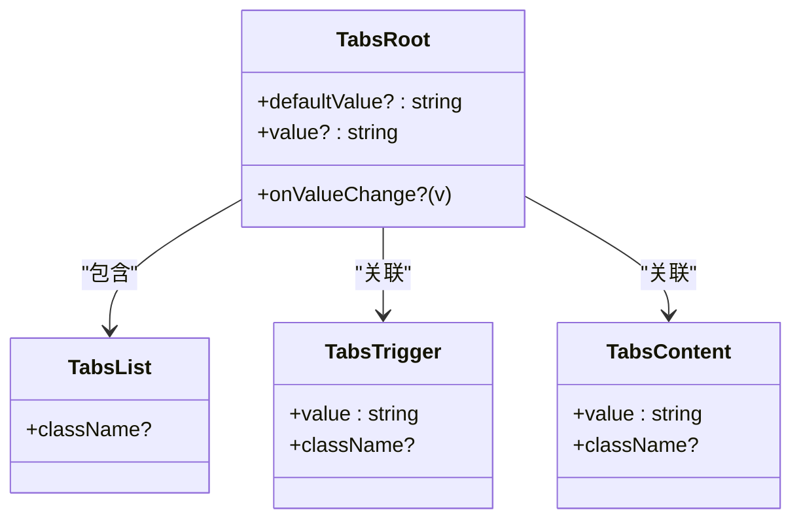
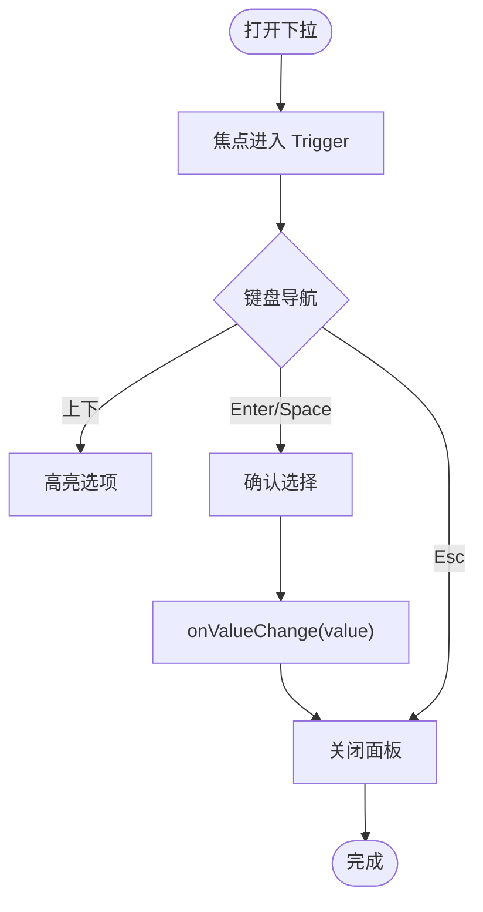
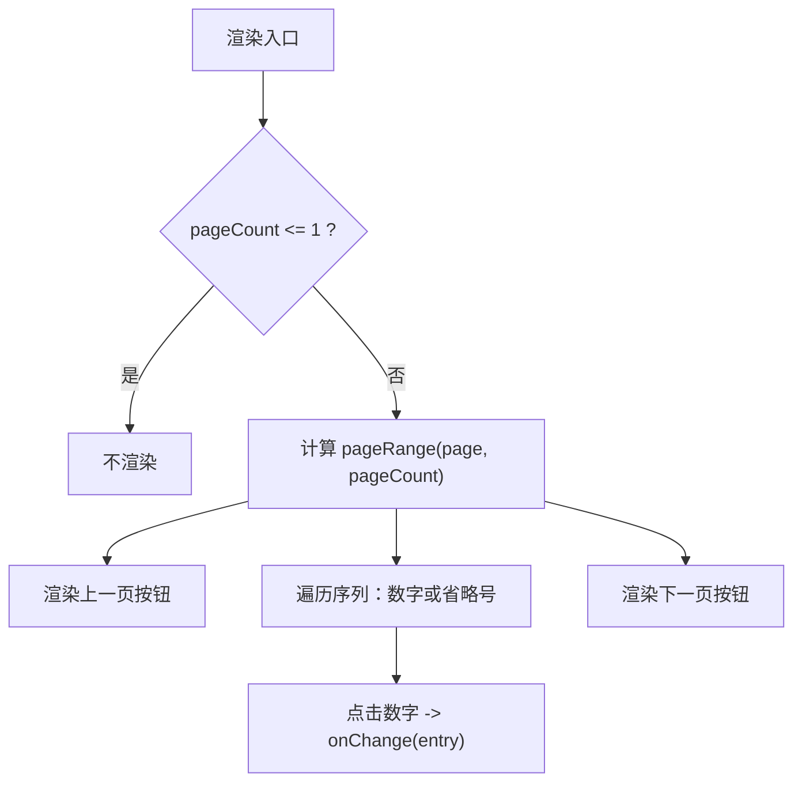
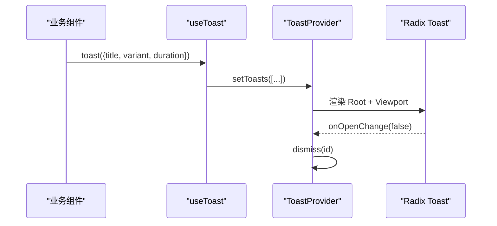
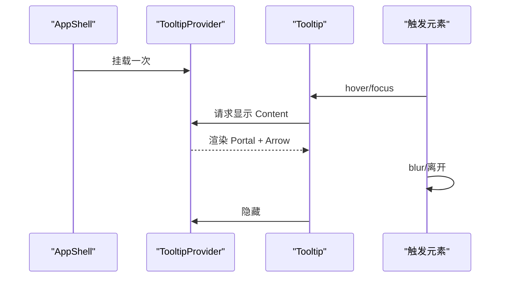
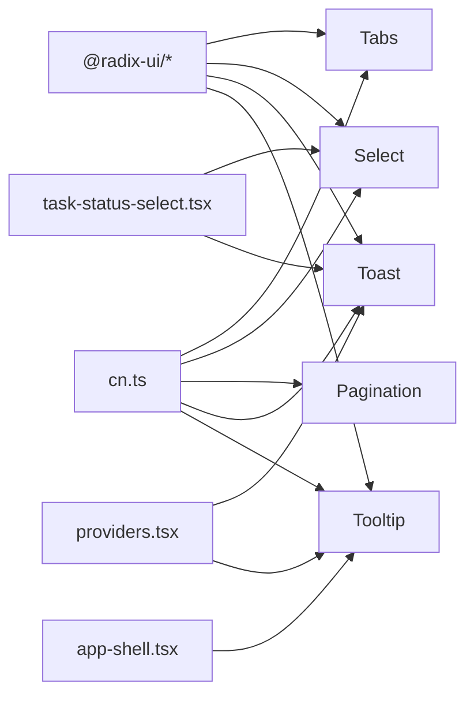

# 布局组件

<cite>
**本文引用的文件**
- [tabs.tsx](file://src/components/ui/tabs.tsx)
- [select.tsx](file://src/components/ui/select.tsx)
- [pagination.tsx](file://src/components/ui/pagination.tsx)
- [toast.tsx](file://src/components/ui/toast.tsx)
- [tooltip.tsx](file://src/components/ui/tooltip.tsx)
- [index.ts](file://src/components/ui/index.ts)
- [cn.ts](file://src/lib/cn.ts)
- [app-shell.tsx](file://src/features/shell/app-shell.tsx)
- [providers.tsx](file://src/features/shell/providers.tsx)
- [task-status-select.tsx](file://src/features/tasks/real/task-status-select.tsx)
- [page.tsx](file://src/app/app/ui-samples/page.tsx)
</cite>

## 目录
1. [简介](#简介)
2. [项目结构](#项目结构)
3. [核心组件](#核心组件)
4. [架构总览](#架构总览)
5. [详细组件分析](#详细组件分析)
6. [依赖关系分析](#依赖关系分析)
7. [性能与可访问性](#性能与可访问性)
8. [故障排查](#故障排查)
9. [结论](#结论)
10. [附录：使用示例与集成指南](#附录使用示例与集成指南)

## 简介
本章节面向 Orbit 项目的布局类 UI 组件，聚焦 Tabs、Select、Pagination、Toast、Tooltip 五个“布局辅助”组件。它们基于 Radix Primitives 构建，提供完整的键盘导航与无障碍语义；通过统一的样式合并工具与 Tailwind tokens 实现一致的视觉语言；在应用外壳（AppShell）与业务页面中承担导航、筛选、分页、提示与补充说明等职责。本文从设计理念、状态管理、交互行为、响应式实现、可访问性与集成方式等方面给出系统化说明，并配合图示帮助理解数据流与调用链。

## 项目结构
这些布局组件统一位于 src/components/ui，并通过 index.ts 集中导出，供 features 与 app 层按需引入。其中：
- Tabs、Select、Tooltip、Toast 基于 @radix-ui/react-* 原语封装，保证可访问性与焦点管理。
- Pagination 以原生 button 组合而成，结合 IconButton 与图标库实现。
- cn.ts 提供 className 合并能力，确保组件内建样式与外部覆盖兼容。
- AppShell 与 providers 负责全局 Provider 挂载（ToastProvider、TooltipProvider），以及 Tooltip 在侧栏的响应式展示。
- 业务组件（如任务状态 Select）展示了如何与 Toast、API 调用和乐观更新结合。

图表来源
- [index.ts:9-24](file://src/components/ui/index.ts#L9-L24)
- [providers.tsx:1-19](file://src/features/shell/providers.tsx#L1-L19)
- [app-shell.tsx:1-389](file://src/features/shell/app-shell.tsx#L1-L389)
- [task-status-select.tsx:1-118](file://src/features/tasks/real/task-status-select.tsx#L1-L118)
- [page.tsx:1-745](file://src/app/app/ui-samples/page.tsx#L1-L745)

章节来源
- [index.ts:1-25](file://src/components/ui/index.ts#L1-L25)
- [cn.ts:1-14](file://src/lib/cn.ts#L1-L14)

## 核心组件
- Tabs：用于二级导航与视图切换，方向键切换、Home/End、aria-selected 与 role=tablist 由 Radix 提供。
- Select：用于筛选与状态选择，支持方向键、Home/End、输入跳转与完整 aria 角色。
- Pagination：列表/看板分页控件，button 呈现，Tab 可达，当前页用 aria-current 标注。
- Toast：轻量通知，基于 Radix Toast + useToast 上下文；约束为“非唯一错误反馈”，需与 InlineError 配合。
- Tooltip：hover 与键盘 focus 均可触发，用于截断文本或图标按钮的完整标签提示。

章节来源
- [tabs.tsx:1-60](file://src/components/ui/tabs.tsx#L1-L60)
- [select.tsx:1-108](file://src/components/ui/select.tsx#L1-L108)
- [pagination.tsx:1-104](file://src/components/ui/pagination.tsx#L1-L104)
- [toast.tsx:1-131](file://src/components/ui/toast.tsx#L1-L131)
- [tooltip.tsx:1-66](file://src/components/ui/tooltip.tsx#L1-L66)

## 架构总览
整体采用“基础组件 + 业务组合”的分层模式：
- 基础层：Radix Primitives + Tailwind tokens + cn 工具，提供可访问、可组合、可覆盖的 UI 原语。
- 组件层：Tabs/Select/Pagination/Toast/Tooltip 封装具体交互与样式。
- 应用层：AppShell 提供全局 Provider（Toast/Tooltip），并在侧栏使用 Tooltip 处理长标题截断。
- 业务层：如 TaskStatusSelect 将 Select 与 API 调用、Toast 提示、刷新策略组合，形成受控、一致的数据流。

图表来源
- [task-status-select.tsx:54-118](file://src/features/tasks/real/task-status-select.tsx#L54-L118)
- [select.tsx:16-108](file://src/components/ui/select.tsx#L16-L108)
- [toast.tsx:58-131](file://src/components/ui/toast.tsx#L58-L131)

## 详细组件分析

### Tabs
- 设计目标：项目二级导航（看板/列表/活动/设置）与手机看板按状态切换。
- 交互与可访问性：方向键切换、Home/End、aria-selected、role=tablist，完全键盘可达。
- 样式与主题：使用 cn 合并 Tailwind 类名，激活态高亮品牌色，过渡动画平滑。
- 组合方式：通常与 TabsList/TabsTrigger/TabsContent 组合，外层容器提供默认值或受控状态。

图表来源
- [tabs.tsx:14-59](file://src/components/ui/tabs.tsx#L14-L59)

章节来源
- [tabs.tsx:1-60](file://src/components/ui/tabs.tsx#L1-L60)
- [page.tsx:495-528](file://src/app/app/ui-samples/page.tsx#L495-L528)

### Select
- 设计目标：看板筛选（负责人/优先级）与任务详情（状态/优先级）。
- 交互与可访问性：方向键、Home/End、输入跳转、aria 角色与焦点管理由 Radix 提供。
- 样式与主题：触发器高度 40，边界对比度满足 3:1；选中项高亮品牌柔色。
- 组合方式：Select/SelectTrigger/SelectContent/SelectItem/SelectValue/SelectLabel/SelectSeparator 组合使用。

图表来源
- [select.tsx:16-108](file://src/components/ui/select.tsx#L16-L108)

章节来源
- [select.tsx:1-108](file://src/components/ui/select.tsx#L1-L108)
- [task-status-select.tsx:94-118](file://src/features/tasks/real/task-status-select.tsx#L94-L118)
- [page.tsx:281-323](file://src/app/app/ui-samples/page.tsx#L281-L323)

### Pagination
- 设计目标：列表/看板分页控件，紧凑且键盘可达。
- 交互与可访问性：button 呈现，Tab 可聚焦，Enter/Space 激活；当前页 aria-current="page"；上一页/下一页有可访问名称。
- 算法：生成紧凑页码序列（首尾 + 当前页邻域，中间省略号），减少大页数时的冗余。
- 组合方式：传入 page、pageCount、onChange，可选 itemLabel 自定义可访问标签。

图表来源
- [pagination.tsx:24-38](file://src/components/ui/pagination.tsx#L24-L38)
- [pagination.tsx:40-104](file://src/components/ui/pagination.tsx#L40-L104)

章节来源
- [pagination.tsx:1-104](file://src/components/ui/pagination.tsx#L1-L104)
- [page.tsx:702-721](file://src/app/app/ui-samples/page.tsx#L702-L721)

### Toast
- 设计目标：瞬时提示（信息/成功/危险），不影响焦点，自动消失。
- 约束：不能作为唯一错误反馈手段；错误需同时由 InlineError 驻留展示。
- 状态管理：内部维护 toasts 数组，使用 React Context 暴露 useToast；每个 Toast 有 id、title、description、variant、duration。
- 可访问性：Radix 管理 aria-live 宣告；关闭按钮具备可访问名称；Viewport 固定定位避免遮挡。

图表来源
- [toast.tsx:58-131](file://src/components/ui/toast.tsx#L58-L131)

章节来源
- [toast.tsx:1-131](file://src/components/ui/toast.tsx#L1-L131)
- [providers.tsx:1-19](file://src/features/shell/providers.tsx#L1-L19)
- [task-status-select.tsx:71-91](file://src/features/tasks/real/task-status-select.tsx#L71-L91)
- [page.tsx:611-661](file://src/app/app/ui-samples/page.tsx#L611-L661)

### Tooltip
- 设计目标：在侧栏收窄与长项目名截断时保留完整标签的可访问名称。
- 交互与可访问性：hover 与键盘 focus 均可触发；Provider 在 AppShell 挂载一次；内容作为无障碍补充说明。
- 组合方式：TooltipProvider 包裹全局；Tooltip 包裹触发元素，side 控制方向。

图表来源
- [tooltip.tsx:14-66](file://src/components/ui/tooltip.tsx#L14-L66)
- [app-shell.tsx:134-241](file://src/features/shell/app-shell.tsx#L134-L241)
- [providers.tsx:1-19](file://src/features/shell/providers.tsx#L1-L19)

章节来源
- [tooltip.tsx:1-66](file://src/components/ui/tooltip.tsx#L1-L66)
- [app-shell.tsx:1-389](file://src/features/shell/app-shell.tsx#L1-L389)
- [providers.tsx:1-19](file://src/features/shell/providers.tsx#L1-L19)

## 依赖关系分析
- 组件对外依赖：
  - Radix Primitives：Tabs、Select、Toast、Tooltip 的核心交互与可访问性。
  - lucide-react：图标资源（ChevronLeft/Right、Check、Info、CircleAlert、X 等）。
  - cn 工具：className 合并，确保样式覆盖安全。
- 应用依赖：
  - Providers：在应用根处挂载 ToastProvider 与 TooltipProvider。
  - AppShell：使用 Tooltip 增强侧栏导航体验；使用 Drawer（Radix Dialog）承载移动端导航。
  - 业务组件：TaskStatusSelect 组合 Select、useToast、API 调用与刷新策略。

图表来源
- [index.ts:9-24](file://src/components/ui/index.ts#L9-L24)
- [cn.ts:1-14](file://src/lib/cn.ts#L1-L14)
- [providers.tsx:1-19](file://src/features/shell/providers.tsx#L1-L19)
- [app-shell.tsx:1-389](file://src/features/shell/app-shell.tsx#L1-L389)
- [task-status-select.tsx:1-118](file://src/features/tasks/real/task-status-select.tsx#L1-L118)

章节来源
- [index.ts:1-25](file://src/components/ui/index.ts#L1-L25)
- [cn.ts:1-14](file://src/lib/cn.ts#L1-L14)

## 性能与可访问性
- 性能
  - 使用 Radix Primitives 的原生优化（Portal、Viewport、事件委托）降低重绘开销。
  - Pagination 的 pageRange 算法仅渲染必要页码，避免大页数下的 DOM 膨胀。
  - cn 工具通过 tailwind-merge 解决类名冲突，减少不必要的样式重计算。
- 可访问性
  - Tabs：方向键切换、Home/End、aria-selected、role=tablist。
  - Select：方向键、Home/End、输入跳转、aria 角色与焦点管理。
  - Pagination：button 可聚焦，当前页 aria-current="page"，上一页/下一页具可访问名称。
  - Toast：aria-live 宣告、自动消失、不影响焦点；关闭按钮具备可访问名称。
  - Tooltip：hover 与键盘 focus 均可触发；内容作为无障碍补充说明。
- 响应式设计
  - AppShell 在不同视口下切换侧栏宽度与导航模式（rail/drawer），配合 Tooltip 保持可读性。
  - Select/Toast/Pagination 均通过 Tailwind 响应式类适配不同屏幕尺寸。

[本节为通用指导，无需特定文件引用]

## 故障排查
- Toast 未生效
  - 检查是否在 ToastProvider 内使用 useToast；若不在，会抛出错误。
  - 参考：[toast.tsx:123-131](file://src/components/ui/toast.tsx#L123-L131)
- Tooltip 不显示
  - 确认已在应用根挂载 TooltipProvider；否则无法工作。
  - 参考：[providers.tsx:1-19](file://src/features/shell/providers.tsx#L1-L19)
- Select 值不同步
  - 确保使用受控模式（value + onValueChange），并在变更回调中执行必要的刷新或错误处理。
  - 参考：[task-status-select.tsx:94-118](file://src/features/tasks/real/task-status-select.tsx#L94-L118)
- Pagination 异常
  - 当 pageCount ≤ 1 时不渲染；检查传入参数是否正确。
  - 参考：[pagination.tsx:47-48](file://src/components/ui/pagination.tsx#L47-L48)

章节来源
- [toast.tsx:123-131](file://src/components/ui/toast.tsx#L123-L131)
- [providers.tsx:1-19](file://src/features/shell/providers.tsx#L1-L19)
- [task-status-select.tsx:94-118](file://src/features/tasks/real/task-status-select.tsx#L94-L118)
- [pagination.tsx:47-48](file://src/components/ui/pagination.tsx#L47-L48)

## 结论
Orbit 的布局类 UI 组件以 Radix Primitives 为核心，结合 Tailwind tokens 与 cn 工具，提供了可访问、可组合、可覆盖的基础能力。Tabs、Select、Pagination、Toast、Tooltip 在应用外壳与业务场景中各司其职：Tabs 负责视图切换，Select 负责筛选与状态选择，Pagination 负责数据浏览，Toast 负责瞬时反馈，Tooltip 负责补充说明。通过 Provider 与上下文管理，组件间解耦清晰；通过受控模式与刷新策略，数据一致性得到保障。整体架构兼顾了可访问性、响应式与性能，便于在更大范围内复用与扩展。

[本节为总结，无需特定文件引用]

## 附录：使用示例与集成指南
- 在应用根挂载 Provider
  - 在 providers.tsx 中组合 ToastProvider 与 TooltipProvider，确保全局可用。
  - 参考：[providers.tsx:1-19](file://src/features/shell/providers.tsx#L1-L19)
- 在业务组件中使用 Select 与 Toast
  - 使用 Select 进行状态选择，调用 API 后根据结果决定是否弹出 Toast，并刷新数据。
  - 参考：[task-status-select.tsx:54-118](file://src/features/tasks/real/task-status-select.tsx#L54-L118)
- 在页面中使用 Tabs、Pagination、Tooltip
  - 使用 Tabs 组织二级导航；使用 Pagination 展示分页；使用 Tooltip 为截断文本或图标按钮提供完整标签。
  - 参考：
    - [page.tsx:495-528](file://src/app/app/ui-samples/page.tsx#L495-L528)
    - [page.tsx:702-721](file://src/app/app/ui-samples/page.tsx#L702-L721)
    - [page.tsx:415-445](file://src/app/app/ui-samples/page.tsx#L415-L445)
- 样式覆盖与主题
  - 通过 className 与 cn 工具安全覆盖样式；遵循设计 tokens 保持一致性。
  - 参考：[cn.ts:1-14](file://src/lib/cn.ts#L1-L14)

章节来源
- [providers.tsx:1-19](file://src/features/shell/providers.tsx#L1-L19)
- [task-status-select.tsx:54-118](file://src/features/tasks/real/task-status-select.tsx#L54-L118)
- [page.tsx:415-445](file://src/app/app/ui-samples/page.tsx#L415-L445)
- [page.tsx:495-528](file://src/app/app/ui-samples/page.tsx#L495-L528)
- [page.tsx:702-721](file://src/app/app/ui-samples/page.tsx#L702-L721)
- [cn.ts:1-14](file://src/lib/cn.ts#L1-L14)