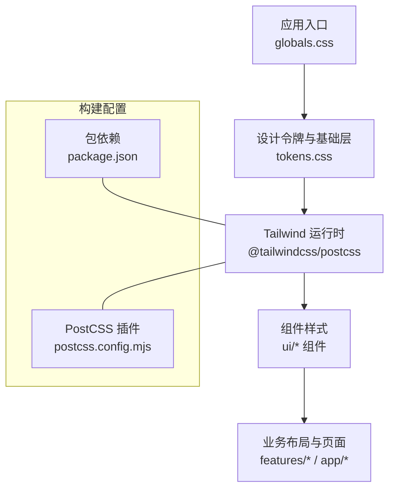
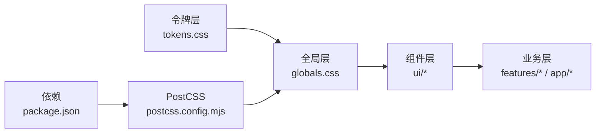
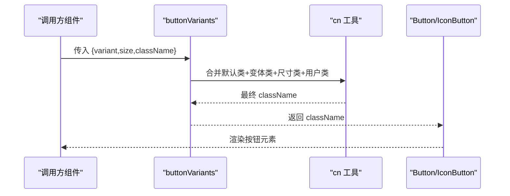
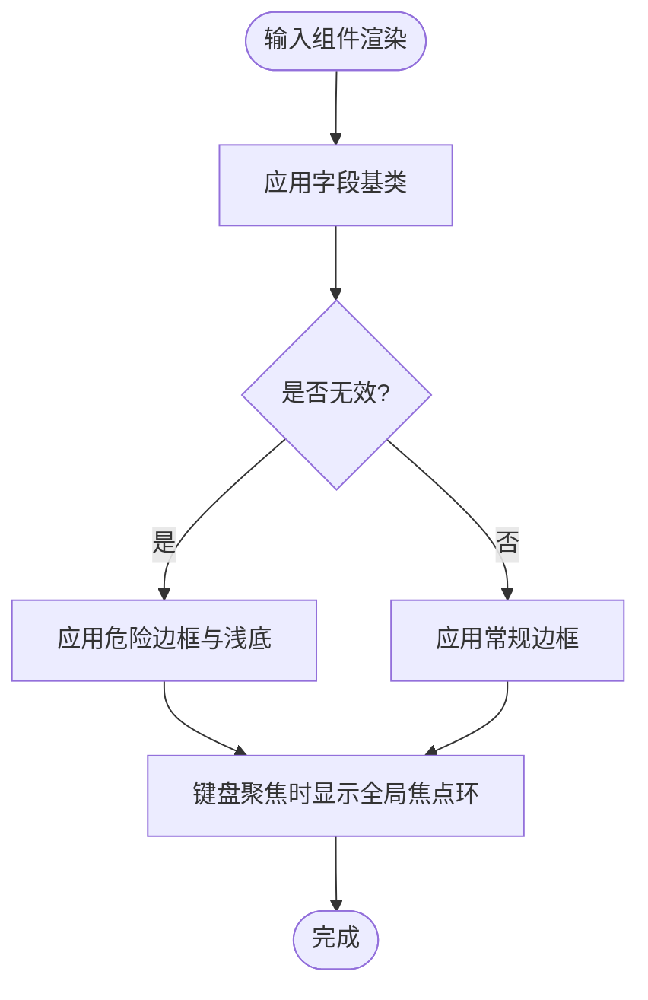
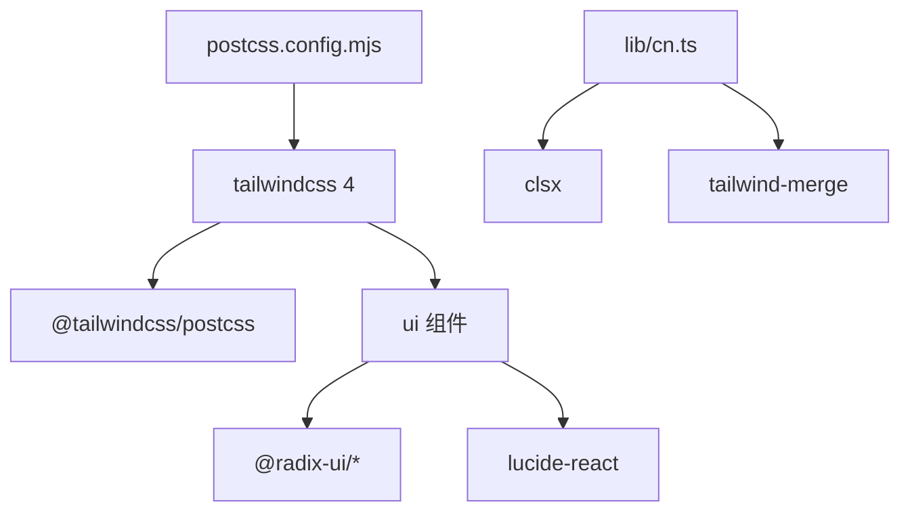

# 样式系统

<cite>
**本文引用的文件**
- [src/styles/globals.css](file://src/styles/globals.css)
- [src/styles/tokens.css](file://src/styles/tokens.css)
- [src/lib/cn.ts](file://src/lib/cn.ts)
- [postcss.config.mjs](file://postcss.config.mjs)
- [package.json](file://package.json)
- [src/components/ui/button.tsx](file://src/components/ui/button.tsx)
- [src/components/ui/input.tsx](file://src/components/ui/input.tsx)
- [src/components/ui/badge.tsx](file://src/components/ui/badge.tsx)
- [src/components/ui/dialog.tsx](file://src/components/ui/dialog.tsx)
- [src/components/ui/avatar.tsx](file://src/components/ui/avatar.tsx)
- [src/features/shell/app-shell.tsx](file://src/features/shell/app-shell.tsx)
- [src/lib/project-color.ts](file://src/lib/project-color.ts)
- [docs/02-UX-AND-DESIGN.md](file://docs/02-UX-AND-DESIGN.md)
</cite>

## 目录
1. [简介](#简介)
2. [项目结构](#项目结构)
3. [核心组件](#核心组件)
4. [架构总览](#架构总览)
5. [详细组件分析](#详细组件分析)
6. [依赖关系分析](#依赖关系分析)
7. [性能考量](#性能考量)
8. [故障排查指南](#故障排查指南)
9. [结论](#结论)
10. [附录](#附录)

## 简介
本文件为 Orbit 项目的样式系统文档，聚焦基于 Tailwind CSS 4 的样式架构与实现。内容涵盖设计令牌（tokens）定义与使用、全局样式组织、组件样式规范、条件样式与响应式实践、CSS 模块化策略、主题定制方案、开发最佳实践、性能优化技巧、浏览器兼容性处理，以及样式调试方法与常见问题解决方案。目标是帮助开发者在不破坏视觉一致性的前提下高效扩展与维护样式。

## 项目结构
Orbit 的样式体系以“单一真源”的设计令牌为核心，通过 Tailwind CSS 4 的 CSS-first 模式在运行时生成主题变量与工具类；组件层仅消费这些令牌，避免硬编码颜色与尺寸。

图表来源
- [src/styles/globals.css:1-13](file://src/styles/globals.css#L1-L13)
- [src/styles/tokens.css:1-169](file://src/styles/tokens.css#L1-L169)
- [postcss.config.mjs:1-9](file://postcss.config.mjs#L1-L9)
- [package.json:29-65](file://package.json#L29-L65)

章节来源
- [src/styles/globals.css:1-13](file://src/styles/globals.css#L1-L13)
- [src/styles/tokens.css:1-169](file://src/styles/tokens.css#L1-L169)
- [postcss.config.mjs:1-9](file://postcss.config.mjs#L1-L9)
- [package.json:29-65](file://package.json#L29-L65)

## 核心组件
- 设计令牌（tokens）：集中定义颜色、字号行高、字体栈、间距、圆角、阴影、动效缓动、断点与外壳尺寸等，并通过 @theme 暴露为 :root 变量与 Tailwind 工具类。
- 全局样式：引入 Tailwind 运行时与设计令牌，设置基础排版、焦点环与减少动画偏好。
- 条件样式合并工具 cn：组合 clsx 的条件能力与 tailwind-merge 的冲突解决，确保组件可被外部 className 安全覆盖。
- 组件样式：Button、Input、Badge、Dialog、Avatar 等统一消费 tokens，遵循触控目标、对比度与可访问性要求。
- 业务布局：AppShell 根据断点切换侧栏宽度与导航形态，体现响应式策略。

章节来源
- [src/styles/tokens.css:23-107](file://src/styles/tokens.css#L23-L107)
- [src/styles/globals.css:1-13](file://src/styles/globals.css#L1-L13)
- [src/lib/cn.ts:1-14](file://src/lib/cn.ts#L1-L14)
- [src/components/ui/button.tsx:1-118](file://src/components/ui/button.tsx#L1-L118)
- [src/components/ui/input.tsx:1-64](file://src/components/ui/input.tsx#L1-L64)
- [src/components/ui/badge.tsx:1-57](file://src/components/ui/badge.tsx#L1-L57)
- [src/components/ui/dialog.tsx:1-118](file://src/components/ui/dialog.tsx#L1-L118)
- [src/components/ui/avatar.tsx:1-109](file://src/components/ui/avatar.tsx#L1-L109)
- [src/features/shell/app-shell.tsx:23-40](file://src/features/shell/app-shell.tsx#L23-L40)

## 架构总览
Orbit 采用“令牌驱动 + 组件消费”的分层架构：
- 令牌层：在 tokens.css 中用 @theme 声明主题变量，自动生成 :root 变量与 Tailwind 工具类，作为视觉唯一真源。
- 全局层：globals.css 引入 Tailwind 运行时与令牌，并定义 base 层排版、焦点环与减少动画。
- 组件层：UI 组件通过 cn 合并默认类与传入类，仅消费令牌，不直接写死颜色或尺寸。
- 业务层：布局与页面按断点与交互需求组合组件，复用令牌与组件样式。

图表来源
- [src/styles/tokens.css:23-107](file://src/styles/tokens.css#L23-L107)
- [src/styles/globals.css:1-13](file://src/styles/globals.css#L1-L13)
- [postcss.config.mjs:1-9](file://postcss.config.mjs#L1-L9)
- [package.json:29-65](file://package.json#L29-L65)

## 详细组件分析

### 按钮 Button/IconButton
- 样式策略：通过 buttonVariants 函数组合 variant 与 size 的类名，统一圆角、过渡与禁用态；焦点环由全局规则提供。
- 可访问性：IconButton 强制 label 映射到 aria-label，保证无文本时的可访问名称。
- 令牌消费：背景、文字、边框、悬停态均使用 tokens 中的品牌色、表面色与前景色。

图表来源
- [src/components/ui/button.tsx:31-49](file://src/components/ui/button.tsx#L31-L49)
- [src/lib/cn.ts:1-14](file://src/lib/cn.ts#L1-L14)

章节来源
- [src/components/ui/button.tsx:1-118](file://src/components/ui/button.tsx#L1-L118)
- [src/styles/tokens.css:23-107](file://src/styles/tokens.css#L23-L107)

### 输入框 Input/Textarea/Label
- 样式策略：字段基类统一圆角、边框、占位符颜色、过渡与禁用态；aria-invalid 时切换危险态背景与边框。
- 可访问性：焦点环由全局 :focus-visible 规则保障；Label 用于关联表单控件。
- 令牌消费：边框、背景、文字、错误态均使用 tokens。

图表来源
- [src/components/ui/input.tsx:12-17](file://src/components/ui/input.tsx#L12-L17)
- [src/styles/tokens.css:157-168](file://src/styles/tokens.css#L157-L168)

章节来源
- [src/components/ui/input.tsx:1-64](file://src/components/ui/input.tsx#L1-L64)
- [src/styles/tokens.css:157-168](file://src/styles/tokens.css#L157-L168)

### 徽章 Badge
- 语义配色：tone 决定背景与文字颜色，使用 success/warning/danger 的软底与深色文字，满足对比度要求。
- 令牌消费：所有颜色来自 tokens，保持与整体设计一致。

章节来源
- [src/components/ui/badge.tsx:1-57](file://src/components/ui/badge.tsx#L1-L57)
- [src/styles/tokens.css:45-50](file://src/styles/tokens.css#L45-L50)

### 对话框 Dialog
- 可访问性：基于 Radix，自动处理焦点陷阱、初始焦点、Escape 关闭与标题描述关联。
- 令牌消费：遮罩、圆角、边框、背景、阴影均来自 tokens。

章节来源
- [src/components/ui/dialog.tsx:1-118](file://src/components/ui/dialog.tsx#L1-L118)
- [src/styles/tokens.css:25-33](file://src/styles/tokens.css#L25-L33)
- [src/styles/tokens.css:88-99](file://src/styles/tokens.css#L88-L99)

### 头像 Avatar/AvatarStack
- 行为：图片加载失败回退为首字母；叠加显示成员列表并提供可访问名称。
- 令牌消费：背景、文字、边框环使用 tokens。

章节来源
- [src/components/ui/avatar.tsx:1-109](file://src/components/ui/avatar.tsx#L1-L109)
- [src/styles/tokens.css:25-33](file://src/styles/tokens.css#L25-L33)

### 应用外壳 AppShell（响应式）
- 断点策略：桌面 ≥1280 固定侧栏 224px，平板 768–1279 收窄至 72px，手机 <768 隐藏侧栏并以抽屉导航呈现。
- 令牌消费：侧栏高度、内边距、激活态背景与文字颜色均来自 tokens。

章节来源
- [src/features/shell/app-shell.tsx:23-40](file://src/features/shell/app-shell.tsx#L23-L40)
- [src/features/shell/app-shell.tsx:65-84](file://src/features/shell/app-shell.tsx#L65-L84)
- [src/styles/tokens.css:105-107](file://src/styles/tokens.css#L105-L107)

## 依赖关系分析
- PostCSS 插件：通过 @tailwindcss/postcss 接入 Tailwind CSS 4，无需 tailwind.config.js。
- 包依赖：clsx 与 tailwind-merge 用于条件与冲突合并；Radix UI 提供无障碍原语；Lucide 图标库用于图标。
- 设计令牌：tokens.css 同时充当 :root 变量与 Tailwind 主题配置，被各组件消费。

图表来源
- [postcss.config.mjs:1-9](file://postcss.config.mjs#L1-L9)
- [package.json:29-65](file://package.json#L29-L65)
- [src/lib/cn.ts:1-14](file://src/lib/cn.ts#L1-L14)

章节来源
- [postcss.config.mjs:1-9](file://postcss.config.mjs#L1-L9)
- [package.json:29-65](file://package.json#L29-L65)
- [src/lib/cn.ts:1-14](file://src/lib/cn.ts#L1-L14)

## 性能考量
- 令牌驱动减少重复样式：通过 @theme 生成的工具类与 :root 变量，避免在多处硬编码颜色与尺寸，降低维护成本与样式膨胀。
- 最小化动画：遵循 prefers-reduced-motion，取消非必要过渡与动画，提升可访问性与性能。
- 组件级样式隔离：每个组件只消费必要令牌，避免全局样式污染。
- 构建期优化：Tailwind CSS 4 的 CSS-first 模式减少配置开销，配合 PostCSS 插件按需生成样式。

[本节为通用指导，不直接分析具体文件]

## 故障排查指南
- 焦点环不可见
  - 现象：大量组件使用 outline-none 导致全局 :focus-visible 规则被覆盖。
  - 原因：全局焦点环规则刻意置于所有 @layer 之外，优先级高于 utilities；若自定义样式覆盖了该规则，需检查选择器层级与 !important。
  - 解决：确保未覆盖 :where(a, button, input, textarea, select, [tabindex]):focus-visible 的 outline 与 outline-offset。
  - 参考
    - [src/styles/tokens.css:157-168](file://src/styles/tokens.css#L157-L168)

- 对比度不达标
  - 现象：辅助文字或状态色对比度不足。
  - 原因：使用了过浅的背景或过淡的文字。
  - 解决：优先使用 tokens 中已验证的颜色；必要时调整 token 值并在设计文档中记录。
  - 参考
    - [src/styles/tokens.css:9-21](file://src/styles/tokens.css#L9-L21)
    - [docs/02-UX-AND-DESIGN.md:9-33](file://docs/02-UX-AND-DESIGN.md#L9-L33)

- 条件样式冲突
  - 现象：外部传入 className 与组件默认类冲突。
  - 原因：未使用 cn 合并或未正确排序。
  - 解决：始终通过 cn 合并类名，确保后者优先；避免手动拼接字符串造成顺序问题。
  - 参考
    - [src/lib/cn.ts:1-14](file://src/lib/cn.ts#L1-L14)
    - [src/components/ui/button.tsx:31-49](file://src/components/ui/button.tsx#L31-L49)

- 响应式布局异常
  - 现象：侧栏宽度或内边距不符合预期。
  - 原因：断点与令牌不一致或组件未使用正确的断点类。
  - 解决：核对 tokens 中断点与 AppShell 的断点策略，确保使用一致的断点类。
  - 参考
    - [src/styles/tokens.css:105-107](file://src/styles/tokens.css#L105-L107)
    - [src/features/shell/app-shell.tsx:23-40](file://src/features/shell/app-shell.tsx#L23-L40)

- 主题定制失效
  - 现象：新增 token 未生效。
  - 原因：未在 @theme 中声明或未重新构建。
  - 解决：在 tokens.css 的 @theme 中添加变量，并确保构建流程包含 PostCSS 插件。
  - 参考
    - [src/styles/tokens.css:23-107](file://src/styles/tokens.css#L23-L107)
    - [postcss.config.mjs:1-9](file://postcss.config.mjs#L1-L9)

章节来源
- [src/styles/tokens.css:157-168](file://src/styles/tokens.css#L157-L168)
- [src/styles/tokens.css:9-21](file://src/styles/tokens.css#L9-L21)
- [docs/02-UX-AND-DESIGN.md:9-33](file://docs/02-UX-AND-DESIGN.md#L9-L33)
- [src/lib/cn.ts:1-14](file://src/lib/cn.ts#L1-L14)
- [src/components/ui/button.tsx:31-49](file://src/components/ui/button.tsx#L31-L49)
- [src/styles/tokens.css:105-107](file://src/styles/tokens.css#L105-L107)
- [src/features/shell/app-shell.tsx:23-40](file://src/features/shell/app-shell.tsx#L23-L40)
- [postcss.config.mjs:1-9](file://postcss.config.mjs#L1-L9)

## 结论
Orbit 的样式系统以设计令牌为核心，借助 Tailwind CSS 4 的 CSS-first 模式实现主题与工具类的自动生成；组件层严格消费令牌，保证视觉一致性与可维护性。通过 cn 工具进行条件样式合并，结合全局焦点环与减少动画偏好，兼顾可访问性与性能。响应式策略在 AppShell 中清晰落地，便于在不同视口下保持一致体验。遵循本文的最佳实践与排查指南，可在不破坏设计一致性的前提下高效扩展样式。

## 附录

### 设计令牌清单（节选）
- 颜色：background、surface、foreground、brand、success、warning、danger 及其软底与项目标记色。
- 字号与行高：caption、label、body、section、page、hero 及对应行高。
- 字体栈：sans 与 mono，优先系统字体。
- 间距：基数 4px，常用刻度命中 docs/02。
- 圆角：control、card、overlay。
- 阴影：popover、overlay、drag。
- 动效：ease-standard、ease-out。
- 断点：md=768、xl=1280。
- 外壳尺寸：侧栏、顶栏、内容内边距、任务面板宽度。

章节来源
- [src/styles/tokens.css:23-107](file://src/styles/tokens.css#L23-L107)
- [docs/02-UX-AND-DESIGN.md:9-33](file://docs/02-UX-AND-DESIGN.md#L9-L33)

### 响应式断点与外壳尺寸
- 桌面 ≥1280：侧栏 224px，顶栏 64px，内容内边距 32px。
- 平板 768–1279：侧栏 72px，内容内边距 24px。
- 手机 <768：抽屉导航，内容内边距 16px。

章节来源
- [src/styles/tokens.css:105-126](file://src/styles/tokens.css#L105-L126)
- [src/features/shell/app-shell.tsx:23-40](file://src/features/shell/app-shell.tsx#L23-L40)

### 主题定制方案
- 新增令牌：在 tokens.css 的 @theme 中添加变量，自动生成 :root 与工具类。
- 派生颜色：使用已有 token 派生新值，保持视觉一致性。
- 构建流程：确保 PostCSS 插件启用，重新构建以生效。

章节来源
- [src/styles/tokens.css:23-107](file://src/styles/tokens.css#L23-L107)
- [postcss.config.mjs:1-9](file://postcss.config.mjs#L1-L9)

### 样式开发最佳实践
- 始终通过 cn 合并 className，避免冲突。
- 组件内仅消费 tokens，不硬编码颜色与尺寸。
- 使用 Radix 原语保证可访问性，不另造不可访问的基础组件。
- 遵循触控目标与对比度要求，优先使用已验证的 token。
- 在业务布局中使用断点与外壳尺寸 token，保持一致性。

章节来源
- [src/lib/cn.ts:1-14](file://src/lib/cn.ts#L1-L14)
- [src/components/ui/button.tsx:1-118](file://src/components/ui/button.tsx#L1-L118)
- [src/components/ui/dialog.tsx:1-118](file://src/components/ui/dialog.tsx#L1-L118)
- [src/styles/tokens.css:9-21](file://src/styles/tokens.css#L9-L21)
- [src/features/shell/app-shell.tsx:23-40](file://src/features/shell/app-shell.tsx#L23-L40)

### 浏览器兼容性处理
- 减少动画：遵从 prefers-reduced-motion，取消非必要过渡与动画。
- 焦点环：使用现代浏览器支持的 outline 与 outline-offset，确保键盘可达。
- 字体栈：优先系统字体，避免首版引入大体积中文字体下载。

章节来源
- [src/styles/tokens.css:144-154](file://src/styles/tokens.css#L144-L154)
- [src/styles/tokens.css:157-168](file://src/styles/tokens.css#L157-L168)
- [src/styles/tokens.css:75-82](file://src/styles/tokens.css#L75-L82)