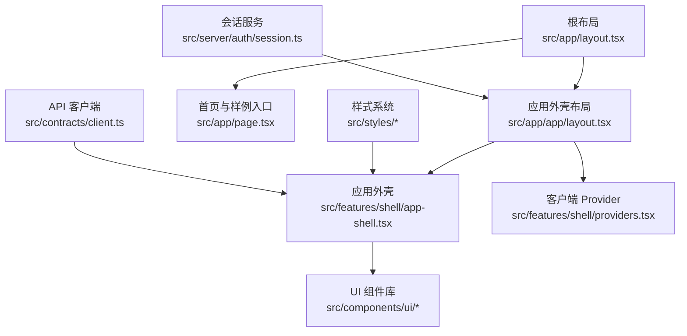
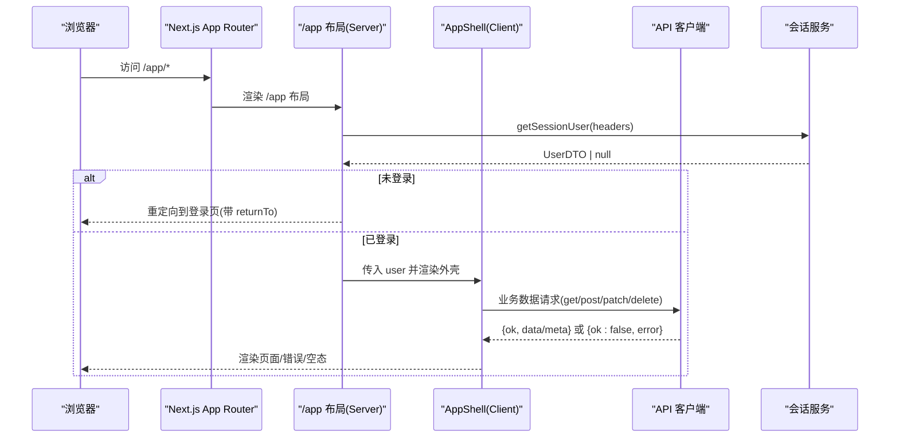
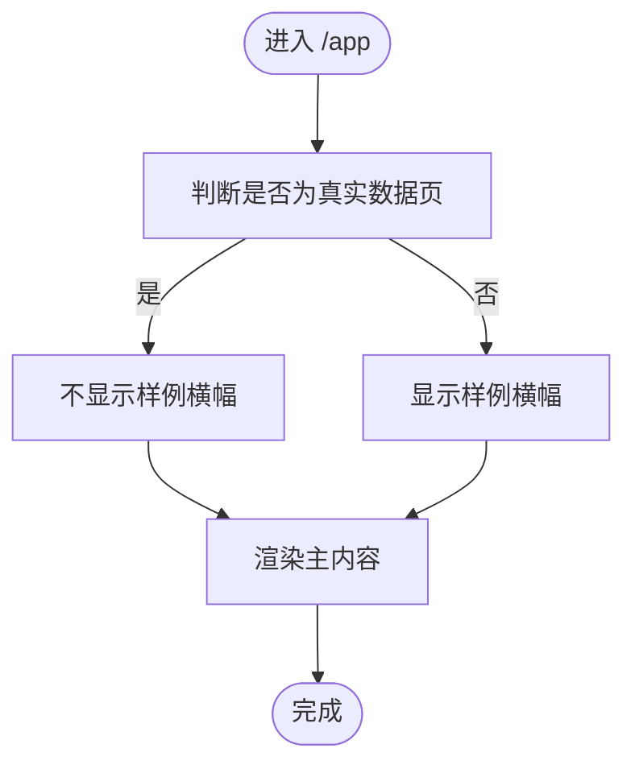
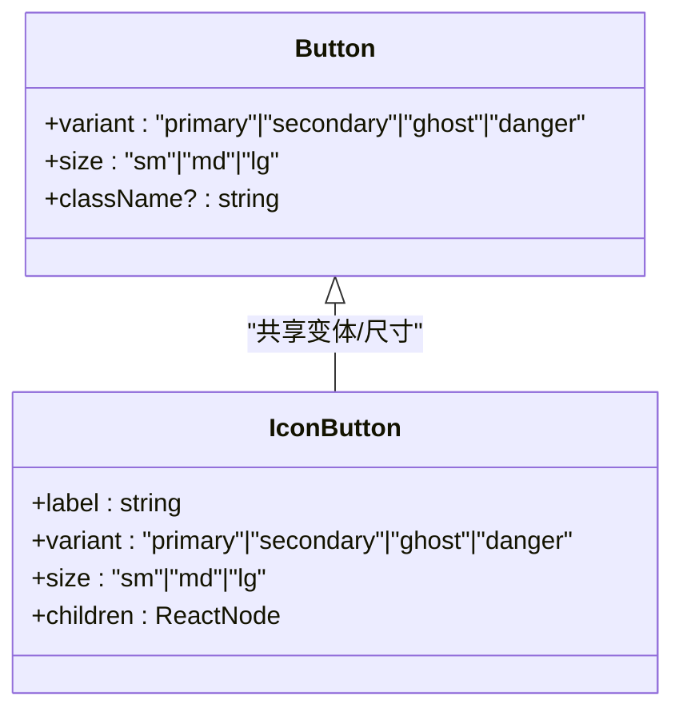
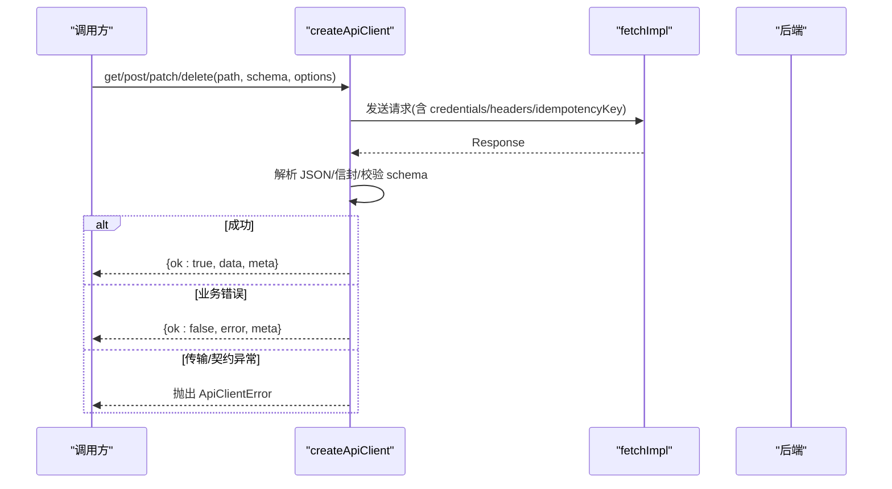
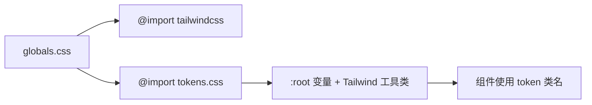
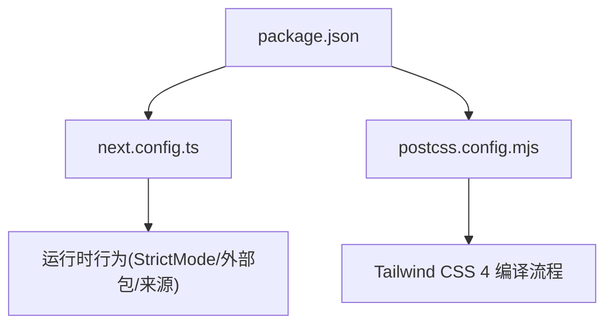

# 前端开发

<cite>
**本文引用的文件**
- [package.json](file://package.json)
- [next.config.ts](file://next.config.ts)
- [postcss.config.mjs](file://postcss.config.mjs)
- [src/app/layout.tsx](file://src/app/layout.tsx)
- [src/app/page.tsx](file://src/app/page.tsx)
- [src/app/app/layout.tsx](file://src/app/app/layout.tsx)
- [src/components/ui/index.ts](file://src/components/ui/index.ts)
- [src/components/ui/button.tsx](file://src/components/ui/button.tsx)
- [src/features/shell/providers.tsx](file://src/features/shell/providers.tsx)
- [src/features/shell/app-shell.tsx](file://src/features/shell/app-shell.tsx)
- [src/features/shell/sample-state.ts](file://src/features/shell/sample-state.ts)
- [src/contracts/client.ts](file://src/contracts/client.ts)
- [src/server/auth/session.ts](file://src/server/auth/session.ts)
- [src/lib/cn.ts](file://src/lib/cn.ts)
- [src/styles/globals.css](file://src/styles/globals.css)
- [src/styles/tokens.css](file://src/styles/tokens.css)
</cite>

## 目录
1. [简介](#简介)
2. [项目结构](#项目结构)
3. [核心组件](#核心组件)
4. [架构总览](#架构总览)
5. [详细组件分析](#详细组件分析)
6. [依赖关系分析](#依赖关系分析)
7. [性能考虑](#性能考虑)
8. [故障排查指南](#故障排查指南)
9. [结论](#结论)
10. [附录](#附录)

## 简介
本文件面向 Orbit 的前端开发者，聚焦基于 Next.js 16 与 React 19 的前端架构与实践。内容涵盖 App Router 路由组织、服务器组件与客户端组件的边界、UI 组件系统设计（Radix UI 封装与自定义规范）、状态管理策略、数据获取模式、错误处理机制、样式系统（Tailwind CSS 4、设计令牌、响应式）、以及可访问性与性能优化建议。文档中的示例均以“代码片段路径”形式给出，便于快速定位源码。

## 项目结构
Orbit 采用 Next.js App Router 的分层组织：
- 根布局与元信息在 src/app/layout.tsx
- 应用外壳与认证门禁在 src/app/app/layout.tsx
- 页面入口与样例导航在 src/app/page.tsx
- UI 基础组件集中在 src/components/ui，统一导出
- 业务功能按领域划分在 src/features
- 样式通过 Tailwind CSS 4 的 CSS-first 方式在 src/styles 中集中定义
- API 客户端与契约类型在 src/contracts
- 服务端会话与授权在 src/server

图表来源
- [src/app/layout.tsx:1-21](file://src/app/layout.tsx#L1-L21)
- [src/app/app/layout.tsx:1-48](file://src/app/app/layout.tsx#L1-L48)
- [src/features/shell/app-shell.tsx:1-389](file://src/features/shell/app-shell.tsx#L1-L389)
- [src/components/ui/index.ts:1-25](file://src/components/ui/index.ts#L1-L25)
- [src/features/shell/providers.tsx:1-20](file://src/features/shell/providers.tsx#L1-L20)
- [src/app/page.tsx:1-101](file://src/app/page.tsx#L1-L101)
- [src/styles/globals.css:1-13](file://src/styles/globals.css#L1-L13)
- [src/contracts/client.ts:1-277](file://src/contracts/client.ts#L1-L277)
- [src/server/auth/session.ts:1-43](file://src/server/auth/session.ts#L1-L43)

章节来源
- [package.json:1-76](file://package.json#L1-L76)
- [next.config.ts:1-21](file://next.config.ts#L1-L21)
- [postcss.config.mjs:1-9](file://postcss.config.mjs#L1-L9)
- [src/app/layout.tsx:1-21](file://src/app/layout.tsx#L1-L21)
- [src/app/page.tsx:1-101](file://src/app/page.tsx#L1-L101)
- [src/app/app/layout.tsx:1-48](file://src/app/app/layout.tsx#L1-L48)

## 核心组件
- 应用外壳 AppShell：响应式侧栏/顶栏/主内容区，手机抽屉导航，真实用户信息注入，样例横幅控制。
- 按钮 Button/IconButton：基于 tokens 的变体与尺寸，强制可访问性（如 IconButton 的 label）。
- 客户端 Provider：Toast 与 Tooltip 的全局上下文挂载。
- 会话服务：在服务端读取 headers 并校验会话，返回 UserDTO。
- API 客户端：类型安全的 fetch 包装，统一信封解析与错误收敛。

章节来源
- [src/features/shell/app-shell.tsx:1-389](file://src/features/shell/app-shell.tsx#L1-L389)
- [src/components/ui/button.tsx:1-118](file://src/components/ui/button.tsx#L1-L118)
- [src/features/shell/providers.tsx:1-20](file://src/features/shell/providers.tsx#L1-L20)
- [src/server/auth/session.ts:1-43](file://src/server/auth/session.ts#L1-L43)
- [src/contracts/client.ts:1-277](file://src/contracts/client.ts#L1-L277)

## 架构总览
Next.js 16 + React 19 的前端架构要点：
- App Router：根布局设置全局元信息；/app 布局负责认证门禁与外壳挂载；页面按需渲染。
- 服务器组件与客户端组件：/app 布局为异步 Server Component，使用 next/navigation 的重定向；AppShell 及其子树为客户端组件，提供交互能力。
- 样式系统：Tailwind CSS 4 通过 @tailwindcss/postcss 接入，无 tailwind.config.js；设计令牌集中于 tokens.css，作为视觉唯一真源。
- 数据流：服务端会话校验后，将 UserDTO 注入外壳；页面通过 API 客户端发起请求，统一信封解析并处理错误。

图表来源
- [src/app/app/layout.tsx:1-48](file://src/app/app/layout.tsx#L1-L48)
- [src/server/auth/session.ts:1-43](file://src/server/auth/session.ts#L1-L43)
- [src/features/shell/app-shell.tsx:1-389](file://src/features/shell/app-shell.tsx#L1-L389)
- [src/contracts/client.ts:1-277](file://src/contracts/client.ts#L1-L277)

## 详细组件分析

### 应用外壳 AppShell（响应式布局与导航）
- 桌面/平板/手机三档布局：固定侧栏、顶栏高度稳定、内容区内边距随断点变化。
- 手机抽屉导航：使用 Radix Drawer，焦点陷阱与恢复由 useFocusReturn 保障。
- 真实用户信息：从 /app 布局注入 UserDTO，用于头像、时区显示与设置入口。
- 样例横幅：非真实数据页显示 M0 样例提示，开发环境附加状态切换提示。

图表来源
- [src/features/shell/app-shell.tsx:1-389](file://src/features/shell/app-shell.tsx#L1-L389)

章节来源
- [src/features/shell/app-shell.tsx:1-389](file://src/features/shell/app-shell.tsx#L1-L389)

### 按钮 Button/IconButton（可访问性与 Token 驱动）
- 变体与尺寸：primary/secondary/ghost/danger；sm/md/lg，全部消费 tokens。
- 可访问性：IconButton 强制 label 映射为 aria-label/title，确保屏幕阅读器可用。
- 类名合并：通过 cn 工具安全覆盖 className，避免冲突。

图表来源
- [src/components/ui/button.tsx:1-118](file://src/components/ui/button.tsx#L1-L118)
- [src/lib/cn.ts:1-14](file://src/lib/cn.ts#L1-L14)

章节来源
- [src/components/ui/button.tsx:1-118](file://src/components/ui/button.tsx#L1-L118)
- [src/lib/cn.ts:1-14](file://src/lib/cn.ts#L1-L14)

### 客户端 Provider（Tooltip/Toast 上下文）
- 在 /app 布局中一次性挂载，保证 Tooltip 与 Toast 在全局可用。
- 无服务端依赖，纯客户端上下文。

章节来源
- [src/features/shell/providers.tsx:1-20](file://src/features/shell/providers.tsx#L1-L20)

### 会话服务（服务端认证）
- 从 Request/Headers 提取会话，返回 UserDTO；未认证抛领域错误或返回 null。
- 在 /app 布局中权威校验，失败即重定向到登录页并携带 returnTo。

章节来源
- [src/server/auth/session.ts:1-43](file://src/server/auth/session.ts#L1-L43)
- [src/app/app/layout.tsx:1-48](file://src/app/app/layout.tsx#L1-L48)

### API 客户端（类型安全与统一信封）
- 方法：get/getList/post/patch/delete，泛型 schema 推导数据类型。
- 统一信封：成功返回 {data/meta}，列表返回 {data[], PageMeta}；错误返回 {error, Meta}。
- 错误分类：传输/契约异常抛出 ApiClientError；业务错误以 ok:false 返回。
- 幂等键：可选 Idempotency-Key 头支持幂等写操作。

图表来源
- [src/contracts/client.ts:1-277](file://src/contracts/client.ts#L1-L277)

章节来源
- [src/contracts/client.ts:1-277](file://src/contracts/client.ts#L1-L277)

### 样式系统（Tailwind CSS 4 与设计令牌）
- 接入方式：postcss 插件 @tailwindcss/postcss，无 tailwind.config.js。
- 设计令牌：tokens.css 集中定义颜色、字号、圆角、阴影、动效缓动、断点与外壳尺寸；同时生成 Tailwind 工具类。
- 全局样式：globals.css 引入 tailwindcss 与 tokens.css，设置 body 基础排版与 reduced-motion 支持。
- 焦点环：独立于 @layer 的全局规则，确保 focus-visible 可见。

图表来源
- [src/styles/globals.css:1-13](file://src/styles/globals.css#L1-L13)
- [src/styles/tokens.css:1-169](file://src/styles/tokens.css#L1-L169)
- [postcss.config.mjs:1-9](file://postcss.config.mjs#L1-L9)

章节来源
- [src/styles/globals.css:1-13](file://src/styles/globals.css#L1-L13)
- [src/styles/tokens.css:1-169](file://src/styles/tokens.css#L1-L169)
- [postcss.config.mjs:1-9](file://postcss.config.mjs#L1-L9)

### 状态管理与样例模式
- 六态模型：data/loading/empty/error/permission/long-content，通过 URL ?state= 切换，供验收与演示。
- 解析函数 parseSampleState 将非法参数回退到 data，保证稳定性。

章节来源
- [src/features/shell/sample-state.ts:1-51](file://src/features/shell/sample-state.ts#L1-L51)

## 依赖关系分析
- 运行时依赖：Next.js 16、React 19、Radix UI 系列、Tailwind CSS 4、Zod、Lucide 图标等。
- 构建配置：Next Config 启用 StrictMode、关闭 poweredByHeader、外部化 pg 包、允许本地开发来源。
- PostCSS：仅使用 @tailwindcss/postcss，无 JS 配置。

图表来源
- [package.json:1-76](file://package.json#L1-L76)
- [next.config.ts:1-21](file://next.config.ts#L1-L21)
- [postcss.config.mjs:1-9](file://postcss.config.mjs#L1-L9)

章节来源
- [package.json:1-76](file://package.json#L1-L76)
- [next.config.ts:1-21](file://next.config.ts#L1-L21)
- [postcss.config.mjs:1-9](file://postcss.config.mjs#L1-L9)

## 性能考虑
- 构建期常量分支：NODE_ENV 条件在构建时被消除，减少生产体积（如开发工具与横幅）。
- 动态渲染：/app 布局显式 force-dynamic，避免缓存账户私有信息。
- 资源外部化：pg 驱动保持 serverExternalPackages，防止进入客户端 bundle。
- 样式零开销：Tailwind CSS 4 按需生成工具类，设计令牌集中一处，避免重复样式。
- 可访问性优先：统一焦点环与键盘交互，降低额外动画对性能的影响（prefers-reduced-motion）。

[本节为通用指导，无需特定文件引用]

## 故障排查指南
- 开发跨域拦截：若出现 Blocked cross-origin request，检查 allowedDevOrigins 是否包含当前主机（next.config.ts）。
- 会话无效：/app 布局会权威校验会话，失败重定向到登录页；确认 cookie 有效且未过期。
- API 错误：
  - 传输/契约异常：抛出 ApiClientError，检查网络与响应格式。
  - 业务错误：{ok:false, error}，根据 error 字段展示局部错误与重试。
- 样式问题：确认 tokens.css 正确导入，组件使用 token 类名而非硬编码值；焦点环被 outline-none 覆盖时，检查全局规则优先级。

章节来源
- [next.config.ts:1-21](file://next.config.ts#L1-L21)
- [src/app/app/layout.tsx:1-48](file://src/app/app/layout.tsx#L1-L48)
- [src/contracts/client.ts:1-277](file://src/contracts/client.ts#L1-L277)
- [src/styles/tokens.css:157-169](file://src/styles/tokens.css#L157-L169)

## 结论
Orbit 前端以 Next.js 16 与 React 19 为基础，采用 App Router 与服务端会话校验，结合 Tailwind CSS 4 的设计令牌体系与 Radix UI 的可访问性基础组件，构建了清晰、可扩展的前端架构。通过统一的 API 客户端与错误处理机制，保证了数据获取的一致性与健壮性。建议在后续里程碑中持续遵循 token 驱动、可访问性优先与性能优化的原则，逐步替换样例数据为真实数据，完善业务功能。

[本节为总结，无需特定文件引用]

## 附录
- 开发命令与脚本：见 package.json scripts（dev/build/start/lint/typecheck/test:* / db:* / check）。
- 环境变量校验：服务端启动期由 Zod 校验，错误只报变量名与预期格式。
- 样例入口：首页提供开发环境下的布局样例链接，便于快速验证各态。

章节来源
- [package.json:12-27](file://package.json#L12-L27)
- [src/app/page.tsx:1-101](file://src/app/page.tsx#L1-L101)