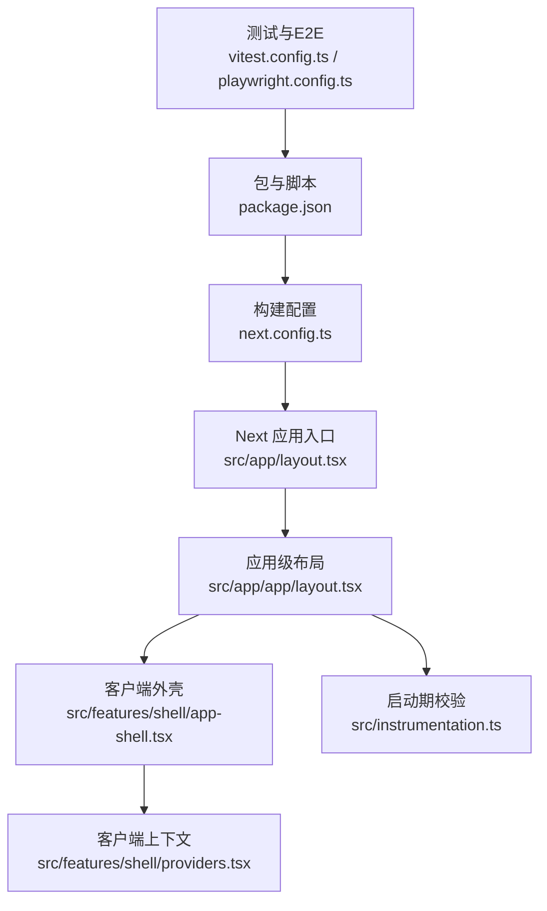
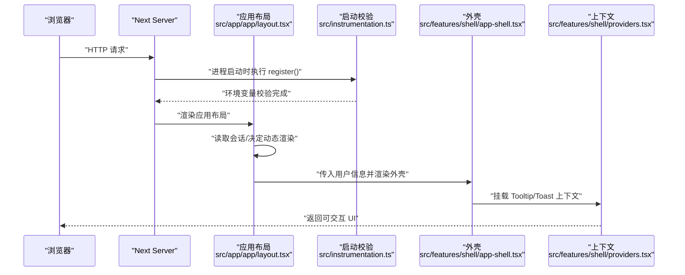
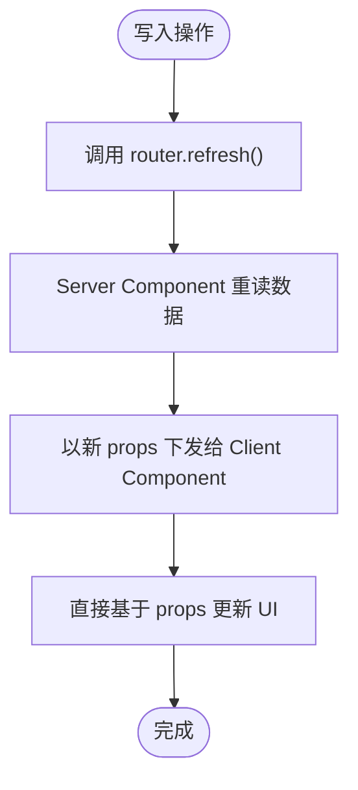
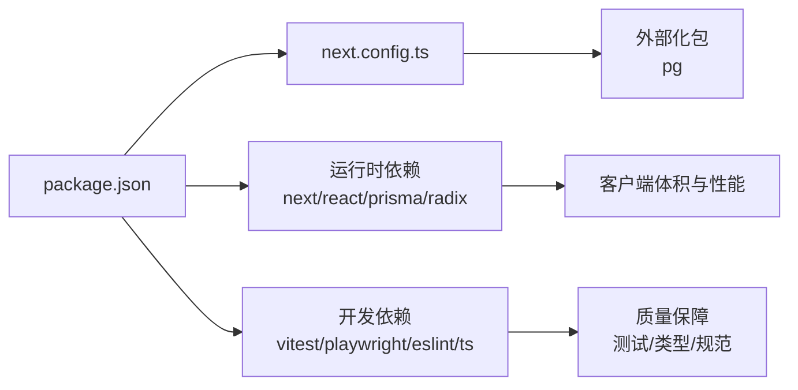

# 性能优化

<cite>
**本文引用的文件**
- [next.config.ts](file://next.config.ts)
- [package.json](file://package.json)
- [src/app/layout.tsx](file://src/app/layout.tsx)
- [src/instrumentation.ts](file://src/instrumentation.ts)
- [src/features/shell/app-shell.tsx](file://src/features/shell/app-shell.tsx)
- [src/features/shell/providers.tsx](file://src/features/shell/providers.tsx)
- [src/features/shell/state-switcher.tsx](file://src/features/shell/state-switcher.tsx)
- [src/features/projects/project-list-client.tsx](file://src/features/projects/project-list-client.tsx)
- [src/features/settings/timezone-picker.tsx](file://src/features/settings/timezone-picker.tsx)
- [src/app/app/layout.tsx](file://src/app/app/layout.tsx)
- [vitest.config.ts](file://vitest.config.ts)
- [playwright.config.ts](file://playwright.config.ts)
- [DEVELOPMENT-PLAN.md](file://DEVELOPMENT-PLAN.md)
</cite>

## 目录
1. [简介](#简介)
2. [项目结构](#项目结构)
3. [核心组件](#核心组件)
4. [架构总览](#架构总览)
5. [详细组件分析](#详细组件分析)
6. [依赖分析](#依赖分析)
7. [性能考虑](#性能考虑)
8. [故障排查指南](#故障排查指南)
9. [结论](#结论)
10. [附录](#附录)

## 简介
本文件面向 Orbit 项目的性能优化，覆盖前端代码分割与懒加载、构建期 Tree Shaking/压缩/缓存策略、运行时 React 性能调优与内存管理、监控与分析工具、性能测试方法与指标，以及可落地的优化案例与最佳实践。文档基于仓库现有配置与实现进行说明，并给出在 Next.js App Router 环境下的具体落地建议。

## 项目结构
Orbit 采用 Next.js App Router 组织页面与布局，客户端能力集中在 features 与 components 层，服务端逻辑位于 server 模块；构建与运行由 next.config.ts 与 package.json 脚本驱动；测试与 e2e 分别使用 Vitest 与 Playwright。

图表来源
- [next.config.ts:1-21](file://next.config.ts#L1-L21)
- [package.json:12-27](file://package.json#L12-L27)
- [src/app/layout.tsx:1-21](file://src/app/layout.tsx#L1-L21)
- [src/app/app/layout.tsx:21-47](file://src/app/app/layout.tsx#L21-L47)
- [src/features/shell/app-shell.tsx:1-40](file://src/features/shell/app-shell.tsx#L1-L40)
- [src/features/shell/providers.tsx:1-20](file://src/features/shell/providers.tsx#L1-L20)
- [src/instrumentation.ts:1-21](file://src/instrumentation.ts#L1-L21)
- [vitest.config.ts:1-58](file://vitest.config.ts#L1-L58)
- [playwright.config.ts:1-41](file://playwright.config.ts#L1-L41)

章节来源
- [next.config.ts:1-21](file://next.config.ts#L1-L21)
- [package.json:12-27](file://package.json#L12-L27)
- [src/app/layout.tsx:1-21](file://src/app/layout.tsx#L1-L21)
- [src/app/app/layout.tsx:21-47](file://src/app/app/layout.tsx#L21-L47)
- [src/features/shell/app-shell.tsx:1-40](file://src/features/shell/app-shell.tsx#L1-L40)
- [src/features/shell/providers.tsx:1-20](file://src/features/shell/providers.tsx#L1-L20)
- [src/instrumentation.ts:1-21](file://src/instrumentation.ts#L1-L21)
- [vitest.config.ts:1-58](file://vitest.config.ts#L1-L58)
- [playwright.config.ts:1-41](file://playwright.config.ts#L1-L41)

## 核心组件
- 构建与运行配置：通过 next.config.ts 控制 StrictMode、响应头、外部化包等；package.json 提供 dev/build/start 脚本与测试命令。
- 应用布局与客户端上下文：根布局设置元信息；应用布局负责会话获取、动态渲染与开发态工具挂载；AppShell 提供响应式外壳与导航；Providers 组合 Tooltip/Toast 上下文。
- 启动期校验：instrumentation 在服务端启动时执行环境变量校验，失败即快速失败，避免错误部署。
- 列表与交互：项目列表客户端组件以 props 为真源，配合 router.refresh 减少状态同步成本；时间选择器对长列表进行渲染裁剪与滚动优化。

章节来源
- [next.config.ts:1-21](file://next.config.ts#L1-L21)
- [package.json:12-27](file://package.json#L12-L27)
- [src/app/layout.tsx:1-21](file://src/app/layout.tsx#L1-L21)
- [src/app/app/layout.tsx:21-47](file://src/app/app/layout.tsx#L21-L47)
- [src/features/shell/app-shell.tsx:1-40](file://src/features/shell/app-shell.tsx#L1-L40)
- [src/features/shell/providers.tsx:1-20](file://src/features/shell/providers.tsx#L1-L20)
- [src/instrumentation.ts:1-21](file://src/instrumentation.ts#L1-L21)
- [src/features/projects/project-list-client.tsx:30-61](file://src/features/projects/project-list-client.tsx#L30-L61)
- [src/features/settings/timezone-picker.tsx:72-101](file://src/features/settings/timezone-picker.tsx#L72-L101)

## 架构总览
下图展示从请求到渲染的关键路径，包括服务端布局、客户端外壳与上下文、以及启动期校验。

图表来源
- [src/instrumentation.ts:1-21](file://src/instrumentation.ts#L1-L21)
- [src/app/app/layout.tsx:21-47](file://src/app/app/layout.tsx#L21-L47)
- [src/features/shell/app-shell.tsx:1-40](file://src/features/shell/app-shell.tsx#L1-L40)
- [src/features/shell/providers.tsx:1-20](file://src/features/shell/providers.tsx#L1-L20)

## 详细组件分析

### 构建与运行配置（Tree Shaking、压缩、缓存）
- Next 配置要点
  - reactStrictMode：开启以暴露副作用问题，利于早期发现性能隐患。
  - poweredByHeader：关闭以减少信息泄露。
  - serverExternalPackages：将 pg 外部化，避免进入客户端 bundle，降低体积与初始化开销。
  - allowedDevOrigins：允许本地回环访问，避免开发阶段跨域导致 HMR/资源加载失败。
- 构建脚本
  - build 前生成 Prisma 客户端，确保类型与查询可用。
  - start 使用生产模式启动服务。
- 缓存与产物
  - Next 默认启用静态预取与增量静态再生机制；对于包含会话的页面已显式设置为动态渲染，避免私有数据进入共享缓存。

章节来源
- [next.config.ts:1-21](file://next.config.ts#L1-L21)
- [package.json:12-27](file://package.json#L12-L27)
- [src/app/app/layout.tsx:21-47](file://src/app/app/layout.tsx#L21-L47)

### 代码分割与懒加载
- 路由级代码分割
  - Next App Router 按路由自动分割；关键页面（如项目看板、任务详情）保持轻量首屏，非关键区域按需加载。
- 组件级懒加载
  - 大型或低频功能（如图表、Markdown 编辑器、上传处理）建议按需导入，避免阻塞首屏。
- 客户端上下文最小化
  - Providers 仅包裹必要的全局上下文（Tooltip/Toast），减少不必要的客户端依赖。

章节来源
- [src/features/shell/providers.tsx:1-20](file://src/features/shell/providers.tsx#L1-L20)
- [DEVELOPMENT-PLAN.md:917-927](file://DEVELOPMENT-PLAN.md#L917-L927)

### 运行时性能优化（React、内存、渲染）
- 数据真源与刷新
  - 列表组件以 Server Component 传入的 props 为唯一真源，写操作后调用 router.refresh() 触发服务端重读与重新渲染，避免客户端状态镜像导致的冗余更新与不一致。
- 长列表渲染优化
  - 时间选择器在未输入时渲染全量以保证选中项可见，过滤时限制最大渲染条数，结合 scrollIntoView 仅操作 DOM，避免 setState 引发的级联渲染。
- 焦点与弹层
  - 编程式打开 Drawer/Dialog 时使用自定义 hook 捕获并恢复焦点，提升可访问性与交互体验，同时避免多余重排。
- 开发态工具隔离
  - 六态切换面板仅在 development 渲染，生产构建通过 NODE_ENV 常量死代码消除，不向真实用户暴露。

图表来源
- [src/features/projects/project-list-client.tsx:30-61](file://src/features/projects/project-list-client.tsx#L30-L61)

章节来源
- [src/features/projects/project-list-client.tsx:30-61](file://src/features/projects/project-list-client.tsx#L30-L61)
- [src/features/settings/timezone-picker.tsx:72-101](file://src/features/settings/timezone-picker.tsx#L72-L101)
- [src/features/shell/app-shell.tsx:1-40](file://src/features/shell/app-shell.tsx#L1-L40)
- [src/features/shell/state-switcher.tsx:1-74](file://src/features/shell/state-switcher.tsx#L1-L74)

### 监控与分析（指标、错误追踪、行为分析）
- 启动期校验
  - instrumentation 在服务端启动时执行环境变量校验，失败快速失败，避免错误配置上线。
- 日志与级别
  - 环境变量支持 LOG_LEVEL 枚举，便于在不同环境调整日志级别，平衡可观测性与性能。
- 安全与隐私
  - 环境变量解析拒绝 NEXT_PUBLIC_ 暴露敏感字段，防止客户端 bundle 泄漏密钥。

章节来源
- [src/instrumentation.ts:1-21](file://src/instrumentation.ts#L1-L21)
- [src/server/env.ts:1-238](file://src/server/env.ts#L1-L238)

### 性能测试方法（基准、负载、用户体验）
- 目标指标
  - Core Web Vitals：LCP≤2.5s、INP≤200ms、CLS≤0.1（第75百分位）。
  - 首次可交互工作台：固定设备与网络条件，连续多次取中位数与范围。
  - 后端接口：关键 JSON 读取 p95≤300ms、普通写入 p95≤500ms（同区域 staging，明确数据集与并发）。
- 测试工具
  - 单元测试与契约测试：Vitest 多 project 并行，集成测试禁用文件间并行以避免数据库连接池溢出。
  - E2E：Playwright 默认启动生产构建并冒烟测试，支持 trace 记录与重试。

章节来源
- [DEVELOPMENT-PLAN.md:917-927](file://DEVELOPMENT-PLAN.md#L917-L927)
- [vitest.config.ts:1-58](file://vitest.config.ts#L1-L58)
- [playwright.config.ts:1-41](file://playwright.config.ts#L1-L41)

## 依赖分析
- 构建与运行时依赖
  - Next.js 作为框架，React 19 提供最新特性；Prisma 用于数据建模与迁移；Radix UI 提供可访问性基础组件。
- 外部化与客户端体积
  - pg 被外部化，避免进入客户端 bundle；server-only 保护服务端模块不被误引入客户端。
- 测试依赖
  - Vitest 与 Playwright 分别承担单元/契约/集成测试与端到端测试，保证质量与回归。

图表来源
- [package.json:29-65](file://package.json#L29-L65)
- [next.config.ts:1-21](file://next.config.ts#L1-L21)

章节来源
- [package.json:29-65](file://package.json#L29-L65)
- [next.config.ts:1-21](file://next.config.ts#L1-L21)

## 性能考虑
- 构建期优化
  - 利用 Next 内置的 Tree Shaking 与代码分割；保持按需导入与最小化客户端依赖；外部化原生/动态模块（如 pg）。
  - 谨慎使用全局样式与第三方库，优先使用 Tailwind 原子类与按需组件。
- 运行时优化
  - 以 Server Component 承载数据获取，Client Component 专注交互；写操作后使用 router.refresh() 刷新真源，避免状态镜像。
  - 长列表与搜索场景限制渲染数量，结合滚动定位与只读 DOM 操作，减少 re-render。
  - 开发态工具严格隔离，生产构建通过常量分支消除。
- 缓存策略
  - 对不含私有数据的页面启用静态预取；含会话的页面强制动态渲染，避免缓存污染。
- 资源优化
  - 图片与字体按需加载与压缩；图标使用矢量库并按需引用；避免重复打包相同资源。

[本节为通用指导，无需特定文件来源]

## 故障排查指南
- 启动失败与环境变量
  - 若环境变量缺失或格式错误，instrumentation 会在启动期抛出 EnvValidationError，错误信息仅包含变量名与预期格式，便于快速定位。
- 开发服务器跨域
  - 若出现「Blocked cross-origin request」，检查 allowedDevOrigins 是否包含当前主机；该配置仅影响开发服务器。
- 数据库连接池溢出
  - 集成测试并行度可能导致连接数接近上限；可通过禁用文件间并行缓解，保留单文件内并发。

章节来源
- [src/instrumentation.ts:1-21](file://src/instrumentation.ts#L1-L21)
- [src/server/env.ts:1-238](file://src/server/env.ts#L1-L238)
- [next.config.ts:1-21](file://next.config.ts#L1-L21)
- [vitest.config.ts:42-53](file://vitest.config.ts#L42-L53)

## 结论
Orbit 在 Next.js 生态下已具备良好性能基础：路由级代码分割、客户端上下文最小化、服务端数据真源与刷新、启动期校验与安全约束。建议在后续里程碑中持续落实懒加载、长列表虚拟化、资源压缩与缓存策略，并通过统一的性能指标与测试流程保障线上体验。

[本节为总结，无需特定文件来源]

## 附录
- 性能目标速查
  - 首屏与交互：LCP≤2.5s、INP≤200ms、CLS≤0.1。
  - 接口吞吐：读取 p95≤300ms、写入 p95≤500ms（同区域 staging，明确数据集与并发）。
  - 看板数据：首屏 JSON 未压缩目标 ≤250KiB，列内卡片数限制。
- 常用命令
  - 开发：pnpm dev
  - 构建：pnpm build
  - 启动：pnpm start
  - 测试：pnpm test:unit / test:integration / test:e2e / test:ui / test:contract

章节来源
- [DEVELOPMENT-PLAN.md:917-927](file://DEVELOPMENT-PLAN.md#L917-L927)
- [package.json:12-27](file://package.json#L12-L27)