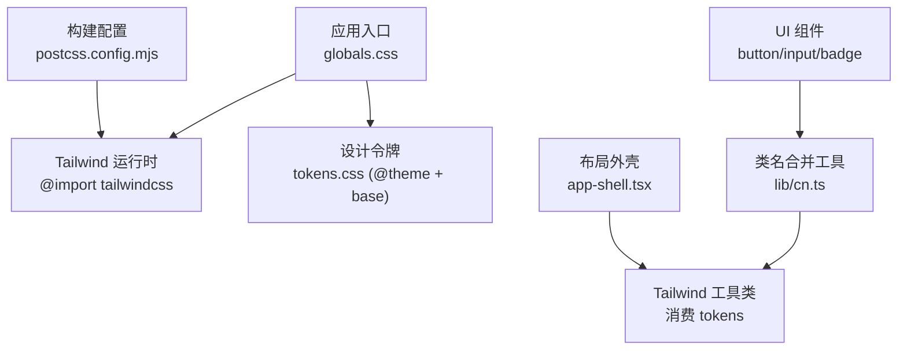
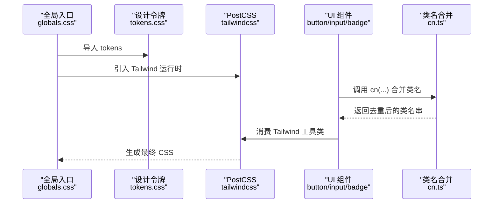
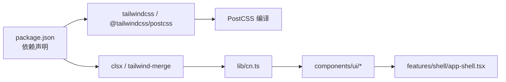

# 样式系统

<cite>
**本文引用的文件**
- [src/styles/globals.css](file://src/styles/globals.css)
- [src/styles/tokens.css](file://src/styles/tokens.css)
- [postcss.config.mjs](file://postcss.config.mjs)
- [package.json](file://package.json)
- [src/lib/cn.ts](file://src/lib/cn.ts)
- [src/components/ui/button.tsx](file://src/components/ui/button.tsx)
- [src/components/ui/input.tsx](file://src/components/ui/input.tsx)
- [src/components/ui/badge.tsx](file://src/components/ui/badge.tsx)
- [src/features/shell/app-shell.tsx](file://src/features/shell/app-shell.tsx)
- [docs/02-UX-AND-DESIGN.md](file://docs/02-UX-AND-DESIGN.md)
</cite>

## 目录
1. [简介](#简介)
2. [项目结构](#项目结构)
3. [核心组件](#核心组件)
4. [架构总览](#架构总览)
5. [详细组件分析](#详细组件分析)
6. [依赖关系分析](#依赖关系分析)
7. [性能考量](#性能考量)
8. [故障排查指南](#故障排查指南)
9. [结论](#结论)
10. [附录](#附录)

## 简介
本文件系统化说明 Orbit 项目的样式体系：基于 Tailwind CSS 4 的 CSS-first 设计，通过 tokens 集中定义颜色、字体、间距、圆角、阴影与动效；以全局样式为入口，组件层消费 token 并组合响应式布局；提供类名合并工具与主题定制策略，确保可维护性、可访问性与跨浏览器一致性。文档同时给出调试技巧与最佳实践，帮助开发者高效扩展与维护样式。

## 项目结构
Orbit 的样式采用“单一真源”的设计令牌（tokens）+ 组件级 Tailwind 工具类组合的方式：
- 全局入口：引入 Tailwind 运行时与设计令牌，统一基础排版与焦点环等基线样式。
- 设计令牌：在 @theme 中声明变量，自动映射到 :root 与 Tailwind 工具类，无需 tailwind.config.js。
- 组件样式：各 UI 组件使用 Tailwind 工具类消费 token，避免硬编码颜色与尺寸。
- 构建配置：PostCSS 仅启用 Tailwind CSS 4 插件，保持极简管线。

图表来源
- [src/styles/globals.css:1-12](file://src/styles/globals.css#L1-L12)
- [src/styles/tokens.css:23-107](file://src/styles/tokens.css#L23-L107)
- [src/lib/cn.ts:1-13](file://src/lib/cn.ts#L1-L13)
- [postcss.config.mjs:1-9](file://postcss.config.mjs#L1-L9)

章节来源
- [src/styles/globals.css:1-12](file://src/styles/globals.css#L1-L12)
- [src/styles/tokens.css:23-107](file://src/styles/tokens.css#L23-L107)
- [postcss.config.mjs:1-9](file://postcss.config.mjs#L1-L9)

## 核心组件
- 设计令牌（tokens）
  - 颜色：背景、表面、前景、品牌、语义色、项目标记色等，均通过 --color-* 暴露，自动生成 bg-/text-/border- 等工具类。
  - 字体与字号：--font-sans、--font-mono 及多档字号与行高，统一正文、标题、标签等排版。
  - 间距与圆角：4px 基数，控件/卡片/弹层圆角分级，保证触控目标与视觉一致。
  - 阴影与动效：限定用于浮层与拖拽，缓动曲线与时长统一。
  - 断点：沿用 Tailwind 默认 md=768、xl=1280，适配桌面/平板/手机三档。
- 全局样式
  - 基础排版：body 字体、字号、行高、抗锯齿与渲染优化。
  - 可访问性：强制 :focus-visible 焦点环，覆盖 outline-none 带来的键盘不可见问题。
  - 动效降级：prefers-reduced-motion 下禁用非必要动画。
- 组件样式
  - Button/IconButton：消费 brand/surface/line-strong 等 token，尺寸与交互态统一。
  - Input/Textarea：边框、背景、占位符、无效态与禁用态统一。
  - Badge：语义化 tone 配色，软底深字，满足对比度要求。
- 布局外壳
  - AppShell：固定侧栏与顶栏高度，移动端抽屉导航，内容区内边距随断点变化。

章节来源
- [src/styles/tokens.css:23-107](file://src/styles/tokens.css#L23-L107)
- [src/styles/tokens.css:109-168](file://src/styles/tokens.css#L109-L168)
- [src/components/ui/button.tsx:15-49](file://src/components/ui/button.tsx#L15-L49)
- [src/components/ui/input.tsx:12-31](file://src/components/ui/input.tsx#L12-L31)
- [src/components/ui/badge.tsx:18-45](file://src/components/ui/badge.tsx#L18-L45)
- [src/features/shell/app-shell.tsx:296-367](file://src/features/shell/app-shell.tsx#L296-L367)

## 架构总览
下图展示从入口到组件的样式数据流：全局入口引入 Tailwind 与 tokens，组件通过 cn 工具合并类名，最终由 PostCSS 编译输出。

图表来源
- [src/styles/globals.css:1-12](file://src/styles/globals.css#L1-L12)
- [src/styles/tokens.css:23-107](file://src/styles/tokens.css#L23-L107)
- [src/lib/cn.ts:1-13](file://src/lib/cn.ts#L1-L13)
- [postcss.config.mjs:1-9](file://postcss.config.mjs#L1-L9)

## 详细组件分析

### 设计令牌与主题定制
- 颜色系统
  - 表面与前景：background、surface、foreground、foreground-secondary/muted/invert。
  - 边界：line、line-strong（控件边界需满足 3:1）。
  - 品牌与语义：brand、brand-hover、brand-soft；success/warning/danger 及其 soft 浅底。
  - 项目标记：6 个固定色，仅用于项目标识，不替代状态或权限。
- 字体与字号
  - 字体栈优先系统字体，避免首版大体积中文字体下载。
  - 字号层级：caption(12)、label(14)、body(16)、section(20)、page(28)、hero(40)，行高按层级设定。
- 间距与圆角
  - 间距基数 4px，常用 p-1/p-2/p-3/p-4/p-6/p-8/p-12 对应 4/8/12/16/24/32/48。
  - 圆角：control(8)、card(12)、overlay(16)。
- 阴影与动效
  - 阴影仅用于浮层与拖拽；动效时长 120–180ms，缓动曲线标准化。
- 断点
  - 沿用 Tailwind 默认 md=768、xl=1280；验收视口 390/768/1440。

章节来源
- [src/styles/tokens.css:23-107](file://src/styles/tokens.css#L23-L107)
- [docs/02-UX-AND-DESIGN.md:9-33](file://docs/02-UX-AND-DESIGN.md#L9-L33)

### 全局样式与可访问性
- 基础排版：body 字体、字号、行高、抗锯齿与文本渲染优化。
- 焦点环：全局 :focus-visible 规则置于所有层之外，优先级高于 utilities 层的 outline-none，确保键盘可达。
- 动效降级：prefers-reduced-motion 下禁用过渡与动画，保留状态可见性。

章节来源
- [src/styles/tokens.css:109-168](file://src/styles/tokens.css#L109-L168)

### 组件样式模式
- Button/IconButton
  - 变体：primary/secondary/ghost/danger，尺寸：sm/md/lg。
  - 样式消费 token：bg-brand、text-foreground-invert、border-line-strong、hover:bg-brand-hover 等。
  - 无障碍：IconButton 强制 label 作为 aria-label。
- Input/Textarea
  - 字段基类统一边框、背景、占位符、禁用态与无效态（aria-invalid 切换 danger 边框与软底）。
  - 焦点环走全局规则，避免重复实现。
- Badge
  - tone 决定语义配色，soft 底 + 深色文字，满足 AA 对比度。

章节来源
- [src/components/ui/button.tsx:15-49](file://src/components/ui/button.tsx#L15-L49)
- [src/components/ui/button.tsx:72-117](file://src/components/ui/button.tsx#L72-L117)
- [src/components/ui/input.tsx:12-31](file://src/components/ui/input.tsx#L12-L31)
- [src/components/ui/badge.tsx:18-45](file://src/components/ui/badge.tsx#L18-L45)

### 响应式设计实现
- 断点管理
  - 桌面 ≥1280(xl)：侧栏 224px，顶栏 64px，内容内边距 32px。
  - 平板 768–1279(md–xl)：侧栏收窄至 72px，内容内边距 24px。
  - 手机 <768(base)：隐藏侧栏，顶部汉堡按钮打开 Drawer 导航，内容内边距 16px。
- 移动优先策略
  - 默认 base 样式适用于小屏，md/xl 逐步增强布局与宽度。
- 自适应布局
  - 侧栏 rail/drawer 双模式，移动端使用 Radix Drawer 提供焦点陷阱与关闭后恢复焦点。
  - 主列通过 pl-[72px]/pl-56 留出侧栏空间，header sticky 与 backdrop-blur 提升可读性。

章节来源
- [src/features/shell/app-shell.tsx:23-40](file://src/features/shell/app-shell.tsx#L23-L40)
- [src/features/shell/app-shell.tsx:307-367](file://src/features/shell/app-shell.tsx#L307-L367)

### 样式工具函数
- 类名合并
  - cn 工具结合 clsx 与 tailwind-merge，支持条件类与冲突消解（后者覆盖前者），使组件既能内建 token 样式，又能被调用方 className 安全覆盖。
- 条件样式
  - 组件内部通过对象映射 variant/size/tone 选择类名，再与外部 className 合并。
- 动态样式生成
  - 项目标记色映射表将契约枚举映射到 bg-project-* 工具类与中文标签，并提供可访问的 aria 文本。

章节来源
- [src/lib/cn.ts:1-13](file://src/lib/cn.ts#L1-L13)
- [src/components/ui/button.tsx:15-49](file://src/components/ui/button.tsx#L15-L49)
- [src/components/ui/badge.tsx:18-45](file://src/components/ui/badge.tsx#L18-L45)
- [src/lib/project-color.ts:1-34](file://src/lib/project-color.ts#L1-L34)

### 主题定制策略
- 单真源：所有视觉变量集中在 tokens.css 的 @theme，修改一处即全局生效。
- 无 JS 配置：通过 @theme 直接生成 :root 变量与 Tailwind 工具类，无需 tailwind.config.js。
- 分层组织：base 层负责基础排版与可访问性；utilities 层由 Tailwind 生成；组件层消费工具类。
- 可扩展性：新增 token 只需在 @theme 添加，即可立即获得工具类与 :root 变量。

章节来源
- [src/styles/tokens.css:23-107](file://src/styles/tokens.css#L23-L107)
- [postcss.config.mjs:1-9](file://postcss.config.mjs#L1-L9)

## 依赖关系分析
- 构建链
  - Next.js 构建时通过 PostCSS 加载 @tailwindcss/postcss，解析 @import "tailwindcss" 与 @theme。
- 运行时依赖
  - clsx 处理条件类，tailwind-merge 解决类名冲突，二者在 cn 工具中组合使用。
- 组件依赖
  - UI 组件依赖 cn 工具与 token 生成的工具类；布局外壳依赖 Radix 原语（Drawer/Dialog）与图标库。

图表来源
- [package.json:29-65](file://package.json#L29-L65)
- [src/lib/cn.ts:1-13](file://src/lib/cn.ts#L1-L13)
- [postcss.config.mjs:1-9](file://postcss.config.mjs#L1-L9)

章节来源
- [package.json:29-65](file://package.json#L29-L65)
- [src/lib/cn.ts:1-13](file://src/lib/cn.ts#L1-L13)
- [postcss.config.mjs:1-9](file://postcss.config.mjs#L1-L9)

## 性能考量
- 减少 CSS 体积
  - 使用 Tailwind 4 的 tree-shaking 能力，仅生成实际使用的工具类。
  - 避免在组件中硬编码大量自定义样式，尽量复用 token 与工具类。
- 减少重排与重绘
  - 动效仅使用 transform 与 opacity，避免触发布局计算。
  - 控制阴影与模糊的使用范围，仅在必要浮层启用。
- 可访问性与体验
  - 遵循 prefers-reduced-motion，降低动画对敏感用户的影响。
  - 确保焦点环始终可见，避免键盘操作障碍。

[本节为通用指导，不直接分析具体文件]

## 故障排查指南
- 键盘焦点不可见
  - 现象：组件使用 outline-none 导致焦点环被覆盖。
  - 原因：utilities 层样式优先级高于 base 层。
  - 解决：全局 :focus-visible 规则置于所有层之外，确保焦点环必定生效。
- 对比度不达标
  - 现象：辅助文字或浅色背景上的文字对比度不足。
  - 解决：使用 tokens 中的 secondary/muted 级别并限制使用场景；必要时调整 token 值并记录。
- 主题未生效
  - 检查 postcss.config.mjs 是否启用 @tailwindcss/postcss。
  - 确认 globals.css 已引入 tailwindcss 与 tokens.css。
- 类名冲突
  - 使用 cn 工具合并类名，确保后者覆盖前者，避免手动拼接导致的意外覆盖。

章节来源
- [src/styles/tokens.css:157-168](file://src/styles/tokens.css#L157-L168)
- [postcss.config.mjs:1-9](file://postcss.config.mjs#L1-L9)
- [src/styles/globals.css:1-12](file://src/styles/globals.css#L1-L12)
- [src/lib/cn.ts:1-13](file://src/lib/cn.ts#L1-L13)

## 结论
Orbit 的样式系统以 tokens 为核心，结合 Tailwind CSS 4 的 CSS-first 能力，实现了高度一致的视觉语言与高效的开发体验。通过全局基线、组件级工具类组合与类名合并工具，既保证了可维护性与可访问性，又提供了灵活的响应式布局方案。建议后续扩展继续遵循“单真源”原则，谨慎调整 token，并通过对比度与可访问性测试验证变更影响。

[本节为总结性内容，不直接分析具体文件]

## 附录

### 样式调试技巧
- 查看最终 CSS
  - 在浏览器开发者工具中检查元素计算的样式，确认 token 对应的工具类是否生效。
- 验证对比度
  - 使用 WCAG 对比度检测工具验证 foreground/background 组合是否符合 AA 标准。
- 快速定位类名冲突
  - 在控制台临时移除或替换 cn 合并后的类名，观察样式变化，定位冲突来源。
- 响应式断点验证
  - 使用设备模拟器切换 390/768/1440 视口，验证侧栏、顶栏与内容区的布局行为。

[本节为通用指导，不直接分析具体文件]