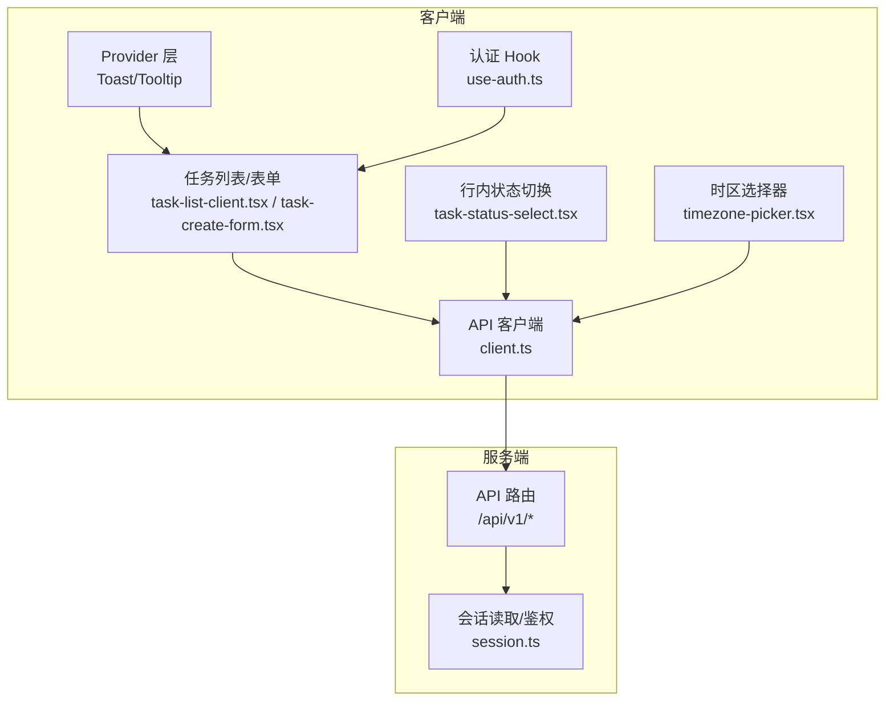
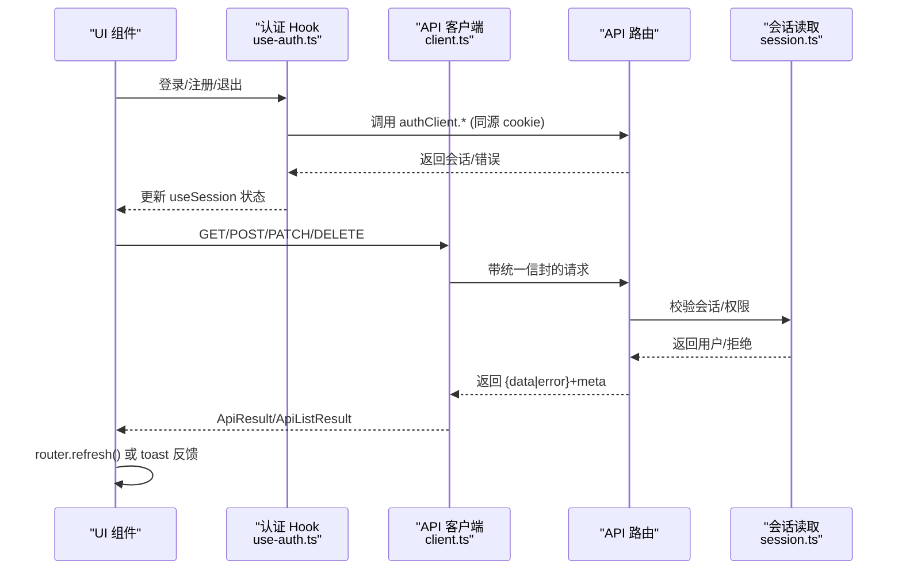
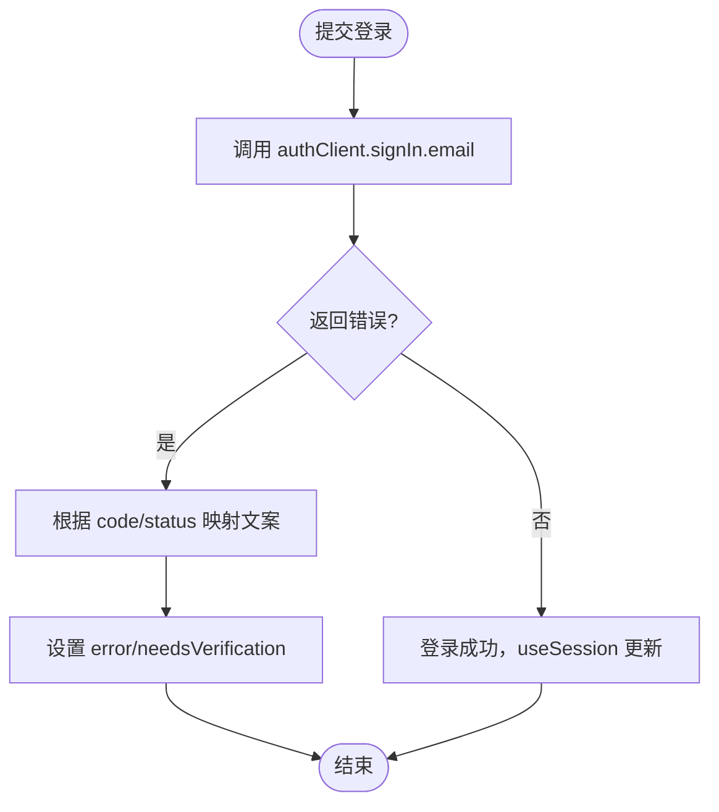
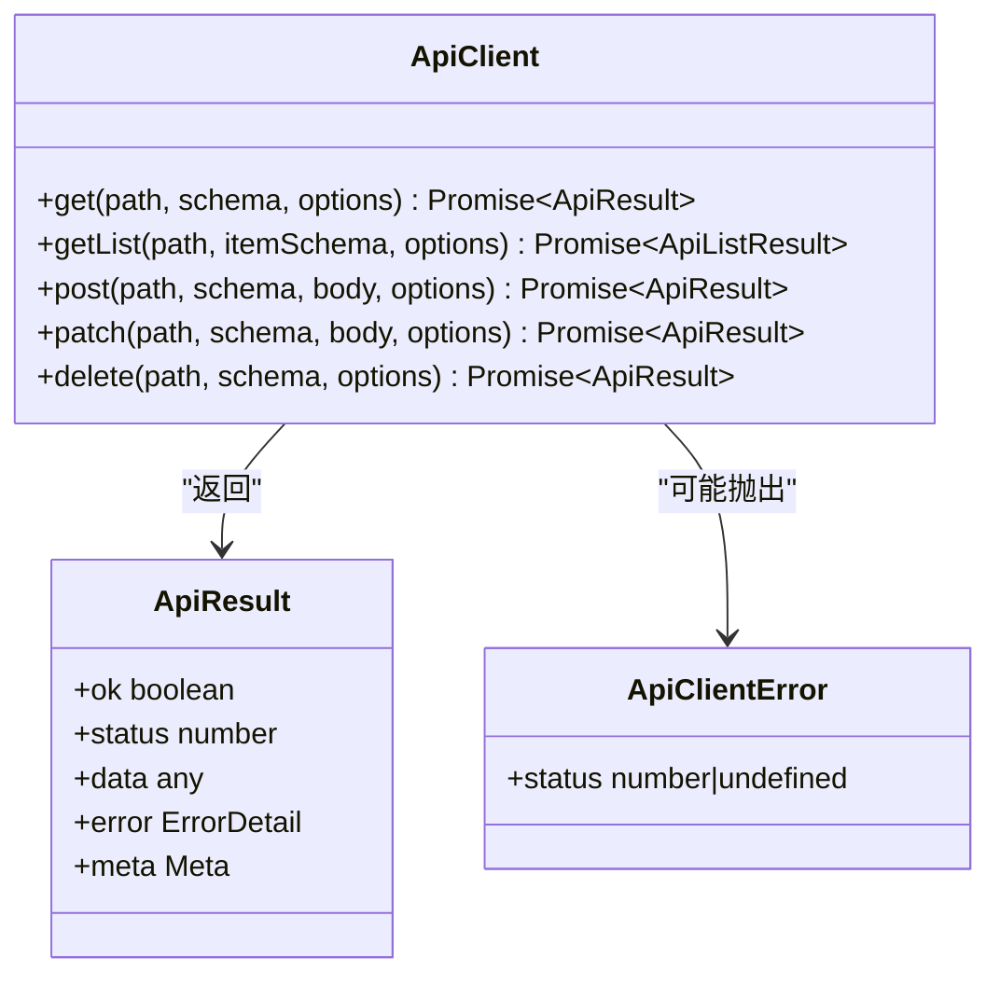
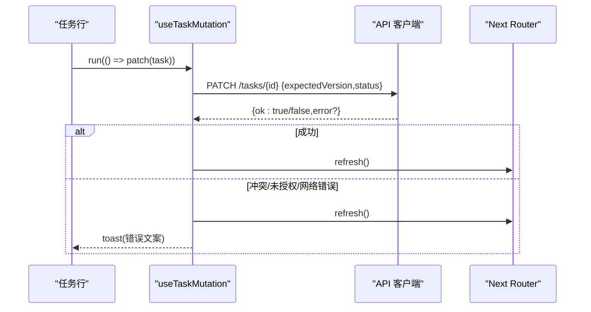
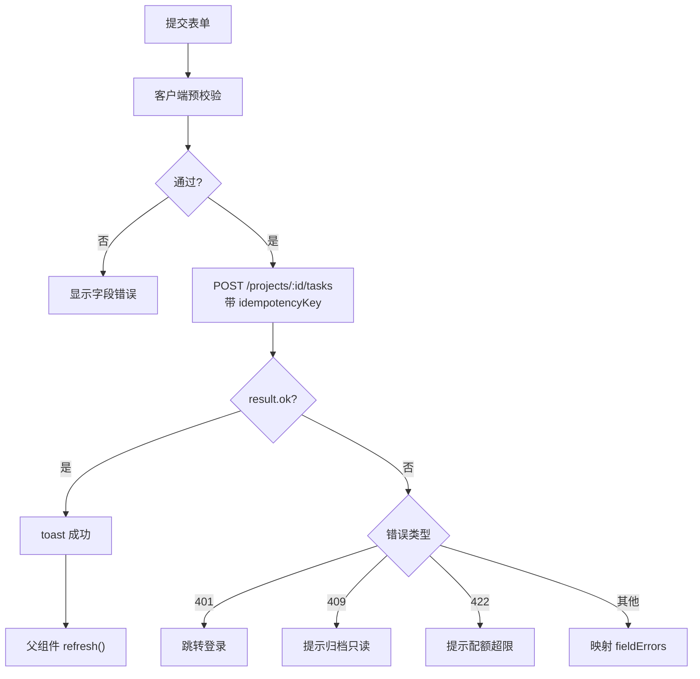
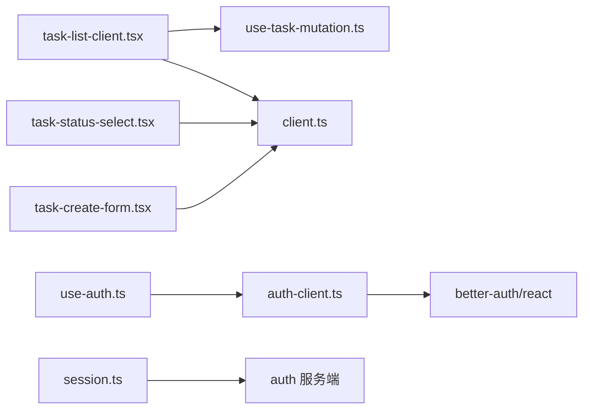

# 状态管理

<cite>
**本文引用的文件**
- [src/features/shell/providers.tsx](file://src/features/shell/providers.tsx)
- [src/features/auth/use-auth.ts](file://src/features/auth/use-auth.ts)
- [src/features/auth/auth-client.ts](file://src/features/auth/auth-client.ts)
- [src/server/auth/session.ts](file://src/server/auth/session.ts)
- [src/contracts/client.ts](file://src/contracts/client.ts)
- [src/features/tasks/real/task-list-client.tsx](file://src/features/tasks/real/task-list-client.tsx)
- [src/features/tasks/real/use-task-mutation.ts](file://src/features/tasks/real/use-task-mutation.ts)
- [src/features/tasks/real/task-status-select.tsx](file://src/features/tasks/real/task-status-select.tsx)
- [src/features/tasks/real/task-create-form.tsx](file://src/features/tasks/real/task-create-form.tsx)
- [src/features/settings/timezone-picker.tsx](file://src/features/settings/timezone-picker.tsx)
- [src/features/shell/sample-state.ts](file://src/features/shell/sample-state.ts)
- [src/features/shell/state-switcher.tsx](file://src/features/shell/state-switcher.tsx)
- [src/features/shell/state-views.tsx](file://src/features/shell/state-views.tsx)
</cite>

## 目录
1. [简介](#简介)
2. [项目结构](#项目结构)
3. [核心组件](#核心组件)
4. [架构总览](#架构总览)
5. [详细组件分析](#详细组件分析)
6. [依赖关系分析](#依赖关系分析)
7. [性能考虑](#性能考虑)
8. [故障排查指南](#故障排查指南)
9. [结论](#结论)
10. [附录](#附录)

## 简介
本文件系统性梳理 Orbit 前端的状态管理策略与实现，覆盖：
- React Hooks 使用模式与本地状态、服务端状态的分离原则
- 数据获取模式：API 客户端封装、统一信封解析、错误处理
- 状态同步机制：乐观并发、冲突解决、数据一致性保证
- 状态持久化方案：会话 Cookie 与本地存储的使用边界
- 复杂状态逻辑示例：表单状态、用户会话、应用配置与时区选择
- 性能优化技巧与调试方法

## 项目结构
Orbit 的前端状态管理围绕“服务端为真源”的原则组织：
- 认证与会话：通过 better-auth/react 的客户端实例订阅会话，服务端提供会话读取与鉴权辅助
- API 客户端：统一的类型安全 fetch 包装，解析统一信封（成功/列表/错误），返回判别联合结果
- 业务组件：以 Server Component 首屏 props 为唯一数据真源；写操作后通过路由刷新回拉最新数据
- 局部 UI 状态：使用 useState/useTransition 等 Hook 管理加载、错误、展开/收起等交互态
- 全局 UI 上下文：Toast、Tooltip 等通过 Provider 注入

图表来源
- [src/features/shell/providers.tsx:1-20](file://src/features/shell/providers.tsx#L1-L20)
- [src/features/auth/use-auth.ts:1-186](file://src/features/auth/use-auth.ts#L1-L186)
- [src/contracts/client.ts:1-277](file://src/contracts/client.ts#L1-L277)
- [src/server/auth/session.ts:1-43](file://src/server/auth/session.ts#L1-L43)
- [src/features/tasks/real/task-list-client.tsx:1-400](file://src/features/tasks/real/task-list-client.tsx#L1-L400)
- [src/features/tasks/real/task-create-form.tsx:1-360](file://src/features/tasks/real/task-create-form.tsx#L1-L360)
- [src/features/tasks/real/task-status-select.tsx:1-118](file://src/features/tasks/real/task-status-select.tsx#L1-L118)
- [src/features/settings/timezone-picker.tsx:1-397](file://src/features/settings/timezone-picker.tsx#L1-L397)

章节来源
- [src/features/shell/providers.tsx:1-20](file://src/features/shell/providers.tsx#L1-L20)
- [src/features/auth/use-auth.ts:1-186](file://src/features/auth/use-auth.ts#L1-L186)
- [src/contracts/client.ts:1-277](file://src/contracts/client.ts#L1-L277)
- [src/server/auth/session.ts:1-43](file://src/server/auth/session.ts#L1-L43)
- [src/features/tasks/real/task-list-client.tsx:1-400](file://src/features/tasks/real/task-list-client.tsx#L1-L400)
- [src/features/tasks/real/task-create-form.tsx:1-360](file://src/features/tasks/real/task-create-form.tsx#L1-L360)
- [src/features/tasks/real/task-status-select.tsx:1-118](file://src/features/tasks/real/task-status-select.tsx#L1-L118)
- [src/features/settings/timezone-picker.tsx:1-397](file://src/features/settings/timezone-picker.tsx#L1-L397)

## 核心组件
- 认证与会话
  - 客户端：better-auth/react 的 createAuthClient 暴露 signIn/signUp/signOut/requestPasswordReset/resetPassword/sendVerificationEmail/useSession 等方法；useSession 订阅当前会话并驱动 UI
  - 服务端：getSessionUser/requireSessionUser 从请求头中解析会话并返回 UserDTO，未认证抛领域错误
- API 客户端
  - createApiClient 提供 get/post/patch/delete/getList，统一构建 URL、设置 headers、发送请求、解析统一信封，返回 ApiResult/ApiListResult 判别联合
  - 传输失败或信封不合法抛出 ApiClientError；业务错误以 { ok:false, error, meta } 返回
- 任务列表与表单
  - 列表：首屏由 Server Component 传入 initialTasks；写操作后 router.refresh() 重新渲染，避免客户端镜像导致版本陈旧
  - 创建表单：客户端预校验 + 服务端权威校验；幂等键在字段变更时刷新，网络异常重试保留原键
  - 行内状态切换：携带 expectedVersion 进行乐观并发控制，冲突时 toast 提示并刷新
- 时区选择器
  - 可搜索组合框，键盘无障碍友好；选项过滤与高亮稳定；支持“使用设备时区”快捷操作

章节来源
- [src/features/auth/auth-client.ts:1-32](file://src/features/auth/auth-client.ts#L1-L32)
- [src/server/auth/session.ts:1-43](file://src/server/auth/session.ts#L1-L43)
- [src/contracts/client.ts:1-277](file://src/contracts/client.ts#L1-L277)
- [src/features/tasks/real/task-list-client.tsx:1-400](file://src/features/tasks/real/task-list-client.tsx#L1-L400)
- [src/features/tasks/real/task-create-form.tsx:1-360](file://src/features/tasks/real/task-create-form.tsx#L1-L360)
- [src/features/tasks/real/task-status-select.tsx:1-118](file://src/features/tasks/real/task-status-select.tsx#L1-L118)
- [src/features/settings/timezone-picker.tsx:1-397](file://src/features/settings/timezone-picker.tsx#L1-L397)

## 架构总览
下图展示从 UI 到服务端的完整调用链与状态流转。

图表来源
- [src/features/auth/use-auth.ts:1-186](file://src/features/auth/use-auth.ts#L1-L186)
- [src/contracts/client.ts:1-277](file://src/contracts/client.ts#L1-L277)
- [src/server/auth/session.ts:1-43](file://src/server/auth/session.ts#L1-L43)

## 详细组件分析

### 认证与会话状态
- 客户端会话订阅
  - useSession 直接转发 better-auth/react 的 useSession，自动响应会话变化
  - 登录/注册/重置密码/重发验证邮件等动作封装为 Hook，统一维护 pending/error/needsVerification
- 服务端会话读取
  - getSessionUser/requireSessionUser 基于 Request/Headers 提取会话，返回 UserDTO 或抛 401 领域错误
- 错误映射
  - 登录错误按 code/status 精确区分：RATE_LIMITED、EMAIL_NOT_VERIFIED、403 Origin 校验失败、其余统一提示

图表来源
- [src/features/auth/use-auth.ts:54-76](file://src/features/auth/use-auth.ts#L54-L76)
- [src/features/auth/auth-client.ts:1-32](file://src/features/auth/auth-client.ts#L1-L32)
- [src/server/auth/session.ts:20-43](file://src/server/auth/session.ts#L20-L43)

章节来源
- [src/features/auth/use-auth.ts:1-186](file://src/features/auth/use-auth.ts#L1-L186)
- [src/features/auth/auth-client.ts:1-32](file://src/features/auth/auth-client.ts#L1-L32)
- [src/server/auth/session.ts:1-43](file://src/server/auth/session.ts#L1-L43)

### API 客户端与数据获取
- 统一信封解析
  - 成功单对象：{ data, meta }；成功列表：{ data[], meta }；错误：{ error, meta }
  - 非 JSON、空体、信封 schema 不匹配均抛出 ApiClientError
- 类型安全
  - 所有方法接受 Zod schema，返回类型由 schema 推导
- 请求配置
  - 支持 query、headers、signal、idempotencyKey、credentials
- 错误分类
  - 传输/契约异常：抛出 ApiClientError
  - 业务错误：返回 { ok:false, status, error, meta }

图表来源
- [src/contracts/client.ts:90-119](file://src/contracts/client.ts#L90-L119)
- [src/contracts/client.ts:57-66](file://src/contracts/client.ts#L57-L66)
- [src/contracts/client.ts:121-254](file://src/contracts/client.ts#L121-L254)

章节来源
- [src/contracts/client.ts:1-277](file://src/contracts/client.ts#L1-L277)

### 任务列表与行内状态切换
- 数据真源
  - 首屏由 Server Component 传入 initialTasks；写操作后 await router.refresh() 带来新 props，避免客户端镜像导致 version 陈旧
- 分页追加
  - “加载更多”将额外片段存入 extra* state，渲染时拼接首屏 props；props 变化时清空追加片段
- 行内状态切换
  - 携带 expectedVersion 进行乐观并发；冲突时 toast 提示并刷新，不做客户端合并
- 授权收敛
  - 仅 owner/创建者可删除；归档项目隐藏新建入口

图表来源
- [src/features/tasks/real/task-status-select.tsx:54-92](file://src/features/tasks/real/task-status-select.tsx#L54-L92)
- [src/features/tasks/real/use-task-mutation.ts:1-27](file://src/features/tasks/real/use-task-mutation.ts#L1-L27)
- [src/features/tasks/real/task-list-client.tsx:107-137](file://src/features/tasks/real/task-list-client.tsx#L107-L137)

章节来源
- [src/features/tasks/real/task-list-client.tsx:1-400](file://src/features/tasks/real/task-list-client.tsx#L1-L400)
- [src/features/tasks/real/task-status-select.tsx:1-118](file://src/features/tasks/real/task-status-select.tsx#L1-L118)
- [src/features/tasks/real/use-task-mutation.ts:1-27](file://src/features/tasks/real/use-task-mutation.ts#L1-L27)

### 任务创建表单与幂等性
- 客户端预校验
  - 标题长度、描述上限、日期格式；即时反馈字段错误
- 幂等键策略
  - 挂载时生成一次；字段变更时刷新；传输层歧义失败（catch）保留原键以便服务端 replay；业务错误则换新键
- 错误处理
  - 401 → 跳转登录；409 PROJECT_ARCHIVED → 只读提示；422 LIMIT_EXCEEDED → 配额超限提示；其他 fieldErrors 映射到字段

图表来源
- [src/features/tasks/real/task-create-form.tsx:97-176](file://src/features/tasks/real/task-create-form.tsx#L97-L176)

章节来源
- [src/features/tasks/real/task-create-form.tsx:1-360](file://src/features/tasks/real/task-create-form.tsx#L1-L360)

### 时区选择器与应用配置
- 交互设计
  - 可编辑组合框，键盘导航完整；高亮项用 id 稳定定位；输入过滤限制渲染数量
- 配置持久化
  - 设备时区作为默认值；提交时随注册/设置一起发送到服务端；客户端不直接持久化到 localStorage
- 无障碍
  - role="combobox"、aria-expanded、aria-controls、aria-autocomplete、aria-activedescendant 等属性完善

章节来源
- [src/features/settings/timezone-picker.tsx:1-397](file://src/features/settings/timezone-picker.tsx#L1-L397)

### 样例状态与演示面板
- 六态模型
  - data/loading/empty/error/permission/long-content，通过 URL ?state= 切换
- 状态切换器
  - 使用 useSyncExternalStore 订阅浏览器 URL，避免 SSR 水合不一致；router.replace 改写查询参数
- 通用视图
  - SampleError：局部错误 + 重试 + 保留草稿说明
  - NoAccess：统一不可访问页面，不泄露资源是否存在

章节来源
- [src/features/shell/sample-state.ts:1-51](file://src/features/shell/sample-state.ts#L1-L51)
- [src/features/shell/state-switcher.tsx:1-110](file://src/features/shell/state-switcher.tsx#L1-L110)
- [src/features/shell/state-views.tsx:1-90](file://src/features/shell/state-views.tsx#L1-L90)

## 依赖关系分析
- 组件耦合
  - 任务列表依赖 useTaskMutation 聚合 pending/refresh；行内状态切换依赖 API 客户端与服务端版本控制
  - 认证 Hook 依赖 better-auth/react 客户端；服务端会话读取依赖 session 工具
- 外部依赖
  - Next Navigation：router.refresh() 用于刷新服务端数据
  - better-auth/react：会话订阅与认证方法
  - Zod：API 响应 schema 校验
- 潜在循环
  - 无直接循环导入；各模块职责清晰，依赖方向单向

图表来源
- [src/features/tasks/real/task-list-client.tsx:1-400](file://src/features/tasks/real/task-list-client.tsx#L1-L400)
- [src/features/tasks/real/use-task-mutation.ts:1-27](file://src/features/tasks/real/use-task-mutation.ts#L1-L27)
- [src/features/tasks/real/task-status-select.tsx:1-118](file://src/features/tasks/real/task-status-select.tsx#L1-L118)
- [src/features/tasks/real/task-create-form.tsx:1-360](file://src/features/tasks/real/task-create-form.tsx#L1-L360)
- [src/features/auth/use-auth.ts:1-186](file://src/features/auth/use-auth.ts#L1-L186)
- [src/features/auth/auth-client.ts:1-32](file://src/features/auth/auth-client.ts#L1-L32)
- [src/server/auth/session.ts:1-43](file://src/server/auth/session.ts#L1-L43)

## 性能考虑
- 单一数据真源
  - 列表数据以 Server Component props 为准，写操作后 router.refresh() 刷新，避免客户端镜像导致的版本陈旧与重复状态
- 过渡与防抖
  - useTaskMutation 使用 useTransition 包裹 action 与 refresh，避免频繁提交与闪烁
- 渲染优化
  - 时区选择器限制最大渲染项数，减少长列表开销
- 缓存策略
  - 会话通过 httpOnly Cookie 传递，不在 localStorage 存储 token；API 客户端默认 same-origin 凭据
  - 服务端对 /me 等接口设置私有缓存控制，避免共享缓存泄露

[本节为通用指导，不直接分析具体文件]

## 故障排查指南
- 认证相关
  - 登录失败：检查 code 是否为 EMAIL_NOT_VERIFIED/RATE_LIMITED，或 status 403 是否来自 Origin 校验
  - 会话失效：401 时硬跳转登录页，确保 httpOnly Cookie 清理与重新评估
- API 错误
  - 传输失败/信封非法：捕获 ApiClientError，提示网络问题
  - 业务错误：根据 error.code 映射用户可见文案（如 VERSION_CONFLICT、PROJECT_ARCHIVED、LIMIT_EXCEEDED）
- 并发冲突
  - 409 VERSION_CONFLICT：toast 提示并刷新，等待服务端最新 version
- 幂等性
  - 字段变更刷新 idempotencyKey；网络异常重试保留原键，避免重复创建

章节来源
- [src/features/auth/use-auth.ts:29-52](file://src/features/auth/use-auth.ts#L29-L52)
- [src/contracts/client.ts:165-245](file://src/contracts/client.ts#L165-L245)
- [src/features/tasks/real/task-status-select.tsx:36-43](file://src/features/tasks/real/task-status-select.tsx#L36-L43)
- [src/features/tasks/real/task-create-form.tsx:140-176](file://src/features/tasks/real/task-create-form.tsx#L140-L176)

## 结论
Orbit 的前端状态管理遵循“服务端为真源、客户端最小化镜像”的原则，结合：
- 类型安全的 API 客户端与统一信封解析
- 基于 useSession 的会话订阅与认证 Hook
- 乐观并发与幂等键保障一致性与可靠性
- 清晰的错误分类与用户友好的错误文案
- 合理的性能优化与无障碍交互

该模式在保证数据一致性的同时，提供了良好的用户体验与可维护性。

## 附录
- 关键实现路径参考
  - 认证流程：[src/features/auth/use-auth.ts:54-76](file://src/features/auth/use-auth.ts#L54-L76)
  - API 客户端骨架：[src/contracts/client.ts:121-254](file://src/contracts/client.ts#L121-L254)
  - 任务列表刷新策略：[src/features/tasks/real/task-list-client.tsx:73-95](file://src/features/tasks/real/task-list-client.tsx#L73-L95)
  - 行内状态切换与冲突处理：[src/features/tasks/real/task-status-select.tsx:54-92](file://src/features/tasks/real/task-status-select.tsx#L54-L92)
  - 表单幂等键策略：[src/features/tasks/real/task-create-form.tsx:121-176](file://src/features/tasks/real/task-create-form.tsx#L121-L176)
  - 时区选择器交互：[src/features/settings/timezone-picker.tsx:123-186](file://src/features/settings/timezone-picker.tsx#L123-L186)
  - 会话读取与鉴权：[src/server/auth/session.ts:20-43](file://src/server/auth/session.ts#L20-L43)