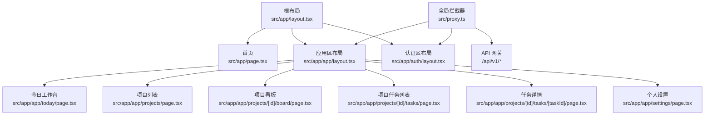
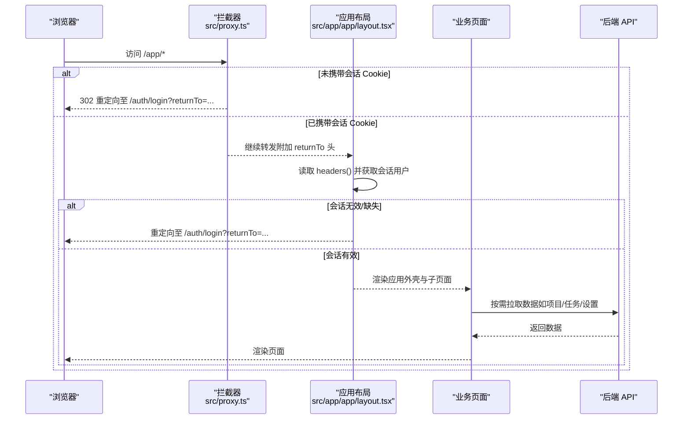
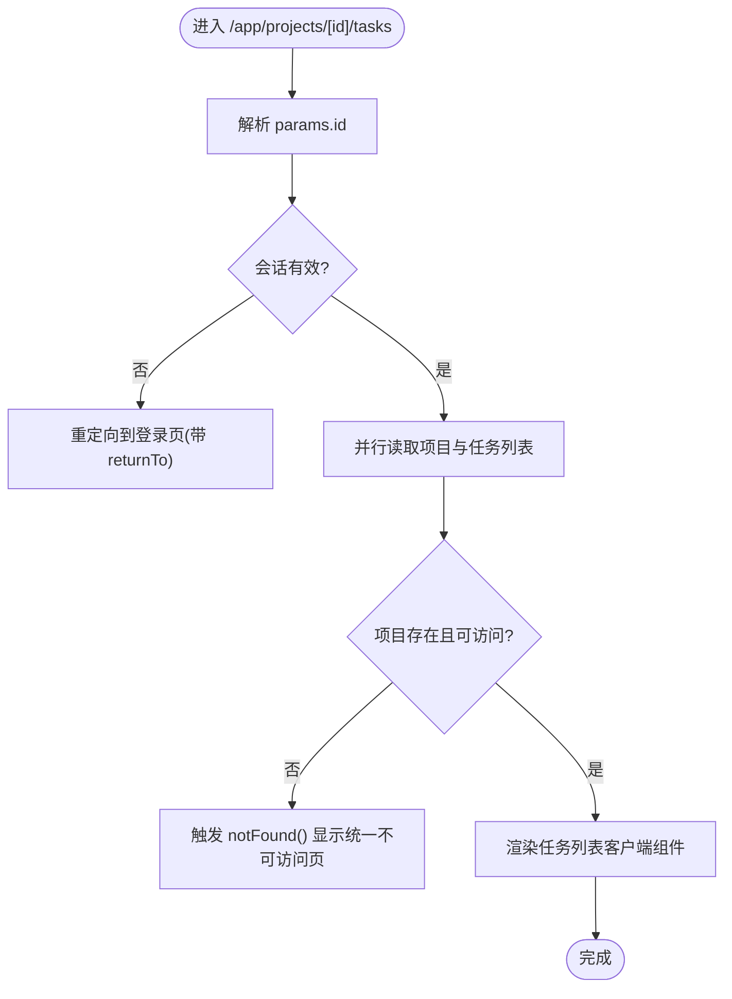
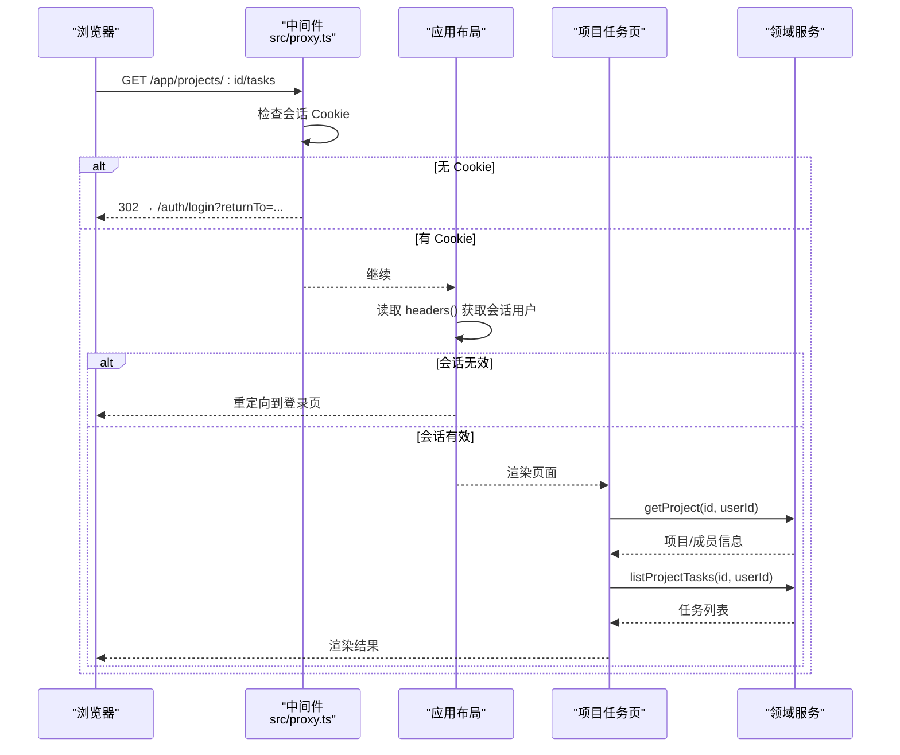
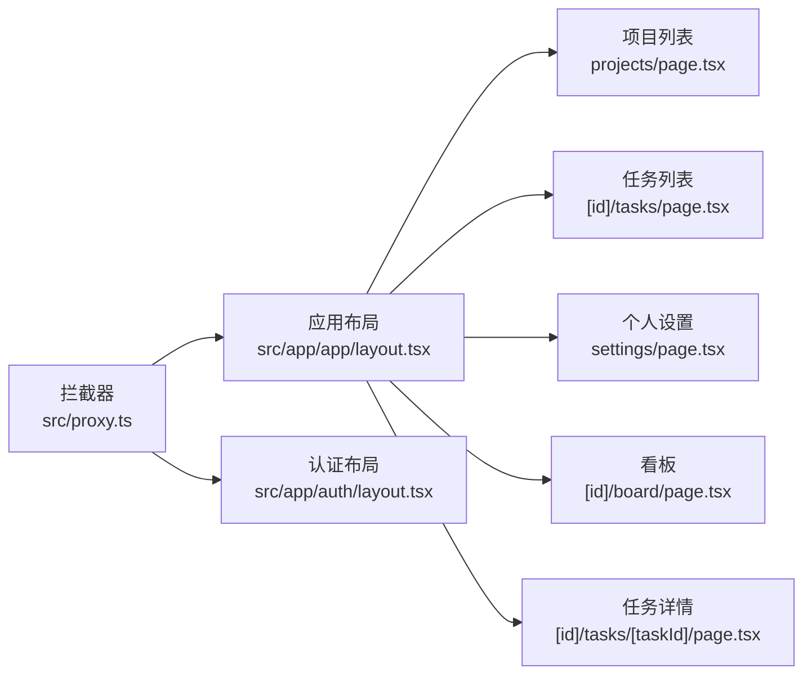

# 页面路由

<cite>
**本文引用的文件**
- [src/app/layout.tsx](file://src/app/layout.tsx)
- [src/app/page.tsx](file://src/app/page.tsx)
- [src/app/app/layout.tsx](file://src/app/app/layout.tsx)
- [src/app/auth/layout.tsx](file://src/app/auth/layout.tsx)
- [src/app/app/projects/page.tsx](file://src/app/app/projects/page.tsx)
- [src/app/app/today/page.tsx](file://src/app/app/today/page.tsx)
- [src/app/app/projects/[id]/board/page.tsx](file://src/app/app/projects/[id]/board/page.tsx)
- [src/app/app/projects/[id]/tasks/page.tsx](file://src/app/app/projects/[id]/tasks/page.tsx)
- [src/app/app/projects/[id]/tasks/[taskId]/page.tsx](file://src/app/app/projects/[id]/tasks/[taskId]/page.tsx)
- [src/app/app/settings/page.tsx](file://src/app/app/settings/page.tsx)
- [src/app/not-found.tsx](file://src/app/not-found.tsx)
- [src/proxy.ts](file://src/proxy.ts)
</cite>

## 目录
1. [简介](#简介)
2. [项目结构](#项目结构)
3. [核心组件](#核心组件)
4. [架构总览](#架构总览)
5. [详细组件分析](#详细组件分析)
6. [依赖关系分析](#依赖关系分析)
7. [性能考量](#性能考量)
8. [故障排查指南](#故障排查指南)
9. [结论](#结论)
10. [附录](#附录)

## 简介
本文件聚焦 Orbit 项目的页面路由体系，基于 Next.js App Router 的目录约定与 Server/Client 组件模型，系统说明：
- 静态路由、动态路由与嵌套路由的组织方式
- 页面布局系统（根布局、应用外壳布局、认证布局）
- 路由守卫与权限控制（代理层门禁 + 服务端会话校验 + 资源级授权）
- 页面加载策略（数据预取、懒加载、错误边界）
- 路由优化技巧（代码分割、预加载、导航性能）
- 具体路由配置示例与调试方法

## 项目结构
Orbit 使用 App Router 的目录即路由模式，关键路径如下：
- 根布局与首页：src/app/layout.tsx、src/app/page.tsx
- 应用区（受保护）：src/app/app/*，含共享布局 src/app/app/layout.tsx
- 认证区：src/app/auth/*，含认证布局 src/app/auth/layout.tsx
- 业务路由：
  - /app/today：我的工作台样例页
  - /app/projects：项目列表（真实数据）
  - /app/projects/[id]/*：项目内看板、任务列表、任务详情等嵌套路由
  - /app/settings：个人设置（真实数据）
- 统一未找到页：src/app/not-found.tsx
- 请求前置拦截器：src/proxy.ts

图表来源
- [src/app/layout.tsx:1-21](file://src/app/layout.tsx#L1-L21)
- [src/app/app/layout.tsx:1-48](file://src/app/app/layout.tsx#L1-L48)
- [src/app/auth/layout.tsx:1-23](file://src/app/auth/layout.tsx#L1-L23)
- [src/proxy.ts:43-77](file://src/proxy.ts#L43-L77)

章节来源
- [src/app/layout.tsx:1-21](file://src/app/layout.tsx#L1-L21)
- [src/app/page.tsx:1-101](file://src/app/page.tsx#L1-L101)
- [src/app/app/layout.tsx:1-48](file://src/app/app/layout.tsx#L1-L48)
- [src/app/auth/layout.tsx:1-23](file://src/app/auth/layout.tsx#L1-L23)
- [src/proxy.ts:1-78](file://src/proxy.ts#L1-L78)

## 核心组件
- 根布局：提供 HTML 语言与元信息，承载全局样式。
- 应用区布局：强制动态渲染、读取会话、未登录重定向到带 returnTo 的登录页；注入应用外壳与开发态工具。
- 认证区布局：为认证相关页面提供元信息与 robots 策略。
- 各业务页面：Server Component 负责权威数据读取与会话校验，将纯 JSON 数据传递给 Client Component 渲染交互。

章节来源
- [src/app/layout.tsx:1-21](file://src/app/layout.tsx#L1-L21)
- [src/app/app/layout.tsx:1-48](file://src/app/app/layout.tsx#L1-L48)
- [src/app/auth/layout.tsx:1-23](file://src/app/auth/layout.tsx#L1-L23)

## 架构总览
Orbit 的路由守卫采用“三层防护”：
- 第一层：请求前置拦截器对 /app/* 与 /api/v1/* 做 Cookie 存在性快速门禁
- 第二层：应用区布局在服务端调用会话接口进行权威校验
- 第三层：具体页面在需要时再次校验会话并执行资源级授权

图表来源
- [src/proxy.ts:43-67](file://src/proxy.ts#L43-L67)
- [src/app/app/layout.tsx:32-47](file://src/app/app/layout.tsx#L32-L47)

章节来源
- [src/proxy.ts:1-78](file://src/proxy.ts#L1-L78)
- [src/app/app/layout.tsx:1-48](file://src/app/app/layout.tsx#L1-L48)

## 详细组件分析

### 静态路由
- 根首页：/ → src/app/page.tsx，展示工程基线说明与样例入口链接
- 今日工作台：/app/today → src/app/app/today/page.tsx，解析查询参数以切换演示状态
- 个人设置：/app/settings → src/app/app/settings/page.tsx，服务端直读最新用户档案并渲染表单

章节来源
- [src/app/page.tsx:1-101](file://src/app/page.tsx#L1-L101)
- [src/app/app/today/page.tsx:1-25](file://src/app/app/today/page.tsx#L1-L25)
- [src/app/app/settings/page.tsx:1-65](file://src/app/app/settings/page.tsx#L1-L65)

### 动态路由与嵌套路由
- 项目看板：/app/projects/[id]/board → src/app/app/projects/[id]/board/page.tsx，解析 params.id 与 searchParams.state/task
- 项目任务列表：/app/projects/[id]/tasks → src/app/app/projects/[id]/tasks/page.tsx，并行读取项目与任务列表，处理 NOT_FOUND 映射到 404
- 任务详情：/app/projects/[id]/tasks/[taskId] → src/app/app/projects/[id]/tasks/[taskId]/page.tsx，独立详情页模式，不存在时 notFound()

图表来源
- [src/app/app/projects/[id]/tasks/page.tsx:38-67](file://src/app/app/projects/[id]/tasks/page.tsx#L38-L67)
- [src/app/not-found.tsx:1-36](file://src/app/not-found.tsx#L1-L36)

章节来源
- [src/app/app/projects/[id]/board/page.tsx:1-38](file://src/app/app/projects/[id]/board/page.tsx#L1-L38)
- [src/app/app/projects/[id]/tasks/page.tsx:1-68](file://src/app/app/projects/[id]/tasks/page.tsx#L1-L68)
- [src/app/app/projects/[id]/tasks/[taskId]/page.tsx:1-49](file://src/app/app/projects/[id]/tasks/[taskId]/page.tsx#L1-L49)

### 页面布局系统
- 根布局：定义语言与元信息，挂载全局样式
- 应用区布局：强制动态渲染、会话校验、注入应用外壳与开发态工具；仅在 development 环境渲染状态切换面板
- 认证区布局：为认证页面提供统一的元信息与 robots 策略

章节来源
- [src/app/layout.tsx:1-21](file://src/app/layout.tsx#L1-L21)
- [src/app/app/layout.tsx:1-48](file://src/app/app/layout.tsx#L1-L48)
- [src/app/auth/layout.tsx:1-23](file://src/app/auth/layout.tsx#L1-L23)

### 路由守卫与权限控制
- 代理层门禁：对 /app/* 与 /api/v1/* 检查会话 Cookie 是否存在；未登录时对页面重定向、对 API 返回标准 401 信封
- 服务端会话校验：应用区布局与各业务页面通过读取请求头获取会话用户，未认证则重定向到带 returnTo 的登录页
- 资源级授权：例如项目任务列表在读取项目时进行成员关系判定，非成员或不存在统一映射为 notFound()

图表来源
- [src/proxy.ts:43-67](file://src/proxy.ts#L43-L67)
- [src/app/app/layout.tsx:32-47](file://src/app/app/layout.tsx#L32-L47)
- [src/app/app/projects/[id]/tasks/page.tsx:38-67](file://src/app/app/projects/[id]/tasks/page.tsx#L38-L67)

章节来源
- [src/proxy.ts:1-78](file://src/proxy.ts#L1-L78)
- [src/app/app/layout.tsx:1-48](file://src/app/app/layout.tsx#L1-L48)
- [src/app/app/projects/[id]/tasks/page.tsx:1-68](file://src/app/app/projects/[id]/tasks/page.tsx#L1-L68)

### 页面加载策略
- 数据预取：所有涉及私有数据的页面均为 Server Component，首屏直接读取会话与数据后传给客户端组件，避免二次请求
- 懒加载：登录页的表单使用 Suspense 包裹以满足客户端 Hook 的边界要求
- 错误边界：不存在的资源通过 notFound() 落入统一不可访问页；并发删除等异常在页面层捕获并转为重定向或错误

章节来源
- [src/app/app/settings/page.tsx:1-65](file://src/app/app/settings/page.tsx#L1-L65)
- [src/app/auth/login/page.tsx:1-29](file://src/app/auth/login/page.tsx#L1-L29)
- [src/app/not-found.tsx:1-36](file://src/app/not-found.tsx#L1-L36)

### 路由优化技巧
- 代码分割：Next.js 自动按路由拆分代码；业务页面仅引入所需组件
- 预加载：首页使用 Link 指向常用入口，利于浏览器预加载
- 导航性能：
  - 应用区布局声明 force-dynamic 确保会话相关渲染不被缓存
  - 页面读取 headers() 使渲染保持动态，避免共享缓存污染
  - 列表页使用分页游标减少首屏体积

章节来源
- [src/app/app/layout.tsx:32-47](file://src/app/app/layout.tsx#L32-L47)
- [src/app/app/projects/page.tsx:1-50](file://src/app/app/projects/page.tsx#L1-L50)
- [src/app/app/projects/[id]/tasks/page.tsx:1-68](file://src/app/app/projects/[id]/tasks/page.tsx#L1-L68)

## 依赖关系分析
- 路由与布局：
  - 根布局为所有页面提供基础 HTML 与样式
  - 应用区布局为 /app/* 提供会话外壳与开发工具
  - 认证区布局为 /auth/* 提供元信息与 robots 策略
- 拦截器与路由：
  - 拦截器对 /app/* 与 /api/v1/* 进行前置保护，未登录时分别重定向或返回 401
- 页面与服务：
  - 业务页面通过领域服务读取数据，保证页面与 API 契约一致

图表来源
- [src/proxy.ts:43-77](file://src/proxy.ts#L43-L77)
- [src/app/app/layout.tsx:1-48](file://src/app/app/layout.tsx#L1-L48)
- [src/app/app/projects/page.tsx:1-50](file://src/app/app/projects/page.tsx#L1-L50)
- [src/app/app/projects/[id]/tasks/page.tsx:1-68](file://src/app/app/projects/[id]/tasks/page.tsx#L1-L68)
- [src/app/app/settings/page.tsx:1-65](file://src/app/app/settings/page.tsx#L1-L65)
- [src/app/app/projects/[id]/board/page.tsx:1-38](file://src/app/app/projects/[id]/board/page.tsx#L1-L38)
- [src/app/app/projects/[id]/tasks/[taskId]/page.tsx:1-49](file://src/app/app/projects/[id]/tasks/[taskId]/page.tsx#L1-L49)

章节来源
- [src/proxy.ts:1-78](file://src/proxy.ts#L1-L78)
- [src/app/app/layout.tsx:1-48](file://src/app/app/layout.tsx#L1-L48)

## 性能考量
- 动态渲染：多处显式声明 force-dynamic 并结合 headers() 读取，确保会话与私有数据不被缓存
- 首屏数据：Server Component 直接读取并传递纯 JSON 数据，减少客户端二次请求
- 分页与游标：列表页限制首屏条目数，通过加载更多实现渐进式加载
- 错误与边界：notFound() 统一不可访问体验，避免泄露资源信息

章节来源
- [src/app/app/layout.tsx:32-47](file://src/app/app/layout.tsx#L32-L47)
- [src/app/app/projects/page.tsx:1-50](file://src/app/app/projects/page.tsx#L1-L50)
- [src/app/app/projects/[id]/tasks/page.tsx:1-68](file://src/app/app/projects/[id]/tasks/page.tsx#L1-L68)
- [src/app/not-found.tsx:1-36](file://src/app/not-found.tsx#L1-L36)

## 故障排查指南
- 401 未认证：
  - 检查是否携带会话 Cookie；/api/v1/* 未认证会返回标准 401 信封
  - 确认拦截器 matcher 是否覆盖目标路径
- 重定向循环：
  - 检查应用布局与会话读取逻辑是否正确返回用户对象
  - 确认 returnTo 参数是否被正确附加与解析
- 404 不可访问：
  - 资源不存在或非成员时，页面应调用 notFound() 落入统一不可访问页
  - 核对领域服务返回的错误码是否为 NOT_FOUND
- 开发态工具：
  - 应用布局中的状态切换面板仅在 development 环境渲染，生产构建会被消除

章节来源
- [src/proxy.ts:26-41](file://src/proxy.ts#L26-L41)
- [src/app/app/layout.tsx:32-47](file://src/app/app/layout.tsx#L32-L47)
- [src/app/app/projects/[id]/tasks/page.tsx:45-54](file://src/app/app/projects/[id]/tasks/page.tsx#L45-L54)
- [src/app/not-found.tsx:1-36](file://src/app/not-found.tsx#L1-L36)

## 结论
Orbit 的路由体系以 App Router 为基础，结合拦截器与多层服务端校验，实现了安全、可扩展且高性能的页面访问控制。通过 Server Component 的数据预取与动态渲染策略，保证了首屏体验与数据一致性；统一的错误边界提升了用户体验与安全性。后续可在更多页面复用该模式，持续优化导航与加载性能。

## 附录
- 常见路由清单
  - 首页：/
  - 登录：/auth/login
  - 注册：/auth/register
  - 忘记密码：/auth/forgot-password
  - 重置密码：/auth/reset-password
  - 邮箱验证：/auth/verify
  - 我的工作台：/app/today
  - 项目列表：/app/projects
  - 项目看板：/app/projects/[id]/board
  - 项目任务列表：/app/projects/[id]/tasks
  - 任务详情：/app/projects/[id]/tasks/[taskId]
  - 个人设置：/app/settings
- 调试建议
  - 使用浏览器开发者工具查看网络请求与响应头，确认 requestId 与缓存策略
  - 在开发环境使用右下角状态切换面板验证不同数据态
  - 针对 /api/v1/* 使用 401 信封判断未认证场景