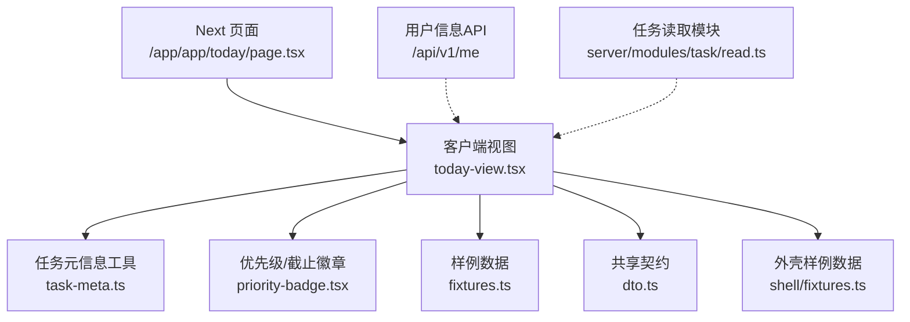
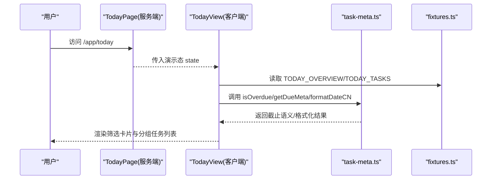
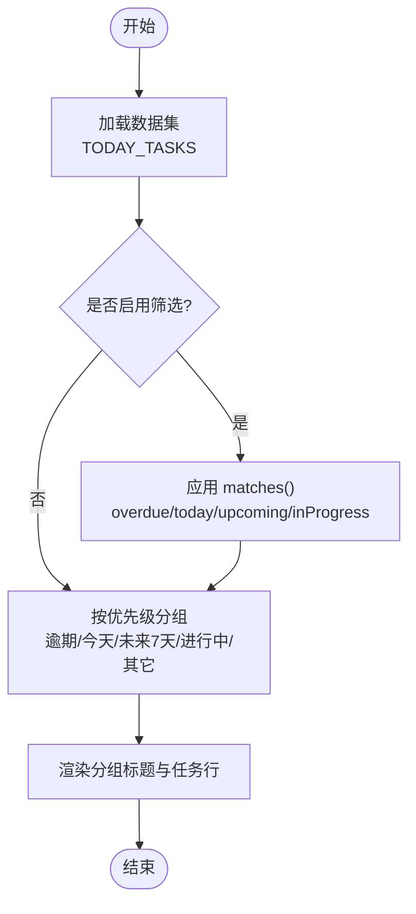
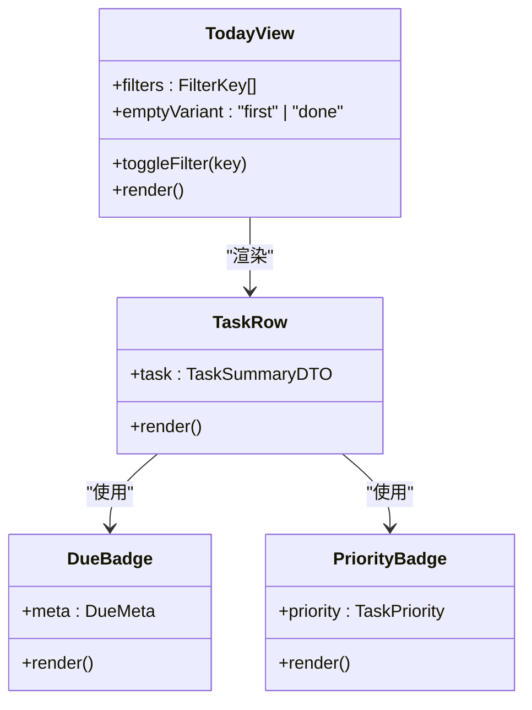
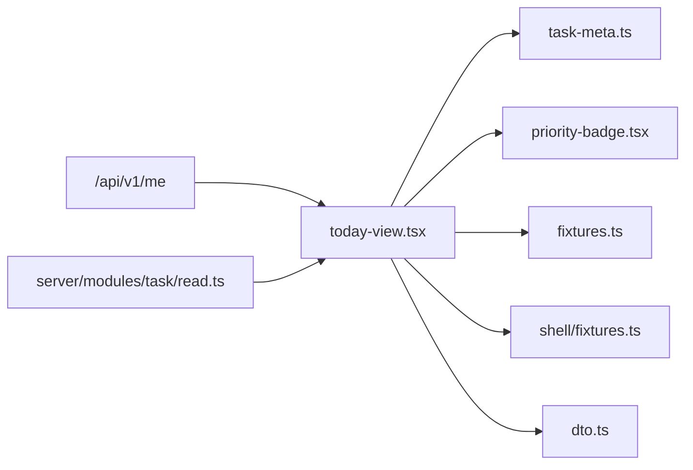

# 今日工作台模块

<cite>
**本文引用的文件**
- [src/app/app/today/page.tsx](file://src/app/app/today/page.tsx)
- [src/features/today/today-view.tsx](file://src/features/today/today-view.tsx)
- [src/features/today/fixtures.ts](file://src/features/today/fixtures.ts)
- [src/features/tasks/task-meta.ts](file://src/features/tasks/task-meta.ts)
- [src/features/tasks/priority-badge.tsx](file://src/features/tasks/priority-badge.tsx)
- [src/contracts/dto.ts](file://src/contracts/dto.ts)
- [src/features/shell/fixtures.ts](file://src/features/shell/fixtures.ts)
- [src/app/api/v1/me/route.ts](file://src/app/api/v1/me/route.ts)
- [src/server/modules/task/read.ts](file://src/server/modules/task/read.ts)
- [docs/02-UX-AND-DESIGN.md](file://docs/02-UX-AND-DESIGN.md)
- [DEVELOPMENT-PLAN.md](file://DEVELOPMENT-PLAN.md)
</cite>

## 目录
1. [简介](#简介)
2. [项目结构](#项目结构)
3. [核心组件](#核心组件)
4. [架构总览](#架构总览)
5. [详细组件分析](#详细组件分析)
6. [依赖关系分析](#依赖关系分析)
7. [性能考量](#性能考量)
8. [故障排查指南](#故障排查指南)
9. [结论](#结论)
10. [附录](#附录)

## 简介
今日工作台是 Orbit 的“我的待办”入口，聚焦用户当前需要关注的任务：逾期、今天到期、未来 7 天到期与进行中。M0 阶段以客户端样例数据驱动界面与交互，展示筛选、分组、空态与加载态；后续里程碑将接入真实后端 API（如 /my/overview）并实现实时更新与状态同步。

## 项目结构
- 页面路由：Next.js App Router 下的 /app/app/today/page.tsx 作为服务端入口，负责解析演示态并渲染客户端视图。
- 视图层：features/today/today-view.tsx 实现工作台 UI、筛选、分组与展示逻辑。
- 数据与工具：
  - features/today/fixtures.ts：样例数据（概览计数、任务列表）。
  - features/tasks/task-meta.ts：日期计算、截止语义、格式化等纯函数。
  - features/tasks/priority-badge.tsx：优先级与截止日徽章展示。
  - contracts/dto.ts：前后端共享的数据契约（OverviewDTO、TaskSummaryDTO 等）。
  - features/shell/fixtures.ts：样例用户、项目与固定“今天”日期。
- 后端集成点（后续）：
  - src/app/api/v1/me/route.ts：当前用户信息接口（时区等），为工作台提供个性化基础。
  - src/server/modules/task/read.ts：任务查询中的逾期判定逻辑（基于用户时区的日历日期）。

图表来源
- [src/app/app/today/page.tsx:1-25](file://src/app/app/today/page.tsx#L1-L25)
- [src/features/today/today-view.tsx:1-320](file://src/features/today/today-view.tsx#L1-L320)
- [src/features/tasks/task-meta.ts:1-133](file://src/features/tasks/task-meta.ts#L1-L133)
- [src/features/tasks/priority-badge.tsx:1-77](file://src/features/tasks/priority-badge.tsx#L1-L77)
- [src/features/today/fixtures.ts:1-204](file://src/features/today/fixtures.ts#L1-L204)
- [src/contracts/dto.ts:425-437](file://src/contracts/dto.ts#L425-L437)
- [src/features/shell/fixtures.ts:18-25](file://src/features/shell/fixtures.ts#L18-L25)
- [src/app/api/v1/me/route.ts:32-47](file://src/app/api/v1/me/route.ts#L32-L47)
- [src/server/modules/task/read.ts:193-197](file://src/server/modules/task/read.ts#L193-L197)

章节来源
- [src/app/app/today/page.tsx:1-25](file://src/app/app/today/page.tsx#L1-L25)
- [docs/02-UX-AND-DESIGN.md:69-76](file://docs/02-UX-AND-DESIGN.md#L69-L76)

## 核心组件
- 页面入口 TodayPage：解析 searchParams 中的演示态，渲染 TodayView。
- 工作台视图 TodayView：
  - 顶部主张与用户时区日期显示。
  - 四个统计卡片（逾期、今天、未来 7 天、进行中），可点击多选筛选。
  - 正文按“逾期 > 今天 > 未来 7 天 > 进行中 > 其它”分组展示任务列表。
  - 支持加载、错误、空态（首次无任务/全部完成）与长内容折行。
- 任务元信息工具：
  - getDueMeta/isOverdue：基于 YYYY-MM-DD 比较与任务状态计算截止语义。
  - formatDateCN：中文日期格式。
- 徽章组件：
  - PriorityBadge：高/中/低/无优先级标识。
  - DueBadge：截止日短显示 + 逾期/临近强调色与无障碍说明。

章节来源
- [src/features/today/today-view.tsx:116-319](file://src/features/today/today-view.tsx#L116-L319)
- [src/features/tasks/task-meta.ts:43-123](file://src/features/tasks/task-meta.ts#L43-L123)
- [src/features/tasks/priority-badge.tsx:14-76](file://src/features/tasks/priority-badge.tsx#L14-L76)

## 架构总览
- 前端（M0）：使用 fixtures 提供的 OverviewDTO 与 TaskSummaryDTO 数组，在客户端完成筛选与分组。
- 后端（规划）：通过 /my/overview 返回用户的 today、timezone 与各分类计数；任务列表可通过带 overdue 等参数的任务查询接口获取。
- 时区一致性：后端根据用户时区计算“今天”，确保逾期判定与前端一致。

图表来源
- [src/app/app/today/page.tsx:20-24](file://src/app/app/today/page.tsx#L20-L24)
- [src/features/today/today-view.tsx:116-319](file://src/features/today/today-view.tsx#L116-L319)
- [src/features/tasks/task-meta.ts:69-123](file://src/features/tasks/task-meta.ts#L69-L123)
- [src/features/today/fixtures.ts:64-162](file://src/features/today/fixtures.ts#L64-L162)

## 详细组件分析

### 今日待办任务：概念设计与算法
- 概念
  - 逾期：有截止日且早于用户时区“今天”，且未完成。
  - 今天到期：截止日等于“今天”，且未完成。
  - 未来 7 天：截止日在“今天+1”到“今天+7”之间，且未完成。
  - 进行中：状态为 IN_PROGRESS，不受日期限制。
  - 这些集合非互斥，因此不展示合计饼图。
- 日期计算
  - 使用 YYYY-MM-DD 字符串字典序比较，等价时间序。
  - 已完成任务不计逾期（DONE 时 overdue=false）。
  - “未来 7 天”包含“今天”与“soon”两类语义。
- 聚合与分组
  - 主归类优先级：逾期 > 今天 > 未来 7 天 > 进行中 > 其它。
  - 可见任务先按筛选条件过滤，再按上述顺序分组。

图表来源
- [src/features/today/today-view.tsx:53-79](file://src/features/today/today-view.tsx#L53-L79)
- [src/features/tasks/task-meta.ts:69-123](file://src/features/tasks/task-meta.ts#L69-L123)

章节来源
- [DEVELOPMENT-PLAN.md:167-175](file://DEVELOPMENT-PLAN.md#L167-L175)
- [src/features/tasks/task-meta.ts:69-123](file://src/features/tasks/task-meta.ts#L69-L123)
- [src/features/today/today-view.tsx:53-79](file://src/features/today/today-view.tsx#L53-L79)

### 界面布局与交互
- 顶部区域：主标题与用户时区日期（formatDateCN）。
- 统计卡片：逾期、今天、未来 7 天、进行中，点击切换选中态，支持多选组合筛选。
- 任务列表：每个任务行显示项目标记色点、标题、编号、截止日期徽章、子任务进度、评论数、附件数与优先级徽章。
- 空态与加载态：首次无任务、全部完成、加载中骨架屏、错误重试。
- 长内容：标题折行与截断策略，避免破坏布局。

图表来源
- [src/features/today/today-view.tsx:81-114](file://src/features/today/today-view.tsx#L81-L114)
- [src/features/tasks/priority-badge.tsx:21-37](file://src/features/tasks/priority-badge.tsx#L21-L37)
- [src/features/tasks/priority-badge.tsx:48-76](file://src/features/tasks/priority-badge.tsx#L48-L76)

章节来源
- [docs/02-UX-AND-DESIGN.md:69-76](file://docs/02-UX-AND-DESIGN.md#L69-L76)
- [src/features/today/today-view.tsx:157-319](file://src/features/today/today-view.tsx#L157-L319)

### 任务状态过滤、优先级排序与截止日期提醒
- 过滤
  - overdue：isOverdue(dueDate, today, status)。
  - today：dueDate === today。
  - upcoming：getDueMeta(tone in ["soon","today"])。
  - inProgress：status === "IN_PROGRESS"。
- 排序
  - 分组内未显式排序；可按业务需求扩展（例如按优先级或截止时间升序）。
- 提醒
  - DueBadge 对逾期/今天/soon 使用不同强调色与文案，tooltip/aria-label 提供完整说明。

章节来源
- [src/features/today/today-view.tsx:53-79](file://src/features/today/today-view.tsx#L53-L79)
- [src/features/tasks/priority-badge.tsx:40-76](file://src/features/tasks/priority-badge.tsx#L40-L76)

### 数据集成、实时更新与状态同步（规划）
- 数据源
  - M0：fixtures.ts 提供 OverviewDTO 与 TaskSummaryDTO 数组。
  - 后续：GET /my/overview 返回 timezone、today 与各分类计数；任务列表通过任务查询接口（支持 overdue、status、priority 等）。
- 时区一致性
  - 后端根据用户时区计算“今天”，确保逾期判定与前端一致。
- 实时更新
  - 可在任务状态变更（如完成）后局部刷新工作台计数与列表，保持 UI 稳定与草稿保留。

章节来源
- [src/app/api/v1/me/route.ts:32-47](file://src/app/api/v1/me/route.ts#L32-L47)
- [src/server/modules/task/read.ts:193-197](file://src/server/modules/task/read.ts#L193-L197)
- [src/contracts/dto.ts:425-437](file://src/contracts/dto.ts#L425-L437)

### 个性化配置与定制化选项
- 用户偏好
  - 时区：来自 /me 的用户档案，影响“今天”的计算与日期显示。
- 定制项（可扩展）
  - 默认筛选组合、分组顺序、是否显示“其它”组、任务行信息密度等。

章节来源
- [src/app/api/v1/me/route.ts:32-47](file://src/app/api/v1/me/route.ts#L32-L47)
- [src/features/shell/fixtures.ts:18-25](file://src/features/shell/fixtures.ts#L18-L25)

### 扩展点、插件开发与第三方集成
- 扩展点
  - 新增筛选维度（如按标签/项目/负责人）。
  - 自定义分组规则与排序策略。
  - 接入外部通知系统（邮件/IM）对逾期任务进行提醒。
- 插件化建议
  - 将筛选器与分组器抽象为可插拔策略，便于在不同工作流中复用。
  - 通过事件总线或状态管理库订阅任务变更，触发工作台增量更新。

[本节为概念性说明，不直接分析具体文件]

## 依赖关系分析
- TodayView 依赖：
  - task-meta.ts：日期计算与格式化。
  - priority-badge.tsx：优先级与截止日徽章。
  - fixtures.ts：样例数据。
  - shell/fixtures.ts：样例用户与项目。
  - dto.ts：类型契约（OverviewDTO、TaskSummaryDTO）。
- 后端依赖（规划）：
  - /api/v1/me：获取用户时区。
  - 任务读取模块：按用户时区计算逾期。

图表来源
- [src/features/today/today-view.tsx:1-320](file://src/features/today/today-view.tsx#L1-L320)
- [src/features/tasks/task-meta.ts:1-133](file://src/features/tasks/task-meta.ts#L1-L133)
- [src/features/tasks/priority-badge.tsx:1-77](file://src/features/tasks/priority-badge.tsx#L1-L77)
- [src/features/today/fixtures.ts:1-204](file://src/features/today/fixtures.ts#L1-L204)
- [src/features/shell/fixtures.ts:1-149](file://src/features/shell/fixtures.ts#L1-L149)
- [src/contracts/dto.ts:425-437](file://src/contracts/dto.ts#L425-L437)
- [src/app/api/v1/me/route.ts:32-47](file://src/app/api/v1/me/route.ts#L32-L47)
- [src/server/modules/task/read.ts:193-197](file://src/server/modules/task/read.ts#L193-L197)

章节来源
- [src/features/today/today-view.tsx:1-320](file://src/features/today/today-view.tsx#L1-L320)
- [src/contracts/dto.ts:425-437](file://src/contracts/dto.ts#L425-L437)

## 性能考量
- 客户端筛选与分组复杂度：O(n) 遍历，n 为任务数量；在小规模数据下足够高效。
- 避免重复计算：getDueMeta/isOverdue 为纯函数，可缓存或按需计算。
- 渲染优化：分组仅在有任务时渲染；空态与加载态减少不必要的 DOM 操作。
- 后续大数据量：考虑分页/虚拟滚动与后端聚合（/my/overview）以减少前端计算。

[本节提供通用指导，不直接分析具体文件]

## 故障排查指南
- 权限态：若 state 为 permission，显示 NoAccess（会话失效或未登录）。
- 网络失败：显示 SampleError，提供重试按钮，保留草稿与筛选状态。
- 空态处理：区分“首次无任务”和“今天已完成”，提供引导操作。
- 时区不一致：确认用户时区设置与后端计算一致，避免逾期判定偏差。

章节来源
- [src/features/today/today-view.tsx:121-124](file://src/features/today/today-view.tsx#L121-L124)
- [src/features/today/today-view.tsx:222-228](file://src/features/today/today-view.tsx#L222-L228)
- [src/features/today/today-view.tsx:237-294](file://src/features/today/today-view.tsx#L237-L294)
- [src/app/api/v1/me/route.ts:32-47](file://src/app/api/v1/me/route.ts#L32-L47)

## 结论
今日工作台在 M0 阶段通过清晰的筛选、分组与展示逻辑，帮助用户快速聚焦重要任务。后续将接入 /my/overview 与任务查询接口，实现基于用户时区的准确计算与实时更新。设计遵循简洁、克制原则，保证可读性与可访问性。

[本节总结性内容，不直接分析具体文件]

## 附录

### 关键数据模型（节选）
- OverviewDTO：timezone、today、overdue、dueToday、upcoming、inProgress、totalOpen。
- TaskSummaryDTO：id、projectId、number、identifier、title、status、priority、assignee、creator、dueDate、completedAt、version、subtaskTotal、subtaskCompleted、commentCount、attachmentCount、deletedAt、createdAt、updatedAt。

章节来源
- [src/contracts/dto.ts:425-437](file://src/contracts/dto.ts#L425-L437)
- [src/contracts/dto.ts:190-215](file://src/contracts/dto.ts#L190-L215)

### 使用场景示例
- 场景一：打开工作台，查看“逾期”“今天”“未来 7 天”“进行中”四类任务的概览与明细。
- 场景二：勾选多个筛选条件，组合查看交集任务。
- 场景三：任务完成后，观察“今天”计数变化与分组重排。
- 场景四：切换用户时区，验证逾期判定与日期显示的一致性。

[本节为概念性说明，不直接分析具体文件]