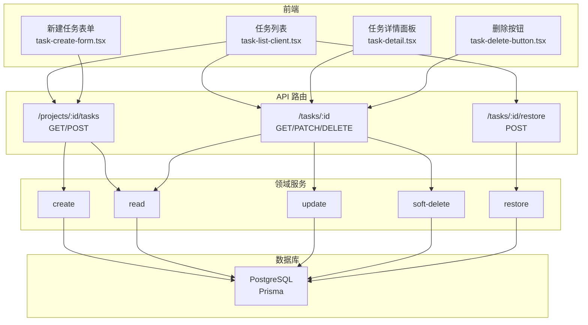
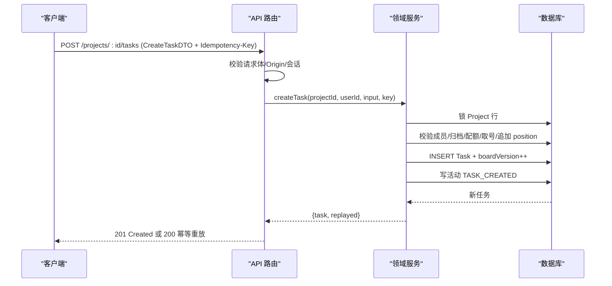
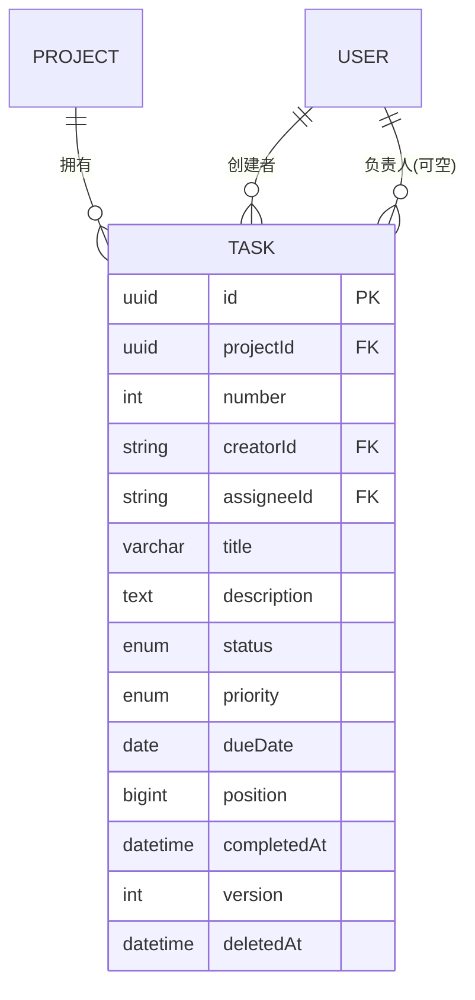
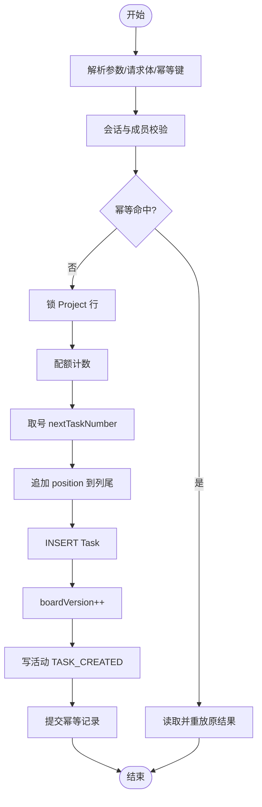
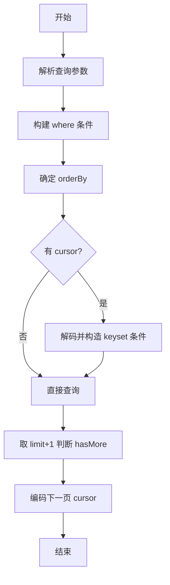
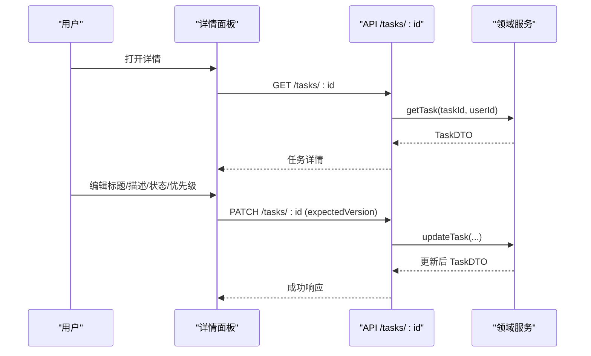
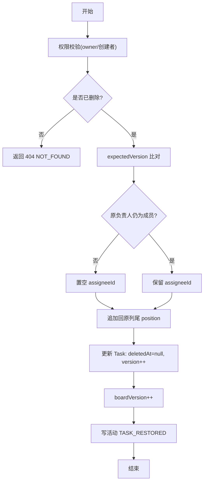
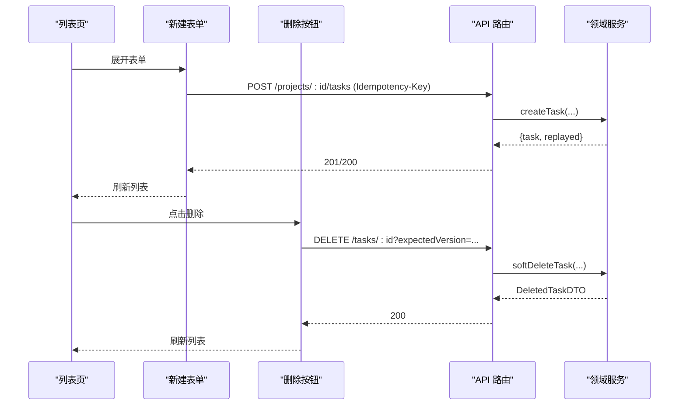
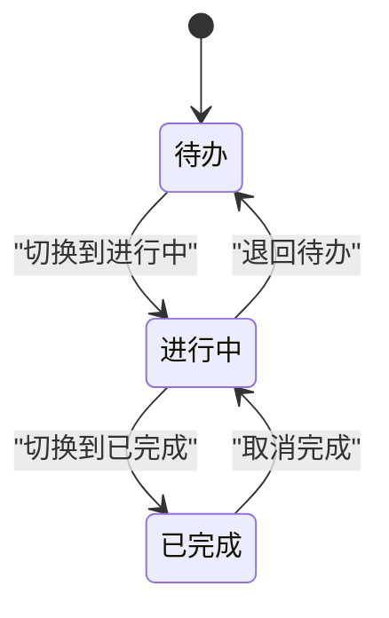
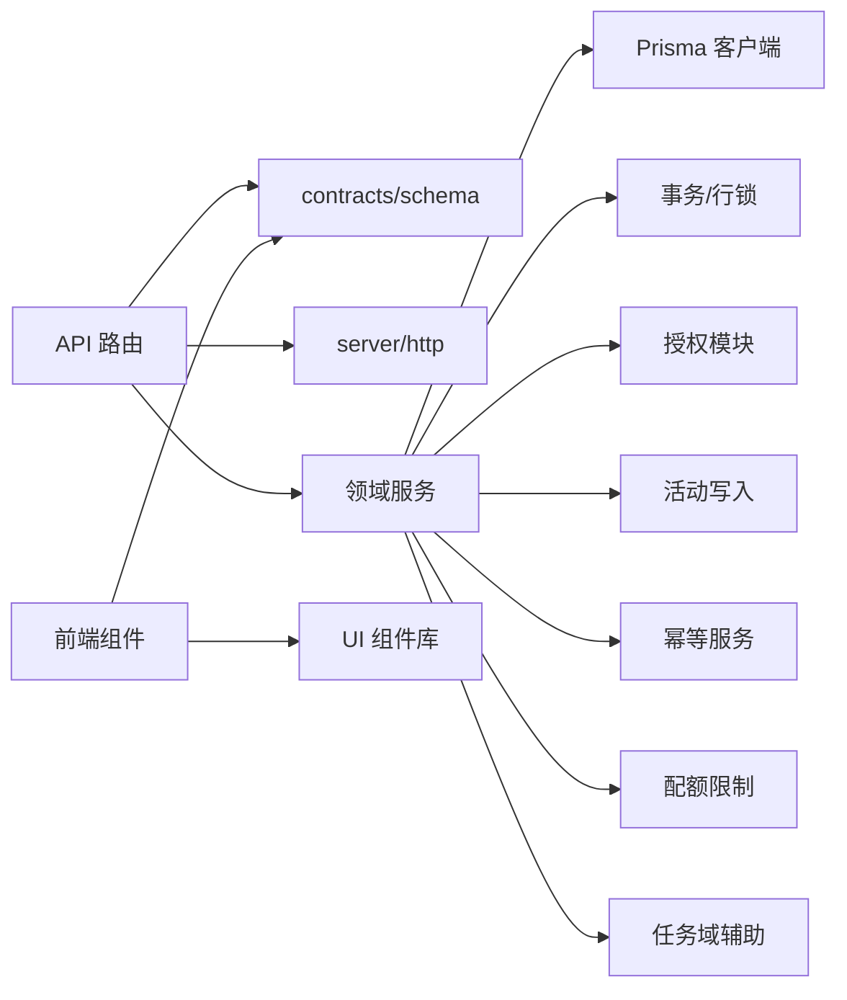

# 任务管理模块

<cite>
**本文引用的文件**
- [prisma/schema.prisma](file://prisma/schema.prisma)
- [src/app/api/v1/projects/[projectId]/tasks/route.ts](file://src/app/api/v1/projects/[projectId]/tasks/route.ts)
- [src/app/api/v1/tasks/[taskId]/route.ts](file://src/app/api/v1/tasks/[taskId]/route.ts)
- [src/app/api/v1/tasks/[taskId]/restore/route.ts](file://src/app/api/v1/tasks/[taskId]/restore/route.ts)
- [src/server/modules/task/index.ts](file://src/server/modules/task/index.ts)
- [src/server/modules/task/create.ts](file://src/server/modules/task/create.ts)
- [src/server/modules/task/read.ts](file://src/server/modules/task/read.ts)
- [src/server/modules/task/update.ts](file://src/server/modules/task/update.ts)
- [src/server/modules/task/soft-delete.ts](file://src/server/modules/task/soft-delete.ts)
- [src/server/modules/task/restore.ts](file://src/server/modules/task/restore.ts)
- [src/features/tasks/task-detail.tsx](file://src/features/tasks/task-detail.tsx)
- [src/features/tasks/priority-badge.tsx](file://src/features/tasks/priority-badge.tsx)
- [src/features/tasks/task-meta.ts](file://src/features/tasks/task-meta.ts)
- [src/features/tasks/real/task-list-client.tsx](file://src/features/tasks/real/task-list-client.tsx)
- [src/features/tasks/real/task-create-form.tsx](file://src/features/tasks/real/task-create-form.tsx)
- [src/features/tasks/real/task-delete-button.tsx](file://src/features/tasks/real/task-delete-button.tsx)
</cite>

## 目录
1. [简介](#简介)
2. [项目结构](#项目结构)
3. [核心组件](#核心组件)
4. [架构总览](#架构总览)
5. [详细组件分析](#详细组件分析)
6. [依赖关系分析](#依赖关系分析)
7. [性能考虑](#性能考虑)
8. [故障排除指南](#故障排除指南)
9. [结论](#结论)
10. [附录](#附录)

## 简介
本模块实现任务管理的完整生命周期：创建、编辑、删除与恢复，以及状态跟踪、优先级设置、截止日期管理与任务分类。前端提供任务列表界面、任务详情面板与操作按钮；后端通过 API 路由与领域服务完成数据校验、权限控制、并发控制与活动记录。任务采用软删除机制，支持回收站恢复，并通过幂等键保障写操作的幂等性。

## 项目结构
- 数据模型定义在 Prisma Schema，包含 Task、Project、User 等实体及枚举（TaskStatus、TaskPriority）。
- API 路由位于 Next.js App Router 的 /api/v1 下，负责请求解析、鉴权、调用领域服务并返回统一信封响应。
- 领域服务集中在 src/server/modules/task，按 create/read/update/soft-delete/restore 拆分，内部复用 access、position、identifier、date-only、mappers 等辅助。
- 前端 UI 分为“真实数据”客户端组件（real/）与“示例数据”展示组件（task-detail.tsx），前者对接 API，后者用于演示详情面板。

图表来源
- [src/app/api/v1/projects/[projectId]/tasks/route.ts:21-33](file://src/app/api/v1/projects/[projectId]/tasks/route.ts#L21-L33)
- [src/app/api/v1/tasks/[taskId]/route.ts:10-25](file://src/app/api/v1/tasks/[taskId]/route.ts#L10-L25)
- [src/app/api/v1/tasks/[taskId]/restore/route.ts:14-27](file://src/app/api/v1/tasks/[taskId]/restore/route.ts#L14-L27)
- [src/server/modules/task/index.ts:1-31](file://src/server/modules/task/index.ts#L1-L31)

章节来源
- [prisma/schema.prisma:14-268](file://prisma/schema.prisma#L14-L268)
- [src/app/api/v1/projects/[projectId]/tasks/route.ts:21-33](file://src/app/api/v1/projects/[projectId]/tasks/route.ts#L21-L33)
- [src/app/api/v1/tasks/[taskId]/route.ts:10-25](file://src/app/api/v1/tasks/[taskId]/route.ts#L10-L25)
- [src/app/api/v1/tasks/[taskId]/restore/route.ts:14-27](file://src/app/api/v1/tasks/[taskId]/restore/route.ts#L14-L27)
- [src/server/modules/task/index.ts:1-31](file://src/server/modules/task/index.ts#L1-L31)

## 核心组件
- 数据模型：Task 包含 id、projectId、number、creatorId、assigneeId、title、description、status、priority、dueDate、position、completedAt、version、deletedAt 等字段；枚举 TaskStatus（TODO/IN_PROGRESS/DONE）、TaskPriority（NONE/LOW/MEDIUM/HIGH）。
- 列表界面：任务表格展示标识、标题、状态、优先级、负责人、截止日与操作列；支持行内切换状态、删除；分页加载更多。
- 详情面板：侧边抽屉或独立页面，展示标题、状态、优先级、负责人、截止日、描述、子任务、附件、评论；支持编辑标题/描述、复制链接、标记完成、删除。
- 操作按钮：新建任务表单（含幂等键）、删除确认对话框、状态选择器。

章节来源
- [prisma/schema.prisma:216-268](file://prisma/schema.prisma#L216-L268)
- [src/features/tasks/real/task-list-client.tsx:31-45](file://src/features/tasks/real/task-list-client.tsx#L31-L45)
- [src/features/tasks/task-detail.tsx:60-67](file://src/features/tasks/task-detail.tsx#L60-L67)
- [src/features/tasks/real/task-create-form.tsx:29-46](file://src/features/tasks/real/task-create-form.tsx#L29-L46)
- [src/features/tasks/real/task-delete-button.tsx:25-35](file://src/features/tasks/real/task-delete-button.tsx#L25-L35)

## 架构总览
- 请求生命周期：请求 ID → Origin（写操作）→ 会话 → schema 校验 → 领域服务（成员/归档/配额/编号/幂等/授权）→ DTO → 统一信封。
- 事务与锁：写操作使用项目行级排他锁，保证编号、位置、boardVersion 与配额的一致性。
- 并发控制：乐观版本 expectedVersion，冲突返回 409 VERSION_CONFLICT 并附带 currentVersion。
- 幂等性：创建与恢复接口支持 Idempotency-Key，重放返回原结果。

图表来源
- [src/app/api/v1/projects/[projectId]/tasks/route.ts:65-103](file://src/app/api/v1/projects/[projectId]/tasks/route.ts#L65-L103)
- [src/server/modules/task/create.ts:32-47](file://src/server/modules/task/create.ts#L32-L47)
- [src/server/modules/task/create.ts:93-189](file://src/server/modules/task/create.ts#L93-L189)

章节来源
- [src/app/api/v1/projects/[projectId]/tasks/route.ts:21-33](file://src/app/api/v1/projects/[projectId]/tasks/route.ts#L21-L33)
- [src/server/modules/task/create.ts:32-47](file://src/server/modules/task/create.ts#L32-L47)

## 详细组件分析

### 数据模型与约束
- 任务模型包含唯一约束（projectId+number）、索引（按项目、删除标记、状态、位置、更新时间等），确保查询与排序高效。
- 状态与完成时间联动：DONE⇔completedAt 由数据库 CHECK 约束强制。
- 优先级枚举顺序决定排序语义（HIGH→MEDIUM→LOW→NONE）。

图表来源
- [prisma/schema.prisma:144-166](file://prisma/schema.prisma#L144-L166)
- [prisma/schema.prisma:216-268](file://prisma/schema.prisma#L216-L268)

章节来源
- [prisma/schema.prisma:216-268](file://prisma/schema.prisma#L216-L268)

### 任务创建流程
- 路由层解析参数与请求体，校验 Origin、会话、幂等键与输入形状。
- 领域服务在事务中执行：成员与归档校验、幂等检查、配额计数、取号、追加位置、插入任务、更新看板版本、写活动、提交幂等记录。
- 默认状态 TODO、优先级 MEDIUM；若传入 DONE 则自动设置 completedAt。

图表来源
- [src/app/api/v1/projects/[projectId]/tasks/route.ts:65-103](file://src/app/api/v1/projects/[projectId]/tasks/route.ts#L65-L103)
- [src/server/modules/task/create.ts:93-189](file://src/server/modules/task/create.ts#L93-L189)

章节来源
- [src/app/api/v1/projects/[projectId]/tasks/route.ts:65-103](file://src/app/api/v1/projects/[projectId]/tasks/route.ts#L65-L103)
- [src/server/modules/task/create.ts:93-189](file://src/server/modules/task/create.ts#L93-L189)

### 任务列表与过滤排序
- 列表使用 keyset 游标分页，支持 updated_desc（默认）、due_asc、priority_desc。
- 过滤条件包括 q（标题模糊匹配）、status、priority、assigneeId/unassigned、overdue（基于用户时区今天）、deleted（仅回收站/仅未删除）。
- 游标解码后进行严格类型校验，非法值返回 400 INVALID_CURSOR。

图表来源
- [src/server/modules/task/read.ts:149-228](file://src/server/modules/task/read.ts#L149-L228)

章节来源
- [src/server/modules/task/read.ts:149-228](file://src/server/modules/task/read.ts#L149-L228)

### 任务详情与交互
- 详情面板支持编辑标题/描述、切换状态与优先级、复制链接、标记完成、删除。
- 未保存更改关闭时弹出确认框，保留编辑或放弃更改。
- 截止日显示根据 today 计算语义（逾期/今天/临近/较晚/无截止）。

图表来源
- [src/features/tasks/task-detail.tsx:82-113](file://src/features/tasks/task-detail.tsx#L82-L113)
- [src/app/api/v1/tasks/[taskId]/route.ts:56-86](file://src/app/api/v1/tasks/[taskId]/route.ts#L56-L86)
- [src/server/modules/task/update.ts:64-191](file://src/server/modules/task/update.ts#L64-L191)

章节来源
- [src/features/tasks/task-detail.tsx:82-113](file://src/features/tasks/task-detail.tsx#L82-L113)
- [src/app/api/v1/tasks/[taskId]/route.ts:56-86](file://src/app/api/v1/tasks/[taskId]/route.ts#L56-L86)
- [src/server/modules/task/update.ts:64-191](file://src/server/modules/task/update.ts#L64-L191)

### 删除与恢复（软删除机制）
- 删除：仅 owner 或任务创建者可删；设置 deletedAt 并递增 version 与 boardVersion；已删除任务再次删除返回 404。
- 恢复：仅 owner 或任务创建者可恢复；要求当前处于已删除态；恢复清 deletedAt、重置 assignee（若原负责人已退出项目则置空）、追加回原列尾、递增 version 与 boardVersion；幂等重放返回原结果。

图表来源
- [src/server/modules/task/soft-delete.ts:47-100](file://src/server/modules/task/soft-delete.ts#L47-L100)
- [src/server/modules/task/restore.ts:85-198](file://src/server/modules/task/restore.ts#L85-L198)

章节来源
- [src/server/modules/task/soft-delete.ts:47-100](file://src/server/modules/task/soft-delete.ts#L47-L100)
- [src/server/modules/task/restore.ts:85-198](file://src/server/modules/task/restore.ts#L85-L198)

### 任务列表界面与操作按钮
- 列表页展示项目信息、回收站入口、新建任务按钮（归档项目隐藏）；表格行内切换状态、显示优先级与截止日；仅 owner 或创建者可见删除按钮。
- 新建任务表单：客户端预校验标题长度、描述长度、日期格式；提交携带幂等键；成功后刷新列表。
- 删除按钮：确认后调用 DELETE 接口，处理 409 版本冲突与 401 未授权。

图表来源
- [src/features/tasks/real/task-list-client.tsx:107-137](file://src/features/tasks/real/task-list-client.tsx#L107-L137)
- [src/features/tasks/real/task-create-form.tsx:97-176](file://src/features/tasks/real/task-create-form.tsx#L97-L176)
- [src/features/tasks/real/task-delete-button.tsx:54-97](file://src/features/tasks/real/task-delete-button.tsx#L54-L97)
- [src/app/api/v1/projects/[projectId]/tasks/route.ts:65-103](file://src/app/api/v1/projects/[projectId]/tasks/route.ts#L65-L103)
- [src/app/api/v1/tasks/[taskId]/route.ts:88-111](file://src/app/api/v1/tasks/[taskId]/route.ts#L88-L111)

章节来源
- [src/features/tasks/real/task-list-client.tsx:107-137](file://src/features/tasks/real/task-list-client.tsx#L107-L137)
- [src/features/tasks/real/task-create-form.tsx:97-176](file://src/features/tasks/real/task-create-form.tsx#L97-L176)
- [src/features/tasks/real/task-delete-button.tsx:54-97](file://src/features/tasks/real/task-delete-button.tsx#L54-L97)

### 任务状态流转与优先级/截止日
- 状态流转：TODO → IN_PROGRESS → DONE；进入 DONE 自动设置 completedAt；离开 DONE 清空 completedAt。
- 优先级：NONE/LOW/MEDIUM/HIGH；列表排序支持 priority_desc。
- 截止日：支持 overdue 过滤（基于用户时区 today）；详情与列表用 DueBadge 显示语义化标签。

图表来源
- [src/server/modules/task/update.ts:137-157](file://src/server/modules/task/update.ts#L137-L157)
- [src/features/tasks/task-meta.ts:11-29](file://src/features/tasks/task-meta.ts#L11-L29)
- [src/features/tasks/priority-badge.tsx:14-38](file://src/features/tasks/priority-badge.tsx#L14-L38)

章节来源
- [src/server/modules/task/update.ts:137-157](file://src/server/modules/task/update.ts#L137-L157)
- [src/features/tasks/task-meta.ts:11-29](file://src/features/tasks/task-meta.ts#L11-L29)
- [src/features/tasks/priority-badge.tsx:14-38](file://src/features/tasks/priority-badge.tsx#L14-L38)

## 依赖关系分析
- API 路由依赖 contracts 中的 schema 进行请求/响应校验，依赖 server/http 工具进行错误封装与 JSON 信封。
- 领域服务依赖 prisma 客户端、事务与行锁、授权模块、活动写入、幂等服务、配额限制与任务域辅助（identifier、position、date-only、mappers）。
- 前端组件依赖 contracts 的客户端 API 与 DTO，UI 组件库提供通用控件。

图表来源
- [src/app/api/v1/projects/[projectId]/tasks/route.ts:1-20](file://src/app/api/v1/projects/[projectId]/tasks/route.ts#L1-L20)
- [src/server/modules/task/create.ts:1-31](file://src/server/modules/task/create.ts#L1-L31)
- [src/features/tasks/real/task-list-client.tsx:1-29](file://src/features/tasks/real/task-list-client.tsx#L1-L29)

章节来源
- [src/app/api/v1/projects/[projectId]/tasks/route.ts:1-20](file://src/app/api/v1/projects/[projectId]/tasks/route.ts#L1-L20)
- [src/server/modules/task/create.ts:1-31](file://src/server/modules/task/create.ts#L1-L31)
- [src/features/tasks/real/task-list-client.tsx:1-29](file://src/features/tasks/real/task-list-client.tsx#L1-L29)

## 性能考虑
- 列表分页：使用 keyset 游标避免深度翻页开销；limit 上限 100，默认 30。
- 索引优化：针对 projectId、deletedAt、status、position、updatedAt 建立复合索引，提升过滤与排序效率。
- 只读路径：列表与详情读取不使用事务，减少锁竞争。
- 写操作串行化：项目行级排他锁保证编号、位置与看板版本一致性，避免并发冲突。
- 前端刷新策略：写操作后 router.refresh() 以服务端 props 为准，避免本地镜像导致版本陈旧。

章节来源
- [src/server/modules/task/read.ts:40-46](file://src/server/modules/task/read.ts#L40-L46)
- [prisma/schema.prisma:262-267](file://prisma/schema.prisma#L262-L267)
- [src/features/tasks/real/task-list-client.tsx:73-79](file://src/features/tasks/real/task-list-client.tsx#L73-L79)

## 故障排除指南
- 400 VALIDATION_ERROR：请求体或查询参数不合法，检查字段形状与必填项。
- 401 UNAUTHORIZED：会话失效，前端应跳转登录页。
- 403 FORBIDDEN：非 owner/创建者尝试删除/恢复，或成员不可写归档项目。
- 404 NOT_FOUND：任务不存在、已软删除或非成员访问。
- 409 VERSION_CONFLICT：乐观并发冲突，提示刷新后重试。
- 409 PROJECT_ARCHIVED：对归档项目执行写操作被拒绝。
- 422 LIMIT_EXCEEDED：未删除任务达到上限（1000），需清理回收站。
- 传输层失败：网络超时或断网，保留幂等键重试以避免重复创建。

章节来源
- [src/app/api/v1/tasks/[taskId]/route.ts:56-111](file://src/app/api/v1/tasks/[taskId]/route.ts#L56-L111)
- [src/app/api/v1/tasks/[taskId]/restore/route.ts:37-69](file://src/app/api/v1/tasks/[taskId]/restore/route.ts#L37-L69)
- [src/features/tasks/real/task-create-form.tsx:140-176](file://src/features/tasks/real/task-create-form.tsx#L140-L176)
- [src/features/tasks/real/task-delete-button.tsx:70-97](file://src/features/tasks/real/task-delete-button.tsx#L70-L97)

## 结论
任务管理模块通过清晰的分层架构与严格的业务规则，实现了任务的创建、编辑、删除与恢复，并提供丰富的列表与详情交互。数据模型与索引设计保障了查询与排序性能；事务与行锁确保写操作一致性；幂等键与乐观并发控制提升了可靠性与用户体验。建议在实际使用中遵循最佳实践：始终传递 expectedVersion、合理使用幂等键、关注配额限制与归档状态，并在前端采用服务端 props 作为唯一数据真源。

## 附录
- 常用 API 端点
  - GET /api/v1/projects/{projectId}/tasks：列出项目任务（支持过滤与排序）
  - POST /api/v1/projects/{projectId}/tasks：创建任务（需 Idempotency-Key）
  - GET /api/v1/tasks/{taskId}：读取任务详情
  - PATCH /api/v1/tasks/{taskId}：更新任务（需 expectedVersion）
  - DELETE /api/v1/tasks/{taskId}?expectedVersion=...：软删除任务
  - POST /api/v1/tasks/{taskId}/restore：恢复任务（需 Idempotency-Key 与 expectedVersion）

章节来源
- [src/app/api/v1/projects/[projectId]/tasks/route.ts:21-33](file://src/app/api/v1/projects/[projectId]/tasks/route.ts#L21-L33)
- [src/app/api/v1/tasks/[taskId]/route.ts:10-25](file://src/app/api/v1/tasks/[taskId]/route.ts#L10-L25)
- [src/app/api/v1/tasks/[taskId]/restore/route.ts:14-27](file://src/app/api/v1/tasks/[taskId]/restore/route.ts#L14-L27)