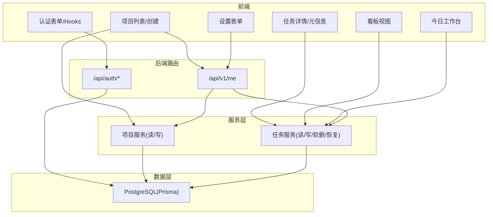
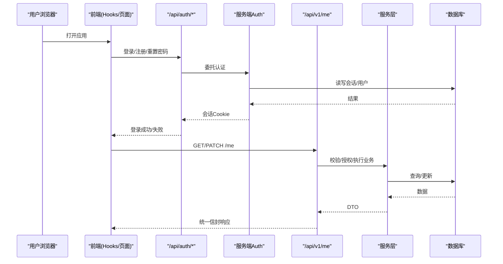
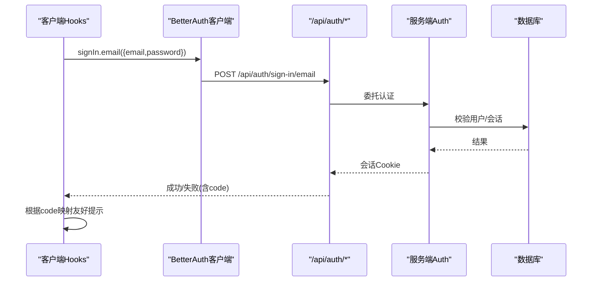
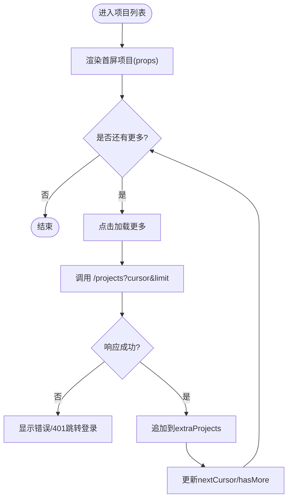
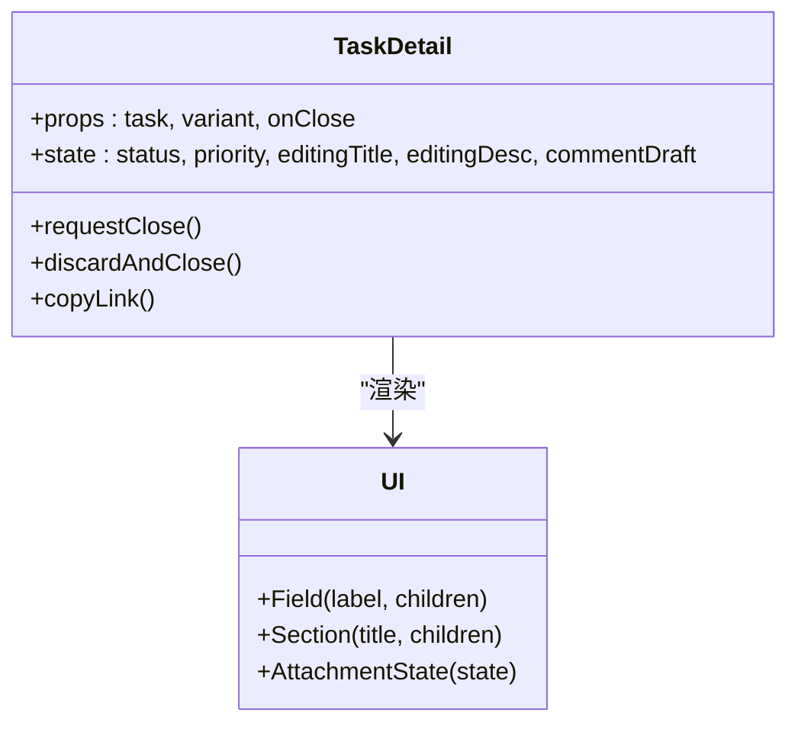
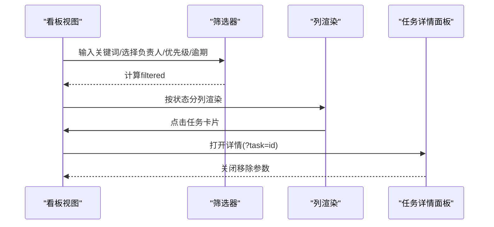
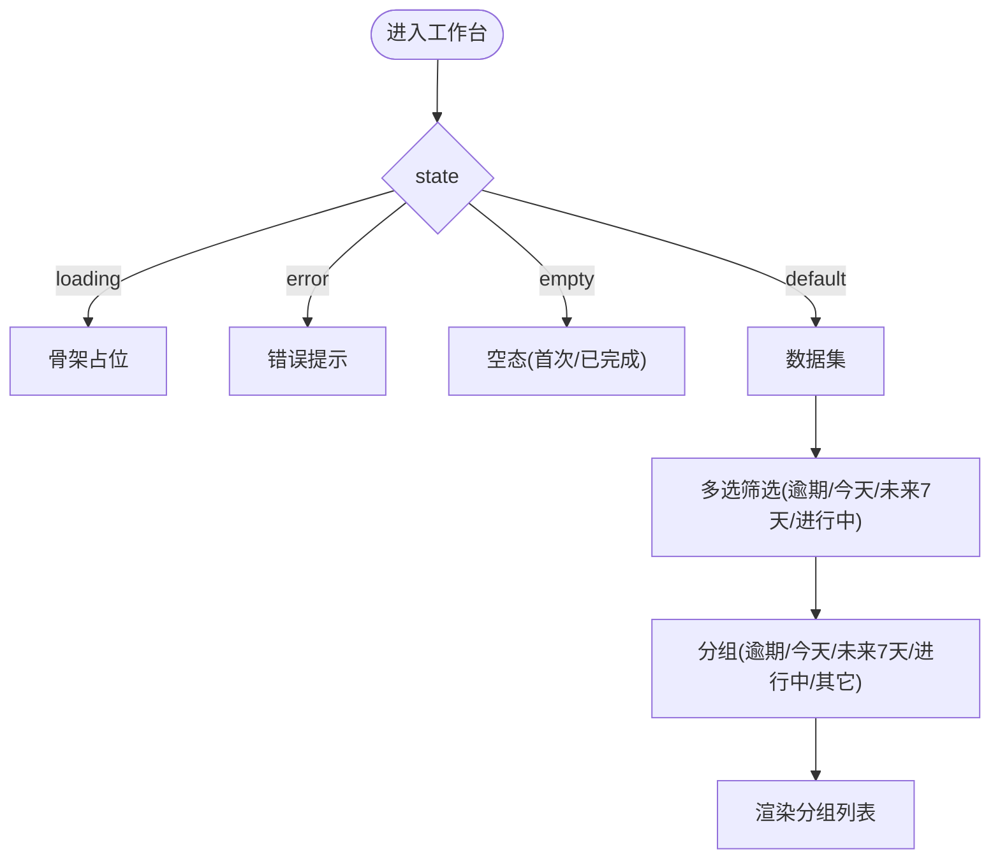
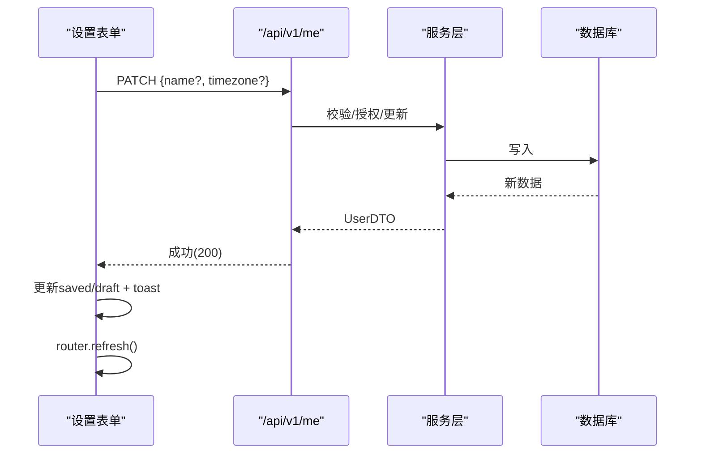
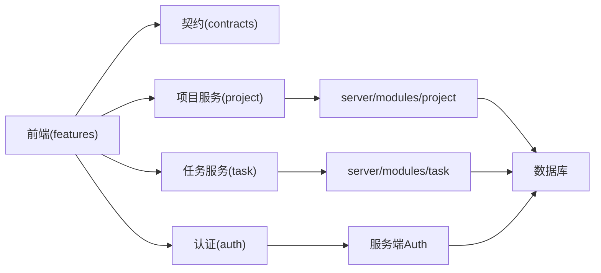

# 功能模块

<cite>
**本文引用的文件**
- [src/features/auth/use-auth.ts](file://src/features/auth/use-auth.ts)
- [src/server/auth/index.ts](file://src/server/auth/index.ts)
- [src/app/api/auth/[...all]/route.ts](file://src/app/api/auth/[...all]/route.ts)
- [src/features/projects/project-list-client.tsx](file://src/features/projects/project-list-client.tsx)
- [src/server/modules/project/index.ts](file://src/server/modules/project/index.ts)
- [src/features/tasks/task-detail.tsx](file://src/features/tasks/task-detail.tsx)
- [src/features/board/board-view.tsx](file://src/features/board/board-view.tsx)
- [src/features/today/today-view.tsx](file://src/features/today/today-view.tsx)
- [src/features/settings/settings-form.tsx](file://src/features/settings/settings-form.tsx)
- [src/server/modules/task/index.ts](file://src/server/modules/task/index.ts)
- [src/app/api/v1/me/route.ts](file://src/app/api/v1/me/route.ts)
- [prisma/schema.prisma](file://prisma/schema.prisma)
- [contracts/openapi.json](file://contracts/openapi.json)
</cite>

## 目录
1. [简介](#简介)
2. [项目结构](#项目结构)
3. [核心组件](#核心组件)
4. [架构总览](#架构总览)
5. [详细组件分析](#详细组件分析)
6. [依赖关系分析](#依赖关系分析)
7. [性能考虑](#性能考虑)
8. [故障排除指南](#故障排除指南)
9. [结论](#结论)
10. [附录](#附录)

## 简介
本文件为 Orbit 项目的“功能模块”文档，覆盖用户认证、项目管理、任务管理、看板视图、今日工作台与设置管理等六大模块。内容从业务目标、用户界面、业务流程与技术实现四个维度展开，并说明模块间的依赖关系、数据流转与状态同步机制；同时给出扩展点、配置选项与自定义能力，以及使用示例、集成指南与常见问题排查方法。文档既适合初学者快速上手，也为高级开发者提供深入的技术细节。

## 项目结构
Orbit 采用 Next.js App Router + 领域分层（features/、server/modules/）+ 契约驱动（contracts/）的架构：
- 前端功能层 features：按领域组织 UI 与客户端逻辑（auth、projects、tasks、board、today、settings）。
- 服务端模块 server/modules：按领域划分的服务入口（project、task），对外暴露 create/read/update 等能力。
- 契约层 contracts：OpenAPI 契约与客户端生成代码，前后端共享 DTO、Schema、错误码。
- 数据库 prisma：统一的数据模型与迁移，支撑认证与业务实体。

图表来源
- [src/features/auth/use-auth.ts:1-186](file://src/features/auth/use-auth.ts#L1-L186)
- [src/app/api/auth/[...all]/route.ts:1-22](file://src/app/api/auth/[...all]/route.ts#L1-L22)
- [src/app/api/v1/me/route.ts:1-91](file://src/app/api/v1/me/route.ts#L1-L91)
- [src/server/modules/project/index.ts:1-24](file://src/server/modules/project/index.ts#L1-L24)
- [src/server/modules/task/index.ts:1-31](file://src/server/modules/task/index.ts#L1-L31)
- [prisma/schema.prisma:1-268](file://prisma/schema.prisma#L1-L268)

章节来源
- [src/features/README.md:1-8](file://src/features/README.md#L1-L8)
- [prisma/schema.prisma:1-268](file://prisma/schema.prisma#L1-L268)

## 核心组件
- 认证模块：基于 Better Auth，封装 useSignIn/useSignUp/useSignOut 等 Hook，处理登录态、验证邮件、密码重置与限流提示。
- 项目管理模块：项目列表与创建，支持游标分页、空态引导、权限校验与刷新策略。
- 任务管理模块：任务详情编辑、状态/优先级切换、子任务/附件/评论展示（M0 样例模式）。
- 看板视图模块：三列固定布局与移动端 Tabs 切换，筛选（关键词/负责人/优先级/逾期），侧边任务详情面板。
- 今日工作台模块：统计卡片筛选（逾期/今天/未来7天/进行中），分组任务列表，多态（加载/空态/错误/长内容）。
- 设置管理模块：姓名与时区编辑，实时预览，字段级错误与会话失效处理，保存后全局刷新。

章节来源
- [src/features/auth/use-auth.ts:1-186](file://src/features/auth/use-auth.ts#L1-L186)
- [src/features/projects/project-list-client.tsx:1-286](file://src/features/projects/project-list-client.tsx#L1-L286)
- [src/features/tasks/task-detail.tsx:1-561](file://src/features/tasks/task-detail.tsx#L1-L561)
- [src/features/board/board-view.tsx:1-494](file://src/features/board/board-view.tsx#L1-L494)
- [src/features/today/today-view.tsx:1-320](file://src/features/today/today-view.tsx#L1-L320)
- [src/features/settings/settings-form.tsx:1-437](file://src/features/settings/settings-form.tsx#L1-L437)

## 架构总览
- 认证流程：前端通过 /api/auth/* 调用 Better Auth，服务端 auth 单例绑定 Prisma 与环境，返回会话 Cookie。
- 业务 API：/api/v1/me 负责账户信息读取与更新；项目与任务由 server/modules 提供服务，遵循请求 ID → Origin → 会话 → Schema → 领域服务 → DTO → 统一信封的流程。
- 数据模型：User/Session/Account/Verification 与 Project/Task/ActivityLog/IdempotencyRecord 等，严格对齐 OpenAPI 契约与枚举定义。

图表来源
- [src/app/api/auth/[...all]/route.ts:1-22](file://src/app/api/auth/[...all]/route.ts#L1-L22)
- [src/server/auth/index.ts:1-29](file://src/server/auth/index.ts#L1-L29)
- [src/app/api/v1/me/route.ts:1-91](file://src/app/api/v1/me/route.ts#L1-L91)
- [prisma/schema.prisma:1-268](file://prisma/schema.prisma#L1-L268)

## 详细组件分析

### 用户认证模块
- 核心功能
  - 登录、注册、退出、找回密码、重设密码、重发验证邮件。
  - 错误文案不泄露账户存在性，区分未验证邮箱与通用失败。
- 用户界面
  - 表单提交时显示 pending 状态；错误以 InlineError 驻留展示。
- 业务流程
  - 前端 Hooks 调用 better-auth/react 客户端；服务端通过 /api/auth/* 全路由挂载。
- 技术实现
  - use-auth.ts 封装 useSignIn/useSignUp/useSignOut 等，集中错误映射与状态管理。
  - server/auth/index.ts 导出 auth 单例，绑定 Prisma 与环境。
  - app/api/auth/[...all]/route.ts 将 Better Auth 接入 Next.js。

图表来源
- [src/features/auth/use-auth.ts:1-186](file://src/features/auth/use-auth.ts#L1-L186)
- [src/app/api/auth/[...all]/route.ts:1-22](file://src/app/api/auth/[...all]/route.ts#L1-L22)
- [src/server/auth/index.ts:1-29](file://src/server/auth/index.ts#L1-L29)

章节来源
- [src/features/auth/use-auth.ts:1-186](file://src/features/auth/use-auth.ts#L1-L186)
- [src/app/api/auth/[...all]/route.ts:1-22](file://src/app/api/auth/[...all]/route.ts#L1-L22)
- [src/server/auth/index.ts:1-29](file://src/server/auth/index.ts#L1-L29)

### 项目管理模块
- 核心功能
  - 列出当前用户拥有或参与的项目（游标分页）、新建项目、进入项目任务列表。
- 用户界面
  - 项目卡片包含名称、Key、颜色标记、角色、成员数、未完成任务数；空态引导创建首个项目。
- 业务流程
  - 首屏数据由 Server Component 传入 props；加载更多通过契约层 getList 追加；创建成功后 router.refresh 刷新。
- 技术实现
  - project-list-client.tsx 维护 extra* 本地分页状态，避免与 refresh 后的 props 脱节。
  - server/modules/project/index.ts 暴露 create/read/update 等服务入口。

图表来源
- [src/features/projects/project-list-client.tsx:1-286](file://src/features/projects/project-list-client.tsx#L1-L286)
- [src/server/modules/project/index.ts:1-24](file://src/server/modules/project/index.ts#L1-L24)

章节来源
- [src/features/projects/project-list-client.tsx:1-286](file://src/features/projects/project-list-client.tsx#L1-L286)
- [src/server/modules/project/index.ts:1-24](file://src/server/modules/project/index.ts#L1-L24)

### 任务管理模块
- 核心功能
  - 任务详情查看与编辑（标题/描述/状态/优先级/负责人/截止日），子任务、附件、评论展示（M0 样例模式）。
- 用户界面
  - 桌面侧面板/手机全屏两种形态；未保存更改关闭时弹出确认框。
- 业务流程
  - M0 使用 fixture 数据，交互触发 Toast 提示样例模式；后续接入真实后端后可替换为 API 调用。
- 技术实现
  - task-detail.tsx 管理编辑草稿、脏检查、焦点恢复与弹窗交互。

图表来源
- [src/features/tasks/task-detail.tsx:1-561](file://src/features/tasks/task-detail.tsx#L1-L561)

章节来源
- [src/features/tasks/task-detail.tsx:1-561](file://src/features/tasks/task-detail.tsx#L1-L561)

### 看板视图模块
- 核心功能
  - 看板三列（TODO/IN_PROGRESS/DONE），支持搜索、负责人、优先级、仅逾期筛选；移动端按状态 Tabs 切换。
- 用户界面
  - 项目页头（颜色/名称/成员头像/新建任务）；列头显示匹配数量；任务详情以侧面板打开。
- 业务流程
  - 本地过滤计算 filtered；openTaskId 控制详情面板；M0 无真实拖拽排序。
- 技术实现
  - board-view.tsx 组合筛选、列渲染与详情面板；复用任务详情组件。

图表来源
- [src/features/board/board-view.tsx:1-494](file://src/features/board/board-view.tsx#L1-L494)
- [src/features/tasks/task-detail.tsx:1-561](file://src/features/tasks/task-detail.tsx#L1-L561)

章节来源
- [src/features/board/board-view.tsx:1-494](file://src/features/board/board-view.tsx#L1-L494)

### 今日工作台模块
- 核心功能
  - 统计卡片（逾期/今天/未来7天/进行中）可多选筛选；正文按“逾期/今天/未来7天/进行中/其它”分组展示任务。
- 用户界面
  - 顶部主张语与日期；加载骨架、空态（首次无任务/全部完成）、错误态与重试。
- 业务流程
  - 本地过滤 matches/bucketOf；state 驱动不同视图（loading/empty/error/long-content）。
- 技术实现
  - today-view.tsx 使用 fixtures 数据，后续可替换为真实 API。

图表来源
- [src/features/today/today-view.tsx:1-320](file://src/features/today/today-view.tsx#L1-L320)

章节来源
- [src/features/today/today-view.tsx:1-320](file://src/features/today/today-view.tsx#L1-L320)

### 设置管理模块
- 核心功能
  - 修改姓名与时区；右侧实时预览当地时刻；账户信息只读展示。
- 用户界面
  - 编号字段行（01 姓名/02 时区）；dirty 态显示“unsaved”，保存后“saved”。
- 业务流程
  - 提交 PATCH /me，仅发送变更字段；成功更新 saved/draft，toast 提示并 router.refresh 全局刷新。
- 技术实现
  - settings-form.tsx 使用契约层 API；401 会话失效引导重新登录；字段级错误 InlineError。

图表来源
- [src/features/settings/settings-form.tsx:1-437](file://src/features/settings/settings-form.tsx#L1-L437)
- [src/app/api/v1/me/route.ts:1-91](file://src/app/api/v1/me/route.ts#L1-L91)

章节来源
- [src/features/settings/settings-form.tsx:1-437](file://src/features/settings/settings-form.tsx#L1-L437)
- [src/app/api/v1/me/route.ts:1-91](file://src/app/api/v1/me/route.ts#L1-L91)

## 依赖关系分析
- 前端依赖
  - 认证模块依赖 better-auth/react 客户端与服务端 auth 单例。
  - 项目/任务/看板/工作台/设置均依赖 contracts 提供的 DTO/Schema/ApiClient。
- 后端依赖
  - 路由层依赖 http 工具（errors/json/origin/request-id）与领域服务。
  - 领域服务依赖 Prisma 生成的客户端与数据库约束。
- 数据模型
  - User/Project/Task 等实体在 schema.prisma 中定义，枚举与索引确保查询与排序一致性。

图表来源
- [contracts/openapi.json:1-800](file://contracts/openapi.json#L1-L800)
- [src/server/modules/project/index.ts:1-24](file://src/server/modules/project/index.ts#L1-L24)
- [src/server/modules/task/index.ts:1-31](file://src/server/modules/task/index.ts#L1-L31)
- [prisma/schema.prisma:1-268](file://prisma/schema.prisma#L1-L268)

章节来源
- [contracts/openapi.json:1-800](file://contracts/openapi.json#L1-L800)
- [prisma/schema.prisma:1-268](file://prisma/schema.prisma#L1-L268)

## 性能考虑
- 前端
  - 项目列表使用“首屏 props + 客户端追加”的分页策略，避免镜像 state 与 refresh 冲突。
  - 看板与工作台使用 useMemo 进行本地过滤，减少重复计算。
  - 设置表单仅在 dirty 时提交，减少无效请求。
- 后端
  - 统一信封与请求 ID 便于追踪与缓存控制（/me 私有数据带 no-store）。
  - 数据库索引与枚举顺序优化查询与排序（如任务优先级 DESC 排序）。
  - 幂等记录与活动日志保障一致性与审计。

[本节为通用指导，无需特定文件引用]

## 故障排除指南
- 认证相关
  - 403 可能来自 Origin 校验失败，需从应用内页面重试；未验证邮箱使用 code 精确判定并提示重发邮件。
  - 会话过期：设置页检测到 401 时引导重新登录。
- 网络与契约
  - ApiClientError 表示连接失败或响应不符合统一信封；项目列表与设置页均有相应错误提示。
- 数据与权限
  - 看板/工作台在未登录或无权限时显示 NoAccess；项目列表 401 跳转登录。
- 常见错误定位
  - 检查请求 ID 与 Origin 校验；核对请求体是否符合 Schema；确认会话 Cookie 是否携带。

章节来源
- [src/features/auth/use-auth.ts:1-186](file://src/features/auth/use-auth.ts#L1-L186)
- [src/features/projects/project-list-client.tsx:1-286](file://src/features/projects/project-list-client.tsx#L1-L286)
- [src/features/settings/settings-form.tsx:1-437](file://src/features/settings/settings-form.tsx#L1-L437)
- [src/app/api/v1/me/route.ts:1-91](file://src/app/api/v1/me/route.ts#L1-L91)

## 结论
Orbit 的功能模块以契约驱动与领域分层为核心，认证、项目、任务、看板、工作台与设置各司其职且相互协作。前端注重用户体验与状态一致性，后端强调安全、一致性与可观测性。通过统一的信封、请求 ID 与严格的 Schema 校验，系统具备良好的扩展性与可维护性。后续可按里程碑逐步接入真实数据层与更丰富的交互（如拖拽排序、评论与附件上传等）。

[本节为总结，无需特定文件引用]

## 附录
- 使用示例
  - 登录：调用 useSignIn(email, password)，根据返回 error.code 与 status 展示友好提示。
  - 创建项目：在项目列表展开表单，提交成功后 await router.refresh() 刷新列表。
  - 编辑设置：修改姓名或时区，提交后 toast 提示并刷新全局。
- 集成指南
  - 新增 API：在 contracts/openapi.json 定义路径与 Schema，前端通过 createApiClient 调用。
  - 新增领域服务：在 server/modules 下按领域拆分 create/read/update，并在路由层编排。
- 扩展点
  - 认证：扩展用户字段（如 timezone）与第三方登录。
  - 项目/任务：扩展状态机、权限模型与活动日志。
  - 看板：实现拖拽排序与实时更新。
  - 设置：扩展偏好项（主题、语言等）。

[本节为补充信息，无需特定文件引用]