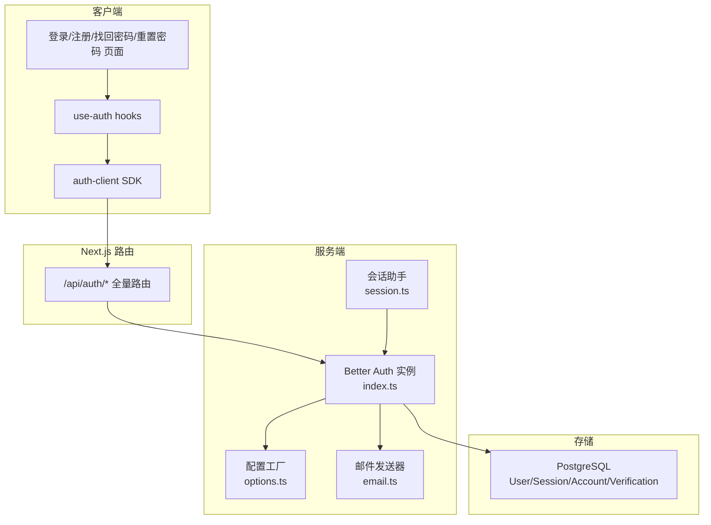
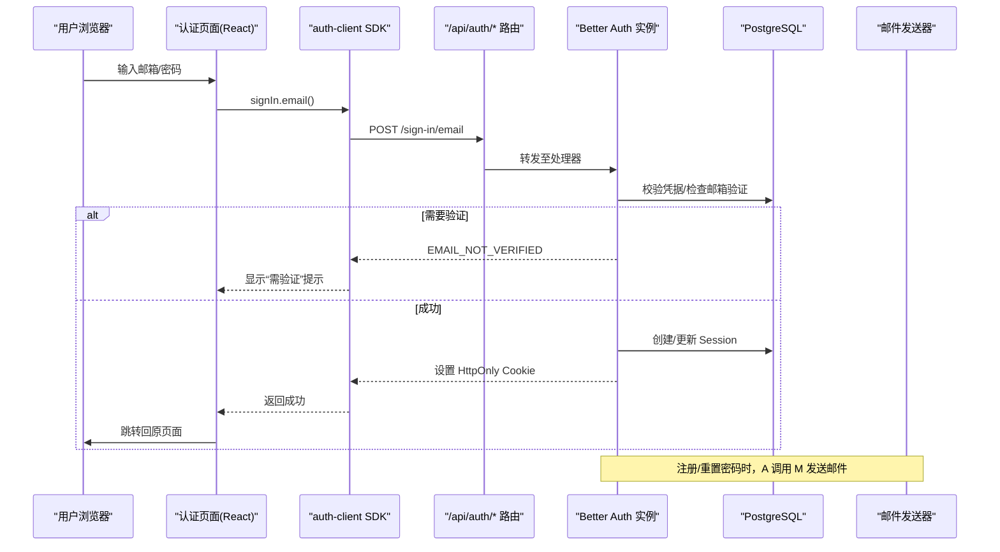
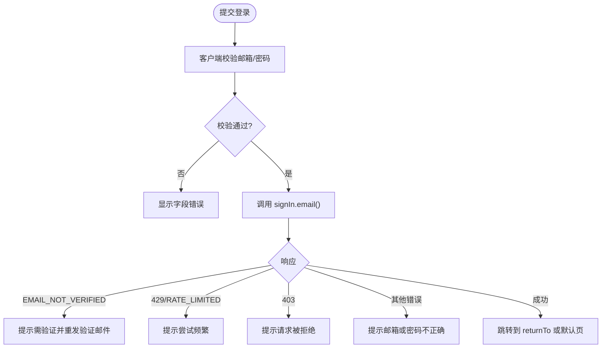
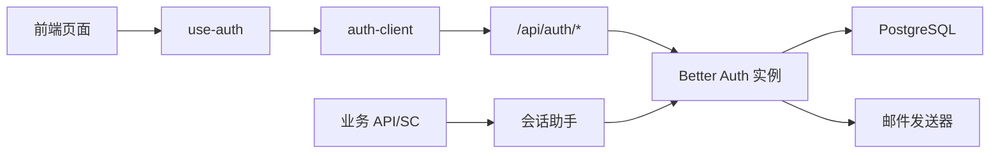

# 用户认证模块

<cite>
**本文引用的文件**
- [src/server/auth/index.ts](file://src/server/auth/index.ts)
- [src/server/auth/options.ts](file://src/server/auth/options.ts)
- [src/server/auth/session.ts](file://src/server/auth/session.ts)
- [src/server/auth/email.ts](file://src/server/auth/email.ts)
- [src/app/api/auth/[...all]/route.ts](file://src/app/api/auth/[...all]/route.ts)
- [src/features/auth/auth-client.ts](file://src/features/auth/auth-client.ts)
- [src/features/auth/use-auth.ts](file://src/features/auth/use-auth.ts)
- [src/features/auth/login-form.tsx](file://src/features/auth/login-form.tsx)
- [src/features/auth/register-form.tsx](file://src/features/auth/register-form.tsx)
- [src/features/auth/forgot-password-form.tsx](file://src/features/auth/forgot-password-form.tsx)
- [src/features/auth/reset-password-form.tsx](file://src/features/auth/reset-password-form.tsx)
- [src/features/auth/validation.ts](file://src/features/auth/validation.ts)
- [src/app/auth/layout.tsx](file://src/app/auth/layout.tsx)
- [prisma/schema.prisma](file://prisma/schema.prisma)
</cite>

## 目录
1. [简介](#简介)
2. [项目结构](#项目结构)
3. [核心组件](#核心组件)
4. [架构总览](#架构总览)
5. [详细组件分析](#详细组件分析)
6. [依赖关系分析](#依赖关系分析)
7. [性能与安全考量](#性能与安全考量)
8. [故障排查指南](#故障排查指南)
9. [结论](#结论)
10. [附录：配置与扩展](#附录配置与扩展)

## 简介
本模块基于 Better Auth 实现邮箱密码认证、会话管理、邮箱验证与密码重置，提供登录、注册、忘记密码、重置密码等前端页面与服务端路由。系统采用数据库会话（Session）、受控 Cookie（HttpOnly + SameSite=Lax，生产启用 Secure）、可信来源白名单、敏感端点限流、以及“重设密码后撤销所有会话”的安全策略。前端通过客户端 SDK 与 hooks 封装调用后端 /api/auth/* 端点，服务端通过会话助手在 API Route/Server Component 中校验身份并返回业务 DTO。

## 项目结构
认证相关代码按“服务端配置与运行时”“客户端 SDK 与 UI”“数据模型”分层组织：
- 服务端
  - 配置与实例：options.ts、index.ts
  - 会话与授权：session.ts
  - 邮件发送：email.ts
  - Next.js 路由挂载：app/api/auth/[...all]/route.ts
- 客户端
  - SDK 与类型推断：features/auth/auth-client.ts
  - 状态与错误处理 hooks：features/auth/use-auth.ts
  - 表单与页面：login/register/forgot-password/reset-password 等
  - 表单校验：validation.ts
  - 认证页布局：app/auth/layout.tsx
- 数据模型：prisma/schema.prisma（User/Session/Account/Verification）

图表来源
- [src/app/api/auth/[...all]/route.ts:1-22](file://src/app/api/auth/[...all]/route.ts#L1-L22)
- [src/server/auth/index.ts:1-29](file://src/server/auth/index.ts#L1-L29)
- [src/server/auth/options.ts:44-141](file://src/server/auth/options.ts#L44-L141)
- [src/server/auth/email.ts:189-218](file://src/server/auth/email.ts#L189-L218)
- [src/features/auth/auth-client.ts:1-32](file://src/features/auth/auth-client.ts#L1-L32)
- [prisma/schema.prisma:27-92](file://prisma/schema.prisma#L27-L92)

章节来源
- [src/app/api/auth/[...all]/route.ts:1-22](file://src/app/api/auth/[...all]/route.ts#L1-L22)
- [src/server/auth/index.ts:1-29](file://src/server/auth/index.ts#L1-L29)
- [src/server/auth/options.ts:44-141](file://src/server/auth/options.ts#L44-L141)
- [src/server/auth/email.ts:189-218](file://src/server/auth/email.ts#L189-L218)
- [src/features/auth/auth-client.ts:1-32](file://src/features/auth/auth-client.ts#L1-L32)
- [prisma/schema.prisma:27-92](file://prisma/schema.prisma#L27-L92)

## 核心组件
- Better Auth 应用单例：导出 auth 实例及会话/用户类型，供服务端使用。
- 配置工厂：集中管理数据库适配器、邮箱密码开关、邮箱验证、会话过期、限流、安全 Cookie、可信来源等。
- 会话助手：统一从请求头解析会话，返回业务 UserDTO；未认证抛领域错误。
- 邮件发送器：基于 nodemailer，构造验证/重置邮件链接与模板，脱敏日志。
- 客户端 SDK：createAuthClient + 插件推断 timezone 字段，暴露 signIn/signUp/resetPassword 等方法。
- 表单与 hooks：封装 pending/error/needsVerification 状态，错误文案不泄露账户存在性。

章节来源
- [src/server/auth/index.ts:1-29](file://src/server/auth/index.ts#L1-L29)
- [src/server/auth/options.ts:44-141](file://src/server/auth/options.ts#L44-L141)
- [src/server/auth/session.ts:1-43](file://src/server/auth/session.ts#L1-L43)
- [src/server/auth/email.ts:189-218](file://src/server/auth/email.ts#L189-L218)
- [src/features/auth/auth-client.ts:1-32](file://src/features/auth/auth-client.ts#L1-L32)
- [src/features/auth/use-auth.ts:1-186](file://src/features/auth/use-auth.ts#L1-L186)

## 架构总览
认证流程由前端页面触发，经客户端 SDK 调用 /api/auth/*，由 Better Auth 路由分发到对应处理器，完成鉴权、写库、发邮件等操作；服务端其他资源通过会话助手读取当前用户。

图表来源
- [src/features/auth/use-auth.ts:54-76](file://src/features/auth/use-auth.ts#L54-L76)
- [src/app/api/auth/[...all]/route.ts:1-22](file://src/app/api/auth/[...all]/route.ts#L1-L22)
- [src/server/auth/options.ts:56-71](file://src/server/auth/options.ts#L56-L71)
- [src/server/auth/email.ts:189-218](file://src/server/auth/email.ts#L189-L218)
- [prisma/schema.prisma:27-92](file://prisma/schema.prisma#L27-L92)

## 详细组件分析

### 认证配置与实例（Better Auth）
- 配置要点
  - 数据库：Prisma 适配器（PostgreSQL），会话落库。
  - 邮箱密码：启用，长度 12–128，要求邮箱验证，重设密码后撤销会话。
  - 邮箱验证：注册/登录时自动发验证邮件，验证通过后自动登录。
  - 会话：7 天过期，每日刷新。
  - 限流：测试环境关闭，其余环境开启；对敏感端点自定义窗口与上限。
  - 安全：仅 https/baseURL 为 https 时启用 Secure Cookie；trustedOrigins 精确匹配。
- 实例导出：auth 单例与类型（Auth/Session/User）。

章节来源
- [src/server/auth/options.ts:44-141](file://src/server/auth/options.ts#L44-L141)
- [src/server/auth/index.ts:1-29](file://src/server/auth/index.ts#L1-L29)

### 会话管理与权限控制
- 获取当前用户：从 Request/Headers 提取会话，返回 UserDTO（不含敏感字段）。
- 强制已认证：未认证抛出 UNAUTHENTICATED 领域错误，由 HTTP 层统一映射为标准信封。
- 适用场景：API Route、Server Component 的资源访问前校验。

章节来源
- [src/server/auth/session.ts:1-43](file://src/server/auth/session.ts#L1-L43)

### 邮件发送与链接构造
- 验证邮件：复用库生成的 URL 的 origin+path，覆写 callbackURL 指向应用自有验证结果页。
- 重置邮件：构造应用自有重置页链接，携带单次使用 token。
- 模板：内联样式 HTML + 纯文本，包含品牌标识、主行动按钮、页脚说明。
- 安全：正文不含密码明文与完整 session token；日志仅记录用途与 userId。

章节来源
- [src/server/auth/email.ts:149-218](file://src/server/auth/email.ts#L149-L218)

### 客户端 SDK 与 Hooks
- SDK：createAuthClient + inferAdditionalFields 推断 timezone 字段；方法名到路径映射遵循约定。
- useSignIn：捕获 EMAIL_NOT_VERIFIED、RATE_LIMITED、403 等错误，给出友好文案。
- useSignUp：提交 name/email/password/timezone；成功后引导去验证页。
- useRequestPasswordReset / useResetPassword：分别发起重置请求与提交新密码。
- useSignOut：清理会话 cookie。
- useResendVerification：重新发送验证邮件。

章节来源
- [src/features/auth/auth-client.ts:1-32](file://src/features/auth/auth-client.ts#L1-L32)
- [src/features/auth/use-auth.ts:1-186](file://src/features/auth/use-auth.ts#L1-L186)

### 登录表单
- 功能：本地校验邮箱格式与密码非空；调用 useSignIn；失败时显示通用错误；未验证时提示并引导验证。
- 跳转：returnTo 经严格同源校验后整页跳转，确保服务端读到新会话。

图表来源
- [src/features/auth/login-form.tsx:21-108](file://src/features/auth/login-form.tsx#L21-L108)
- [src/features/auth/use-auth.ts:54-76](file://src/features/auth/use-auth.ts#L54-L76)

章节来源
- [src/features/auth/login-form.tsx:1-108](file://src/features/auth/login-form.tsx#L1-L108)
- [src/features/auth/use-auth.ts:54-76](file://src/features/auth/use-auth.ts#L54-L76)

### 注册表单
- 功能：收集姓名/邮箱/密码/确认密码；本地校验长度与一致性；提交后进入“验证邮件已发送”态。
- 行为：requireEmailVerification 下注册不建立会话，需点击邮件链接验证后自动登录。

章节来源
- [src/features/auth/register-form.tsx:1-146](file://src/features/auth/register-form.tsx#L1-L146)
- [src/features/auth/use-auth.ts:78-104](file://src/features/auth/use-auth.ts#L78-L104)

### 忘记密码表单
- 功能：输入邮箱，调用 requestPasswordReset；无论邮箱是否存在均返回统一成功文案，避免信息泄露。
- 后续：重置邮件链接指向应用自有重置页。

章节来源
- [src/features/auth/forgot-password-form.tsx:1-106](file://src/features/auth/forgot-password-form.tsx#L1-L106)
- [src/features/auth/use-auth.ts:122-142](file://src/features/auth/use-auth.ts#L122-L142)

### 重置密码表单
- 功能：从 URL 取 token；校验新密码长度与一致性；提交 resetPassword。
- 安全：成功后服务器撤销该用户所有既有会话，引导重新登录。

章节来源
- [src/features/auth/reset-password-form.tsx:1-116](file://src/features/auth/reset-password-form.tsx#L1-L116)
- [src/features/auth/use-auth.ts:144-162](file://src/features/auth/use-auth.ts#L144-L162)

### 表单校验与强度提示
- 规则：邮箱格式、密码长度 12–128、姓名 1–40 字符。
- 强度评估：基于长度与字符种类给出即时反馈，仅作体验优化，不替代服务端校验。

章节来源
- [src/features/auth/validation.ts:1-67](file://src/features/auth/validation.ts#L1-L67)

### 认证页布局
- 与 /app/* 分离，不受应用级会话门禁影响；设置元信息与 robots 策略。

章节来源
- [src/app/auth/layout.tsx:1-23](file://src/app/auth/layout.tsx#L1-L23)

## 依赖关系分析
- 客户端依赖
  - 页面 → use-auth hooks → auth-client SDK → /api/auth/*
- 服务端依赖
  - /api/auth/* → Better Auth 实例 → Prisma 适配器 → PostgreSQL
  - Better Auth → 邮件发送器 → nodemailer → SMTP
  - 业务 API/Server Component → 会话助手 → Better Auth 会话

图表来源
- [src/features/auth/use-auth.ts:1-186](file://src/features/auth/use-auth.ts#L1-L186)
- [src/features/auth/auth-client.ts:1-32](file://src/features/auth/auth-client.ts#L1-L32)
- [src/app/api/auth/[...all]/route.ts:1-22](file://src/app/api/auth/[...all]/route.ts#L1-L22)
- [src/server/auth/index.ts:1-29](file://src/server/auth/index.ts#L1-L29)
- [src/server/auth/session.ts:1-43](file://src/server/auth/session.ts#L1-L43)
- [src/server/auth/email.ts:189-218](file://src/server/auth/email.ts#L189-L218)

章节来源
- [src/features/auth/use-auth.ts:1-186](file://src/features/auth/use-auth.ts#L1-L186)
- [src/features/auth/auth-client.ts:1-32](file://src/features/auth/auth-client.ts#L1-L32)
- [src/app/api/auth/[...all]/route.ts:1-22](file://src/app/api/auth/[...all]/route.ts#L1-L22)
- [src/server/auth/index.ts:1-29](file://src/server/auth/index.ts#L1-L29)
- [src/server/auth/session.ts:1-43](file://src/server/auth/session.ts#L1-L43)
- [src/server/auth/email.ts:189-218](file://src/server/auth/email.ts#L189-L218)

## 性能与安全考量
- 性能
  - 会话落库：减少内存压力，适合多实例部署；配合索引提升查询效率。
  - 邮件发送：transport 按 env 缓存，避免重复建连；模板轻量、内联样式兼容性好。
  - 限流：保护敏感端点，防止暴力破解与滥用。
- 安全
  - Cookie：HttpOnly + SameSite=Lax，生产启用 Secure；避免跨站攻击。
  - 可信来源：精确 trustedOrigins 列表，防止 CSRF/重定向风险。
  - 邮箱验证：未验证不可登录；登录失败时重发验证邮件。
  - 密码重置：重设后撤销所有会话，降低旧设备风险。
  - 隐私：错误文案不泄露账户是否存在；日志脱敏。

[本节为通用指导，无需具体文件引用]

## 故障排查指南
- 登录失败
  - 现象：提示“邮箱或密码不正确”或“尝试过于频繁”。
  - 可能原因：凭据错误、限流触发、Origin 校验失败。
  - 处理：检查网络与 Origin；若 429，等待重试；若 403，确认从应用内页面重试。
- 邮箱未验证
  - 现象：登录后提示需验证。
  - 处理：前往验证页查看状态或重新发送验证邮件；检查垃圾邮件。
- 重置链接无效
  - 现象：重置页提示链接无效或缺少令牌。
  - 处理：重新申请重置邮件；注意链接有效期与一次性使用限制。
- 邮件未收到
  - 现象：注册/重置后未收到邮件。
  - 处理：检查 SMTP 配置与收件箱/垃圾箱；查看服务日志中的脱敏记录。

章节来源
- [src/features/auth/use-auth.ts:32-52](file://src/features/auth/use-auth.ts#L32-L52)
- [src/features/auth/login-form.tsx:30-43](file://src/features/auth/login-form.tsx#L30-L43)
- [src/features/auth/reset-password-form.tsx:29-47](file://src/features/auth/reset-password-form.tsx#L29-L47)
- [src/server/auth/email.ts:165-184](file://src/server/auth/email.ts#L165-L184)

## 结论
本认证模块以 Better Auth 为核心，结合 Prisma 会话存储、严格的 Cookie 与可信来源策略、细粒度限流与隐私友好的错误文案，实现了安全的邮箱密码认证、会话管理与邮件验证/重置流程。前端通过 hooks 封装简化交互，服务端通过会话助手保障资源访问安全。整体设计清晰、可扩展性强，便于集成更多认证提供商与业务定制。

[本节为总结，无需具体文件引用]

## 附录：配置与扩展
- 关键配置项
  - 应用基础地址与密钥：baseURL、secret
  - 可信来源：AUTH_TRUSTED_ORIGINS（逗号分隔，无通配符）
  - 邮箱密码：min/max 长度、是否要求邮箱验证、重设密码后撤销会话
  - 邮箱验证：注册/登录时自动发验证邮件、验证后自动登录
  - 会话：过期时间与刷新周期
  - 限流：全局开关、窗口与上限、自定义敏感端点规则
  - 安全 Cookie：仅在 https baseURL 时启用 Secure
- 自定义认证提供商集成建议
  - 在 options.ts 中添加对应 provider 配置（如 OAuth），保持 basePath 与 trustedOrigins 一致。
  - 如需扩展用户字段，沿用 additionalFields 模式（参考 timezone）。
  - 邮件钩子可复用 email.ts 的模板与发送逻辑。
- 常见模式
  - 登录成功后整页跳转：使用 sanitizeReturnTo 校验后 window.location.assign。
  - 未验证引导：根据 code 精准识别 EMAIL_NOT_VERIFIED，避免误判 403。
  - 资源访问：在服务端使用 requireSessionUser 保证数据安全。

章节来源
- [src/server/auth/options.ts:44-141](file://src/server/auth/options.ts#L44-L141)
- [src/features/auth/auth-client.ts:1-32](file://src/features/auth/auth-client.ts#L1-L32)
- [src/features/auth/use-auth.ts:54-76](file://src/features/auth/use-auth.ts#L54-L76)
- [src/server/auth/session.ts:24-42](file://src/server/auth/session.ts#L24-L42)
- [prisma/schema.prisma:27-92](file://prisma/schema.prisma#L27-L92)