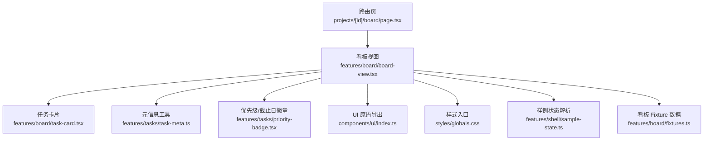
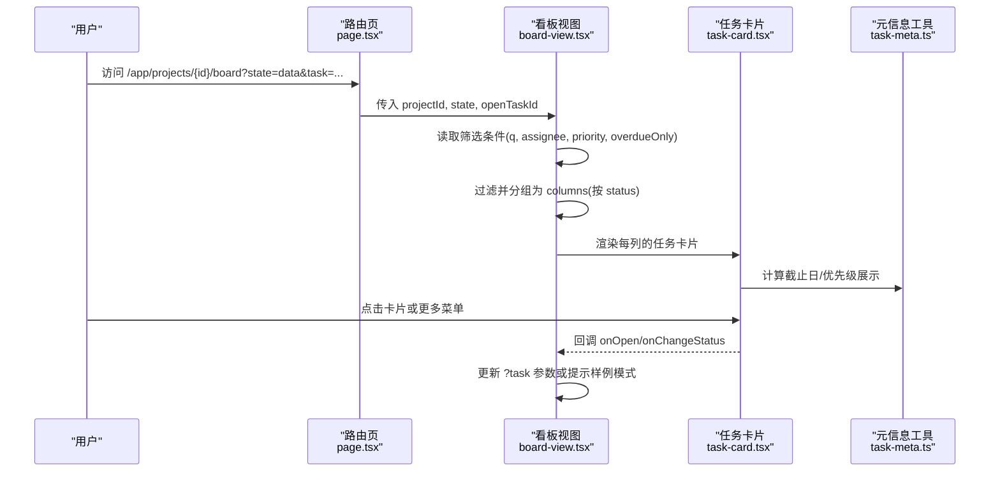
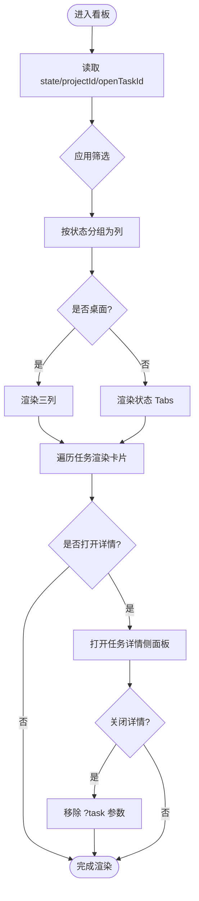
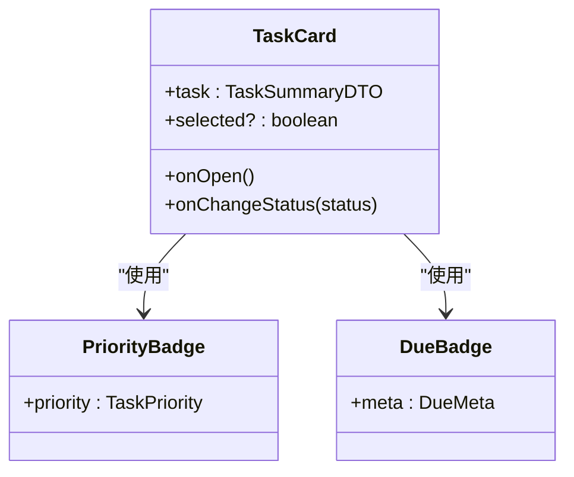
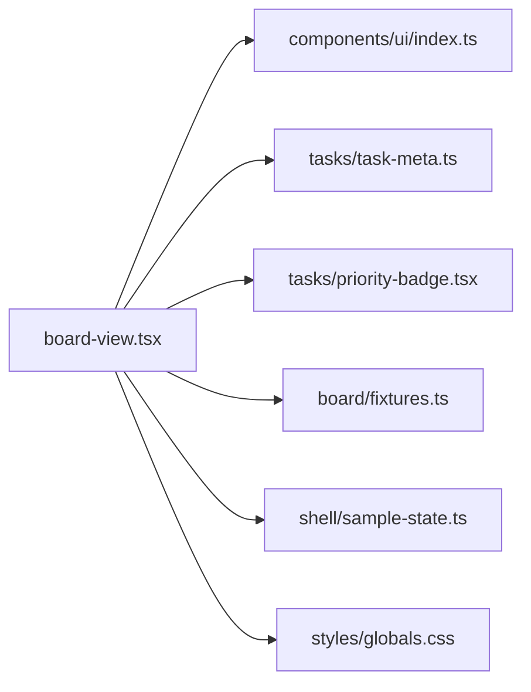

# 看板视图模块

<cite>
**本文引用的文件**
- [board-view.tsx](file://src/features/board/board-view.tsx)
- [task-card.tsx](file://src/features/board/task-card.tsx)
- [page.tsx](file://src/app/app/projects/[id]/board/page.tsx)
- [fixtures.ts](file://src/features/board/fixtures.ts)
- [task-meta.ts](file://src/features/tasks/task-meta.ts)
- [priority-badge.tsx](file://src/features/tasks/priority-badge.tsx)
- [sample-state.ts](file://src/features/shell/sample-state.ts)
- [dto.ts](file://src/contracts/dto.ts)
- [index.ts](file://src/components/ui/index.ts)
- [globals.css](file://src/styles/globals.css)
- [02-UX-AND-DESIGN.md](file://docs/02-UX-AND-DESIGN.md)
</cite>

## 目录
1. [简介](#简介)
2. [项目结构](#项目结构)
3. [核心组件](#核心组件)
4. [架构总览](#架构总览)
5. [详细组件分析](#详细组件分析)
6. [依赖关系分析](#依赖关系分析)
7. [性能与可扩展性](#性能与可扩展性)
8. [故障排查指南](#故障排查指南)
9. [结论](#结论)
10. [附录：定制、主题与扩展](#附录定制主题与扩展)

## 简介
本模块实现项目看板视图（ORB-002），提供三列固定布局（待办/进行中/已完成）、任务卡片展示、筛选与搜索、移动端按状态分栏切换，以及通过 URL 参数打开任务详情侧面板。M0 阶段使用本地 fixture 数据演示布局与交互；真实拖拽排序属于后续里程碑。

## 项目结构
看板视图由页面路由、视图容器、任务卡片、元信息工具与 UI 原语组成，遵循“特性目录 + 共享 UI”的组织方式。

图表来源
- [page.tsx:1-38](file://src/app/app/projects/[id]/board/page.tsx#L1-L38)
- [board-view.tsx:1-256](file://src/features/board/board-view.tsx#L1-L256)
- [task-card.tsx:1-146](file://src/features/board/task-card.tsx#L1-L146)
- [task-meta.ts:1-133](file://src/features/tasks/task-meta.ts#L1-L133)
- [priority-badge.tsx:1-77](file://src/features/tasks/priority-badge.tsx#L1-L77)
- [index.ts:1-25](file://src/components/ui/index.ts#L1-L25)
- [globals.css:1-13](file://src/styles/globals.css#L1-L13)
- [sample-state.ts:1-51](file://src/features/shell/sample-state.ts#L1-L51)
- [fixtures.ts:1-178](file://src/features/board/fixtures.ts#L1-L178)

章节来源
- [page.tsx:1-38](file://src/app/app/projects/[id]/board/page.tsx#L1-L38)
- [board-view.tsx:1-256](file://src/features/board/board-view.tsx#L1-L256)

## 核心组件
- 看板视图 BoardView：负责项目页头、二级导航 Tabs、筛选行、桌面三列与移动端单列 Tabs、任务详情侧面板开关、加载/空态/错误/无权限等状态渲染。
- 任务卡片 TaskCard：展示编号、优先级、标题、子任务/评论/附件计数、截止日与负责人，并提供更多操作菜单（移动到某列）。
- 元信息与徽章：统一的状态标签、列顺序、优先级标签、截止日语义计算与展示。
- 路由页：解析路由与查询参数，将 state 与 openTaskId 传入视图。

章节来源
- [board-view.tsx:59-256](file://src/features/board/board-view.tsx#L59-L256)
- [task-card.tsx:28-136](file://src/features/board/task-card.tsx#L28-L136)
- [task-meta.ts:11-123](file://src/features/tasks/task-meta.ts#L11-L123)
- [priority-badge.tsx:21-77](file://src/features/tasks/priority-badge.tsx#L21-L77)
- [page.tsx:27-37](file://src/app/app/projects/[id]/board/page.tsx#L27-L37)

## 架构总览
看板视图采用“页面路由 → 视图容器 → 列/卡片 → 元信息工具”的单向数据流。筛选与搜索在客户端进行，基于本地 fixture 数据过滤并分组到各列。任务详情通过 URL 参数 ?task=<id> 控制显示，关闭时移除该参数。

图表来源
- [page.tsx:27-37](file://src/app/app/projects/[id]/board/page.tsx#L27-L37)
- [board-view.tsx:68-124](file://src/features/board/board-view.tsx#L68-L124)
- [task-card.tsx:67-92](file://src/features/board/task-card.tsx#L67-L92)
- [task-meta.ts:80-123](file://src/features/tasks/task-meta.ts#L80-L123)

## 详细组件分析

### 看板视图 BoardView
- 职责
  - 项目页头：项目标记色、名称、成员头像、新建任务按钮。
  - 二级导航：看板/列表/活动/设置 Tabs，当前仅看板可用。
  - 筛选行：关键词搜索、负责人、优先级、仅逾期、清除筛选。
  - 布局：桌面端三列固定；移动端按状态 Tabs 一次一列。
  - 详情侧面板：通过 ?task 打开任务详情，关闭时移除参数并恢复焦点。
  - 状态渲染：loading/empty/error/permission/long-content 六态。
- 关键流程
  - 筛选逻辑：组合 q、assignee、priority、overdueOnly 过滤任务集合。
  - 列分组：按 STATUS_COLUMN_ORDER 将任务分配到列。
  - 路由参数：withParams 函数维护 URL 查询参数，openTask/closeTask 管理 ?task。
- 可访问性与响应式
  - 键盘焦点与返回焦点：useFocusReturn 确保弹窗/侧面板关闭后焦点回到触发元素。
  - 移动端：Tabs 切换状态列，避免横向滚动。

图表来源
- [board-view.tsx:68-124](file://src/features/board/board-view.tsx#L68-L124)
- [board-view.tsx:126-256](file://src/features/board/board-view.tsx#L126-L256)

章节来源
- [board-view.tsx:59-256](file://src/features/board/board-view.tsx#L59-L256)

### 任务卡片 TaskCard
- 展示内容
  - 第一行：编号 + 优先级 + 更多菜单（移动到某列）。
  - 第二行：标题（两行截断，作为打开详情的可访问控件）。
  - 第三行：子任务/评论/附件计数（图标+数字）。
  - 第四行：截止日 + 负责人（头像+姓名）。
- 交互
  - 更多菜单：移动到不同状态列（禁用当前状态）。
  - 打开详情：调用 onOpen，配合看板视图的 ?task 参数。
- 视觉与可访问性
  - hover/focus-within 显示更多菜单；移动端常显菜单。
  - 高优先级/逾期用图标+文案，不整卡染红。

图表来源
- [task-card.tsx:28-136](file://src/features/board/task-card.tsx#L28-L136)
- [priority-badge.tsx:21-77](file://src/features/tasks/priority-badge.tsx#L21-L77)

章节来源
- [task-card.tsx:28-136](file://src/features/board/task-card.tsx#L28-L136)

### 元信息与徽章
- 状态与列顺序：STATUS_LABEL、STATUS_COLUMN_ORDER 保证看板列顺序一致。
- 优先级标签：PRIORITY_LABEL 映射中文，PriorityBadge 根据优先级选择强调色。
- 截止日语义：getDueMeta 计算 overdue/today/soon/later/none，DueBadge 展示短日期与完整说明。

章节来源
- [task-meta.ts:11-123](file://src/features/tasks/task-meta.ts#L11-L123)
- [priority-badge.tsx:21-77](file://src/features/tasks/priority-badge.tsx#L21-L77)

### 路由与状态
- 路由页解析 params/searchParams，将 state 与 openTaskId 传入 BoardView。
- SampleState 支持 data/loading/empty/error/permission/long-content 六态，便于验收与演示。

章节来源
- [page.tsx:27-37](file://src/app/app/projects/[id]/board/page.tsx#L27-L37)
- [sample-state.ts:13-51](file://src/features/shell/sample-state.ts#L13-L51)

### 数据与契约
- 看板数据来自 fixtures.ts，覆盖三列、四种优先级、逾期与长标题场景。
- DTO 定义严格对齐 OpenAPI，包含 TaskSummary、BoardColumn、Board 等类型，为后续接入真实后端做准备。

章节来源
- [fixtures.ts:1-178](file://src/features/board/fixtures.ts#L1-L178)
- [dto.ts:190-296](file://src/contracts/dto.ts#L190-L296)

## 依赖关系分析
看板视图依赖以下模块：
- UI 原语：Button、Input、Select、Tabs、DropdownMenu、Avatar、Skeleton、EmptyState、Toast、useFocusReturn。
- 业务工具：任务元信息、优先级/截止日徽章。
- 数据源：看板 fixture 与 shell 示例项目/人员。
- 样式：全局 CSS 引入 Tailwind 与设计 tokens。

图表来源
- [board-view.tsx:1-40](file://src/features/board/board-view.tsx#L1-L40)
- [index.ts:1-25](file://src/components/ui/index.ts#L1-L25)
- [task-meta.ts:1-133](file://src/features/tasks/task-meta.ts#L1-L133)
- [priority-badge.tsx:1-77](file://src/features/tasks/priority-badge.tsx#L1-L77)
- [fixtures.ts:1-178](file://src/features/board/fixtures.ts#L1-L178)
- [sample-state.ts:1-51](file://src/features/shell/sample-state.ts#L1-L51)
- [globals.css:1-13](file://src/styles/globals.css#L1-L13)

章节来源
- [board-view.tsx:1-40](file://src/features/board/board-view.tsx#L1-L40)

## 性能与可扩展性
- 当前实现
  - 筛选与分组在客户端执行，数据量较小（fixture）时无明显性能问题。
  - 使用 useMemo 缓存过滤结果，减少重复计算。
  - 骨架屏与空态提升感知性能。
- 建议优化（面向未来数据接入）
  - 虚拟滚动：当列内任务较多时，考虑虚拟化列表以减少 DOM 节点数量。
  - 分页/游标：对接后端 BoardColumn.nextCursor，按需加载列内任务。
  - 增量更新：利用 boardVersion 与任务 version 做乐观并发与局部刷新。
  - 防抖搜索：对关键词输入增加防抖，降低频繁过滤开销。
  - 懒加载详情：仅在需要时加载任务详情数据，避免首屏过重。

[本节为通用指导，不直接分析具体文件]

## 故障排查指南
- 筛选无结果
  - 现象：列中显示“没有匹配任务”，并提供“清除筛选”。
  - 处理：检查 q、assignee、priority、overdueOnly 的组合条件。
- 详情侧面板焦点问题
  - 现象：关闭详情后焦点未回到卡片或不可见区域。
  - 处理：useFocusReturn 捕获/返回焦点；直链或跨断点导致原卡片隐藏时回退到看板容器聚焦。
- 状态切换提示
  - 现象：移动任务到其它列仅弹出样例提示。
  - 原因：M0 未连接真实后端，所有写操作暂为占位。
- 加载/空态/错误/无权限
  - 现象：根据 state 参数渲染对应界面。
  - 处理：确认路由 searchParams.state 值合法；非法或空默认 data。

章节来源
- [board-view.tsx:144-231](file://src/features/board/board-view.tsx#L144-L231)
- [board-view.tsx:235-254](file://src/features/board/board-view.tsx#L235-L254)
- [sample-state.ts:42-51](file://src/features/shell/sample-state.ts#L42-L51)

## 结论
看板视图在 M0 阶段提供了稳定的三列布局、任务卡片展示、筛选与搜索、移动端适配与详情侧面板。通过统一的元信息工具与 UI 原语，保证了视觉一致性与可访问性。后续里程碑将逐步接入真实后端、实现拖拽排序、虚拟滚动与增量更新，以支撑大规模任务管理与实时协作。

[本节为总结，不直接分析具体文件]

## 附录：定制、主题与扩展
- 主题与 Token
  - 全局样式通过 globals.css 引入 Tailwind 与设计 tokens，颜色、间距、圆角、动效均集中管理。
  - 项目颜色用于标记，不替代状态或权限标识。
- 定制选项
  - 列顺序与标签：通过 STATUS_COLUMN_ORDER 与 STATUS_LABEL 调整。
  - 优先级与截止日：通过 PRIORITY_LABEL 与 getDueMeta/DueBadge 定制展示。
  - 筛选维度：可在 FilterRow 扩展新的筛选条件（如标签、自定义字段）。
- 扩展开发指南
  - 接入真实数据：替换 BOARD_TASKS 为 API 拉取的数据，保持 TaskSummary 结构一致。
  - 实现拖拽：在 ColumnBody 中集成拖拽库，结合 MoveTask 契约（expectedVersion、expectedBoardVersion、toStatus、beforeTaskId）完成状态转换与排序。
  - 实时更新：监听 boardVersion 变化，增量更新列内任务；冲突时保留草稿并提示。
  - 可访问性：确保所有交互支持键盘操作，焦点管理遵循 useFocusReturn 规范。

章节来源
- [globals.css:1-13](file://src/styles/globals.css#L1-L13)
- [task-meta.ts:11-123](file://src/features/tasks/task-meta.ts#L11-L123)
- [dto.ts:264-296](file://src/contracts/dto.ts#L264-L296)
- [02-UX-AND-DESIGN.md:81-105](file://docs/02-UX-AND-DESIGN.md#L81-L105)