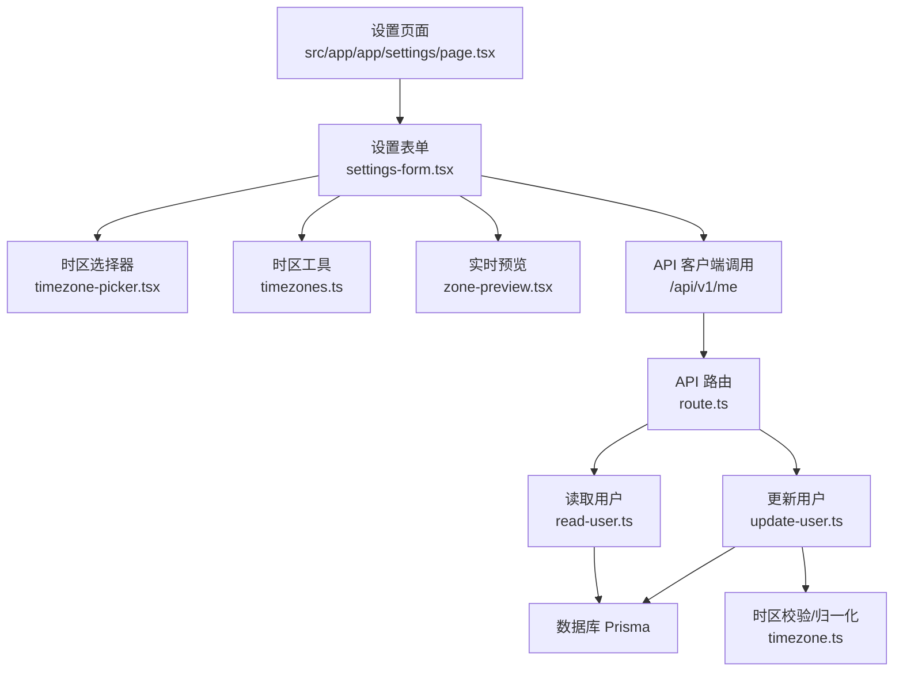
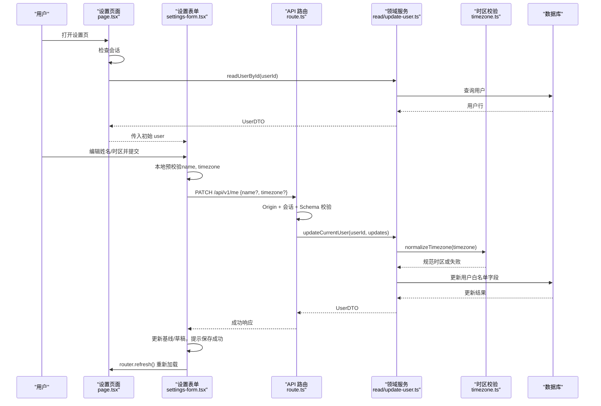
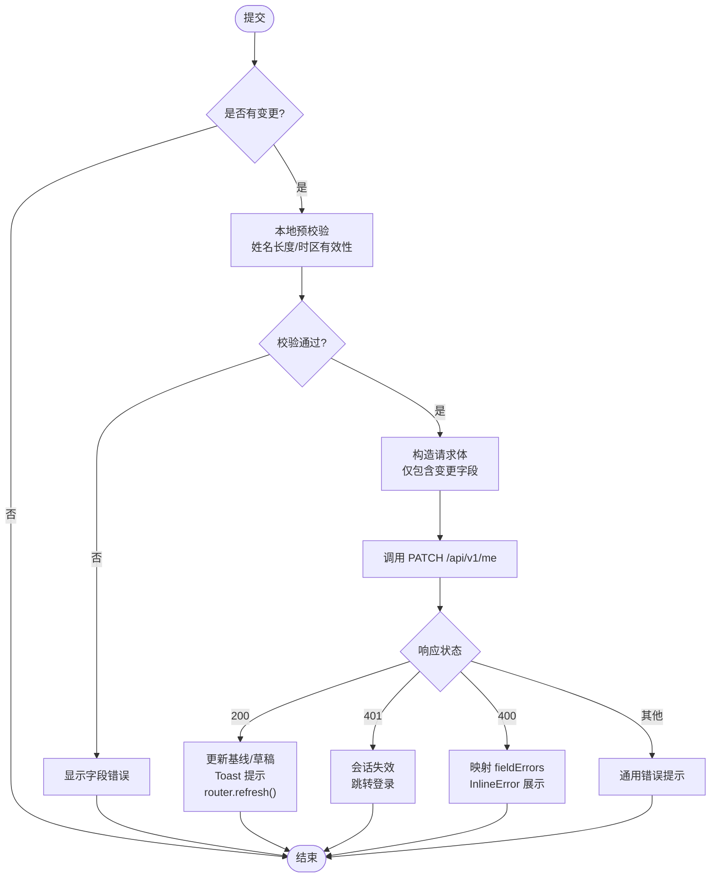
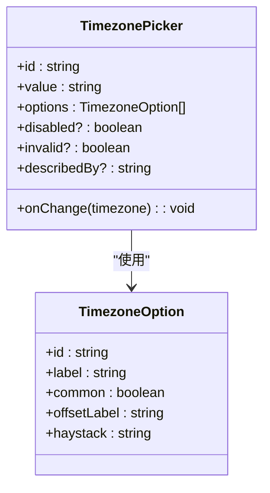
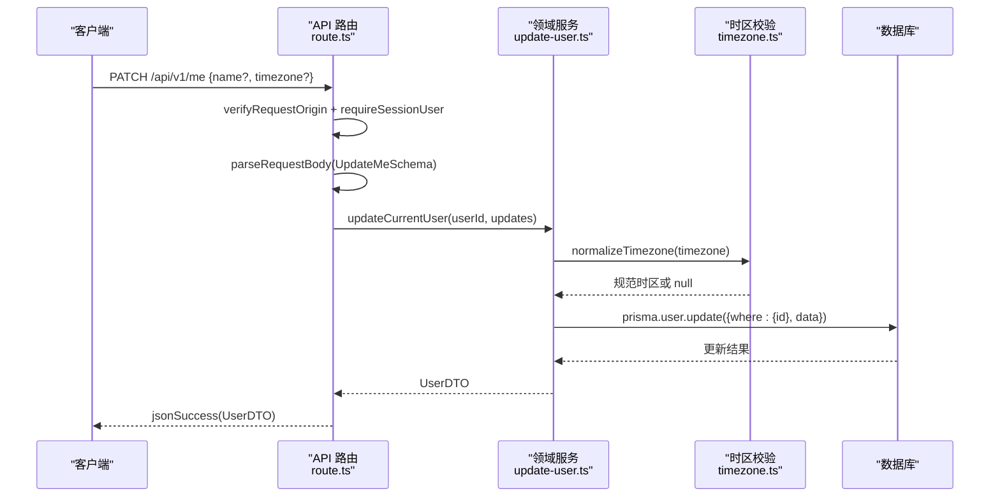
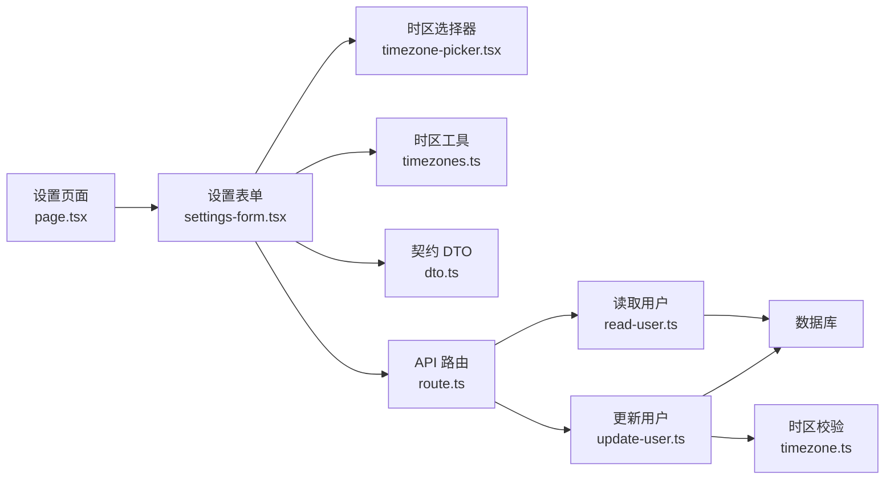

# 设置管理模块

<cite>
**本文引用的文件**
- [src/app/app/settings/page.tsx](file://src/app/app/settings/page.tsx)
- [src/features/settings/settings-form.tsx](file://src/features/settings/settings-form.tsx)
- [src/features/settings/timezone-picker.tsx](file://src/features/settings/timezone-picker.tsx)
- [src/features/settings/timezones.ts](file://src/features/settings/timezones.ts)
- [src/features/settings/zone-preview.tsx](file://src/features/settings/zone-preview.tsx)
- [src/app/api/v1/me/route.ts](file://src/app/api/v1/me/route.ts)
- [src/server/me/read-user.ts](file://src/server/me/read-user.ts)
- [src/server/me/update-user.ts](file://src/server/me/update-user.ts)
- [src/server/me/timezone.ts](file://src/server/me/timezone.ts)
- [src/contracts/dto.ts](file://src/contracts/dto.ts)
</cite>

## 目录
1. [简介](#简介)
2. [项目结构](#项目结构)
3. [核心组件](#核心组件)
4. [架构总览](#架构总览)
5. [详细组件分析](#详细组件分析)
6. [依赖关系分析](#依赖关系分析)
7. [性能考量](#性能考量)
8. [故障排查指南](#故障排查指南)
9. [结论](#结论)
10. [附录：扩展与集成](#附录：扩展与集成)

## 简介
本模块实现用户个人设置的编辑能力，包括姓名与时区修改、时区选择器、实时预览、表单校验与持久化。数据通过统一的 API 层（GET/PATCH /api/v1/me）进行读取与更新，服务端对 IANA 时区进行权威校验并归一化存储。前端采用“草稿-基线”的 dirty 模式，仅提交变更字段，保存成功后刷新页面以同步全局状态。

## 项目结构
- 路由与服务端页面：负责鉴权、读取当前用户档案并渲染设置页。
- 客户端设置表单：提供姓名与时区的编辑、本地预校验、提交与错误展示。
- 时区工具与选择器：构建完整 IANA 列表、过滤、格式化、设备时区检测与键盘可访问的组合框。
- 实时预览：显示所选时区的时钟、日期、GMT 偏移、24 小时刻度进度及与设备时区差异。
- API 路由：GET 返回当前用户，PATCH 更新姓名与时区。
- 领域服务：读取用户、更新用户、时区校验与归一化。
- 契约 DTO：前后端共享的 User/UpdateMe schema 与类型。

图表来源
- [src/app/app/settings/page.tsx:1-65](file://src/app/app/settings/page.tsx#L1-L65)
- [src/features/settings/settings-form.tsx:1-437](file://src/features/settings/settings-form.tsx#L1-L437)
- [src/features/settings/timezone-picker.tsx:1-397](file://src/features/settings/timezone-picker.tsx#L1-L397)
- [src/features/settings/timezones.ts:1-379](file://src/features/settings/timezones.ts#L1-L379)
- [src/features/settings/zone-preview.tsx:1-202](file://src/features/settings/zone-preview.tsx#L1-L202)
- [src/app/api/v1/me/route.ts:1-91](file://src/app/api/v1/me/route.ts#L1-L91)
- [src/server/me/read-user.ts:1-50](file://src/server/me/read-user.ts#L1-L50)
- [src/server/me/update-user.ts:1-103](file://src/server/me/update-user.ts#L1-L103)
- [src/server/me/timezone.ts:1-69](file://src/server/me/timezone.ts#L1-L69)

章节来源
- [src/app/app/settings/page.tsx:1-65](file://src/app/app/settings/page.tsx#L1-L65)
- [src/features/settings/settings-form.tsx:1-437](file://src/features/settings/settings-form.tsx#L1-L437)
- [src/features/settings/timezone-picker.tsx:1-397](file://src/features/settings/timezone-picker.tsx#L1-L397)
- [src/features/settings/timezones.ts:1-379](file://src/features/settings/timezones.ts#L1-L379)
- [src/features/settings/zone-preview.tsx:1-202](file://src/features/settings/zone-preview.tsx#L1-L202)
- [src/app/api/v1/me/route.ts:1-91](file://src/app/api/v1/me/route.ts#L1-L91)
- [src/server/me/read-user.ts:1-50](file://src/server/me/read-user.ts#L1-L50)
- [src/server/me/update-user.ts:1-103](file://src/server/me/update-user.ts#L1-L103)
- [src/server/me/timezone.ts:1-69](file://src/server/me/timezone.ts#L1-L69)
- [src/contracts/dto.ts:65-84](file://src/contracts/dto.ts#L65-L84)

## 核心组件
- 设置页面（服务端组件）：检查会话、直接查库获取最新用户档案，作为初值传入客户端表单；强制动态渲染避免缓存私有数据。
- 设置表单（客户端组件）：维护草稿与已保存基线，计算 dirty 态；本地预校验（姓名长度、IANA 时区）；仅提交变更字段；成功更新后刷新页面。
- 时区选择器：基于 WAI-ARIA 的可搜索组合框，支持键盘导航、高亮滚动、设备时区快捷选择、输入过滤与最大渲染项限制。
- 时区工具：运行时获取 IANA 列表、常用时区分组、GMT 偏移与时间格式化、设备时区检测、差值文案等。
- 实时预览：秒级时钟驱动，展示当地时钟、日期、GMT 偏移、24 小时刻度进度与设备时区差异。
- API 路由：GET /me 返回当前用户；PATCH /me 校验请求体、调用领域服务更新并返回新数据。
- 领域服务：读取用户（直连数据库）、更新用户（白名单写入、时区归一化）、时区校验（拒绝裸偏移、大小写归一）。
- 契约 DTO：User/UpdateMe schema 定义字段约束与类型，前后端共享。

章节来源
- [src/app/app/settings/page.tsx:1-65](file://src/app/app/settings/page.tsx#L1-L65)
- [src/features/settings/settings-form.tsx:1-437](file://src/features/settings/settings-form.tsx#L1-L437)
- [src/features/settings/timezone-picker.tsx:1-397](file://src/features/settings/timezone-picker.tsx#L1-L397)
- [src/features/settings/timezones.ts:1-379](file://src/features/settings/timezones.ts#L1-L379)
- [src/features/settings/zone-preview.tsx:1-202](file://src/features/settings/zone-preview.tsx#L1-L202)
- [src/app/api/v1/me/route.ts:1-91](file://src/app/api/v1/me/route.ts#L1-L91)
- [src/server/me/read-user.ts:1-50](file://src/server/me/read-user.ts#L1-L50)
- [src/server/me/update-user.ts:1-103](file://src/server/me/update-user.ts#L1-L103)
- [src/server/me/timezone.ts:1-69](file://src/server/me/timezone.ts#L1-L69)
- [src/contracts/dto.ts:65-84](file://src/contracts/dto.ts#L65-L84)

## 架构总览
设置模块遵循“服务端权威数据 + 客户端交互优化”的分层设计：
- 服务端页面负责鉴权与权威数据读取，确保首屏即有真实数据。
- 客户端表单负责交互、预校验与增量提交，减少无效网络请求。
- API 路由统一处理请求生命周期（Origin、会话、Schema 校验、领域服务、信封响应）。
- 领域服务封装业务规则（白名单写入、时区归一化、并发安全）。
- 契约层保证前后端数据结构一致，便于复用校验与类型。

图表来源
- [src/app/app/settings/page.tsx:1-65](file://src/app/app/settings/page.tsx#L1-L65)
- [src/features/settings/settings-form.tsx:1-437](file://src/features/settings/settings-form.tsx#L1-L437)
- [src/app/api/v1/me/route.ts:1-91](file://src/app/api/v1/me/route.ts#L1-L91)
- [src/server/me/read-user.ts:1-50](file://src/server/me/read-user.ts#L1-L50)
- [src/server/me/update-user.ts:1-103](file://src/server/me/update-user.ts#L1-L103)
- [src/server/me/timezone.ts:1-69](file://src/server/me/timezone.ts#L1-L69)

## 详细组件分析

### 设置页面（服务端）
- 职责：鉴权、读取权威用户数据、渲染设置页。
- 关键点：
  - 未认证重定向到登录页并携带 returnTo。
  - 直接查库获取最新用户，避免会话快照导致的数据延迟。
  - 声明 force-dynamic，防止缓存私有数据。
  - 将 UserDTO 作为初值传给客户端表单。

章节来源
- [src/app/app/settings/page.tsx:1-65](file://src/app/app/settings/page.tsx#L1-L65)
- [src/server/me/read-user.ts:1-50](file://src/server/me/read-user.ts#L1-L50)

### 设置表单（客户端）
- 职责：编辑姓名与时区、本地预校验、提交变更、错误处理、保存反馈。
- 关键点：
  - 使用草稿与基线对比判断 dirty，禁用无意义保存。
  - 仅提交变更字段（PATCH 语义），满足契约 minProperties:1。
  - 本地预校验：姓名长度、IANA 时区有效性。
  - 成功：更新基线与草稿、Toast 提示、router.refresh() 同步全局。
  - 错误：401 会话失效跳转登录；400 字段错误映射到 InlineError；其他错误通用提示。
  - 无障碍：aria-invalid、aria-describedby、aria-live 等。

图表来源
- [src/features/settings/settings-form.tsx:1-437](file://src/features/settings/settings-form.tsx#L1-L437)
- [src/contracts/dto.ts:65-84](file://src/contracts/dto.ts#L65-L84)

章节来源
- [src/features/settings/settings-form.tsx:1-437](file://src/features/settings/settings-form.tsx#L1-L437)
- [src/contracts/dto.ts:65-84](file://src/contracts/dto.ts#L65-L84)

### 时区选择器
- 职责：提供可搜索、键盘可操作的时区选择控件。
- 关键点：
  - 基于 WAI-ARIA 的 combobox/listbox 模式，保持焦点在输入框，使用 aria-activedescendant 高亮选项。
  - 输入过滤：匹配中文标签与 IANA 标识，限制最大渲染项数提升性能。
  - 键盘导航：上下移动、Home/End、Enter 选中、Esc 关闭、Tab 关闭。
  - 设备时区快捷操作：一键设置为浏览器时区。
  - 外部点击关闭：pointerdown 事件阻止默认行为避免 blur 竞态。

图表来源
- [src/features/settings/timezone-picker.tsx:1-397](file://src/features/settings/timezone-picker.tsx#L1-L397)
- [src/features/settings/timezones.ts:111-123](file://src/features/settings/timezones.ts#L111-L123)

章节来源
- [src/features/settings/timezone-picker.tsx:1-397](file://src/features/settings/timezone-picker.tsx#L1-L397)
- [src/features/settings/timezones.ts:111-123](file://src/features/settings/timezones.ts#L111-L123)

### 时区工具
- 职责：构建 IANA 列表、常用时区分组、格式化与校验、设备时区检测、差值文案。
- 关键点：
  - 运行时获取 supported time zones，兼容老环境降级为常用表。
  - 常用时区优先排序并提供中文短标签。
  - 格式化器缓存避免重复创建 Intl.DateTimeFormat。
  - isKnownTimezone 用于客户端预校验；normalizeTimezone 在服务端进行权威校验与归一化。
  - zoneOffsetMinutes、describeZoneDifference 用于计算偏移与差异文案。
  - deviceTimezone 获取浏览器时区，不可识别回退 Asia/Shanghai。

章节来源
- [src/features/settings/timezones.ts:1-379](file://src/features/settings/timezones.ts#L1-L379)
- [src/server/me/timezone.ts:1-69](file://src/server/me/timezone.ts#L1-L69)

### 实时预览
- 职责：展示所选时区的时钟、日期、GMT 偏移、24 小时刻度进度与设备时区差异。
- 关键点：
  - 模块级外部时钟存储（useSyncExternalStore），订阅数为 0 自动停表，避免泄漏。
  - 水合安全：服务端快照为 0，避免 hydration mismatch。
  - role="timer" 隐式 aria-live=off，逐秒更新不打扰读屏软件。
  - 24 小时刻度尺按小时着色，游标随进度平滑移动。

章节来源
- [src/features/settings/zone-preview.tsx:1-202](file://src/features/settings/zone-preview.tsx#L1-L202)
- [src/features/settings/timezones.ts:180-235](file://src/features/settings/timezones.ts#L180-L235)

### API 接口（/api/v1/me）
- GET /me：返回当前用户档案（直连数据库，确保最新）。
- PATCH /me：更新姓名与时区（白名单写入、时区归一化、字段级错误）。
- 请求生命周期：请求 ID → Origin（写操作）→ 会话 → Schema 校验 → 领域服务 → 统一信封。
- 缓存策略：所有响应带 private/no-store，禁止缓存私有数据。

图表来源
- [src/app/api/v1/me/route.ts:1-91](file://src/app/api/v1/me/route.ts#L1-L91)
- [src/server/me/update-user.ts:1-103](file://src/server/me/update-user.ts#L1-L103)
- [src/server/me/timezone.ts:1-69](file://src/server/me/timezone.ts#L1-L69)

章节来源
- [src/app/api/v1/me/route.ts:1-91](file://src/app/api/v1/me/route.ts#L1-L91)
- [src/server/me/update-user.ts:1-103](file://src/server/me/update-user.ts#L1-L103)
- [src/server/me/timezone.ts:1-69](file://src/server/me/timezone.ts#L1-L69)
- [src/contracts/dto.ts:65-84](file://src/contracts/dto.ts#L65-L84)

### 数据模型与验证规则
- UserDTO：包含 id、name、email、emailVerified、timezone。
- UpdateMeDTO：name（1—40）、timezone（1—100），至少提供一个字段。
- 服务端时区校验：拒绝裸偏移、大小写归一、保留合法 IANA 标识。
- 字段级错误：fieldErrors.name、fieldErrors.timezone 映射到 UI。

章节来源
- [src/contracts/dto.ts:65-84](file://src/contracts/dto.ts#L65-L84)
- [src/server/me/timezone.ts:1-69](file://src/server/me/timezone.ts#L1-L69)
- [src/server/me/update-user.ts:44-82](file://src/server/me/update-user.ts#L44-L82)

## 依赖关系分析
- 页面依赖表单组件与服务器读取服务。
- 表单依赖时区选择器、时区工具、契约 DTO 与 API 客户端。
- API 路由依赖会话、Schema 校验、领域服务与 HTTP 辅助。
- 领域服务依赖数据库与时区校验。
- 契约层被前后端共同引用，保证一致性。

图表来源
- [src/app/app/settings/page.tsx:1-65](file://src/app/app/settings/page.tsx#L1-L65)
- [src/features/settings/settings-form.tsx:1-437](file://src/features/settings/settings-form.tsx#L1-L437)
- [src/features/settings/timezone-picker.tsx:1-397](file://src/features/settings/timezone-picker.tsx#L1-L397)
- [src/features/settings/timezones.ts:1-379](file://src/features/settings/timezones.ts#L1-L379)
- [src/app/api/v1/me/route.ts:1-91](file://src/app/api/v1/me/route.ts#L1-L91)
- [src/server/me/read-user.ts:1-50](file://src/server/me/read-user.ts#L1-L50)
- [src/server/me/update-user.ts:1-103](file://src/server/me/update-user.ts#L1-L103)
- [src/server/me/timezone.ts:1-69](file://src/server/me/timezone.ts#L1-L69)
- [src/contracts/dto.ts:65-84](file://src/contracts/dto.ts#L65-L84)

章节来源
- [src/app/app/settings/page.tsx:1-65](file://src/app/app/settings/page.tsx#L1-L65)
- [src/features/settings/settings-form.tsx:1-437](file://src/features/settings/settings-form.tsx#L1-L437)
- [src/app/api/v1/me/route.ts:1-91](file://src/app/api/v1/me/route.ts#L1-L91)
- [src/server/me/read-user.ts:1-50](file://src/server/me/read-user.ts#L1-L50)
- [src/server/me/update-user.ts:1-103](file://src/server/me/update-user.ts#L1-L103)
- [src/server/me/timezone.ts:1-69](file://src/server/me/timezone.ts#L1-L69)
- [src/contracts/dto.ts:65-84](file://src/contracts/dto.ts#L65-L84)

## 性能考量
- 时区选项构建：一次性计算 400+ 项的 GMT 偏移与格式化，使用 useMemo 缓存。
- 格式化器缓存：Intl.DateTimeFormat 实例按 key 缓存，避免重复构造开销。
- 列表渲染限制：过滤后最多渲染固定数量选项，提升交互流畅度。
- 外部时钟存储：模块级定时器仅在存在订阅时运行，订阅数为 0 自动清理。
- 最小化网络请求：仅提交变更字段，避免无意义写库与限流消耗。

[本节为通用性能建议，不直接分析具体文件]

## 故障排查指南
- 会话失效（401）：表单检测到 401 时提示会话失效并跳转登录页。
- 字段校验失败（400）：fieldErrors 映射到对应字段的 InlineError，提示用户修正。
- 传输或信封异常：捕获 ApiClientError 或未知错误，给出通用重试提示。
- 时区无效：客户端预校验与服务端权威校验双重保障，非法时区无法入库。
- 并发删除：领域服务将数据库记录不存在错误收敛为 NOT_FOUND，引导重新登录。

章节来源
- [src/features/settings/settings-form.tsx:122-158](file://src/features/settings/settings-form.tsx#L122-L158)
- [src/app/api/v1/me/route.ts:56-90](file://src/app/api/v1/me/route.ts#L56-L90)
- [src/server/me/update-user.ts:90-103](file://src/server/me/update-user.ts#L90-L103)

## 结论
设置管理模块通过清晰的分层与严格的契约校验，实现了安全的个人信息编辑能力。前端注重用户体验（dirty 模式、实时预览、键盘可访问），后端确保数据一致性与安全性（权威校验、白名单写入、私有数据不缓存）。该设计易于扩展与维护，并为后续功能（如语言、主题）提供了清晰的接入点。

[本节为总结性内容，不直接分析具体文件]

## 附录：扩展与集成
- 新增设置项：
  - 在 UpdateMeDTO 中添加可选字段，并在表单中增加对应控件与本地预校验。
  - 在领域服务 buildUserUpdateData 中处理新字段（校验、归一化、白名单写入）。
  - 在 API 路由中复用现有流程（Origin、会话、Schema、领域服务）。
- 第三方服务集成：
  - 如需引入外部时区服务或偏好同步，可在领域服务层抽象接口，保持路由与表单不变。
  - 注意幂等与冲突解决：使用 expectedVersion 或乐观锁机制避免覆盖。
- 国际化与本地化：
  - 当前界面文案为中文，可通过 i18n 框架替换字符串，不影响逻辑。
  - 时区显示与格式化已使用 Intl，适配多语言环境。
- 主题切换：
  - 可在应用层注入主题上下文，设置页无需改动；若需保存主题偏好，参照姓名/时区流程扩展。

[本节为概念性指导，不直接分析具体文件]