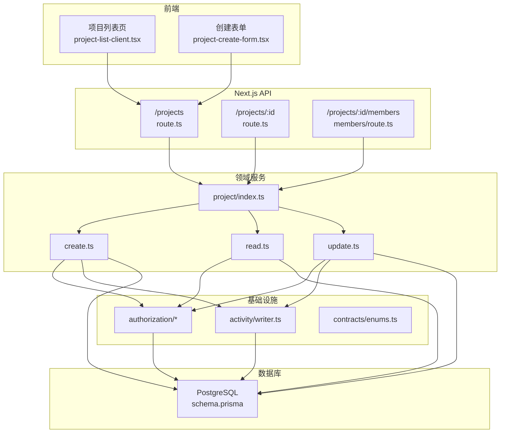
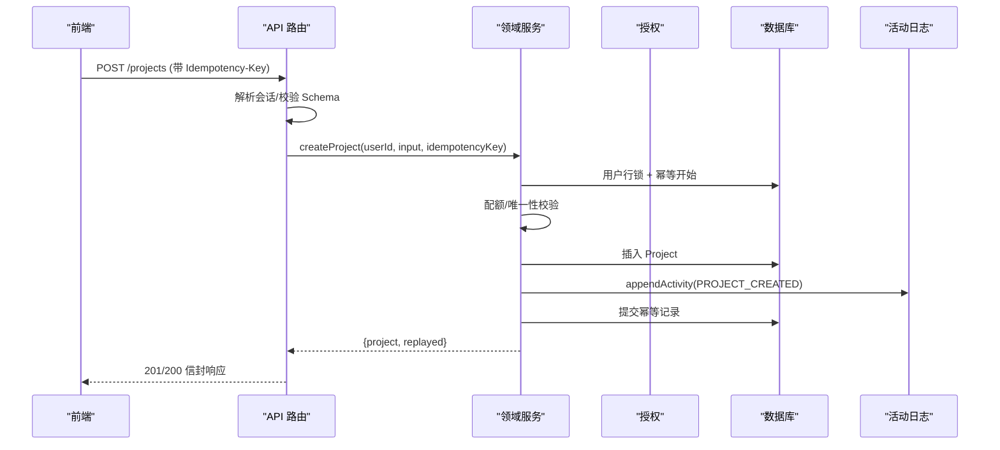
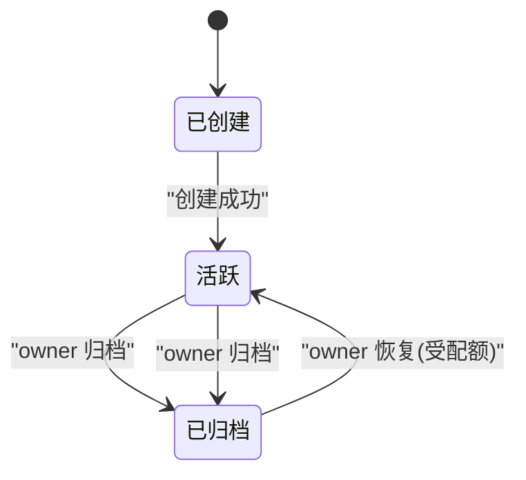
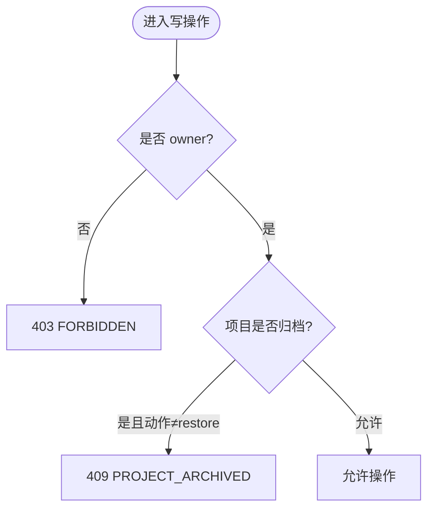
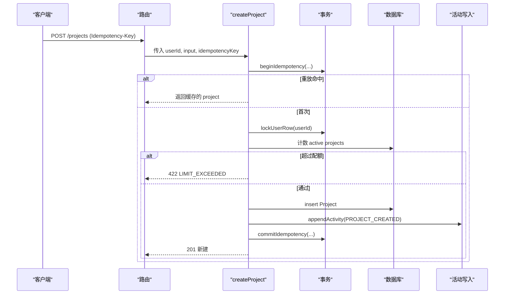
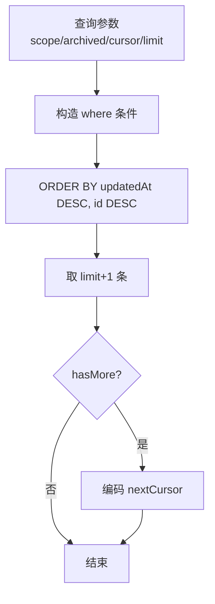
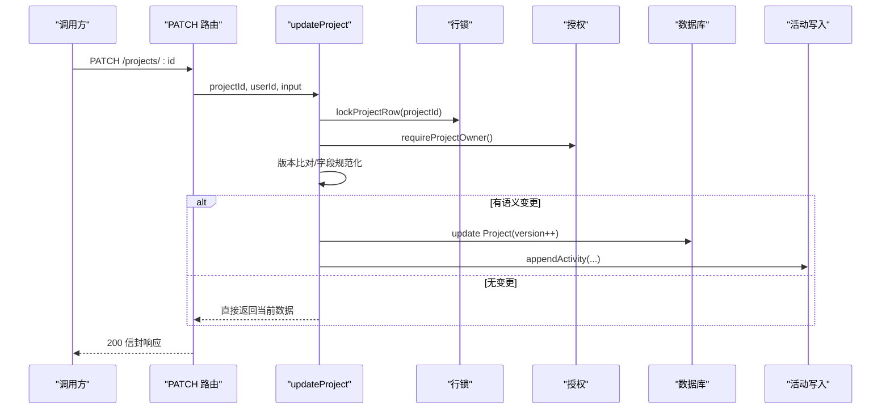
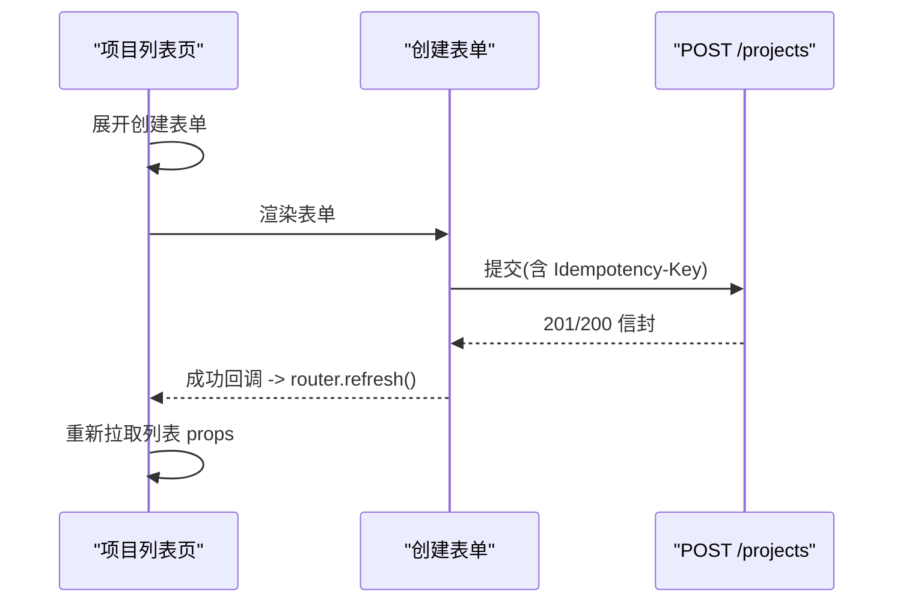
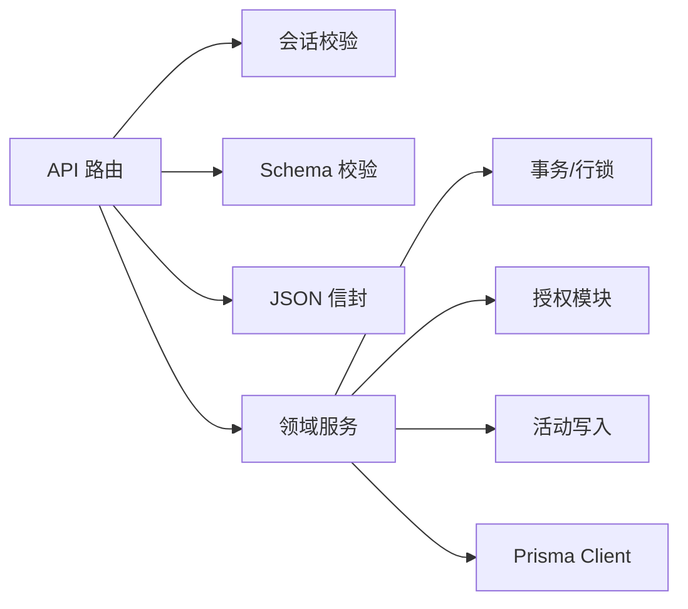

# 项目管理模块

<cite>
**本文引用的文件**
- [schema.prisma](file://prisma/schema.prisma)
- [project/index.ts](file://src/server/modules/project/index.ts)
- [project/create.ts](file://src/server/modules/project/create.ts)
- [project/read.ts](file://src/server/modules/project/read.ts)
- [project/update.ts](file://src/server/modules/project/update.ts)
- [authorization/decide.ts](file://src/server/modules/authorization/decide.ts)
- [authorization/project-access.ts](file://src/server/modules/authorization/project-access.ts)
- [activity/writer.ts](file://src/server/modules/activity/writer.ts)
- [contracts/enums.ts](file://src/contracts/enums.ts)
- [api/projects/route.ts](file://src/app/api/v1/projects/route.ts)
- [api/projects/[projectId]/route.ts](file://src/app/api/v1/projects/[projectId]/route.ts)
- [api/projects/[projectId]/members/route.ts](file://src/app/api/v1/projects/[projectId]/members/route.ts)
- [features/projects/project-list-client.tsx](file://src/features/projects/project-list-client.tsx)
- [features/projects/project-create-form.tsx](file://src/features/projects/project-create-form.tsx)
</cite>

## 目录
1. [简介](#简介)
2. [项目结构](#项目结构)
3. [核心组件](#核心组件)
4. [架构总览](#架构总览)
5. [详细组件分析](#详细组件分析)
6. [依赖关系分析](#依赖关系分析)
7. [性能考量](#性能考量)
8. [故障排查指南](#故障排查指南)
9. [结论](#结论)
10. [附录：API 与最佳实践](#附录api-与最佳实践)

## 简介
本模块提供项目的创建、编辑、删除（归档/恢复）与成员管理功能，覆盖数据模型、权限控制、生命周期管理与活动日志。前端包含项目列表页、项目创建表单与项目详情入口；后端通过 Next.js API Routes 暴露 RESTful 接口，领域服务负责事务、授权、幂等与审计。

## 项目结构
- 数据模型：Prisma schema 定义 Project、ProjectMember、ActivityLog 等实体及枚举。
- 领域服务：按 create/read/update 拆分，统一从 index 导出；授权与活动写入为共享基础设施。
- API 路由：/api/v1/projects 与 /api/v1/projects/[projectId] 及其 members 子资源。
- 前端特性：项目列表客户端与创建表单，使用契约层客户端调用 API。

**图表来源**
- [api/projects/route.ts:1-93](file://src/app/api/v1/projects/route.ts#L1-L93)
- [api/projects/[projectId]/route.ts:1-80](file://src/app/api/v1/projects/[projectId]/route.ts#L1-L80)
- [api/projects/[projectId]/members/route.ts:1-38](file://src/app/api/v1/projects/[projectId]/members/route.ts#L1-L38)
- [project/index.ts:1-24](file://src/server/modules/project/index.ts#L1-L24)
- [project/create.ts:1-181](file://src/server/modules/project/create.ts#L1-L181)
- [project/read.ts:1-192](file://src/server/modules/project/read.ts#L1-L192)
- [project/update.ts:1-204](file://src/server/modules/project/update.ts#L1-L204)
- [authorization/project-access.ts:1-121](file://src/server/modules/authorization/project-access.ts#L1-L121)
- [activity/writer.ts:1-65](file://src/server/modules/activity/writer.ts#L1-L65)
- [schema.prisma:144-195](file://prisma/schema.prisma#L144-L195)

**章节来源**
- [schema.prisma:144-195](file://prisma/schema.prisma#L144-L195)
- [project/index.ts:1-24](file://src/server/modules/project/index.ts#L1-L24)

## 核心组件
- 数据模型：Project、ProjectMember、ActivityLog 以及任务域相关表（Task）。
- 领域服务：
  - createProject：创建项目，含配额校验、唯一性校验、幂等重放、活动记录。
  - listProjects/getProject/listMembers：读取项目列表、单个项目、成员列表。
  - updateProject：更新资料、归档/恢复，含乐观并发、白名单字段变更、活动记录。
- 授权：基于角色（OWNER/MEMBER）与项目归档状态判定读写权限。
- 活动日志：在业务事务内追加不可变事件，metadata 经白名单过滤。
- API 路由：封装请求生命周期（请求 ID、Origin、会话、Schema 校验、领域服务、信封响应）。

**章节来源**
- [project/create.ts:18-181](file://src/server/modules/project/create.ts#L18-L181)
- [project/read.ts:20-192](file://src/server/modules/project/read.ts#L20-L192)
- [project/update.ts:23-204](file://src/server/modules/project/update.ts#L23-L204)
- [authorization/decide.ts:1-67](file://src/server/modules/authorization/decide.ts#L1-L67)
- [authorization/project-access.ts:12-121](file://src/server/modules/authorization/project-access.ts#L12-L121)
- [activity/writer.ts:5-65](file://src/server/modules/activity/writer.ts#L5-L65)

## 架构总览
项目采用“路由层编排 + 领域服务实现 + 基础设施复用”的分层架构。路由层仅做 HTTP 编排与输入校验；领域服务处理业务不变量（配额、唯一性、版本、归档态）；授权与活动写入作为跨领域能力被复用。

**图表来源**
- [api/projects/route.ts:56-93](file://src/app/api/v1/projects/route.ts#L56-L93)
- [project/create.ts:71-181](file://src/server/modules/project/create.ts#L71-L181)
- [activity/writer.ts:49-65](file://src/server/modules/activity/writer.ts#L49-L65)

## 详细组件分析

### 数据模型与生命周期
- Project：拥有者、名称、唯一 key、描述、颜色、归档时间、版本号、看板版本、任务编号计数器、字节占用等。
- ProjectMember：项目与成员的多对多关系（实际为单向关联），保证同一用户对同一项目唯一。
- ActivityLog：项目维度的操作日志，记录实体类型、动作、元数据与时间。
- 生命周期：创建 → 活跃 → 归档（只读）→ 恢复（受配额限制）→ 再次活跃。

**图表来源**
- [schema.prisma:144-195](file://prisma/schema.prisma#L144-L195)
- [project/update.ts:145-158](file://src/server/modules/project/update.ts#L145-L158)

**章节来源**
- [schema.prisma:144-195](file://prisma/schema.prisma#L144-L195)

### 权限控制机制
- 读访问：非成员与不存在统一返回 NOT_FOUND，不泄露存在性。
- 写访问：仅 owner 可执行 update/archive/restore；归档项目除 restore 外全部禁止。
- 角色计算：根据是否 owner 或 member 计算 OWNER/MEMBER，不持久化。

**图表来源**
- [authorization/decide.ts:40-67](file://src/server/modules/authorization/decide.ts#L40-L67)
- [authorization/project-access.ts:91-121](file://src/server/modules/authorization/project-access.ts#L91-L121)

**章节来源**
- [authorization/decide.ts:1-67](file://src/server/modules/authorization/decide.ts#L1-L67)
- [authorization/project-access.ts:12-121](file://src/server/modules/authorization/project-access.ts#L12-L121)

### 项目创建流程（含幂等与配额）
- 幂等：以 routeKey + 请求体哈希 + Idempotency-Key 去重，重放时重新授权并返回原结果。
- 配额：每个用户未归档项目数上限（默认 10），超限返回 LIMIT_EXCEEDED。
- 唯一性：key 全局唯一，冲突返回 PROJECT_KEY_TAKEN。
- 活动：创建成功后写入 PROJECT_CREATED 日志。

**图表来源**
- [project/create.ts:71-181](file://src/server/modules/project/create.ts#L71-L181)
- [activity/writer.ts:49-65](file://src/server/modules/activity/writer.ts#L49-L65)

**章节来源**
- [project/create.ts:18-181](file://src/server/modules/project/create.ts#L18-L181)

### 项目读取与分页
- 列表：支持 scope（all/owned/joined）、archived（exclude/only）过滤，keyset 游标分页（updatedAt,id）。
- 单项目：成员可见，非成员/不存在 404。
- 成员列表：owner 排首位，其后按 joinedAt 升序，不包含 email。

**图表来源**
- [project/read.ts:65-135](file://src/server/modules/project/read.ts#L65-L135)

**章节来源**
- [project/read.ts:20-192](file://src/server/modules/project/read.ts#L20-L192)

### 项目更新、归档与恢复
- 乐观并发：expectedVersion 不符返回 VERSION_CONFLICT，附带 currentVersion。
- 白名单字段：name/description/color 变更才计入语义变化；无变化不 bump version、不写活动。
- 归档/恢复：归档后只读；恢复需满足配额限制。
- 活动：PROJECT_UPDATED/PROJECT_ARCHIVED/PROJECT_RESTORED。

**图表来源**
- [project/update.ts:73-204](file://src/server/modules/project/update.ts#L73-L204)
- [authorization/project-access.ts:91-121](file://src/server/modules/authorization/project-access.ts#L91-L121)

**章节来源**
- [project/update.ts:23-204](file://src/server/modules/project/update.ts#L23-L204)

### 项目成员邀请与角色权限
- 成员可见性：listMembers 仅成员/owner 可访问，非成员 404。
- 角色：OWNER（项目所有者）与 MEMBER（成员），由服务端计算，不入库。
- 邀请：当前仓库未实现邀请接口；可在现有成员管理基础上扩展邀请流程（鉴权、幂等、活动日志）。

**章节来源**
- [project/read.ts:152-192](file://src/server/modules/project/read.ts#L152-L192)
- [contracts/enums.ts:22-32](file://src/contracts/enums.ts#L22-L32)

### 项目活动日志
- 原则：只追加、不可变；必须在业务事务内写入，确保原子性。
- 安全：metadata 白名单过滤，避免敏感信息入库。
- 事件：PROJECT_CREATED/UPDATED/ARCHIVED/RESTORED 等。

**章节来源**
- [activity/writer.ts:5-65](file://src/server/modules/activity/writer.ts#L5-L65)

### 前端界面实现
- 项目列表页：首屏由 Server Component 渲染，客户端“加载更多”使用游标分页；空态引导创建第一个项目。
- 创建表单：客户端预校验 + 服务端权威校验；幂等键策略：内容变更换新键，传输歧义失败保留原键重试。
- 项目详情：通过卡片跳转到项目任务列表页面（/app/projects/:id/tasks）。

**图表来源**
- [features/projects/project-list-client.tsx:22-37](file://src/features/projects/project-list-client.tsx#L22-L37)
- [features/projects/project-create-form.tsx:28-51](file://src/features/projects/project-create-form.tsx#L28-L51)
- [api/projects/route.ts:56-93](file://src/app/api/v1/projects/route.ts#L56-L93)

**章节来源**
- [features/projects/project-list-client.tsx:22-286](file://src/features/projects/project-list-client.tsx#L22-L286)
- [features/projects/project-create-form.tsx:28-355](file://src/features/projects/project-create-form.tsx#L28-L355)

## 依赖关系分析
- 路由层依赖：会话校验、请求 Origin、Schema 校验、JSON 信封工具。
- 领域服务依赖：数据库事务、授权模块、活动写入、限流/配额常量。
- 数据模型依赖：Prisma 生成的客户端类型与约束。

**图表来源**
- [api/projects/route.ts:1-93](file://src/app/api/v1/projects/route.ts#L1-L93)
- [api/projects/[projectId]/route.ts:1-80](file://src/app/api/v1/projects/[projectId]/route.ts#L1-L80)
- [project/create.ts:1-181](file://src/server/modules/project/create.ts#L1-L181)
- [project/update.ts:1-204](file://src/server/modules/project/update.ts#L1-L204)

**章节来源**
- [api/projects/route.ts:1-93](file://src/app/api/v1/projects/route.ts#L1-L93)
- [project/index.ts:1-24](file://src/server/modules/project/index.ts#L1-L24)

## 性能考量
- 游标分页：使用 keyset 分页（updatedAt,id），避免深度翻页开销。
- 行级锁：写操作串行化，避免并发竞争导致的数据不一致。
- 最小化 IO：列表查询按需 include 计数，减少不必要 JOIN。
- 幂等：避免重复创建与重复活动记录，降低数据库压力。
- 索引：利用 schema 中定义的复合索引提升查询效率。

[本节为通用指导，无需特定文件引用]

## 故障排查指南
- 404 NOT_FOUND：项目不存在或非成员；检查 projectId 格式与成员关系。
- 403 FORBIDDEN：成员尝试 owner-only 操作；确认角色与动作。
- 409 PROJECT_ARCHIVED：归档项目写操作；仅 owner 可 restore。
- 409 VERSION_CONFLICT：乐观并发冲突；提示用户刷新并重试。
- 409 PROJECT_KEY_TAKEN：key 冲突；更换项目标识。
- 422 LIMIT_EXCEEDED：活跃项目数超限；归档部分项目后再恢复。
- 400 VALIDATION_ERROR：字段校验失败；检查 name/key/description 长度与格式。

**章节来源**
- [authorization/project-access.ts:28-41](file://src/server/modules/authorization/project-access.ts#L28-L41)
- [project/create.ts:45-56](file://src/server/modules/project/create.ts#L45-L56)
- [project/update.ts:109-113](file://src/server/modules/project/update.ts#L109-L113)

## 结论
本项目管理模块通过清晰的分层与严格的不变量保障，实现了健壮的项目 CRUD、成员管理与活动审计。幂等、配额、乐观并发与归档态控制共同保证了数据一致性与用户体验。建议后续扩展邀请流程与更丰富的成员角色，同时持续优化查询与日志归档策略。

[本节为总结，无需特定文件引用]

## 附录：API 与最佳实践

### API 接口概览
- GET /api/v1/projects
  - 作用：列出当前用户拥有或参与的项目（支持 scope、archived、cursor、limit）。
  - 成功：200 信封，data 为项目数组，meta 包含 nextCursor、hasMore。
  - 错误：400 无效参数；401 未登录；其他错误统一信封。
- POST /api/v1/projects
  - 作用：创建项目（需要 Idempotency-Key）。
  - 成功：201 新建；200 幂等重放。
  - 错误：400 校验失败；409 key 冲突；422 配额超限；401 未登录。
- GET /api/v1/projects/:projectId
  - 作用：读取单个项目（成员可见）。
  - 成功：200 信封。
  - 错误：404 非成员/不存在；401 未登录。
- PATCH /api/v1/projects/:projectId
  - 作用：更新项目资料/归档/恢复（owner-only）。
  - 成功：200 信封。
  - 错误：403 非 owner；404 非成员/不存在；409 归档只读/版本冲突；400 校验失败。
- GET /api/v1/projects/:projectId/members
  - 作用：列出项目成员（不含 email，owner 首位）。
  - 成功：200 信封。
  - 错误：404 非成员/不存在；401 未登录。

**章节来源**
- [api/projects/route.ts:21-93](file://src/app/api/v1/projects/route.ts#L21-L93)
- [api/projects/[projectId]/route.ts:13-80](file://src/app/api/v1/projects/[projectId]/route.ts#L13-L80)
- [api/projects/[projectId]/members/route.ts:7-38](file://src/app/api/v1/projects/[projectId]/members/route.ts#L7-L38)

### 数据验证与业务规则
- 名称：1–80 字符；描述：≤2000 字符；颜色：限定枚举；key：2–8 位大写字母数字，首字母为字母。
- 配额：每用户未归档项目数上限（默认 10）。
- 唯一性：key 全局唯一。
- 并发：expectedVersion 必须匹配；否则返回冲突。
- 归档：归档后只读；恢复受配额限制。
- 活动：所有关键变更写入活动日志，metadata 白名单过滤。

**章节来源**
- [project/create.ts:102-124](file://src/server/modules/project/create.ts#L102-L124)
- [project/update.ts:118-158](file://src/server/modules/project/update.ts#L118-L158)
- [activity/writer.ts:16-47](file://src/server/modules/activity/writer.ts#L16-L47)

### 最佳实践
- 始终携带 Idempotency-Key 进行写操作，避免重复提交。
- 前端展示错误时映射到字段级 InlineError，并保留用户输入以便修正。
- 列表分页使用游标，避免 deep pagination。
- 写操作前进行轻量客户端校验，但服务端仍为权威。
- 对敏感字段（如 email）不在成员列表中返回。

[本节为通用指导，无需特定文件引用]