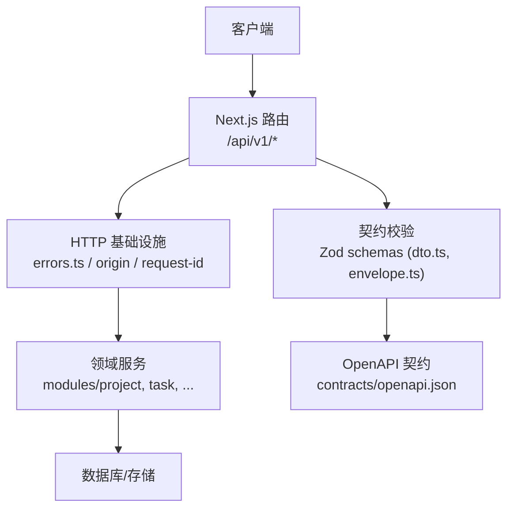
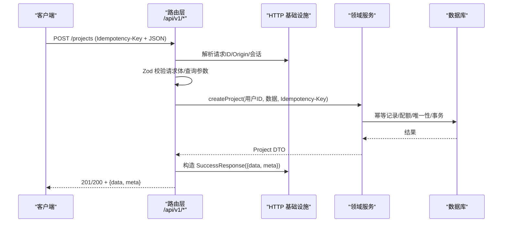
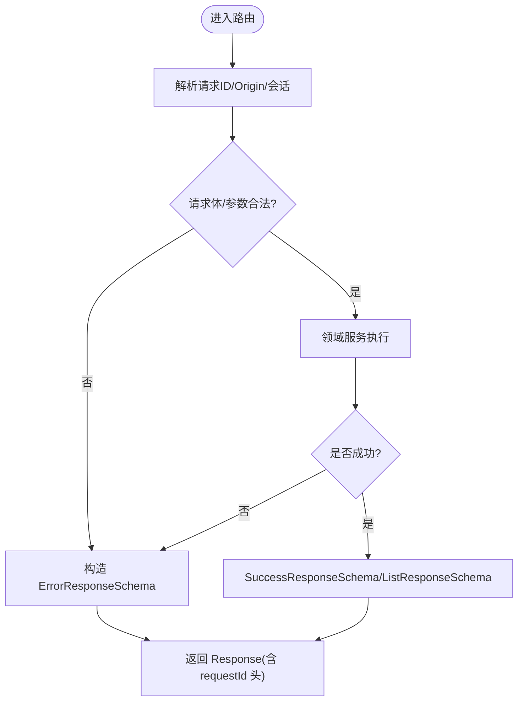
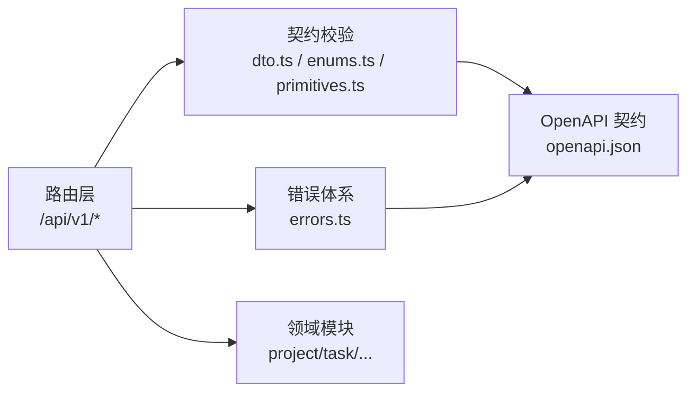

# API 规范

<cite>
**本文引用的文件**
- [contracts/openapi.json](file://contracts/openapi.json)
- [docs/05-API-CONTRACT.md](file://docs/05-API-CONTRACT.md)
- [src/contracts/dto.ts](file://src/contracts/dto.ts)
- [src/contracts/envelope.ts](file://src/contracts/envelope.ts)
- [src/contracts/primitives.ts](file://src/contracts/primitives.ts)
- [src/contracts/enums.ts](file://src/contracts/enums.ts)
- [src/server/http/errors.ts](file://src/server/http/errors.ts)
- [src/app/api/v1/me/route.ts](file://src/app/api/v1/me/route.ts)
- [src/app/api/v1/projects/route.ts](file://src/app/api/v1/projects/route.ts)
- [src/app/api/v1/tasks/[taskId]/route.ts](file://src/app/api/v1/tasks/[taskId]/route.ts)
- [tests/contract/openapi.test.ts](file://tests/contract/openapi.test.ts)
- [tests/contract/openapi-consistency.test.ts](file://tests/contract/openapi-consistency.test.ts)
- [tests/contract/envelope.test.ts](file://tests/contract/envelope.test.ts)
- [tests/contract/dto.test.ts](file://tests/contract/dto.test.ts)
- [tests/contract/client.test.ts](file://tests/contract/client.test.ts)
</cite>

## 目录
1. [简介](#简介)
2. [项目结构](#项目结构)
3. [核心组件](#核心组件)
4. [架构总览](#架构总览)
5. [详细组件分析](#详细组件分析)
6. [依赖关系分析](#依赖关系分析)
7. [性能与基准](#性能与基准)
8. [故障排查指南](#故障排查指南)
9. [结论](#结论)
10. [附录：API 调用示例与集成指南](#附录api-调用示例与集成指南)

## 简介
本规范文档面向 Orbit V1 业务 API，围绕 OpenAPI 契约、DTO 数据契约、统一响应信封、错误码体系、版本管理策略、请求验证机制、文档与 SDK 生成、测试自动化以及性能基准方法展开。目标是让前后端在“契约即代码”的前提下保持一致，确保向后兼容、可演进且可测试。

## 项目结构
- 契约层（contracts）：OpenAPI 3.1 定义位于 contracts/openapi.json，作为机器可读的权威协议；运行时校验使用 src/contracts 下的 Zod schemas（dto.ts、envelope.ts、primitives.ts、enums.ts）。
- 路由层（src/app/api/v1）：Next.js App Router 实现 /api/v1 下的业务接口，遵循统一的请求生命周期与信封格式。
- HTTP 基础设施（src/server/http）：错误映射、缓存头、请求 ID、Origin 校验等横切能力。
- 领域模块（src/server/modules）：项目、任务、成员、活动等业务逻辑。
- 测试（tests/contract、integration、e2e、unit）：契约一致性、信封与 DTO 校验、端到端流程与单元测试。

图表来源
- [src/app/api/v1/me/route.ts:1-91](file://src/app/api/v1/me/route.ts#L1-L91)
- [src/app/api/v1/projects/route.ts:1-93](file://src/app/api/v1/projects/route.ts#L1-L93)
- [src/server/http/errors.ts:1-136](file://src/server/http/errors.ts#L1-L136)
- [src/contracts/dto.ts:1-476](file://src/contracts/dto.ts#L1-L476)
- [src/contracts/envelope.ts:1-94](file://src/contracts/envelope.ts#L1-L94)
- [contracts/openapi.json:1-800](file://contracts/openapi.json#L1-L800)

章节来源
- [docs/05-API-CONTRACT.md:1-133](file://docs/05-API-CONTRACT.md#L1-L133)
- [contracts/openapi.json:1-800](file://contracts/openapi.json#L1-L800)

## 核心组件
- OpenAPI 契约：定义路径、操作、参数、响应与共享模型，基路径为 /api/v1，认证由 /api/auth/* 处理，健康检查不采用业务信封。
- DTO 与枚举：以 Zod schema 表达字段约束、枚举值、长度范围、必填项与白名单，严格对齐 OpenAPI components/schemas。
- 响应信封：成功返回 {data, meta}，列表返回 {data[], PageMeta}，错误返回 {error, meta}，meta 包含 requestId；所有对象 additionalProperties:false。
- 错误码：集中维护 ErrorCode 与 HTTP 状态码映射，DomainError 携带 code/message/fieldErrors/currentVersion/currentBoardVersion。
- 路由与中间件：每个路由负责解析请求、校验输入、调用领域服务、构造统一信封并设置缓存头。

章节来源
- [src/contracts/dto.ts:1-476](file://src/contracts/dto.ts#L1-L476)
- [src/contracts/envelope.ts:1-94](file://src/contracts/envelope.ts#L1-L94)
- [src/contracts/error-codes.ts:1-137](file://src/contracts/error-codes.ts#L1-L137)
- [src/server/http/errors.ts:1-136](file://src/server/http/errors.ts#L1-L136)
- [contracts/openapi.json:1-800](file://contracts/openapi.json#L1-L800)

## 架构总览
下图展示一次典型写操作的完整链路：客户端发起请求 → 路由层解析与校验 → 领域服务执行业务规则 → 返回统一信封。

图表来源
- [src/app/api/v1/projects/route.ts:1-93](file://src/app/api/v1/projects/route.ts#L1-L93)
- [src/server/http/errors.ts:1-136](file://src/server/http/errors.ts#L1-L136)
- [src/contracts/envelope.ts:1-94](file://src/contracts/envelope.ts#L1-L94)

## 详细组件分析

### OpenAPI 契约与版本管理
- 版本与基路径：OpenAPI 3.1，info.version=1.0.0，servers[0].url=/api/v1。
- 标签分组：Account、Projects、Members、Invitations、Tasks、Board、Subtasks、Comments、Files、Activity、Dashboard。
- 安全：多数操作需要 sessionCookie；认证由 /api/auth/* 管理。
- 版本策略：通过 /api/v1 前缀隔离版本；新增功能优先扩展现有资源或新增子资源；破坏性变更需发布新主版本（如 /api/v2），旧版本保留过渡期。
- 向后兼容保证：
  - 新增可选字段与只读字段保持兼容。
  - 删除/重命名字段需废弃周期与迁移说明。
  - 枚举值仅追加，不删除已有值。
  - 分页游标语义稳定，nextCursor 可为空。
- 废弃 API 处理：
  - 在 OpenAPI 中标记 deprecated 并提供替代方案。
  - 响应头或文档提示弃用时间线。
  - 服务端可返回警告信息并在后续版本移除。

章节来源
- [contracts/openapi.json:1-800](file://contracts/openapi.json#L1-L800)
- [docs/05-API-CONTRACT.md:1-133](file://docs/05-API-CONTRACT.md#L1-L133)

### DTO 数据契约与白名单
- 基础类型：RequestId、Cursor、Uuid、UserId、IsoDateTime、IsoDate、Version、NullableIsoDateTime。
- 枚举：项目颜色/角色/可见性过滤、任务状态/优先级/排序、邀请状态/预览角色、附件状态、活动实体类型/动作、活动元数据字段。
- 核心 DTO：User、UserSummary、Project、Member、Task/TaskSummary、Comment、Attachment、Activity、Board、Overview、Create/Update 系列请求体。
- 白名单与安全：所有 DTO 使用 strictObject 拒绝未知字段，避免泄露敏感字段（password、tokenHash、objectKey、session 等）。
- 最小修改约束：PATCH 请求要求至少一个可修改字段（除 expectedVersion）。

章节来源
- [src/contracts/primitives.ts:1-42](file://src/contracts/primitives.ts#L1-L42)
- [src/contracts/enums.ts:1-130](file://src/contracts/enums.ts#L1-L130)
- [src/contracts/dto.ts:1-476](file://src/contracts/dto.ts#L1-L476)
- [tests/contract/dto.test.ts:1-410](file://tests/contract/dto.test.ts#L1-L410)

### 响应信封与错误标准化
- 成功信封：{data, meta:{requestId}}；列表信封：{data[], meta:{requestId,nextCursor,hasMore}}。
- 错误信封：{error:{code,message,fieldErrors?,currentVersion?,currentBoardVersion?}, meta:{requestId}}。
- 缓存策略：私有响应 Cache-Control: private, no-store；防止浏览器/共享缓存泄漏。
- 错误码映射：ErrorCode → HttpStatus 集中维护，DomainError 自动派生状态码。

图表来源
- [src/contracts/envelope.ts:1-94](file://src/contracts/envelope.ts#L1-L94)
- [src/server/http/errors.ts:1-136](file://src/server/http/errors.ts#L1-L136)
- [tests/contract/envelope.test.ts:1-183](file://tests/contract/envelope.test.ts#L1-L183)

章节来源
- [src/contracts/envelope.ts:1-94](file://src/contracts/envelope.ts#L1-L94)
- [src/server/http/errors.ts:1-136](file://src/server/http/errors.ts#L1-L136)
- [tests/contract/envelope.test.ts:1-183](file://tests/contract/envelope.test.ts#L1-L183)

### 请求验证机制与参数校验
- 请求体：JSON 对象，使用对应 DTO schema 校验；过大请求直接拒绝（PAYLOAD_TOO_LARGE）。
- 查询参数：cursor、limit、scope、archived、q、status、priority、assigneeId、unassigned、overdue、deleted、sort 等，均通过 Zod schema 校验与转换。
- 布尔查询：URL 字符串 "true"/"false" 显式转换，避免陷阱。
- 必填与最小属性：PATCH 要求至少一个可修改字段；expectedVersion 用于乐观并发。
- 幂等键：创建类操作要求 Idempotency-Key（UUID），服务端按 userId+method+routeKey+key 规范化后去重。

章节来源
- [src/contracts/dto.ts:1-476](file://src/contracts/dto.ts#L1-L476)
- [src/app/api/v1/me/route.ts:1-91](file://src/app/api/v1/me/route.ts#L1-L91)
- [src/app/api/v1/projects/route.ts:1-93](file://src/app/api/v1/projects/route.ts#L1-L93)
- [src/app/api/v1/tasks/[taskId]/route.ts:1-112](file://src/app/api/v1/tasks/[taskId]/route.ts#L1-L112)

### 权限、幂等与并发
- 权限入口：先定位最小资源（如任务归属项目），再验证当前成员关系与软删除状态。
- 幂等：创建项目/任务/邀请/子任务/评论/恢复任务支持 Idempotency-Key；邀请明文 token 首回可见，重放返回 null。
- 并发：更新/移动使用 expectedVersion；看板 move 同时校验 boardVersion；冲突返回 409 并附带 currentVersion/currentBoardVersion。

章节来源
- [docs/05-API-CONTRACT.md:1-133](file://docs/05-API-CONTRACT.md#L1-L133)
- [src/app/api/v1/projects/route.ts:1-93](file://src/app/api/v1/projects/route.ts#L1-L93)
- [src/app/api/v1/tasks/[taskId]/route.ts:1-112](file://src/app/api/v1/tasks/[taskId]/route.ts#L1-L112)

### 分页与列表
- 游标分页：默认 30，上限 100；cursor 必须绑定排序与过滤指纹。
- 排序：任务列表默认 updatedAt,id 降序；优先级 HIGH→MEDIUM→LOW→NONE；截止日空值排尾。
- 看板：三列快照 + boardVersion；每列最多 limit；cursor 携带原 boardVersion，版本变化返回 409 BOARD_CONFLICT。

章节来源
- [docs/05-API-CONTRACT.md:1-133](file://docs/05-API-CONTRACT.md#L1-L133)
- [src/contracts/dto.ts:1-476](file://src/contracts/dto.ts#L1-L476)

### 文件上传协议
- multipart/form-data：uploadId、declaredSizeBytes、sha256、file（顺序固定，file 最后）。
- 服务端重新计算摘要，不信任客户端结果；空文件拒绝；单次上传时限 120 秒；元信息区最大 64KiB。
- 重复 uploadId 同元信息：READY 返回既有附件 200；UPLOADING 返回 409；FAILED/DELETED 要求新 uploadId。

章节来源
- [docs/05-API-CONTRACT.md:1-133](file://docs/05-API-CONTRACT.md#L1-L133)
- [src/contracts/dto.ts:1-476](file://src/contracts/dto.ts#L1-L476)

### API 文档生成、SDK 生成与测试自动生成
- 文档生成：基于 contracts/openapi.json 生成在线文档（如 Swagger UI / Redoc）。
- SDK 生成：使用 openapi-generator 或等效工具从同一契约生成 TypeScript 客户端，确保类型一致。
- 测试自动生成：
  - 契约测试：校验 OpenAPI 结构、operationId 唯一性与 method/path 正确性。
  - DTO/信封测试：正反例与边界条件覆盖。
  - 客户端测试：封装请求 URL 拼接、默认基路径、信封解析。

章节来源
- [tests/contract/openapi.test.ts:1-40](file://tests/contract/openapi.test.ts#L1-L40)
- [tests/contract/openapi-consistency.test.ts:47-173](file://tests/contract/openapi-consistency.test.ts#L47-L173)
- [tests/contract/envelope.test.ts:1-183](file://tests/contract/envelope.test.ts#L1-L183)
- [tests/contract/dto.test.ts:1-410](file://tests/contract/dto.test.ts#L1-L410)
- [tests/contract/client.test.ts:44-80](file://tests/contract/client.test.ts#L44-L80)

## 依赖关系分析
- 路由层依赖契约校验（Zod schemas）、HTTP 基础设施（错误、缓存、Origin、请求 ID）、领域服务。
- 契约层（dto/enums/primitives/envelope）无服务端依赖，可进入客户端 bundle。
- 错误体系集中化，避免在各路由重复实现。

图表来源
- [src/app/api/v1/me/route.ts:1-91](file://src/app/api/v1/me/route.ts#L1-L91)
- [src/app/api/v1/projects/route.ts:1-93](file://src/app/api/v1/projects/route.ts#L1-L93)
- [src/contracts/dto.ts:1-476](file://src/contracts/dto.ts#L1-L476)
- [src/server/http/errors.ts:1-136](file://src/server/http/errors.ts#L1-L136)
- [contracts/openapi.json:1-800](file://contracts/openapi.json#L1-L800)

章节来源
- [src/app/api/v1/me/route.ts:1-91](file://src/app/api/v1/me/route.ts#L1-L91)
- [src/app/api/v1/projects/route.ts:1-93](file://src/app/api/v1/projects/route.ts#L1-L93)
- [src/server/http/errors.ts:1-136](file://src/server/http/errors.ts#L1-L136)

## 性能与基准
- 请求体大小限制：业务 JSON payload 最大 64KiB（附件接口另设上限），过大请求在完整解析前拒绝。
- 分页与游标：默认 30，上限 100；看板每列默认 50；避免大列表一次性加载。
- 幂等与并发：Idempotency-Key 减少重复写入；乐观并发减少锁竞争。
- 基准测试建议：
  - 使用 k6/Locust/JMeter 对关键接口进行负载测试（创建项目、创建任务、移动任务、列表分页）。
  - 指标：P95/P99 延迟、吞吐、错误率、数据库连接池利用率。
  - 场景：高并发移动任务（boardVersion 冲突重试）、大批量列表分页、文件上传流控。
  - 回归：将性能阈值纳入 CI，失败阻断合并。

[本节提供通用指导，无需特定文件引用]

## 故障排查指南
- 常见错误与处理：
  - 400 VALIDATION_ERROR：检查请求体/参数是否符合 DTO schema；关注 fieldErrors。
  - 401 UNAUTHENTICATED：确认会话有效；必要时引导登录并保留 returnTo。
  - 403 FORBIDDEN/EMAIL_UNVERIFIED/ORIGIN_NOT_ALLOWED：检查权限与 Origin。
  - 404 NOT_FOUND：资源不存在或非成员不可见（统一不区分）。
  - 409 VERSION_CONFLICT/BOARD_CONFLICT：读取 currentVersion/currentBoardVersion 后重试。
  - 413 PAYLOAD_TOO_LARGE：减小请求体或分片上传。
  - 422 LIMIT_EXCEEDED/ASSIGNEE_NOT_MEMBER/INVALID_BOARD_TARGET：修正业务输入。
  - 429 RATE_LIMITED：按 Retry-After 等待并重试。
  - 500 INTERNAL_ERROR：查看 requestId 与服务端日志（脱敏）。
- 调试步骤：
  - 从响应 meta.requestId 追踪日志。
  - 检查 Zod 校验失败原因（path、message）。
  - 核对 OpenAPI 契约与实际实现的一致性（operationId/method/path）。

章节来源
- [src/server/http/errors.ts:1-136](file://src/server/http/errors.ts#L1-L136)
- [tests/contract/envelope.test.ts:1-183](file://tests/contract/envelope.test.ts#L1-L183)
- [tests/contract/openapi-consistency.test.ts:47-173](file://tests/contract/openapi-consistency.test.ts#L47-L173)

## 结论
Orbit V1 通过 OpenAPI 契约与 Zod DTO 的双向约束，实现了强类型、可验证、可测试的 API 体系。统一信封与错误码使前后端交互清晰一致；幂等与乐观并发保障高可用与一致性；完善的测试与文档生成确保长期可维护性。建议在迭代中持续维护契约与实现的同步，并以性能基准保障服务质量。

[本节总结性内容，无需特定文件引用]

## 附录：API 调用示例与集成指南

### 获取当前账户
- 方法：GET /api/v1/me
- 认证：sessionCookie
- 成功响应：{data: User, meta: Meta}
- 错误：401/403/404/500 等，统一信封

章节来源
- [contracts/openapi.json:49-123](file://contracts/openapi.json#L49-L123)
- [src/app/api/v1/me/route.ts:32-47](file://src/app/api/v1/me/route.ts#L32-L47)

### 修改当前账户姓名或时区
- 方法：PATCH /api/v1/me
- 请求体：UpdateMe（name/timezone 至少一项）
- 成功响应：{data: User, meta: Meta}
- 错误：400/401/403/404/500 等

章节来源
- [contracts/openapi.json:124-208](file://contracts/openapi.json#L124-L208)
- [src/app/api/v1/me/route.ts:49-91](file://src/app/api/v1/me/route.ts#L49-L91)

### 列出项目
- 方法：GET /api/v1/projects
- 查询参数：cursor、limit、scope、archived
- 成功响应：{data: Project[], meta: PageMeta}

章节来源
- [contracts/openapi.json:209-338](file://contracts/openapi.json#L209-L338)
- [src/app/api/v1/projects/route.ts:35-54](file://src/app/api/v1/projects/route.ts#L35-L54)

### 创建项目
- 方法：POST /api/v1/projects
- 请求头：Idempotency-Key（UUID）
- 请求体：CreateProject（name/key 必填）
- 成功响应：201 新建 / 200 幂等重放

章节来源
- [contracts/openapi.json:339-457](file://contracts/openapi.json#L339-L457)
- [src/app/api/v1/projects/route.ts:56-93](file://src/app/api/v1/projects/route.ts#L56-L93)

### 读取任务详情
- 方法：GET /api/v1/tasks/{taskId}
- 成功响应：{data: Task, meta: Meta}

章节来源
- [src/app/api/v1/tasks/[taskId]/route.ts:43-54](file://src/app/api/v1/tasks/[taskId]/route.ts#L43-L54)

### 更新任务
- 方法：PATCH /api/v1/tasks/{taskId}
- 请求体：UpdateTask（expectedVersion 必填 + 至少一个可改字段）
- 成功响应：{data: Task, meta: Meta}

章节来源
- [src/app/api/v1/tasks/[taskId]/route.ts:56-86](file://src/app/api/v1/tasks/[taskId]/route.ts#L56-L86)

### 软删除任务
- 方法：DELETE /api/v1/tasks/{taskId}
- 查询参数：expectedVersion（必填）
- 成功响应：{data: DeletedTask, meta: Meta}

章节来源
- [src/app/api/v1/tasks/[taskId]/route.ts:88-112](file://src/app/api/v1/tasks/[taskId]/route.ts#L88-L112)

### 客户端 SDK 集成要点
- 基路径：/api/v1（DEFAULT_API_BASE_URL）
- 请求构建：buildRequestUrl 拼接 baseUrl + path + query，跳过 undefined，去除多余斜杠
- 响应解析：成功信封 {data, meta}；列表信封 {data[], meta: PageMeta}
- 错误处理：根据 error.code 分支处理；保留 requestId 用于日志追踪

章节来源
- [tests/contract/client.test.ts:44-80](file://tests/contract/client.test.ts#L44-L80)