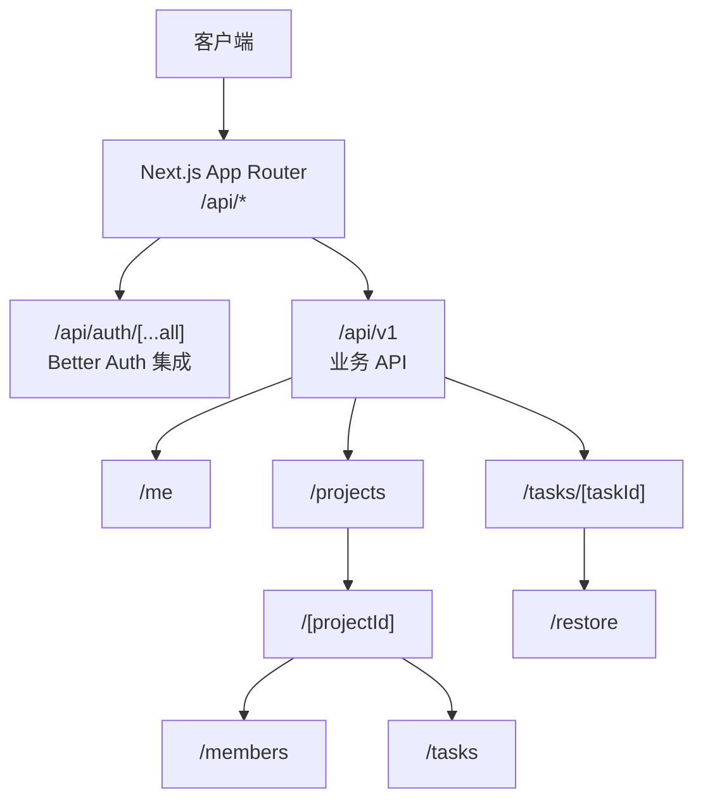
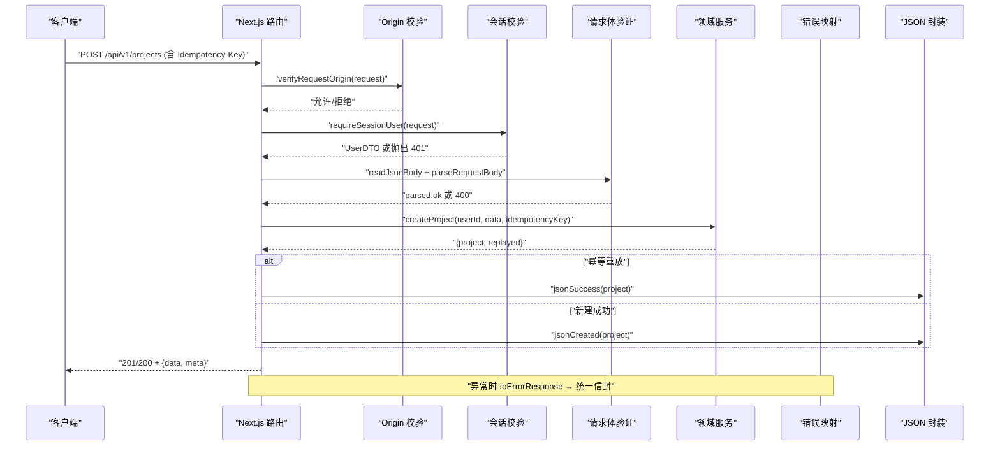
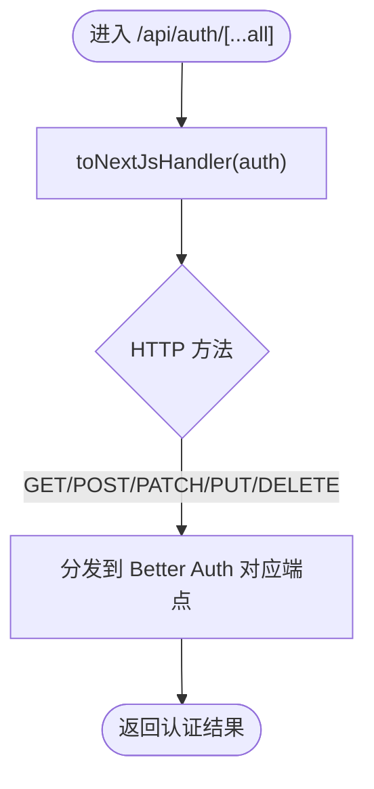
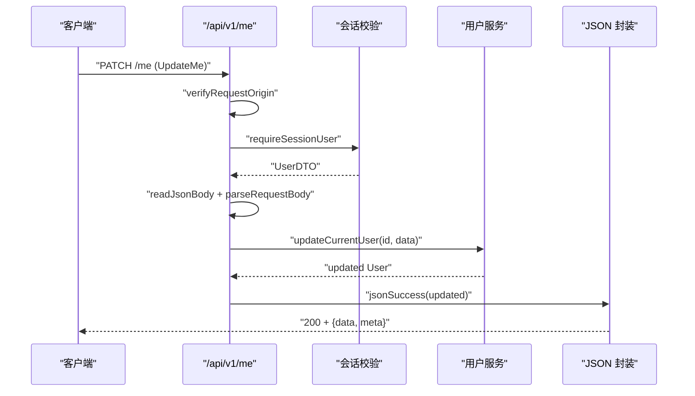
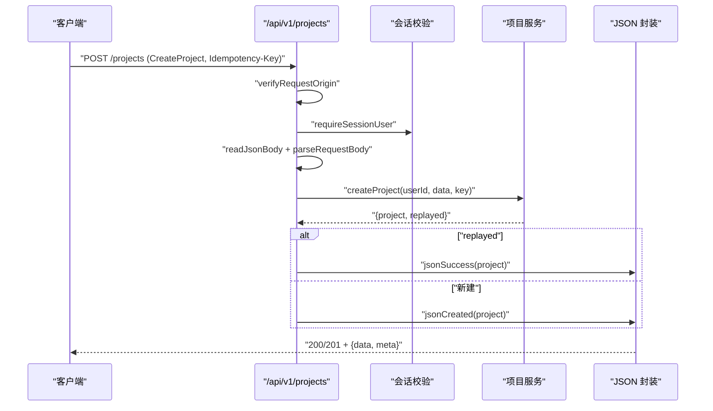
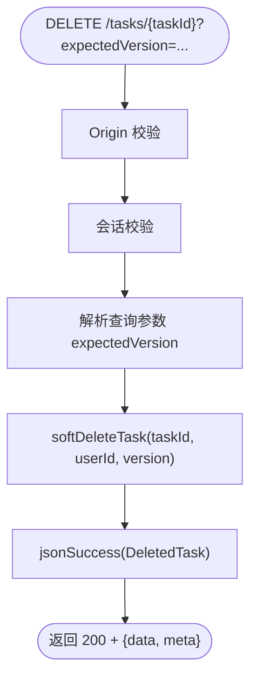
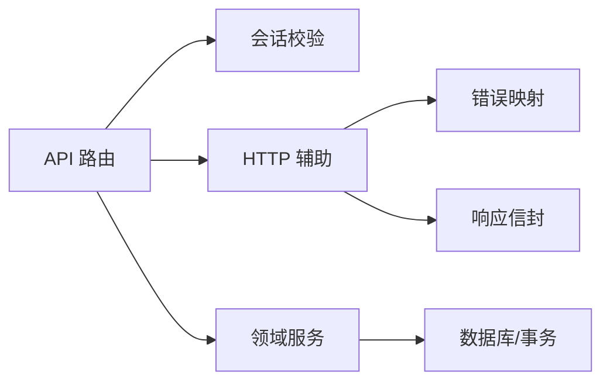

# API 路由设计

<cite>
**本文引用的文件**
- [src/app/api/auth/[...all]/route.ts](file://src/app/api/auth/[...all]/route.ts)
- [src/app/api/v1/me/route.ts](file://src/app/api/v1/me/route.ts)
- [src/app/api/v1/projects/route.ts](file://src/app/api/v1/projects/route.ts)
- [src/app/api/v1/projects/[projectId]/route.ts](file://src/app/api/v1/projects/[projectId]/route.ts)
- [src/app/api/v1/projects/[projectId]/members/route.ts](file://src/app/api/v1/projects/[projectId]/members/route.ts)
- [src/app/api/v1/projects/[projectId]/tasks/route.ts](file://src/app/api/v1/projects/[projectId]/tasks/route.ts)
- [src/app/api/v1/tasks/[taskId]/route.ts](file://src/app/api/v1/tasks/[taskId]/route.ts)
- [src/app/api/v1/tasks/[taskId]/restore/route.ts](file://src/app/api/v1/tasks/[taskId]/restore/route.ts)
- [src/server/auth/index.ts](file://src/server/auth/index.ts)
- [src/server/auth/session.ts](file://src/server/auth/session.ts)
- [src/server/http/json.ts](file://src/server/http/json.ts)
- [src/server/http/errors.ts](file://src/server/http/errors.ts)
- [contracts/openapi.json](file://contracts/openapi.json)
</cite>

## 目录
1. [简介](#简介)
2. [项目结构](#项目结构)
3. [核心组件](#核心组件)
4. [架构总览](#架构总览)
5. [详细组件分析](#详细组件分析)
6. [依赖关系分析](#依赖关系分析)
7. [性能考虑](#性能考虑)
8. [故障排查指南](#故障排查指南)
9. [结论](#结论)
10. [附录](#附录)

## 简介
本文件为 Orbit 项目的 API 路由设计文档，聚焦基于 Next.js App Router 的 /api 组织方式与 RESTful 规范。内容涵盖：
- 认证集成（Better Auth）与业务 API 的分层
- 动态路由参数处理、请求体/查询参数校验、幂等键与 Origin 校验
- 统一响应信封、错误映射与缓存策略
- 用户信息、项目管理、任务管理的端点实现与调用流程
- 版本化策略（/api/v1）与向后兼容性建议

## 项目结构
API 路由采用“按资源+版本”的目录组织：
- /api/auth/[...all]：Better Auth 全量路由挂载（登录、注册、会话、邮箱验证等）
- /api/v1：业务 API 根路径，包含 me、projects、tasks 等资源
  - /me：当前用户信息读取与更新
  - /projects：项目列表与创建；[projectId]：单个项目读写；[projectId]/members：成员列表；[projectId]/tasks：项目任务列表与创建
  - /tasks/[taskId]：任务详情、更新、软删除；[taskId]/restore：恢复已软删除的任务

图表来源
- [src/app/api/auth/[...all]/route.ts:1-22](file://src/app/api/auth/[...all]/route.ts#L1-L22)
- [src/app/api/v1/me/route.ts:1-91](file://src/app/api/v1/me/route.ts#L1-L91)
- [src/app/api/v1/projects/route.ts:1-93](file://src/app/api/v1/projects/route.ts#L1-L93)
- [src/app/api/v1/projects/[projectId]/route.ts:1-80](file://src/app/api/v1/projects/[projectId]/route.ts#L1-L80)
- [src/app/api/v1/projects/[projectId]/members/route.ts:1-38](file://src/app/api/v1/projects/[projectId]/members/route.ts#L1-L38)
- [src/app/api/v1/projects/[projectId]/tasks/route.ts:1-104](file://src/app/api/v1/projects/[projectId]/tasks/route.ts#L1-L104)
- [src/app/api/v1/tasks/[taskId]/route.ts:1-112](file://src/app/api/v1/tasks/[taskId]/route.ts#L1-L112)
- [src/app/api/v1/tasks/[taskId]/restore/route.ts:1-70](file://src/app/api/v1/tasks/[taskId]/restore/route.ts#L1-L70)

章节来源
- [src/app/api/auth/[...all]/route.ts:1-22](file://src/app/api/auth/[...all]/route.ts#L1-L22)
- [src/app/api/v1/me/route.ts:1-91](file://src/app/api/v1/me/route.ts#L1-L91)
- [src/app/api/v1/projects/route.ts:1-93](file://src/app/api/v1/projects/route.ts#L1-L93)
- [src/app/api/v1/projects/[projectId]/route.ts:1-80](file://src/app/api/v1/projects/[projectId]/route.ts#L1-L80)
- [src/app/api/v1/projects/[projectId]/members/route.ts:1-38](file://src/app/api/v1/projects/[projectId]/members/route.ts#L1-L38)
- [src/app/api/v1/projects/[projectId]/tasks/route.ts:1-104](file://src/app/api/v1/projects/[projectId]/tasks/route.ts#L1-L104)
- [src/app/api/v1/tasks/[taskId]/route.ts:1-112](file://src/app/api/v1/tasks/[taskId]/route.ts#L1-L112)
- [src/app/api/v1/tasks/[taskId]/restore/route.ts:1-70](file://src/app/api/v1/tasks/[taskId]/restore/route.ts#L1-L70)

## 核心组件
- 认证与会话
  - Better Auth 单例：绑定 Prisma 与配置，提供会话能力
  - 会话助手：获取当前用户或要求已认证，返回契约层 UserDTO
- HTTP 基础设施
  - 统一响应信封：成功 {data, meta}、列表 {data:[], meta:PageMeta}、错误 {error, meta}
  - 请求体读取：64KiB 上限、Content-Length 前置拒绝、增量读取防内存溢出
  - 幂等键校验：Idempotency-Key 必须为合法 UUID
  - 错误映射：DomainError → 标准 ErrorResponse，统一状态码派生与 no-store 缓存
- 路由层职责
  - 解析动态参数、校验请求体/查询参数、Origin 校验（写操作）、会话检查、调用领域服务、构造响应

章节来源
- [src/server/auth/index.ts:1-29](file://src/server/auth/index.ts#L1-L29)
- [src/server/auth/session.ts:1-43](file://src/server/auth/session.ts#L1-L43)
- [src/server/http/json.ts:1-149](file://src/server/http/json.ts#L1-L149)
- [src/server/http/errors.ts:1-136](file://src/server/http/errors.ts#L1-L136)
- [contracts/openapi.json:1-800](file://contracts/openapi.json#L1-L800)

## 架构总览
下图展示一次典型写操作的端到端流程：客户端发起请求 → Next.js 路由 → Origin 校验 → 会话校验 → 请求体验证 → 领域服务 → 统一信封响应。

图表来源
- [src/app/api/v1/projects/route.ts:56-93](file://src/app/api/v1/projects/route.ts#L56-L93)
- [src/server/http/json.ts:83-149](file://src/server/http/json.ts#L83-L149)
- [src/server/http/errors.ts:108-136](file://src/server/http/errors.ts#L108-L136)

## 详细组件分析

### 认证路由集成（Better Auth）
- 挂载位置：/api/auth/[...all]
- 行为：通过 toNextJsHandler(auth) 暴露 GET/POST/PATCH/PUT/DELETE，承载 sign-up/sign-in/get-session/verify-email/reset-password 等
- 运行环境：nodejs（依赖加密与数据库驱动）
- 安全注意：不叠加自定义 Origin 层，避免破坏回调

图表来源
- [src/app/api/auth/[...all]/route.ts:1-22](file://src/app/api/auth/[...all]/route.ts#L1-L22)
- [src/server/auth/index.ts:1-29](file://src/server/auth/index.ts#L1-L29)

章节来源
- [src/app/api/auth/[...all]/route.ts:1-22](file://src/app/api/auth/[...all]/route.ts#L1-L22)
- [src/server/auth/index.ts:1-29](file://src/server/auth/index.ts#L1-L29)

### 用户信息获取与更新（/api/v1/me）
- GET /me：返回当前账户档案（直接查库保证 PATCH 后立即可读），未认证返回 401
- PATCH /me：修改姓名/时区，需 Origin 校验、会话校验、请求体验证（UpdateMeSchema），成功后返回更新后的用户
- 缓存策略：所有响应带 private, no-store，防止共享缓存泄露隐私

图表来源
- [src/app/api/v1/me/route.ts:56-91](file://src/app/api/v1/me/route.ts#L56-L91)
- [src/server/http/json.ts:52-76](file://src/server/http/json.ts#L52-L76)

章节来源
- [src/app/api/v1/me/route.ts:1-91](file://src/app/api/v1/me/route.ts#L1-L91)

### 项目管理（/api/v1/projects）
- GET /projects：列出当前用户拥有/参与的项目，支持 scope/archived/cursor 分页
- POST /projects：创建项目，需要 Idempotency-Key，幂等重放返回 200，新建返回 201
- GET /projects/{projectId}：读取项目（成员可见）
- PATCH /projects/{projectId}：更新/归档/恢复（owner-only），乐观并发冲突返回 409

图表来源
- [src/app/api/v1/projects/route.ts:56-93](file://src/app/api/v1/projects/route.ts#L56-L93)
- [src/server/http/json.ts:52-76](file://src/server/http/json.ts#L52-L76)

章节来源
- [src/app/api/v1/projects/route.ts:1-93](file://src/app/api/v1/projects/route.ts#L1-L93)
- [src/app/api/v1/projects/[projectId]/route.ts:1-80](file://src/app/api/v1/projects/[projectId]/route.ts#L1-L80)

### 项目成员（/api/v1/projects/[projectId]/members）
- GET /projects/{projectId}/members：列出成员（非分页），owner 排首位，随后按加入时间排序，不含 email

章节来源
- [src/app/api/v1/projects/[projectId]/members/route.ts:1-38](file://src/app/api/v1/projects/[projectId]/members/route.ts#L1-L38)

### 项目任务（/api/v1/projects/[projectId]/tasks）
- GET /projects/{projectId}/tasks：列出项目任务（游标分页、过滤、排序）
- POST /projects/{projectId}/tasks：创建任务（需要 Idempotency-Key），幂等重放返回 200，新建返回 201

章节来源
- [src/app/api/v1/projects/[projectId]/tasks/route.ts:1-104](file://src/app/api/v1/projects/[projectId]/tasks/route.ts#L1-L104)

### 任务管理（/api/v1/tasks/[taskId]）
- GET /tasks/{taskId}：读取任务详情（成员可见）
- PATCH /tasks/{taskId}：更新任务字段（成员可改），乐观并发冲突返回 409
- DELETE /tasks/{taskId}：软删除任务（仅 owner 或创建者可删），expectedVersion 从查询参数读取

图表来源
- [src/app/api/v1/tasks/[taskId]/route.ts:88-112](file://src/app/api/v1/tasks/[taskId]/route.ts#L88-L112)

章节来源
- [src/app/api/v1/tasks/[taskId]/route.ts:1-112](file://src/app/api/v1/tasks/[taskId]/route.ts#L1-L112)

### 任务恢复（/api/v1/tasks/[taskId]/restore）
- POST /tasks/{taskId}/restore：恢复已软删除的任务，需要 Idempotency-Key 与 VersionInput
- 权限：仅 owner 或创建者可恢复；处于已删除态才有效；归档项目返回 409；超配额返回 422

章节来源
- [src/app/api/v1/tasks/[taskId]/restore/route.ts:1-70](file://src/app/api/v1/tasks/[taskId]/restore/route.ts#L1-L70)

## 依赖关系分析
- 路由层依赖
  - 会话：requireSessionUser（来自 server/auth/session.ts）
  - 请求体/响应：readJsonBody、jsonSuccess/jsonCreated/jsonList/jsonEnvelope、requireIdempotencyKey（来自 server/http/json.ts）
  - 错误：errorResponse、toErrorResponse（来自 server/http/errors.ts）
  - 领域服务：各模块 service（如 project/task/me）
- 外部契约
  - OpenAPI 定义在 contracts/openapi.json，作为接口契约与测试依据
  - 信封类型与构建器在 contracts/envelope.ts（此处引用其约定）

图表来源
- [src/app/api/v1/projects/route.ts:1-93](file://src/app/api/v1/projects/route.ts#L1-L93)
- [src/server/http/json.ts:1-149](file://src/server/http/json.ts#L1-L149)
- [src/server/http/errors.ts:1-136](file://src/server/http/errors.ts#L1-L136)
- [src/server/auth/session.ts:1-43](file://src/server/auth/session.ts#L1-L43)

章节来源
- [src/app/api/v1/projects/route.ts:1-93](file://src/app/api/v1/projects/route.ts#L1-L93)
- [src/server/http/json.ts:1-149](file://src/server/http/json.ts#L1-L149)
- [src/server/http/errors.ts:1-136](file://src/server/http/errors.ts#L1-L136)
- [src/server/auth/session.ts:1-43](file://src/server/auth/session.ts#L1-L43)

## 性能考虑
- 请求体大小限制：统一 64KiB 上限，Content-Length 前置拒绝与增量读取结合，避免超大 body 占用内存
- 幂等性：写操作强制 Idempotency-Key（UUID），减少重试带来的副作用
- 缓存控制：所有响应携带 private, no-store，避免共享缓存导致的数据泄露
- 运行时：API 路由使用 nodejs 运行时，确保数据库与加密能力可用
- 分页：列表接口使用游标分页，减少大数据集传输与渲染压力

章节来源
- [src/server/http/json.ts:23-149](file://src/server/http/json.ts#L23-L149)
- [src/app/api/v1/projects/route.ts:32-33](file://src/app/api/v1/projects/route.ts#L32-L33)
- [src/app/api/v1/me/route.ts:29-30](file://src/app/api/v1/me/route.ts#L29-L30)

## 故障排查指南
- 常见错误与定位
  - 401 UNAUTHENTICATED：会话缺失或未登录，检查 requireSessionUser 是否通过
  - 400 VALIDATION_ERROR：请求体或查询参数不符合 schema，检查 parseRequestBody/parseQueryParams 返回值
  - 409 VERSION_CONFLICT：乐观并发失败，检查 expectedVersion 与 currentVersion
  - 413 PAYLOAD_TOO_LARGE：请求体超过 64KiB，检查客户端上传大小与 Content-Length
  - 403 FORBIDDEN：权限不足（如非 owner 尝试归档/删除），检查授权逻辑
- 日志与追踪
  - 所有响应携带 x-request-id 头，便于链路追踪
  - 未预期错误会记录脱敏日志（仅 name/message 或类型），不泄露堆栈与敏感数据
- 调试建议
  - 确认 Origin 校验是否放行同源浏览器请求
  - 对幂等写操作，重复发送相同 Idempotency-Key 应得到一致结果

章节来源
- [src/server/http/errors.ts:108-136](file://src/server/http/errors.ts#L108-L136)
- [src/server/http/json.ts:83-149](file://src/server/http/json.ts#L83-L149)
- [src/app/api/v1/me/route.ts:38-47](file://src/app/api/v1/me/route.ts#L38-L47)

## 结论
Orbit 的 API 路由以 Next.js App Router 为基础，采用清晰的版本化与资源分层，配合 Better Auth 完成认证与会话管理。通过统一的请求体验证、Origin 校验、幂等键与错误映射，实现了稳定可靠的业务接口。响应信封标准化与缓存策略保障了数据安全与一致性。建议在后续迭代中持续对齐 OpenAPI 契约，完善测试覆盖，并逐步扩展更多业务域。

## 附录

### 路由清单与契约要点
- /api/auth/*：Better Auth 全量认证端点（由 [...all] 捕获）
- /api/v1/me：GET/PATCH 当前用户
- /api/v1/projects：GET 列表、POST 创建（需 Idempotency-Key）
- /api/v1/projects/{projectId}：GET 读取、PATCH 更新/归档/恢复（owner-only）
- /api/v1/projects/{projectId}/members：GET 成员列表
- /api/v1/projects/{projectId}/tasks：GET 列表、POST 创建（需 Idempotency-Key）
- /api/v1/tasks/{taskId}：GET 读取、PATCH 更新、DELETE 软删除（expectedVersion 查询参数）
- /api/v1/tasks/{taskId}/restore：POST 恢复（需 Idempotency-Key 与 VersionInput）

章节来源
- [contracts/openapi.json:1-800](file://contracts/openapi.json#L1-L800)

### 版本管理与向后兼容
- 版本前缀：/api/v1，新增功能在不破坏现有契约的前提下扩展
- 向后兼容建议
  - 新增可选字段优先于必填字段
  - 保留旧字段至少一个主版本周期
  - 变更枚举值时增加新值而非替换
  - 通过 OpenAPI 契约与自动化测试保障兼容性

章节来源
- [contracts/openapi.json:1-800](file://contracts/openapi.json#L1-L800)