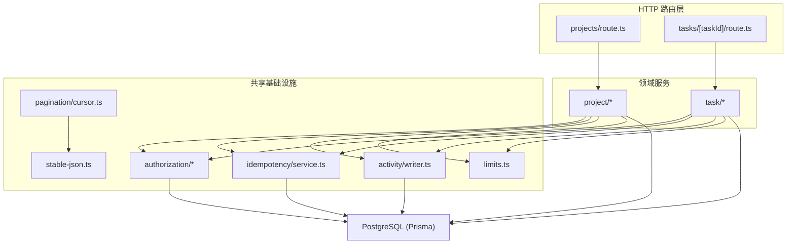
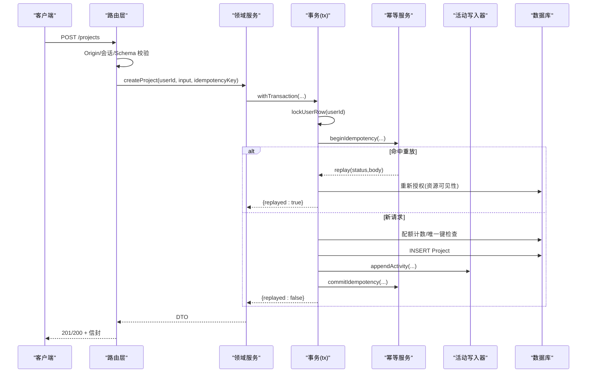
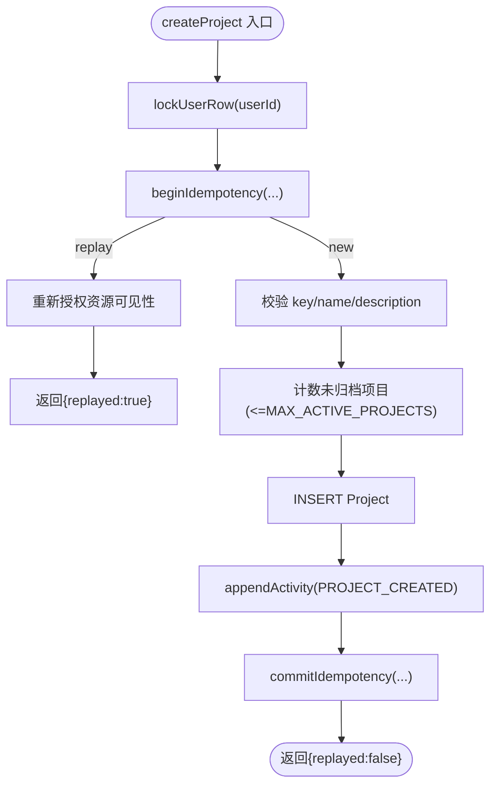
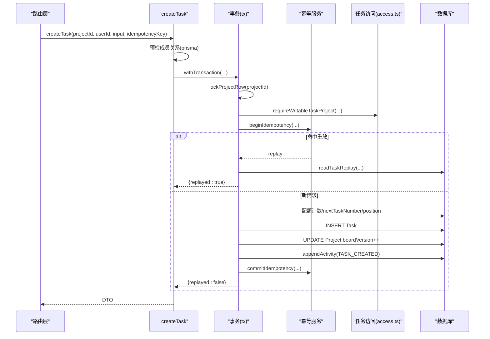
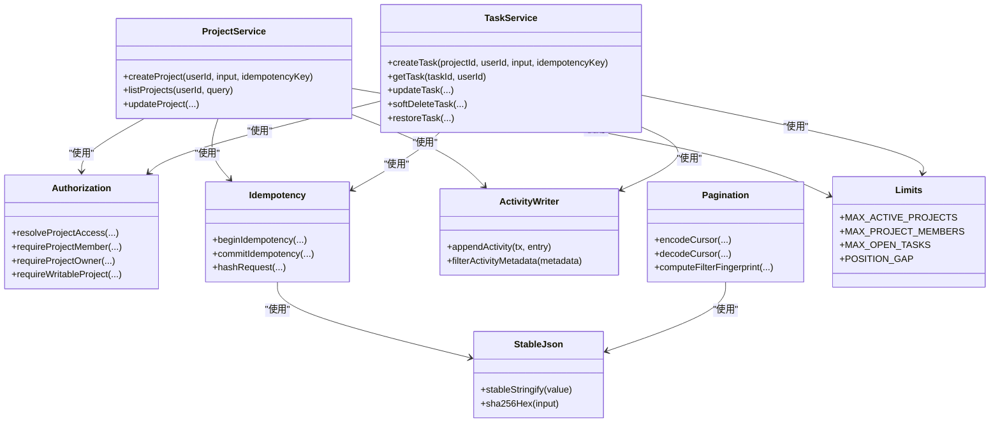

# 业务逻辑层

<cite>
**本文引用的文件**
- [src/server/modules/project/index.ts](file://src/server/modules/project/index.ts)
- [src/server/modules/project/create.ts](file://src/server/modules/project/create.ts)
- [src/server/modules/project/read.ts](file://src/server/modules/project/read.ts)
- [src/server/modules/project/update.ts](file://src/server/modules/project/update.ts)
- [src/server/modules/project/mappers.ts](file://src/server/modules/project/mappers.ts)
- [src/server/modules/task/index.ts](file://src/server/modules/task/index.ts)
- [src/server/modules/task/create.ts](file://src/server/modules/task/create.ts)
- [src/server/modules/task/read.ts](file://src/server/modules/task/read.ts)
- [src/server/modules/task/update.ts](file://src/server/modules/task/update.ts)
- [src/server/modules/task/soft-delete.ts](file://src/server/modules/task/soft-delete.ts)
- [src/server/modules/task/restore.ts](file://src/server/modules/task/restore.ts)
- [src/server/modules/task/access.ts](file://src/server/modules/task/access.ts)
- [src/server/modules/task/mappers.ts](file://src/server/modules/task/mappers.ts)
- [src/server/modules/activity/writer.ts](file://src/server/modules/activity/writer.ts)
- [src/server/modules/authorization/decide.ts](file://src/server/modules/authorization/decide.ts)
- [src/server/modules/authorization/project-access.ts](file://src/server/modules/authorization/project-access.ts)
- [src/server/modules/idempotency/service.ts](file://src/server/modules/idempotency/service.ts)
- [src/server/modules/pagination/cursor.ts](file://src/server/modules/pagination/cursor.ts)
- [src/server/modules/stable-json.ts](file://src/server/modules/stable-json.ts)
- [src/server/modules/limits.ts](file://src/server/modules/limits.ts)
- [src/app/api/v1/projects/route.ts](file://src/app/api/v1/projects/route.ts)
- [src/app/api/v1/tasks/[taskId]/route.ts](file://src/app/api/v1/tasks/[taskId]/route.ts)
- [prisma/schema.prisma](file://prisma/schema.prisma)
</cite>

## 目录
1. [简介](#简介)
2. [项目结构](#项目结构)
3. [核心组件](#核心组件)
4. [架构总览](#架构总览)
5. [详细组件分析](#详细组件分析)
6. [依赖关系分析](#依赖关系分析)
7. [性能与并发](#性能与并发)
8. [故障排查指南](#故障排查指南)
9. [结论](#结论)
10. [附录：扩展指南与最佳实践](#附录：扩展指南与最佳实践)

## 简介
本文件面向 Orbit 项目的“业务逻辑层”，聚焦模块化架构设计与实现，覆盖项目模块、任务模块、活动日志模块、授权模块与幂等性服务。文档说明各模块的职责边界、核心函数接口、业务规则、事务编排、权限控制、数据验证、并发控制与可扩展性建议，并通过图示帮助读者快速理解系统结构与关键流程。

## 项目结构
业务逻辑层位于 src/server/modules，按领域划分（project、task），并包含跨领域共享能力（activity、authorization、idempotency、pagination、stable-json、limits）。API 路由层（src/app/api）仅负责 HTTP 编排、参数校验与错误封装，调用领域服务完成业务处理。数据库模型由 Prisma 定义（prisma/schema.prisma）。

图表来源
- [src/app/api/v1/projects/route.ts:1-93](file://src/app/api/v1/projects/route.ts#L1-L93)
- [src/app/api/v1/tasks/[taskId]/route.ts:1-112](file://src/app/api/v1/tasks/[taskId]/route.ts#L1-L112)
- [src/server/modules/project/index.ts:1-24](file://src/server/modules/project/index.ts#L1-L24)
- [src/server/modules/task/index.ts:1-31](file://src/server/modules/task/index.ts#L1-L31)
- [src/server/modules/authorization/decide.ts:1-67](file://src/server/modules/authorization/decide.ts#L1-L67)
- [src/server/modules/idempotency/service.ts:1-181](file://src/server/modules/idempotency/service.ts#L1-L181)
- [src/server/modules/activity/writer.ts:1-65](file://src/server/modules/activity/writer.ts#L1-L65)
- [src/server/modules/pagination/cursor.ts:1-77](file://src/server/modules/pagination/cursor.ts#L1-L77)
- [src/server/modules/stable-json.ts:1-41](file://src/server/modules/stable-json.ts#L1-L41)
- [src/server/modules/limits.ts:1-27](file://src/server/modules/limits.ts#L1-L27)

章节来源
- [src/app/api/v1/projects/route.ts:1-93](file://src/app/api/v1/projects/route.ts#L1-L93)
- [src/app/api/v1/tasks/[taskId]/route.ts:1-112](file://src/app/api/v1/tasks/[taskId]/route.ts#L1-L112)
- [src/server/modules/project/index.ts:1-24](file://src/server/modules/project/index.ts#L1-L24)
- [src/server/modules/task/index.ts:1-31](file://src/server/modules/task/index.ts#L1-L31)

## 核心组件
- 项目模块：提供创建、读取、更新项目的能力，统一导出入口屏蔽内部文件划分；内置配额、唯一键校验、活动记录与幂等重放。
- 任务模块：提供创建、读取、更新、软删除、恢复任务的能力；包含编号生成、位置计算、负责人校验、看板版本递增与活动记录。
- 活动日志模块：只追加写入，metadata 白名单过滤，确保与业务写入同一事务原子提交。
- 授权模块：纯判定函数 + IO 层封装，统一收敛“不存在/非成员”为 NOT_FOUND，写操作区分 FORBIDDEN/ARCHIVED。
- 幂等性服务：基于唯一键与请求体哈希的幂等重放，支持冲突哨兵与事务外复查，保障并发安全。
- 分页游标：基于 keyset 的分页编码/解码，绑定过滤指纹防止越权拼接。
- 稳定 JSON：对象键排序、跳过 undefined 的稳定序列化，用于幂等哈希与过滤指纹。
- 限制常量：集中管理配额与算法常量，在锁内计数校验。

章节来源
- [src/server/modules/project/index.ts:1-24](file://src/server/modules/project/index.ts#L1-L24)
- [src/server/modules/task/index.ts:1-31](file://src/server/modules/task/index.ts#L1-L31)
- [src/server/modules/activity/writer.ts:1-65](file://src/server/modules/activity/writer.ts#L1-L65)
- [src/server/modules/authorization/decide.ts:1-67](file://src/server/modules/authorization/decide.ts#L1-L67)
- [src/server/modules/idempotency/service.ts:1-181](file://src/server/modules/idempotency/service.ts#L1-L181)
- [src/server/modules/pagination/cursor.ts:1-77](file://src/server/modules/pagination/cursor.ts#L1-L77)
- [src/server/modules/stable-json.ts:1-41](file://src/server/modules/stable-json.ts#L1-L41)
- [src/server/modules/limits.ts:1-27](file://src/server/modules/limits.ts#L1-L27)

## 架构总览
- 分层清晰：HTTP 路由层只做参数解析、会话校验、Origin 校验与错误封装；领域服务承载业务规则与事务编排；共享基础设施提供可复用能力。
- 事务与锁：写操作使用 withTransaction，并在必要时加行级锁（用户行或项目行）以串行化配额、编号、position 与 boardVersion。
- 幂等与活动：所有写操作在事务内先 beginIdempotency，成功后 commitIdempotency；活动日志与业务写入同事务原子提交。
- 授权与安全：读访问通过 resolveProjectAccess 统一收敛不可见；写访问通过 requireWritableProject 区分 FORBIDDEN/ARCHIVED；metadata 白名单过滤避免敏感信息入库。

图表来源
- [src/app/api/v1/projects/route.ts:62-93](file://src/app/api/v1/projects/route.ts#L62-L93)
- [src/server/modules/project/create.ts:71-181](file://src/server/modules/project/create.ts#L71-L181)
- [src/server/modules/idempotency/service.ts:129-181](file://src/server/modules/idempotency/service.ts#L129-L181)
- [src/server/modules/activity/writer.ts:50-65](file://src/server/modules/activity/writer.ts#L50-L65)

## 详细组件分析

### 项目模块（Project）
- 职责边界：对外暴露 create/list/read/update 及映射器；内部拆分 create/read/update/mappers；不直接暴露授权、幂等、活动、分页等跨域能力。
- 核心流程（创建项目）：
  - 锁定用户行，开始幂等检查；若重放则重新授权目标资源可见性后返回原响应。
  - 校验 key 格式与名称长度；在锁内计数未归档项目数，超过上限抛出 LIMIT_EXCEEDED。
  - 插入项目行，记录活动日志，提交幂等记录；捕获唯一键冲突转换为 PROJECT_KEY_TAKEN。
  - 幂等提交阶段若发生唯一键冲突，抛出哨兵错误，由调用方在事务外用 resolveIdempotencyCommitConflict 决定 replay 或 409。
- 数据验证：key 需符合正则；name 长度限制；description/color 默认值处理。
- 权限控制：创建时 owner=当前用户；后续读/写通过 authorization 模块判定角色与可写状态。
- 并发策略：用户级行锁串行化配额与幂等记录；项目唯一键由 DB 约束兜底。

图表来源
- [src/server/modules/project/create.ts:71-181](file://src/server/modules/project/create.ts#L71-L181)
- [src/server/modules/idempotency/service.ts:129-181](file://src/server/modules/idempotency/service.ts#L129-L181)
- [src/server/modules/activity/writer.ts:50-65](file://src/server/modules/activity/writer.ts#L50-L65)

章节来源
- [src/server/modules/project/index.ts:1-24](file://src/server/modules/project/index.ts#L1-L24)
- [src/server/modules/project/create.ts:1-181](file://src/server/modules/project/create.ts#L1-L181)
- [src/server/modules/project/read.ts](file://src/server/modules/project/read.ts)
- [src/server/modules/project/update.ts](file://src/server/modules/project/update.ts)
- [src/server/modules/project/mappers.ts](file://src/server/modules/project/mappers.ts)

### 任务模块（Task）
- 职责边界：对外暴露 create/read/update/soft-delete/restore 及映射器；内部辅助（identifier、position、access、date-only）仅供本目录复用。
- 核心流程（创建任务）：
  - 预检成员关系（应用单例 prisma），避免对热门项目行加排他锁造成 DoS。
  - 进入事务，锁定项目行；持锁后复核授权与归档态。
  - 开始幂等检查；若重放，通过 readTaskReplay 返回已存在任务视图。
  - 校验标题/描述长度；在锁内计数未删除任务数，超过上限抛出 LIMIT_EXCEEDED。
  - 校验 assignee 是否允许；生成 nextTaskNumber 与 position；插入 Task；boardVersion++；记录活动；提交幂等记录。
- 数据验证：标题 1–120，描述 ≤10000；status=DONE 时 completedAt=now；默认 status=TODO、priority=MEDIUM。
- 权限控制：成员可见；仅 owner 或创建者可软删除；归档项目写操作受限。
- 并发策略：项目行锁串行化编号、配额、position 与 boardVersion；幂等冲突通过哨兵+重试解决。

图表来源
- [src/server/modules/task/create.ts:77-202](file://src/server/modules/task/create.ts#L77-L202)
- [src/server/modules/task/access.ts](file://src/server/modules/task/access.ts)
- [src/server/modules/idempotency/service.ts:129-181](file://src/server/modules/idempotency/service.ts#L129-L181)

章节来源
- [src/server/modules/task/index.ts:1-31](file://src/server/modules/task/index.ts#L1-L31)
- [src/server/modules/task/create.ts:1-202](file://src/server/modules/task/create.ts#L1-L202)
- [src/server/modules/task/read.ts](file://src/server/modules/task/read.ts)
- [src/server/modules/task/update.ts](file://src/server/modules/task/update.ts)
- [src/server/modules/task/soft-delete.ts](file://src/server/modules/task/soft-delete.ts)
- [src/server/modules/task/restore.ts](file://src/server/modules/task/restore.ts)
- [src/server/modules/task/access.ts](file://src/server/modules/task/access.ts)
- [src/server/modules/task/mappers.ts](file://src/server/modules/task/mappers.ts)

### 活动日志模块（Activity）
- 设计原则：只追加、不编辑；必须在业务事务内调用，与业务改动同原子性；metadata 走白名单过滤，禁止存储原始描述/评论/文件内容/令牌等敏感信息。
- 接口：appendActivity(tx, entry)，filterActivityMetadata(metadata)。
- 白名单字段：taskIdentifier、fields、fromStatus、toStatus、targetUserId、count。
- 使用场景：项目创建、任务创建/更新/移动/删除/恢复等事件记录。

章节来源
- [src/server/modules/activity/writer.ts:1-65](file://src/server/modules/activity/writer.ts#L1-L65)

### 授权模块（Authorization）
- 纯判定函数：decideProjectAccess(facts) 计算读访问角色（OWNER/MEMBER/NOT_FOUND）；decideProjectWrite(facts) 判定写访问（ALLOWED/FORBIDDEN/ARCHIVED）。
- IO 层封装：resolveProjectAccess/requireProjectMember/requireProjectOwner/requireWritableProject，将判定结果翻译为领域错误（NOT_FOUND/FORBIDDEN/PROJECT_ARCHIVED）。
- 安全约定：非成员与不存在统一收敛为 NOT_FOUND，不泄露项目是否存在；归档项目仅 restore 例外。

章节来源
- [src/server/modules/authorization/decide.ts:1-67](file://src/server/modules/authorization/decide.ts#L1-L67)
- [src/server/modules/authorization/project-access.ts:1-121](file://src/server/modules/authorization/project-access.ts#L1-L121)

### 幂等性服务（Idempotency）
- 语义：唯一键 (userId, method, routeKey, key)；保存规范化请求 SHA-256 与响应，24h 有效；同 key 同内容重放，异内容 409 IDEMPOTENCY_CONFLICT。
- 事务编排：beginIdempotency 在事务开始处检查；commitIdempotency 在业务写入成功后落库；冲突时抛出 IdempotencyCommitConflictError，由调用方在事务外用 resolveIdempotencyCommitConflict 复查 hash。
- 重放前重新授权：调用方需在重放路径上重新校验目标资源对当前用户仍可见，避免退出成员借旧缓存读取。
- 工具：hashRequest(body) 基于 stableStringify 的 SHA-256。

章节来源
- [src/server/modules/idempotency/service.ts:1-181](file://src/server/modules/idempotency/service.ts#L1-L181)
- [src/server/modules/stable-json.ts:1-41](file://src/server/modules/stable-json.ts#L1-L41)

### 分页游标（Pagination Cursor）
- 约定：游标为不透明串，携带排序字段值、末项 id、过滤指纹；过滤变化即游标失效（INVALID_CURSOR）。
- 工具：encodeCursor/decodeCursor/computeFilterFingerprint，base64url 编码，长度受契约约束。

章节来源
- [src/server/modules/pagination/cursor.ts:1-77](file://src/server/modules/pagination/cursor.ts#L1-L77)

### 限制与常量（Limits）
- 集中定义配额与算法常量：每用户最多未归档项目数、每项目最多成员数、每项目最多未删除任务数、看板 position 初始间隔。
- 在锁内计数校验，保证并发安全。

章节来源
- [src/server/modules/limits.ts:1-27](file://src/server/modules/limits.ts#L1-L27)

## 依赖关系分析
- 路由层依赖领域服务与 HTTP 工具（会话、Origin、JSON 信封、错误转换）。
- 领域服务依赖授权、幂等、活动、分页、稳定 JSON、限制常量与数据库客户端。
- 授权模块依赖纯判定函数与数据库查询；幂等模块依赖稳定 JSON 与数据库唯一约束；活动模块依赖事务客户端与白名单过滤。
- 数据模型（Prisma）定义了 User、Project、ProjectMember、ActivityLog、IdempotencyRecord、Task 等实体及其关系与索引。

图表来源
- [src/server/modules/project/index.ts:1-24](file://src/server/modules/project/index.ts#L1-L24)
- [src/server/modules/task/index.ts:1-31](file://src/server/modules/task/index.ts#L1-L31)
- [src/server/modules/authorization/project-access.ts:1-121](file://src/server/modules/authorization/project-access.ts#L1-L121)
- [src/server/modules/idempotency/service.ts:1-181](file://src/server/modules/idempotency/service.ts#L1-L181)
- [src/server/modules/activity/writer.ts:1-65](file://src/server/modules/activity/writer.ts#L1-L65)
- [src/server/modules/pagination/cursor.ts:1-77](file://src/server/modules/pagination/cursor.ts#L1-L77)
- [src/server/modules/stable-json.ts:1-41](file://src/server/modules/stable-json.ts#L1-L41)
- [src/server/modules/limits.ts:1-27](file://src/server/modules/limits.ts#L1-L27)

章节来源
- [prisma/schema.prisma:14-200](file://prisma/schema.prisma#L14-L200)

## 性能与并发
- 行级锁顺序：项目模块对用户行加锁（串行化配额与幂等记录）；任务模块对项目行加锁（串行化编号、配额、position 与 boardVersion）。
- 幂等冲突处理：commitIdempotency 遇到唯一键冲突时抛出哨兵错误，调用方在事务外用 resolveIdempotencyCommitConflict 复查 hash；任务创建在捕获该错误后在新事务中重试，确保一致性。
- 预检优化：任务创建在进入事务前先预检成员关系，避免非成员对热门项目行加排他锁造成 DoS。
- 游标分页：keyset 分页结合过滤指纹，避免全表扫描与越权拼接。
- 活动日志：只追加写入，减少锁竞争；metadata 白名单降低写入体积与安全风险。

[本节为通用性能讨论，不直接分析具体文件]

## 故障排查指南
- 幂等冲突（IDEMPOTENCY_CONFLICT）：当同一 key 的请求体不一致时抛出；检查客户端是否正确生成幂等键与请求体规范化。
- 唯一键冲突（P2002）：项目 key 或幂等记录唯一键冲突；确认 key 唯一性与幂等键生成策略。
- 权限不足（FORBIDDEN/PROJECT_ARCHIVED）：成员执行 owner-only 操作或归档项目写操作；检查授权流程与项目归档状态。
- 游标无效（INVALID_CURSOR）：游标过期或过滤条件变化；提示前端刷新列表。
- 配额超限（LIMIT_EXCEEDED）：项目或任务数量达到上限；引导用户归档或清理。

章节来源
- [src/server/modules/idempotency/service.ts:54-108](file://src/server/modules/idempotency/service.ts#L54-L108)
- [src/server/modules/project/create.ts:45-62](file://src/server/modules/project/create.ts#L45-L62)
- [src/server/modules/authorization/project-access.ts:28-41](file://src/server/modules/authorization/project-access.ts#L28-L41)
- [src/server/modules/pagination/cursor.ts:28-31](file://src/server/modules/pagination/cursor.ts#L28-L31)

## 结论
Orbit 的业务逻辑层采用清晰的领域分层与共享基础设施模式，通过事务与行级锁保证并发安全，通过幂等服务与活动日志提升可靠性与可观测性，通过授权模块统一权限决策与错误收敛。该设计便于扩展与维护，适合在多租户、高并发场景下稳定运行。

[本节为总结性内容，不直接分析具体文件]

## 附录：扩展指南与最佳实践
- 新增领域服务：遵循“路由层只做编排，领域服务承载业务规则”的原则；将权限判定、配额校验、幂等与活动记录纳入事务编排。
- 权限扩展：在 authorization/decide.ts 中增加纯判定函数，在 project-access.ts 中封装 IO 层与错误映射。
- 幂等扩展：为新写操作定义 routeKey 与 begin/commit 调用点；确保重放路径重新授权。
- 活动日志：在关键业务变更处调用 appendActivity，严格使用 metadata 白名单。
- 分页扩展：使用 encodeCursor/decodeCursor 与 computeFilterFingerprint，确保过滤条件变化时游标失效。
- 并发与锁：优先在项目/用户行上加锁，避免热点行竞争；必要时引入更细粒度锁。
- 数据验证：在服务入口处进行形状与业务规则校验，结合 DB CHECK 作为兜底。
- 测试建议：对纯判定函数进行穷举分支测试；对事务编排进行集成测试，覆盖幂等重放与冲突场景。

[本节为通用指导，不直接分析具体文件]