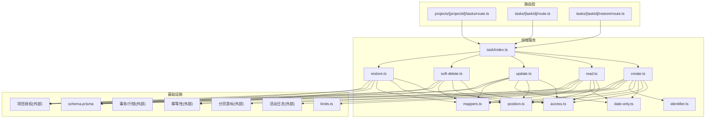
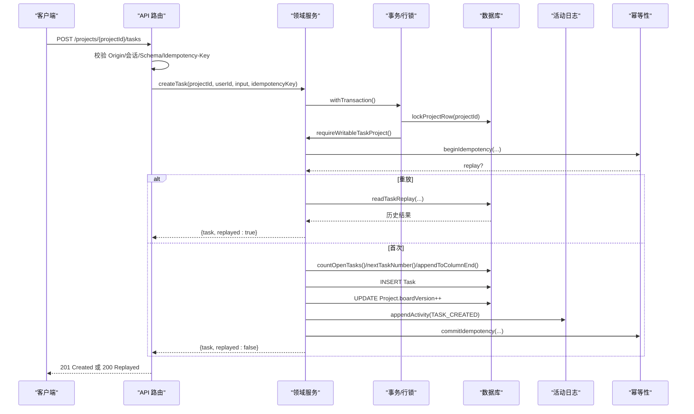
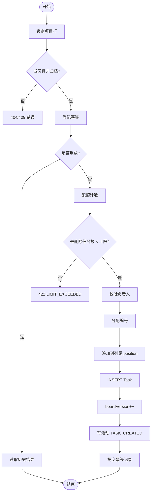
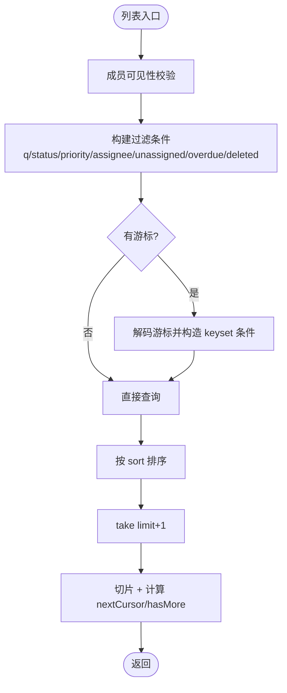
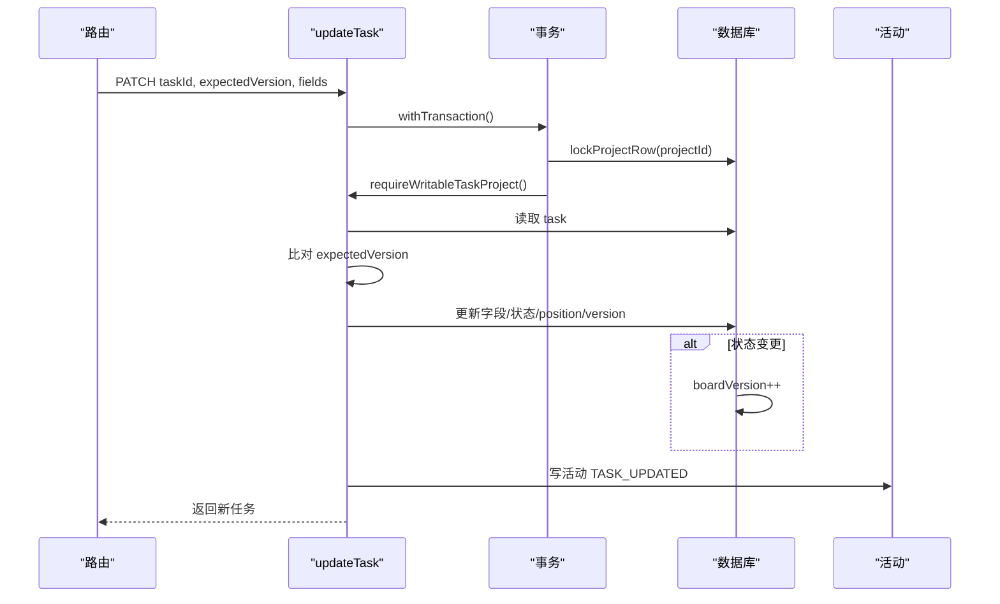
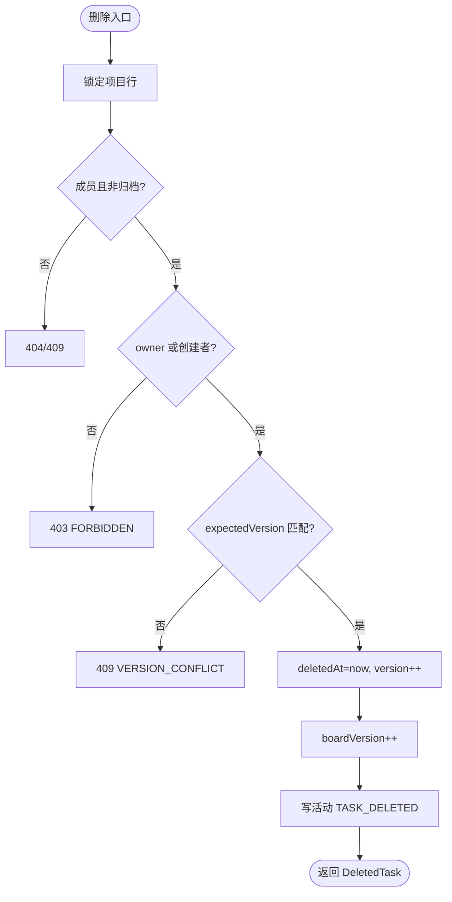
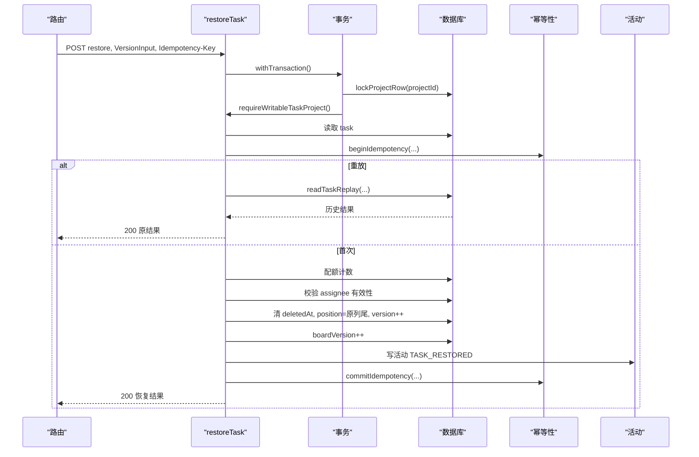
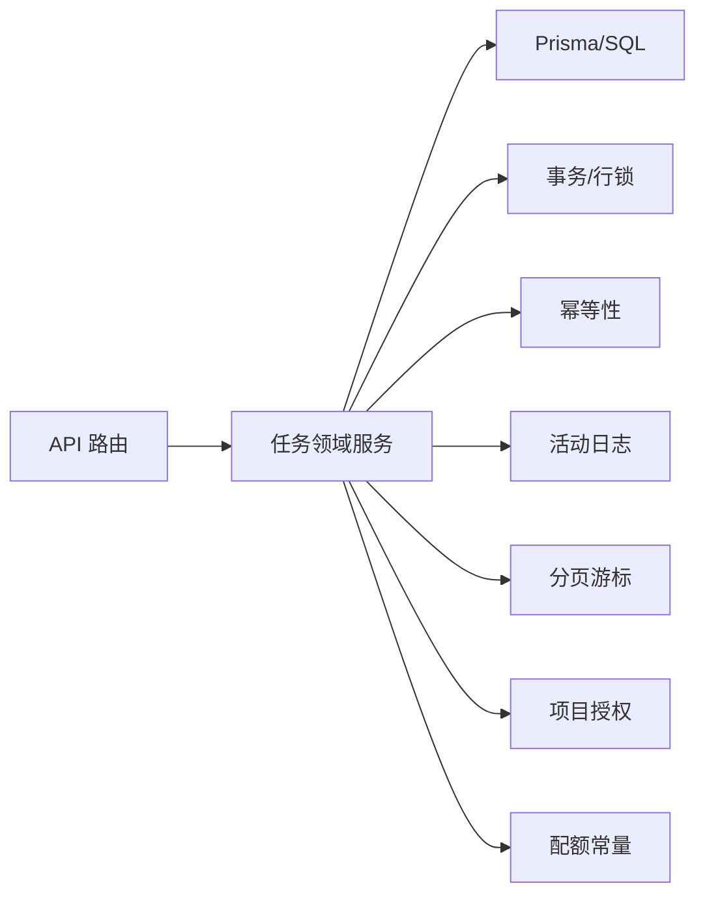

# 任务模块

<cite>
**本文引用的文件**
- [schema.prisma](file://prisma/schema.prisma)
- [index.ts](file://src/server/modules/task/index.ts)
- [create.ts](file://src/server/modules/task/create.ts)
- [read.ts](file://src/server/modules/task/read.ts)
- [update.ts](file://src/server/modules/task/update.ts)
- [soft-delete.ts](file://src/server/modules/task/soft-delete.ts)
- [restore.ts](file://src/server/modules/task/restore.ts)
- [access.ts](file://src/server/modules/task/access.ts)
- [position.ts](file://src/server/modules/task/position.ts)
- [date-only.ts](file://src/server/modules/task/date-only.ts)
- [mappers.ts](file://src/server/modules/task/mappers.ts)
- [identifier.ts](file://src/server/modules/task/identifier.ts)
- [limits.ts](file://src/server/modules/limits.ts)
- [route.ts（项目任务）](file://src/app/api/v1/projects/[projectId]/tasks/route.ts)
- [route.ts（任务详情）](file://src/app/api/v1/tasks/[taskId]/route.ts)
- [route.ts（恢复）](file://src/app/api/v1/tasks/[taskId]/restore/route.ts)
</cite>

## 目录
1. [简介](#简介)
2. [项目结构](#项目结构)
3. [核心组件](#核心组件)
4. [架构总览](#架构总览)
5. [详细组件分析](#详细组件分析)
6. [依赖关系分析](#依赖关系分析)
7. [性能考量](#性能考量)
8. [故障排查指南](#故障排查指南)
9. [结论](#结论)
10. [附录](#附录)

## 简介
本文件为 Orbit 项目的“任务模块”全面技术文档，覆盖任务创建、查询、更新、软删除与恢复的完整业务闭环；深入解释任务状态机、优先级系统、截止日期处理与位置排序算法；说明访问控制、权限验证与安全机制；阐述任务与项目的关联关系、数据映射与转换逻辑；并提供批量操作、并发控制与事务处理的实现要点，以及扩展指南与性能优化建议。

## 项目结构
任务模块采用“路由层 → 领域服务 → 基础设施”的分层组织：
- 路由层：Next.js API 路由负责请求解析、鉴权、校验与响应封装。
- 领域服务：位于 server/modules/task，按职责拆分为 create/read/update/soft-delete/restore，并共享 access、position、date-only、mappers、identifier 等辅助。
- 基础设施：数据库模型（Prisma）、事务与行锁、幂等性、活动日志、分页游标、授权与配额常量等。

图表来源
- [route.ts（项目任务）:1-104](file://src/app/api/v1/projects/[projectId]/tasks/route.ts#L1-L104)
- [route.ts（任务详情）:1-112](file://src/app/api/v1/tasks/[taskId]/route.ts#L1-L112)
- [route.ts（恢复）:1-70](file://src/app/api/v1/tasks/[taskId]/restore/route.ts#L1-L70)
- [index.ts:1-31](file://src/server/modules/task/index.ts#L1-L31)
- [create.ts:1-202](file://src/server/modules/task/create.ts#L1-L202)
- [read.ts:1-250](file://src/server/modules/task/read.ts#L1-L250)
- [update.ts:1-191](file://src/server/modules/task/update.ts#L1-L191)
- [soft-delete.ts:1-100](file://src/server/modules/task/soft-delete.ts#L1-L100)
- [restore.ts:1-198](file://src/server/modules/task/restore.ts#L1-L198)
- [access.ts:1-102](file://src/server/modules/task/access.ts#L1-L102)
- [position.ts:1-48](file://src/server/modules/task/position.ts#L1-L48)
- [date-only.ts:1-48](file://src/server/modules/task/date-only.ts#L1-L48)
- [mappers.ts:1-89](file://src/server/modules/task/mappers.ts#L1-L89)
- [identifier.ts:1-42](file://src/server/modules/task/identifier.ts#L1-L42)
- [limits.ts:1-27](file://src/server/modules/limits.ts#L1-L27)
- [schema.prisma:144-268](file://prisma/schema.prisma#L144-L268)

章节来源
- [route.ts（项目任务）:1-104](file://src/app/api/v1/projects/[projectId]/tasks/route.ts#L1-L104)
- [route.ts（任务详情）:1-112](file://src/app/api/v1/tasks/[taskId]/route.ts#L1-L112)
- [route.ts（恢复）:1-70](file://src/app/api/v1/tasks/[taskId]/restore/route.ts#L1-L70)
- [index.ts:1-31](file://src/server/modules/task/index.ts#L1-L31)

## 核心组件
- 统一出口：task/index.ts 暴露 create/list/get/update/soft-delete/restore 及 DTO 映射函数，屏蔽内部文件划分。
- 创建任务：createTask 在 Project 行锁事务内完成成员/归档复核、幂等登记、配额计数、编号分配、列尾追加 position、写入 Task、递增 boardVersion、写活动、提交幂等记录。
- 读取任务：listProjectTasks 支持 keyset 游标分页、过滤（q/status/priority/assigneeId/unassigned/overdue/deleted）与三种排序（updated_desc/due_asc/priority_desc）。getTask 返回未删除任务详情。
- 更新任务：updateTask 白名单字段变更检测、乐观版本控制、状态变更驱动 completedAt 与看板重排、boardVersion++、写活动。
- 软删除：softDeleteTask 仅 owner 或创建者可删，置 deletedAt、version++、boardVersion++、写活动。
- 恢复任务：restoreTask 要求已删除态、幂等重放、配额检查、原负责人若已退项目则取消分配、放回原列尾、boardVersion++、写活动。
- 访问控制：requireWritableTaskProject 确保成员且非归档；canDeleteTask 限定 owner 或创建者；isAllowedAssignee/assertAssigneeAllowed 限制负责人归属。
- 位置排序：appendToColumnEnd 基于索引 (projectId, deletedAt, status, position, id) 取列末项 + POSITION_GAP。
- 日期处理：date-only 严格 UTC 转换，避免时区偏移错日。
- 标识符：nextTaskNumber 原子递增 Project.nextTaskNumber；formatIdentifier 生成 ORB-N 形式。

章节来源
- [index.ts:1-31](file://src/server/modules/task/index.ts#L1-L31)
- [create.ts:32-202](file://src/server/modules/task/create.ts#L32-L202)
- [read.ts:27-250](file://src/server/modules/task/read.ts#L27-L250)
- [update.ts:20-191](file://src/server/modules/task/update.ts#L20-L191)
- [soft-delete.ts:16-100](file://src/server/modules/task/soft-delete.ts#L16-L100)
- [restore.ts:31-198](file://src/server/modules/task/restore.ts#L31-L198)
- [access.ts:11-102](file://src/server/modules/task/access.ts#L11-L102)
- [position.ts:5-48](file://src/server/modules/task/position.ts#L5-L48)
- [date-only.ts:3-48](file://src/server/modules/task/date-only.ts#L3-L48)
- [identifier.ts:5-42](file://src/server/modules/task/identifier.ts#L5-L42)

## 架构总览
任务模块遵循“路由编排 → 领域服务 → 基础设施”的清晰分层，所有写操作均在 Project 行锁事务中执行，保证编号、配额、position 与 boardVersion 的一致性；读操作使用应用单例 Prisma 客户端，结合 keyset 游标与过滤指纹实现稳定分页。

图表来源
- [route.ts（项目任务）:65-104](file://src/app/api/v1/projects/[projectId]/tasks/route.ts#L65-L104)
- [create.ts:77-202](file://src/server/modules/task/create.ts#L77-L202)

章节来源
- [route.ts（项目任务）:1-104](file://src/app/api/v1/projects/[projectId]/tasks/route.ts#L1-L104)
- [create.ts:1-202](file://src/server/modules/task/create.ts#L1-L202)

## 详细组件分析

### 任务创建（createTask）
- 事务序列：Project 行锁 → 成员/归档复核 → 幂等登记 → 配额计数 → 编号分配 → 列尾追加 position → 插入 Task → boardVersion++ → 写活动 → 提交幂等记录。
- 不变量：每项目未删除任务数 < MAX_OPEN_TASKS；creatorId 由会话确定；status=DONE 时 completedAt=now；默认 status=TODO、priority=MEDIUM；幂等重放安全。
- 错误处理：非法 UUID→404；配额超限→422 LIMIT_EXCEEDED；幂等冲突重试。

图表来源
- [create.ts:77-202](file://src/server/modules/task/create.ts#L77-L202)
- [identifier.ts:24-36](file://src/server/modules/task/identifier.ts#L24-L36)
- [position.ts:31-47](file://src/server/modules/task/position.ts#L31-L47)
- [limits.ts:22-27](file://src/server/modules/limits.ts#L22-L27)

章节来源
- [create.ts:32-202](file://src/server/modules/task/create.ts#L32-L202)

### 任务列表与详情（listProjectTasks / getTask）
- 列表：keyset 游标分页，支持过滤 q/status/priority/assigneeId/unassigned/overdue/deleted；排序 updated_desc/due_asc/priority_desc；过滤指纹防篡改。
- 详情：先定位最小 projectId，再验成员关系与 deletedAt；不存在/非成员/已软删除→404。

图表来源
- [read.ts:149-228](file://src/server/modules/task/read.ts#L149-L228)

章节来源
- [read.ts:27-250](file://src/server/modules/task/read.ts#L27-L250)

### 任务更新（updateTask）
- 白名单字段：title/description/status/priority/assigneeId/dueDate；规范化后无变化不 bump version、不写活动。
- 状态变更：进入 DONE 设置 completedAt；离开 DONE 清空；变更状态追加目标列尾并 boardVersion++。
- 并发控制：expectedVersion 不符→409 VERSION_CONFLICT 并回传 currentVersion。

图表来源
- [update.ts:64-191](file://src/server/modules/task/update.ts#L64-L191)

章节来源
- [update.ts:20-191](file://src/server/modules/task/update.ts#L20-L191)

### 软删除（softDeleteTask）
- 权限：仅 owner 或任务创建者可删。
- 行为：置 deletedAt、version++、boardVersion++、写活动 TASK_DELETED。
- 并发：expectedVersion 不符→409。

图表来源
- [soft-delete.ts:47-100](file://src/server/modules/task/soft-delete.ts#L47-L100)

章节来源
- [soft-delete.ts:16-100](file://src/server/modules/task/soft-delete.ts#L16-L100)

### 恢复（restoreTask）
- 权限：仅 owner 或任务创建者可恢复。
- 行为：要求已删除态、幂等重放、配额检查、原负责人若已退项目则取消分配、放回原列尾、boardVersion++、写活动 TASK_RESTORED。
- 并发：expectedVersion 不符→409；幂等冲突重试。

图表来源
- [restore.ts:85-198](file://src/server/modules/task/restore.ts#L85-L198)

章节来源
- [restore.ts:31-198](file://src/server/modules/task/restore.ts#L31-L198)

### 访问控制与权限矩阵
- 写操作：成员可创建/编辑/分配任意任务；归档项目对所有写操作只读（409 PROJECT_ARCHIVED）。
- 删除/恢复：仅 owner 或任务创建者。
- 负责人：必须是项目 owner 或成员。
- 不可见：不存在、非法 UUID、非成员或已软删除统一 404，不泄露存在性。

章节来源
- [access.ts:11-102](file://src/server/modules/task/access.ts#L11-L102)

### 状态机、优先级与截止日期
- 状态机：TODO → IN_PROGRESS → DONE；DONE⇔completedAt 由数据库 CHECK 约束强制。
- 优先级：枚举声明序 NONE→LOW→MEDIUM→HIGH，ORDER BY priority DESC 得到 HIGH→NONE。
- 截止日期：date-only 严格 UTC 转换；逾期过滤基于用户时区日历日期。

章节来源
- [schema.prisma:221-232](file://prisma/schema.prisma#L221-L232)
- [schema.prisma:240-268](file://prisma/schema.prisma#L240-L268)
- [read.ts:62-70](file://src/server/modules/task/read.ts#L62-L70)
- [date-only.ts:3-48](file://src/server/modules/task/date-only.ts#L3-L48)

### 位置排序算法（看板列尾追加）
- 规则：空列初始间隔 POSITION_GAP；否则当前最大 position + POSITION_GAP。
- 索引：(projectId, deletedAt, status, position, id) 保障高效查询。
- 范围：创建、状态变更、恢复均追加到目标列尾；中点插入属于后续迭代。

章节来源
- [position.ts:5-48](file://src/server/modules/task/position.ts#L5-L48)
- [limits.ts:25-27](file://src/server/modules/limits.ts#L25-L27)

### 数据映射与转换
- identifier：projectKey-number（如 ORB-12）。
- dueDate：UTC date-only 字符串；completedAt/createdAt/updatedAt ISO 字符串。
- 人员信息：仅 id/name，不含 email。
- 占位字段：subtaskTotal/subtaskCompleted/commentCount/attachmentCount 暂恒为 0。

章节来源
- [mappers.ts:12-89](file://src/server/modules/task/mappers.ts#L12-L89)
- [identifier.ts:38-42](file://src/server/modules/task/identifier.ts#L38-L42)

## 依赖关系分析
- 路由层依赖领域服务接口，不感知内部实现细节。
- 领域服务依赖：
  - 数据库：Prisma 模型与原生 SQL（编号、position、boardVersion）。
  - 事务与行锁：保证编号、配额、position、boardVersion 原子一致。
  - 幂等性：创建与恢复支持幂等重放。
  - 活动日志：记录关键变更。
  - 分页游标：列表过滤指纹与 keyset 条件。
  - 项目授权：成员可见性与归档拒绝。
  - 配额常量：MAX_OPEN_TASKS、POSITION_GAP。

图表来源
- [index.ts:1-31](file://src/server/modules/task/index.ts#L1-L31)
- [create.ts:1-202](file://src/server/modules/task/create.ts#L1-L202)
- [read.ts:1-250](file://src/server/modules/task/read.ts#L1-L250)
- [update.ts:1-191](file://src/server/modules/task/update.ts#L1-L191)
- [soft-delete.ts:1-100](file://src/server/modules/task/soft-delete.ts#L1-L100)
- [restore.ts:1-198](file://src/server/modules/task/restore.ts#L1-L198)

章节来源
- [index.ts:1-31](file://src/server/modules/task/index.ts#L1-L31)

## 性能考量
- 索引利用：列表查询依赖 (projectId, deletedAt, status, position, id) 与 (projectId, deletedAt, updatedAt, id)，确保 keyset 分页与排序高效。
- 行锁串行化：Project 行锁避免编号、配额、position、boardVersion 竞争，减少脏写与重试。
- 游标分页：limit+1 策略与过滤指纹防止全表扫描与游标篡改。
- 日期与时区：UTC date-only 转换避免额外时区计算开销。
- 幂等性：减少重复请求对数据库的压力。
- 建议：
  - 监控慢查询与锁等待，必要时拆分热点项目。
  - 合理设置 limit，避免过大值导致内存压力。
  - 定期清理回收站任务，降低索引膨胀。

[本节为通用指导，无需具体文件引用]

## 故障排查指南
- 404 NOT_FOUND：非法 UUID、任务不存在、非成员、已软删除。
- 409 PROJECT_ARCHIVED：归档项目写操作被拒绝。
- 409 VERSION_CONFLICT：expectedVersion 不符，需刷新后重试。
- 422 LIMIT_EXCEEDED：未删除任务数达到上限，需删除部分任务。
- 422 ASSIGNEE_NOT_MEMBER：负责人不是项目成员。
- 400 INVALID_CURSOR：游标损坏或过滤/排序变化。
- 幂等冲突：commitIdempotency 唯一键冲突时自动在新事务重试。

章节来源
- [access.ts:22-46](file://src/server/modules/task/access.ts#L22-L46)
- [read.ts:79-128](file://src/server/modules/task/read.ts#L79-L128)
- [create.ts:191-202](file://src/server/modules/task/create.ts#L191-L202)
- [restore.ts:187-198](file://src/server/modules/task/restore.ts#L187-L198)

## 结论
任务模块通过清晰的层次划分、严格的权限与并发控制、稳定的分页与幂等机制，实现了高可靠的任务生命周期管理。状态机、优先级、截止日期与位置排序均与数据库约束和索引设计紧密配合，确保一致性与性能。未来可在移动卡片、子任务、评论与附件等方面继续扩展，同时保持现有事务与幂等边界。

[本节为总结，无需具体文件引用]

## 附录
- 批量操作建议：将多个写操作合并到同一事务，减少往返；对外提供批量端点时需考虑幂等与限流。
- 并发控制：继续使用 Project 行锁保护编号、配额、position、boardVersion；对读多写少场景可引入缓存层但需失效策略。
- 事务处理：所有写操作保持在事务内；异常时回滚；幂等冲突自动重试。
- 扩展指南：新增字段需在 schema.prisma 定义迁移，并在 mappers 中暴露；新增状态/优先级需同步枚举与排序逻辑；新增权限需更新 access.ts 判定。

[本节为通用指导，无需具体文件引用]