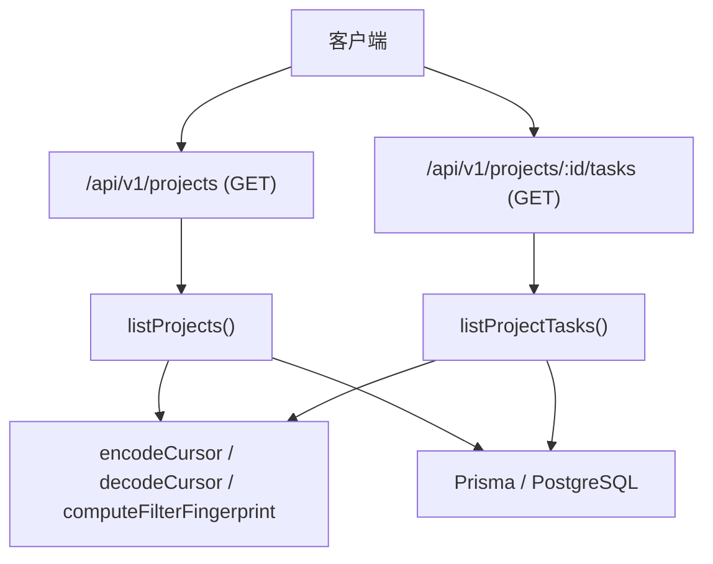
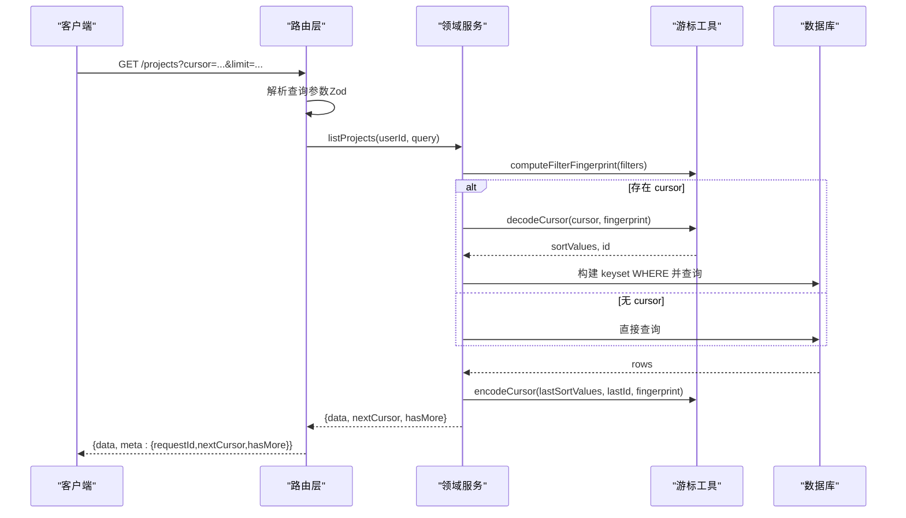
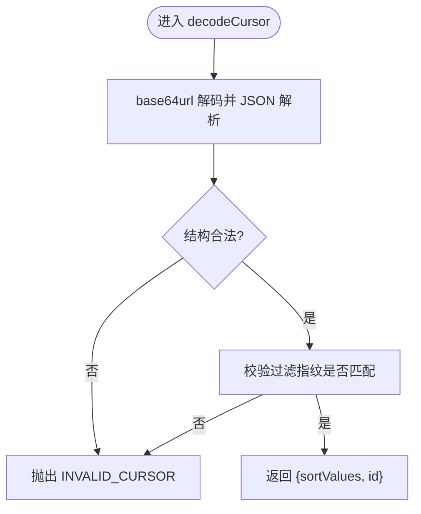
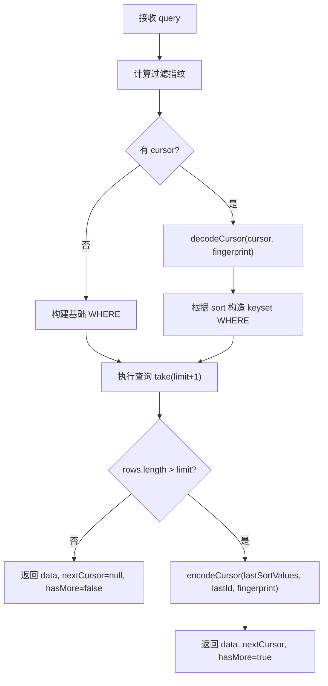
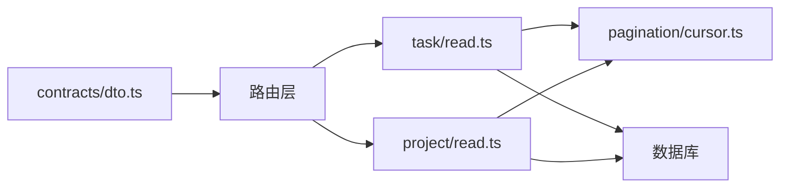

# 分页服务

<cite>
**本文引用的文件**
- [src/server/modules/pagination/cursor.ts](file://src/server/modules/pagination/cursor.ts)
- [src/server/modules/task/read.ts](file://src/server/modules/task/read.ts)
- [src/server/modules/project/read.ts](file://src/server/modules/project/read.ts)
- [src/app/api/v1/projects/route.ts](file://src/app/api/v1/projects/route.ts)
- [src/app/api/v1/projects/[projectId]/tasks/route.ts](file://src/app/api/v1/projects/[projectId]/tasks/route.ts)
- [src/contracts/dto.ts](file://src/contracts/dto.ts)
- [tests/integration/project.test.ts](file://tests/integration/project.test.ts)
- [tests/contract/m2-envelope.test.ts](file://tests/contract/m2-envelope.test.ts)
</cite>

## 目录
1. [简介](#简介)
2. [项目结构](#项目结构)
3. [核心组件](#核心组件)
4. [架构总览](#架构总览)
5. [详细组件分析](#详细组件分析)
6. [依赖关系分析](#依赖关系分析)
7. [性能考量](#性能考量)
8. [故障排查指南](#故障排查指南)
9. [结论](#结论)
10. [附录：API 使用示例与最佳实践](#附录api-使用示例与最佳实践)

## 简介
本文件面向 Orbit 项目的分页服务，聚焦游标（keyset）分页的设计原理、实现细节与性能优势。文档覆盖游标的生成、解析与验证机制；分页参数处理、结果集限制与排序策略；在不同数据源上的适配方案与优化技巧；并给出 API 使用示例、错误处理与一致性保证；最后提供扩展性设计、缓存策略、监控指标建议以及调优与常见问题解决方案。

## 项目结构
分页能力由“基础设施 + 领域服务 + 路由层”三层协作构成：
- 基础设施：统一游标编码/解码与过滤指纹计算，确保跨模块一致性与安全性。
- 领域服务：在任务与项目列表查询中应用 keyset 分页，结合过滤、排序与权限控制。
- 路由层：负责请求生命周期编排、参数校验、调用领域服务并返回统一信封响应。

图表来源
- [src/app/api/v1/projects/route.ts:36-53](file://src/app/api/v1/projects/route.ts#L36-L53)
- [src/app/api/v1/projects/[projectId]/tasks/route.ts:44-62](file://src/app/api/v1/projects/[projectId]/tasks/route.ts#L44-L62)
- [src/server/modules/project/read.ts:65-134](file://src/server/modules/project/read.ts#L65-L134)
- [src/server/modules/task/read.ts:149-227](file://src/server/modules/task/read.ts#L149-L227)
- [src/server/modules/pagination/cursor.ts:33-76](file://src/server/modules/pagination/cursor.ts#L33-L76)

章节来源
- [src/app/api/v1/projects/route.ts:36-53](file://src/app/api/v1/projects/route.ts#L36-L53)
- [src/app/api/v1/projects/[projectId]/tasks/route.ts:44-62](file://src/app/api/v1/projects/[projectId]/tasks/route.ts#L44-L62)
- [src/server/modules/project/read.ts:65-134](file://src/server/modules/project/read.ts#L65-L134)
- [src/server/modules/task/read.ts:149-227](file://src/server/modules/task/read.ts#L149-L227)
- [src/server/modules/pagination/cursor.ts:33-76](file://src/server/modules/pagination/cursor.ts#L33-L76)

## 核心组件
- 游标基础设施（cursor.ts）
  - encodeCursor：将排序字段值、末项 id 与过滤指纹编码为 base64url 字符串。
  - decodeCursor：解码并严格校验结构、类型与过滤指纹，非法或过滤不匹配抛出 INVALID_CURSOR。
  - computeFilterFingerprint：对过滤条件进行稳定序列化后取 SHA-256 前缀，绑定游标到当前过滤上下文。
- 任务列表（task/read.ts）
  - listProjectTasks：支持 updated_desc、due_asc、priority_desc 三种排序；构造 keyset WHERE；限制 limit（默认 30，上限 100）。
- 项目列表（project/read.ts）
  - listProjects：基于 updatedAt DESC, id DESC 的 keyset 分页；支持 scope 与 archived 过滤。
- 路由层（projects route、tasks route）
  - 解析查询参数（含 cursor、limit、sort、过滤等），调用领域服务，返回统一信封 {data, meta}。

章节来源
- [src/server/modules/pagination/cursor.ts:33-76](file://src/server/modules/pagination/cursor.ts#L33-L76)
- [src/server/modules/task/read.ts:40-70](file://src/server/modules/task/read.ts#L40-L70)
- [src/server/modules/task/read.ts:149-227](file://src/server/modules/task/read.ts#L149-L227)
- [src/server/modules/project/read.ts:27-35](file://src/server/modules/project/read.ts#L27-L35)
- [src/server/modules/project/read.ts:65-134](file://src/server/modules/project/read.ts#L65-L134)
- [src/app/api/v1/projects/route.ts:36-53](file://src/app/api/v1/projects/route.ts#L36-L53)
- [src/app/api/v1/projects/[projectId]/tasks/route.ts:44-62](file://src/app/api/v1/projects/[projectId]/tasks/route.ts#L44-L62)

## 架构总览
下图展示了从 HTTP 请求到数据库查询的关键流程，突出游标在其中的作用点。

图表来源
- [src/app/api/v1/projects/route.ts:36-53](file://src/app/api/v1/projects/route.ts#L36-L53)
- [src/server/modules/project/read.ts:65-134](file://src/server/modules/project/read.ts#L65-L134)
- [src/server/modules/pagination/cursor.ts:33-76](file://src/server/modules/pagination/cursor.ts#L33-L76)

## 详细组件分析

### 游标基础设施（cursor.ts）
- 设计要点
  - 游标是不透明字符串，内部包含排序字段值数组 v、末项 id、过滤指纹 f。
  - 过滤指纹将游标绑定到当前过滤条件，避免跨过滤拼接导致的数据不一致。
  - 编码采用 base64url，长度受契约约束（≤2048）。
- 关键函数
  - computeFilterFingerprint：对过滤条件稳定序列化后取 SHA-256 前 16 位。
  - encodeCursor：将 v、id、f 编码为 base64url 字符串。
  - decodeCursor：解码并校验结构与类型，比较过滤指纹，非法或不匹配抛 INVALID_CURSOR。

图表来源
- [src/server/modules/pagination/cursor.ts:52-76](file://src/server/modules/pagination/cursor.ts#L52-L76)

章节来源
- [src/server/modules/pagination/cursor.ts:15-76](file://src/server/modules/pagination/cursor.ts#L15-L76)

### 任务列表分页（task/read.ts）
- 排序策略
  - updated_desc（默认）：updatedAt DESC, id DESC。
  - due_asc：dueDate ASC NULLS LAST, id ASC。
  - priority_desc：priority DESC（枚举序 HIGH→NONE），id DESC。
- 游标 keyset 条件
  - 对每种排序构造“严格其后”的 OR 条件，确保稳定且可索引的扫描。
  - 对因时间/日期/优先级导致的边界情况（如 null 截止日、优先级集合）做专门处理。
- 过滤与限制
  - 支持 q（标题模糊匹配）、status、priority、assigneeId/unassigned、overdue、deleted。
  - limit 默认 30，最大 100；查询时 take limit+1 以判断是否有下一页。
- 安全与健壮性
  - 游标内值视为不可信输入，先做语义校验再用于比较，避免 500 错误。
  - 过滤指纹非 HMAC，因此 decode 阶段必须校验指纹，防止篡改。

图表来源
- [src/server/modules/task/read.ts:149-227](file://src/server/modules/task/read.ts#L149-L227)
- [src/server/modules/task/read.ts:61-135](file://src/server/modules/task/read.ts#L61-L135)

章节来源
- [src/server/modules/task/read.ts:40-135](file://src/server/modules/task/read.ts#L40-L135)
- [src/server/modules/task/read.ts:149-227](file://src/server/modules/task/read.ts#L149-L227)

### 项目列表分页（project/read.ts）
- 排序策略：updatedAt DESC, id DESC。
- 过滤：scope（all/owned/joined）、archived（exclude/only）。
- 游标：携带 (updatedAt, id) 与过滤指纹；非法值或指纹不匹配 → INVALID_CURSOR。
- 限制：默认 30，上限 100；take limit+1 判断 hasMore。

章节来源
- [src/server/modules/project/read.ts:27-35](file://src/server/modules/project/read.ts#L27-L35)
- [src/server/modules/project/read.ts:65-134](file://src/server/modules/project/read.ts#L65-L134)

### 路由层与参数处理
- 查询参数校验：通过 Zod schema 校验 cursor、limit、sort、过滤等参数。
- 响应封装：统一返回 {data, meta:{requestId, nextCursor, hasMore}}。
- 错误处理：捕获领域异常并转换为统一错误信封。

章节来源
- [src/app/api/v1/projects/route.ts:36-53](file://src/app/api/v1/projects/route.ts#L36-L53)
- [src/app/api/v1/projects/[projectId]/tasks/route.ts:44-62](file://src/app/api/v1/projects/[projectId]/tasks/route.ts#L44-L62)
- [src/contracts/dto.ts:447-475](file://src/contracts/dto.ts#L447-L475)

## 依赖关系分析
- 路由层依赖 contracts 中的 DTO schema 进行参数校验。
- 领域服务依赖游标基础设施进行游标编解码与指纹计算。
- 领域服务依赖 Prisma 与数据库索引（updatedAt、dueDate、priority、id）以获得高效 keyset 扫描。
- 测试用例验证分页正确性、信封格式与响应头一致性。

图表来源
- [src/contracts/dto.ts:447-475](file://src/contracts/dto.ts#L447-L475)
- [src/app/api/v1/projects/route.ts:36-53](file://src/app/api/v1/projects/route.ts#L36-L53)
- [src/app/api/v1/projects/[projectId]/tasks/route.ts:44-62](file://src/app/api/v1/projects/[projectId]/tasks/route.ts#L44-L62)
- [src/server/modules/task/read.ts:149-227](file://src/server/modules/task/read.ts#L149-L227)
- [src/server/modules/project/read.ts:65-134](file://src/server/modules/project/read.ts#L65-L134)
- [src/server/modules/pagination/cursor.ts:33-76](file://src/server/modules/pagination/cursor.ts#L33-L76)

章节来源
- [src/contracts/dto.ts:447-475](file://src/contracts/dto.ts#L447-L475)
- [src/server/modules/pagination/cursor.ts:33-76](file://src/server/modules/pagination/cursor.ts#L33-L76)

## 性能考量
- 为什么选择游标分页
  - 偏移分页在大偏移量下需要扫描并丢弃大量行，复杂度随偏移增长；游标分页基于有序键直接定位下一页起点，时间复杂度与页大小相关，适合大数据集。
  - 本项目中，updated_at、due_date、priority 配合 id 作为稳定排序键，便于建立合适索引，使 keyset 条件高效命中。
- 查询优化
  - 使用 take(limit+1) 仅多取一行即可判断 hasMore，避免额外 count 查询。
  - 对模糊搜索 q 进行通配符转义，避免退化全表扫描。
  - 针对 overdue 场景按用户时区计算 today，减少不必要的 UTC 转换误差。
- 索引建议
  - 任务表：(projectId, deletedAt, status, priority, dueDate, updatedAt, id)。
  - 项目表：(ownerId, archivedAt, updatedAt, id) 与 (members.userId, projectId, updatedAt, id)。
- 并发与一致性
  - 只读路径使用应用级 Prisma 单例，不开事务，降低锁竞争。
  - 游标绑定过滤指纹，避免跨过滤拼接导致的不一致。

[本节为通用性能讨论，无需特定文件引用]

## 故障排查指南
- 常见错误
  - INVALID_CURSOR：游标损坏、过滤条件变化或排序变更导致指纹不匹配；需前端刷新列表或重新获取首屏。
  - VALIDATION_ERROR：同时指定 assigneeId 与 unassigned=true；或请求体/查询参数不符合 schema。
  - NOT_FOUND：非成员访问项目资源或软删除任务。
- 排查步骤
  - 检查请求中的 cursor 是否与当前过滤/排序一致。
  - 确认 limit 是否在 1–100 范围内。
  - 查看日志中的 requestId 与错误码，定位具体环节。
- 参考断言与行为
  - 集成测试验证分页连续性（两页 id 不重叠）。
  - 信封测试验证响应头 Cache-Control 与 requestId 一致性。

章节来源
- [tests/integration/project.test.ts:618-637](file://tests/integration/project.test.ts#L618-L637)
- [tests/contract/m2-envelope.test.ts:227-235](file://tests/contract/m2-envelope.test.ts#L227-L235)

## 结论
Orbit 的分页服务以游标（keyset）为核心，通过稳定的排序键与过滤指纹绑定，实现了高效、安全且可扩展的分页能力。相比传统偏移分页，它在大数据集上具备显著的性能优势，并通过严格的参数校验与错误处理保障数据一致性与用户体验。未来可在索引优化、缓存策略与监控指标方面持续演进。

[本节为总结性内容，无需特定文件引用]

## 附录：API 使用示例与最佳实践

### 列出项目（GET /api/v1/projects）
- 参数
  - cursor：可选，上一页返回的 nextCursor。
  - limit：可选，1–100，默认 30。
  - scope：可选，all/owned/joined。
  - archived：可选，exclude/only。
- 响应
  - data：项目数组。
  - meta：{requestId, nextCursor, hasMore}。
- 示例
  - 首次加载：GET /api/v1/projects?scope=owned&limit=20
  - 下一页：GET /api/v1/projects?scope=owned&limit=20&cursor=<nextCursor>

章节来源
- [src/app/api/v1/projects/route.ts:36-53](file://src/app/api/v1/projects/route.ts#L36-L53)
- [src/server/modules/project/read.ts:65-134](file://src/server/modules/project/read.ts#L65-L134)
- [src/contracts/dto.ts:454-459](file://src/contracts/dto.ts#L454-L459)

### 列出项目任务（GET /api/v1/projects/:projectId/tasks）
- 参数
  - cursor：可选。
  - limit：可选，1–100，默认 30。
  - sort：可选，updated_desc/due_asc/priority_desc。
  - q/status/priority/assigneeId/unassigned/overdue/deleted：可选过滤。
- 响应
  - data：任务摘要数组。
  - meta：{requestId, nextCursor, hasMore}。
- 示例
  - 首次加载：GET /api/v1/projects/{projectId}/tasks?sort=updated_desc&limit=30
  - 下一页：GET /api/v1/projects/{projectId}/tasks?sort=updated_desc&limit=30&cursor=<nextCursor>

章节来源
- [src/app/api/v1/projects/[projectId]/tasks/route.ts:44-62](file://src/app/api/v1/projects/[projectId]/tasks/route.ts#L44-L62)
- [src/server/modules/task/read.ts:149-227](file://src/server/modules/task/read.ts#L149-L227)
- [src/contracts/dto.ts:465-475](file://src/contracts/dto.ts#L465-L475)

### 最佳实践
- 始终使用服务端返回的 nextCursor，不要自行拼接或修改。
- 当过滤或排序改变时，应重置 cursor 并重新拉取首屏。
- 合理设置 limit，避免过大导致响应体积膨胀。
- 关注 hasMore 标志，决定是否继续请求下一页。
- 在客户端缓存首屏数据，结合增量加载更多提升体验。

[本节为通用实践指导，无需特定文件引用]