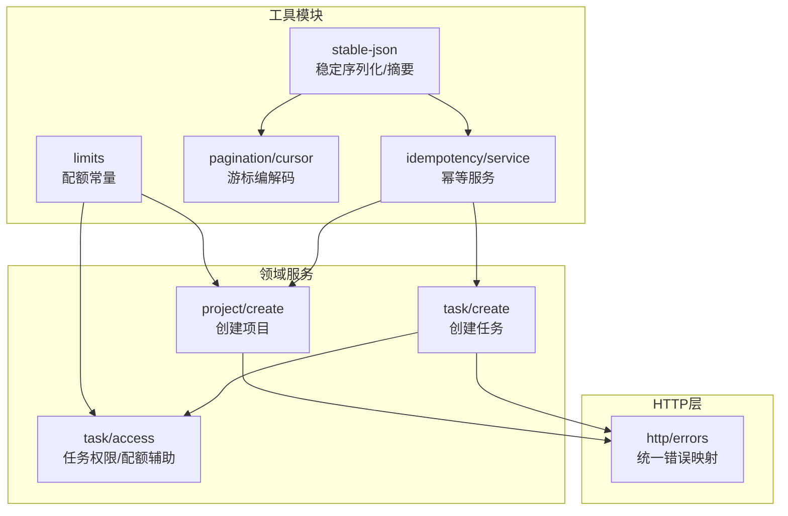
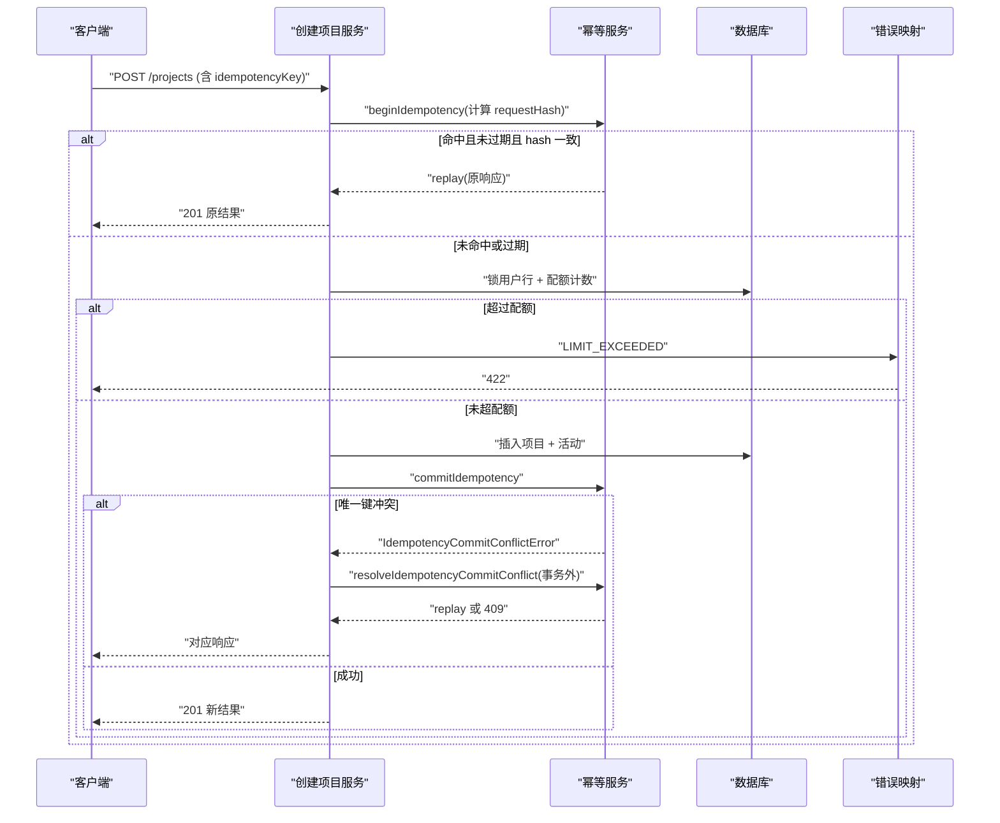
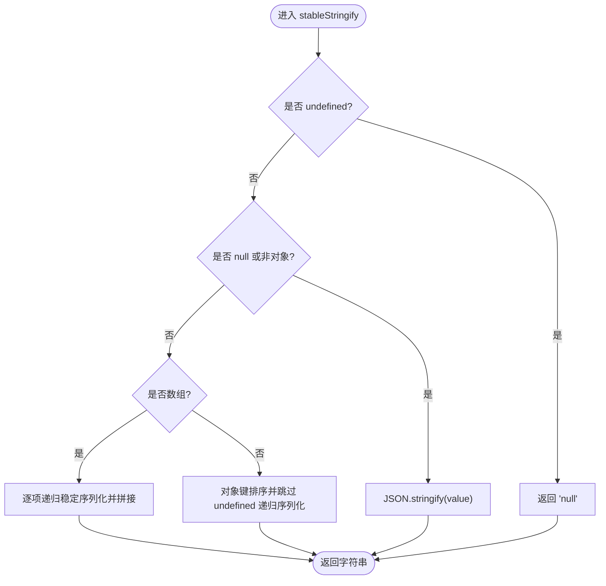
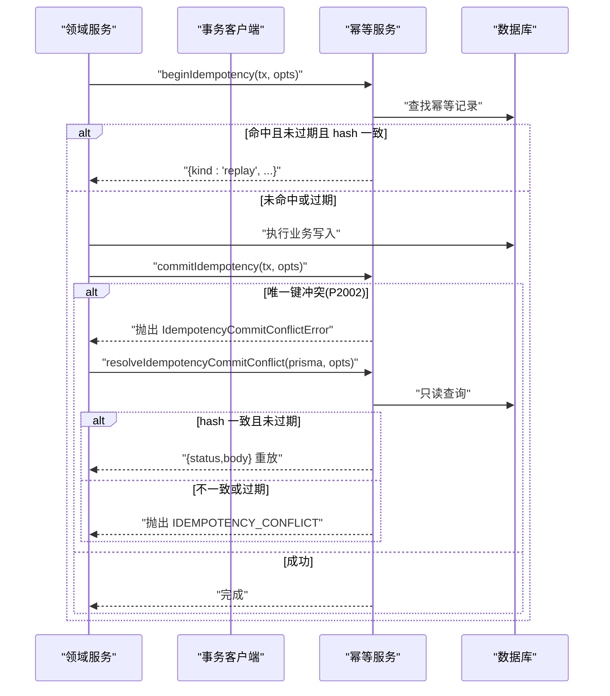
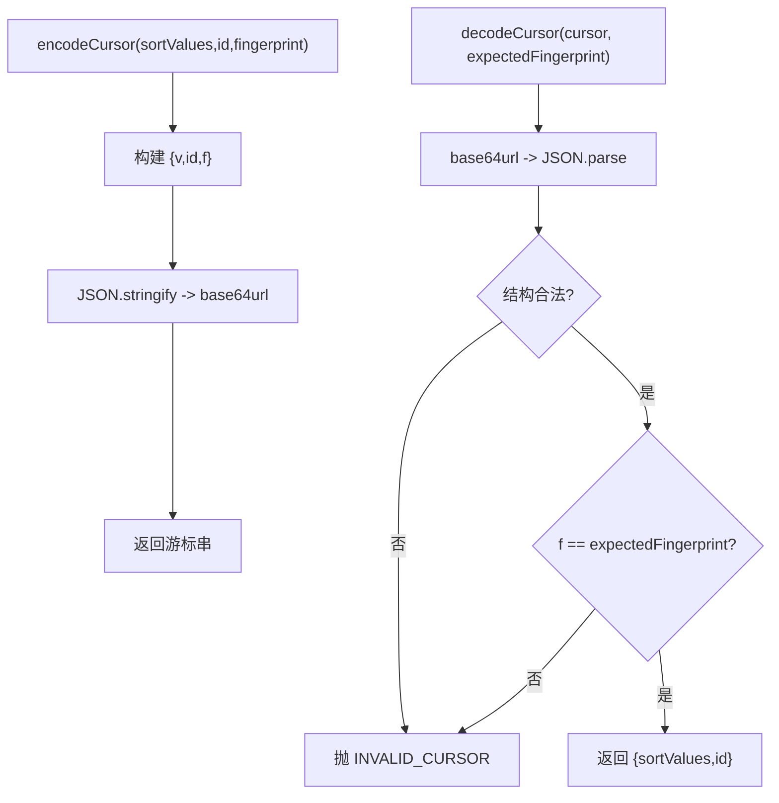
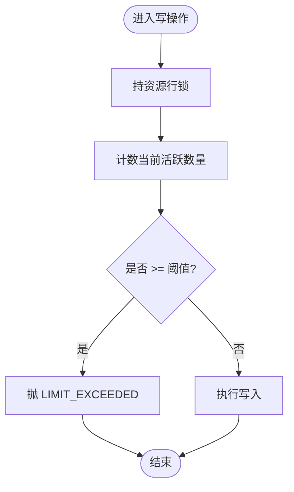
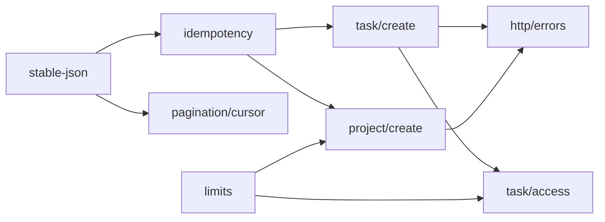

# 工具模块

<cite>
**本文引用的文件**
- [src/server/modules/stable-json.ts](file://src/server/modules/stable-json.ts)
- [src/server/modules/idempotency/service.ts](file://src/server/modules/idempotency/service.ts)
- [src/server/modules/pagination/cursor.ts](file://src/server/modules/pagination/cursor.ts)
- [src/server/modules/limits.ts](file://src/server/modules/limits.ts)
- [src/server/modules/project/create.ts](file://src/server/modules/project/create.ts)
- [src/server/modules/task/create.ts](file://src/server/modules/task/create.ts)
- [src/server/modules/task/access.ts](file://src/server/modules/task/access.ts)
- [src/server/http/errors.ts](file://src/server/http/errors.ts)
- [tests/unit/request-hash.test.ts](file://tests/unit/request-hash.test.ts)
- [tests/integration/project.test.ts](file://tests/integration/project.test.ts)
</cite>

## 目录
1. [简介](#简介)
2. [项目结构](#项目结构)
3. [核心组件](#核心组件)
4. [架构总览](#架构总览)
5. [详细组件分析](#详细组件分析)
6. [依赖关系分析](#依赖关系分析)
7. [性能考虑](#性能考虑)
8. [故障排查指南](#故障排查指南)
9. [结论](#结论)
10. [附录：使用示例与最佳实践](#附录使用示例与最佳实践)

## 简介
本章节面向 Orbit 项目的“工具模块”，聚焦以下目标：
- 限流服务（配额与阈值控制）的实现机制与使用方式。
- 稳定 JSON 序列化的设计目标与技术实现，确保对象序列化的一致性与可预测性。
- 工具模块在业务逻辑层中的作用与价值：幂等、分页游标、配额校验、错误统一等。
- 扩展性与自定义实现方法、配置选项、性能考量与最佳实践。

## 项目结构
工具模块位于 server/modules 下，按职责拆分为：
- stable-json：稳定序列化与摘要，支撑幂等指纹与过滤指纹。
- idempotency：幂等记录服务，封装事务内外的幂等流程与并发冲突处理。
- pagination/cursor：基于 keyset 的分页游标编码/解码与过滤指纹绑定。
- limits：集中定义配额与算法常量，供领域服务在锁内判断。
- project/create、task/create、task/access：领域服务如何组合使用上述工具。
- http/errors：统一错误模型与响应构造，配合工具模块抛出的领域错误。

图表来源
- [src/server/modules/stable-json.ts:1-41](file://src/server/modules/stable-json.ts#L1-L41)
- [src/server/modules/idempotency/service.ts:1-181](file://src/server/modules/idempotency/service.ts#L1-L181)
- [src/server/modules/pagination/cursor.ts:1-77](file://src/server/modules/pagination/cursor.ts#L1-L77)
- [src/server/modules/limits.ts:1-27](file://src/server/modules/limits.ts#L1-L27)
- [src/server/modules/project/create.ts:1-181](file://src/server/modules/project/create.ts#L1-L181)
- [src/server/modules/task/create.ts:1-202](file://src/server/modules/task/create.ts#L1-L202)
- [src/server/modules/task/access.ts:1-102](file://src/server/modules/task/access.ts#L1-L102)
- [src/server/http/errors.ts:1-136](file://src/server/http/errors.ts#L1-L136)

章节来源
- [src/server/modules/stable-json.ts:1-41](file://src/server/modules/stable-json.ts#L1-L41)
- [src/server/modules/idempotency/service.ts:1-181](file://src/server/modules/idempotency/service.ts#L1-L181)
- [src/server/modules/pagination/cursor.ts:1-77](file://src/server/modules/pagination/cursor.ts#L1-L77)
- [src/server/modules/limits.ts:1-27](file://src/server/modules/limits.ts#L1-L27)
- [src/server/modules/project/create.ts:1-181](file://src/server/modules/project/create.ts#L1-L181)
- [src/server/modules/task/create.ts:1-202](file://src/server/modules/task/create.ts#L1-L202)
- [src/server/modules/task/access.ts:1-102](file://src/server/modules/task/access.ts#L1-L102)
- [src/server/http/errors.ts:1-136](file://src/server/http/errors.ts#L1-L136)

## 核心组件
- 稳定 JSON 序列化与摘要
  - 提供稳定字符串化与 SHA-256 摘要，保证键序无关、数组保序、undefined 跳过，用于幂等请求指纹与分页过滤指纹。
- 幂等服务
  - 在事务开始处检查幂等记录，命中则重放；未命中则执行业务并在成功后落库幂等记录；并发唯一键冲突时通过哨兵错误在事务外复查并决定重放或冲突。
- 游标分页
  - 将排序字段值、末项 id 与过滤指纹编码为不透明 base64url 串；解码时校验结构与过滤指纹，防止跨过滤拼接导致结果错误。
- 配额与阈值
  - 集中定义每用户未归档项目上限、每项目成员上限、每项目未删除任务上限、看板 position 初始间隔等常量，供领域服务在锁内计数校验。
- 错误模型
  - 统一领域错误到标准信封响应，状态码由错误码派生，避免泄露内部细节。

章节来源
- [src/server/modules/stable-json.ts:1-41](file://src/server/modules/stable-json.ts#L1-L41)
- [src/server/modules/idempotency/service.ts:1-181](file://src/server/modules/idempotency/service.ts#L1-L181)
- [src/server/modules/pagination/cursor.ts:1-77](file://src/server/modules/pagination/cursor.ts#L1-L77)
- [src/server/modules/limits.ts:1-27](file://src/server/modules/limits.ts#L1-L27)
- [src/server/http/errors.ts:1-136](file://src/server/http/errors.ts#L1-L136)

## 架构总览
工具模块作为共享基础设施，被多个领域服务复用：
- 幂等：通过稳定序列化生成请求指纹，结合数据库唯一约束与事务外复查，保障幂等与并发安全。
- 配额：在持有行锁的事务中计数并比较阈值，超限抛出领域错误。
- 分页：游标绑定过滤指纹，确保过滤变化后旧游标失效。
- 错误：所有工具抛出的领域错误经 HTTP 层统一映射为标准响应。

图表来源
- [src/server/modules/project/create.ts:1-181](file://src/server/modules/project/create.ts#L1-L181)
- [src/server/modules/idempotency/service.ts:1-181](file://src/server/modules/idempotency/service.ts#L1-L181)
- [src/server/http/errors.ts:1-136](file://src/server/http/errors.ts#L1-L136)

## 详细组件分析

### 稳定 JSON 序列化与摘要
- 设计目标
  - 键序无关：对象键递归字典序排序，避免同一逻辑请求因字段顺序不同产生不同指纹。
  - 数组保序：数组顺序有意义，逐项递归序列化。
  - undefined 语义对齐 JSON.stringify：跳过值为 undefined 的键，避免把 undefined 转为 "null"。
  - 输出稳定：相同输入必得相同字符串，便于 SHA-256 摘要。
- 技术实现
  - stableStringify：递归遍历对象/数组，对象键排序并跳过 undefined，数组保持顺序。
  - sha256Hex：对字符串计算 SHA-256 十六进制摘要。
- 复杂度
  - 时间 O(N log N)（对象键排序），空间 O(N)（递归栈与中间字符串）。
- 使用场景
  - 幂等请求指纹：hashRequest = SHA-256(stableStringify(body))。
  - 分页过滤指纹：computeFilterFingerprint(filters)。

图表来源
- [src/server/modules/stable-json.ts:18-35](file://src/server/modules/stable-json.ts#L18-L35)

章节来源
- [src/server/modules/stable-json.ts:1-41](file://src/server/modules/stable-json.ts#L1-L41)
- [tests/unit/request-hash.test.ts:1-63](file://tests/unit/request-hash.test.ts#L1-L63)

### 幂等服务（事务内外协作）
- 关键语义
  - beginIdempotency：事务内查既有记录，命中且未过期且 hash 一致 → replay；已过期 → 删除旧记录并按 new 处理；否则 new。
  - commitIdempotency：业务写入成功后落库幂等记录（expiresAt=now+24h）。若发生唯一键冲突（P2002），当前事务已 aborted，抛出哨兵错误交由事务外处理。
  - resolveIdempotencyCommitConflict：事务外用应用单例只读查询，hash 一致且未过期 → replay；否则 409 IDEMPOTENCY_CONFLICT。
- 并发陷阱与处理
  - PG 唯一键冲突使事务进入 aborted，Prisma 交互式事务不会自动建 SAVEPOINT，故不在事务内复查，避免二次失败。
- 数据流
  - 调用方在 withTransaction 包裹的业务函数中先 begin，再执行业务，最后 commit；捕获哨兵错误后在事务外 resolve。

图表来源
- [src/server/modules/idempotency/service.ts:129-181](file://src/server/modules/idempotency/service.ts#L129-L181)
- [src/server/modules/idempotency/service.ts:95-108](file://src/server/modules/idempotency/service.ts#L95-L108)

章节来源
- [src/server/modules/idempotency/service.ts:1-181](file://src/server/modules/idempotency/service.ts#L1-L181)
- [src/server/modules/project/create.ts:71-181](file://src/server/modules/project/create.ts#L71-L181)
- [src/server/modules/task/create.ts:77-202](file://src/server/modules/task/create.ts#L77-L202)

### 游标分页（keyset + 过滤指纹）
- 约定
  - 游标是不透明串，包含排序字段值、末项 id、过滤指纹。
  - 过滤指纹绑定当前过滤条件：过滤变化即旧游标失效，防止跨过滤拼接出错误结果。
  - 编码采用 base64url，长度受契约约束。
- 实现要点
  - computeFilterFingerprint：对 filters 稳定序列化后取 SHA-256 前 16 位。
  - encodeCursor/decodeCursor：结构校验与指纹匹配，不合法或不匹配抛 INVALID_CURSOR。

图表来源
- [src/server/modules/pagination/cursor.ts:33-76](file://src/server/modules/pagination/cursor.ts#L33-L76)

章节来源
- [src/server/modules/pagination/cursor.ts:1-77](file://src/server/modules/pagination/cursor.ts#L1-L77)

### 配额与阈值控制（限流服务）
- 设计目标
  - 在事务锁内计数并比较阈值，避免前端隐藏按钮绕过限制。
  - 集中管理配额常量，便于产品策略调整与审计。
- 实现要点
  - MAX_ACTIVE_PROJECTS：每用户最多未归档项目数。
  - MAX_PROJECT_MEMBERS：每项目最多成员数（M4 生效）。
  - MAX_OPEN_TASKS：每项目最多未删除任务数。
  - POSITION_GAP：看板 position 初始间隔（bigint）。
- 使用位置
  - 项目创建：锁内计数 active projects，超限抛 LIMIT_EXCEEDED。
  - 任务创建：锁内计数 open tasks，超限抛 LIMIT_EXCEEDED。

图表来源
- [src/server/modules/limits.ts:11-26](file://src/server/modules/limits.ts#L11-L26)
- [src/server/modules/project/create.ts:116-121](file://src/server/modules/project/create.ts#L116-L121)
- [src/server/modules/task/create.ts:123-125](file://src/server/modules/task/create.ts#L123-L125)
- [src/server/modules/task/access.ts:86-92](file://src/server/modules/task/access.ts#L86-L92)

章节来源
- [src/server/modules/limits.ts:1-27](file://src/server/modules/limits.ts#L1-L27)
- [src/server/modules/project/create.ts:1-181](file://src/server/modules/project/create.ts#L1-L181)
- [src/server/modules/task/create.ts:1-202](file://src/server/modules/task/create.ts#L1-L202)
- [src/server/modules/task/access.ts:1-102](file://src/server/modules/task/access.ts#L1-L102)
- [tests/integration/project.test.ts:555-593](file://tests/integration/project.test.ts#L555-L593)

### 错误模型与统一映射
- DomainError：携带 ErrorCode、可选字段级错误与冲突明细，状态码由错误码派生。
- toErrorResponse：DomainError 走其 code/status；其它异常收敛为 INTERNAL_ERROR，仅记录脱敏日志。
- 缓存策略：错误响应带 private,no-store，避免私有内容进入公共缓存。

章节来源
- [src/server/http/errors.ts:1-136](file://src/server/http/errors.ts#L1-L136)

## 依赖关系分析
- stable-json 被 idempotency 与 pagination 共同依赖，提供稳定的序列化与摘要能力。
- idempotency 被 project/create 与 task/create 使用，贯穿幂等流程。
- limits 被 project/create 与 task/access 使用，提供配额常量与错误构造。
- task/create 依赖 task/access 进行配额计数与权限校验。
- 所有领域服务最终通过 http/errors 统一错误映射。

图表来源
- [src/server/modules/stable-json.ts:1-41](file://src/server/modules/stable-json.ts#L1-L41)
- [src/server/modules/idempotency/service.ts:1-181](file://src/server/modules/idempotency/service.ts#L1-L181)
- [src/server/modules/pagination/cursor.ts:1-77](file://src/server/modules/pagination/cursor.ts#L1-L77)
- [src/server/modules/limits.ts:1-27](file://src/server/modules/limits.ts#L1-L27)
- [src/server/modules/project/create.ts:1-181](file://src/server/modules/project/create.ts#L1-L181)
- [src/server/modules/task/create.ts:1-202](file://src/server/modules/task/create.ts#L1-L202)
- [src/server/modules/task/access.ts:1-102](file://src/server/modules/task/access.ts#L1-L102)
- [src/server/http/errors.ts:1-136](file://src/server/http/errors.ts#L1-L136)

章节来源
- [src/server/modules/stable-json.ts:1-41](file://src/server/modules/stable-json.ts#L1-L41)
- [src/server/modules/idempotency/service.ts:1-181](file://src/server/modules/idempotency/service.ts#L1-L181)
- [src/server/modules/pagination/cursor.ts:1-77](file://src/server/modules/pagination/cursor.ts#L1-L77)
- [src/server/modules/limits.ts:1-27](file://src/server/modules/limits.ts#L1-L27)
- [src/server/modules/project/create.ts:1-181](file://src/server/modules/project/create.ts#L1-L181)
- [src/server/modules/task/create.ts:1-202](file://src/server/modules/task/create.ts#L1-L202)
- [src/server/modules/task/access.ts:1-102](file://src/server/modules/task/access.ts#L1-L102)
- [src/server/http/errors.ts:1-136](file://src/server/http/errors.ts#L1-L136)

## 性能考虑
- 稳定序列化
  - 对象键排序带来 O(N log N) 开销；建议对大对象谨慎使用，或在边界层做最小化 payload。
  - 递归深度与对象大小影响内存占用；避免过深嵌套与超大对象。
- 幂等记录
  - 唯一键冲突会导致事务 aborted，需在外层重试或走重放分支；合理设置 idempotencyKey 生命周期与 TTL。
  - 24h 有效期减少存储压力；过期后允许重新执行。
- 游标分页
  - 过滤指纹截断至 16 位，兼顾区分度与长度；避免过长游标影响网络传输。
- 配额计数
  - 必须在锁内计数，避免并发竞态；热点资源（如项目）加锁粒度要合理，避免过度串行化。

[本节为通用性能讨论，不直接分析具体文件]

## 故障排查指南
- 幂等冲突
  - 现象：同 key 异 body 报 409 IDEMPOTENCY_CONFLICT；并发提交可能触发唯一键冲突。
  - 排查：确认 idempotencyKey 是否重复使用；检查请求体是否一致；查看事务外 resolve 分支是否命中重放。
- 游标无效
  - 现象：INVALID_CURSOR。
  - 排查：检查过滤器是否变化；确认游标编码/解码是否一致；验证 base64url 与 JSON 结构。
- 配额超限
  - 现象：LIMIT_EXCEEDED。
  - 排查：确认当前活跃数量是否达到阈值；检查是否在锁内计数；必要时归档或清理资源。
- 错误响应
  - 现象：非预期状态码或消息。
  - 排查：确认抛出的 DomainError 是否正确；检查 toErrorResponse 映射；避免泄露内部细节。

章节来源
- [src/server/modules/idempotency/service.ts:54-108](file://src/server/modules/idempotency/service.ts#L54-L108)
- [src/server/modules/pagination/cursor.ts:28-76](file://src/server/modules/pagination/cursor.ts#L28-L76)
- [src/server/modules/limits.ts:11-26](file://src/server/modules/limits.ts#L11-L26)
- [src/server/http/errors.ts:39-136](file://src/server/http/errors.ts#L39-L136)

## 结论
工具模块为 Orbit 提供了稳定、可复用的基础设施能力：
- 稳定 JSON 序列化确保幂等与分页的确定性。
- 幂等服务在事务内外协作，正确处理并发冲突与重放。
- 配额与阈值在锁内计数，保障一致性。
- 游标分页绑定过滤指纹，防止跨过滤拼接错误。
- 统一错误模型提升可观测性与安全性。
这些能力贯穿项目创建、任务创建等核心流程，显著提升了系统的可靠性与可维护性。

[本节为总结性内容，不直接分析具体文件]

## 附录：使用示例与最佳实践

- 幂等请求指纹
  - 使用 hashRequest(body) 生成稳定指纹，确保键序无关、数组保序、undefined 跳过。
  - 参考测试用例验证行为：键序无关、内容敏感、空对象稳定、嵌套递归排序等。
  - 章节来源
    - [tests/unit/request-hash.test.ts:1-63](file://tests/unit/request-hash.test.ts#L1-L63)

- 项目创建中的配额与幂等
  - 在事务内先锁用户行，再 beginIdempotency，然后计数 active projects，超限抛 LIMIT_EXCEEDED。
  - 成功后 commitIdempotency；若唯一键冲突，在事务外 resolve 并重放或返回冲突。
  - 章节来源
    - [src/server/modules/project/create.ts:71-181](file://src/server/modules/project/create.ts#L71-L181)
    - [tests/integration/project.test.ts:555-593](file://tests/integration/project.test.ts#L555-L593)

- 任务创建中的配额与权限
  - 在事务内先锁项目行，复核成员与归档态，再 beginIdempotency，计数 open tasks，超限抛 LIMIT_EXCEEDED。
  - 负责人必须为项目 owner 或成员，否则抛 ASSIGNEE_NOT_MEMBER。
  - 章节来源
    - [src/server/modules/task/create.ts:77-202](file://src/server/modules/task/create.ts#L77-L202)
    - [src/server/modules/task/access.ts:62-84](file://src/server/modules/task/access.ts#L62-L84)

- 游标分页的使用
  - 编码：encodeCursor(sortValues, id, fingerprint)。
  - 解码：decodeCursor(cursor, expectedFingerprint)，不合法或不匹配抛 INVALID_CURSOR。
  - 章节来源
    - [src/server/modules/pagination/cursor.ts:33-76](file://src/server/modules/pagination/cursor.ts#L33-L76)

- 配置选项与扩展
  - 配额常量集中在 limits.ts，便于产品策略调整。
  - 幂等 TTL、游标指纹长度等可在对应模块内调整，但需评估对稳定性与性能的影响。
  - 章节来源
    - [src/server/modules/limits.ts:11-26](file://src/server/modules/limits.ts#L11-L26)
    - [src/server/modules/pagination/cursor.ts:15-36](file://src/server/modules/pagination/cursor.ts#L15-L36)
    - [src/server/modules/idempotency/service.ts:30-31](file://src/server/modules/idempotency/service.ts#L30-L31)

- 最佳实践
  - 始终在事务锁内进行配额计数与幂等检查，避免前端绕过。
  - 使用稳定序列化生成指纹，确保键序无关与内容敏感。
  - 对大对象谨慎使用稳定序列化，控制 payload 大小。
  - 错误统一通过 DomainError 与 toErrorResponse，避免泄露内部细节。
  - 游标变更过滤时必须刷新列表，避免使用过期游标。

[本节为实践指导，不直接分析具体文件]