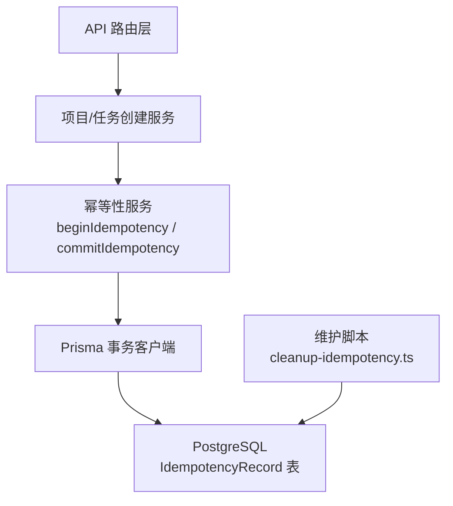
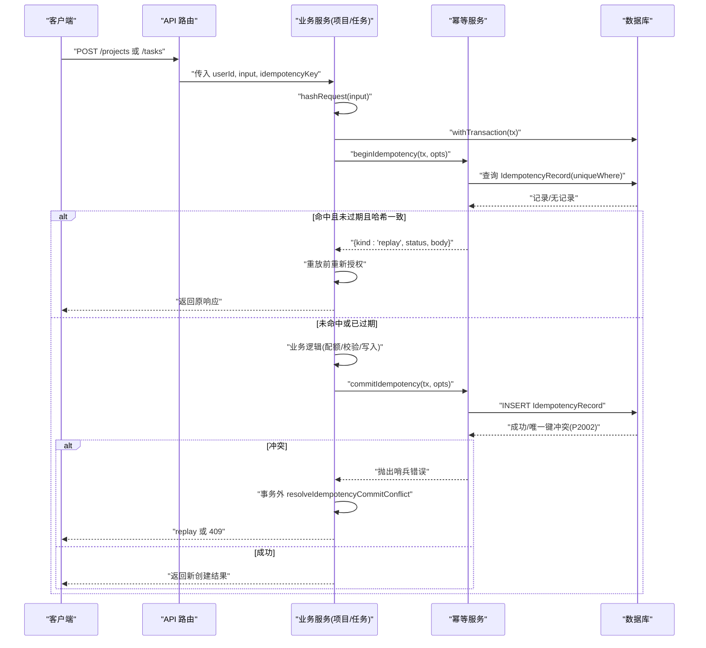
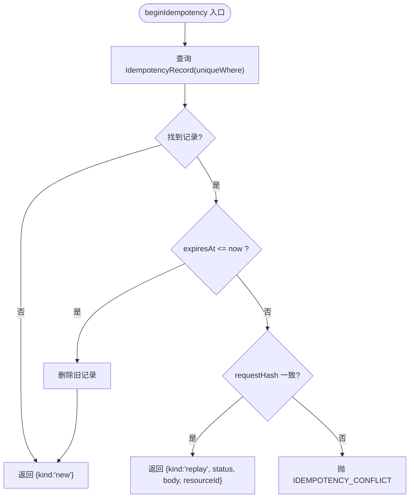
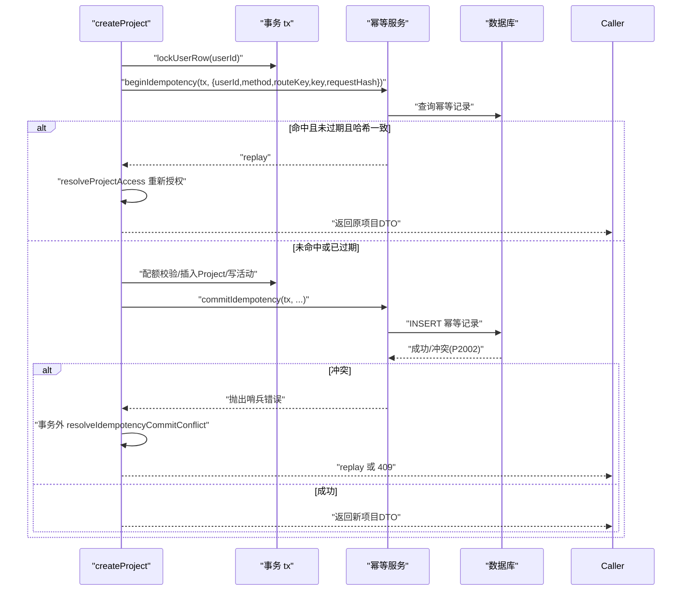
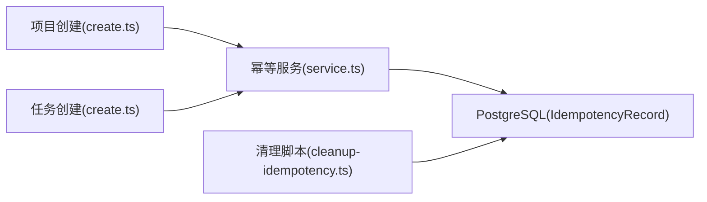

# 幂等性服务

<cite>
**本文引用的文件**
- [service.ts](file://src/server/modules/idempotency/service.ts)
- [create.ts（项目）](file://src/server/modules/project/create.ts)
- [create.ts（任务）](file://src/server/modules/task/create.ts)
- [schema.prisma](file://prisma/schema.prisma)
- [cleanup-idempotency.ts](file://scripts/cleanup-idempotency.ts)
- [idempotency.test.ts](file://tests/integration/idempotency.test.ts)
</cite>

## 目录
1. [简介](#简介)
2. [项目结构](#项目结构)
3. [核心组件](#核心组件)
4. [架构总览](#架构总览)
5. [详细组件分析](#详细组件分析)
6. [依赖关系分析](#依赖关系分析)
7. [性能考量](#性能考量)
8. [故障排查指南](#故障排查指南)
9. [结论](#结论)
10. [附录：使用示例与最佳实践](#附录使用示例与最佳实践)

## 简介
本文件系统性说明 Orbit 项目的幂等性服务设计、实现与使用。幂等性在分布式系统中至关重要，它能保证“相同请求重复提交”不会导致副作用被重复执行，从而提升系统在重试、网络抖动、消息重发、定时任务重复触发等场景下的可靠性与一致性。

Orbit 的幂等性服务以数据库为持久化载体，通过“唯一键 + 请求体规范化哈希 + 响应缓存 + TTL 过期清理”的组合，提供强一致的去重与重放能力；并在事务边界内完成幂等检查与落库，确保业务写入与幂等记录原子一致。

## 项目结构
幂等性相关代码主要分布在以下位置：
- 幂等服务核心：src/server/modules/idempotency/service.ts
- 业务模块集成点：
  - 项目创建：src/server/modules/project/create.ts
  - 任务创建：src/server/modules/task/create.ts
- 数据模型与索引：prisma/schema.prisma（IdempotencyRecord 表及约束/索引）
- 维护脚本：scripts/cleanup-idempotency.ts（过期记录清理）
- 集成测试：tests/integration/idempotency.test.ts（覆盖重放、冲突、过期语义）

图表来源
- [service.ts:129-180](file://src/server/modules/idempotency/service.ts#L129-L180)
- [create.ts（项目）:71-180](file://src/server/modules/project/create.ts#L71-L180)
- [create.ts（任务）:77-202](file://src/server/modules/task/create.ts#L77-L202)
- [schema.prisma:197-214](file://prisma/schema.prisma#L197-L214)
- [cleanup-idempotency.ts:27-98](file://scripts/cleanup-idempotency.ts#L27-L98)

章节来源
- [service.ts:1-181](file://src/server/modules/idempotency/service.ts#L1-L181)
- [schema.prisma:197-214](file://prisma/schema.prisma#L197-L214)

## 核心组件
- 幂等记录模型 IdempotencyRecord：存储 (userId, method, routeKey, key) 唯一键对应的请求哈希、响应状态码、响应体、资源 ID 以及过期时间。
- 幂等服务函数：
  - beginIdempotency：事务开始时查询幂等记录，判定 new/replay/冲突/过期。
  - commitIdempotency：业务成功后写入幂等记录，处理并发唯一键冲突。
  - resolveIdempotencyCommitConflict：事务外复查冲突，决定 replay 或 409。
  - hashRequest：对请求体进行稳定序列化并计算 SHA-256 哈希。
- 业务集成：
  - 项目创建：在用户行锁后执行幂等检查，配额校验，写入项目与活动日志，最后落幂等记录。
  - 任务创建：在项目行锁后执行成员/归档复核，再执行幂等检查、配额校验、编号与位置分配、写入任务与活动日志，最后落幂等记录。
- 维护脚本：按 expiresAt 索引分批删除过期幂等记录，避免长事务与锁竞争。

章节来源
- [service.ts:62-180](file://src/server/modules/idempotency/service.ts#L62-L180)
- [create.ts（项目）:71-180](file://src/server/modules/project/create.ts#L71-L180)
- [create.ts（任务）:77-202](file://src/server/modules/task/create.ts#L77-L202)
- [schema.prisma:197-214](file://prisma/schema.prisma#L197-L214)
- [cleanup-idempotency.ts:27-98](file://scripts/cleanup-idempotency.ts#L27-L98)

## 架构总览
幂等性贯穿“请求进入 → 鉴权/授权 → 幂等检查 → 业务执行 → 幂等落库 → 返回结果”的全链路。关键特性：
- 唯一键维度：(userId, method, routeKey, key)。其中 routeKey 是规范化后的路径（不含具体资源 ID），key 由调用方生成（如 UUID）。
- 请求体规范化：通过稳定序列化与 SHA-256 计算 requestHash，用于判断“同 key 是否同内容”。
- 重放策略：命中且未过期且哈希一致则直接返回原响应；过期后不再去重，允许重新执行。
- 并发安全：利用数据库唯一约束与事务，捕获 P2002 冲突后不在事务内复查，抛出哨兵错误交由事务外解决。
- 过期清理：独立脚本基于 expiresAt 索引批量删除，避免影响在线请求路径。

图表来源
- [service.ts:129-180](file://src/server/modules/idempotency/service.ts#L129-L180)
- [create.ts（项目）:71-180](file://src/server/modules/project/create.ts#L71-L180)
- [create.ts（任务）:77-202](file://src/server/modules/task/create.ts#L77-L202)

## 详细组件分析

### 幂等服务核心（service.ts）
- 唯一键与 where 条件：
  - uniqueWhere(opts) 构造 (userId, method, routeKey, key) 复合条件，对应数据库唯一约束。
- 请求哈希：
  - hashRequest(body) 使用稳定序列化与 SHA-256，保证键序无关的等价请求产生相同哈希。
- 开始阶段 beginIdempotency：
  - 若不存在记录 → new；
  - 若存在但已过期 → 删除旧记录并按 new 处理；
  - 若存在且未过期且哈希一致 → replay；
  - 若存在且未过期但哈希不同 → 抛 IDEMPOTENCY_CONFLICT。
- 提交阶段 commitIdempotency：
  - 写入幂等记录（expiresAt = now + 24h）；
  - 捕获 P2002 唯一键冲突时，不在此事务内复查（事务已 aborted），抛出 IdempotencyCommitConflictError 哨兵错误。
- 事务外复查 resolveIdempotencyCommitConflict：
  - 用应用单例只读查询既有记录，若存在且未过期且哈希一致 → 返回原响应（视为并发重放）；否则抛 409 IDEMPOTENCY_CONFLICT。

图表来源
- [service.ts:129-146](file://src/server/modules/idempotency/service.ts#L129-L146)

章节来源
- [service.ts:62-180](file://src/server/modules/idempotency/service.ts#L62-L180)

### 项目创建中的幂等集成（project/create.ts）
- 幂等键参数：
  - userId：会话确认的用户 ID；
  - method：固定为 "POST"；
  - routeKey：CREATE_PROJECT_ROUTE_KEY = "POST /projects"；
  - key：调用方提供的幂等键（通常为 UUID）；
  - requestHash：对输入 DTO 的稳定哈希。
- 事务顺序：
  - lockUserRow（串行化配额与幂等）→ beginIdempotency → 配额计数 → 插入 Project → 写活动日志 → commitIdempotency。
- 重放前重新授权：
  - 若 replay 且包含 resourceId，调用 resolveProjectAccess 再次校验当前用户对资源的可见性，防止退出成员借旧缓存读取。
- 并发冲突处理：
  - 捕获 IdempotencyCommitConflictError 后，在事务外用 resolveIdempotencyCommitConflict 决定 replay 或 409。

图表来源
- [create.ts（项目）:71-180](file://src/server/modules/project/create.ts#L71-L180)
- [service.ts:129-180](file://src/server/modules/idempotency/service.ts#L129-L180)

章节来源
- [create.ts（项目）:71-180](file://src/server/modules/project/create.ts#L71-L180)

### 任务创建中的幂等集成（task/create.ts）
- 幂等键参数：
  - userId：会话确认的用户 ID；
  - method：固定为 "POST"；
  - routeKey：createTaskRouteKey(projectId) = "POST /projects/{projectId}/tasks"；
  - key：调用方提供的幂等键；
  - requestHash：对输入 DTO 的稳定哈希。
- 事务顺序：
  - lockProjectRow（串行化编号、配额、position 与 boardVersion）→ requireWritableTaskProject（成员+非归档复核）→ beginIdempotency → 配额计数 → nextTaskNumber/appendToColumnEnd → INSERT Task → boardVersion++ → 写活动 → commitIdempotency。
- 重放分支：
  - 若 replay，则在持锁后重新确认成员关系与项目可写，再读取任务详情返回。
- 并发冲突处理：
  - 捕获 IdempotencyCommitConflictError 后，在新事务与项目锁内重新执行授权、目标可见性及幂等检查。

章节来源
- [create.ts（任务）:77-202](file://src/server/modules/task/create.ts#L77-L202)

### 数据模型与索引（schema.prisma）
- IdempotencyRecord 字段：
  - id：主键；
  - userId、method、routeKey、key：构成唯一键；
  - requestHash：请求体规范化哈希；
  - responseStatus、responseBody：缓存响应；
  - resourceId：关联的业务资源 ID；
  - createdAt、expiresAt：创建时间与过期时间。
- 约束与索引：
  - @@unique([userId, method, routeKey, key])：保证同一用户、方法、路由、幂等键的唯一性；
  - @@index([expiresAt])：支持过期记录的快速清理。

章节来源
- [schema.prisma:197-214](file://prisma/schema.prisma#L197-L214)

### 过期清理与维护（cleanup-idempotency.ts）
- 运行环境限制：仅允许 APP_ENV=development/test，拒绝 staging/production，避免误删生产数据。
- 清理策略：
  - 基于 expiresAt 索引，SELECT id WHERE expiresAt < NOW() LIMIT 1000，然后 DELETE FROM IdempotencyRecord WHERE id IN (...)；
  - 循环直到 affected rows = 0，每批短事务立即提交，避免长时间持锁。
- 支持 --dry-run：仅统计过期记录数，不执行删除。

章节来源
- [cleanup-idempotency.ts:27-98](file://scripts/cleanup-idempotency.ts#L27-L98)

## 依赖关系分析
- 幂等服务依赖：
  - Prisma TransactionClient：用于事务内查询与写入；
  - stable-json 工具：稳定序列化与 SHA-256 哈希；
  - DomainError：统一错误类型。
- 业务模块依赖：
  - 项目/任务创建服务依赖幂等服务进行去重与重放；
  - 依赖授权模块在重放前重新校验权限；
  - 依赖活动日志写入模块记录操作轨迹。
- 数据库依赖：
  - PostgreSQL 唯一约束与索引保障幂等性与清理效率。

图表来源
- [create.ts（项目）:71-180](file://src/server/modules/project/create.ts#L71-L180)
- [create.ts（任务）:77-202](file://src/server/modules/task/create.ts#L77-L202)
- [service.ts:129-180](file://src/server/modules/idempotency/service.ts#L129-L180)
- [schema.prisma:197-214](file://prisma/schema.prisma#L197-L214)
- [cleanup-idempotency.ts:27-98](file://scripts/cleanup-idempotency.ts#L27-L98)

章节来源
- [service.ts:1-181](file://src/server/modules/idempotency/service.ts#L1-L181)
- [create.ts（项目）:71-180](file://src/server/modules/project/create.ts#L71-L180)
- [create.ts（任务）:77-202](file://src/server/modules/task/create.ts#L77-L202)
- [schema.prisma:197-214](file://prisma/schema.prisma#L197-L214)
- [cleanup-idempotency.ts:27-98](file://scripts/cleanup-idempotency.ts#L27-L98)

## 性能考量
- 唯一键查询：
  - 使用 (userId, method, routeKey, key) 复合唯一键，查询高效；
  - 建议确保该组合有合适索引（Prisma 自动维护唯一约束索引）。
- 过期清理：
  - 基于 expiresAt 索引分批删除，避免全表扫描与长事务；
  - 每批 LIMIT 1000，减少锁持有时间。
- 事务边界：
  - 幂等检查与业务写入在同一事务中，保证原子性；
  - 冲突处理在事务外进行，避免 aborted 事务内的二次失败。
- 响应体大小：
  - responseBody 为 JSON 列，注意控制响应体大小以避免过大存储与传输开销。
- 哈希计算：
  - 稳定序列化与 SHA-256 计算开销较小，但应避免对超大请求体频繁计算；可在网关或上游做限流与裁剪。

[本节为通用性能指导，不直接分析具体文件]

## 故障排查指南
- 常见错误与处理：
  - IDEMPOTENCY_CONFLICT：同 key 异 body 且未过期，需更换幂等键或调整请求体；
  - 唯一键冲突 P2002：并发写入导致，幂等服务会抛出哨兵错误，调用方需在事务外复查；
  - 事务已中止 25P02：唯一键冲突后事务进入 aborted，禁止在事务内复查，必须外部处理。
- 调试步骤：
  - 检查幂等键生成策略是否正确（唯一且稳定）；
  - 检查请求体稳定序列化是否一致（键序、默认值、空值处理）；
  - 检查 expiresAt 是否合理（TTL 配置与清理频率）；
  - 查看 IdempotencyRecord 表是否存在大量过期未清理记录。
- 恢复策略：
  - 对于并发冲突：调用方根据 resolveIdempotencyCommitConflict 的结果选择 replay 或 409；
  - 对于过期记录：运行 cleanup 脚本清理，或调整 TTL 与清理频率。

章节来源
- [service.ts:54-108](file://src/server/modules/idempotency/service.ts#L54-L108)
- [cleanup-idempotency.ts:27-98](file://scripts/cleanup-idempotency.ts#L27-L98)

## 结论
Orbit 的幂等性服务通过“唯一键 + 请求哈希 + 响应缓存 + TTL 过期 + 事务原子性”的设计，提供了可靠的去重与重放能力，适用于 HTTP 接口、消息队列与定时任务等场景。其并发安全与异常处理机制确保了在高并发与故障场景下的稳定性。配合过期清理脚本与完善的集成测试，形成了完整的幂等性保障体系。

[本节为总结性内容，不直接分析具体文件]

## 附录：使用示例与最佳实践

### 幂等键生成策略
- 推荐格式：UUID 或高熵随机字符串，确保全局唯一；
- 维度：结合 (userId, method, routeKey, key)，避免跨用户或跨路由复用；
- 稳定性：幂等键一旦生成应保持不变，直到请求完成或超时。

章节来源
- [service.ts:33-40](file://src/server/modules/idempotency/service.ts#L33-L40)
- [create.ts（项目）:71-91](file://src/server/modules/project/create.ts#L71-L91)
- [create.ts（任务）:77-107](file://src/server/modules/task/create.ts#L77-L107)

### 存储方案与过期处理
- 存储：IdempotencyRecord 表，包含唯一键、请求哈希、响应状态码、响应体、资源 ID、过期时间；
- 过期：TTL 为 24 小时，过期后不再去重，允许重新执行；
- 清理：使用 cleanup 脚本基于 expiresAt 索引分批删除。

章节来源
- [schema.prisma:197-214](file://prisma/schema.prisma#L197-L214)
- [cleanup-idempotency.ts:27-98](file://scripts/cleanup-idempotency.ts#L27-L98)

### 服务间通信、消息队列与定时任务中的应用
- 服务间通信：
  - 在调用下游服务前，先进行幂等检查；若命中 replay，直接返回缓存响应；
  - 若业务写入成功，落幂等记录；若并发冲突，事务外复查。
- 消息队列：
  - 每条消息携带幂等键（如 messageId），消费前进行幂等检查；
  - 消费成功后落幂等记录，避免重复消费。
- 定时任务：
  - 每次调度生成幂等键（如 scheduleId + runId），执行前检查；
  - 若命中 replay，跳过执行；若冲突，记录日志并告警。

[本节为概念性指导，不直接分析具体文件]

### 配置选项与性能调优
- TTL 调整：根据业务需求调整 expiresAt 的有效期（当前为 24 小时）；
- 清理频率：根据数据量调整清理脚本的执行频率与批次大小；
- 响应体大小：控制 responseBody 的大小，避免过大存储与传输开销；
- 索引优化：确保唯一键与 expiresAt 索引有效，必要时添加复合索引。

[本节为通用配置指导，不直接分析具体文件]

### 边界条件、异常处理与故障恢复
- 边界条件：
  - 过期记录不去重：expiresAt 过期后，同 key 异 body 按全新请求执行；
  - 重放前重新授权：防止退出成员借旧缓存读取。
- 异常处理：
  - IDEMPOTENCY_CONFLICT：提示客户端更换幂等键；
  - 唯一键冲突 P2002：事务外复查，决定 replay 或 409。
- 故障恢复：
  - 清理过期记录，释放存储空间；
  - 监控幂等记录增长趋势，及时调整 TTL 与清理策略。

章节来源
- [service.ts:129-180](file://src/server/modules/idempotency/service.ts#L129-L180)
- [create.ts（项目）:93-99](file://src/server/modules/project/create.ts#L93-L99)

### 测试方法与最佳实践
- 集成测试覆盖：
  - 同 key 同 body → 重放原响应（200，同一资源 id，仅创建一条）；
  - 同 key 异 body → 409 IDEMPOTENCY_CONFLICT；
  - 过期记录不去重：expiresAt 过期后同 key 异 body 按全新请求执行 → 201 新资源。
- 测试要点：
  - 模拟登录与会话；
  - 构造幂等键与请求体；
  - 验证响应状态码与资源 ID；
  - 检查数据库记录数量与幂等记录状态。

章节来源
- [idempotency.test.ts:155-211](file://tests/integration/idempotency.test.ts#L155-L211)