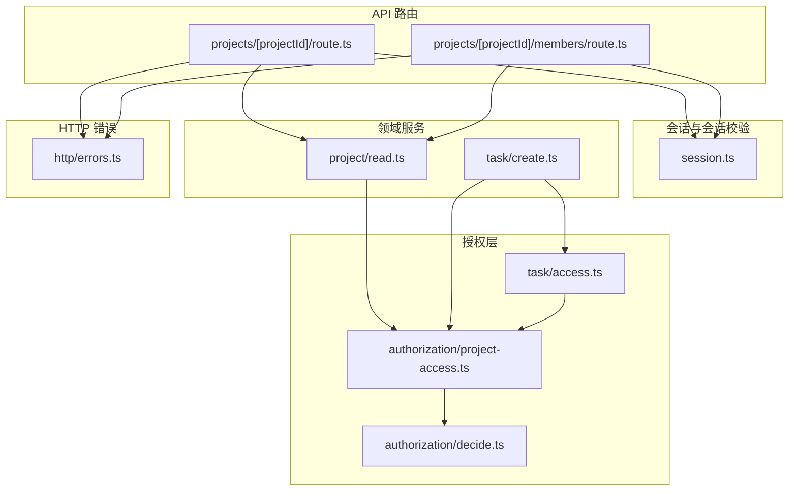
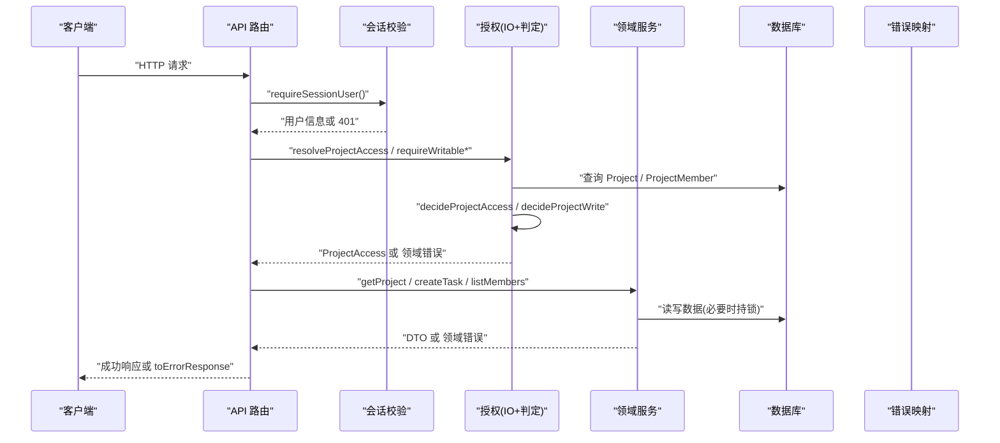
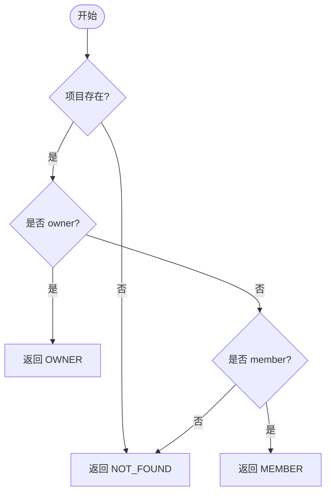
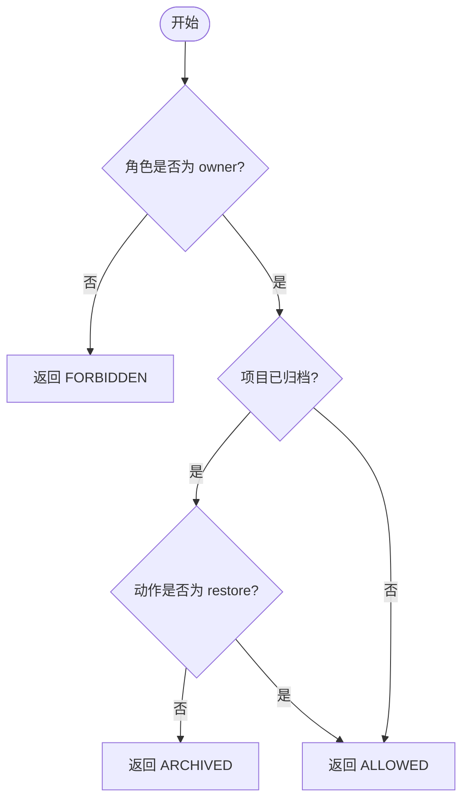
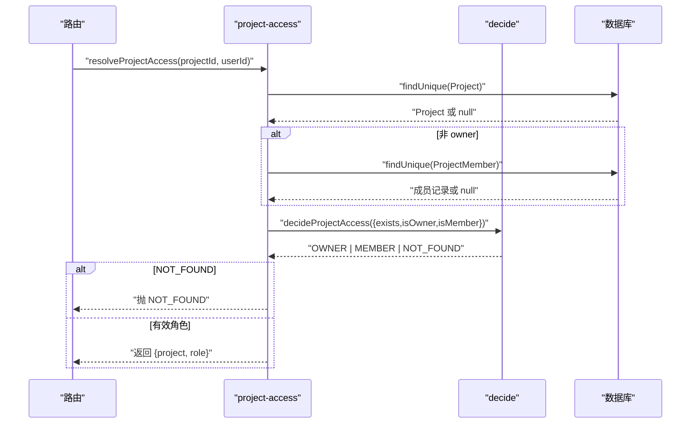
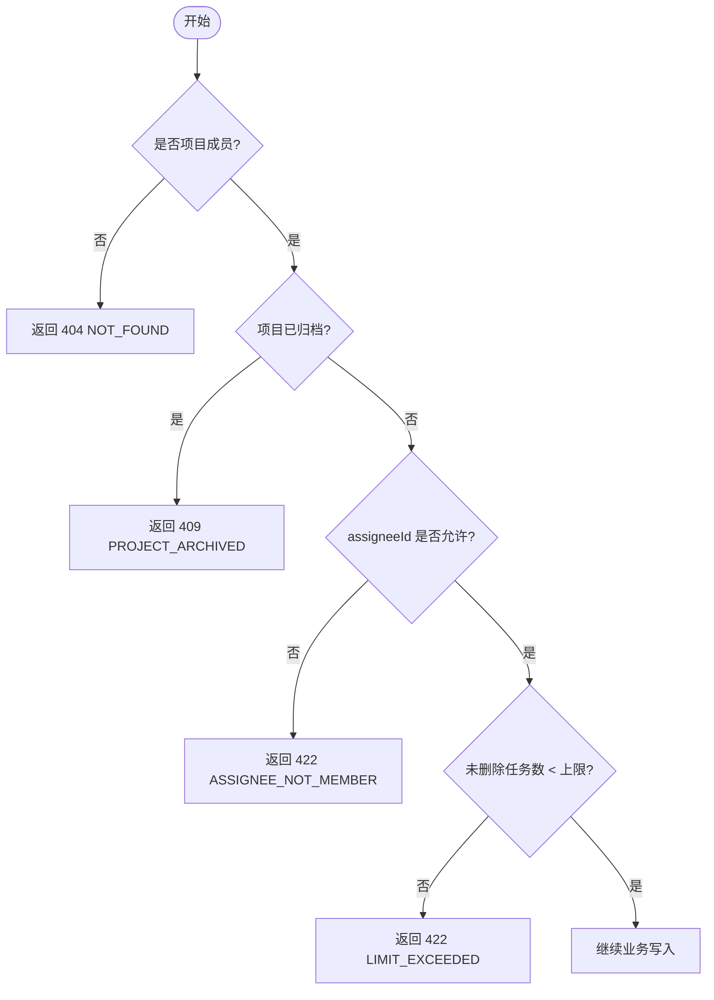
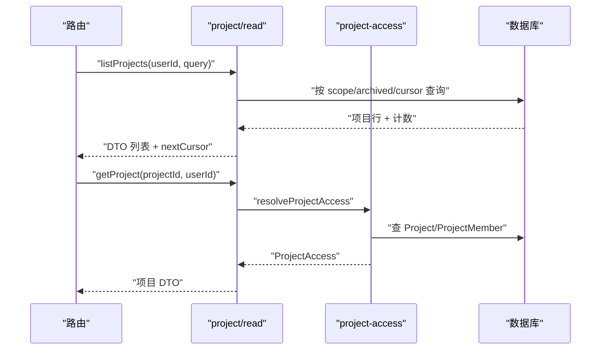
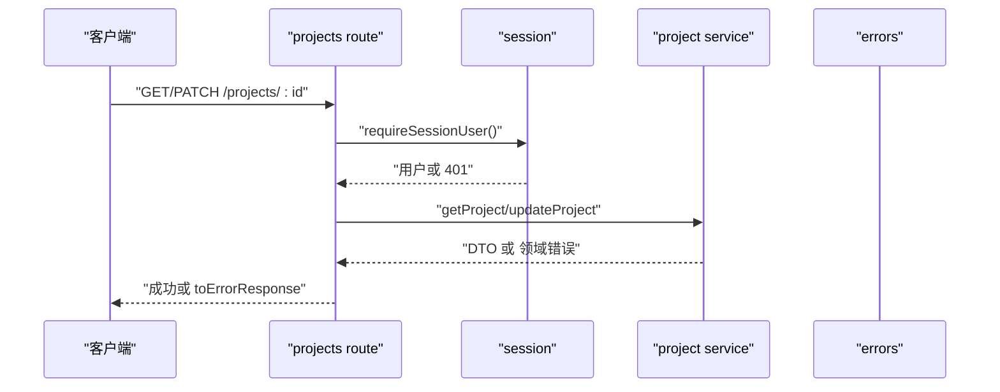
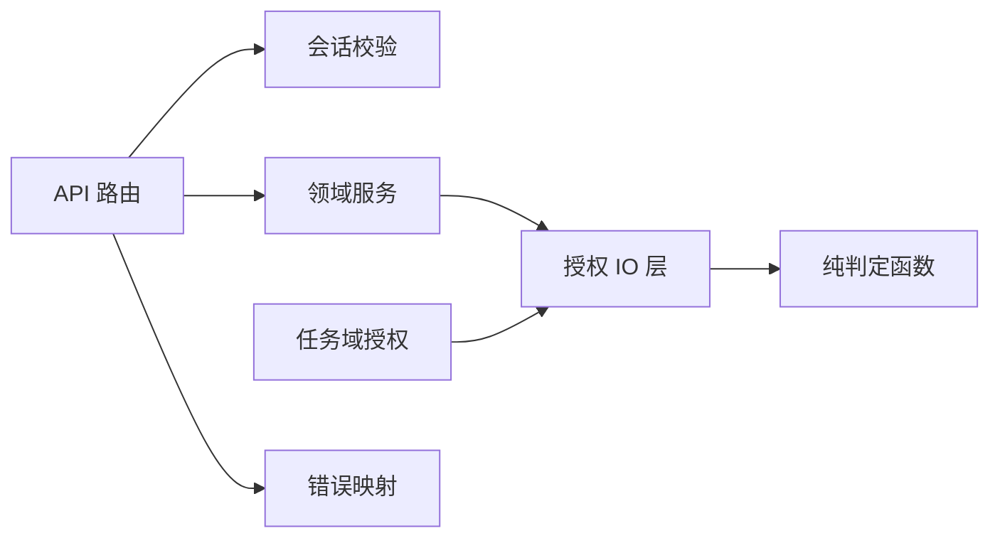

# 授权模块

<cite>
**本文引用的文件**
- [decide.ts](file://src/server/modules/authorization/decide.ts)
- [project-access.ts](file://src/server/modules/authorization/project-access.ts)
- [task/access.ts](file://src/server/modules/task/access.ts)
- [project/read.ts](file://src/server/modules/project/read.ts)
- [task/create.ts](file://src/server/modules/task/create.ts)
- [projects/[projectId]/route.ts](file://src/app/api/v1/projects/[projectId]/route.ts)
- [projects/[projectId]/members/route.ts](file://src/app/api/v1/projects/[projectId]/members/route.ts)
- [session.ts](file://src/server/auth/session.ts)
- [errors.ts](file://src/server/http/errors.ts)
- [permission.test.ts](file://tests/integration/permission.test.ts)
- [project-access.test.ts](file://tests/unit/project-access.test.ts)
</cite>

## 目录
1. [简介](#简介)
2. [项目结构](#项目结构)
3. [核心组件](#核心组件)
4. [架构总览](#架构总览)
5. [详细组件分析](#详细组件分析)
6. [依赖关系分析](#依赖关系分析)
7. [性能与缓存](#性能与缓存)
8. [故障排查指南](#故障排查指南)
9. [结论](#结论)
10. [附录：扩展与自定义权限规则](#附录：扩展与自定义权限规则)

## 简介
本文件为 Orbit 项目的授权模块提供全面文档，聚焦以下目标：
- 权限决策引擎的设计与实现：基于角色的访问控制（RBAC）与资源级权限验证。
- 项目访问控制逻辑、成员权限管理与资源隔离机制。
- 权限检查流程、缓存策略与性能优化方案。
- 授权规则定义方式、动态权限计算与上下文感知授权。
- 权限配置示例、安全最佳实践与常见问题解决方案。
- 授权系统扩展指南与自定义权限规则的实现方法。

## 项目结构
授权相关代码集中在服务器端模块中，采用“纯判定 + IO 层封装”的分层设计：
- 纯判定层：无 I/O 的决策函数，便于单元测试穷举分支。
- IO 层：负责读取数据库、组装事实、调用纯判定并抛出领域错误。
- 领域服务：在事务内组合授权、锁、幂等、配额等业务不变量。
- API 路由：仅做 HTTP 编排，统一捕获异常并转换为标准信封响应。

**图表来源**
- [projects/[projectId]/route.ts:36-79](file://src/app/api/v1/projects/[projectId]/route.ts#L36-L79)
- [projects/[projectId]/members/route.ts:26-37](file://src/app/api/v1/projects/[projectId]/members/route.ts#L26-L37)
- [session.ts:32-42](file://src/server/auth/session.ts#L32-L42)
- [decide.ts:13-66](file://src/server/modules/authorization/decide.ts#L13-L66)
- [project-access.ts:55-120](file://src/server/modules/authorization/project-access.ts#L55-L120)
- [task/access.ts:48-101](file://src/server/modules/task/access.ts#L48-L101)
- [project/read.ts:137-191](file://src/server/modules/project/read.ts#L137-L191)
- [task/create.ts:77-100](file://src/server/modules/task/create.ts#L77-L100)
- [errors.ts:103-135](file://src/server/http/errors.ts#L103-L135)

**章节来源**
- [projects/[projectId]/route.ts:36-79](file://src/app/api/v1/projects/[projectId]/route.ts#L36-L79)
- [projects/[projectId]/members/route.ts:26-37](file://src/app/api/v1/projects/[projectId]/members/route.ts#L26-L37)
- [session.ts:32-42](file://src/server/auth/session.ts#L32-L42)
- [decide.ts:13-66](file://src/server/modules/authorization/decide.ts#L13-L66)
- [project-access.ts:55-120](file://src/server/modules/authorization/project-access.ts#L55-L120)
- [task/access.ts:48-101](file://src/server/modules/task/access.ts#L48-L101)
- [project/read.ts:137-191](file://src/server/modules/project/read.ts#L137-L191)
- [task/create.ts:77-100](file://src/server/modules/task/create.ts#L77-L100)
- [errors.ts:103-135](file://src/server/http/errors.ts#L103-L135)

## 核心组件
- 纯判定函数
  - 读访问角色判定：根据项目是否存在、是否 owner、是否 member 决定 OWNER/MEMBER/NOT_FOUND。
  - 写访问判定：仅 owner 可更新/归档/恢复；归档项目只读，唯一例外是 owner 的 restore。
- IO 授权层
  - resolveProjectAccess：查 Project 与 ProjectMember，填充事实并调用纯判定，非成员/不存在统一抛 NOT_FOUND。
  - requireProjectMember / requireProjectOwner / requireWritableProject：面向不同场景的强约束入口。
- 任务域授权辅助
  - requireWritableTaskProject：成员可见且项目未归档才可写。
  - isAllowedAssignee / assertAssigneeAllowed：负责人必须是 owner 或成员。
  - canDeleteTask：owner 或任务创建者可删除/恢复。
- 领域服务集成
  - project/read.ts：列表与详情读取均通过 resolveProjectAccess 进行成员可见性控制。
  - task/create.ts：在事务内先锁 Project，再复核成员与归档状态，随后执行幂等、配额、编号、写入与活动记录。
- 会话与会话校验
  - requireSessionUser：未登录返回 UNAUTHENTICATED。
- HTTP 错误映射
  - DomainError：携带 ErrorCode、message、可选字段错误与冲突明细；toErrorResponse 统一输出标准信封与 no-store 缓存头。

**章节来源**
- [decide.ts:13-66](file://src/server/modules/authorization/decide.ts#L13-L66)
- [project-access.ts:28-120](file://src/server/modules/authorization/project-access.ts#L28-L120)
- [task/access.ts:22-101](file://src/server/modules/task/access.ts#L22-L101)
- [project/read.ts:137-191](file://src/server/modules/project/read.ts#L137-L191)
- [task/create.ts:77-100](file://src/server/modules/task/create.ts#L77-L100)
- [session.ts:32-42](file://src/server/auth/session.ts#L32-L42)
- [errors.ts:39-61](file://src/server/http/errors.ts#L39-L61)
- [errors.ts:103-135](file://src/server/http/errors.ts#L103-L135)

## 架构总览
授权系统遵循“请求 → 会话 → 授权 → 业务 → 响应”的清晰流水线，所有错误统一收敛为标准信封。

**图表来源**
- [projects/[projectId]/route.ts:36-79](file://src/app/api/v1/projects/[projectId]/route.ts#L36-L79)
- [projects/[projectId]/members/route.ts:26-37](file://src/app/api/v1/projects/[projectId]/members/route.ts#L26-L37)
- [session.ts:32-42](file://src/server/auth/session.ts#L32-L42)
- [project-access.ts:55-120](file://src/server/modules/authorization/project-access.ts#L55-L120)
- [decide.ts:33-66](file://src/server/modules/authorization/decide.ts#L33-L66)
- [project/read.ts:137-191](file://src/server/modules/project/read.ts#L137-L191)
- [task/create.ts:77-100](file://src/server/modules/task/create.ts#L77-L100)
- [errors.ts:103-135](file://src/server/http/errors.ts#L103-L135)

## 详细组件分析

### 项目读访问角色判定（RBAC 核心）
- 输入事实：项目是否存在、是否 owner、是否 member。
- 决策规则：
  - 不存在 → NOT_FOUND（不泄露存在性）。
  - owner → OWNER。
  - member → MEMBER。
  - 既非 owner 也非 member → NOT_FOUND。
- 该函数无 I/O，便于穷举测试与事务内复用。

**图表来源**
- [decide.ts:33-38](file://src/server/modules/authorization/decide.ts#L33-L38)

**章节来源**
- [decide.ts:13-38](file://src/server/modules/authorization/decide.ts#L13-L38)
- [project-access.test.ts:14-41](file://tests/unit/project-access.test.ts#L14-L41)

### 项目写访问判定（归档与 owner-only）
- 仅 owner 可 update/archive/restore。
- 归档项目对写操作只读，唯一例外是 owner 的 restore。
- 非 owner 直接 FORBIDDEN。

**图表来源**
- [decide.ts:61-66](file://src/server/modules/authorization/decide.ts#L61-L66)

**章节来源**
- [decide.ts:40-66](file://src/server/modules/authorization/decide.ts#L40-L66)
- [project-access.ts:109-120](file://src/server/modules/authorization/project-access.ts#L109-L120)

### 项目 IO 授权层（成员可见性与错误映射）
- resolveProjectAccess：校验 UUID → 查 Project → 若非 owner 则查 ProjectMember → 调用 decideProjectAccess → 非成员/不存在抛 NOT_FOUND。
- requireProjectMember：成员可见（owner 视为成员）。
- requireProjectOwner：必须 owner，否则 FORBIDDEN。
- requireWritableProject：owner 且非归档（除 restore），否则 FORBIDDEN/ARCHIVED。

**图表来源**
- [project-access.ts:55-77](file://src/server/modules/authorization/project-access.ts#L55-L77)
- [decide.ts:33-38](file://src/server/modules/authorization/decide.ts#L33-L38)

**章节来源**
- [project-access.ts:28-120](file://src/server/modules/authorization/project-access.ts#L28-L120)

### 任务域授权与配额保护
- requireWritableTaskProject：成员可见且项目未归档方可写。
- isAllowedAssignee / assertAssigneeAllowed：负责人必须是 owner 或成员。
- countOpenTasks：统计未删除任务数，用于配额限制。
- canDeleteTask：owner 或任务创建者可删除/恢复。

**图表来源**
- [task/access.ts:48-101](file://src/server/modules/task/access.ts#L48-L101)
- [task/create.ts:123-128](file://src/server/modules/task/create.ts#L123-L128)

**章节来源**
- [task/access.ts:22-101](file://src/server/modules/task/access.ts#L22-L101)
- [task/create.ts:77-128](file://src/server/modules/task/create.ts#L77-L128)

### 项目列表与详情（成员可见性）
- listProjects：按 scope（owned/joined/all）与 archived 过滤，keyset 游标分页。
- getProject：通过 resolveProjectAccess 确保成员可见。
- listMembers：成员/owner 可见，owner 排首位，后续按 joinedAt 升序，不包含 email。

**图表来源**
- [project/read.ts:65-135](file://src/server/modules/project/read.ts#L65-L135)
- [project/read.ts:137-191](file://src/server/modules/project/read.ts#L137-L191)
- [project-access.ts:55-77](file://src/server/modules/authorization/project-access.ts#L55-L77)

**章节来源**
- [project/read.ts:65-191](file://src/server/modules/project/read.ts#L65-L191)

### API 路由中的授权集成
- GET /projects/{id}：成员可见，非成员/不存在 → 404。
- PATCH /projects/{id}：owner-only，支持乐观并发与归档只读。
- GET /projects/{id}/members：成员/owner 可见，非成员 → 404。
- 所有路由统一捕获异常并通过 toErrorResponse 输出标准信封。

**图表来源**
- [projects/[projectId]/route.ts:36-79](file://src/app/api/v1/projects/[projectId]/route.ts#L36-L79)
- [projects/[projectId]/members/route.ts:26-37](file://src/app/api/v1/projects/[projectId]/members/route.ts#L26-L37)
- [session.ts:32-42](file://src/server/auth/session.ts#L32-L42)
- [errors.ts:103-135](file://src/server/http/errors.ts#L103-L135)

**章节来源**
- [projects/[projectId]/route.ts:36-79](file://src/app/api/v1/projects/[projectId]/route.ts#L36-L79)
- [projects/[projectId]/members/route.ts:26-37](file://src/app/api/v1/projects/[projectId]/members/route.ts#L26-L37)

## 依赖关系分析
- 路由层依赖会话校验与领域服务，不直接持有授权细节。
- 领域服务依赖授权 IO 层，授权 IO 层依赖纯判定函数。
- 任务域授权复用项目授权能力，并在事务内叠加任务级规则。
- 错误处理统一由 HTTP 层完成，避免业务层泄漏内部细节。

**图表来源**
- [projects/[projectId]/route.ts:36-79](file://src/app/api/v1/projects/[projectId]/route.ts#L36-L79)
- [project-access.ts:55-120](file://src/server/modules/authorization/project-access.ts#L55-L120)
- [decide.ts:33-66](file://src/server/modules/authorization/decide.ts#L33-L66)
- [task/access.ts:48-101](file://src/server/modules/task/access.ts#L48-L101)
- [errors.ts:103-135](file://src/server/http/errors.ts#L103-L135)

**章节来源**
- [projects/[projectId]/route.ts:36-79](file://src/app/api/v1/projects/[projectId]/route.ts#L36-L79)
- [project-access.ts:55-120](file://src/server/modules/authorization/project-access.ts#L55-L120)
- [decide.ts:33-66](file://src/server/modules/authorization/decide.ts#L33-L66)
- [task/access.ts:48-101](file://src/server/modules/task/access.ts#L48-L101)
- [errors.ts:103-135](file://src/server/http/errors.ts#L103-L135)

## 性能与缓存
- 缓存策略
  - 所有错误响应与授权相关响应使用 Cache-Control: private, no-store，防止共享缓存泄露私有数据。
  - 列表接口使用 keyset 游标分页，减少全表扫描与内存占用。
- 性能优化
  - 纯判定函数无 I/O，可在事务内多次复用，避免重复计算。
  - 写路径在事务内先锁 Project，再复核授权与归档态，降低竞争与重放风险。
  - 任务创建前进行成员预检（应用单例 prisma），避免非成员对热门项目行加排他锁造成 DoS 面。
- 幂等与重放
  - 幂等键在事务内记录并重放时重新授权，确保被移除用户无法通过旧键获取资源。

**章节来源**
- [errors.ts:18-19](file://src/server/http/errors.ts#L18-L19)
- [errors.ts:80-89](file://src/server/http/errors.ts#L80-L89)
- [project-access.ts:86-89](file://src/server/modules/task/access.ts#L86-L89)
- [task/create.ts:86-110](file://src/server/modules/task/create.ts#L86-L110)
- [project/read.ts:65-135](file://src/server/modules/project/read.ts#L65-L135)

## 故障排查指南
- 常见错误码与含义
  - NOT_FOUND：项目/任务不存在或当前用户无权访问（非成员与不存在统一收敛）。
  - FORBIDDEN：成员尝试 owner-only 操作。
  - PROJECT_ARCHIVED：归档项目只读，仅 owner 可 restore。
  - LIMIT_EXCEEDED：未删除任务数达到上限。
  - ASSIGNEE_NOT_MEMBER：负责人不是 owner 或成员。
  - UNAUTHENTICATED：未登录。
- 排查步骤
  - 确认会话是否有效（requireSessionUser）。
  - 确认项目成员关系与归档状态（resolveProjectAccess / requireWritable*）。
  - 检查任务级权限（canDeleteTask、isAllowedAssignee）。
  - 查看错误信封中的 requestId 与 fieldErrors，定位具体字段问题。
- 集成测试覆盖
  - 已移除用户访问一律 404，不泄露存在性。
  - 幂等重放重新授权：被移除用户重放旧 Idempotency-Key 应返回 404，而非回放旧响应。

**章节来源**
- [errors.ts:39-61](file://src/server/http/errors.ts#L39-L61)
- [errors.ts:103-135](file://src/server/http/errors.ts#L103-L135)
- [permission.test.ts:268-431](file://tests/integration/permission.test.ts#L268-L431)

## 结论
Orbit 授权模块通过“纯判定 + IO 层封装”实现了清晰的 RBAC 与资源级权限控制，结合事务锁、幂等与配额保护，确保了安全性与一致性。统一的错误映射与 no-store 缓存策略保障了隐私与合规。测试覆盖了越权与重放场景，具备较强的健壮性。

## 附录：扩展与自定义权限规则
- 新增资源类型
  - 在对应领域服务中引入 requireWritableTaskProject 或类似模式，先成员可见再业务规则。
  - 若需 owner-only，可直接复用 requireProjectOwner。
- 自定义权限矩阵
  - 在 decide.ts 风格下新增纯判定函数，保持无 I/O 以便测试与复用。
  - 在 IO 层将数据库事实注入判定函数，并映射为领域错误。
- 上下文感知授权
  - 在事务内持锁后复查授权（如幂等重放前），确保成员关系与归档态最新。
- 配置示例（概念性）
  - 角色定义：OWNER、MEMBER。
  - 资源范围：Project、Task。
  - 动作白名单：update、archive、restore、create、delete、read。
  - 规则优先级：不存在/不可见 → NOT_FOUND；成员不足 → FORBIDDEN；归档只读 → ARCHIVED；配额超限 → LIMIT_EXCEEDED。
- 安全最佳实践
  - 永远不要向未授权者泄露资源存在性。
  - 所有写操作在事务内持锁并复核授权。
  - 使用幂等键与重放前重新授权。
  - 错误响应统一 no-store，避免缓存泄露。
  - 日志脱敏，仅记录 requestId 与必要元信息。