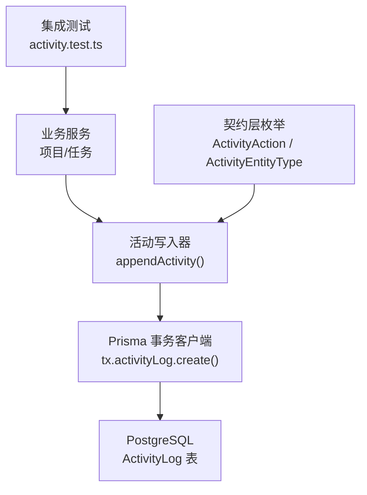
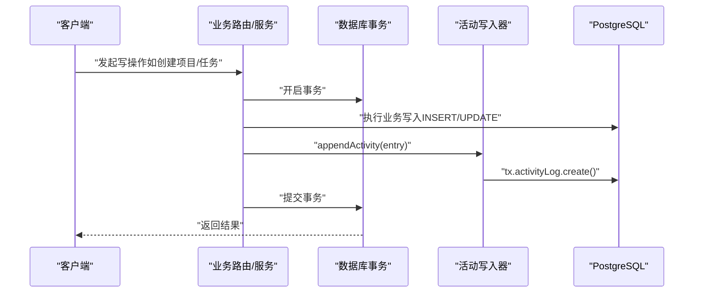
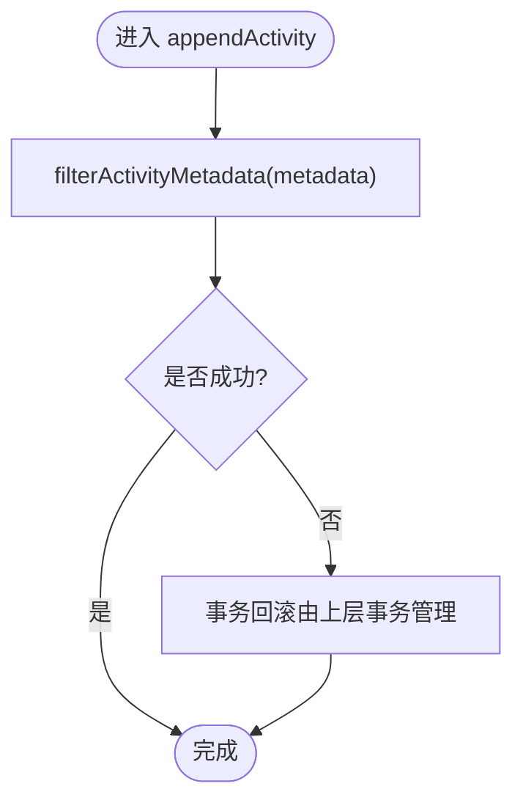
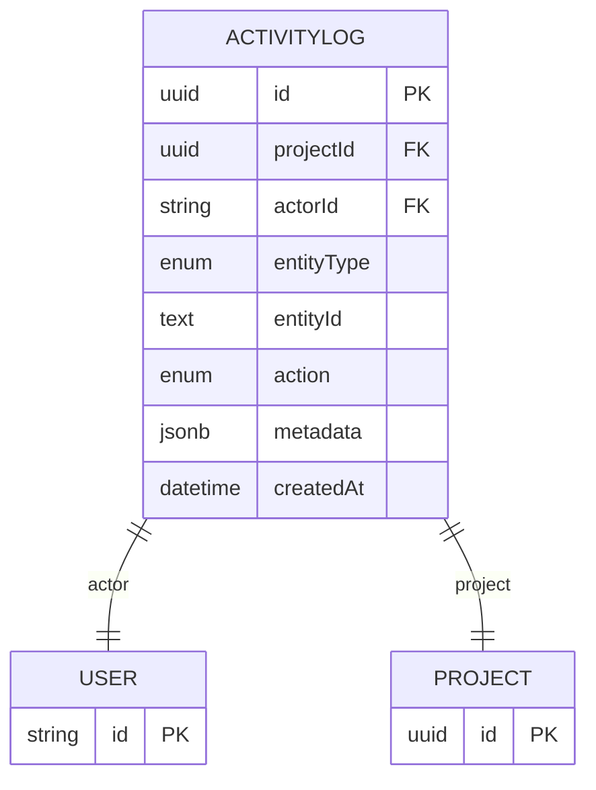
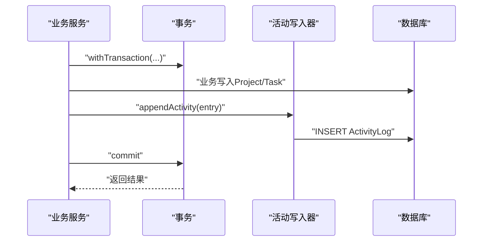
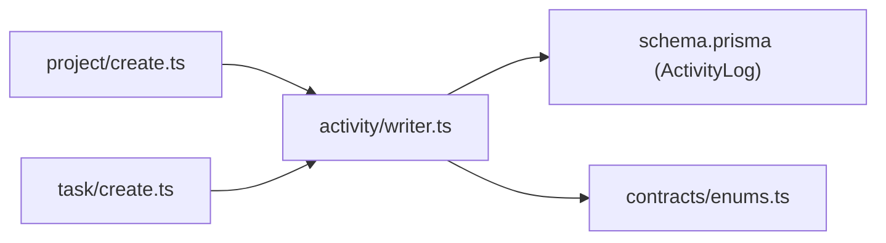

# 活动日志模块

<cite>
**本文引用的文件**
- [src/server/modules/activity/writer.ts](file://src/server/modules/activity/writer.ts)
- [prisma/schema.prisma](file://prisma/schema.prisma)
- [src/contracts/enums.ts](file://src/contracts/enums.ts)
- [src/server/modules/project/create.ts](file://src/server/modules/project/create.ts)
- [src/server/modules/task/create.ts](file://src/server/modules/task/create.ts)
- [tests/integration/activity.test.ts](file://tests/integration/activity.test.ts)
- [docs/04-DATA-MODEL.md](file://docs/04-DATA-MODEL.md)
</cite>

## 目录
1. [简介](#简介)
2. [项目结构](#项目结构)
3. [核心组件](#核心组件)
4. [架构总览](#架构总览)
5. [详细组件分析](#详细组件分析)
6. [依赖关系分析](#依赖关系分析)
7. [性能与索引优化](#性能与索引优化)
8. [故障排查指南](#故障排查指南)
9. [结论](#结论)
10. [附录](#附录)

## 简介
本模块为 Orbit 项目的“活动日志”子系统，负责记录用户操作审计、变更追踪与历史记录。其设计原则是：只追加不编辑；与业务写入处于同一数据库事务，保证原子性；metadata 采用白名单过滤，避免敏感数据入库；通过枚举约束 action/entityType，确保类型安全与可查询性。集成点覆盖项目创建、任务创建/更新/移动/删除/恢复等关键路径，并通过集成测试验证事务一致性与幂等边界。

## 项目结构
活动日志相关代码主要分布在以下位置：
- 写入器：src/server/modules/activity/writer.ts
- 数据模型与索引：prisma/schema.prisma
- 契约枚举（action/entityType）：src/contracts/enums.ts
- 业务调用方（示例）：src/server/modules/project/create.ts、src/server/modules/task/create.ts
- 集成验证：tests/integration/activity.test.ts
- 数据模型规范说明：docs/04-DATA-MODEL.md

图表来源
- [src/server/modules/activity/writer.ts:50-64](file://src/server/modules/activity/writer.ts#L50-L64)
- [prisma/schema.prisma:181-195](file://prisma/schema.prisma#L181-L195)
- [src/contracts/enums.ts:77-113](file://src/contracts/enums.ts#L77-L113)
- [tests/integration/activity.test.ts:252-311](file://tests/integration/activity.test.ts#L252-L311)

章节来源
- [src/server/modules/activity/writer.ts:1-64](file://src/server/modules/activity/writer.ts#L1-L64)
- [prisma/schema.prisma:181-195](file://prisma/schema.prisma#L181-L195)
- [src/contracts/enums.ts:77-113](file://src/contracts/enums.ts#L77-L113)
- [tests/integration/activity.test.ts:252-311](file://tests/integration/activity.test.ts#L252-L311)
- [docs/04-DATA-MODEL.md:73-78](file://docs/04-DATA-MODEL.md#L73-L78)

## 核心组件
- 活动写入器（writer.ts）
  - appendActivity(tx, entry)：在事务内追加一条活动日志，使用 Prisma 事务客户端写入 activityLog。
  - filterActivityMetadata(metadata)：按白名单过滤 metadata，仅保留 taskIdentifier、fields、fromStatus、toStatus、targetUserId、count 等允许字段，防止敏感内容入库。
  - ActivityEntry：定义写入入参（projectId、actorId、entityType、entityId、action、可选 metadata）。
- 数据模型（schema.prisma）
  - ActivityLog 模型：id、projectId、actorId、entityType、entityId、action、metadata(jsonb)、createdAt；关联 Project 与 User；包含按 projectId、createdAt、id 的复合索引以支持分页与时间序查询。
- 契约枚举（enums.ts）
  - ActivityEntityType：PROJECT、MEMBER、TASK、SUBTASK、COMMENT、ATTACHMENT。
  - ActivityAction：涵盖项目、成员、任务、子任务、评论、附件等全量动作（如 PROJECT_CREATED、TASK_UPDATED、TASK_DELETED 等）。
- 业务集成点
  - 项目创建：createProject 中在事务内调用 appendActivity 记录 PROJECT_CREATED。
  - 任务创建：createTask 中在事务内调用 appendActivity 记录 TASK_CREATED，并附带 taskIdentifier 元数据。
- 集成测试（activity.test.ts）
  - 验证“活动随事务写入”的一致性：创建项目/任务后计数与最新活动行断言；归档项目产生 PROJECT_ARCHIVED；软删除产生 TASK_DELETED；恢复产生 TASK_RESTORED；业务失败回滚时不残留活动。

章节来源
- [src/server/modules/activity/writer.ts:16-64](file://src/server/modules/activity/writer.ts#L16-L64)
- [prisma/schema.prisma:107-137](file://prisma/schema.prisma#L107-L137)
- [prisma/schema.prisma:181-195](file://prisma/schema.prisma#L181-L195)
- [src/contracts/enums.ts:77-113](file://src/contracts/enums.ts#L77-L113)
- [src/server/modules/project/create.ts:144-151](file://src/server/modules/project/create.ts#L144-L151)
- [src/server/modules/task/create.ts:159-166](file://src/server/modules/task/create.ts#L159-L166)
- [tests/integration/activity.test.ts:252-311](file://tests/integration/activity.test.ts#L252-L311)

## 架构总览
活动日志作为“只追加”的审计表，嵌入到各业务写事务中，与业务数据同生共死。写入流程如下：

图表来源
- [src/server/modules/project/create.ts:78-167](file://src/server/modules/project/create.ts#L78-L167)
- [src/server/modules/task/create.ts:93-188](file://src/server/modules/task/create.ts#L93-L188)
- [src/server/modules/activity/writer.ts:50-64](file://src/server/modules/activity/writer.ts#L50-L64)

章节来源
- [src/server/modules/project/create.ts:78-167](file://src/server/modules/project/create.ts#L78-L167)
- [src/server/modules/task/create.ts:93-188](file://src/server/modules/task/create.ts#L93-L188)
- [src/server/modules/activity/writer.ts:50-64](file://src/server/modules/activity/writer.ts#L50-L64)

## 详细组件分析

### 活动写入器（writer.ts）
- 职责
  - 提供 appendActivity(tx, entry)：在事务内插入一条活动日志。
  - 提供 filterActivityMetadata(metadata)：对 metadata 进行白名单过滤，避免敏感信息入库。
- 设计要点
  - 只追加不编辑：符合审计不可变要求。
  - 必须在业务事务内调用：与业务写入同原子性，失败即回滚。
  - metadata 白名单：taskIdentifier、fields、fromStatus、toStatus、targetUserId、count。
- 复杂度
  - 过滤 O(k)，k 为白名单长度（常数级），整体写入为单次 INSERT。

图表来源
- [src/server/modules/activity/writer.ts:36-64](file://src/server/modules/activity/writer.ts#L36-L64)

章节来源
- [src/server/modules/activity/writer.ts:16-64](file://src/server/modules/activity/writer.ts#L16-L64)

### 数据模型与索引（schema.prisma）
- 模型
  - ActivityLog：id(UUID)、projectId、actorId、entityType(枚举)、entityId(text)、action(枚举)、metadata(jsonb)、createdAt。
  - 关联：Project、User（均为 RESTRICT 删除策略，保护历史）。
- 索引
  - @@index([projectId, createdAt(sort: Desc), id(sort: Desc)])：支持按项目分页、时间倒序浏览活动。
- 约束与类型
  - entityType/action 使用枚举，确保取值受控且可查询。
  - metadata 为 jsonb，便于扩展但需配合白名单过滤。

图表来源
- [prisma/schema.prisma:181-195](file://prisma/schema.prisma#L181-L195)
- [prisma/schema.prisma:27-47](file://prisma/schema.prisma#L27-L47)
- [prisma/schema.prisma:144-166](file://prisma/schema.prisma#L144-L166)

章节来源
- [prisma/schema.prisma:107-137](file://prisma/schema.prisma#L107-L137)
- [prisma/schema.prisma:181-195](file://prisma/schema.prisma#L181-L195)

### 契约枚举（enums.ts）
- ActivityEntityType：限定实体类型（PROJECT/MEMBER/TASK/SUBTASK/COMMENT/ATTACHMENT）。
- ActivityAction：限定动作集合（如 PROJECT_CREATED、TASK_UPDATED、TASK_DELETED 等），用于分类统计与展示。
- 作用
  - 统一类型定义，前后端共享；避免字符串拼写错误导致的数据不一致。
  - 便于后续做基于 action/entityType 的聚合分析与权限控制。

章节来源
- [src/contracts/enums.ts:77-113](file://src/contracts/enums.ts#L77-L113)

### 业务集成点（项目/任务）
- 项目创建（createProject）
  - 在 withTransaction 中执行：锁用户行 → 幂等检查 → 配额校验 → 插入项目 → 写活动（PROJECT_CREATED）→ 提交幂等记录。
  - 活动与业务写入在同一事务，失败回滚无残留。
- 任务创建（createTask）
  - 在 withTransaction 中执行：锁项目行 → 授权与归档态检查 → 幂等检查 → 配额校验 → 取号与定位 → 插入任务 → boardVersion++ → 写活动（TASK_CREATED，含 taskIdentifier）→ 提交幂等记录。
  - 活动与业务写入在同一事务，失败回滚无残留。

图表来源
- [src/server/modules/project/create.ts:78-167](file://src/server/modules/project/create.ts#L78-L167)
- [src/server/modules/task/create.ts:93-188](file://src/server/modules/task/create.ts#L93-L188)
- [src/server/modules/activity/writer.ts:50-64](file://src/server/modules/activity/writer.ts#L50-L64)

章节来源
- [src/server/modules/project/create.ts:78-167](file://src/server/modules/project/create.ts#L78-L167)
- [src/server/modules/task/create.ts:93-188](file://src/server/modules/task/create.ts#L93-L188)

### 集成测试（activity.test.ts）
- 覆盖场景
  - 创建项目 → 恰好 1 条 PROJECT_CREATED，metadata 为空对象。
  - 归档项目 → 恰好 1 条 PROJECT_ARCHIVED + version bump。
  - 创建任务 → 恰好 1 条 TASK_CREATED，metadata.taskIdentifier 正确。
  - 有变化 PATCH → TASK_UPDATED + version bump；无语义变化 → 不写活动、不 bump version。
  - 业务失败（expectedVersion 不符）→ 409，事务回滚，无任何残留活动。
  - 软删除 → TASK_DELETED；恢复 → TASK_RESTORED。
- 价值
  - 验证“活动与业务写入同一事务”的强一致性；保障审计数据的完整性与准确性。

章节来源
- [tests/integration/activity.test.ts:252-311](file://tests/integration/activity.test.ts#L252-L311)
- [tests/integration/activity.test.ts:358-502](file://tests/integration/activity.test.ts#L358-L502)
- [tests/integration/activity.test.ts:504-567](file://tests/integration/activity.test.ts#L504-L567)

## 依赖关系分析
- 直接依赖
  - writer.ts 依赖 Prisma 事务客户端与契约枚举类型。
  - 业务服务（project/create.ts、task/create.ts）依赖 writer.ts 的 appendActivity。
- 间接依赖
  - 通过 Prisma 生成客户端访问 ActivityLog 表。
  - 契约枚举确保 action/entityType 的取值一致。
- 耦合与内聚
  - 写入器高度内聚于“单条 INSERT”，对外暴露最小接口；业务服务负责组装 entry。
  - 数据模型与契约解耦：schema 定义存储结构，enums 定义语义取值。

图表来源
- [src/server/modules/project/create.ts:144-151](file://src/server/modules/project/create.ts#L144-L151)
- [src/server/modules/task/create.ts:159-166](file://src/server/modules/task/create.ts#L159-L166)
- [src/server/modules/activity/writer.ts:50-64](file://src/server/modules/activity/writer.ts#L50-L64)
- [prisma/schema.prisma:181-195](file://prisma/schema.prisma#L181-L195)
- [src/contracts/enums.ts:77-113](file://src/contracts/enums.ts#L77-L113)

章节来源
- [src/server/modules/project/create.ts:144-151](file://src/server/modules/project/create.ts#L144-L151)
- [src/server/modules/task/create.ts:159-166](file://src/server/modules/task/create.ts#L159-L166)
- [src/server/modules/activity/writer.ts:50-64](file://src/server/modules/activity/writer.ts#L50-L64)
- [prisma/schema.prisma:181-195](file://prisma/schema.prisma#L181-L195)
- [src/contracts/enums.ts:77-113](file://src/contracts/enums.ts#L77-L113)

## 性能与索引优化
- 索引设计
  - ActivityLog 使用复合索引 [projectId, createdAt DESC, id DESC]，支持按项目分页与时间倒序浏览，减少排序开销。
- 写入性能
  - 每次操作仅一次 INSERT；metadata 经白名单过滤，避免大对象入库。
- 查询性能
  - 建议查询条件优先使用 projectId、action、createdAt 范围；避免对 metadata 全文检索。
- 扩展建议
  - 当活动量增长时，可按时间分片或归档冷数据；必要时增加 action/entityType 的单独索引以优化筛选。

章节来源
- [prisma/schema.prisma:194-195](file://prisma/schema.prisma#L194-L195)
- [docs/04-DATA-MODEL.md:73-78](file://docs/04-DATA-MODEL.md#L73-L78)

## 故障排查指南
- 常见问题
  - 活动未写入：确认是否在事务内调用 appendActivity；检查业务事务是否提交。
  - 活动重复：检查幂等键与请求重放逻辑；确认 beginIdempotency/commitIdempotency 的使用。
  - metadata 异常：核对白名单字段；避免传入敏感内容。
- 调试方法
  - 使用集成测试用例复现：参考 activity.test.ts 中的断言方式。
  - 查看最近活动：按 projectId + createdAt 倒序查询最新记录。
- 回滚验证
  - 业务失败（如 expectedVersion 冲突）应回滚，活动计数不变；可通过 countActivities 断言。

章节来源
- [tests/integration/activity.test.ts:358-502](file://tests/integration/activity.test.ts#L358-L502)
- [tests/integration/activity.test.ts:252-311](file://tests/integration/activity.test.ts#L252-L311)

## 结论
活动日志模块以“只追加、事务内写入、白名单 metadata”为核心设计，确保了审计数据的不可变性与一致性。通过枚举约束与索引优化，实现了高内聚、低耦合的写入能力，并在集成测试中验证了关键路径的正确性。未来可在数据增长时考虑分片与归档策略，进一步提升查询与存储效率。

## 附录
- 触发时机与异步处理
  - 当前实现为同步写入（事务内 INSERT），非异步队列；如需异步化，应在事务外引入消息队列并确保最终一致性与去重。
- 合规性要求
  - 白名单 metadata 避免存储原始描述、评论、文件内容与令牌；满足最小必要原则。
- 清理策略与存储优化
  - 建议按时间窗口归档历史活动；定期清理过期幂等记录；监控表大小与查询延迟。