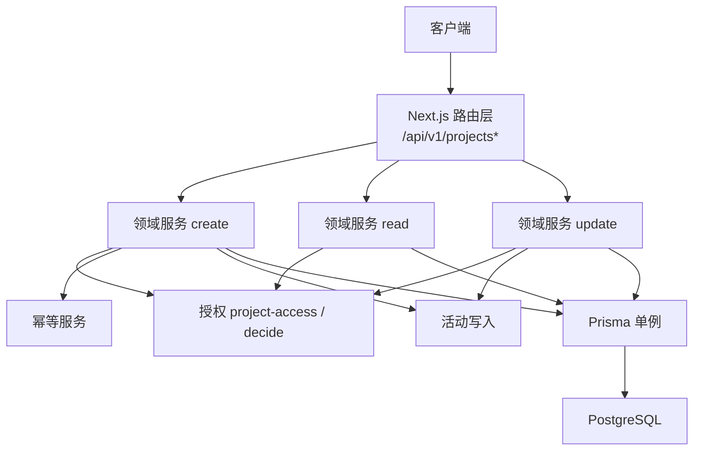
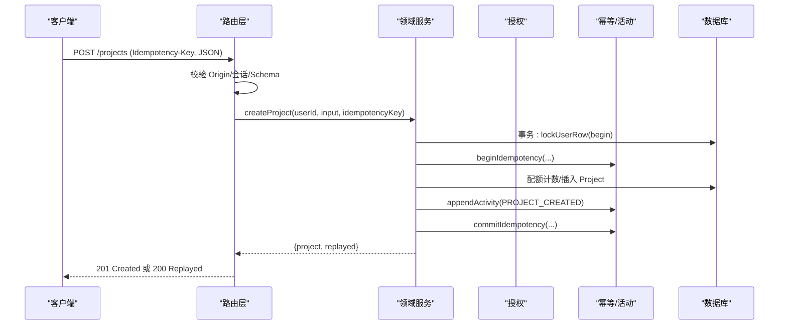
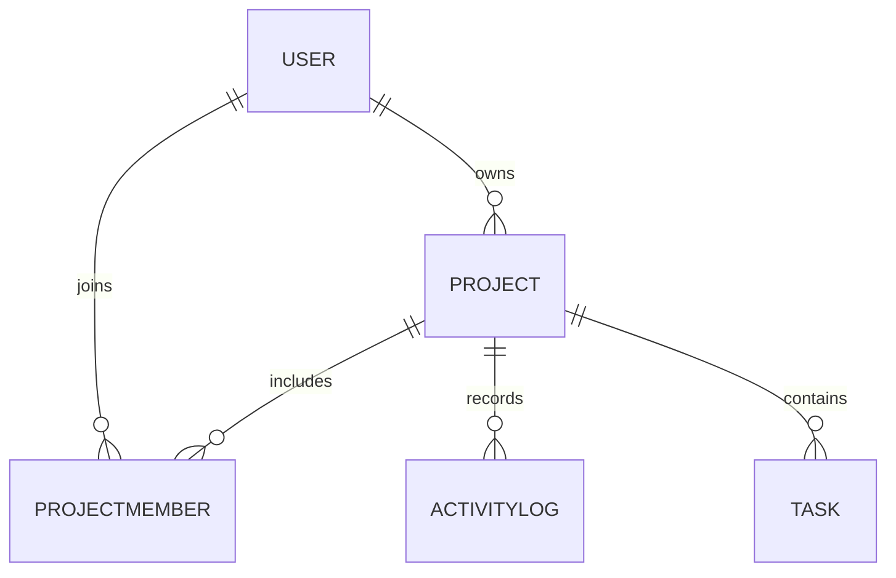
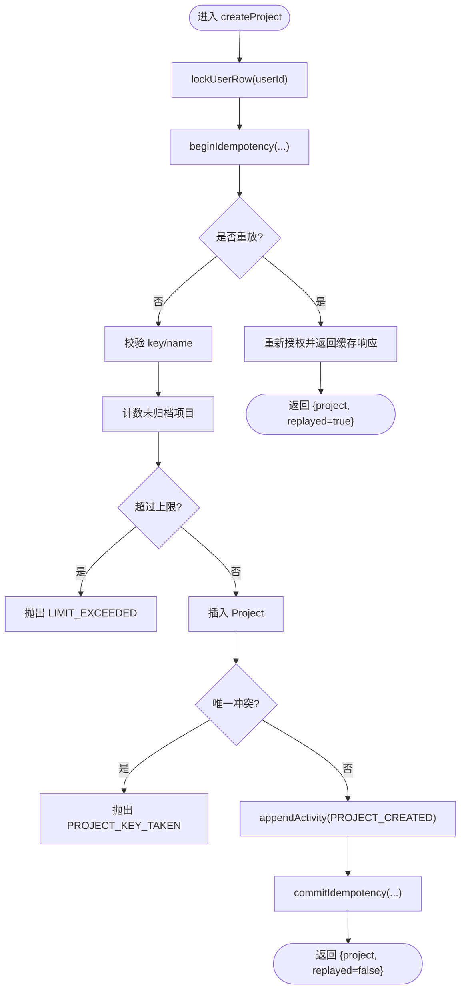
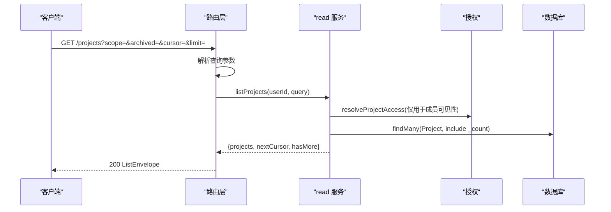
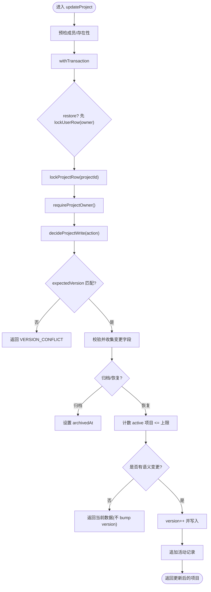
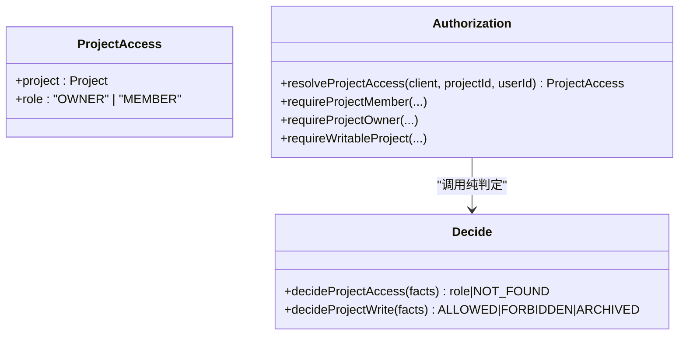
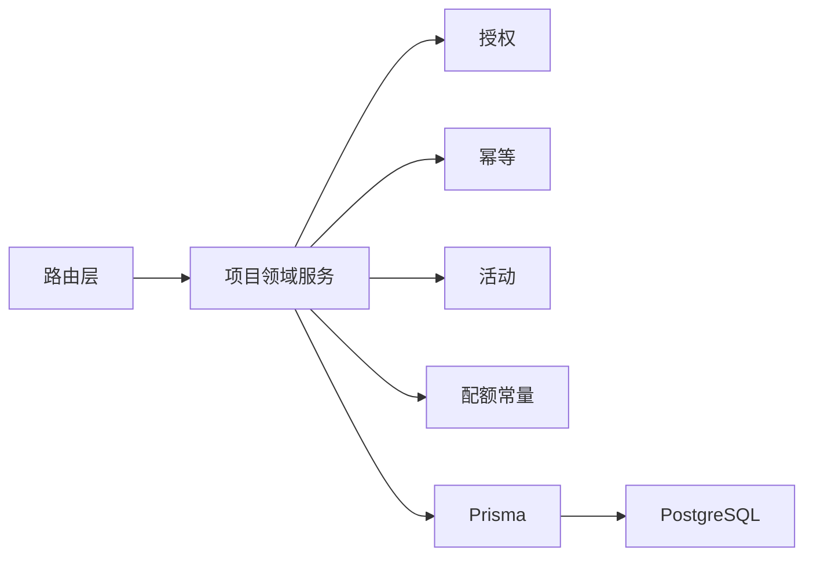

# 项目模块

<cite>
**本文引用的文件**
- [schema.prisma](file://prisma/schema.prisma)
- [04-DATA-MODEL.md](file://docs/04-DATA-MODEL.md)
- [index.ts](file://src/server/modules/project/index.ts)
- [create.ts](file://src/server/modules/project/create.ts)
- [read.ts](file://src/server/modules/project/read.ts)
- [update.ts](file://src/server/modules/project/update.ts)
- [mappers.ts](file://src/server/modules/project/mappers.ts)
- [project-access.ts](file://src/server/modules/authorization/project-access.ts)
- [decide.ts](file://src/server/modules/authorization/decide.ts)
- [limits.ts](file://src/server/modules/limits.ts)
- [route.ts（列表/创建）](file://src/app/api/v1/projects/route.ts)
- [route.ts（详情/更新）](file://src/app/api/v1/projects/[projectId]/route.ts)
- [members/route.ts](file://src/app/api/v1/projects/[projectId]/members/route.ts)
- [dto.ts](file://src/contracts/dto.ts)
</cite>

## 目录
1. [简介](#简介)
2. [项目结构](#项目结构)
3. [核心组件](#核心组件)
4. [架构总览](#架构总览)
5. [详细组件分析](#详细组件分析)
6. [依赖关系分析](#依赖关系分析)
7. [性能与一致性](#性能与一致性)
8. [故障排查指南](#故障排查指南)
9. [结论](#结论)
10. [附录：API 调用示例与最佳实践](#附录api-调用示例与最佳实践)

## 简介
本章节聚焦 Orbit 项目的“项目”领域模块，围绕项目 CRUD、数据模型映射、验证规则、权限控制、成员管理、访问控制与协作能力进行系统化说明。文档同时覆盖 API 路由编排、错误处理策略、并发与幂等设计、以及与其他模块的集成方式，并提供扩展指南与最佳实践建议。

## 项目结构
项目模块采用“路由层 → 领域服务 → 授权/基础设施 → 数据模型”的分层组织：
- 路由层：Next.js App Router 暴露 RESTful 接口，负责请求生命周期编排（请求 ID、Origin、会话、参数校验、统一信封）。
- 领域服务：按 create/read/update 拆分，封装业务不变量、事务与锁、配额、活动记录、幂等。
- 授权：纯判定函数 + IO 层组合，统一收敛“不存在/非成员”为 404，避免信息泄露。
- 数据模型：Prisma schema 定义 Project、ProjectMember、ActivityLog 等实体及约束。

图表来源
- [route.ts（列表/创建）:1-93](file://src/app/api/v1/projects/route.ts#L1-L93)
- [route.ts（详情/更新）:1-80](file://src/app/api/v1/projects/[projectId]/route.ts#L1-L80)
- [index.ts:1-24](file://src/server/modules/project/index.ts#L1-L24)
- [create.ts:1-181](file://src/server/modules/project/create.ts#L1-L181)
- [read.ts:1-192](file://src/server/modules/project/read.ts#L1-L192)
- [update.ts:1-204](file://src/server/modules/project/update.ts#L1-L204)
- [project-access.ts:1-121](file://src/server/modules/authorization/project-access.ts#L1-L121)
- [decide.ts:1-67](file://src/server/modules/authorization/decide.ts#L1-L67)

章节来源
- [schema.prisma:14-268](file://prisma/schema.prisma#L14-L268)
- [04-DATA-MODEL.md:1-134](file://docs/04-DATA-MODEL.md#L1-L134)

## 核心组件
- 项目领域服务入口：统一导出 create/read/update 与 DTO 映射工具。
- 创建项目：用户级行锁 + 幂等键 + 配额检查 + key 唯一性 + 活动记录。
- 读取项目：keyset 游标分页、过滤指纹、成员可见性、开放任务计数。
- 更新项目：Owner-only、乐观版本、归档/恢复状态机、规范化后无变化不 bump version。
- 授权：读访问角色计算、写操作决策、统一 404 收敛。
- 数据模型：Project、ProjectMember、ActivityLog 等实体与约束。
- 契约 DTO：前后端共享的 Zod Schema 与类型，严格白名单输出。

章节来源
- [index.ts:1-24](file://src/server/modules/project/index.ts#L1-L24)
- [create.ts:18-181](file://src/server/modules/project/create.ts#L18-L181)
- [read.ts:20-192](file://src/server/modules/project/read.ts#L20-L192)
- [update.ts:23-204](file://src/server/modules/project/update.ts#L23-L204)
- [project-access.ts:12-121](file://src/server/modules/authorization/project-access.ts#L12-L121)
- [decide.ts:1-67](file://src/server/modules/authorization/decide.ts#L1-L67)
- [dto.ts:86-137](file://src/contracts/dto.ts#L86-L137)

## 架构总览
项目模块遵循“路由编排 → 领域服务 → 授权/基础设施 → 数据库”的清晰分层，所有写路径在事务内完成，并使用行锁保证并发安全；读路径使用应用单例 Prisma，配合 keyset 游标实现高效分页。

图表来源
- [route.ts（列表/创建）:56-93](file://src/app/api/v1/projects/route.ts#L56-L93)
- [create.ts:64-181](file://src/server/modules/project/create.ts#L64-L181)

## 详细组件分析

### 数据模型与映射
- 核心实体：Project、ProjectMember、ActivityLog、Task（用于 openTaskCount 统计）。
- 关键约束：Project.key 全局唯一且格式受限；version/boardVersion/nextTaskNumber 递增；软删除字段 deletedAt 用于任务域；Project.archivedAt 表示归档。
- DTO 映射：toProjectDTO 将数据库行转换为契约 DTO，role 由 ownerId/viewerId 计算得出，memberCount/openTaskCount 由查询侧传入，时间字段统一 ISO 字符串。

图表来源
- [schema.prisma:144-195](file://prisma/schema.prisma#L144-L195)

章节来源
- [schema.prisma:144-268](file://prisma/schema.prisma#L144-L268)
- [mappers.ts:5-50](file://src/server/modules/project/mappers.ts#L5-L50)
- [dto.ts:86-137](file://src/contracts/dto.ts#L86-L137)

### 创建项目（POST /projects）
- 输入校验：name/key/description/color 通过 Zod 校验；key 正则与 DB CHECK 双重保障。
- 并发与幂等：用户级行锁串行化配额与幂等；begin/commit 幂等记录，重放时重新授权。
- 配额限制：未归档项目数上限（默认 10），超限返回 LIMIT_EXCEEDED。
- 活动记录：PROJECT_CREATED 写入 ActivityLog。
- 响应：新建 201，幂等重放 200。

图表来源
- [create.ts:64-181](file://src/server/modules/project/create.ts#L64-L181)

章节来源
- [create.ts:18-181](file://src/server/modules/project/create.ts#L18-L181)
- [limits.ts:1-27](file://src/server/modules/limits.ts#L1-L27)
- [dto.ts:107-114](file://src/contracts/dto.ts#L107-L114)

### 读取项目（GET /projects 与 GET /projects/{id}）
- 列表：支持 scope（all/owned/joined）、archived（exclude/only）、cursor 分页；默认 limit=30，最大 100；过滤指纹防篡改。
- 详情：成员可见；非成员/不存在统一 404；openTaskCount 口径为未删除且未完成的任务数。
- 成员列表：owner 排首位，其后按 joinedAt 升序；不披露 email。

图表来源
- [read.ts:60-135](file://src/server/modules/project/read.ts#L60-L135)
- [route.ts（列表/创建）:35-54](file://src/app/api/v1/projects/route.ts#L35-L54)

章节来源
- [read.ts:20-192](file://src/server/modules/project/read.ts#L20-L192)
- [route.ts（列表/创建）:35-54](file://src/app/api/v1/projects/route.ts#L35-L54)

### 更新项目（PATCH /projects/{id}）
- 权限：Owner-only；成员执行 owner-only 操作返回 403；非成员/不存在 404。
- 状态机：归档（archived=true）只读；恢复（archived=false）需满足配额。
- 乐观并发：expectedVersion 不符返回 VERSION_CONFLICT 并附带 currentVersion。
- 规范化：若语义无变化（如 trim 后相同），不 bump version、不写活动。
- 活动：PROJECT_UPDATED/ARCHIVED/RESTORED 根据实际变更写入。

图表来源
- [update.ts:73-204](file://src/server/modules/project/update.ts#L73-L204)

章节来源
- [update.ts:23-204](file://src/server/modules/project/update.ts#L23-L204)
- [decide.ts:40-67](file://src/server/modules/authorization/decide.ts#L40-L67)
- [limits.ts:1-27](file://src/server/modules/limits.ts#L1-L27)

### 成员管理与访问控制
- 成员可见性：listMembers 要求成员/owner 可见；非成员 404。
- 角色计算：role 为计算字段，OWNER/MEMBER 由 ownerId 与 viewerId 决定。
- 访问控制：resolveProjectAccess 统一收敛“不存在/非成员”为 404；requireProjectOwner 用于 owner-only 操作。

图表来源
- [project-access.ts:12-121](file://src/server/modules/authorization/project-access.ts#L12-L121)
- [decide.ts:1-67](file://src/server/modules/authorization/decide.ts#L1-L67)

章节来源
- [project-access.ts:12-121](file://src/server/modules/authorization/project-access.ts#L12-L121)
- [decide.ts:1-67](file://src/server/modules/authorization/decide.ts#L1-L67)
- [read.ts:152-192](file://src/server/modules/project/read.ts#L152-L192)

## 依赖关系分析
- 路由层依赖：会话、Origin、JSON 信封、请求 ID、参数校验。
- 领域服务依赖：授权、幂等、活动、配额、Prisma。
- 授权依赖：纯判定函数 decide.ts，IO 层 project-access.ts。
- 数据模型依赖：Prisma schema 定义的实体与约束。

图表来源
- [route.ts（列表/创建）:1-93](file://src/app/api/v1/projects/route.ts#L1-L93)
- [route.ts（详情/更新）:1-80](file://src/app/api/v1/projects/[projectId]/route.ts#L1-L80)
- [index.ts:1-24](file://src/server/modules/project/index.ts#L1-L24)
- [limits.ts:1-27](file://src/server/modules/limits.ts#L1-L27)

章节来源
- [index.ts:1-24](file://src/server/modules/project/index.ts#L1-L24)
- [route.ts（列表/创建）:1-93](file://src/app/api/v1/projects/route.ts#L1-L93)
- [route.ts（详情/更新）:1-80](file://src/app/api/v1/projects/[projectId]/route.ts#L1-L80)

## 性能与一致性
- 并发与锁：写路径使用 User→Project 行锁顺序，避免竞争条件；恢复归档需先取 User 锁再 Project 锁。
- 幂等：基于 routeKey + key + requestHash 的幂等记录，重放前重新授权，防止退出成员利用旧缓存。
- 分页：keyset 游标（updatedAt,id）+ 过滤指纹，避免偏移分页的性能问题。
- 配额：在事务锁内计数并校验，确保上限不被绕过。
- 活动：写入 ActivityLog，便于审计与追踪。
- 版本：乐观并发 version 控制，避免覆盖式更新。

章节来源
- [create.ts:18-181](file://src/server/modules/project/create.ts#L18-L181)
- [update.ts:23-204](file://src/server/modules/project/update.ts#L23-L204)
- [read.ts:20-135](file://src/server/modules/project/read.ts#L20-L135)
- [04-DATA-MODEL.md:89-126](file://docs/04-DATA-MODEL.md#L89-L126)

## 故障排查指南
- 404 NOT_FOUND：项目不存在或非成员；统一收敛，不泄露是否存在。
- 403 FORBIDDEN：成员尝试 owner-only 操作。
- 409 PROJECT_ARCHIVED：对归档项目执行写操作（除 restore）。
- 409 VERSION_CONFLICT：expectedVersion 不匹配；应刷新后重试。
- 422 LIMIT_EXCEEDED：达到未归档项目数量上限；需归档部分项目。
- 409 PROJECT_KEY_TAKEN：key 已被占用；更换后重试。
- 400 INVALID_CURSOR：游标损坏或过滤指纹不一致；重新获取列表。

章节来源
- [project-access.ts:28-41](file://src/server/modules/authorization/project-access.ts#L28-L41)
- [create.ts:45-56](file://src/server/modules/project/create.ts#L45-L56)
- [update.ts:109-113](file://src/server/modules/project/update.ts#L109-L113)
- [read.ts:76-87](file://src/server/modules/project/read.ts#L76-L87)

## 结论
项目模块以清晰的层次划分和严格的并发控制实现了健壮的 CRUD 能力。通过授权纯判定、幂等与活动记录、配额与版本控制，确保了数据一致性与可追溯性。结合 keyset 分页与 DTO 白名单，兼顾了性能与安全。后续扩展可在此基础上增加成员邀请/移除、看板移动等复杂交互。

## 附录：API 调用示例与最佳实践

### API 概览
- GET /api/v1/projects：列出我的项目（支持 scope/archived/cursor/limit）。
- POST /api/v1/projects：创建项目（需要 Idempotency-Key）。
- GET /api/v1/projects/{projectId}：读取单个项目（成员可见）。
- PATCH /api/v1/projects/{projectId}：更新/归档/恢复（Owner-only，需要 expectedVersion）。
- GET /api/v1/projects/{projectId}/members：列出成员（成员/owner 可见）。

章节来源
- [route.ts（列表/创建）:21-93](file://src/app/api/v1/projects/route.ts#L21-L93)
- [route.ts（详情/更新）:13-80](file://src/app/api/v1/projects/[projectId]/route.ts#L13-L80)
- [members/route.ts:7-38](file://src/app/api/v1/projects/[projectId]/members/route.ts#L7-L38)

### 典型调用流程（创建项目）
- 步骤：
  - 生成 Idempotency-Key（UUID）。
  - 构造请求体 name/key/description/color。
  - 发送 POST /api/v1/projects。
  - 成功返回 201；幂等重放返回 200 与原结果。
- 注意事项：
  - key 必须为大写字母开头、长度 2–8 位字母数字。
  - 未归档项目数上限为 10。
  - 重放前会重新授权，确保资源仍可读。

章节来源
- [route.ts（列表/创建）:56-93](file://src/app/api/v1/projects/route.ts#L56-L93)
- [create.ts:64-181](file://src/server/modules/project/create.ts#L64-L181)
- [dto.ts:107-114](file://src/contracts/dto.ts#L107-L114)

### 典型调用流程（更新项目）
- 步骤：
  - 获取当前 version。
  - 构造请求体包含 expectedVersion 与至少一个可修改字段。
  - 发送 PATCH /api/v1/projects/{projectId}。
  - 若 version 冲突，返回 409 并附带 currentVersion。
- 注意事项：
  - 归档项目仅可恢复（archived=false）。
  - 恢复时需满足配额限制。
  - 规范化后无语义变化不会 bump version。

章节来源
- [route.ts（详情/更新）:49-80](file://src/app/api/v1/projects/[projectId]/route.ts#L49-L80)
- [update.ts:73-204](file://src/server/modules/project/update.ts#L73-L204)

### 最佳实践
- 始终使用 Idempotency-Key 发起创建类请求，避免网络重试导致重复。
- 更新前读取最新 version，并在失败时刷新并重试。
- 列表分页使用 cursor 而非 offset，提升性能与稳定性。
- 敏感字段（如 email）不在成员列表中暴露。
- 权限不足统一返回 404，避免泄露资源存在性。

章节来源
- [04-DATA-MODEL.md:89-126](file://docs/04-DATA-MODEL.md#L89-L126)
- [project-access.ts:12-41](file://src/server/modules/authorization/project-access.ts#L12-L41)
- [read.ts:60-135](file://src/server/modules/project/read.ts#L60-L135)