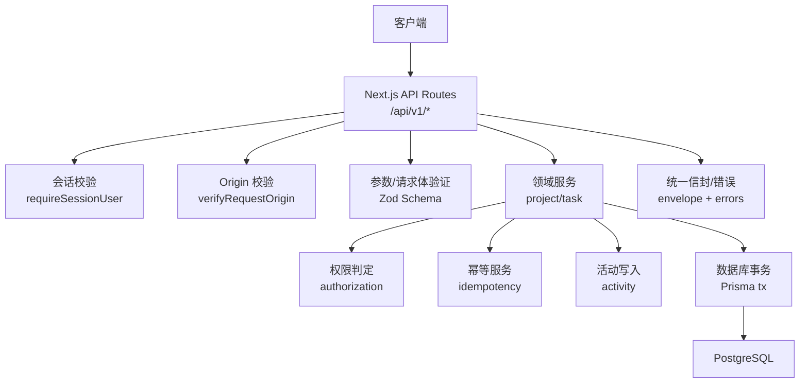
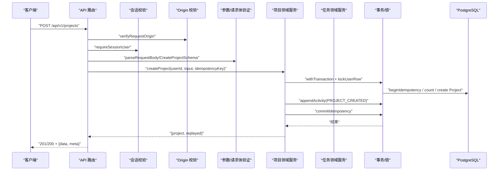
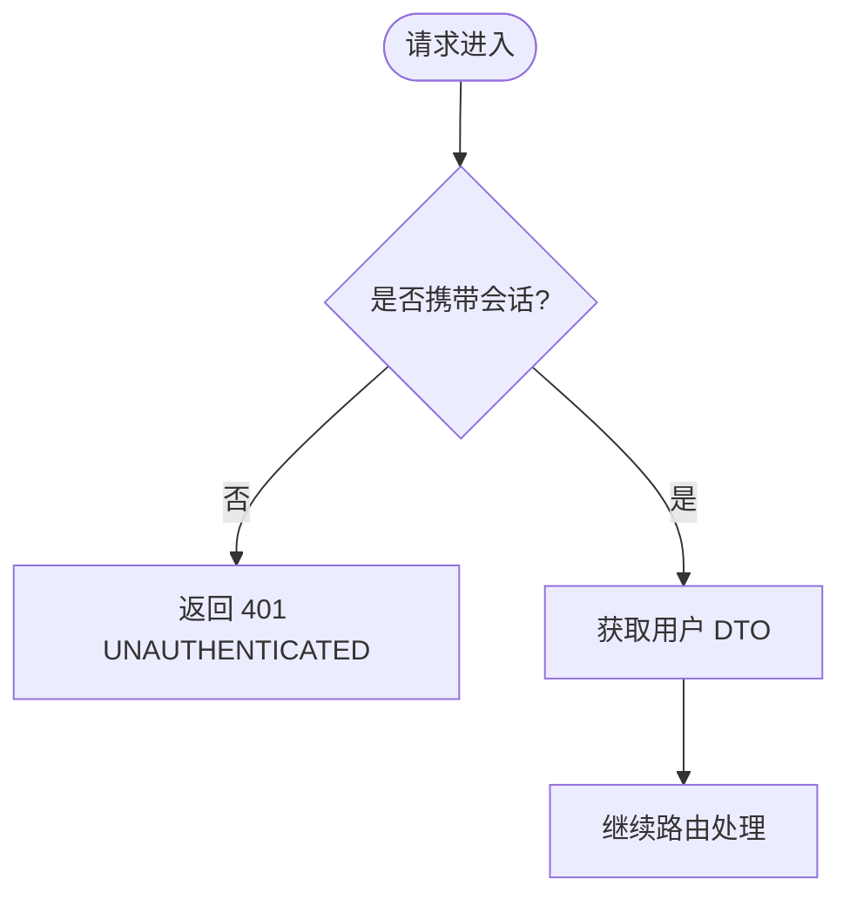
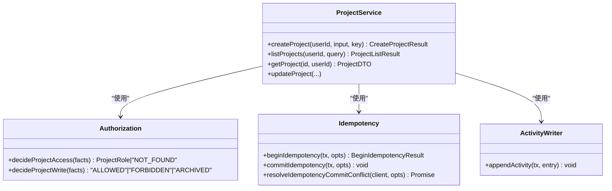
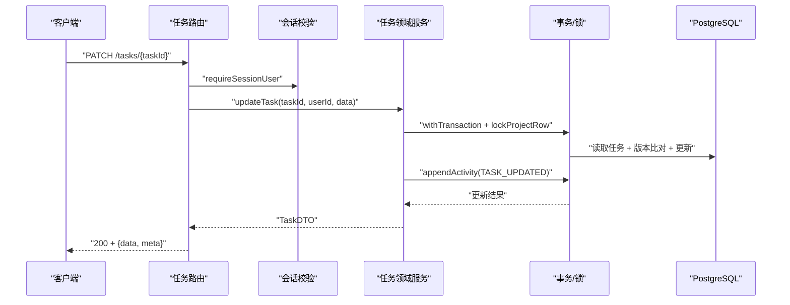
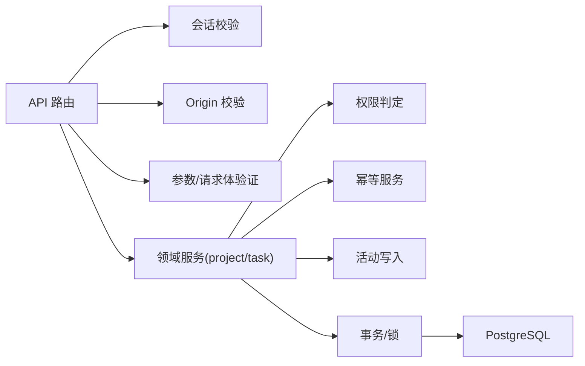

# 后端开发

<cite>
**本文引用的文件**
- [src/app/api/v1/projects/route.ts](file://src/app/api/v1/projects/route.ts)
- [src/app/api/v1/tasks/[taskId]/route.ts](file://src/app/api/v1/tasks/[taskId]/route.ts)
- [src/app/api/auth/[...all]/route.ts](file://src/app/api/auth/[...all]/route.ts)
- [src/server/auth/index.ts](file://src/server/auth/index.ts)
- [src/server/auth/session.ts](file://src/server/auth/session.ts)
- [src/server/http/errors.ts](file://src/server/http/errors.ts)
- [src/contracts/envelope.ts](file://src/contracts/envelope.ts)
- [prisma/schema.prisma](file://prisma/schema.prisma)
- [src/server/modules/project/index.ts](file://src/server/modules/project/index.ts)
- [src/server/modules/project/create.ts](file://src/server/modules/project/create.ts)
- [src/server/modules/task/index.ts](file://src/server/modules/task/index.ts)
- [src/server/modules/task/create.ts](file://src/server/modules/task/create.ts)
- [src/server/modules/authorization/decide.ts](file://src/server/modules/authorization/decide.ts)
- [src/server/modules/idempotency/service.ts](file://src/server/modules/idempotency/service.ts)
- [src/server/modules/activity/writer.ts](file://src/server/modules/activity/writer.ts)
</cite>

## 目录
1. [简介](#简介)
2. [项目结构](#项目结构)
3. [核心组件](#核心组件)
4. [架构总览](#架构总览)
5. [详细组件分析](#详细组件分析)
6. [依赖关系分析](#依赖关系分析)
7. [性能考虑](#性能考虑)
8. [故障排查指南](#故障排查指南)
9. [结论](#结论)
10. [附录：API 规范与集成示例](#附录api-规范与集成示例)

## 简介
本文件为 Orbit 项目的后端开发文档，聚焦于基于 Next.js API Routes 的后端架构。内容涵盖路由组织、中间件处理、请求响应流程；业务逻辑层的模块化设计（项目、任务、活动日志等）；数据访问层（Prisma ORM、查询优化、事务）；认证授权与会话管理；API 设计规范、错误处理策略与日志记录方案；并提供具体 API 实现示例与集成指引。

## 项目结构
- API 路由位于 src/app/api，按版本 v1 组织资源路径，如 /api/v1/projects、/api/v1/tasks/[taskId]。
- 认证相关路由通过 catch-all 挂载到 /api/auth/*，由 Better Auth 统一处理。
- 业务逻辑集中在 src/server/modules，按领域划分（project、task），并共享基础设施（authorization、idempotency、activity、pagination）。
- 数据模型与迁移在 prisma/schema.prisma 中定义，使用 Prisma Client 进行数据访问。
- 统一信封与错误处理在 contracts 与 server/http 中实现，确保前后端契约一致与安全。

图表来源
- [src/app/api/v1/projects/route.ts:21-93](file://src/app/api/v1/projects/route.ts#L21-L93)
- [src/app/api/v1/tasks/[taskId]/route.ts:10-112](file://src/app/api/v1/tasks/[taskId]/route.ts#L10-L112)
- [src/server/auth/session.ts:20-43](file://src/server/auth/session.ts#L20-L43)
- [src/server/modules/project/create.ts:18-181](file://src/server/modules/project/create.ts#L18-L181)
- [src/server/modules/task/create.ts:32-202](file://src/server/modules/task/create.ts#L32-L202)
- [src/contracts/envelope.ts:4-94](file://src/contracts/envelope.ts#L4-L94)
- [src/server/http/errors.ts:10-136](file://src/server/http/errors.ts#L10-L136)

章节来源
- [src/app/api/v1/projects/route.ts:21-93](file://src/app/api/v1/projects/route.ts#L21-L93)
- [src/app/api/v1/tasks/[taskId]/route.ts:10-112](file://src/app/api/v1/tasks/[taskId]/route.ts#L10-L112)
- [src/server/auth/index.ts:1-29](file://src/server/auth/index.ts#L1-L29)
- [src/server/auth/session.ts:20-43](file://src/server/auth/session.ts#L20-L43)
- [src/contracts/envelope.ts:4-94](file://src/contracts/envelope.ts#L4-L94)
- [src/server/http/errors.ts:10-136](file://src/server/http/errors.ts#L10-L136)
- [prisma/schema.prisma:14-268](file://prisma/schema.prisma#L14-L268)

## 核心组件
- 认证与会话：Better Auth 单例绑定 Prisma 与环境配置；提供 getSessionUser/requireSessionUser 用于服务端会话校验。
- 路由编排：v1 路由负责解析请求、校验参数与请求体、调用领域服务、封装统一信封响应。
- 领域服务：项目与任务模块分别封装创建、读取、更新、软删除等业务逻辑，包含配额、唯一性、幂等、授权、活动日志。
- 数据访问：Prisma 事务封装 withTransaction，行级锁 lockProjectRow/lockUserRow，配合幂等与活动写入保证原子性。
- 错误与信封：DomainError 统一业务异常；toErrorResponse 将异常映射为标准信封；成功响应使用 jsonSuccess/jsonCreated/jsonList。

章节来源
- [src/server/auth/index.ts:1-29](file://src/server/auth/index.ts#L1-L29)
- [src/server/auth/session.ts:20-43](file://src/server/auth/session.ts#L20-L43)
- [src/app/api/v1/projects/route.ts:21-93](file://src/app/api/v1/projects/route.ts#L21-L93)
- [src/app/api/v1/tasks/[taskId]/route.ts:10-112](file://src/app/api/v1/tasks/[taskId]/route.ts#L10-L112)
- [src/server/modules/project/create.ts:18-181](file://src/server/modules/project/create.ts#L18-L181)
- [src/server/modules/task/create.ts:32-202](file://src/server/modules/task/create.ts#L32-L202)
- [src/server/http/errors.ts:10-136](file://src/server/http/errors.ts#L10-L136)
- [src/contracts/envelope.ts:4-94](file://src/contracts/envelope.ts#L4-L94)

## 架构总览
下图展示了从 HTTP 请求到数据库事务的完整链路，包括认证、授权、幂等、活动日志与统一信封。

图表来源
- [src/app/api/v1/projects/route.ts:62-93](file://src/app/api/v1/projects/route.ts#L62-L93)
- [src/server/modules/project/create.ts:71-181](file://src/server/modules/project/create.ts#L71-L181)
- [src/server/modules/idempotency/service.ts:122-181](file://src/server/modules/idempotency/service.ts#L122-L181)
- [src/server/modules/activity/writer.ts:49-65](file://src/server/modules/activity/writer.ts#L49-L65)
- [prisma/schema.prisma:144-166](file://prisma/schema.prisma#L144-L166)

## 详细组件分析

### 认证与会话
- 认证入口：/api/auth/* 通过 toNextJsHandler(auth) 暴露所有认证端点，runtime=nodejs，避免 Edge 限制。
- 会话获取：getSessionUser 返回 UserDTO（不含敏感字段），requireSessionUser 未登录时抛出 UNAUTHENTICATED。
- 应用单例：auth 绑定 Prisma 与已校验环境，server-only 保护避免进入客户端 bundle。

图表来源
- [src/app/api/auth/[...all]/route.ts:4-22](file://src/app/api/auth/[...all]/route.ts#L4-L22)
- [src/server/auth/session.ts:20-43](file://src/server/auth/session.ts#L20-L43)
- [src/server/auth/index.ts:1-29](file://src/server/auth/index.ts#L1-L29)

章节来源
- [src/app/api/auth/[...all]/route.ts:4-22](file://src/app/api/auth/[...all]/route.ts#L4-L22)
- [src/server/auth/session.ts:20-43](file://src/server/auth/session.ts#L20-L43)
- [src/server/auth/index.ts:1-29](file://src/server/auth/index.ts#L1-L29)

### 项目模块（Project）
- 路由：GET /projects 列出当前用户的项目（支持游标分页）；POST /projects 创建项目（需 Idempotency-Key）。
- 领域服务 createProject：
  - 事务内顺序：lockUserRow → beginIdempotency → 配额计数 → insert Project → appendActivity(PROJECT_CREATED) → commitIdempotency。
  - 不变量：每用户未归档项目数上限；key 全局唯一；幂等重放前重新授权。
- 读操作 listProjects：返回项目列表与分页元信息。

图表来源
- [src/server/modules/project/index.ts:1-24](file://src/server/modules/project/index.ts#L1-L24)
- [src/server/modules/project/create.ts:18-181](file://src/server/modules/project/create.ts#L18-L181)
- [src/server/modules/authorization/decide.ts:1-67](file://src/server/modules/authorization/decide.ts#L1-L67)
- [src/server/modules/idempotency/service.ts:1-181](file://src/server/modules/idempotency/service.ts#L1-L181)
- [src/server/modules/activity/writer.ts:1-65](file://src/server/modules/activity/writer.ts#L1-L65)

章节来源
- [src/app/api/v1/projects/route.ts:21-93](file://src/app/api/v1/projects/route.ts#L21-L93)
- [src/server/modules/project/create.ts:18-181](file://src/server/modules/project/create.ts#L18-L181)
- [src/server/modules/authorization/decide.ts:1-67](file://src/server/modules/authorization/decide.ts#L1-L67)

### 任务模块（Task）
- 路由：GET/PATCH/DELETE /tasks/[taskId]，分别对应读取、更新、软删除。
- 领域服务 createTask：
  - 事务内顺序：lockProjectRow → requireWritableTaskProject → beginIdempotency → 配额计数 → nextTaskNumber → appendToColumnEnd → INSERT Task → boardVersion++ → appendActivity(TASK_CREATED) → commitIdempotency。
  - 不变量：每项目未删除任务数上限；负责人必须是成员；DONE 状态要求 completedAt；幂等重放前复核成员与可写权限。
- 更新与软删除：PATCH 更新任务字段；DELETE 软删除任务，需要 expectedVersion 乐观并发控制。

图表来源
- [src/app/api/v1/tasks/[taskId]/route.ts:56-86](file://src/app/api/v1/tasks/[taskId]/route.ts#L56-L86)
- [src/server/modules/task/create.ts:32-202](file://src/server/modules/task/create.ts#L32-L202)
- [prisma/schema.prisma:240-267](file://prisma/schema.prisma#L240-L267)

章节来源
- [src/app/api/v1/tasks/[taskId]/route.ts:10-112](file://src/app/api/v1/tasks/[taskId]/route.ts#L10-L112)
- [src/server/modules/task/create.ts:32-202](file://src/server/modules/task/create.ts#L32-L202)
- [prisma/schema.prisma:240-267](file://prisma/schema.prisma#L240-L267)

### 活动日志（ActivityLog）
- 写入器 appendActivity：在事务内追加一条活动日志，metadata 经白名单过滤，防止敏感信息入库。
- 事件类型与动作枚举在 schema 中定义，严格对齐契约。

章节来源
- [src/server/modules/activity/writer.ts:1-65](file://src/server/modules/activity/writer.ts#L1-L65)
- [prisma/schema.prisma:181-195](file://prisma/schema.prisma#L181-L195)

### 幂等性（Idempotency）
- 语义：同 (userId, method, routeKey, key) 且请求体哈希一致则重放原响应；否则 409 IDEMPOTENCY_CONFLICT。
- 事务内 beginIdempotency 检查既有记录；commitIdempotency 落库幂等记录；冲突时抛出哨兵错误，事务外 resolveIdempotencyCommitConflict 复查 hash。
- 有效期 24 小时，过期后允许重新执行。

章节来源
- [src/server/modules/idempotency/service.ts:1-181](file://src/server/modules/idempotency/service.ts#L1-L181)
- [src/server/modules/project/create.ts:71-181](file://src/server/modules/project/create.ts#L71-L181)
- [src/server/modules/task/create.ts:77-202](file://src/server/modules/task/create.ts#L77-L202)

### 权限控制（Authorization）
- 纯判定函数 decideProjectAccess 与 decideProjectWrite，将“谁能读/写”决策与 IO 解耦，便于测试与复用。
- 非成员与不存在统一收敛为 NOT_FOUND，不泄露存在性信息。

章节来源
- [src/server/modules/authorization/decide.ts:1-67](file://src/server/modules/authorization/decide.ts#L1-L67)

## 依赖关系分析
- 路由层依赖会话校验、Origin 校验、参数/请求体验证、领域服务与统一信封。
- 领域服务依赖权限判定、幂等服务、活动写入、事务与锁。
- 数据模型通过 Prisma 生成客户端，schema 定义实体与关系。

图表来源
- [src/app/api/v1/projects/route.ts:21-93](file://src/app/api/v1/projects/route.ts#L21-L93)
- [src/app/api/v1/tasks/[taskId]/route.ts:10-112](file://src/app/api/v1/tasks/[taskId]/route.ts#L10-L112)
- [src/server/modules/project/create.ts:18-181](file://src/server/modules/project/create.ts#L18-L181)
- [src/server/modules/task/create.ts:32-202](file://src/server/modules/task/create.ts#L32-L202)
- [prisma/schema.prisma:14-268](file://prisma/schema.prisma#L14-L268)

章节来源
- [src/app/api/v1/projects/route.ts:21-93](file://src/app/api/v1/projects/route.ts#L21-L93)
- [src/app/api/v1/tasks/[taskId]/route.ts:10-112](file://src/app/api/v1/tasks/[taskId]/route.ts#L10-L112)
- [src/server/modules/project/create.ts:18-181](file://src/server/modules/project/create.ts#L18-L181)
- [src/server/modules/task/create.ts:32-202](file://src/server/modules/task/create.ts#L32-L202)
- [prisma/schema.prisma:14-268](file://prisma/schema.prisma#L14-L268)

## 性能考虑
- 游标分页：项目列表使用 nextCursor 与 hasMore，减少一次性加载数据量。
- 行级锁：Project/User 行锁串行化关键临界区（编号、配额、position、boardVersion），避免竞争条件。
- 幂等记录：24 小时 TTL，降低重复请求对数据库的压力。
- 索引优化：Project、Task、ActivityLog 等表建立复合索引，提升查询与排序性能。
- 只读复查：幂等冲突时在事务外用只读客户端复查，避免 aborted 事务二次失败。

[本节为通用性能建议，无需特定文件引用]

## 故障排查指南
- 401 UNAUTHENTICATED：会话缺失或无效，检查 Cookie/Headers 与 requireSessionUser 调用。
- 400 VALIDATION_ERROR：请求体或查询参数不符合 Zod Schema，检查输入格式与长度限制。
- 409 CONFLICT：
  - PROJECT_KEY_TAKEN：项目 key 冲突，更换 key。
  - IDEMPOTENCY_CONFLICT：同一 Idempotency-Key 用于不同请求体，生成新键。
  - VERSION_CONFLICT：乐观并发失败，使用 currentVersion 重试。
- 422 LIMIT_EXCEEDED：达到项目或任务数量上限，清理归档或已完成项。
- 500 INTERNAL_ERROR：未预期错误，查看 requestId 与服务端日志定位问题。

章节来源
- [src/server/http/errors.ts:10-136](file://src/server/http/errors.ts#L10-L136)
- [src/server/modules/project/create.ts:45-56](file://src/server/modules/project/create.ts#L45-L56)
- [src/server/modules/idempotency/service.ts:54-60](file://src/server/modules/idempotency/service.ts#L54-L60)

## 结论
Orbit 后端采用清晰的层次化架构：路由层负责 HTTP 编排，领域服务封装业务规则，数据访问层通过 Prisma 事务与行锁保障一致性。认证与会话由 Better Auth 提供，权限判定与幂等机制确保安全性与可靠性。统一信封与错误处理使前后端契约一致，便于调试与维护。

[本节为总结性内容，无需特定文件引用]

## 附录：API 规范与集成示例
- 统一信封：
  - 成功：{data, meta:{requestId}}；列表增加 nextCursor、hasMore。
  - 错误：{error:{code,message,fieldErrors?,currentVersion?,currentBoardVersion?}, meta:{requestId}}。
- 项目接口：
  - GET /api/v1/projects：列出当前用户项目，支持游标分页。
  - POST /api/v1/projects：创建项目，需 Idempotency-Key，201 新建成功，200 幂等重放。
- 任务接口：
  - GET /api/v1/tasks/{taskId}：读取任务详情。
  - PATCH /api/v1/tasks/{taskId}：更新任务字段，支持乐观并发。
  - DELETE /api/v1/tasks/{taskId}：软删除任务，需 expectedVersion。
- 集成要点：
  - 所有写操作需设置 Idempotency-Key（UUID）。
  - 会话通过 Cookie 传递，服务端 requireSessionUser 校验。
  - 错误响应包含 requestId，便于追踪。

章节来源
- [src/contracts/envelope.ts:4-94](file://src/contracts/envelope.ts#L4-L94)
- [src/app/api/v1/projects/route.ts:21-93](file://src/app/api/v1/projects/route.ts#L21-L93)
- [src/app/api/v1/tasks/[taskId]/route.ts:10-112](file://src/app/api/v1/tasks/[taskId]/route.ts#L10-L112)
- [src/server/modules/idempotency/service.ts:1-181](file://src/server/modules/idempotency/service.ts#L1-L181)
- [src/server/http/errors.ts:10-136](file://src/server/http/errors.ts#L10-L136)