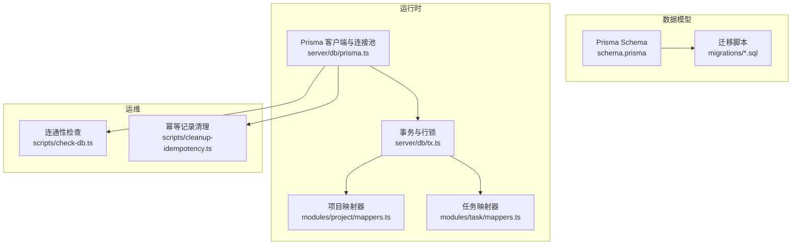
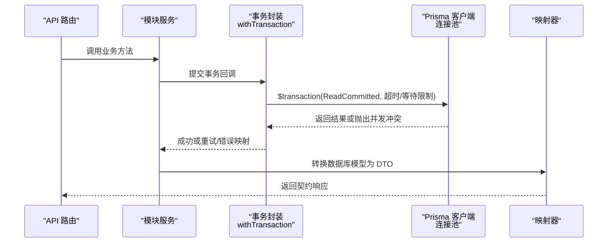
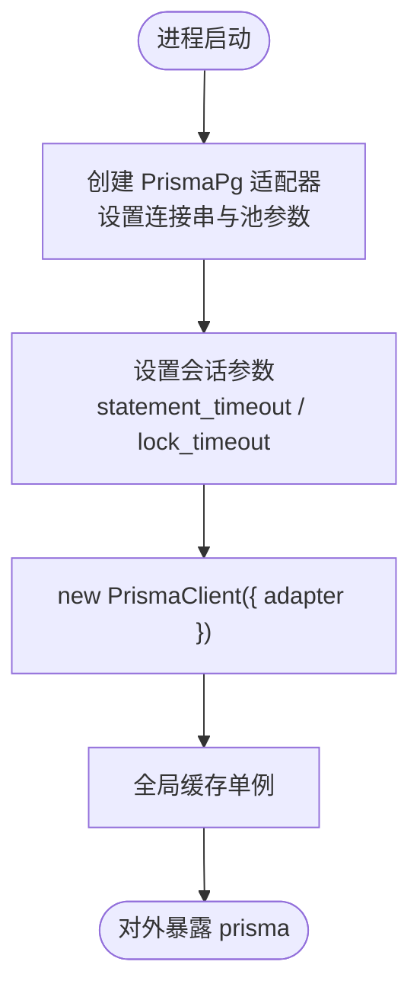
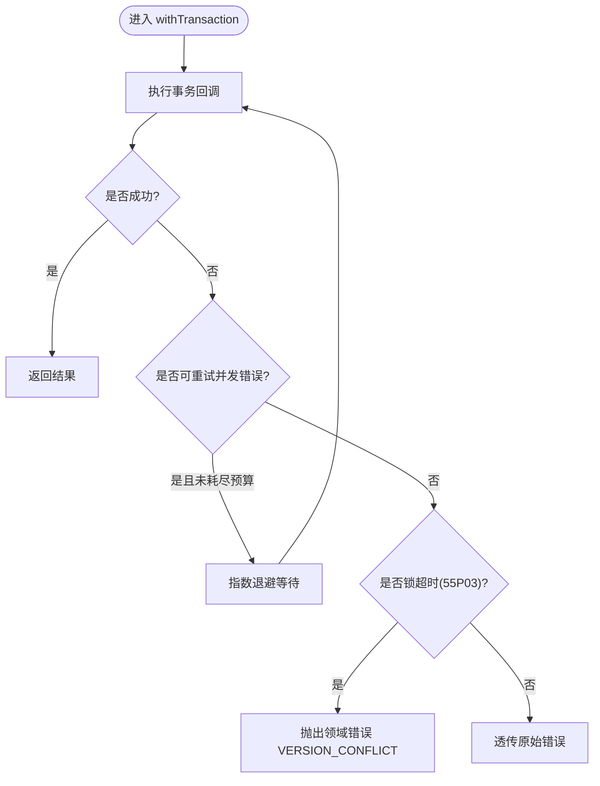
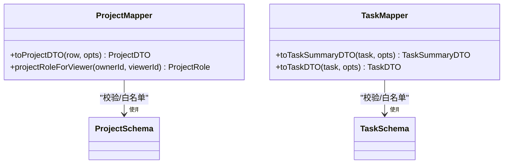
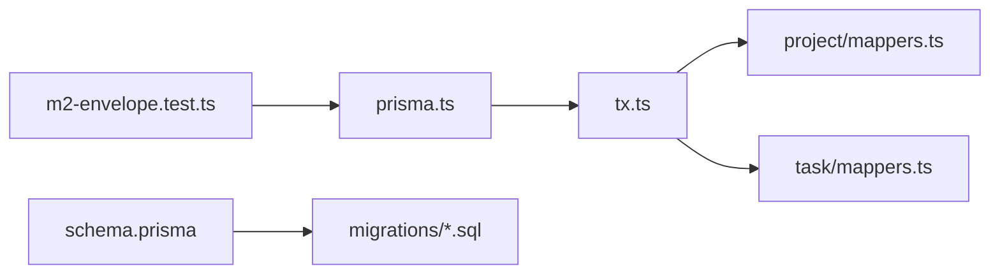

# 数据访问层

<cite>
**本文引用的文件**
- [prisma/schema.prisma](file://prisma/schema.prisma)
- [src/server/db/prisma.ts](file://src/server/db/prisma.ts)
- [src/server/db/tx.ts](file://src/server/db/tx.ts)
- [src/server/modules/project/mappers.ts](file://src/server/modules/project/mappers.ts)
- [src/server/modules/task/mappers.ts](file://src/server/modules/task/mappers.ts)
- [prisma/migrations/20260908162114_init_auth/migration.sql](file://prisma/migrations/20260908162114_init_auth/migration.sql)
- [scripts/check-db.ts](file://scripts/check-db.ts)
- [scripts/cleanup-idempotency.ts](file://scripts/cleanup-idempotency.ts)
- [tests/contract/m2-envelope.test.ts](file://tests/contract/m2-envelope.test.ts)
</cite>

## 目录
1. [简介](#简介)
2. [项目结构](#项目结构)
3. [核心组件](#核心组件)
4. [架构总览](#架构总览)
5. [详细组件分析](#详细组件分析)
6. [依赖关系分析](#依赖关系分析)
7. [性能考虑](#性能考虑)
8. [故障排查指南](#故障排查指南)
9. [结论](#结论)
10. [附录](#附录)

## 简介
本章节面向 Orbit 项目的数据访问层，围绕基于 Prisma ORM 的数据模型设计、实体关系映射、查询优化与事务处理展开。文档涵盖数据库迁移管理、Schema 版本控制与数据一致性保证；解释数据映射器模式（领域对象与数据库模型的转换）；说明查询构建器使用、N+1 问题解决方案与性能优化策略；并提供数据操作示例、连接池配置、错误处理机制、备份恢复策略与监控方案建议。

## 项目结构
数据访问层由以下关键部分组成：
- Prisma Schema 定义与迁移：集中描述数据模型、枚举、索引与约束，并通过迁移脚本演进数据库结构。
- Prisma 客户端与连接池：单例化 PrismaClient，配置 PostgreSQL 适配器与连接池参数、会话级超时。
- 事务与行锁：封装可重试的事务执行、死锁/序列化失败退避重试、项目/用户行级排他锁。
- 数据映射器：将数据库模型转换为契约 DTO，进行字段白名单过滤、计算字段注入与类型校验。
- 运维脚本：数据库连通性检查、幂等记录清理等维护工具。



**图表来源**
- [prisma/schema.prisma:1-268](file://prisma/schema.prisma#L1-L268)
- [src/server/db/prisma.ts:1-45](file://src/server/db/prisma.ts#L1-L45)
- [src/server/db/tx.ts:1-159](file://src/server/db/tx.ts#L1-L159)
- [src/server/modules/project/mappers.ts:1-50](file://src/server/modules/project/mappers.ts#L1-L50)
- [src/server/modules/task/mappers.ts:1-89](file://src/server/modules/task/mappers.ts#L1-L89)
- [scripts/check-db.ts:1-41](file://scripts/check-db.ts#L1-L41)
- [scripts/cleanup-idempotency.ts:1-29](file://scripts/cleanup-idempotency.ts#L1-L29)

**章节来源**
- [prisma/schema.prisma:1-268](file://prisma/schema.prisma#L1-L268)
- [src/server/db/prisma.ts:1-45](file://src/server/db/prisma.ts#L1-L45)
- [src/server/db/tx.ts:1-159](file://src/server/db/tx.ts#L1-L159)
- [src/server/modules/project/mappers.ts:1-50](file://src/server/modules/project/mappers.ts#L1-L50)
- [src/server/modules/task/mappers.ts:1-89](file://src/server/modules/task/mappers.ts#L1-L89)
- [scripts/check-db.ts:1-41](file://scripts/check-db.ts#L1-L41)
- [scripts/cleanup-idempotency.ts:1-29](file://scripts/cleanup-idempotency.ts#L1-L29)

## 核心组件
- 数据模型与关系：通过 Prisma Schema 定义 User、Session、Account、Verification、Project、ProjectMember、ActivityLog、IdempotencyRecord、Task 及其关联与索引。
- 连接池与客户端：单例 PrismaClient + PostgreSQL 适配器，配置最大连接数、空闲回收、连接获取超时与语句/锁超时。
- 事务与并发控制：ReadCommitted 隔离级别、有限技术重试（指数退避）、FOR UPDATE 行锁、锁顺序约定。
- 数据映射器：严格遵循契约 Schema 的 DTO 输出，计算角色、标识符、日期格式等。
- 迁移管理：按时间戳命名迁移，包含认证域与业务域表结构变更。
- 运维脚本：连通性探测与幂等记录清理。

**章节来源**
- [prisma/schema.prisma:23-267](file://prisma/schema.prisma#L23-L267)
- [src/server/db/prisma.ts:6-34](file://src/server/db/prisma.ts#L6-L34)
- [src/server/db/tx.ts:6-124](file://src/server/db/tx.ts#L6-L124)
- [src/server/modules/project/mappers.ts:5-49](file://src/server/modules/project/mappers.ts#L5-L49)
- [src/server/modules/task/mappers.ts:12-88](file://src/server/modules/task/mappers.ts#L12-L88)
- [prisma/migrations/20260908162114_init_auth/migration.sql:1-71](file://prisma/migrations/20260908162114_init_auth/migration.sql#L1-L71)

## 架构总览
下图展示了从请求到数据持久化的整体流程：API 路由调用模块服务，模块服务在事务中执行数据库操作，必要时对行加锁，再通过映射器产出 DTO。



**图表来源**
- [src/server/db/tx.ts:95-124](file://src/server/db/tx.ts#L95-L124)
- [src/server/db/prisma.ts:16-34](file://src/server/db/prisma.ts#L16-L34)
- [src/server/modules/project/mappers.ts:31-49](file://src/server/modules/project/mappers.ts#L31-L49)
- [src/server/modules/task/mappers.ts:53-88](file://src/server/modules/task/mappers.ts#L53-L88)

## 详细组件分析

### 数据模型与实体关系
- 认证域：User、Session、Account、Verification，遵循 Better Auth 1.7.3 官方 schema 约定，含必要唯一约束、外键与索引。
- 项目域：Project、ProjectMember、ActivityLog、IdempotencyRecord，采用 UUID 主键、Restrict 删除保护、复合索引优化查询。
- 任务域：Task，包含状态、优先级、软删除、版本号、位置等字段，并针对常用查询建立多索引。
- 枚举：ProjectColor、ActivityEntityType、ActivityAction、TaskStatus、TaskPriority，取值与契约保持一致。

```mermaid
erDiagram
USER ||--o{ SESSION : "拥有"
USER ||--o{ ACCOUNT : "拥有"
USER ||--o{ PROJECT : "创建(所有者)"
USER ||--o{ PROJECT_MEMBER : "成员"
USER ||--o{ ACTIVITY_LOG : "行为者"
USER ||--o{ IDEMPOTENCY_RECORD : "幂等记录"
USER ||--o{ TASK : "创建者"
USER ||--o{ TASK : "被分配"
PROJECT ||--o{ PROJECT_MEMBER : "包含"
PROJECT ||--o{ ACTIVITY_LOG : "活动日志"
PROJECT ||--o{ TASK : "包含"
PROJECT_MEMBER }o--|| USER : "成员"
PROJECT_MEMBER }o--|| PROJECT : "所属项目"
ACTIVITY_LOG }o--|| PROJECT : "归属项目"
ACTIVITY_LOG }o--|| USER : "行为者"
IDEMPOTENCY_RECORD }o--|| USER : "归属用户"
TASK }o--|| PROJECT : "属于项目"
TASK }o--|| USER : "创建者"
TASK }o--||? USER : "被分配"
```

**图表来源**
- [prisma/schema.prisma:27-267](file://prisma/schema.prisma#L27-L267)

**章节来源**
- [prisma/schema.prisma:23-267](file://prisma/schema.prisma#L23-L267)

### 连接池与客户端配置
- 单例 PrismaClient：避免 HMR 重复实例导致连接泄漏，生产环境保持单一实例。
- 连接池参数：
  - max：单实例最大连接数，限制对数据库的连接占用。
  - idleTimeoutMillis：空闲连接回收时间。
  - connectionTimeoutMillis：获取连接的等待上限。
- 会话级 PostgreSQL 参数：
  - statement_timeout=5000：单条语句最长 5s，防止慢查询长期占用连接。
  - lock_timeout=3000：等锁最长 3s，配合事务重试快速失败。



**图表来源**
- [src/server/db/prisma.ts:16-40](file://src/server/db/prisma.ts#L16-L40)

**章节来源**
- [src/server/db/prisma.ts:6-40](file://src/server/db/prisma.ts#L6-L40)

### 事务与并发控制
- 隔离级别：统一 ReadCommitted，写事务在锁保护下读己所写。
- 重试策略：对死锁（40P01）、序列化失败（40001）、锁不可用（55P03）进行有限技术重试，指数退避 50/150/450ms，最多 3 次。
- 锁顺序：User → Project → Task → 子资源，避免死锁。
- 行锁：提供 lockProjectRow、lockUserRow 在事务内对目标行加 FOR UPDATE 排他锁。
- 超时：事务默认 timeout=5000ms、maxWait=2000ms，与连接池会话超时呼应。



**图表来源**
- [src/server/db/tx.ts:95-124](file://src/server/db/tx.ts#L95-L124)
- [src/server/db/tx.ts:59-82](file://src/server/db/tx.ts#L59-L82)

**章节来源**
- [src/server/db/tx.ts:6-159](file://src/server/db/tx.ts#L6-L159)

### 数据映射器模式
- 项目映射器：
  - 计算角色：根据 ownerId 与 viewerId 判断 OWNER/MEMBER。
  - 计数注入：memberCount 与 openTaskCount 由查询层传入，mapper 仅透传。
  - 白名单输出：经 ProjectSchema 复校，隐藏内部字段（如 reservedBytes/usedBytes）。
- 任务映射器：
  - 标识符生成：projectKey-number 形式。
  - 日期归一化：dueDate 使用 UTC date-only 映射，避免时区偏移。
  - 人员精简：assignee/creator 仅暴露 id/name，不含 email。
  - 诚实零值：M5 前 subtask/comment/attachment 相关计数固定为 0。



**图表来源**
- [src/server/modules/project/mappers.ts:5-49](file://src/server/modules/project/mappers.ts#L5-L49)
- [src/server/modules/task/mappers.ts:12-88](file://src/server/modules/task/mappers.ts#L12-L88)

**章节来源**
- [src/server/modules/project/mappers.ts:5-49](file://src/server/modules/project/mappers.ts#L5-L49)
- [src/server/modules/task/mappers.ts:12-88](file://src/server/modules/task/mappers.ts#L12-L88)

### 查询构建器与 N+1 问题
- 选择字段：在查询层按需 select 关联表的必要字段（如 assignee/creator 的 id/name），减少多余数据传输。
- 预加载关联：通过 Prisma 的 include/select 一次性拉取关联数据，避免循环查询导致的 N+1。
- 索引利用：充分利用 schema 中的复合索引（如任务按项目、删除标记、状态、位置排序），提升列表与看板查询性能。
- 视图层聚合：将复杂计数（如 openTaskCount）放在查询层完成，mapper 只做轻量转换。

**章节来源**
- [prisma/schema.prisma:144-267](file://prisma/schema.prisma#L144-L267)
- [src/server/modules/task/mappers.ts:31-88](file://src/server/modules/task/mappers.ts#L31-L88)

### 迁移管理与 Schema 版本控制
- 迁移组织：按时间戳命名目录存放 SQL 迁移，确保可追溯与有序执行。
- 初始迁移：认证域表结构与外键、唯一索引创建。
- 版本演进：后续迁移逐步引入项目域与任务域，保持向后兼容。
- 约束实现：部分 CHECK 约束通过手写 SQL 在迁移中实现，以弥补 Prisma Schema 表达能力的不足。

**章节来源**
- [prisma/migrations/20260908162114_init_auth/migration.sql:1-71](file://prisma/migrations/20260908162114_init_auth/migration.sql#L1-L71)
- [prisma/schema.prisma:139-267](file://prisma/schema.prisma#L139-L267)

### 数据操作示例（路径指引）
- 读取项目列表与详情：参考项目模块 read 服务与映射器组合，结合索引与 select 优化。
- 创建/更新任务：在事务中执行，必要时对项目/任务行加锁，再写入并映射为 DTO。
- 幂等写入：通过 IdempotencyRecord 记录请求哈希与响应，避免重复提交。

**章节来源**
- [src/server/modules/project/mappers.ts:31-49](file://src/server/modules/project/mappers.ts#L31-L49)
- [src/server/modules/task/mappers.ts:53-88](file://src/server/modules/task/mappers.ts#L53-L88)
- [prisma/schema.prisma:197-214](file://prisma/schema.prisma#L197-L214)

### 连接池配置与测试复用
- 生产与开发：统一使用 PrismaPg 适配器与相同池参数，确保行为一致。
- 测试环境：通过 mock 替换 prisma 模块，使用独立 DATABASE_URL 与相同池配置，保障集成测试隔离性与稳定性。

**章节来源**
- [src/server/db/prisma.ts:16-40](file://src/server/db/prisma.ts#L16-L40)
- [tests/contract/m2-envelope.test.ts:57-81](file://tests/contract/m2-envelope.test.ts#L57-L81)

### 错误处理机制
- 并发冲突：识别 PostgreSQL SQLSTATE（40P01/40001/55P03），进行有限重试或映射为领域错误。
- 锁超时：当锁等待超过 lock_timeout，抛出 VERSION_CONFLICT，提示客户端稍后重试。
- 其他错误：非并发冲突的错误直接透传，便于上层统一处理。

**章节来源**
- [src/server/db/tx.ts:59-82](file://src/server/db/tx.ts#L59-L82)
- [src/server/db/tx.ts:115-121](file://src/server/db/tx.ts#L115-L121)

## 依赖关系分析
- 模块耦合：
  - tx.ts 依赖 prisma.ts 提供的 PrismaClient。
  - mappers 依赖生成的 Prisma 类型与契约 Schema。
  - 迁移脚本与 schema.prisma 共同决定数据库结构。
- 外部依赖：
  - @prisma/adapter-pg：PostgreSQL 驱动适配器。
  - pg：底层数据库客户端（用于脚本）。
- 潜在循环：当前未发现循环依赖；模块职责清晰，分层明确。



**图表来源**
- [src/server/db/prisma.ts:1-45](file://src/server/db/prisma.ts#L1-L45)
- [src/server/db/tx.ts:1-159](file://src/server/db/tx.ts#L1-L159)
- [src/server/modules/project/mappers.ts:1-50](file://src/server/modules/project/mappers.ts#L1-L50)
- [src/server/modules/task/mappers.ts:1-89](file://src/server/modules/task/mappers.ts#L1-L89)
- [prisma/schema.prisma:1-268](file://prisma/schema.prisma#L1-L268)
- [tests/contract/m2-envelope.test.ts:57-81](file://tests/contract/m2-envelope.test.ts#L57-L81)

**章节来源**
- [src/server/db/prisma.ts:1-45](file://src/server/db/prisma.ts#L1-L45)
- [src/server/db/tx.ts:1-159](file://src/server/db/tx.ts#L1-L159)
- [src/server/modules/project/mappers.ts:1-50](file://src/server/modules/project/mappers.ts#L1-L50)
- [src/server/modules/task/mappers.ts:1-89](file://src/server/modules/task/mappers.ts#L1-L89)
- [prisma/schema.prisma:1-268](file://prisma/schema.prisma#L1-L268)
- [tests/contract/m2-envelope.test.ts:57-81](file://tests/contract/m2-envelope.test.ts#L57-L81)

## 性能考虑
- 连接池调优：合理设置 max、idleTimeout、connectionTimeout，避免连接耗尽与排队过长。
- 语句与锁超时：通过会话参数限制慢查询与锁等待，提高系统鲁棒性。
- 索引设计：为高频查询建立复合索引，减少全表扫描与排序开销。
- 查询优化：使用 select/include 预加载关联，避免 N+1；在查询层完成必要聚合。
- 事务粒度：尽量缩小事务范围，减少持锁时间与竞争概率。

[本节为通用指导，不直接分析具体文件]

## 故障排查指南
- 数据库连通性：使用 check-db 脚本验证连接与版本信息，定位网络或凭证问题。
- 幂等记录膨胀：运行 cleanup-idempotency 脚本分批清理过期记录，释放空间并维持性能。
- 并发冲突：关注事务重试日志与错误码，调整业务重试策略或优化锁粒度。
- 慢查询：结合 statement_timeout 与数据库慢查询日志定位热点 SQL，优化索引与查询计划。

**章节来源**
- [scripts/check-db.ts:1-41](file://scripts/check-db.ts#L1-L41)
- [scripts/cleanup-idempotency.ts:1-29](file://scripts/cleanup-idempotency.ts#L1-L29)
- [src/server/db/tx.ts:95-124](file://src/server/db/tx.ts#L95-L124)

## 结论
Orbit 的数据访问层以 Prisma Schema 为核心，结合严格的迁移管理、健壮的事务与并发控制、以及清晰的映射器模式，实现了高一致性与高性能的数据读写。通过合理的连接池配置、索引设计与查询优化，有效避免了常见性能陷阱。运维脚本为日常维护提供了便利。建议在后续迭代中持续完善监控与告警，进一步提升系统的可观测性与稳定性。

[本节为总结性内容，不直接分析具体文件]

## 附录

### 备份与恢复策略（建议）
- 定期全量备份：结合数据库原生备份工具（如 pg_dump）定时导出，保留多份历史快照。
- 增量备份：启用 WAL 归档与时间点恢复能力，支持细粒度恢复。
- 恢复演练：定期进行恢复演练，验证备份可用性与恢复流程。
- 安全存储：备份文件加密并存储于异地或对象存储，防范数据丢失风险。

[本节为通用建议，不直接分析具体文件]

### 监控方案（建议）
- 连接池监控：跟踪连接数、等待队列、超时次数，及时发现瓶颈。
- 事务监控：统计事务耗时、重试次数、冲突率，评估锁竞争情况。
- 慢查询监控：收集慢查询 SQL 与执行计划，持续优化索引与查询。
- 指标上报：将关键指标上报至监控系统，设置阈值告警。

[本节为通用建议，不直接分析具体文件]