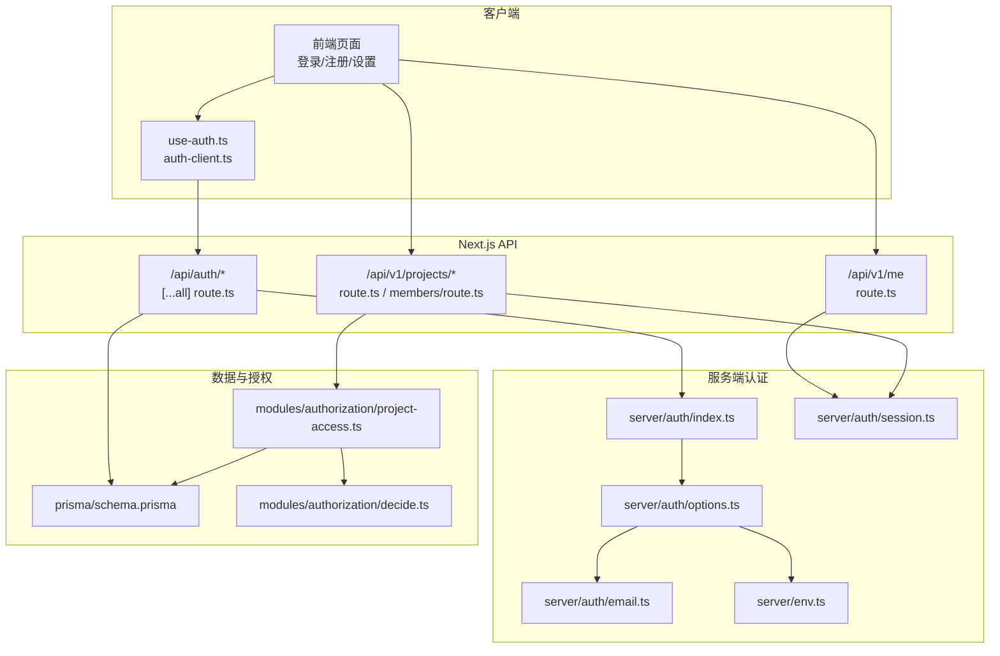
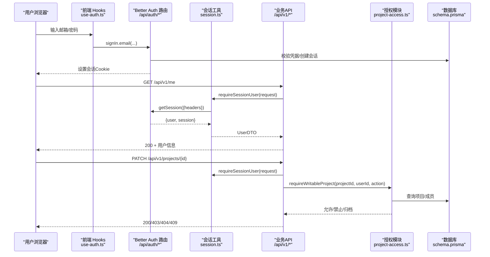
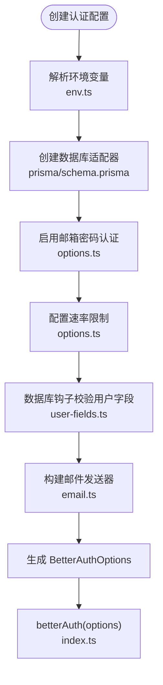
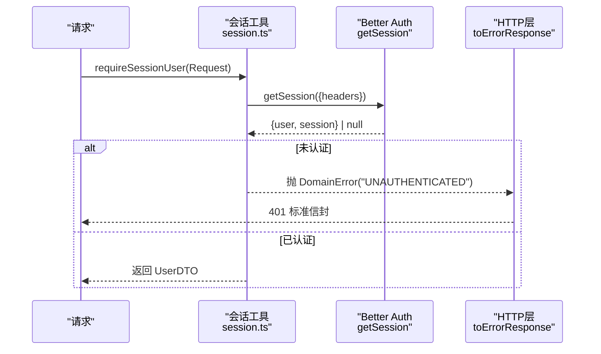
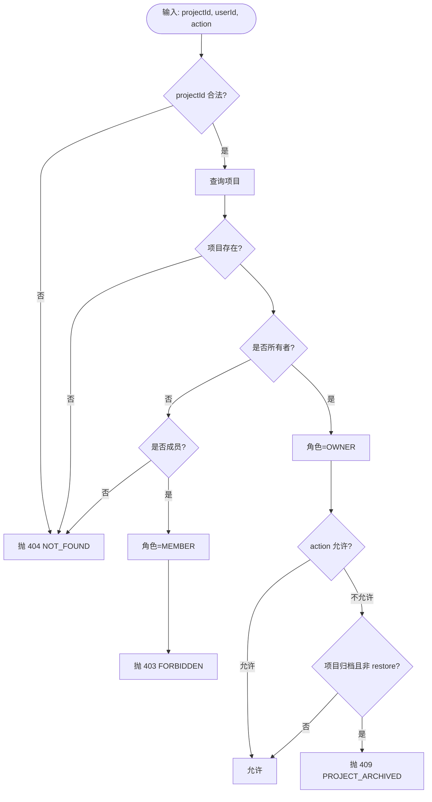
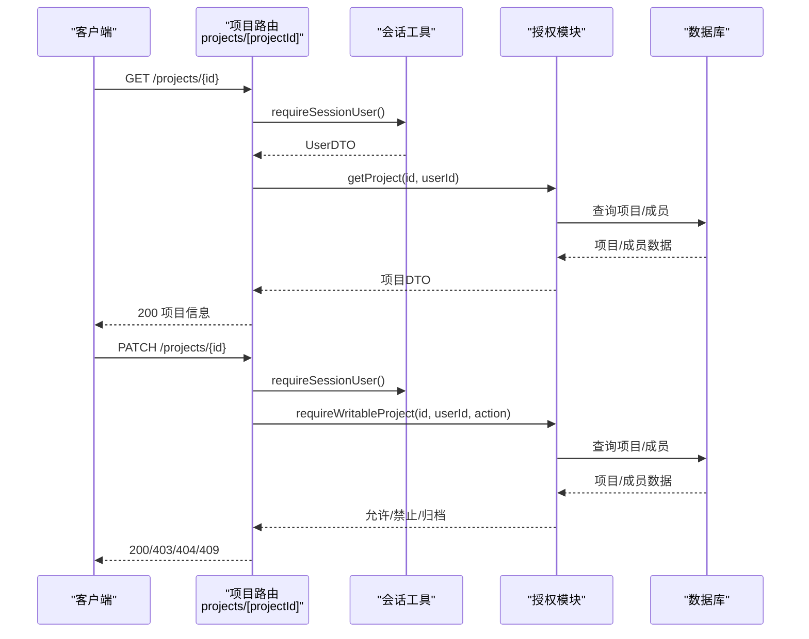
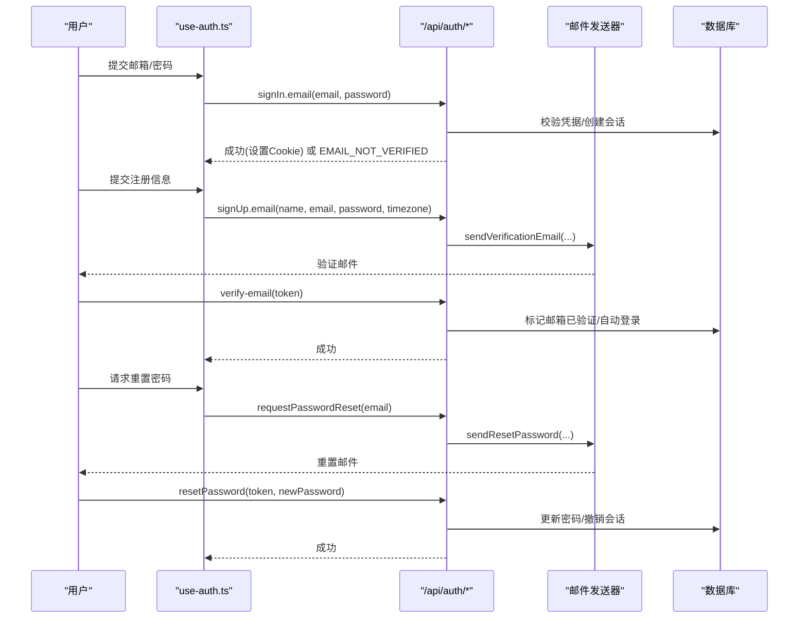
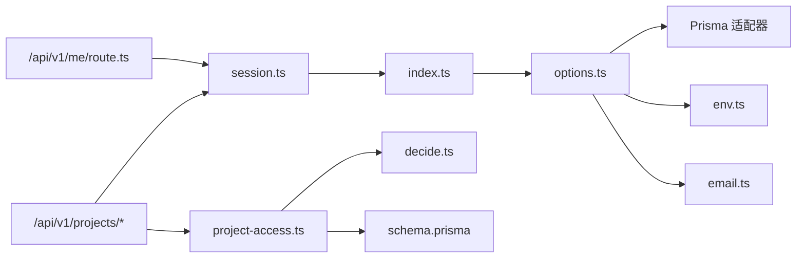

# 认证授权

<cite>
**本文引用的文件**
- [src/server/auth/index.ts](file://src/server/auth/index.ts)
- [src/server/auth/options.ts](file://src/server/auth/options.ts)
- [src/server/auth/session.ts](file://src/server/auth/session.ts)
- [src/app/api/auth/[...all]/route.ts](file://src/app/api/auth/[...all]/route.ts)
- [prisma/schema.prisma](file://prisma/schema.prisma)
- [src/server/auth/email.ts](file://src/server/auth/email.ts)
- [src/server/auth/user-fields.ts](file://src/server/auth/user-fields.ts)
- [src/features/auth/auth-client.ts](file://src/features/auth/auth-client.ts)
- [src/features/auth/use-auth.ts](file://src/features/auth/use-auth.ts)
- [src/server/modules/authorization/decide.ts](file://src/server/modules/authorization/decide.ts)
- [src/server/modules/authorization/project-access.ts](file://src/server/modules/authorization/project-access.ts)
- [src/app/api/v1/me/route.ts](file://src/app/api/v1/me/route.ts)
- [src/app/api/v1/projects/[projectId]/route.ts](file://src/app/api/v1/projects/[projectId]/route.ts)
- [src/app/api/v1/projects/[projectId]/members/route.ts](file://src/app/api/v1/projects/[projectId]/members/route.ts)
- [src/server/env.ts](file://src/server/env.ts)
</cite>

## 目录
1. [简介](#简介)
2. [项目结构](#项目结构)
3. [核心组件](#核心组件)
4. [架构总览](#架构总览)
5. [详细组件分析](#详细组件分析)
6. [依赖关系分析](#依赖关系分析)
7. [性能与安全考量](#性能与安全考量)
8. [故障排查指南](#故障排查指南)
9. [结论](#结论)
10. [附录](#附录)

## 简介
本文件为 Orbit 项目的认证与授权文档，聚焦基于 Better Auth 的认证系统实现、会话管理、安全配置、用户权限模型、访问控制策略、JWT/令牌处理、第三方认证集成与审计日志方案。内容覆盖邮箱密码认证、会话持久化、资源级权限检查、项目成员权限与项目级访问控制，并提供认证流程示例、权限验证代码位置与安全漏洞防护建议。

## 项目结构
认证与授权相关代码主要分布在以下层次：
- 服务端认证核心：Better Auth 实例、选项与环境绑定、会话查询封装
- 客户端认证能力：React hooks、错误提示、会话订阅
- 数据模型：Prisma 中的 User/Session/Account/Verification 及业务扩展字段
- 邮件服务：验证与重置密码邮件发送（nodemailer + SMTP）
- 授权模块：项目级访问判定与 IO 层封装
- API 路由：认证端点挂载、受保护的业务接口（/me、项目等）

图表来源
- [src/app/api/auth/[...all]/route.ts:1-22](file://src/app/api/auth/[...all]/route.ts#L1-L22)
- [src/server/auth/index.ts:1-29](file://src/server/auth/index.ts#L1-L29)
- [src/server/auth/options.ts:1-141](file://src/server/auth/options.ts#L1-L141)
- [src/server/auth/session.ts:1-43](file://src/server/auth/session.ts#L1-L43)
- [src/server/auth/email.ts:1-218](file://src/server/auth/email.ts#L1-L218)
- [src/server/env.ts:1-238](file://src/server/env.ts#L1-L238)
- [prisma/schema.prisma:23-92](file://prisma/schema.prisma#L23-L92)
- [src/server/modules/authorization/decide.ts:1-67](file://src/server/modules/authorization/decide.ts#L1-L67)
- [src/server/modules/authorization/project-access.ts:1-121](file://src/server/modules/authorization/project-access.ts#L1-L121)

章节来源
- [src/app/api/auth/[...all]/route.ts:1-22](file://src/app/api/auth/[...all]/route.ts#L1-L22)
- [src/server/auth/index.ts:1-29](file://src/server/auth/index.ts#L1-L29)
- [src/server/auth/options.ts:1-141](file://src/server/auth/options.ts#L1-L141)
- [src/server/auth/session.ts:1-43](file://src/server/auth/session.ts#L1-L43)
- [prisma/schema.prisma:23-92](file://prisma/schema.prisma#L23-L92)

## 核心组件
- Better Auth 应用单例与类型导出：集中创建并暴露认证实例与会话类型，供服务端使用。
- Better Auth 配置工厂：绑定数据库适配器、邮箱密码、会话策略、限流、可信源、Cookie 安全策略、数据库钩子与用户扩展字段。
- 会话工具：统一从请求头解析会话，返回契约层用户 DTO；未认证时抛出领域错误。
- 认证路由：通过 Next.js catch-all 挂载 Better Auth 全部端点，运行时固定为 nodejs。
- 邮件发送器：基于 nodemailer，提供验证与重置密码邮件模板与链接构造，脱敏日志。
- 用户字段校验：姓名与时区校验，确保入库数据合法。
- 客户端认证 Hooks：封装登录、注册、退出、找回密码、重设密码、重发验证邮件等操作与错误文案映射。
- 授权模块：纯函数判定项目角色与写操作许可；IO 层负责查库、翻译领域错误。

章节来源
- [src/server/auth/index.ts:1-29](file://src/server/auth/index.ts#L1-L29)
- [src/server/auth/options.ts:1-141](file://src/server/auth/options.ts#L1-L141)
- [src/server/auth/session.ts:1-43](file://src/server/auth/session.ts#L1-L43)
- [src/app/api/auth/[...all]/route.ts:1-22](file://src/app/api/auth/[...all]/route.ts#L1-L22)
- [src/server/auth/email.ts:1-218](file://src/server/auth/email.ts#L1-L218)
- [src/server/auth/user-fields.ts:1-26](file://src/server/auth/user-fields.ts#L1-L26)
- [src/features/auth/auth-client.ts:1-32](file://src/features/auth/auth-client.ts#L1-L32)
- [src/features/auth/use-auth.ts:1-186](file://src/features/auth/use-auth.ts#L1-L186)
- [src/server/modules/authorization/decide.ts:1-67](file://src/server/modules/authorization/decide.ts#L1-L67)
- [src/server/modules/authorization/project-access.ts:1-121](file://src/server/modules/authorization/project-access.ts#L1-L121)

## 架构总览
认证授权整体流程如下：
- 客户端通过 better-auth/react 客户端发起登录/注册/重置等操作，调用 /api/auth/* 端点。
- 服务端通过 Next.js catch-all 路由将请求交给 Better Auth 处理，完成鉴权、会话创建与 Cookie 下发。
- 业务 API（如 /me、项目相关）在服务端通过会话工具校验当前用户身份，再进行资源级授权判定。
- 项目级访问控制由纯判定函数与 IO 层组合，保证非成员与不存在统一收敛为 404，避免信息泄露。

图表来源
- [src/features/auth/use-auth.ts:54-76](file://src/features/auth/use-auth.ts#L54-L76)
- [src/app/api/auth/[...all]/route.ts:1-22](file://src/app/api/auth/[...all]/route.ts#L1-L22)
- [src/server/auth/session.ts:20-43](file://src/server/auth/session.ts#L20-L43)
- [src/app/api/v1/me/route.ts:38-47](file://src/app/api/v1/me/route.ts#L38-L47)
- [src/app/api/v1/projects/[projectId]/route.ts:54-79](file://src/app/api/v1/projects/[projectId]/route.ts#L54-L79)
- [src/server/modules/authorization/project-access.ts:55-121](file://src/server/modules/authorization/project-access.ts#L55-L121)
- [prisma/schema.prisma:23-92](file://prisma/schema.prisma#L23-L92)

## 详细组件分析

### 认证系统与配置（Better Auth）
- 应用单例：在 server-only 中创建 Better Auth 实例，绑定 Prisma 与已校验环境，导出会话与用户类型。
- 配置工厂：启用邮箱密码认证、最小/最大密码长度、强制邮箱验证、重置后撤销会话、自定义速率限制、Https 下 Secure Cookie、可信来源列表、数据库钩子对用户 name/timezone 进行规范化。
- 会话策略：数据库会话，过期时间与刷新间隔明确声明。
- 邮件发送：验证与重置邮件通过 nodemailer 发送，链接构造复用库回调或应用自有页面，脱敏日志记录。

图表来源
- [src/server/auth/options.ts:44-139](file://src/server/auth/options.ts#L44-L139)
- [src/server/auth/index.ts:1-29](file://src/server/auth/index.ts#L1-L29)
- [src/server/auth/email.ts:189-217](file://src/server/auth/email.ts#L189-L217)
- [src/server/auth/user-fields.ts:1-26](file://src/server/auth/user-fields.ts#L1-L26)
- [src/server/env.ts:98-155](file://src/server/env.ts#L98-L155)
- [prisma/schema.prisma:23-92](file://prisma/schema.prisma#L23-L92)

章节来源
- [src/server/auth/index.ts:1-29](file://src/server/auth/index.ts#L1-L29)
- [src/server/auth/options.ts:1-141](file://src/server/auth/options.ts#L1-L141)
- [src/server/auth/email.ts:1-218](file://src/server/auth/email.ts#L1-L218)
- [src/server/auth/user-fields.ts:1-26](file://src/server/auth/user-fields.ts#L1-L26)
- [src/server/env.ts:1-238](file://src/server/env.ts#L1-L238)
- [prisma/schema.prisma:23-92](file://prisma/schema.prisma#L23-L92)

### 会话管理与安全配置
- 会话获取：统一从 Request/Headers 提取会话，返回契约层 UserDTO，不包含敏感字段。
- 要求已认证：未认证抛 UNAUTHENTICATED 领域错误，由 HTTP 层统一映射为标准信封响应。
- Cookie 安全：HttpOnly + SameSite=Lax 默认；Secure 仅在 https baseURL 时开启；trustedOrigins 精确配置。
- 速率限制：针对敏感端点设定更严格的阈值，test 环境关闭以支持集成测试。

图表来源
- [src/server/auth/session.ts:20-43](file://src/server/auth/session.ts#L20-L43)
- [src/app/api/v1/me/route.ts:38-47](file://src/app/api/v1/me/route.ts#L38-L47)

章节来源
- [src/server/auth/session.ts:1-43](file://src/server/auth/session.ts#L1-L43)
- [src/server/auth/options.ts:107-133](file://src/server/auth/options.ts#L107-L133)
- [src/server/env.ts:126-155](file://src/server/env.ts#L126-L155)

### 用户权限模型与访问控制
- 项目角色：OWNER 与 MEMBER，计算得出不写入数据库。
- 读访问判定：项目不存在或非成员 → NOT_FOUND；owner → OWNER；成员 → MEMBER。
- 写访问判定：仅 owner 可更新/归档/恢复；归档项目只读（restore 除外）。
- IO 层：查询项目与成员，将判定结果转换为领域错误（NOT_FOUND/FORBIDDEN/PROJECT_ARCHIVED），统一不泄露项目是否存在。

图表来源
- [src/server/modules/authorization/decide.ts:13-67](file://src/server/modules/authorization/decide.ts#L13-L67)
- [src/server/modules/authorization/project-access.ts:55-121](file://src/server/modules/authorization/project-access.ts#L55-L121)

章节来源
- [src/server/modules/authorization/decide.ts:1-67](file://src/server/modules/authorization/decide.ts#L1-L67)
- [src/server/modules/authorization/project-access.ts:1-121](file://src/server/modules/authorization/project-access.ts#L1-L121)

### JWT 令牌处理与第三方认证集成
- 令牌处理：本项目采用数据库会话模式，会话存储在 Session 表，通过 Cookie 维持；不使用显式 JWT 传输。
- 第三方认证：当前实现启用邮箱密码认证；如需接入第三方 OAuth，可在 Better Auth 选项中添加对应 provider，并通过相同会话机制管理登录态。
- 安全最佳实践：保持 HTTPS、启用 Secure Cookie、严格 trustedOrigins、对敏感端点启用速率限制、重置密码后撤销所有会话。

章节来源
- [src/server/auth/options.ts:44-139](file://src/server/auth/options.ts#L44-L139)
- [src/server/auth/session.ts:20-43](file://src/server/auth/session.ts#L20-L43)

### 资源级权限检查与项目级访问控制
- 资源级检查：业务 API 在服务端通过 requireSessionUser 确认身份，再调用授权模块进行资源访问判定。
- 项目级访问控制：
  - GET /projects/{id}：成员可见，非成员/不存在 → 404。
  - PATCH /projects/{id}：仅 owner，成员 → 403；归档项目只读（restore 除外）→ 409。
  - GET /projects/{id}/members：成员可见，非成员 → 404。

图表来源
- [src/app/api/v1/projects/[projectId]/route.ts:36-79](file://src/app/api/v1/projects/[projectId]/route.ts#L36-L79)
- [src/app/api/v1/projects/[projectId]/members/route.ts:26-37](file://src/app/api/v1/projects/[projectId]/members/route.ts#L26-L37)
- [src/server/modules/authorization/project-access.ts:55-121](file://src/server/modules/authorization/project-access.ts#L55-L121)

章节来源
- [src/app/api/v1/projects/[projectId]/route.ts:1-80](file://src/app/api/v1/projects/[projectId]/route.ts#L1-L80)
- [src/app/api/v1/projects/[projectId]/members/route.ts:1-38](file://src/app/api/v1/projects/[projectId]/members/route.ts#L1-L38)
- [src/server/modules/authorization/project-access.ts:1-121](file://src/server/modules/authorization/project-access.ts#L1-L121)

### 认证流程示例
- 登录流程：客户端调用 useSignIn → POST /sign-in/email → 成功设置会话 Cookie → 后续请求携带 Cookie 被服务端识别。
- 注册流程：客户端调用 useSignUp → POST /sign-up/email → 发送验证邮件 → 用户点击验证链接完成邮箱验证 → 自动登录或引导重新登录。
- 重置密码：客户端调用 useRequestPasswordReset → POST /request-password-reset → 发送邮件 → 用户点击重置链接 → POST /reset-password → 成功后撤销该用户所有既有会话。

图表来源
- [src/features/auth/use-auth.ts:54-162](file://src/features/auth/use-auth.ts#L54-L162)
- [src/app/api/auth/[...all]/route.ts:1-22](file://src/app/api/auth/[...all]/route.ts#L1-L22)
- [src/server/auth/email.ts:189-217](file://src/server/auth/email.ts#L189-L217)

章节来源
- [src/features/auth/use-auth.ts:1-186](file://src/features/auth/use-auth.ts#L1-L186)
- [src/app/api/auth/[...all]/route.ts:1-22](file://src/app/api/auth/[...all]/route.ts#L1-L22)
- [src/server/auth/email.ts:1-218](file://src/server/auth/email.ts#L1-L218)

### 审计日志记录方案
- 活动日志：ActivityLog 模型记录项目域内的关键操作（创建/更新/删除/归档/恢复等），包含实体类型、动作、元数据与时间戳。
- 幂等记录：IdempotencyRecord 记录重复请求的去重信息与响应，防止重复操作导致不一致。
- 认证侧日志：邮件发送记录脱敏信息（用途与 userId），不输出 token/链接/明文邮箱。

章节来源
- [prisma/schema.prisma:181-214](file://prisma/schema.prisma#L181-L214)
- [src/server/auth/email.ts:165-184](file://src/server/auth/email.ts#L165-L184)

## 依赖关系分析
- 认证核心依赖：Prisma 适配器、环境变量校验、邮件发送器、数据库钩子。
- 会话工具依赖：Better Auth 会话 API、HTTP 错误映射、契约层用户 DTO。
- 授权模块依赖：Prisma 事务客户端、领域错误、UUID 校验。
- API 路由依赖：会话工具、授权模块、JSON 信封与请求体解析。

图表来源
- [src/server/auth/options.ts:44-139](file://src/server/auth/options.ts#L44-L139)
- [src/server/auth/index.ts:1-29](file://src/server/auth/index.ts#L1-L29)
- [src/server/auth/session.ts:1-43](file://src/server/auth/session.ts#L1-L43)
- [src/app/api/v1/me/route.ts:1-91](file://src/app/api/v1/me/route.ts#L1-L91)
- [src/app/api/v1/projects/[projectId]/route.ts:1-80](file://src/app/api/v1/projects/[projectId]/route.ts#L1-L80)
- [src/server/modules/authorization/project-access.ts:1-121](file://src/server/modules/authorization/project-access.ts#L1-L121)
- [src/server/modules/authorization/decide.ts:1-67](file://src/server/modules/authorization/decide.ts#L1-L67)
- [prisma/schema.prisma:23-92](file://prisma/schema.prisma#L23-L92)

章节来源
- [src/server/auth/options.ts:1-141](file://src/server/auth/options.ts#L1-L141)
- [src/server/auth/index.ts:1-29](file://src/server/auth/index.ts#L1-L29)
- [src/server/auth/session.ts:1-43](file://src/server/auth/session.ts#L1-L43)
- [src/app/api/v1/me/route.ts:1-91](file://src/app/api/v1/me/route.ts#L1-L91)
- [src/app/api/v1/projects/[projectId]/route.ts:1-80](file://src/app/api/v1/projects/[projectId]/route.ts#L1-L80)
- [src/server/modules/authorization/project-access.ts:1-121](file://src/server/modules/authorization/project-access.ts#L1-L121)
- [src/server/modules/authorization/decide.ts:1-67](file://src/server/modules/authorization/decide.ts#L1-L67)
- [prisma/schema.prisma:23-92](file://prisma/schema.prisma#L23-L92)

## 性能与安全考量
- 性能
  - 会话存储于数据库，过期与刷新策略明确，减少频繁重建成本。
  - 邮件发送器按 env 缓存 transport，避免每封邮件重建连接。
  - 授权判定为纯函数，便于单元测试与复用，降低 IO 耦合。
- 安全
  - HTTPS 下启用 Secure Cookie；HttpOnly + SameSite=Lax 默认保障。
  - trustedOrigins 精确配置，拒绝通配符。
  - 敏感端点启用速率限制，防止暴力破解。
  - 重置密码后撤销所有会话，防止旧令牌滥用。
  - 非成员与不存在统一 404，避免信息泄露。
  - 环境变量校验严格，禁止秘密泄露到客户端。

章节来源
- [src/server/auth/options.ts:107-133](file://src/server/auth/options.ts#L107-L133)
- [src/server/auth/email.ts:38-65](file://src/server/auth/email.ts#L38-L65)
- [src/server/modules/authorization/project-access.ts:18-41](file://src/server/modules/authorization/project-access.ts#L18-L41)
- [src/server/env.ts:126-155](file://src/server/env.ts#L126-L155)

## 故障排查指南
- 登录失败
  - 检查是否为 RATE_LIMITED/429（尝试过于频繁）。
  - 检查 EMAIL_NOT_VERIFIED（未验证邮箱，服务端会重发验证邮件）。
  - 其他 403 可能为 Origin 校验失败，需从应用内重试。
- 会话无效
  - 检查 Cookie 是否 HttpOnly/SameSite/Lax；生产环境需 HTTPS。
  - 检查 trustedOrigins 配置是否正确。
- 项目访问异常
  - 非成员/不存在统一 404；成员执行 owner-only 操作返回 403；归档项目写操作返回 409。
- 邮件发送问题
  - 检查 SMTP 配置（host/port/secure/auth）；本地 Mailpit 无需 TLS。
  - 查看脱敏日志（kind 与 userId）定位发送情况。

章节来源
- [src/features/auth/use-auth.ts:32-52](file://src/features/auth/use-auth.ts#L32-L52)
- [src/server/auth/options.ts:112-129](file://src/server/auth/options.ts#L112-L129)
- [src/server/modules/authorization/project-access.ts:28-41](file://src/server/modules/authorization/project-access.ts#L28-L41)
- [src/server/auth/email.ts:165-184](file://src/server/auth/email.ts#L165-L184)

## 结论
Orbit 的认证授权体系以 Better Auth 为核心，结合 Prisma 数据模型与严格的配置校验，实现了安全的邮箱密码认证、会话持久化与资源级访问控制。通过纯判定函数与 IO 层分离，授权逻辑清晰、可测试性强。邮件服务与速率限制增强了用户体验与安全性。未来可按需在 Better Auth 中添加第三方认证 provider，沿用同一会话机制。

## 附录
- 环境变量要点
  - BETTER_AUTH_URL/BETTER_AUTH_SECRET：认证基础 URL 与密钥。
  - AUTH_TRUSTED_ORIGINS：精确可信来源列表。
  - SMTP_*：邮件服务器配置。
  - APP_ENV：运行环境，影响速率限制等行为。
- 数据模型要点
  - User/Session/Account/Verification：认证核心表。
  - Project/ProjectMember/Task：业务域模型，支撑项目与任务权限。
- 客户端方法对照
  - signIn.email/signUp.email/requestPasswordReset/resetPassword/sendVerificationEmail/useSession。

章节来源
- [src/server/env.ts:98-155](file://src/server/env.ts#L98-L155)
- [prisma/schema.prisma:23-92](file://prisma/schema.prisma#L23-L92)
- [src/features/auth/auth-client.ts:17-25](file://src/features/auth/auth-client.ts#L17-L25)