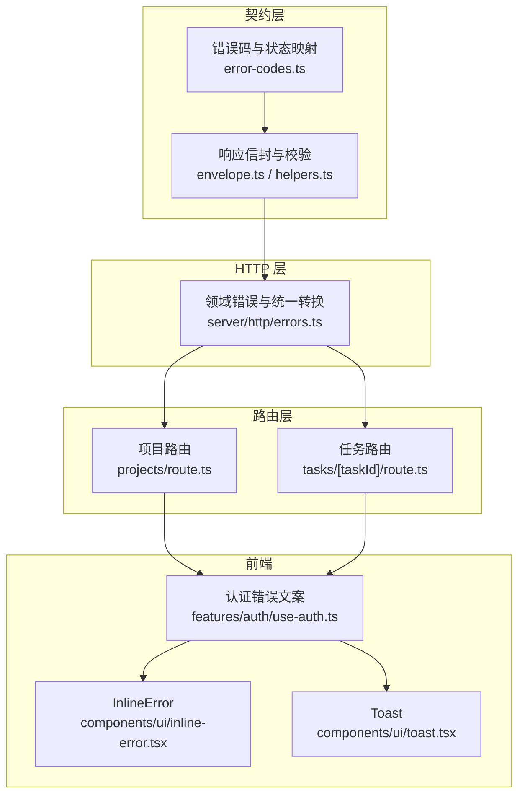
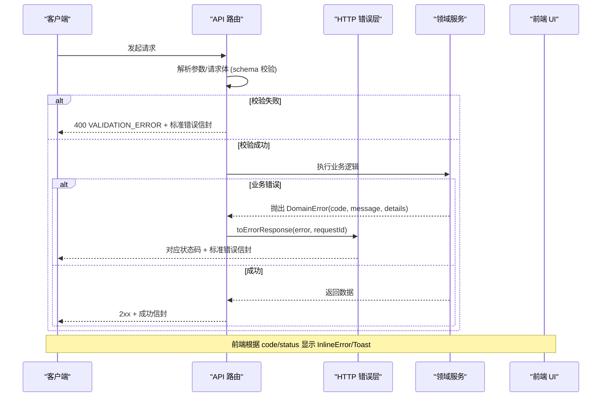
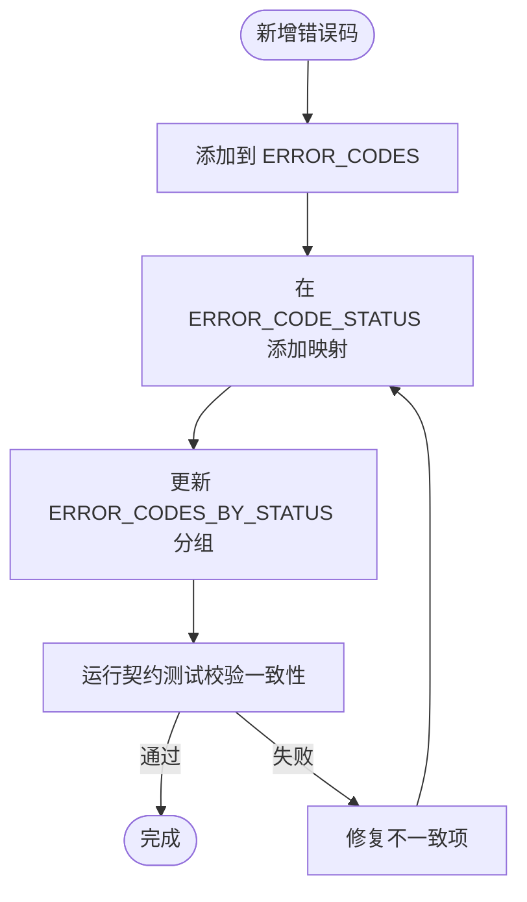
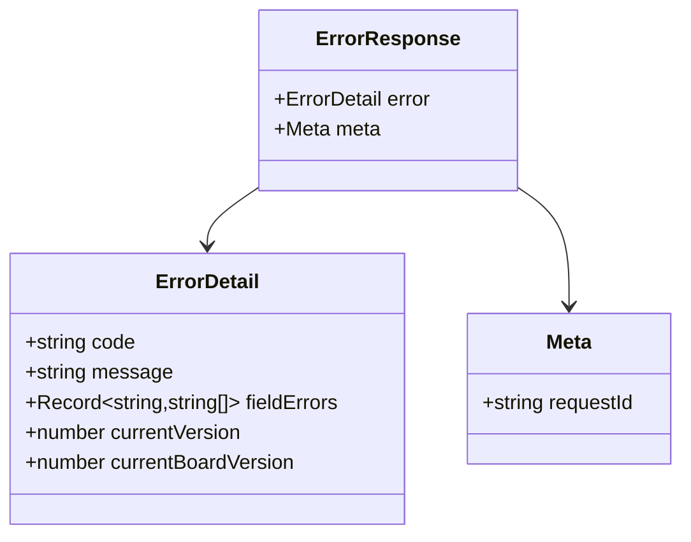
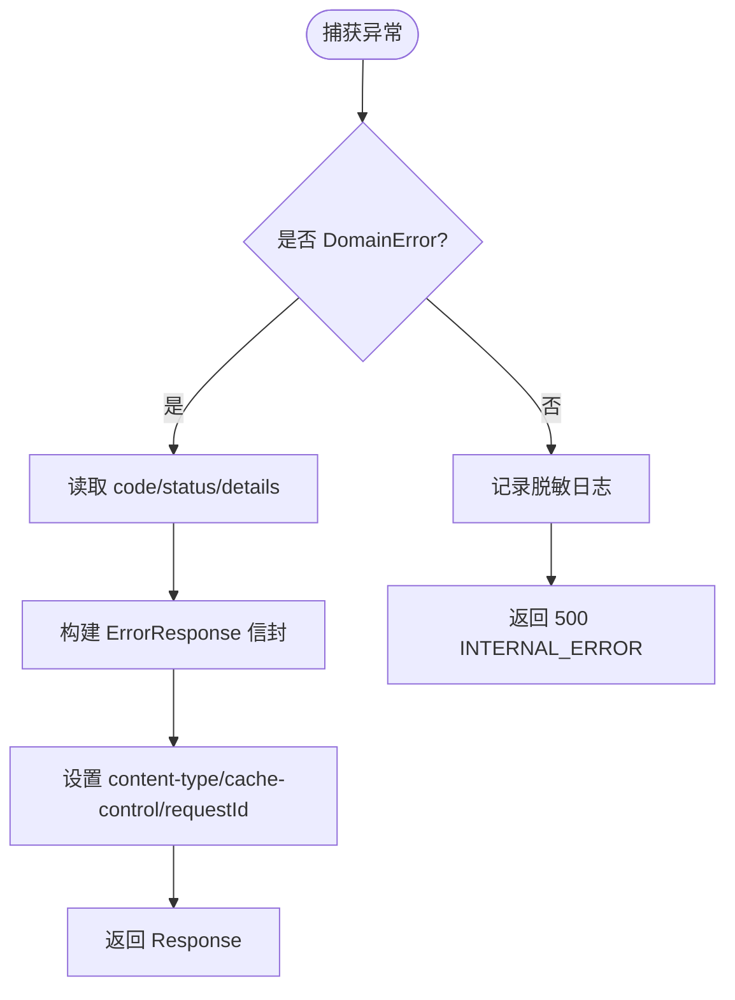
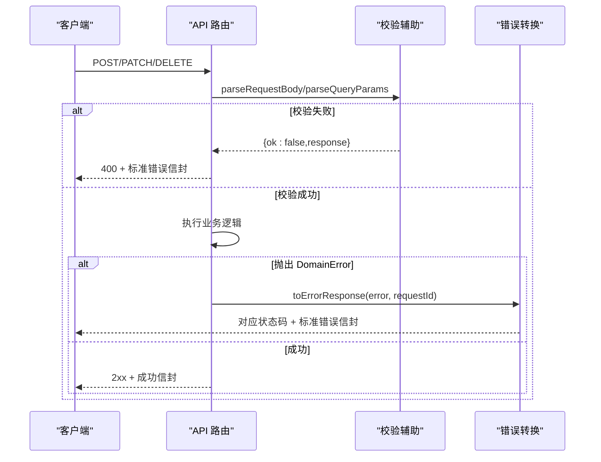
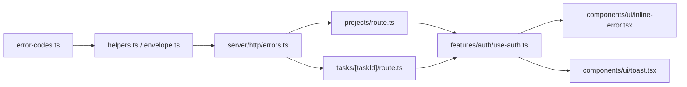

# 错误处理

<cite>
**本文引用的文件**
- [src/contracts/error-codes.ts](file://src/contracts/error-codes.ts)
- [src/contracts/envelope.ts](file://src/contracts/envelope.ts)
- [src/contracts/helpers.ts](file://src/contracts/helpers.ts)
- [src/server/http/errors.ts](file://src/server/http/errors.ts)
- [src/app/api/v1/projects/route.ts](file://src/app/api/v1/projects/route.ts)
- [src/app/api/v1/tasks/[taskId]/route.ts](file://src/app/api/v1/tasks/[taskId]/route.ts)
- [src/components/ui/inline-error.tsx](file://src/components/ui/inline-error.tsx)
- [src/components/ui/toast.tsx](file://src/components/ui/toast.tsx)
- [src/features/auth/use-auth.ts](file://src/features/auth/use-auth.ts)
- [src/instrumentation.ts](file://src/instrumentation.ts)
- [tests/contract/error-codes.test.ts](file://tests/contract/error-codes.test.ts)
</cite>

## 目录
1. [简介](#简介)
2. [项目结构](#项目结构)
3. [核心组件](#核心组件)
4. [架构总览](#架构总览)
5. [详细组件分析](#详细组件分析)
6. [依赖关系分析](#依赖关系分析)
7. [性能考虑](#性能考虑)
8. [故障排查指南](#故障排查指南)
9. [结论](#结论)
10. [附录](#附录)

## 简介
本文件为 Orbit 项目的统一错误处理规范与实现说明，覆盖以下方面：
- 统一的错误码定义、HTTP 状态码映射与错误响应信封格式。
- 前端错误展示组件（局部错误提示与 Toast）及用户体验策略。
- 后端异常捕获机制、领域错误类型设计与错误传播路径。
- 调试信息处理原则（请求 ID、脱敏日志）。
- 生产环境监控、聚合分析与告警建议（基于现有日志能力扩展）。
- 具体示例、异常恢复策略与用户体验优化建议。
- 错误排查工具与调试技巧。

## 项目结构
错误处理相关代码按“契约层 → HTTP 层 → 路由层 → 前端 UI”分层组织：
- 契约层：集中定义错误码、HTTP 状态映射、标准响应信封与校验辅助。
- HTTP 层：提供领域错误类型、统一错误到 Response 的转换与兜底 500 处理。
- 路由层：在 API 路由中统一使用 schema 校验、错误响应封装与全局 catch 收敛。
- 前端 UI：提供 InlineError 与 Toast 两种错误反馈方式，并配合认证流程的错误文案映射。



图表来源
- [src/contracts/error-codes.ts:18-136](file://src/contracts/error-codes.ts#L18-L136)
- [src/contracts/envelope.ts:21-57](file://src/contracts/envelope.ts#L21-L57)
- [src/contracts/helpers.ts:64-144](file://src/contracts/helpers.ts#L64-L144)
- [src/server/http/errors.ts:39-135](file://src/server/http/errors.ts#L39-L135)
- [src/app/api/v1/projects/route.ts:36-92](file://src/app/api/v1/projects/route.ts#L36-L92)
- [src/app/api/v1/tasks/[taskId]/route.ts:44-111](file://src/app/api/v1/tasks/[taskId]/route.ts#L44-L111)
- [src/components/ui/inline-error.tsx:5-39](file://src/components/ui/inline-error.tsx#L5-L39)
- [src/components/ui/toast.tsx:15-130](file://src/components/ui/toast.tsx#L15-L130)
- [src/features/auth/use-auth.ts:29-52](file://src/features/auth/use-auth.ts#L29-L52)

章节来源
- [src/contracts/error-codes.ts:18-136](file://src/contracts/error-codes.ts#L18-L136)
- [src/contracts/envelope.ts:21-57](file://src/contracts/envelope.ts#L21-L57)
- [src/contracts/helpers.ts:64-144](file://src/contracts/helpers.ts#L64-L144)
- [src/server/http/errors.ts:39-135](file://src/server/http/errors.ts#L39-L135)
- [src/app/api/v1/projects/route.ts:36-92](file://src/app/api/v1/projects/route.ts#L36-L92)
- [src/app/api/v1/tasks/[taskId]/route.ts:44-111](file://src/app/api/v1/tasks/[taskId]/route.ts#L44-L111)
- [src/components/ui/inline-error.tsx:5-39](file://src/components/ui/inline-error.tsx#L5-L39)
- [src/components/ui/toast.tsx:15-130](file://src/components/ui/toast.tsx#L15-L130)
- [src/features/auth/use-auth.ts:29-52](file://src/features/auth/use-auth.ts#L29-L52)

## 核心组件
- 错误码与状态映射：集中维护 ErrorCode 列表、ERROR_CODE_STATUS 映射、按状态分组视图以及 httpStatusForErrorCode 工具函数。测试覆盖确保映射一致性。
- 响应信封：统一成功与失败信封结构，错误体包含 code、message、可选 fieldErrors 与冲突版本；meta 固定携带 requestId。
- 领域错误与转换：DomainError 携带 code、fieldErrors、details；toErrorResponse 将未知异常收敛为 500 INTERNAL_ERROR，并记录脱敏日志。
- 路由层集成：所有 API 路由通过 parseRequestBody/parseQueryParams 进行输入校验，失败返回标准错误信封；catch 块统一调用 toErrorResponse。
- 前端错误展示：InlineError 用于字段级或局部错误驻留提示；Toast 用于瞬时提示；认证流程根据 error.code/status 输出友好文案。

章节来源
- [src/contracts/error-codes.ts:18-136](file://src/contracts/error-codes.ts#L18-L136)
- [src/contracts/envelope.ts:21-57](file://src/contracts/envelope.ts#L21-L57)
- [src/contracts/helpers.ts:64-144](file://src/contracts/helpers.ts#L64-L144)
- [src/server/http/errors.ts:39-135](file://src/server/http/errors.ts#L39-L135)
- [src/app/api/v1/projects/route.ts:36-92](file://src/app/api/v1/projects/route.ts#L36-L92)
- [src/app/api/v1/tasks/[taskId]/route.ts:44-111](file://src/app/api/v1/tasks/[taskId]/route.ts#L44-L111)
- [src/components/ui/inline-error.tsx:5-39](file://src/components/ui/inline-error.tsx#L5-L39)
- [src/components/ui/toast.tsx:15-130](file://src/components/ui/toast.tsx#L15-L130)
- [src/features/auth/use-auth.ts:29-52](file://src/features/auth/use-auth.ts#L29-L52)

## 架构总览
下图展示了从请求进入路由到错误响应的完整链路，包括输入校验、领域错误抛出、统一转换与前端展示。



图表来源
- [src/app/api/v1/projects/route.ts:36-92](file://src/app/api/v1/projects/route.ts#L36-L92)
- [src/app/api/v1/tasks/[taskId]/route.ts:44-111](file://src/app/api/v1/tasks/[taskId]/route.ts#L44-L111)
- [src/server/http/errors.ts:123-135](file://src/server/http/errors.ts#L123-L135)
- [src/contracts/helpers.ts:100-126](file://src/contracts/helpers.ts#L100-L126)
- [src/components/ui/inline-error.tsx:5-39](file://src/components/ui/inline-error.tsx#L5-L39)
- [src/components/ui/toast.tsx:15-130](file://src/components/ui/toast.tsx#L15-L130)

## 详细组件分析

### 错误码与 HTTP 状态映射
- 唯一真源：ERROR_CODES 数组集中声明全部错误码，顺序按 HTTP 状态分组便于阅读与维护。
- 类型安全映射：ERROR_CODE_STATUS 以 satisfies 约束键集必须完全覆盖 ErrorCode，值限定为 HttpStatus。
- 便捷分组：ERROR_CODES_BY_STATUS 提供按状态分组的视图，由测试交叉校验与映射一致。
- 工具函数：httpStatusForErrorCode 提供类型安全的状态码查询。



图表来源
- [src/contracts/error-codes.ts:28-136](file://src/contracts/error-codes.ts#L28-L136)
- [tests/contract/error-codes.test.ts:43-83](file://tests/contract/error-codes.test.ts#L43-L83)

章节来源
- [src/contracts/error-codes.ts:28-136](file://src/contracts/error-codes.ts#L28-L136)
- [tests/contract/error-codes.test.ts:43-83](file://tests/contract/error-codes.test.ts#L43-L83)

### 统一响应信封与校验
- 错误信封：{ error: { code, message, fieldErrors?, currentVersion?, currentBoardVersion? }, meta: { requestId } }，严格模式拒绝额外字段。
- 成功信封：{ data, meta: { requestId } }；列表信封：{ data: T[], meta: PageMeta }。
- 构造器：buildErrorResponse/buildSuccessResponse/buildListResponse 均经 Zod 复校，保证返回值合法。
- 校验辅助：parseRequestBody/parseQueryParams 将 Zod 校验失败映射为标准 400 错误信封。



图表来源
- [src/contracts/envelope.ts:21-57](file://src/contracts/envelope.ts#L21-L57)
- [src/contracts/helpers.ts:64-144](file://src/contracts/helpers.ts#L64-L144)

章节来源
- [src/contracts/envelope.ts:21-57](file://src/contracts/envelope.ts#L21-L57)
- [src/contracts/helpers.ts:64-144](file://src/contracts/helpers.ts#L64-L144)

### 领域错误类型与统一转换
- DomainError：携带 code、fieldErrors、details（如 currentVersion/currentBoardVersion），并提供 status 派生自 ErrorCode。
- toErrorResponse：对 DomainError 直接映射；对未知异常记录脱敏日志（仅 name/message 或类型）并返回 500 INTERNAL_ERROR。
- internalErrorResponse：通用 500 响应，不泄露内部细节。
- 缓存控制：所有错误响应设置 Cache-Control: private, no-store，避免私有内容被共享缓存。



图表来源
- [src/server/http/errors.ts:39-135](file://src/server/http/errors.ts#L39-L135)

章节来源
- [src/server/http/errors.ts:39-135](file://src/server/http/errors.ts#L39-L135)

### 路由层错误处理实践
- 输入校验：使用 parseRequestBody/parseQueryParams，失败即返回 400 标准错误信封。
- 写操作 Origin 校验：verifyRequestOrigin 失败时返回相应错误。
- 幂等性：POST 创建支持幂等重放，返回 200 同原结果。
- 统一捕获：每个方法 try/catch 后调用 toErrorResponse 收敛未知异常。



图表来源
- [src/app/api/v1/projects/route.ts:36-92](file://src/app/api/v1/projects/route.ts#L36-L92)
- [src/app/api/v1/tasks/[taskId]/route.ts:44-111](file://src/app/api/v1/tasks/[taskId]/route.ts#L44-L111)
- [src/contracts/helpers.ts:100-126](file://src/contracts/helpers.ts#L100-L126)
- [src/server/http/errors.ts:123-135](file://src/server/http/errors.ts#L123-L135)

章节来源
- [src/app/api/v1/projects/route.ts:36-92](file://src/app/api/v1/projects/route.ts#L36-L92)
- [src/app/api/v1/tasks/[taskId]/route.ts:44-111](file://src/app/api/v1/tasks/[taskId]/route.ts#L44-L111)

### 前端错误展示与用户体验
- InlineError：用于字段旁或局部区域的错误提示，具备 role="alert" 与图标，适合驻留展示。
- Toast：基于 Radix 的轻量通知，用于瞬时提示；不作为唯一错误反馈手段。
- 认证错误文案：根据 error.code/status 精确区分限流、未验证邮箱、Origin 拒绝等场景，避免泄露账户存在性。

```mermaid
flowchart TD
FErr(["收到错误响应"]) --> Decide{"code/status 判断"}
Decide --> |RATE_LIMITED/429| ShowRate["提示「尝试过于频繁」"]
Decide --> |EMAIL_NOT_VERIFIED| ShowVerify["提示「邮箱尚未验证」并重发邮件"]
Decide --> |403(非未验证)| ShowForbidden["提示「登录请求被拒绝」"]
Decide --> |其他| ShowFallback["提示「邮箱或密码不正确」"]
ShowRate --> UI["InlineError/Toast 展示"]
ShowVerify --> UI
ShowForbidden --> UI
ShowFallback --> UI
```

图表来源
- [src/components/ui/inline-error.tsx:5-39](file://src/components/ui/inline-error.tsx#L5-L39)
- [src/components/ui/toast.tsx:15-130](file://src/components/ui/toast.tsx#L15-L130)
- [src/features/auth/use-auth.ts:29-52](file://src/features/auth/use-auth.ts#L29-L52)

章节来源
- [src/components/ui/inline-error.tsx:5-39](file://src/components/ui/inline-error.tsx#L5-L39)
- [src/components/ui/toast.tsx:15-130](file://src/components/ui/toast.tsx#L15-L130)
- [src/features/auth/use-auth.ts:29-52](file://src/features/auth/use-auth.ts#L29-L52)

### 启动期环境变量校验与错误
- instrumentation.register 在服务端启动时执行环境变量校验，失败只暴露变量名与预期格式，不泄露任何值。
- 该机制确保配置错误快速失败，避免运行时出现隐蔽问题。

章节来源
- [src/instrumentation.ts:1-21](file://src/instrumentation.ts#L1-L21)

## 依赖关系分析
- 契约层被 HTTP 层与路由层共同依赖，确保错误码、信封与校验的一致性。
- 路由层依赖 HTTP 错误层进行统一异常转换，同时依赖契约层的校验辅助。
- 前端依赖 UI 组件与认证 hooks 进行错误展示与文案映射。



图表来源
- [src/contracts/error-codes.ts:18-136](file://src/contracts/error-codes.ts#L18-L136)
- [src/contracts/helpers.ts:64-144](file://src/contracts/helpers.ts#L64-L144)
- [src/contracts/envelope.ts:21-57](file://src/contracts/envelope.ts#L21-L57)
- [src/server/http/errors.ts:39-135](file://src/server/http/errors.ts#L39-L135)
- [src/app/api/v1/projects/route.ts:36-92](file://src/app/api/v1/projects/route.ts#L36-L92)
- [src/app/api/v1/tasks/[taskId]/route.ts:44-111](file://src/app/api/v1/tasks/[taskId]/route.ts#L44-L111)
- [src/features/auth/use-auth.ts:29-52](file://src/features/auth/use-auth.ts#L29-L52)
- [src/components/ui/inline-error.tsx:5-39](file://src/components/ui/inline-error.tsx#L5-L39)
- [src/components/ui/toast.tsx:15-130](file://src/components/ui/toast.tsx#L15-L130)

章节来源
- [src/contracts/error-codes.ts:18-136](file://src/contracts/error-codes.ts#L18-L136)
- [src/contracts/helpers.ts:64-144](file://src/contracts/helpers.ts#L64-L144)
- [src/contracts/envelope.ts:21-57](file://src/contracts/envelope.ts#L21-L57)
- [src/server/http/errors.ts:39-135](file://src/server/http/errors.ts#L39-L135)
- [src/app/api/v1/projects/route.ts:36-92](file://src/app/api/v1/projects/route.ts#L36-L92)
- [src/app/api/v1/tasks/[taskId]/route.ts:44-111](file://src/app/api/v1/tasks/[taskId]/route.ts#L44-L111)
- [src/features/auth/use-auth.ts:29-52](file://src/features/auth/use-auth.ts#L29-L52)
- [src/components/ui/inline-error.tsx:5-39](file://src/components/ui/inline-error.tsx#L5-L39)
- [src/components/ui/toast.tsx:15-130](file://src/components/ui/toast.tsx#L15-L130)

## 性能考虑
- 错误响应体积：错误信封仅包含必要字段，避免冗余 payload。
- 缓存控制：错误响应强制 private, no-store，防止缓存放大错误影响范围。
- 校验前置：在路由层尽早进行 schema 校验，减少无效业务处理开销。
- 日志脱敏：仅记录 name/message 或类型，避免大对象或敏感上下文带来的 I/O 压力。

[本节为通用指导，无需特定文件引用]

## 故障排查指南
- 定位请求：利用响应头中的 requestId，结合服务端日志中的 requestId 进行关联追踪。
- 检查错误码：对照 ERROR_CODES 与 ERROR_CODE_STATUS 确认状态码映射是否正确。
- 校验失败：查看 fieldErrors 定位具体字段问题，必要时调整表单或接口入参。
- 并发冲突：关注 currentVersion/currentBoardVersion，客户端应据此刷新并重试。
- 限流与鉴权：429 RATE_LIMITED 与 403 FORBIDDEN/ORIGIN_NOT_ALLOWED 需分别处理重试与来源校验。
- 启动期错误：instrumentation 报错会阻止进程启动，优先检查环境变量配置。

章节来源
- [src/contracts/error-codes.ts:28-136](file://src/contracts/error-codes.ts#L28-L136)
- [src/contracts/envelope.ts:21-57](file://src/contracts/envelope.ts#L21-L57)
- [src/server/http/errors.ts:123-135](file://src/server/http/errors.ts#L123-L135)
- [src/instrumentation.ts:1-21](file://src/instrumentation.ts#L1-L21)

## 结论
Orbit 的错误处理体系以契约层为核心，统一错误码、状态映射与响应信封；HTTP 层提供领域错误类型与统一转换；路由层通过 schema 校验与全局捕获保障一致性；前端通过 InlineError 与 Toast 提供可访问且友好的错误反馈。该设计在保证安全性的同时，兼顾了可观测性与用户体验。

[本节为总结，无需特定文件引用]

## 附录

### 错误码与 HTTP 状态码映射表（节选）
- 400：VALIDATION_ERROR、INVALID_CURSOR
- 401：UNAUTHENTICATED
- 403：FORBIDDEN、EMAIL_UNVERIFIED、ORIGIN_NOT_ALLOWED
- 404：NOT_FOUND
- 409：VERSION_CONFLICT、BOARD_CONFLICT、PROJECT_KEY_TAKEN、PROJECT_ARCHIVED、INVITATION_USED、ALREADY_EXISTS、IDEMPOTENCY_CONFLICT、UPLOAD_IN_PROGRESS
- 410：INVITATION_EXPIRED、INVITATION_REVOKED
- 413：PAYLOAD_TOO_LARGE
- 415：UNSUPPORTED_FILE_TYPE
- 422：LIMIT_EXCEEDED、ASSIGNEE_NOT_MEMBER、INVALID_BOARD_TARGET
- 429：RATE_LIMITED
- 500：INTERNAL_ERROR
- 503：STORAGE_UNAVAILABLE、SERVICE_UNAVAILABLE

章节来源
- [src/contracts/error-codes.ts:28-136](file://src/contracts/error-codes.ts#L28-L136)
- [tests/contract/error-codes.test.ts:43-83](file://tests/contract/error-codes.test.ts#L43-L83)

### 错误响应信封结构
- 错误体：{ error: { code, message, fieldErrors?, currentVersion?, currentBoardVersion? }, meta: { requestId } }
- 成功体：{ data, meta: { requestId } }
- 列表体：{ data: T[], meta: PageMeta }

章节来源
- [src/contracts/envelope.ts:21-57](file://src/contracts/envelope.ts#L21-L57)
- [src/contracts/helpers.ts:64-144](file://src/contracts/helpers.ts#L64-L144)

### 异常恢复策略与用户体验优化建议
- 409 并发冲突：客户端读取 currentVersion/currentBoardVersion 后刷新资源并重试。
- 429 限流：前端退避重试（指数退避），并提示用户稍后再试。
- 403 鉴权失败：引导用户重新登录或从应用内页面重试。
- 网络/服务器错误：保留草稿与局部错误提示，提供重试按钮，避免整页替换导致的数据丢失。
- 可访问性：InlineError 使用 role="alert"，确保屏幕阅读器及时播报。

章节来源
- [src/server/http/errors.ts:39-135](file://src/server/http/errors.ts#L39-L135)
- [src/components/ui/inline-error.tsx:5-39](file://src/components/ui/inline-error.tsx#L5-L39)
- [src/components/ui/toast.tsx:15-130](file://src/components/ui/toast.tsx#L15-L130)
- [src/features/auth/use-auth.ts:29-52](file://src/features/auth/use-auth.ts#L29-L52)

### 生产环境监控、聚合分析与告警建议
- 当前能力：toErrorResponse 对未知异常记录脱敏日志（requestId、name/message 或类型），可用于基础监控。
- 建议扩展：
  - 接入结构化日志系统（如 JSON 日志），按 level、requestId、errorCode 索引。
  - 建立错误聚合看板：统计各 errorCode 频次、趋势与峰值。
  - 告警规则：当 INTERNAL_ERROR、RATE_LIMITED、STORAGE_UNAVAILABLE 等关键错误突增时触发告警。
  - 追踪链路：将 requestId 贯穿前后端，便于跨层定位问题。

[本节为通用建议，无需特定文件引用]