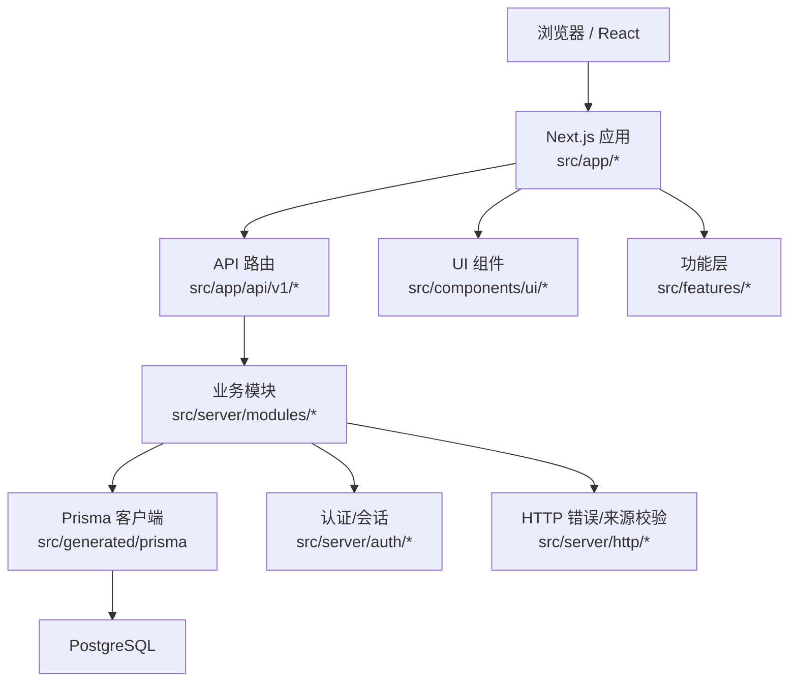
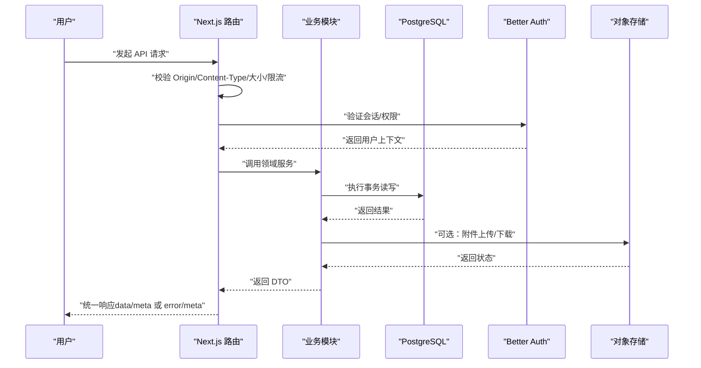
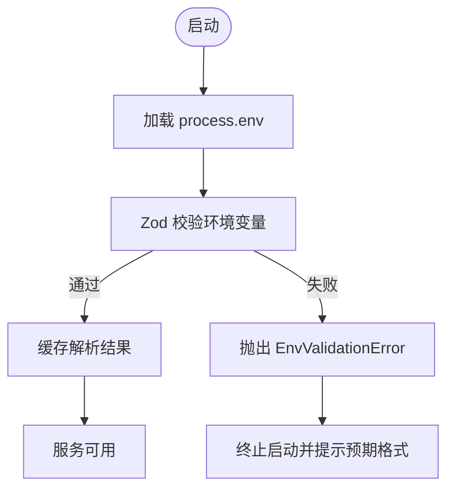
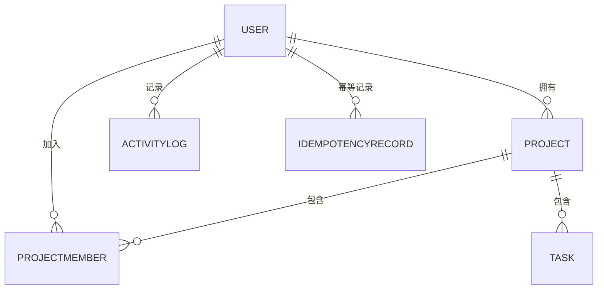
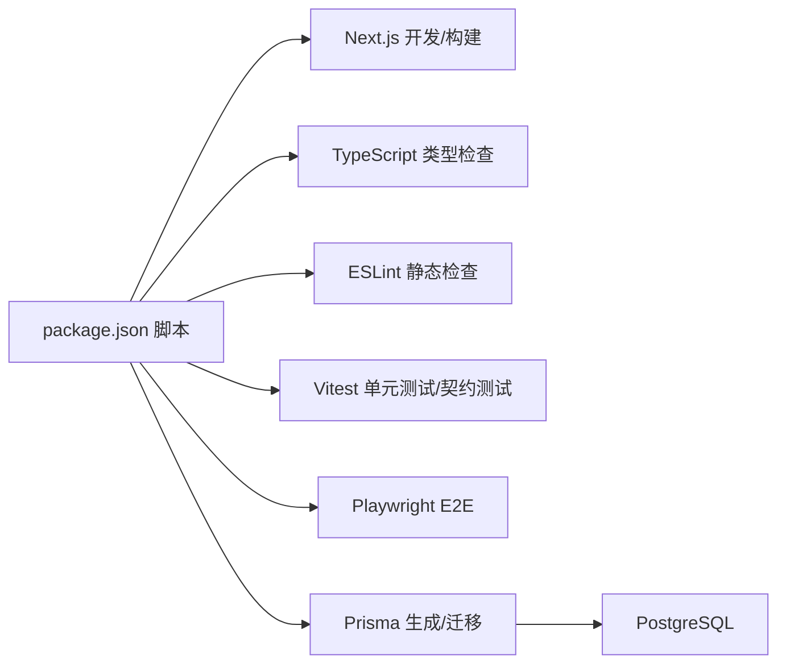

# 开发指南

<cite>
**本文引用的文件**
- [package.json](file://package.json)
- [tsconfig.json](file://tsconfig.json)
- [eslint.config.mjs](file://eslint.config.mjs)
- [next.config.ts](file://next.config.ts)
- [prisma/schema.prisma](file://prisma/schema.prisma)
- [AGENTS.md](file://AGENTS.md)
- [DEVELOPMENT-PLAN.md](file://DEVELOPMENT-PLAN.md)
- [infra/compose.dev.yml](file://infra/compose.dev.yml)
- [playwright.config.ts](file://playwright.config.ts)
- [vitest.config.ts](file://vitest.config.ts)
- [src/server/env.ts](file://src/server/env.ts)
- [src/contracts/index.ts](file://src/contracts/index.ts)
- [src/app/layout.tsx](file://src/app/layout.tsx)
- [scripts/README.md](file://scripts/README.md)
</cite>

## 目录
1. [简介](#简介)
2. [项目结构](#项目结构)
3. [核心组件](#核心组件)
4. [架构总览](#架构总览)
5. [详细组件分析](#详细组件分析)
6. [依赖关系分析](#依赖关系分析)
7. [性能注意事项](#性能注意事项)
8. [故障排查指南](#故障排查指南)
9. [结论](#结论)
10. [附录](#附录)

## 简介
本指南面向 Orbit 项目的开发者，目标是帮助新加入的工程师快速搭建本地开发环境、理解代码结构与规范、掌握 Git 工作流与代码审查流程，并熟悉调试工具链、新功能开发建议、重构与性能优化技巧。文档基于仓库现有配置与约定进行说明，确保与实际实现一致。

## 项目结构
Orbit 采用 Next.js App Router 模块化单体架构，前后端同源，业务逻辑集中在 src/server 模块层，API 路由在 src/app/api，前端功能按 features 划分，契约层统一在 src/contracts，数据库模型与迁移在 prisma，测试分为 unit、contract、integration、e2e，基础设施编排使用 Docker Compose。

图表来源
- [next.config.ts:1-21](file://next.config.ts#L1-L21)
- [src/app/layout.tsx:1-21](file://src/app/layout.tsx#L1-L21)
- [src/contracts/index.ts:1-18](file://src/contracts/index.ts#L1-L18)
- [prisma/schema.prisma:1-268](file://prisma/schema.prisma#L1-L268)

章节来源
- [package.json:12-27](file://package.json#L12-L27)
- [next.config.ts:1-21](file://next.config.ts#L1-L21)
- [src/app/layout.tsx:1-21](file://src/app/layout.tsx#L1-L21)
- [prisma/schema.prisma:14-21](file://prisma/schema.prisma#L14-L21)

## 核心组件
- 运行时与包管理：Node.js 24+、pnpm 10+；脚本命令包括 dev/build/start/lint/typecheck/test:* 等。
- 类型系统：TypeScript strict 模式开启，路径别名 @/* 指向 src，禁止 any（ESLint 强制）。
- 契约层：Zod schema、DTO、错误码、API 客户端骨架，无服务端依赖，可在前后端共享。
- 数据库：PostgreSQL + Prisma 7，schema 定义 User/Project/Task 等实体及枚举，迁移位于 prisma/migrations。
- 环境变量：集中校验，禁止将秘密暴露到客户端，支持多环境。
- 测试：Vitest（unit/contract/integration）与 Playwright（e2e），集成测试直连真实 PostgreSQL。
- 基础设施：Docker Compose 提供 PostgreSQL、MinIO、Mailpit 本地依赖。

章节来源
- [package.json:1-76](file://package.json#L1-L76)
- [tsconfig.json:1-47](file://tsconfig.json#L1-L47)
- [eslint.config.mjs:1-84](file://eslint.config.mjs#L1-L84)
- [src/contracts/index.ts:1-18](file://src/contracts/index.ts#L1-L18)
- [prisma/schema.prisma:14-268](file://prisma/schema.prisma#L14-L268)
- [src/server/env.ts:1-238](file://src/server/env.ts#L1-L238)
- [vitest.config.ts:1-58](file://vitest.config.ts#L1-L58)
- [playwright.config.ts:1-41](file://playwright.config.ts#L1-L41)
- [infra/compose.dev.yml:1-72](file://infra/compose.dev.yml#L1-L72)

## 架构总览
Orbit 的请求生命周期遵循“请求 ID → Origin/Content-Type/大小/限流 → 会话检查 → schema 校验 → 确定所属项目 → 领域服务内再次授权 → 事务 → DTO → 统一响应”的链路。认证由 Better Auth 负责，附件通过 S3 兼容存储，活动日志写入同一事务保证一致性。

图表来源
- [DEVELOPMENT-PLAN.md:377-473](file://DEVELOPMENT-PLAN.md#L377-L473)
- [src/server/env.ts:1-238](file://src/server/env.ts#L1-L238)
- [prisma/schema.prisma:14-268](file://prisma/schema.prisma#L14-L268)

## 详细组件分析

### 环境与配置
- 环境变量集中解析与校验，拒绝 NEXT_PUBLIC_ 前缀的秘密变量，非 development 环境要求足够长度的认证密钥，测试库必须独立于开发/生产库。
- Next 配置启用严格模式、关闭框架信息泄露、外部化 pg 驱动、允许本地开发来源。
- TypeScript 严格模式开启，路径别名与 JSX 配置完整。

图表来源
- [src/server/env.ts:1-238](file://src/server/env.ts#L1-L238)
- [next.config.ts:1-21](file://next.config.ts#L1-L21)
- [tsconfig.json:1-47](file://tsconfig.json#L1-L47)

章节来源
- [src/server/env.ts:1-238](file://src/server/env.ts#L1-L238)
- [next.config.ts:1-21](file://next.config.ts#L1-L21)
- [tsconfig.json:1-47](file://tsconfig.json#L1-L47)

### 数据模型与迁移
- 使用 Prisma 7，datasource provider 为 PostgreSQL，generator 输出至 src/generated/prisma。
- 模型包含认证相关表（User/Session/Account/Verification）以及业务表（Project/ProjectMember/ActivityLog/IdempotencyRecord/Task），并定义枚举与索引。
- 迁移位于 prisma/migrations，生产部署使用 migrate deploy。

图表来源
- [prisma/schema.prisma:14-268](file://prisma/schema.prisma#L14-L268)

章节来源
- [prisma/schema.prisma:14-268](file://prisma/schema.prisma#L14-L268)

### 契约层与客户端
- contracts 提供 Zod schemas、DTO、错误码、辅助函数与 API 客户端骨架，无服务端依赖，可跨端共享。
- 所有外部输入在服务端重新校验，前端隐藏不构成权限控制。

章节来源
- [src/contracts/index.ts:1-18](file://src/contracts/index.ts#L1-L18)

### 测试与质量门禁
- Vitest 三个 project：unit、contract、integration；集成测试禁用文件级并行以避免连接池溢出。
- Playwright e2e 默认构建并启动生产模式，支持复用已有服务。
- ESLint 使用 flat config，禁止 any，限制客户端导入服务端专属模块。

章节来源
- [vitest.config.ts:1-58](file://vitest.config.ts#L1-L58)
- [playwright.config.ts:1-41](file://playwright.config.ts#L1-L41)
- [eslint.config.mjs:1-84](file://eslint.config.mjs#L1-L84)

### 基础设施与本地依赖
- Docker Compose 提供 PostgreSQL、MinIO、Mailpit，端口绑定 127.0.0.1，健康检查就绪。
- 可通过环境变量覆盖宿主端口以解决冲突。

章节来源
- [infra/compose.dev.yml:1-72](file://infra/compose.dev.yml#L1-L72)

## 依赖关系分析
- 运行时依赖：Next.js、React、Prisma Client、Better Auth、Zod、pg、Tailwind/Radix UI 等。
- 开发依赖：ESLint、Playwright、Vitest、Prisma CLI、TypeScript、PostCSS/Tailwind 插件。
- 构建与脚本：dev/build/start/lint/typecheck/test:*，db:* 迁移与种子。

图表来源
- [package.json:12-27](file://package.json#L12-L27)

章节来源
- [package.json:1-76](file://package.json#L1-L76)

## 性能注意事项
- 短事务与锁顺序：同项目写操作先锁 Project，再按 Task→子资源顺序锁定，避免竞争与死锁。
- 列表与看板：使用游标分页与一致快照读取，避免跨页重复与不一致。
- 附件上传：元信息校验与配额预留在前，二进制流在后，失败清理与补偿保持一致性。
- 外部依赖隔离：网络 I/O 不在事务内，避免长事务阻塞。
- 构建优化：pg 驱动外部化，避免进入客户端 bundle；关闭 poweredByHeader 减少信息泄露。

章节来源
- [DEVELOPMENT-PLAN.md:423-473](file://DEVELOPMENT-PLAN.md#L423-L473)
- [next.config.ts:1-21](file://next.config.ts#L1-L21)

## 故障排查指南
- 环境变量问题：启动期校验失败会抛出 EnvValidationError，仅显示变量名与预期格式，不泄露值。检查 APP_ENV、DATABASE_URL、TEST_DATABASE_URL、BETTER_AUTH_SECRET、AUTH_TRUSTED_ORIGINS 等。
- 数据库连接：使用 scripts/check-db.ts 探测 DATABASE_URL 是否可连接；Compose 健康检查用于确认服务就绪。
- 测试连接池：集成测试禁用文件级并行，避免超过 PostgreSQL 默认 max_connections。
- Origin/CORS：Next 配置 allowedDevOrigins 与 AUTH_TRUSTED_ORIGINS 需匹配本地访问地址，否则可能触发跨域拒绝。
- 类型与规则：运行 pnpm typecheck 与 pnpm lint，修复 any 与受限导入问题。

章节来源
- [src/server/env.ts:1-238](file://src/server/env.ts#L1-L238)
- [scripts/README.md:1-15](file://scripts/README.md#L1-L15)
- [vitest.config.ts:42-53](file://vitest.config.ts#L42-L53)
- [next.config.ts:13-18](file://next.config.ts#L13-L18)
- [eslint.config.mjs:31-80](file://eslint.config.mjs#L31-L80)

## 结论
Orbit 的工程基线已具备完整的开发、测试、迁移与本地依赖能力。遵循严格的类型与契约校验、安全的环境变量策略、一致的请求生命周期与事务约束，能够保障后续里程碑的功能交付与质量门槛。新成员应优先掌握环境配置、脚本命令、测试与迁移流程，并在实现新功能时同步更新契约与测试。

## 附录

### 开发环境搭建步骤
- 安装 Node.js 24+ 与 pnpm 10+。
- 克隆仓库后安装依赖：pnpm install。
- 启动本地依赖：docker compose -f infra/compose.dev.yml up -d。
- 初始化数据库：pnpm db:migrate:dev。
- 启动开发服务器：pnpm dev。
- 运行检查：pnpm check（lint + typecheck + unit + contract）。

章节来源
- [package.json:1-27](file://package.json#L1-L27)
- [infra/compose.dev.yml:1-72](file://infra/compose.dev.yml#L1-L72)

### 代码规范与工具链
- TypeScript 严格模式：strict、noUncheckedIndexedAccess、noImplicitOverride。
- ESLint 规则：禁止 any、限制未使用变量、禁止客户端导入服务端专属模块。
- 路径别名：@/* 指向 src。
- 构建与脚本：dev/build/start/lint/typecheck/test:*、db:*。

章节来源
- [tsconfig.json:1-47](file://tsconfig.json#L1-L47)
- [eslint.config.mjs:1-84](file://eslint.config.mjs#L1-L84)
- [package.json:12-27](file://package.json#L12-L27)

### Git 工作流与代码审查
- 分支策略：按里程碑推进（M0—M6），每次只处理一个范围，完成后提交并更新进度。
- 代码审查：遵循 AGENTS.md 约定，先规格与验收再实现；变更需同步契约与测试。
- 提交规范：避免提交 .env、凭证、会话、邀请令牌和真实用户附件。

章节来源
- [AGENTS.md:1-49](file://AGENTS.md#L1-L49)
- [DEVELOPMENT-PLAN.md:752-800](file://DEVELOPMENT-PLAN.md#L752-L800)

### 新功能开发指南
- 新增接口：同步 OpenAPI、Zod schema、DTO 与测试；服务端重新校验外部输入。
- 新增页面：遵循设计 token 与交互规范，提供 loading/empty/error/permission/long-content/mobile 状态。
- 新增数据模型：更新 schema 与迁移，补充索引与约束，必要时手写 SQL。

章节来源
- [src/contracts/index.ts:1-18](file://src/contracts/index.ts#L1-L18)
- [prisma/schema.prisma:14-268](file://prisma/schema.prisma#L14-L268)
- [DEVELOPMENT-PLAN.md:377-473](file://DEVELOPMENT-PLAN.md#L377-L473)

### 重构建议与性能优化
- 保持契约层与服务端校验一致，避免类型漂移。
- 将复杂逻辑下沉到 server/modules，保持路由薄、职责清晰。
- 优化查询：利用索引与游标分页，避免全表扫描与多次独立读取拼接。
- 附件流程：确保元信息校验前置、失败清理与最终一致性。

章节来源
- [DEVELOPMENT-PLAN.md:423-473](file://DEVELOPMENT-PLAN.md#L423-L473)
- [prisma/schema.prisma:14-268](file://prisma/schema.prisma#L14-L268)

### 常见问题排查
- 环境变量校验失败：检查 APP_ENV、DATABASE_URL、TEST_DATABASE_URL、BETTER_AUTH_SECRET、AUTH_TRUSTED_ORIGINS。
- 数据库连接失败：确认 Compose 服务健康与端口映射，使用 check-db.ts 探测。
- 测试连接池溢出：集成测试禁用文件级并行，避免超过 max_connections。
- Origin 被拒绝：调整 allowedDevOrigins 与 AUTH_TRUSTED_ORIGINS 以匹配本地访问地址。

章节来源
- [src/server/env.ts:1-238](file://src/server/env.ts#L1-L238)
- [scripts/README.md:1-15](file://scripts/README.md#L1-L15)
- [vitest.config.ts:42-53](file://vitest.config.ts#L42-L53)
- [next.config.ts:13-18](file://next.config.ts#L13-L18)

### 社区贡献指南
- 遵循 AGENTS.md 与 DEVELOPMENT-PLAN.md 的约定，先规格与验收再实现。
- 变更需同步契约、测试与文档；避免引入范围外技术栈。
- 提交前运行 pnpm check，确保 lint、typecheck、unit、contract 均通过。

章节来源
- [AGENTS.md:1-49](file://AGENTS.md#L1-L49)
- [DEVELOPMENT-PLAN.md:752-800](file://DEVELOPMENT-PLAN.md#L752-L800)
- [package.json:27-27](file://package.json#L27-L27)