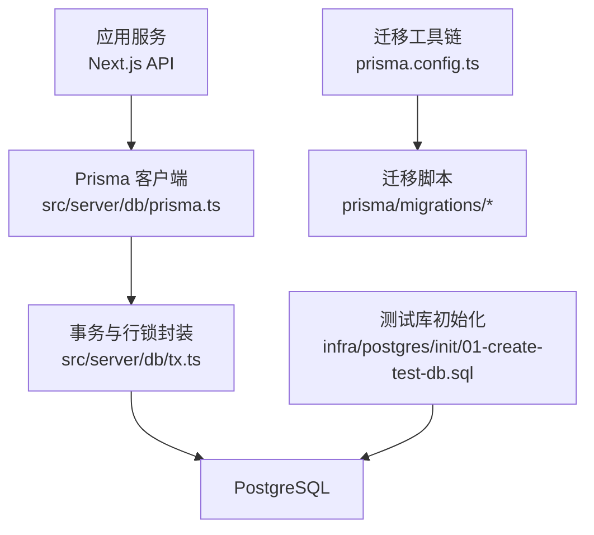
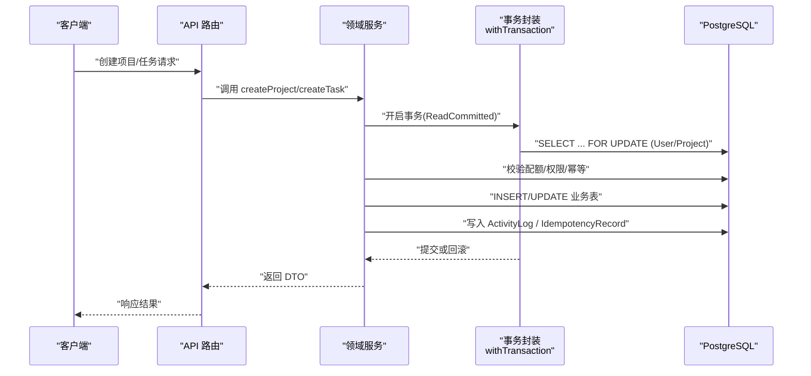
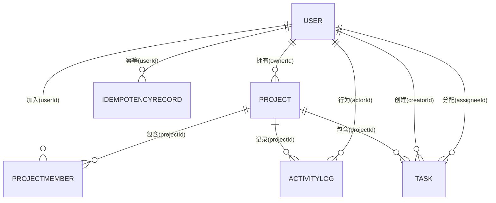
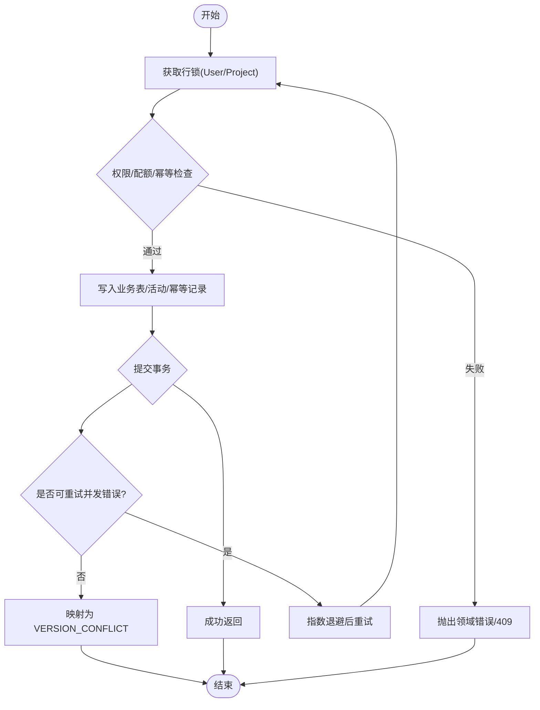
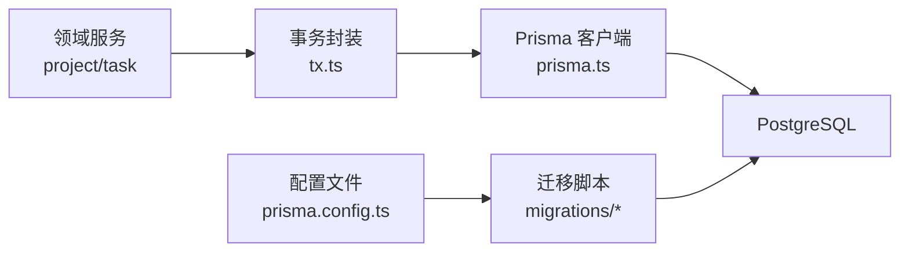

# 数据库设计

<cite>
**本文引用的文件**
- [prisma/schema.prisma](file://prisma/schema.prisma)
- [20260908162114_init_auth/migration.sql](file://prisma/migrations/20260908162114_init_auth/migration.sql)
- [20260908192443_add_auth_indexes/migration.sql](file://prisma/migrations/20260908192443_add_auth_indexes/migration.sql)
- [20260909001003_add_project_domain/migration.sql](file://prisma/migrations/20260909001003_add_project_domain/migration.sql)
- [20260909004718_add_task_domain/migration.sql](file://prisma/migrations/20260909004718_add_task_domain/migration.sql)
- [docs/04-DATA-MODEL.md](file://docs/04-DATA-MODEL.md)
- [infra/postgres/init/01-create-test-db.sql](file://infra/postgres/init/01-create-test-db.sql)
- [prisma.config.ts](file://prisma.config.ts)
- [src/server/db/prisma.ts](file://src/server/db/prisma.ts)
- [src/server/db/tx.ts](file://src/server/db/tx.ts)
- [src/server/modules/project/create.ts](file://src/server/modules/project/create.ts)
- [src/server/modules/task/create.ts](file://src/server/modules/task/create.ts)
- [scripts/check-db.ts](file://scripts/check-db.ts)
</cite>

## 目录
1. [简介](#简介)
2. [项目结构](#项目结构)
3. [核心组件](#核心组件)
4. [架构总览](#架构总览)
5. [详细组件分析](#详细组件分析)
6. [依赖关系分析](#依赖关系分析)
7. [性能考量](#性能考量)
8. [故障排查指南](#故障排查指南)
9. [结论](#结论)
10. [附录](#附录)

## 简介
本文件为 Orbit 项目的数据库设计文档，聚焦基于 PostgreSQL 的数据库架构与数据模型。内容覆盖实体关系、Prisma Schema 字段定义与业务规则、主外键与索引策略、迁移与版本控制、数据验证与约束、事务与并发控制、查询优化与缓存建议、初始化脚本与测试数据方法等。目标是为研发与运维提供一致、可追溯、可落地的数据库设计与实践指南。

## 项目结构
Orbit 使用 Prisma 作为 ORM 与迁移工具，PostgreSQL 作为数据库。Schema 位于 prisma/schema.prisma，迁移位于 prisma/migrations；应用层通过 src/server/db 下的单例客户端与事务封装访问数据库；基础设施通过 infra/postgres/init 提供测试库初始化脚本；配置由 prisma.config.ts 管理连接串与迁移路径。

图表来源
- [prisma/config.ts:13-23](file://prisma.config.ts#L13-L23)
- [src/server/db/prisma.ts:16-34](file://src/server/db/prisma.ts#L16-L34)
- [src/server/db/tx.ts:95-124](file://src/server/db/tx.ts#L95-L124)
- [infra/postgres/init/01-create-test-db.sql:1-8](file://infra/postgres/init/01-create-test-db.sql#L1-L8)

章节来源
- [prisma.config.ts:1-24](file://prisma.config.ts#L1-L24)
- [src/server/db/prisma.ts:1-45](file://src/server/db/prisma.ts#L1-L45)
- [src/server/db/tx.ts:1-159](file://src/server/db/tx.ts#L1-L159)
- [infra/postgres/init/01-create-test-db.sql:1-8](file://infra/postgres/init/01-create-test-db.sql#L1-L8)

## 核心组件
- 认证域：User、Session、Account、Verification（遵循 Better Auth 1.7.3 官方 schema，User 扩展 timezone）。
- 项目域：Project、ProjectMember、ActivityLog、IdempotencyRecord。
- 任务域：Task（含状态、优先级、软删除、看板排序 position）。
- 枚举：ProjectColor、ActivityEntityType、ActivityAction、TaskStatus、TaskPriority。
- 约束：CHECK 约束在迁移 SQL 中手写补齐（如 key 格式、计数器正值、字节非负、标题非空、DONE⇔completedAt）。
- 索引：针对高频查询路径建立复合索引，包括项目列表、活动日志时间倒序、任务看板列内排序等。

章节来源
- [prisma/schema.prisma:27-268](file://prisma/schema.prisma#L27-L268)
- [docs/04-DATA-MODEL.md:27-87](file://docs/04-DATA-MODEL.md#L27-L87)
- [20260909001003_add_project_domain/migration.sql:110-117](file://prisma/migrations/20260909001003_add_project_domain/migration.sql#L110-L117)
- [20260909004718_add_task_domain/migration.sql:53-62](file://prisma/migrations/20260909004718_add_task_domain/migration.sql#L53-L62)

## 架构总览
下图展示从 API 到数据库的关键路径：API 调用进入领域服务，服务通过 withTransaction 执行事务，必要时对 Project/User 加排他锁，再调用 Prisma 客户端进行读写；幂等记录与活动日志在同一事务内写入，保证一致性。

图表来源
- [src/server/modules/project/create.ts:71-167](file://src/server/modules/project/create.ts#L71-L167)
- [src/server/modules/task/create.ts:77-189](file://src/server/modules/task/create.ts#L77-L189)
- [src/server/db/tx.ts:95-124](file://src/server/db/tx.ts#L95-L124)
- [src/server/db/prisma.ts:16-34](file://src/server/db/prisma.ts#L16-L34)

## 详细组件分析

### 实体关系图（ER）

图表来源
- [prisma/schema.prisma:144-268](file://prisma/schema.prisma#L144-L268)
- [20260909001003_add_project_domain/migration.sql:92-108](file://prisma/migrations/20260909001003_add_project_domain/migration.sql#L92-L108)
- [20260909004718_add_task_domain/migration.sql:44-52](file://prisma/migrations/20260909004718_add_task_domain/migration.sql#L44-L52)

### 核心实体与字段定义

- User
  - 主键 id（字符串 cuid），唯一 email，时区 timezone（默认 Asia/Shanghai），审计字段 createdAt/updatedAt。
  - 反向关系：项目拥有者、成员、活动作者、幂等记录、创建/分配的任务。
  - 业务规则：email 唯一；timezone 用于前端时间显示；密码不在此表存储。

- Session
  - 主键 id，唯一 token，过期时间 expiresAt，用户关联 userId（级联删除）。
  - 索引：userId。

- Account
  - 主键 id，provider 相关字段，可选令牌与过期时间，密码哈希仅存于此。
  - 索引：userId。

- Verification
  - 主键 id，identifier/value/expiresAt，审计字段。
  - 索引：identifier。

- Project
  - 主键 id（UUID），ownerId（RESTRICT），name/key/description/color，归档时间 archivedAt，版本 version/boardVersion，nextTaskNumber，预留/已用字节 reservedBytes/usedBytes，审计字段。
  - 唯一：key。
  - 索引：(ownerId, archivedAt, updatedAt, id)。
  - CHECK：key 格式、计数器正值、字节非负。

- ProjectMember
  - 主键 id（UUID），projectId/userId（均 RESTRICT），joinedAt。
  - 唯一：(projectId, userId)，索引：(userId, projectId)。

- ActivityLog
  - 主键 id（UUID），projectId/actorId，entityType/entityId/action，metadata（JSONB），createdAt。
  - 索引：(projectId, createdAt DESC, id DESC)。

- IdempotencyRecord
  - 主键 id（UUID），userId/method/routeKey/key/requestHash/responseStatus/responseBody/resourceId，createdAt/expiresAt。
  - 唯一：(userId, method, routeKey, key)，索引：expiresAt。

- Task
  - 主键 id（UUID），projectId/number/creatorId/assigneeId（SET NULL），title/description/status/priority/dueDate/position/completedAt/version/deletedAt，审计字段。
  - 唯一：(projectId, number)、(id, projectId)。
  - 索引：(projectId, deletedAt, status, position, id)、(projectId, deletedAt, updatedAt, id)、(assigneeId, deletedAt, status, dueDate, id)。
  - CHECK：number>0、version>0、标题 trim 非空、DONE⇔completedAt。

章节来源
- [prisma/schema.prisma:27-268](file://prisma/schema.prisma#L27-L268)
- [20260908162114_init_auth/migration.sql:1-71](file://prisma/migrations/20260908162114_init_auth/migration.sql#L1-L71)
- [20260908192443_add_auth_indexes/migration.sql:1-9](file://prisma/migrations/20260908192443_add_auth_indexes/migration.sql#L1-L9)
- [20260909001003_add_project_domain/migration.sql:11-117](file://prisma/migrations/20260909001003_add_project_domain/migration.sql#L11-L117)
- [20260909004718_add_task_domain/migration.sql:7-62](file://prisma/migrations/20260909004718_add_task_domain/migration.sql#L7-L62)
- [docs/04-DATA-MODEL.md:27-87](file://docs/04-DATA-MODEL.md#L27-L87)

### 主键与外键关系
- 主键
  - 认证域：User/Session/Account/Verification 使用字符串主键。
  - 业务域：Project/ProjectMember/ActivityLog/IdempotencyRecord/Task 使用 UUID 主键，默认 gen_random_uuid()。
- 外键
  - Session/Account → User：级联删除（Cascade）。
  - Project/ProjectMember/ActivityLog/Task → User/Project：RESTRICT（保护业务数据）。
  - Task.assigneeId → User：SetNull（成员退出/删除时置空）。
- 唯一约束
  - User.email、Session.token、Project.key、ProjectMember(projectId,userId)、Task(projectId,number)、Task(id,projectId)、IdempotencyRecord(userId,method,routeKey,key)。

章节来源
- [prisma/schema.prisma:27-268](file://prisma/schema.prisma#L27-L268)
- [20260908162114_init_auth/migration.sql:66-71](file://prisma/migrations/20260908162114_init_auth/migration.sql#L66-L71)
- [20260909001003_add_project_domain/migration.sql:92-108](file://prisma/migrations/20260909001003_add_project_domain/migration.sql#L92-L108)
- [20260909004718_add_task_domain/migration.sql:44-52](file://prisma/migrations/20260909004718_add_task_domain/migration.sql#L44-L52)

### 索引设计与查询优化
- 认证域
  - Session.userId、Account.userId、Verification.identifier 索引提升会话/账户/验证码查询效率。
- 项目域
  - Project(ownerId, archivedAt, updatedAt, id)：支持按所有者过滤、归档态筛选、分页与排序。
  - ProjectMember(userId, projectId)：快速查找成员关系。
  - ActivityLog(projectId, createdAt DESC, id DESC)：高效获取项目活动流。
  - IdempotencyRecord(expiresAt)：便于清理过期幂等记录。
- 任务域
  - Task(projectId, deletedAt, status, position, id)：看板列内排序与分页。
  - Task(projectId, deletedAt, updatedAt, id)：按更新时间分页。
  - Task(assigneeId, deletedAt, status, dueDate, id)：个人待办/到期任务视图。

章节来源
- [20260908192443_add_auth_indexes/migration.sql:1-9](file://prisma/migrations/20260908192443_add_auth_indexes/migration.sql#L1-L9)
- [20260909001003_add_project_domain/migration.sql:71-90](file://prisma/migrations/20260909001003_add_project_domain/migration.sql#L71-L90)
- [20260909004718_add_task_domain/migration.sql:29-43](file://prisma/migrations/20260909004718_add_task_domain/migration.sql#L29-L43)
- [docs/04-DATA-MODEL.md:31-53](file://docs/04-DATA-MODEL.md#L31-L53)

### 数据验证规则与业务约束
- 字符串长度限制：name varchar(80)、key varchar(8)、title varchar(120) 等。
- 枚举约束：ProjectColor、ActivityEntityType、ActivityAction、TaskStatus、TaskPriority。
- CHECK 约束（迁移 SQL 实现）
  - Project：key 格式、version/boardVersion/nextTaskNumber > 0、reservedBytes/usedBytes >= 0。
  - Task：number > 0、version > 0、btrim(title) <> ''、status = 'DONE' ⇔ completedAt IS NOT NULL。
- 业务规则
  - 幂等：IdempotencyRecord 防止重复提交，重放前重新授权。
  - 配额：项目未归档数量上限、任务未删除数量上限、附件空间预算。
  - 看板排序：position 初始间隔 1024，移动时计算中点，必要时整列重编号。

章节来源
- [20260909001003_add_project_domain/migration.sql:110-117](file://prisma/migrations/20260909001003_add_project_domain/migration.sql#L110-L117)
- [20260909004718_add_task_domain/migration.sql:53-62](file://prisma/migrations/20260909004718_add_task_domain/migration.sql#L53-L62)
- [docs/04-DATA-MODEL.md:89-125](file://docs/04-DATA-MODEL.md#L89-L125)
- [src/server/modules/project/create.ts:102-142](file://src/server/modules/project/create.ts#L102-L142)
- [src/server/modules/task/create.ts:113-152](file://src/server/modules/task/create.ts#L113-L152)

### 事务与并发控制
- 隔离级别：ReadCommitted；只读快照场景另行使用 REPEATABLE READ。
- 锁顺序：User → Project → Task → 子资源，避免死锁。
- 重试策略：对死锁/序列化失败/锁超时做有限技术重试（指数退避 50/150/450ms），锁超时映射为 409 VERSION_CONFLICT。
- 超时：statement_timeout=5000ms、lock_timeout=3000ms，事务默认 timeout=5000ms、maxWait=2000ms。

图表来源
- [src/server/db/tx.ts:95-124](file://src/server/db/tx.ts#L95-L124)
- [src/server/db/tx.ts:132-158](file://src/server/db/tx.ts#L132-L158)
- [src/server/modules/project/create.ts:78-167](file://src/server/modules/project/create.ts#L78-L167)
- [src/server/modules/task/create.ts:93-189](file://src/server/modules/task/create.ts#L93-L189)

章节来源
- [src/server/db/tx.ts:1-159](file://src/server/db/tx.ts#L1-L159)
- [src/server/db/prisma.ts:16-34](file://src/server/db/prisma.ts#L16-L34)
- [src/server/modules/project/create.ts:71-181](file://src/server/modules/project/create.ts#L71-L181)
- [src/server/modules/task/create.ts:77-202](file://src/server/modules/task/create.ts#L77-L202)

### 数据访问模式与缓存策略
- 数据访问模式
  - 写操作：通过 withTransaction 包裹，先锁行再写，确保原子性。
  - 读操作：优先使用索引覆盖查询，减少回表；看板读取使用一致快照（短只读事务）。
- 缓存策略
  - 幂等记录：短期缓存小对象创建/恢复响应，重放前重新授权。
  - 活动日志：按项目+时间倒序分页读取，适合追加型日志。
  - 不建议缓存敏感或易变数据；如需缓存，需考虑失效策略与一致性。

章节来源
- [docs/04-DATA-MODEL.md:73-87](file://docs/04-DATA-MODEL.md#L73-L87)
- [docs/04-DATA-MODEL.md:109-118](file://docs/04-DATA-MODEL.md#L109-L118)
- [src/server/modules/project/create.ts:85-164](file://src/server/modules/project/create.ts#L85-L164)
- [src/server/modules/task/create.ts:101-186](file://src/server/modules/task/create.ts#L101-L186)

### 迁移管理与版本控制
- 迁移位置：prisma/migrations，每个目录对应一次变更。
- 生成与部署：生产环境使用 migrate deploy，不运行 migrate dev/db push。
- 种子数据：仅在开发/测试库执行，脚本验证环境与库名，稳定 fixture ID/upsert，不删全库。
- 测试库：infra/postgres/init/01-create-test-db.sql 创建 orbit_test，与开发库隔离。

章节来源
- [docs/04-DATA-MODEL.md:127-133](file://docs/04-DATA-MODEL.md#L127-L133)
- [prisma.config.ts:13-23](file://prisma.config.ts#L13-L23)
- [infra/postgres/init/01-create-test-db.sql:1-8](file://infra/postgres/init/01-create-test-db.sql#L1-L8)

### 数据库初始化脚本与测试数据
- 初始化脚本
  - 首次启动容器时创建 orbit_test 数据库，使用 \gexec 保证幂等。
- 连接验证
  - scripts/check-db.ts 显式验证 DATABASE_URL 可连接并输出脱敏信息。
- 测试数据
  - 使用稳定 fixture ID/upsert，基准时间可注入，日期相对生成，避免硬编码“今天”。

章节来源
- [infra/postgres/init/01-create-test-db.sql:1-8](file://infra/postgres/init/01-create-test-db.sql#L1-L8)
- [scripts/check-db.ts:1-41](file://scripts/check-db.ts#L1-L41)
- [docs/04-DATA-MODEL.md:127-133](file://docs/04-DATA-MODEL.md#L127-L133)

## 依赖关系分析
- 模块耦合
  - 领域服务依赖事务封装与 Prisma 客户端；Prisma 客户端依赖环境变量与适配器。
  - 迁移脚本与 Schema 强耦合，任何字段变更需同步更新迁移与约束。
- 外部依赖
  - Better Auth 认证模型锁定版本，不得随意改动其 schema。
  - PostgreSQL 运行时参数（statement_timeout、lock_timeout）影响事务与锁行为。

图表来源
- [src/server/modules/project/create.ts:71-181](file://src/server/modules/project/create.ts#L71-L181)
- [src/server/modules/task/create.ts:77-202](file://src/server/modules/task/create.ts#L77-L202)
- [src/server/db/tx.ts:95-159](file://src/server/db/tx.ts#L95-L159)
- [src/server/db/prisma.ts:16-45](file://src/server/db/prisma.ts#L16-L45)
- [prisma.config.ts:13-23](file://prisma.config.ts#L13-L23)

章节来源
- [src/server/modules/project/create.ts:71-181](file://src/server/modules/project/create.ts#L71-L181)
- [src/server/modules/task/create.ts:77-202](file://src/server/modules/task/create.ts#L77-L202)
- [src/server/db/tx.ts:95-159](file://src/server/db/tx.ts#L95-L159)
- [src/server/db/prisma.ts:16-45](file://src/server/db/prisma.ts#L16-L45)
- [prisma.config.ts:13-23](file://prisma.config.ts#L13-L23)

## 性能考量
- 索引优化
  - 利用复合索引加速看板列内排序、个人任务视图、活动日志分页。
  - 避免过度索引导致写入放大；按需评估 trigram 全文搜索。
- 事务与锁
  - 保持事务短小（目标 < 1s），SQL 超时 5s，锁超时 3s；网络 I/O 不在事务内。
  - 统一锁顺序避免死锁；对并发冲突做有限重试。
- 连接池
  - max=15，空闲回收 30s，连接获取等待 5s；多实例部署预留余量。
- 查询优化
  - 只选必要字段，避免 N+1；看板读取使用一致快照。
  - 大字段（如 metadata）谨慎查询，必要时拆分或延迟加载。

[本节为通用指导，无需具体文件引用]

## 故障排查指南
- 常见错误
  - 唯一约束冲突（P2002）：key 重复、任务编号重复、幂等记录冲突。
  - 锁超时（55P03）：资源被占用，返回 409 VERSION_CONFLICT，客户端稍后重试。
  - 慢查询/超时：检查 statement_timeout 与索引命中情况。
- 诊断步骤
  - 使用 scripts/check-db.ts 验证连接与库名。
  - 查看迁移历史与当前状态，确认 schema 一致。
  - 检查事务日志与活动日志，定位异常操作。
- 修复建议
  - 修正输入校验与业务规则（如 key 格式、标题非空）。
  - 调整索引或重写查询以改善性能。
  - 对幂等记录进行清理与维护。

章节来源
- [src/server/db/tx.ts:59-82](file://src/server/db/tx.ts#L59-L82)
- [src/server/db/tx.ts:115-120](file://src/server/db/tx.ts#L115-L120)
- [scripts/check-db.ts:14-41](file://scripts/check-db.ts#L14-L41)
- [docs/04-DATA-MODEL.md:127-133](file://docs/04-DATA-MODEL.md#L127-L133)

## 结论
Orbit 的数据库设计以 Prisma + PostgreSQL 为核心，围绕认证、项目、任务三大域构建，强调数据完整性（CHECK 约束）、一致性（事务与行锁）、可维护性（迁移与版本控制）与可扩展性（索引与查询优化）。通过严格的锁顺序、幂等机制与配额控制，系统在并发与一致性之间取得平衡。后续可根据数据规模与访问模式进一步优化索引与缓存策略。

[本节为总结，无需具体文件引用]

## 附录
- 关键路径参考
  - Schema 定义：[prisma/schema.prisma](file://prisma/schema.prisma)
  - 迁移历史：[prisma/migrations](file://prisma/migrations)
  - 事务封装：[src/server/db/tx.ts](file://src/server/db/tx.ts)
  - 客户端配置：[src/server/db/prisma.ts](file://src/server/db/prisma.ts)
  - 领域服务示例：[src/server/modules/project/create.ts](file://src/server/modules/project/create.ts)、[src/server/modules/task/create.ts](file://src/server/modules/task/create.ts)
  - 测试库初始化：[infra/postgres/init/01-create-test-db.sql](file://infra/postgres/init/01-create-test-db.sql)

[本节为附录，无需具体文件引用]