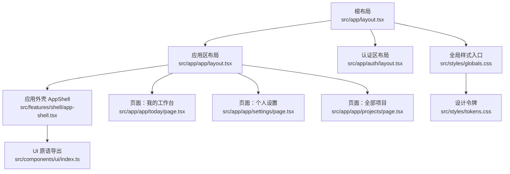
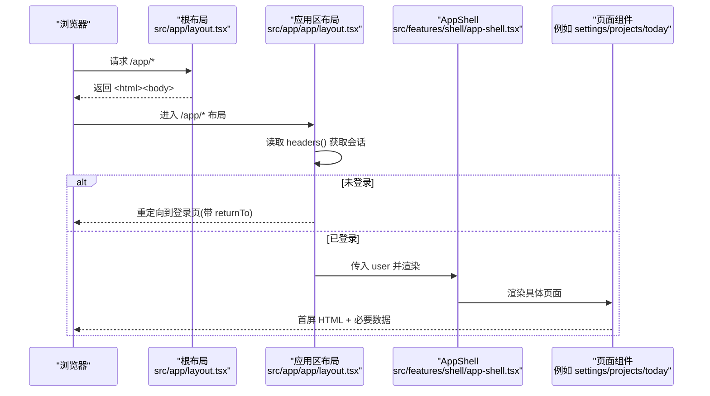
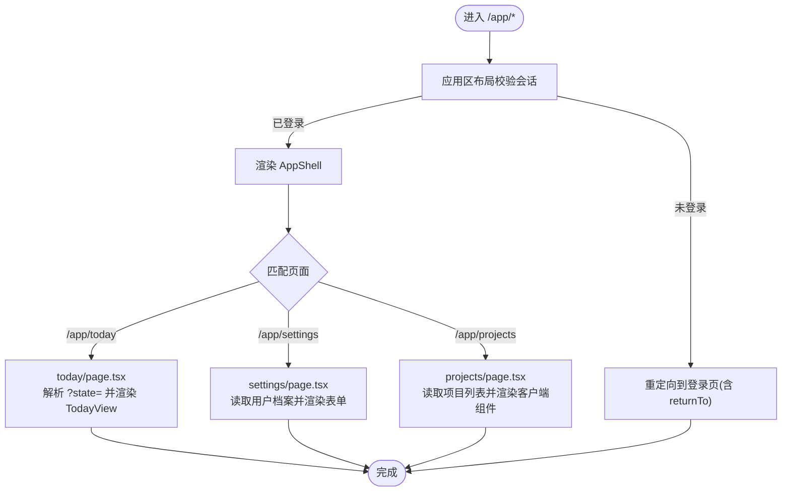
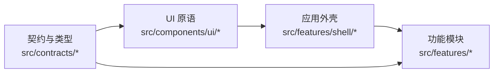
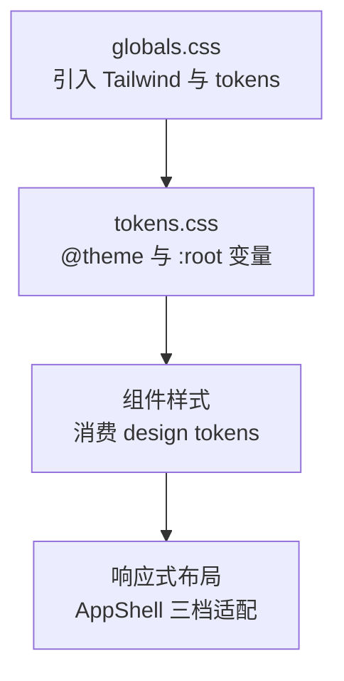
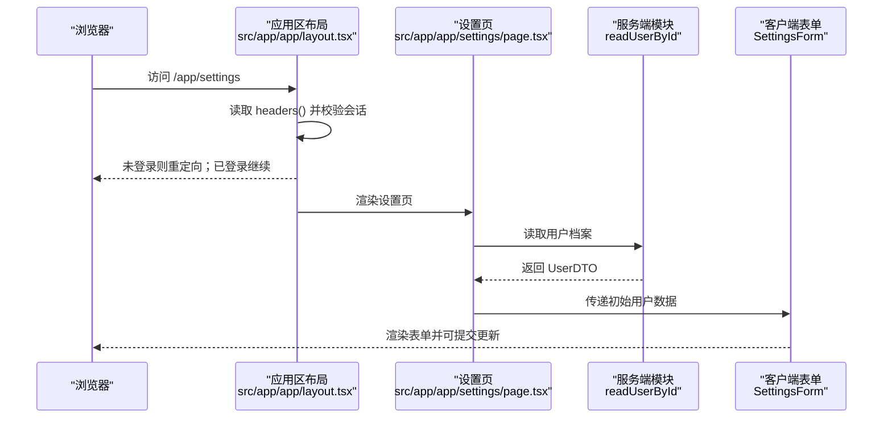
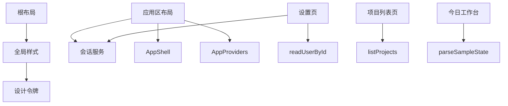

# 前端架构设计

<cite>
**本文引用的文件**
- [src/app/layout.tsx](file://src/app/layout.tsx)
- [src/app/app/layout.tsx](file://src/app/app/layout.tsx)
- [src/app/auth/layout.tsx](file://src/app/auth/layout.tsx)
- [next.config.ts](file://next.config.ts)
- [postcss.config.mjs](file://postcss.config.mjs)
- [src/styles/globals.css](file://src/styles/globals.css)
- [src/styles/tokens.css](file://src/styles/tokens.css)
- [src/features/shell/app-shell.tsx](file://src/features/shell/app-shell.tsx)
- [src/features/shell/providers.tsx](file://src/features/shell/providers.tsx)
- [src/components/ui/index.ts](file://src/components/ui/index.ts)
- [src/app/app/projects/page.tsx](file://src/app/app/projects/page.tsx)
- [src/app/app/today/page.tsx](file://src/app/app/today/page.tsx)
- [src/app/app/settings/page.tsx](file://src/app/app/settings/page.tsx)
- [src/features/shell/fixtures.ts](file://src/features/shell/fixtures.ts)
</cite>

## 目录
1. [简介](#简介)
2. [项目结构](#项目结构)
3. [核心组件](#核心组件)
4. [架构总览](#架构总览)
5. [详细组件分析](#详细组件分析)
6. [依赖关系分析](#依赖关系分析)
7. [性能考量](#性能考量)
8. [故障排查指南](#故障排查指南)
9. [结论](#结论)
10. [附录](#附录)

## 简介
本文件面向 Orbit 项目的前端架构，聚焦 Next.js App Router 的路由组织、页面与嵌套/动态路由的使用；组件化分层（UI 原语、业务组件、功能模块）；状态管理策略（客户端状态、服务端状态、缓存）；样式系统（Tailwind CSS 配置、设计令牌、响应式）；以及性能优化（代码分割、懒加载、缓存）。文档同时提供架构图与渲染流程图，帮助读者从页面到组件完整理解渲染链路。

## 项目结构
Orbit 采用 Next.js App Router 的目录即路由约定：
- 根布局 src/app/layout.tsx 定义全局元信息与基础 HTML 外壳。
- /app/* 为受保护的应用区域，由 src/app/app/layout.tsx 进行会话校验并挂载应用外壳 AppShell。
- /auth/* 为认证相关页面，独立布局，不受应用区门禁影响。
- 功能按领域拆分在 src/features/*，通用 UI 原语集中在 src/components/ui/*，样式与主题集中在 src/styles/*。

图表来源
- [src/app/layout.tsx:1-21](file://src/app/layout.tsx#L1-L21)
- [src/app/app/layout.tsx:1-48](file://src/app/app/layout.tsx#L1-L48)
- [src/app/auth/layout.tsx:1-23](file://src/app/auth/layout.tsx#L1-L23)
- [src/features/shell/app-shell.tsx:1-389](file://src/features/shell/app-shell.tsx#L1-L389)
- [src/styles/globals.css:1-13](file://src/styles/globals.css#L1-L13)
- [src/styles/tokens.css:1-169](file://src/styles/tokens.css#L1-L169)

章节来源
- [src/app/layout.tsx:1-21](file://src/app/layout.tsx#L1-L21)
- [src/app/app/layout.tsx:1-48](file://src/app/app/layout.tsx#L1-L48)
- [src/app/auth/layout.tsx:1-23](file://src/app/auth/layout.tsx#L1-L23)
- [src/styles/globals.css:1-13](file://src/styles/globals.css#L1-L13)
- [src/styles/tokens.css:1-169](file://src/styles/tokens.css#L1-L169)

## 核心组件
- 根布局：负责站点元信息、语言与 body 包裹。
- 应用区布局：强制动态渲染、读取请求头获取会话用户，未登录重定向至登录页；挂载 AppProviders 与 AppShell。
- 应用外壳 AppShell：响应式侧栏/顶栏/内容区，手机使用抽屉导航；根据当前路径决定是否显示“M0 样例横幅”；底部展示当前账户与个人设置入口。
- 客户端 Provider：组合 TooltipProvider 与 ToastProvider，为全应用提供交互上下文。
- UI 原语统一导出：集中暴露 Button、Input、Dialog、Drawer、Tooltip、Toast 等原子组件，确保样式消费设计令牌。

章节来源
- [src/app/app/layout.tsx:1-48](file://src/app/app/layout.tsx#L1-L48)
- [src/features/shell/app-shell.tsx:1-389](file://src/features/shell/app-shell.tsx#L1-L389)
- [src/features/shell/providers.tsx:1-20](file://src/features/shell/providers.tsx#L1-L20)
- [src/components/ui/index.ts:1-25](file://src/components/ui/index.ts#L1-L25)

## 架构总览
App Router 渲染流程（从根布局到页面与外壳）：
- 根布局注入全局样式与元信息。
- 进入 /app/* 时，应用区布局执行会话校验，失败则重定向；成功后将用户数据传入 AppShell。
- AppShell 渲染侧栏/顶栏/内容区，并根据路径决定示例横幅；子页面在 main 中渲染。
- 各页面作为 Server Component 负责权威数据读取（如设置页、项目列表页），再传递给客户端组件处理交互。

图表来源
- [src/app/layout.tsx:1-21](file://src/app/layout.tsx#L1-L21)
- [src/app/app/layout.tsx:1-48](file://src/app/app/layout.tsx#L1-L48)
- [src/features/shell/app-shell.tsx:1-389](file://src/features/shell/app-shell.tsx#L1-L389)
- [src/app/app/settings/page.tsx:1-65](file://src/app/app/settings/page.tsx#L1-L65)
- [src/app/app/projects/page.tsx:1-50](file://src/app/app/projects/page.tsx#L1-L50)
- [src/app/app/today/page.tsx:1-25](file://src/app/app/today/page.tsx#L1-L25)

## 详细组件分析

### 路由与页面组织
- 根布局：定义站点标题与描述，最小外壳。
- 应用区布局：声明 force-dynamic，避免共享缓存泄露私有数据；通过 headers() 与 getSessionUser 做权威校验；开发环境渲染状态切换工具。
- 认证区布局：仅设置元信息与 robots 策略，视觉由各自页面承载。
- 页面：
  - 今日工作台：Server Component 解析 searchParams 中的演示态，渲染 TodayView。
  - 个人设置：Server Component 读取最新用户档案，错误时回退到登录页；表单由客户端组件驱动。
  - 全部项目：Server Component 调用领域服务 listProjects 获取分页结果，传给客户端组件进行创建/加载更多等操作。

图表来源
- [src/app/app/layout.tsx:1-48](file://src/app/app/layout.tsx#L1-L48)
- [src/app/app/today/page.tsx:1-25](file://src/app/app/today/page.tsx#L1-L25)
- [src/app/app/settings/page.tsx:1-65](file://src/app/app/settings/page.tsx#L1-L65)
- [src/app/app/projects/page.tsx:1-50](file://src/app/app/projects/page.tsx#L1-L50)

章节来源
- [src/app/app/layout.tsx:1-48](file://src/app/app/layout.tsx#L1-L48)
- [src/app/auth/layout.tsx:1-23](file://src/app/auth/layout.tsx#L1-L23)
- [src/app/app/today/page.tsx:1-25](file://src/app/app/today/page.tsx#L1-L25)
- [src/app/app/settings/page.tsx:1-65](file://src/app/app/settings/page.tsx#L1-L65)
- [src/app/app/projects/page.tsx:1-50](file://src/app/app/projects/page.tsx#L1-L50)

### 组件化架构与分层
- UI 原语层（src/components/ui/*）：基于 Radix 原语与 lucide-react 构建可复用原子组件，样式完全消费设计令牌。
- 业务外壳层（src/features/shell/*）：应用级布局与导航（AppShell）、客户端 Provider 组合、开发态工具。
- 功能模块层（src/features/*）：按领域组织（auth、board、projects、tasks、today、settings），每个模块包含视图、表单、状态与工具。
- 契约与类型（src/contracts/*）：前后端一致的 DTO、枚举、错误码与辅助函数，保证类型安全。

图表来源
- [src/components/ui/index.ts:1-25](file://src/components/ui/index.ts#L1-L25)
- [src/features/shell/app-shell.tsx:1-389](file://src/features/shell/app-shell.tsx#L1-L389)
- [src/features/shell/providers.tsx:1-20](file://src/features/shell/providers.tsx#L1-L20)

章节来源
- [src/components/ui/index.ts:1-25](file://src/components/ui/index.ts#L1-L25)
- [src/features/shell/app-shell.tsx:1-389](file://src/features/shell/app-shell.tsx#L1-L389)
- [src/features/shell/providers.tsx:1-20](file://src/features/shell/providers.tsx#L1-L20)

### 状态管理策略
- 客户端状态：
  - 导航与交互：AppShell 内维护抽屉打开状态、当前激活项等。
  - 演示态：今日工作台通过 URL 查询参数 ?state= 控制六态演示。
- 服务端状态：
  - 会话与用户：应用区布局与服务端页面通过 headers() 与 getSessionUser 获取权威会话；设置页直接读取数据库最新用户档案。
  - 列表数据：项目列表页调用领域服务 listProjects，返回分页结果给客户端组件。
- 缓存机制：
  - 应用区布局与关键页面显式 force-dynamic，避免共享缓存泄露私有数据。
  - 退出登录采用整页硬跳转，清空客户端内存态，避免跨账号污染。

章节来源
- [src/app/app/layout.tsx:1-48](file://src/app/app/layout.tsx#L1-L48)
- [src/app/app/settings/page.tsx:1-65](file://src/app/app/settings/page.tsx#L1-L65)
- [src/app/app/projects/page.tsx:1-50](file://src/app/app/projects/page.tsx#L1-L50)
- [src/app/app/today/page.tsx:1-25](file://src/app/app/today/page.tsx#L1-L25)
- [src/features/shell/app-shell.tsx:1-389](file://src/features/shell/app-shell.tsx#L1-L389)

### 样式系统与响应式设计
- Tailwind CSS 4 接入：通过 postcss 插件 @tailwindcss/postcss，无 tailwind.config.js，配置走 CSS。
- 设计令牌：在 tokens.css 中以 @theme 定义颜色、字号、字体栈、间距、圆角、阴影、动效缓动与断点；并在 base 层设置 :root 变量与全局排版、焦点环与 reduced-motion 支持。
- 响应式：AppShell 遵循桌面/平板/手机三档布局，侧栏宽度与内容内边距随断点变化；手机使用 Drawer 导航。

图表来源
- [postcss.config.mjs:1-9](file://postcss.config.mjs#L1-L9)
- [src/styles/globals.css:1-13](file://src/styles/globals.css#L1-L13)
- [src/styles/tokens.css:1-169](file://src/styles/tokens.css#L1-L169)
- [src/features/shell/app-shell.tsx:1-389](file://src/features/shell/app-shell.tsx#L1-L389)

章节来源
- [postcss.config.mjs:1-9](file://postcss.config.mjs#L1-L9)
- [src/styles/globals.css:1-13](file://src/styles/globals.css#L1-L13)
- [src/styles/tokens.css:1-169](file://src/styles/tokens.css#L1-L169)
- [src/features/shell/app-shell.tsx:1-389](file://src/features/shell/app-shell.tsx#L1-L389)

### 渲染流程与交互序列（以“个人设置”为例）

图表来源
- [src/app/app/layout.tsx:1-48](file://src/app/app/layout.tsx#L1-L48)
- [src/app/app/settings/page.tsx:1-65](file://src/app/app/settings/page.tsx#L1-L65)

## 依赖关系分析
- 布局与外壳：
  - 根布局依赖全局样式。
  - 应用区布局依赖会话服务与 AppShell、AppProviders。
- 页面与功能：
  - 设置页依赖会话服务与用户读取模块。
  - 项目列表页依赖领域服务 listProjects。
  - 今日工作台依赖演示态解析与 TodayView。
- 样式与主题：
  - 全局样式导入 Tailwind 与设计令牌。
  - 所有组件样式消费 tokens。

图表来源
- [src/app/layout.tsx:1-21](file://src/app/layout.tsx#L1-L21)
- [src/app/app/layout.tsx:1-48](file://src/app/app/layout.tsx#L1-L48)
- [src/app/app/settings/page.tsx:1-65](file://src/app/app/settings/page.tsx#L1-L65)
- [src/app/app/projects/page.tsx:1-50](file://src/app/app/projects/page.tsx#L1-L50)
- [src/app/app/today/page.tsx:1-25](file://src/app/app/today/page.tsx#L1-L25)
- [src/styles/globals.css:1-13](file://src/styles/globals.css#L1-L13)
- [src/styles/tokens.css:1-169](file://src/styles/tokens.css#L1-L169)

章节来源
- [src/app/app/layout.tsx:1-48](file://src/app/app/layout.tsx#L1-L48)
- [src/app/app/settings/page.tsx:1-65](file://src/app/app/settings/page.tsx#L1-L65)
- [src/app/app/projects/page.tsx:1-50](file://src/app/app/projects/page.tsx#L1-L50)
- [src/app/app/today/page.tsx:1-25](file://src/app/app/today/page.tsx#L1-L25)
- [src/styles/globals.css:1-13](file://src/styles/globals.css#L1-L13)
- [src/styles/tokens.css:1-169](file://src/styles/tokens.css#L1-L169)

## 性能考量
- 代码分割与按需加载：
  - Next.js 自动按路由与组件边界进行代码分割；客户端组件（如 AppShell）仅在客户端执行。
- 懒加载：
  - 页面级组件作为 Server Component 优先渲染，必要时再加载客户端交互逻辑。
- 缓存策略：
  - 应用区布局与敏感页面显式 force-dynamic，避免共享缓存泄露私有数据。
  - 退出登录整页跳转，清空客户端内存态，避免跨账号数据污染。
- 构建与运行时：
  - next.config.ts 关闭 poweredByHeader，外部化 pg 驱动，允许本地回环主机访问 dev server，提升开发与运行稳定性。

章节来源
- [next.config.ts:1-21](file://next.config.ts#L1-L21)
- [src/app/app/layout.tsx:1-48](file://src/app/app/layout.tsx#L1-L48)
- [src/app/app/settings/page.tsx:1-65](file://src/app/app/settings/page.tsx#L1-L65)
- [src/app/app/projects/page.tsx:1-50](file://src/app/app/projects/page.tsx#L1-L50)

## 故障排查指南
- 未登录或会话失效：
  - 现象：访问 /app/* 被重定向到登录页。
  - 原因：应用区布局或服务端页面检测到无效会话。
  - 处理：检查 cookie 与服务器端会话有效性；确认代理层与布局双重保护生效。
- 隐私数据泄漏风险：
  - 现象：私有数据出现在共享缓存中。
  - 原因：未声明 force-dynamic 或误用静态生成。
  - 处理：对涉及会话与私有数据的布局/页面添加 force-dynamic。
- 样式异常：
  - 现象：焦点环不可见或主题不一致。
  - 原因：组件覆盖 outline 或 tokens 未正确引入。
  - 处理：确保 globals.css 引入 tokens.css；检查组件是否移除 focus-visible 样式。
- 开发模式问题：
  - 现象：HMR/资源加载失败。
  - 原因：dev server 允许的 origin 不包含测试主机。
  - 处理：在 next.config.ts 中添加 allowedDevOrigins。

章节来源
- [src/app/app/layout.tsx:1-48](file://src/app/app/layout.tsx#L1-L48)
- [src/app/app/settings/page.tsx:1-65](file://src/app/app/settings/page.tsx#L1-L65)
- [src/styles/tokens.css:109-169](file://src/styles/tokens.css#L109-L169)
- [next.config.ts:1-21](file://next.config.ts#L1-L21)

## 结论
Orbit 前端基于 Next.js App Router 构建了清晰的分层架构：根与应用区布局负责元信息与会话校验，AppShell 提供响应式外壳与导航，功能模块按领域组织，UI 原语统一导出并消费设计令牌。样式系统通过 Tailwind CSS 4 与 tokens.css 实现一致的主题与响应式体验。性能方面通过 force-dynamic、代码分割与合理的缓存策略保障数据安全与渲染效率。整体架构兼顾安全性、可维护性与可扩展性，适合后续里程碑持续演进。

## 附录
- 设计令牌参考：颜色、字号、字体栈、间距、圆角、阴影、动效缓动与断点均在 tokens.css 中统一定义，并通过 @theme 编译为 CSS 变量与 Tailwind 工具类。
- 示例数据：fixtures.ts 提供 M0 阶段用于布局演示的合成数据，与真实数据严格区分。

章节来源
- [src/styles/tokens.css:1-169](file://src/styles/tokens.css#L1-L169)
- [src/features/shell/fixtures.ts:1-149](file://src/features/shell/fixtures.ts#L1-L149)