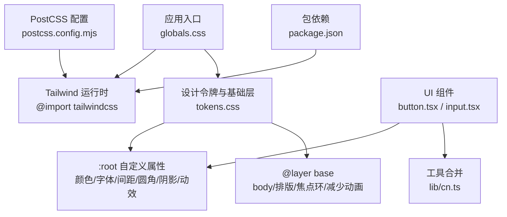
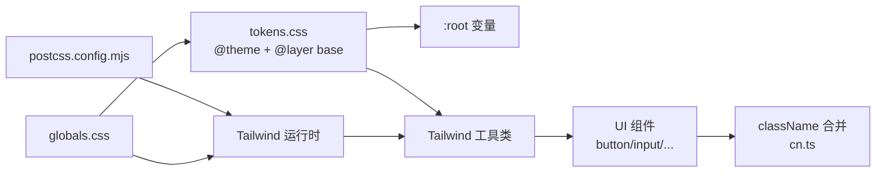
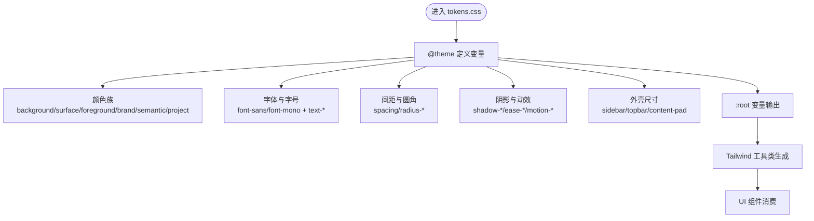
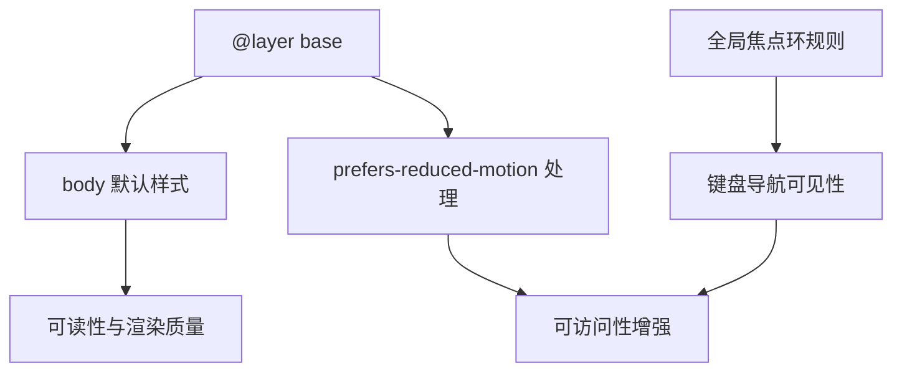
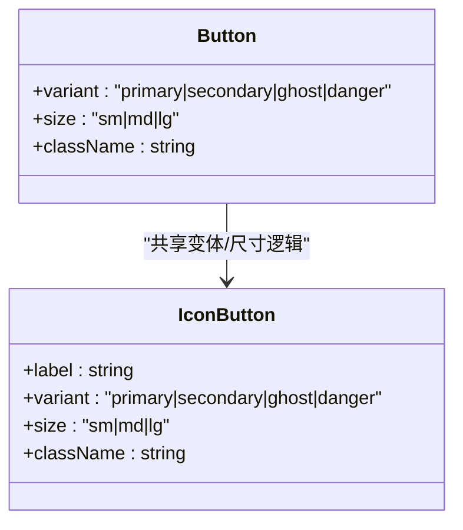
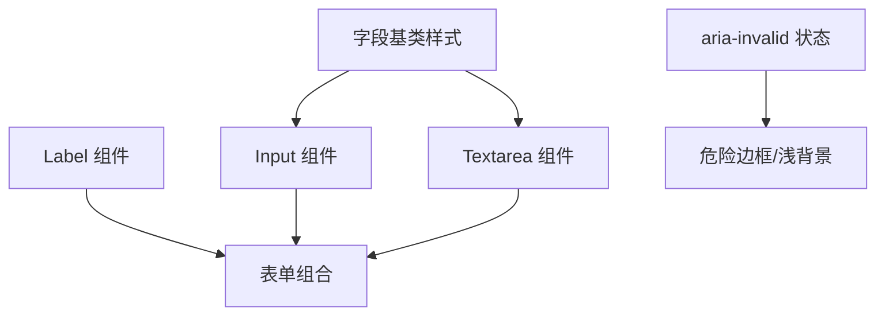
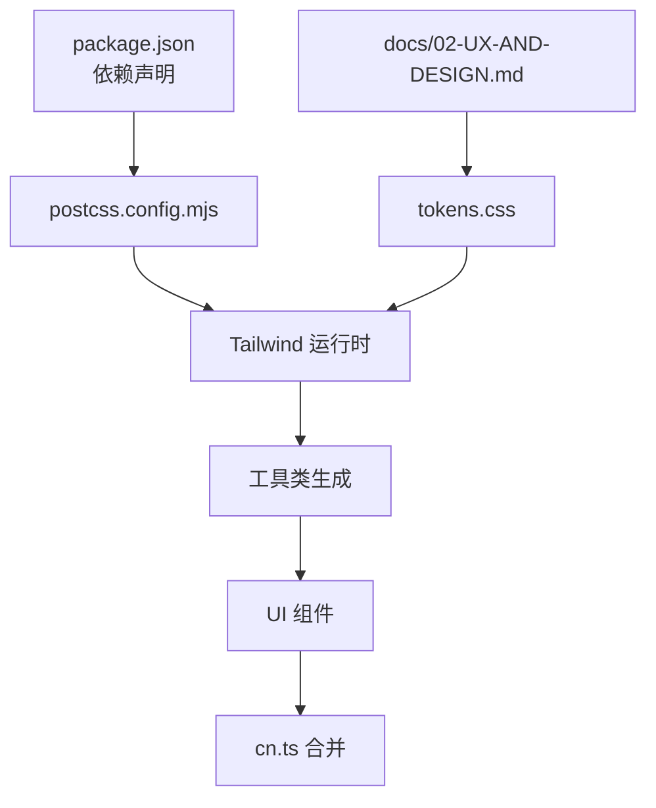

# 样式系统架构

<cite>
**本文引用的文件**
- [src/styles/globals.css](file://src/styles/globals.css)
- [src/styles/tokens.css](file://src/styles/tokens.css)
- [postcss.config.mjs](file://postcss.config.mjs)
- [package.json](file://package.json)
- [src/components/ui/button.tsx](file://src/components/ui/button.tsx)
- [src/components/ui/input.tsx](file://src/components/ui/input.tsx)
- [src/lib/cn.ts](file://src/lib/cn.ts)
- [docs/02-UX-AND-DESIGN.md](file://docs/02-UX-AND-DESIGN.md)
</cite>

## 目录
1. [简介](#简介)
2. [项目结构](#项目结构)
3. [核心组件](#核心组件)
4. [架构总览](#架构总览)
5. [详细组件分析](#详细组件分析)
6. [依赖关系分析](#依赖关系分析)
7. [性能考虑](#性能考虑)
8. [故障排查指南](#故障排查指南)
9. [结论](#结论)
10. [附录：样式开发规范与约定](#附录样式开发规范与约定)

## 简介
本文件为 Orbit 项目的样式系统架构文档，聚焦 Tailwind CSS 的配置与使用、设计令牌（Design Tokens）的定义与管理、CSS 模块化与隔离策略、响应式设计与断点管理，并给出样式架构图、设计规范与开发实践建议。目标是让不同技术背景的读者都能理解并正确使用该样式系统。

## 项目结构
Orbit 的样式体系采用“CSS-first”的 Tailwind CSS 4 方案，通过 @theme 在 CSS 中声明主题变量，无需 tailwind.config.js。全局入口引入 Tailwind 运行时与设计令牌，UI 组件以工具类消费这些令牌，形成“单一视觉真源”。

图表来源
- [src/styles/globals.css:1-12](file://src/styles/globals.css#L1-L12)
- [src/styles/tokens.css:23-107](file://src/styles/tokens.css#L23-L107)
- [postcss.config.mjs:1-9](file://postcss.config.mjs#L1-L9)
- [package.json:29-65](file://package.json#L29-L65)
- [src/components/ui/button.tsx:15-49](file://src/components/ui/button.tsx#L15-L49)
- [src/components/ui/input.tsx:12-17](file://src/components/ui/input.tsx#L12-L17)
- [src/lib/cn.ts:1-14](file://src/lib/cn.ts#L1-L14)

章节来源
- [src/styles/globals.css:1-12](file://src/styles/globals.css#L1-L12)
- [postcss.config.mjs:1-9](file://postcss.config.mjs#L1-L9)
- [package.json:29-65](file://package.json#L29-L65)

## 核心组件
- 设计令牌（Design Tokens）：集中定义于 tokens.css，包含颜色、字体、字号行高、间距、圆角、阴影、动效缓动、外壳尺寸等，并通过 @theme 同时暴露为 :root 变量与 Tailwind 工具类。
- 全局入口：globals.css 仅负责引入 Tailwind 运行时与 tokens.css，不硬编码业务样式。
- UI 组件：Button、Input、Textarea 等通过工具类消费令牌，保持外观一致且可被覆盖。
- 工具函数：cn.ts 基于 clsx + tailwind-merge 安全合并 className，保证组件内建样式与外部覆盖的优先级可控。

章节来源
- [src/styles/tokens.css:23-107](file://src/styles/tokens.css#L23-L107)
- [src/styles/globals.css:1-12](file://src/styles/globals.css#L1-L12)
- [src/components/ui/button.tsx:15-49](file://src/components/ui/button.tsx#L15-L49)
- [src/components/ui/input.tsx:12-17](file://src/components/ui/input.tsx#L12-L17)
- [src/lib/cn.ts:1-14](file://src/lib/cn.ts#L1-L14)

## 架构总览
样式系统遵循“令牌驱动 + 工具类消费”的分层架构：
- 令牌层：tokens.css 中的 @theme 定义所有视觉变量，生成 :root 变量与对应工具类。
- 基础层：@layer base 统一 body 排版、默认颜色、字体、减少动画策略以及全局焦点环。
- 组件层：UI 组件通过工具类组合令牌，实现按钮、输入框等控件外观。
- 构建层：PostCSS 通过 @tailwindcss/postcss 接入 Tailwind 4；无 tailwind.config.js。

图表来源
- [src/styles/tokens.css:23-107](file://src/styles/tokens.css#L23-L107)
- [src/styles/globals.css:1-12](file://src/styles/globals.css#L1-L12)
- [postcss.config.mjs:1-9](file://postcss.config.mjs#L1-L9)
- [src/components/ui/button.tsx:15-49](file://src/components/ui/button.tsx#L15-L49)
- [src/lib/cn.ts:1-14](file://src/lib/cn.ts#L1-L14)

## 详细组件分析

### 设计令牌与主题系统
- 颜色体系：背景、表面、前景、品牌、语义色（成功/警告/危险）、项目标记色、边框线等，均通过 --color-* 变量暴露，并自动生成 bg-/text-/border- 等工具类。
- 字体与字号：--font-sans/--font-mono 及 text-caption/label/body/section/page/hero 等字号与行高配对，确保可读性与一致性。
- 间距与圆角：--spacing=4px 作为基数，配合 h-10/h-11 满足触控目标；radius-control/card/overlay 区分控件/卡片/弹层。
- 阴影与动效：popover/overlay/drag 三类阴影；ease-standard/ease-out 缓动；motion-fast/base/slow 时长 token。
- 外壳尺寸：侧栏宽度、顶栏高度、内容内边距、任务面板宽度等，用于布局与响应式适配。
- 对比度验证：令牌值已对照 WCAG 2.1 进行实测，满足正文 AA 4.5:1、控件边界 3:1 等要求。

图表来源
- [src/styles/tokens.css:23-107](file://src/styles/tokens.css#L23-L107)

章节来源
- [src/styles/tokens.css:23-107](file://src/styles/tokens.css#L23-L107)
- [docs/02-UX-AND-DESIGN.md:9-33](file://docs/02-UX-AND-DESIGN.md#L9-L33)

### 全局基础层与可访问性
- 基础排版：body 默认背景、文字颜色、字体、字号与行高，启用抗锯齿与文本优化。
- 减少动画：prefers-reduced-motion 下禁用非必要过渡与动画，保留状态可见性。
- 统一焦点环：在全局层外定义 :focus-visible 的 outline 与 offset，确保不被组件内的 outline-none 覆盖，保障键盘可达性。

图表来源
- [src/styles/tokens.css:109-168](file://src/styles/tokens.css#L109-L168)

章节来源
- [src/styles/tokens.css:109-168](file://src/styles/tokens.css#L109-L168)

### 按钮组件样式策略
- 变体与尺寸：primary/secondary/ghost/danger 四种变体；sm/md/lg 三种尺寸，统一使用 rounded-control、transition、duration、ease 等令牌或工具类。
- 可访问性：IconButton 强制 label 映射到 aria-label，确保屏幕阅读器可用。
- 交互反馈：hover/active/disabled 状态通过工具类组合，避免硬编码颜色。

图表来源
- [src/components/ui/button.tsx:12-49](file://src/components/ui/button.tsx#L12-L49)
- [src/components/ui/button.tsx:72-117](file://src/components/ui/button.tsx#L72-L117)

章节来源
- [src/components/ui/button.tsx:12-49](file://src/components/ui/button.tsx#L12-L49)
- [src/components/ui/button.tsx:72-117](file://src/components/ui/button.tsx#L72-L117)

### 输入组件样式策略
- 字段基类：统一圆角、边框、背景、占位符颜色、过渡与禁用态；aria-invalid 时切换 danger 边框与浅背景。
- 标签：Label 使用 text-label 与次要前景色，间距由调用方控制。
- 可访问性：焦点环由全局规则提供，组件内使用 outline-none 以避免重复描边。

图表来源
- [src/components/ui/input.tsx:12-17](file://src/components/ui/input.tsx#L12-L17)
- [src/components/ui/input.tsx:20-47](file://src/components/ui/input.tsx#L20-L47)
- [src/components/ui/input.tsx:50-63](file://src/components/ui/input.tsx#L50-L63)

章节来源
- [src/components/ui/input.tsx:12-17](file://src/components/ui/input.tsx#L12-L17)
- [src/components/ui/input.tsx:20-47](file://src/components/ui/input.tsx#L20-L47)
- [src/components/ui/input.tsx:50-63](file://src/components/ui/input.tsx#L50-L63)

### 样式合并与覆盖机制
- cn.ts 使用 clsx 处理条件类，再用 tailwind-merge 解决冲突，后者优先。这样组件内建样式可被外部 className 安全覆盖，便于定制与测试。

章节来源
- [src/lib/cn.ts:1-14](file://src/lib/cn.ts#L1-L14)

## 依赖关系分析
- 构建依赖：PostCSS 通过 @tailwindcss/postcss 接入 Tailwind 4；package.json 中声明 tailwindcss 与相关类型。
- 模块依赖：globals.css 引入 Tailwind 运行时与 tokens.css；UI 组件依赖 lib/cn.ts 进行类名合并。
- 设计依据：docs/02-UX-AND-DESIGN.md 定义了令牌初始值、字号行高、间距、圆角、阴影、动效与响应式外壳规格，是样式的权威来源。

图表来源
- [package.json:29-65](file://package.json#L29-L65)
- [postcss.config.mjs:1-9](file://postcss.config.mjs#L1-L9)
- [src/styles/tokens.css:23-107](file://src/styles/tokens.css#L23-L107)
- [src/lib/cn.ts:1-14](file://src/lib/cn.ts#L1-L14)
- [docs/02-UX-AND-DESIGN.md:9-33](file://docs/02-UX-AND-DESIGN.md#L9-L33)

章节来源
- [package.json:29-65](file://package.json#L29-L65)
- [postcss.config.mjs:1-9](file://postcss.config.mjs#L1-L9)
- [docs/02-UX-AND-DESIGN.md:9-33](file://docs/02-UX-AND-DESIGN.md#L9-L33)

## 性能考虑
- 首屏体积：优先系统字体栈，避免首版引入大体积中文字体下载，降低网络开销。
- 渲染性能：动效以 opacity/transform 为主，时长控制在 120–180ms，减少重排重绘。
- 样式层叠：通过 @layer base 与全局焦点环规则，避免不必要的覆盖与重计算。
- 构建简化：CSS-first 配置减少 JS 配置复杂度，提升构建稳定性。

[本节为通用指导，不直接分析具体文件]

## 故障排查指南
- 焦点环不可见：若组件使用 outline-none，需确认全局 :focus-visible 规则未被意外覆盖；当前规则置于所有层之外以确保优先级。
- 对比度不达标：调整对应 --color-* 令牌值，并在 tokens.css 注释中记录对比度测试结果。
- 响应式异常：检查是否误用断点；本项目与 Tailwind 默认 md=768、xl=1280 一致，无需覆盖。
- 样式覆盖冲突：使用 cn.ts 合并 className，确保外部覆盖按预期生效。

章节来源
- [src/styles/tokens.css:157-168](file://src/styles/tokens.css#L157-L168)
- [src/lib/cn.ts:1-14](file://src/lib/cn.ts#L1-L14)

## 结论
Orbit 的样式系统以设计令牌为核心，借助 Tailwind CSS 4 的 CSS-first 能力，将视觉变量集中管理并自动暴露为工具类与 :root 变量。UI 组件通过工具类消费令牌，实现一致的视觉语言与良好的可维护性。全局基础层与可访问性策略保障了跨设备的一致体验与键盘可达性。该架构简洁、可扩展，适合团队协作与长期演进。

[本节为总结，不直接分析具体文件]

## 附录：样式开发规范与约定
- 令牌优先：新增视觉变量应先在 tokens.css 的 @theme 中定义，再在组件中使用对应工具类。
- 命名约定：颜色使用 --color-*，字号使用 --text-*，圆角使用 --radius-*，阴影使用 --shadow-*，动效使用 --ease-* 与 --motion-*。
- 组件样式：组件内部只组合工具类，不写死颜色/尺寸；必要时通过 cn.ts 合并外部 className。
- 响应式：遵循 docs/02 §4 的外壳规格，使用 Tailwind 默认断点（md=768、xl=1280），不在项目中覆盖断点。
- 可访问性：所有可聚焦元素必须可见焦点环；图标按钮需提供 aria-label；减少动画场景下仍保持状态清晰。
- 文档同步：任何影响令牌或视觉规范的变更需同步更新 docs/02-UX-AND-DESIGN.md。

章节来源
- [docs/02-UX-AND-DESIGN.md:9-33](file://docs/02-UX-AND-DESIGN.md#L9-L33)
- [src/styles/tokens.css:23-107](file://src/styles/tokens.css#L23-L107)
- [src/components/ui/button.tsx:12-49](file://src/components/ui/button.tsx#L12-L49)
- [src/components/ui/input.tsx:12-17](file://src/components/ui/input.tsx#L12-L17)
- [src/lib/cn.ts:1-14](file://src/lib/cn.ts#L1-L14)