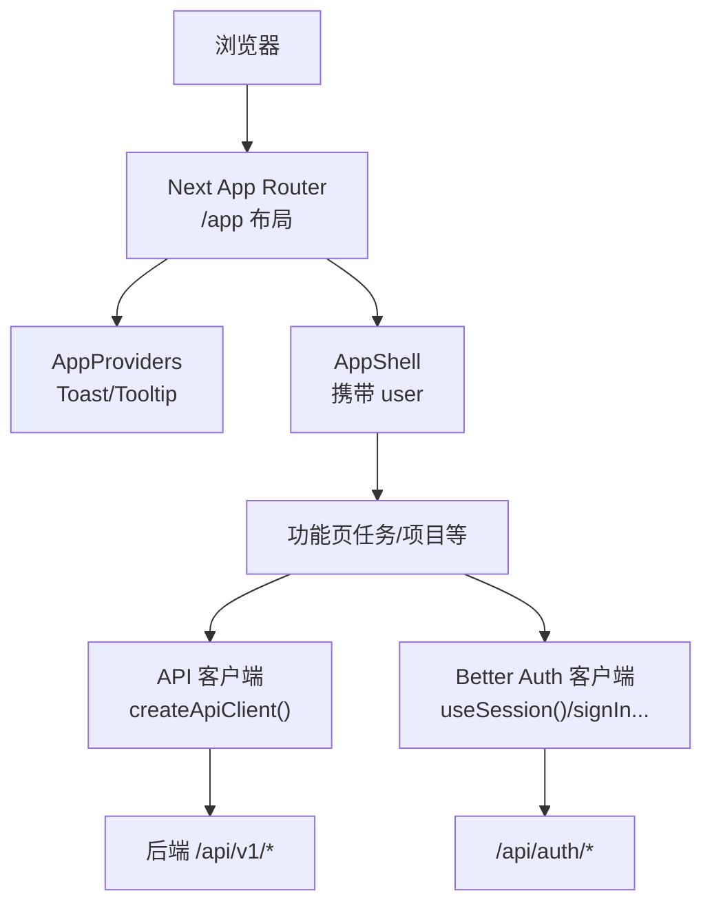
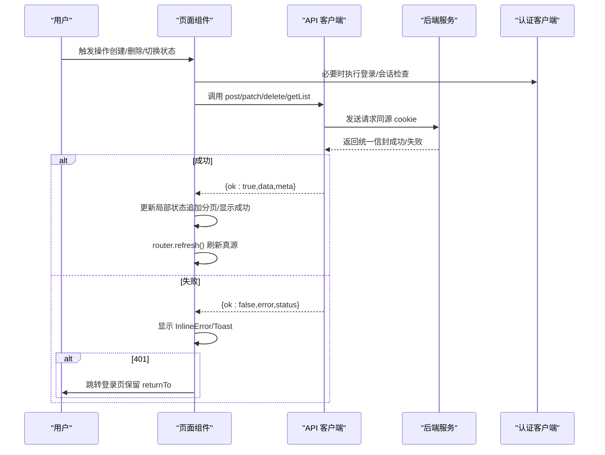
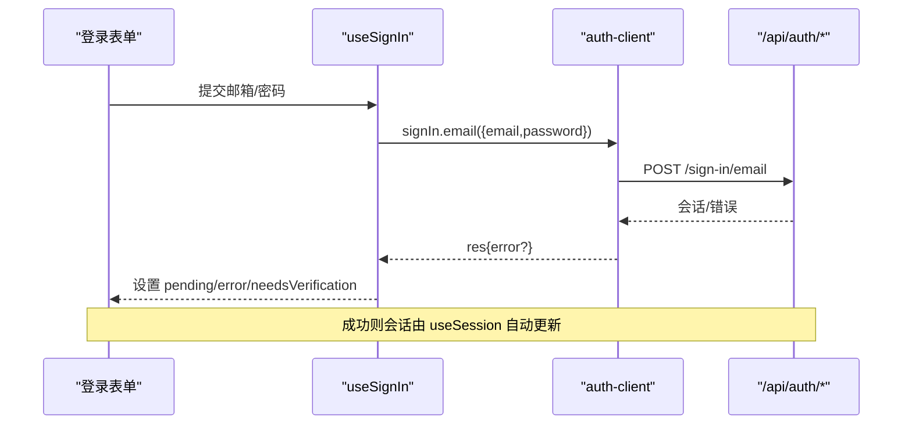
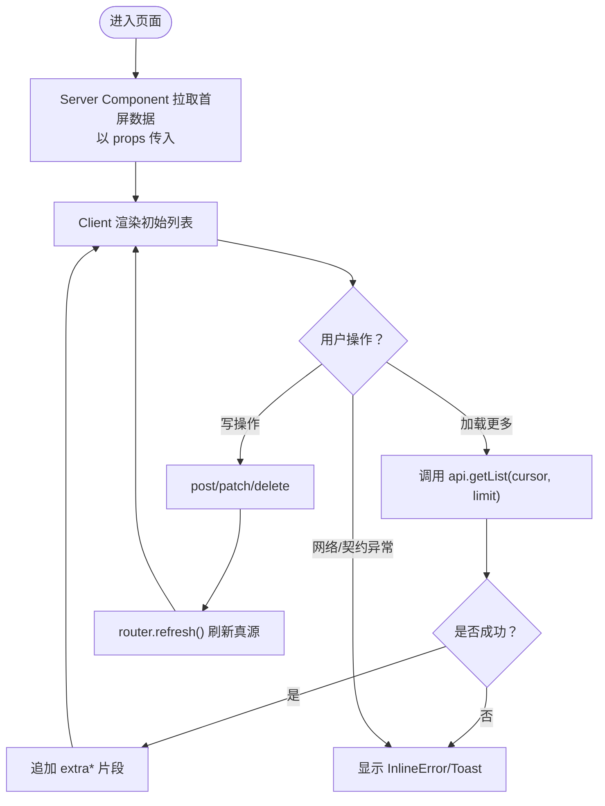
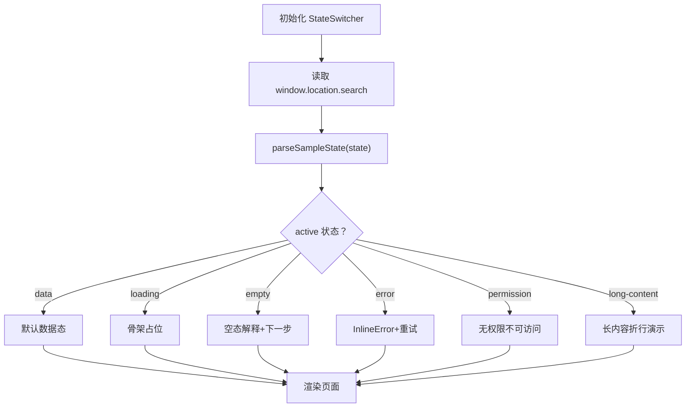
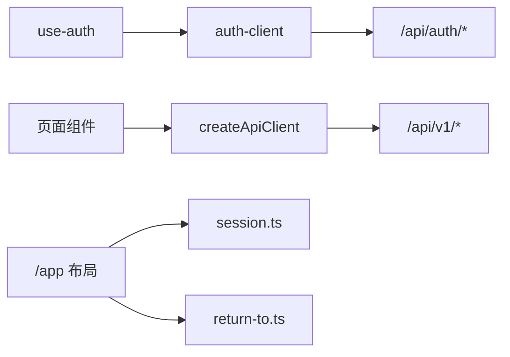

# 状态管理策略

<cite>
**本文引用的文件**
- [src/features/shell/providers.tsx](file://src/features/shell/providers.tsx)
- [src/features/auth/use-auth.ts](file://src/features/auth/use-auth.ts)
- [src/features/auth/auth-client.ts](file://src/features/auth/auth-client.ts)
- [src/features/shell/sample-state.ts](file://src/features/shell/sample-state.ts)
- [src/features/shell/state-switcher.tsx](file://src/features/shell/state-switcher.tsx)
- [src/features/shell/state-views.tsx](file://src/features/shell/state-views.tsx)
- [src/app/layout.tsx](file://src/app/layout.tsx)
- [src/app/app/layout.tsx](file://src/app/app/layout.tsx)
- [src/contracts/client.ts](file://src/contracts/client.ts)
- [src/features/tasks/real/task-list-client.tsx](file://src/features/tasks/real/task-list-client.tsx)
- [src/features/projects/project-list-client.tsx](file://src/features/projects/project-list-client.tsx)
- [src/server/auth/session.ts](file://src/server/auth/session.ts)
- [src/lib/return-to.ts](file://src/lib/return-to.ts)
</cite>

## 目录
1. [简介](#简介)
2. [项目结构](#项目结构)
3. [核心组件](#核心组件)
4. [架构总览](#架构总览)
5. [详细组件分析](#详细组件分析)
6. [依赖关系分析](#依赖关系分析)
7. [性能考量](#性能考量)
8. [故障排查指南](#故障排查指南)
9. [结论](#结论)
10. [附录](#附录)

## 简介
本文件为 Orbit 项目的“状态管理策略”文档，聚焦于客户端状态、服务端数据获取与缓存、认证状态、持久化与本地存储，以及状态流转与同步流程。项目采用 React Hooks + Context（UI 级 Provider）+ 第三方库（Better Auth 客户端）的组合方案；业务数据通过统一信封的 API 客户端进行类型安全调用，并以“服务端渲染首屏 + 客户端增量更新 + router.refresh 刷新真源”的模式实现一致性与可维护性。

## 项目结构
- 应用外壳与全局上下文：根布局提供基础 HTML，/app 布局负责会话校验并注入用户信息，AppProviders 组合 UI 级 Provider（Toast、Tooltip）。
- 认证状态：基于 Better Auth 客户端封装 use-auth hooks，暴露登录、注册、重置密码、验证邮件等动作，并通过 useSession 订阅会话。
- 业务数据：统一的 contracts/client.ts 提供类型安全的 get/post/patch/delete 方法，返回统一信封结果；页面组件以 Server Component 首屏 props 为真源，客户端仅做局部交互与分页追加。
- 样例态：开发期通过 URL 查询参数切换六态（data/loading/empty/error/permission/long-content），便于验收与演示。

图表来源
- [src/app/app/layout.tsx:10-47](file://src/app/app/layout.tsx#L10-L47)
- [src/features/shell/providers.tsx:7-19](file://src/features/shell/providers.tsx#L7-L19)
- [src/contracts/client.ts:90-124](file://src/contracts/client.ts#L90-L124)
- [src/features/auth/auth-client.ts:1-32](file://src/features/auth/auth-client.ts#L1-L32)

章节来源
- [src/app/layout.tsx:1-21](file://src/app/layout.tsx#L1-L21)
- [src/app/app/layout.tsx:10-47](file://src/app/app/layout.tsx#L10-L47)
- [src/features/shell/providers.tsx:7-19](file://src/features/shell/providers.tsx#L7-L19)

## 核心组件
- 认证状态管理
  - use-auth：对 Better Auth 客户端的薄封装，提供 signIn/signUp/signOut/resetPassword/requestPasswordReset/resendVerification 等 hook，附带 pending/error/needsVerification 等 UI 状态。
  - auth-client：Better Auth 客户端实例，声明插件与可用方法映射。
  - session：服务端会话读取与强制认证工具，供路由与 Server Component 使用。
- 业务数据状态
  - contracts/client.ts：统一信封解析、错误分类、类型推断、请求构建与发送。
  - 列表页（项目/任务）：以 Server Component 传入的 initial* 为真源，客户端仅维护“加载更多”的 extra* 片段与加载/错误状态，写操作后通过 router.refresh 刷新真源。
- UI 级上下文
  - AppProviders：挂载 ToastProvider 与 TooltipProvider，用于全局提示与悬停标签。
- 样例态
  - sample-state.ts：定义六态常量与解析函数。
  - state-switcher.tsx：通过 URL ?state= 切换演示态，使用 useSyncExternalStore 订阅 popstate。
  - state-views.tsx：复用错误态与无权限态视图。

章节来源
- [src/features/auth/use-auth.ts:1-186](file://src/features/auth/use-auth.ts#L1-L186)
- [src/features/auth/auth-client.ts:1-32](file://src/features/auth/auth-client.ts#L1-L32)
- [src/server/auth/session.ts:1-43](file://src/server/auth/session.ts#L1-L43)
- [src/contracts/client.ts:1-277](file://src/contracts/client.ts#L1-L277)
- [src/features/tasks/real/task-list-client.tsx:1-400](file://src/features/tasks/real/task-list-client.tsx#L1-L400)
- [src/features/projects/project-list-client.tsx:1-286](file://src/features/projects/project-list-client.tsx#L1-L286)
- [src/features/shell/providers.tsx:7-19](file://src/features/shell/providers.tsx#L7-L19)
- [src/features/shell/sample-state.ts:1-51](file://src/features/shell/sample-state.ts#L1-L51)
- [src/features/shell/state-switcher.tsx:1-110](file://src/features/shell/state-switcher.tsx#L1-L110)
- [src/features/shell/state-views.tsx:1-90](file://src/features/shell/state-views.tsx#L1-L90)

## 架构总览
- 认证流：前端通过 Better Auth 客户端发起登录/注册/退出等操作；服务端在 /app 布局与 API 层校验会话，未认证重定向到登录页并保留 returnTo。
- 数据流：Server Component 拉取数据并作为 props 传入 Client Component；Client Component 仅维护局部交互状态与分页追加；写操作成功后调用 router.refresh 让 Server Component 重新读取最新数据，保证“props 是唯一真源”。
- 错误处理：网络或契约异常抛出 ApiClientError；业务错误按统一信封返回 {ok:false,error,meta}；401 触发硬跳转登录。
- 样例态：开发期通过 URL 参数切换不同展示态，便于验收。

图表来源
- [src/contracts/client.ts:121-255](file://src/contracts/client.ts#L121-L255)
- [src/features/tasks/real/task-list-client.tsx:107-137](file://src/features/tasks/real/task-list-client.tsx#L107-L137)
- [src/features/projects/project-list-client.tsx:90-118](file://src/features/projects/project-list-client.tsx#L90-L118)
- [src/features/auth/use-auth.ts:54-120](file://src/features/auth/use-auth.ts#L54-L120)

## 详细组件分析

### 认证状态管理（Better Auth + use-auth）
- 会话订阅：useSession 转发至 Better Auth 客户端，自动维护当前会话。
- 登录/注册/退出：每个动作封装为 hook，包含 pending/error/needsVerification 等 UI 状态；错误文案根据 status/code 映射为用户友好消息。
- 服务端会话：/app 布局与服务端模块通过 getSessionUser/requireSessionUser 校验会话，未认证重定向到登录页并保留 returnTo。

图表来源
- [src/features/auth/use-auth.ts:54-76](file://src/features/auth/use-auth.ts#L54-L76)
- [src/features/auth/auth-client.ts:17-25](file://src/features/auth/auth-client.ts#L17-L25)
- [src/app/app/layout.tsx:17-40](file://src/app/app/layout.tsx#L17-L40)
- [src/server/auth/session.ts:20-42](file://src/server/auth/session.ts#L20-L42)

章节来源
- [src/features/auth/use-auth.ts:1-186](file://src/features/auth/use-auth.ts#L1-L186)
- [src/features/auth/auth-client.ts:1-32](file://src/features/auth/auth-client.ts#L1-L32)
- [src/server/auth/session.ts:1-43](file://src/server/auth/session.ts#L1-L43)
- [src/app/app/layout.tsx:10-47](file://src/app/app/layout.tsx#L10-L47)
- [src/lib/return-to.ts:1-78](file://src/lib/return-to.ts#L1-L78)

### 业务数据状态（Server Props + 客户端增量）
- 真源模型：Server Component 读取数据后以 props 传入 Client Component；Client 不镜像完整列表到 useState，避免与 refresh 后的新 props 脱节。
- 分页追加：客户端维护 extra* 片段（extraTasks/extraProjects、extraCursor、extraHasMore），仅在“加载更多”时追加；当 base props 变化时清空追加片段，避免重复。
- 写操作：创建/删除/状态切换后调用 router.refresh()，使 Server Component 重新读取最新数据，确保版本一致性（如 task.version）。

图表来源
- [src/features/tasks/real/task-list-client.tsx:73-98](file://src/features/tasks/real/task-list-client.tsx#L73-L98)
- [src/features/tasks/real/task-list-client.tsx:107-137](file://src/features/tasks/real/task-list-client.tsx#L107-L137)
- [src/features/projects/project-list-client.tsx:58-83](file://src/features/projects/project-list-client.tsx#L58-L83)
- [src/features/projects/project-list-client.tsx:90-118](file://src/features/projects/project-list-client.tsx#L90-L118)

章节来源
- [src/features/tasks/real/task-list-client.tsx:1-400](file://src/features/tasks/real/task-list-client.tsx#L1-L400)
- [src/features/projects/project-list-client.tsx:1-286](file://src/features/projects/project-list-client.tsx#L1-L286)
- [src/contracts/client.ts:121-255](file://src/contracts/client.ts#L121-L255)

### 样例态与演示面板
- 六态模型：data/loading/empty/error/permission/long-content，配合 URL ?state= 切换。
- 状态切换器：使用 useSyncExternalStore 订阅 popstate，避免 SSR 水合不一致；点击按钮通过 router.replace 改写查询参数。
- 视图复用：SampleError/NoAccess 提供一致的局部错误与无权限态。

图表来源
- [src/features/shell/sample-state.ts:13-50](file://src/features/shell/sample-state.ts#L13-L50)
- [src/features/shell/state-switcher.tsx:24-60](file://src/features/shell/state-switcher.tsx#L24-L60)
- [src/features/shell/state-views.tsx:16-89](file://src/features/shell/state-views.tsx#L16-L89)

章节来源
- [src/features/shell/sample-state.ts:1-51](file://src/features/shell/sample-state.ts#L1-L51)
- [src/features/shell/state-switcher.tsx:1-110](file://src/features/shell/state-switcher.tsx#L1-L110)
- [src/features/shell/state-views.tsx:1-90](file://src/features/shell/state-views.tsx#L1-L90)

### UI 级上下文（Context Providers）
- AppProviders：组合 ToastProvider 与 TooltipProvider，为全应用提供全局提示与悬停标签能力。
- 作用域：在 /app 布局中挂载一次，属于客户端上下文，无服务端依赖。

章节来源
- [src/features/shell/providers.tsx:7-19](file://src/features/shell/providers.tsx#L7-L19)
- [src/app/app/layout.tsx:41-45](file://src/app/app/layout.tsx#L41-L45)

## 依赖关系分析
- 认证依赖链：use-auth → auth-client → /api/auth/*；/app 布局与服务端模块通过 session.ts 校验会话。
- 数据依赖链：页面组件 → createApiClient → 统一信封解析 → 后端 /api/v1/*。
- 回退与重定向：return-to.ts 提供安全的 returnTo 校验与构造，被 /app 布局与认证流程复用。

图表来源
- [src/features/auth/use-auth.ts:1-186](file://src/features/auth/use-auth.ts#L1-L186)
- [src/features/auth/auth-client.ts:1-32](file://src/features/auth/auth-client.ts#L1-L32)
- [src/contracts/client.ts:121-255](file://src/contracts/client.ts#L121-L255)
- [src/server/auth/session.ts:1-43](file://src/server/auth/session.ts#L1-L43)
- [src/lib/return-to.ts:1-78](file://src/lib/return-to.ts#L1-L78)

章节来源
- [src/features/auth/use-auth.ts:1-186](file://src/features/auth/use-auth.ts#L1-L186)
- [src/features/auth/auth-client.ts:1-32](file://src/features/auth/auth-client.ts#L1-L32)
- [src/contracts/client.ts:1-277](file://src/contracts/client.ts#L1-L277)
- [src/server/auth/session.ts:1-43](file://src/server/auth/session.ts#L1-L43)
- [src/lib/return-to.ts:1-78](file://src/lib/return-to.ts#L1-L78)

## 性能考量
- 真源单一：以 Server Component 的 props 为唯一真源，避免客户端镜像导致的状态漂移与版本冲突（如 task.version）。
- 增量分页：仅将额外拉取的下一页片段存入 extra*，减少首屏渲染压力；base props 变化时清空片段，避免重复。
- 最小化重渲染：useSyncExternalStore 订阅 URL 变更，避免 effect 内同步 setState；router.refresh 精准刷新真源。
- 传输优化：统一信封与 Zod 校验减少无效数据传输；credentials:same-origin 利用 Cookie 会话，无需 token 落盘。
- 动态渲染：/app 布局显式 force-dynamic，避免共享缓存泄露账户私有信息。

[本节为通用指导，不直接分析具体文件]

## 故障排查指南
- 认证相关
  - 401 未认证：页面组件检测到 401 时硬跳转登录页，保留 returnTo；/app 布局在服务端校验会话，失败即重定向。
  - 邮箱未验证：登录错误码 EMAIL_NOT_VERIFIED 时提示用户前往邮箱验证并重发验证邮件。
  - Origin 校验失败：403 且非 EMAIL_NOT_VERIFIED 时提示从应用内页面重试。
- 数据相关
  - 网络/契约异常：ApiClientError 捕获并提示“无法连接服务器”；信封不合法抛错，便于定位接口契约问题。
  - 业务错误：统一信封 {ok:false,error,meta}，在 UI 中以 InlineError 驻留提示。
- 样例态
  - 若出现水合不一致，确认 StateSwitcher 使用 useSyncExternalStore 订阅 popstate，并在导航后触发重渲染。

章节来源
- [src/features/auth/use-auth.ts:32-52](file://src/features/auth/use-auth.ts#L32-L52)
- [src/contracts/client.ts:57-66](file://src/contracts/client.ts#L57-L66)
- [src/contracts/client.ts:180-245](file://src/contracts/client.ts#L180-L245)
- [src/features/tasks/real/task-list-client.tsx:102-137](file://src/features/tasks/real/task-list-client.tsx#L102-L137)
- [src/features/projects/project-list-client.tsx:85-118](file://src/features/projects/project-list-client.tsx#L85-L118)
- [src/features/shell/state-switcher.tsx:24-60](file://src/features/shell/state-switcher.tsx#L24-L60)

## 结论
Orbit 的状态管理以“服务端真源 + 客户端局部状态 + 统一信封 API 客户端”为核心，结合 Better Auth 提供的会话能力，实现了清晰的职责边界与高可维护性。通过 props 驱动、增量分页与 router.refresh 刷新，避免了常见的状态漂移与版本冲突；认证流程在服务端权威校验，前端仅做体验增强。该策略兼顾了性能、一致性与安全性，适合团队协作与长期演进。

[本节为总结，不直接分析具体文件]

## 附录
- 最佳实践
  - 始终将 Server Component 的 props 视为唯一真源，客户端仅维护局部交互与分页片段。
  - 写操作后优先使用 router.refresh 刷新真源，而非手动更新本地状态。
  - 使用统一信封与 Zod 校验保障契约一致性，集中处理错误与元数据。
  - 认证相关跳转一律通过 return-to.ts 的安全校验，防止开放重定向。
  - 敏感数据（用户信息）仅在服务端渲染，避免进入共享缓存。
- 性能优化建议
  - 合理使用分页与游标，避免一次性加载过多数据。
  - 将 UI 级上下文（Toast/Tooltip）集中在 AppProviders 挂载，减少重复开销。
  - 对频繁触发的副作用（如 popstate）使用 useSyncExternalStore，避免不必要的重渲染。

[本节为通用指导，不直接分析具体文件]