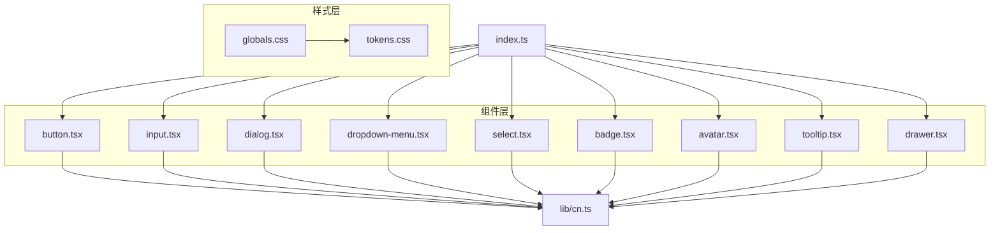
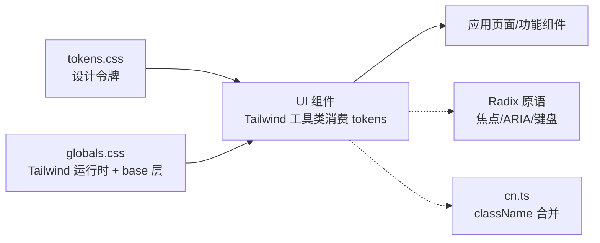
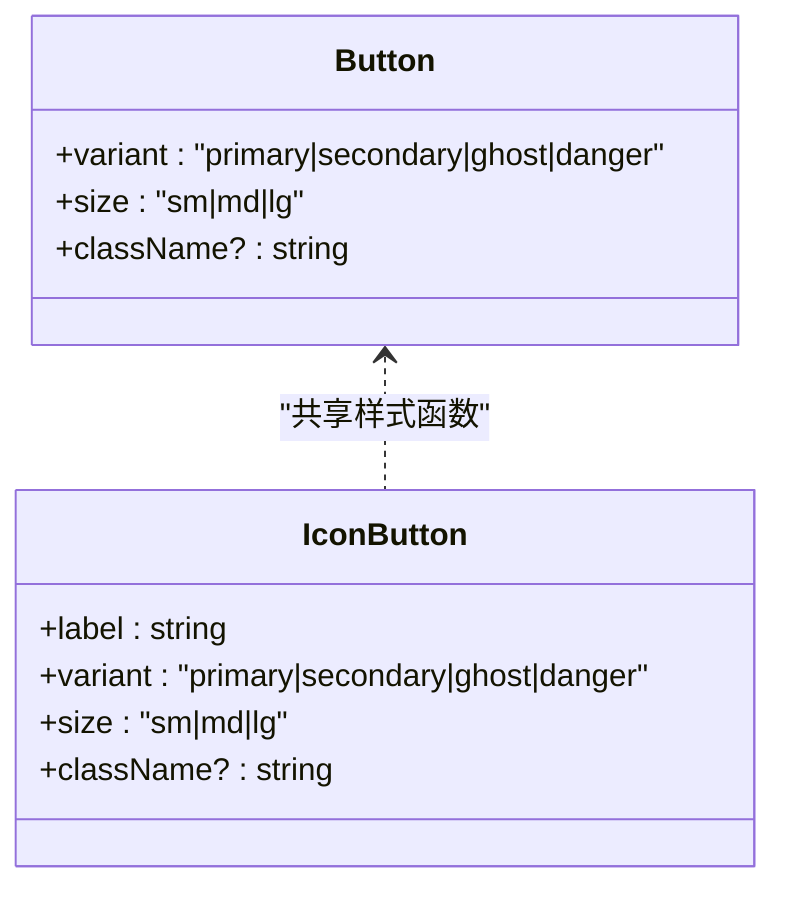
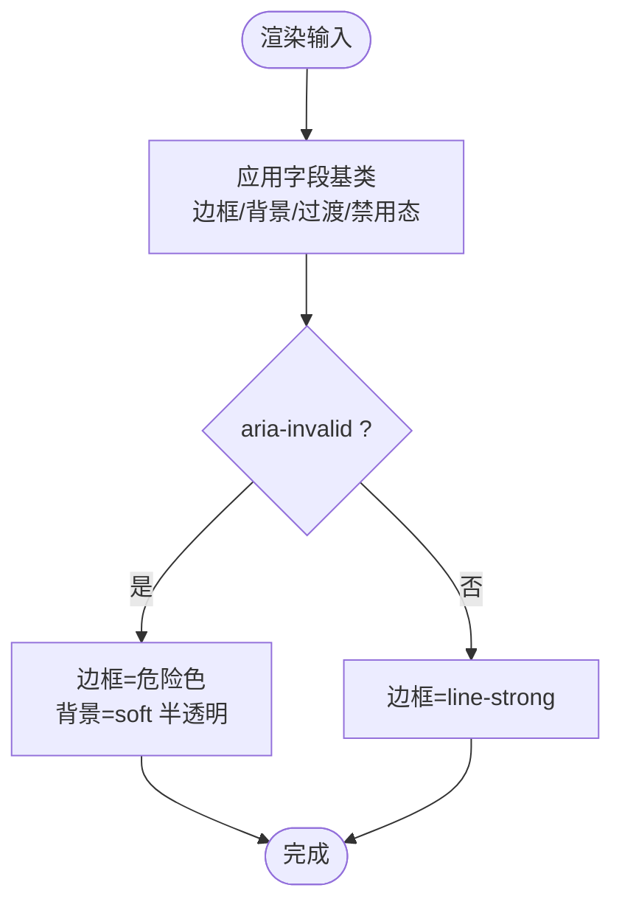
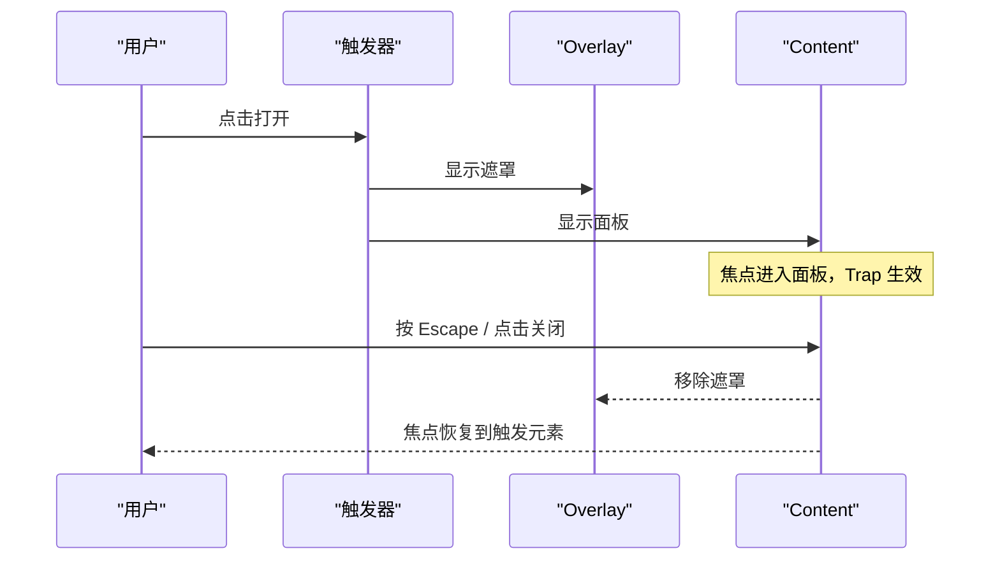
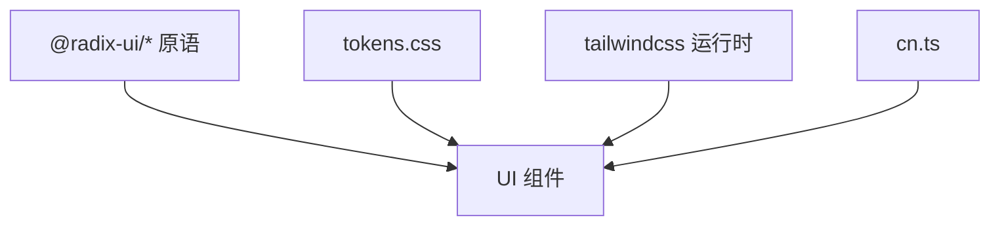

# UI 组件库

<cite>
**本文引用的文件**
- [src/components/ui/README.md](file://src/components/ui/README.md)
- [src/components/ui/index.ts](file://src/components/ui/index.ts)
- [src/styles/tokens.css](file://src/styles/tokens.css)
- [src/styles/globals.css](file://src/styles/globals.css)
- [docs/02-UX-AND-DESIGN.md](file://docs/02-UX-AND-DESIGN.md)
- [src/components/ui/button.tsx](file://src/components/ui/button.tsx)
- [src/components/ui/input.tsx](file://src/components/ui/input.tsx)
- [src/components/ui/dialog.tsx](file://src/components/ui/dialog.tsx)
- [src/components/ui/dropdown-menu.tsx](file://src/components/ui/dropdown-menu.tsx)
- [src/components/ui/select.tsx](file://src/components/ui/select.tsx)
- [src/components/ui/badge.tsx](file://src/components/ui/badge.tsx)
- [src/components/ui/avatar.tsx](file://src/components/ui/avatar.tsx)
- [src/components/ui/tooltip.tsx](file://src/components/ui/tooltip.tsx)
- [src/components/ui/drawer.tsx](file://src/components/ui/drawer.tsx)
- [src/lib/cn.ts](file://src/lib/cn.ts)
</cite>

## 目录
1. [简介](#简介)
2. [项目结构](#项目结构)
3. [核心组件](#核心组件)
4. [架构总览](#架构总览)
5. [详细组件分析](#详细组件分析)
6. [依赖关系分析](#依赖关系分析)
7. [性能考量](#性能考量)
8. [故障排查指南](#故障排查指南)
9. [结论](#结论)
10. [附录：API 参考与最佳实践](#附录api-参考与最佳实践)

## 简介
本文件为 Orbit 项目的 UI 组件库文档，聚焦基础原子组件（按钮、输入框、对话框、下拉菜单、选择器、徽章、头像、工具提示、抽屉等）的设计原则、实现方式与使用规范。组件以 Radix primitives 为基础保证可访问性，样式完全基于设计令牌（tokens），并通过 Tailwind CSS 4 的 CSS-first 主题机制消费 tokens。文档同时说明响应式策略、键盘导航与 ARIA 支持、以及组件 API 与最佳实践。

## 项目结构
UI 组件位于 src/components/ui，统一通过 index.ts 导出；样式系统集中在 src/styles，其中 tokens.css 是视觉唯一真源，globals.css 引入 Tailwind 运行时与 tokens。业务组件按领域组织在 src/features，不混入基础原语。

图表来源
- [src/styles/globals.css:1-13](file://src/styles/globals.css#L1-L13)
- [src/styles/tokens.css:1-169](file://src/styles/tokens.css#L1-L169)
- [src/components/ui/index.ts:1-25](file://src/components/ui/index.ts#L1-L25)
- [src/lib/cn.ts:1-14](file://src/lib/cn.ts#L1-L14)

章节来源
- [src/components/ui/README.md:1-7](file://src/components/ui/README.md#L1-L7)
- [src/components/ui/index.ts:1-25](file://src/components/ui/index.ts#L1-L25)
- [src/styles/globals.css:1-13](file://src/styles/globals.css#L1-L13)
- [src/styles/tokens.css:1-169](file://src/styles/tokens.css#L1-L169)

## 核心组件
- 按钮 Button / IconButton：提供 primary/secondary/ghost/danger 变体与 sm/md/lg 尺寸；焦点环由全局 :focus-visible 规则提供；触控目标满足最小 44px（lg）。
- 输入 Input / Textarea / Label：高度 40px，圆角 8px，边框色 line-strong；aria-invalid 时切换危险态；焦点环走全局规则。
- 对话框 Dialog：基于 Radix Dialog，包含 Overlay、Content、Header、Title、Description、Footer；焦点陷阱、Escape 关闭、标题/描述关联无障碍。
- 下拉菜单 DropdownMenu：基于 Radix DropdownMenu，提供 Content、Item、Label、Separator；键盘导航完整。
- 选择器 Select：基于 Radix Select，触发器 40px，内容 popper 定位；支持方向键导航与输入跳转。
- 徽章 Badge：用于状态/优先级/计数，tone 映射 success/warning/danger/brand/neutral。
- 头像 Avatar / AvatarStack：首字母占位，叠加显示 +N；成员列表提供可访问名称。
- 工具提示 Tooltip：基于 Radix Tooltip，hover/focus 均可触发，提供 Provider。
- 抽屉 Drawer：基于 Radix Dialog，支持 left/right 侧滑面板，可隐藏默认关闭按钮但保留 Escape/遮罩关闭。

章节来源
- [src/components/ui/button.tsx:1-118](file://src/components/ui/button.tsx#L1-L118)
- [src/components/ui/input.tsx:1-64](file://src/components/ui/input.tsx#L1-L64)
- [src/components/ui/dialog.tsx:1-118](file://src/components/ui/dialog.tsx#L1-L118)
- [src/components/ui/dropdown-menu.tsx:1-80](file://src/components/ui/dropdown-menu.tsx#L1-L80)
- [src/components/ui/select.tsx:1-108](file://src/components/ui/select.tsx#L1-L108)
- [src/components/ui/badge.tsx:1-57](file://src/components/ui/badge.tsx#L1-L57)
- [src/components/ui/avatar.tsx:1-109](file://src/components/ui/avatar.tsx#L1-L109)
- [src/components/ui/tooltip.tsx:1-66](file://src/components/ui/tooltip.tsx#L1-L66)
- [src/components/ui/drawer.tsx:1-89](file://src/components/ui/drawer.tsx#L1-L89)

## 架构总览
Orbit 的 UI 架构遵循“头壳分离”：
- 样式层：tokens.css 定义颜色、字号、间距、圆角、阴影、动效与断点；globals.css 引入 Tailwind 运行时与 tokens，并设置 base 层排版与统一焦点环。
- 组件层：所有组件通过 Tailwind 工具类消费 tokens，不硬编码颜色/尺寸；可访问性由 Radix primitives 保障。
- 工具层：cn.ts 合并 className，确保调用方可安全覆盖组件内建样式。

图表来源
- [src/styles/tokens.css:1-169](file://src/styles/tokens.css#L1-L169)
- [src/styles/globals.css:1-13](file://src/styles/globals.css#L1-L13)
- [src/components/ui/button.tsx:1-118](file://src/components/ui/button.tsx#L1-L118)
- [src/lib/cn.ts:1-14](file://src/lib/cn.ts#L1-L14)

## 详细组件分析

### 按钮 Button / IconButton
- 设计要点：
  - 变体：primary/secondary/ghost/danger；尺寸：sm/md/lg。
  - 触控目标：lg 达到 44px，满足移动端可点击要求。
  - 焦点环：由全局 :focus-visible 提供 2px brand + 2px offset。
  - 禁用态：pointer-events-none + opacity 降低。
- 可访问性：
  - IconButton 强制 label 作为 aria-label/title，确保屏幕阅读器可读。
- 样式自定义：
  - 通过 className 追加或覆盖；内部使用 cn 合并，后者优先。

图表来源
- [src/components/ui/button.tsx:12-49](file://src/components/ui/button.tsx#L12-L49)
- [src/components/ui/button.tsx:51-118](file://src/components/ui/button.tsx#L51-L118)

章节来源
- [src/components/ui/button.tsx:1-118](file://src/components/ui/button.tsx#L1-L118)
- [src/styles/tokens.css:157-168](file://src/styles/tokens.css#L157-L168)

### 输入 Input / Textarea / Label
- 设计要点：
  - 高度 40px（h-10），圆角 8px，边框 line-strong。
  - aria-invalid 时边框变为 danger，背景使用 soft 色。
  - 标签 Label 使用 text-label 与次要前景色。
- 可访问性：
  - 焦点环由全局 :focus-visible 提供；表单控件保持原生语义。
- 样式自定义：
  - 通过 className 扩展；内部使用 fieldBase 基类。

图表来源
- [src/components/ui/input.tsx:12-17](file://src/components/ui/input.tsx#L12-L17)
- [src/components/ui/input.tsx:20-48](file://src/components/ui/input.tsx#L20-L48)

章节来源
- [src/components/ui/input.tsx:1-64](file://src/components/ui/input.tsx#L1-L64)
- [src/styles/tokens.css:157-168](file://src/styles/tokens.css#L157-L168)

### 对话框 Dialog
- 设计要点：
  - 基于 Radix Dialog，包含 Overlay、Content、Header、Title、Description、Footer。
  - 圆角 rounded-overlay(16)，阴影 shadow-overlay，边框 border-line，背景 surface。
  - 关闭按钮使用 IconButton，提供 closeLabel。
- 可访问性：
  - 焦点陷阱、初始焦点移入、关闭后恢复焦点、Escape 关闭、标题/描述关联。
- 交互流程：

图表来源
- [src/components/ui/dialog.tsx:17-74](file://src/components/ui/dialog.tsx#L17-L74)
- [src/components/ui/dialog.tsx:76-118](file://src/components/ui/dialog.tsx#L76-L118)

章节来源
- [src/components/ui/dialog.tsx:1-118](file://src/components/ui/dialog.tsx#L1-L118)

### 下拉菜单 DropdownMenu
- 设计要点：
  - 基于 Radix DropdownMenu，Content 使用 rounded-overlay、shadow-popover。
  - Item 高亮态 data-[highlighted] 使用 brand-soft 背景与 brand 文字。
- 可访问性：
  - 完整键盘导航（Enter/Space/方向键/Escape），焦点管理由 Radix 负责。
- 使用约束：
  - 任务卡 hover 显示更多菜单时，键盘 focus-within 也必须可见（由上层 TaskCard 控制触发）。

章节来源
- [src/components/ui/dropdown-menu.tsx:1-80](file://src/components/ui/dropdown-menu.tsx#L1-L80)

### 选择器 Select
- 设计要点：
  - 基于 Radix Select，触发器 h-10，边框 line-strong。
  - 内容使用 popper 定位，viewport 包裹选项。
- 可访问性：
  - 方向键/Home/End/输入跳转，ARIA 角色与焦点管理由 Radix 提供。

章节来源
- [src/components/ui/select.tsx:1-108](file://src/components/ui/select.tsx#L1-L108)

### 徽章 Badge
- 设计要点：
  - tone 映射 neutral/brand/success/warning/danger，使用 soft 背景与深色文字，满足对比度。
  - 图标可选，aria-hidden 避免重复朗读。
- 使用场景：
  - 任务卡最多一个重点色状态；高优先级/逾期用图标+文案而非整卡染色。

章节来源
- [src/components/ui/badge.tsx:1-57](file://src/components/ui/badge.tsx#L1-L57)

### 头像 Avatar / AvatarStack
- 设计要点：
  - 无图时使用姓名首字母 fallback；尺寸 sm/md/lg。
  - AvatarStack 叠加显示，超出显示 +N，并提供可访问的成员名称列表。
- 可访问性：
  - Image alt=name；Fallback aria-label=name；堆叠外层 aria-label 列出全部成员。

章节来源
- [src/components/ui/avatar.tsx:1-109](file://src/components/ui/avatar.tsx#L1-L109)

### 工具提示 Tooltip
- 设计要点：
  - 基于 Radix Tooltip，Provider 延迟触发 delayDuration。
  - 内容使用 foreground 背景与 invert 文字，阴影 shadow-popover。
- 使用场景：
  - 侧栏收窄与长项目名截断时提供完整标签的可访问名称。

章节来源
- [src/components/ui/tooltip.tsx:1-66](file://src/components/ui/tooltip.tsx#L1-L66)

### 抽屉 Drawer
- 设计要点：
  - 基于 Radix Dialog，支持 left/right 侧滑，宽度 min(85vw,320px)。
  - 可隐藏默认关闭按钮，但仍保留 Escape/遮罩关闭。
- 可访问性：
  - 焦点陷阱、初始焦点、关闭恢复、标题/描述（DrawerDescription 视觉隐藏但可用）。

章节来源
- [src/components/ui/drawer.tsx:1-89](file://src/components/ui/drawer.tsx#L1-L89)

## 依赖关系分析
- 组件对 Radix primitives 的依赖：Dialog、DropdownMenu、Select、Tooltip、Avatar 均基于对应 Radix 包，获得可访问性与焦点管理。
- 样式依赖：所有组件通过 Tailwind 工具类消费 tokens.css 中定义的变量；全局焦点环规则置于 @layer base 之外以确保优先级。
- 工具依赖：cn.ts 使用 clsx 与 tailwind-merge 合并 className，允许调用方安全覆盖。

图表来源
- [src/components/ui/dialog.tsx:1-118](file://src/components/ui/dialog.tsx#L1-L118)
- [src/components/ui/dropdown-menu.tsx:1-80](file://src/components/ui/dropdown-menu.tsx#L1-L80)
- [src/components/ui/select.tsx:1-108](file://src/components/ui/select.tsx#L1-L108)
- [src/components/ui/tooltip.tsx:1-66](file://src/components/ui/tooltip.tsx#L1-L66)
- [src/components/ui/avatar.tsx:1-109](file://src/components/ui/avatar.tsx#L1-L109)
- [src/styles/tokens.css:1-169](file://src/styles/tokens.css#L1-L169)
- [src/styles/globals.css:1-13](file://src/styles/globals.css#L1-L13)
- [src/lib/cn.ts:1-14](file://src/lib/cn.ts#L1-L14)

章节来源
- [src/components/ui/index.ts:1-25](file://src/components/ui/index.ts#L1-L25)
- [src/styles/tokens.css:1-169](file://src/styles/tokens.css#L1-L169)
- [src/styles/globals.css:1-13](file://src/styles/globals.css#L1-L13)
- [src/lib/cn.ts:1-14](file://src/lib/cn.ts#L1-L14)

## 性能考量
- 动画与过渡：组件使用 duration-150 与 ease-standard，符合 120–180ms 动效规范；尊重 prefers-reduced-motion，自动取消非必要动画。
- 渲染开销：弹窗/菜单/选择器使用 Portal 挂载到 body，减少重排；Popover/Shadow 使用轻量阴影 token。
- 样式合并：cn.ts 使用 tailwind-merge，避免冲突类导致的多余计算与重绘。
- 字体与资源：优先系统字体栈，避免首版引入大体积中文字体下载。

[本节为通用指导，不直接分析具体文件]

## 故障排查指南
- 焦点环不可见：
  - 检查是否使用了 outline-none 覆盖了全局 :focus-visible；全局规则置于 @layer base 之外，应能胜出。
  - 确认组件未显式移除焦点环；必要时移除 outline-none。
- 弹窗/菜单遮挡：
  - 检查 z-index 层级；Content/Portal 使用固定层级，避免父容器覆盖。
- 可访问性问题：
  - 确保 Dialog/Drawer 有 Title/Description；IconButton 必须提供 label。
  - 使用 AvatarStack 时提供 names 列表，以便屏幕阅读器读取完整成员信息。
- 样式覆盖失败：
  - 使用 cn 合并 className；确保调用方传入的类在后，以获得更高优先级。

章节来源
- [src/styles/tokens.css:157-168](file://src/styles/tokens.css#L157-L168)
- [src/components/ui/dialog.tsx:17-74](file://src/components/ui/dialog.tsx#L17-L74)
- [src/components/ui/drawer.tsx:17-63](file://src/components/ui/drawer.tsx#L17-L63)
- [src/components/ui/button.tsx:78-118](file://src/components/ui/button.tsx#L78-L118)
- [src/components/ui/avatar.tsx:71-109](file://src/components/ui/avatar.tsx#L71-L109)
- [src/lib/cn.ts:1-14](file://src/lib/cn.ts#L1-L14)

## 结论
Orbit 的 UI 组件库以 Radix primitives 保障可访问性，以 tokens.css 作为视觉唯一真源，通过 Tailwind CSS 4 的 CSS-first 主题机制消费 tokens，形成清晰、安静、可信的设计语言。组件具备完善的键盘导航与 ARIA 支持，响应式策略覆盖桌面/平板/手机三档。通过统一的 API 与样式约定，业务组件可在 features 下稳定复用基础原语。

[本节为总结，不直接分析具体文件]

## 附录：API 参考与最佳实践

### 设计令牌（tokens）概览
- 颜色：background/surface/foreground/line/brand/success/warning/danger 等，含 soft 派生色。
- 字号与行高：caption/label/body/section/page/hero 及对应行高。
- 间距基数：4px；常用 p-1/p-2/p-3/p-4/p-6/p-8/p-12。
- 圆角：control/card/overlay。
- 阴影：popover/overlay/drag。
- 动效：ease-standard/ease-out；motion-fast/base/slow。
- 断点：与 Tailwind 默认 md=768、xl=1280 一致。

章节来源
- [src/styles/tokens.css:23-107](file://src/styles/tokens.css#L23-L107)
- [docs/02-UX-AND-DESIGN.md:9-33](file://docs/02-UX-AND-DESIGN.md#L9-L33)

### 组件 API 参考

- Button
  - props: variant="primary|secondary|ghost|danger", size="sm|md|lg", className?, ...原生 button 属性
  - 事件: 透传 onClick/onKeyDown 等
  - 样式: 通过 className 覆盖；内部使用 buttonVariants 生成基础类

- IconButton
  - props: label (必需), variant, size, className?, ...原生 button 属性
  - 事件: 透传
  - 样式: 同 Button 变体；尺寸由 iconSizeClass 控制

- Input / Textarea / Label
  - props: 原生 input/textarea/label 属性；Input/Textarea 支持 className
  - 事件: 透传 onChange/onFocus 等
  - 样式: 字段基类 fieldBase；aria-invalid 切换危险态

- Dialog
  - 子组件: DialogRoot/Trigger/Close, DialogOverlay, DialogContent(closeLabel?), DialogHeader, DialogTitle, DialogDescription, DialogFooter
  - 事件: 透传 Radix 事件
  - 样式: 圆角 overlay、阴影 overlay、边框 line、背景 surface

- DropdownMenu
  - 子组件: Root, Trigger, Content(sideOffset?), Item, Label, Separator
  - 事件: 透传 Radix 事件
  - 样式: 内容圆角 overlay、阴影 popover；Item 高亮态 brand-soft

- Select
  - 子组件: Root, Value, Trigger, Content(position="popper"), Item, Label, Separator
  - 事件: 透传 Radix 事件
  - 样式: 触发器 h-10、边框 line-strong；内容 shadow popover

- Badge
  - props: tone="neutral|brand|success|warning|danger", icon?, children?, className?
  - 样式: 使用 soft 背景与深色文字，满足对比度

- Avatar / AvatarStack
  - Avatar props: name (必需), src?, size="sm|md|lg", className?
  - AvatarStack props: names: string[], max=3, size="sm|md|lg"
  - 样式: 圆形、品牌软底；堆叠时 ring 与负边距叠加

- Tooltip
  - TooltipProvider props: children, delayDuration?
  - Tooltip props: content (必需), side="top|right|bottom|left", children, className?
  - 样式: foreground 背景、invert 文字、shadow popover

- Drawer
  - 子组件: Root, Trigger, Close, Content(side="left|right", closeLabel?, showCloseButton?, className?), Title, Description
  - 事件: 透传 Radix 事件
  - 样式: 侧滑面板、阴影 overlay、边框 line

章节来源
- [src/components/ui/button.tsx:12-118](file://src/components/ui/button.tsx#L12-L118)
- [src/components/ui/input.tsx:12-64](file://src/components/ui/input.tsx#L12-L64)
- [src/components/ui/dialog.tsx:17-118](file://src/components/ui/dialog.tsx#L17-L118)
- [src/components/ui/dropdown-menu.tsx:15-80](file://src/components/ui/dropdown-menu.tsx#L15-L80)
- [src/components/ui/select.tsx:16-108](file://src/components/ui/select.tsx#L16-L108)
- [src/components/ui/badge.tsx:11-57](file://src/components/ui/badge.tsx#L11-L57)
- [src/components/ui/avatar.tsx:14-109](file://src/components/ui/avatar.tsx#L14-L109)
- [src/components/ui/tooltip.tsx:14-66](file://src/components/ui/tooltip.tsx#L14-L66)
- [src/components/ui/drawer.tsx:16-89](file://src/components/ui/drawer.tsx#L16-L89)

### 可访问性与键盘导航
- 焦点环：全局 :focus-visible 提供 2px brand + 2px offset；避免使用 outline-none 破坏焦点环。
- 弹窗/菜单：Radix 提供焦点陷阱、Escape 关闭、初始焦点与恢复；Dialog/Drawer 需配置 Title/Description。
- 图标按钮：必须提供 label 作为 aria-label/title。
- 头像堆叠：提供 names 列表，使屏幕阅读器可读出完整成员信息。

章节来源
- [src/styles/tokens.css:157-168](file://src/styles/tokens.css#L157-L168)
- [src/components/ui/dialog.tsx:17-74](file://src/components/ui/dialog.tsx#L17-L74)
- [src/components/ui/drawer.tsx:17-63](file://src/components/ui/drawer.tsx#L17-L63)
- [src/components/ui/button.tsx:78-118](file://src/components/ui/button.tsx#L78-L118)
- [src/components/ui/avatar.tsx:71-109](file://src/components/ui/avatar.tsx#L71-L109)

### 响应式设计与移动端适配
- 断点：与 Tailwind 默认 md=768、xl=1280 一致；外壳尺寸 token 提供 sidebar/topbar/content-pad 等。
- 布局：桌面左侧 224px 侧栏、顶部 64px 工具栏、内容内边距 32；平板侧栏收窄至 72px；手机顶部抽屉导航，内边距 16。
- 触控目标：按钮 lg 尺寸达到 44px；输入框高度 40px，必要时可扩展至 44px。
- 详情面板：桌面右侧展示，手机全屏展示；任务详情在移动设备占满屏。

章节来源
- [src/styles/tokens.css:109-126](file://src/styles/tokens.css#L109-L126)
- [docs/02-UX-AND-DESIGN.md:59-68](file://docs/02-UX-AND-DESIGN.md#L59-L68)
- [docs/02-UX-AND-DESIGN.md:101-107](file://docs/02-UX-AND-DESIGN.md#L101-L107)

### 使用示例与最佳实践
- 按钮：
  - 主操作使用 primary，危险操作使用 danger；图标按钮务必提供 label。
  - 通过 className 微调间距或对齐；避免覆盖焦点环。
- 输入：
  - 使用 Label 明确字段含义；错误态设置 aria-invalid；提交前校验并反馈。
- 对话框：
  - 使用 Header/Title/Description/Footer 组织内容；关闭按钮提供 closeLabel。
- 下拉菜单/选择器：
  - 使用 Item/Label/Separator 组织选项；键盘导航无需额外实现。
- 徽章：
  - 每个任务卡最多一个重点色状态；使用 tone 表达语义。
- 头像：
  - 无图时 fallback 显示首字母；堆叠时提供 names 列表。
- 工具提示：
  - 在截断文本处提供 content；Provider 在应用根挂载一次。
- 抽屉：
  - 导航使用 left，详情使用 right；可隐藏默认关闭按钮但保留 Escape/遮罩关闭。

章节来源
- [src/components/ui/button.tsx:12-118](file://src/components/ui/button.tsx#L12-L118)
- [src/components/ui/input.tsx:12-64](file://src/components/ui/input.tsx#L12-L64)
- [src/components/ui/dialog.tsx:17-118](file://src/components/ui/dialog.tsx#L17-L118)
- [src/components/ui/dropdown-menu.tsx:15-80](file://src/components/ui/dropdown-menu.tsx#L15-L80)
- [src/components/ui/select.tsx:16-108](file://src/components/ui/select.tsx#L16-L108)
- [src/components/ui/badge.tsx:11-57](file://src/components/ui/badge.tsx#L11-L57)
- [src/components/ui/avatar.tsx:14-109](file://src/components/ui/avatar.tsx#L14-L109)
- [src/components/ui/tooltip.tsx:14-66](file://src/components/ui/tooltip.tsx#L14-L66)
- [src/components/ui/drawer.tsx:16-89](file://src/components/ui/drawer.tsx#L16-L89)