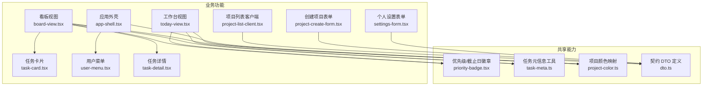
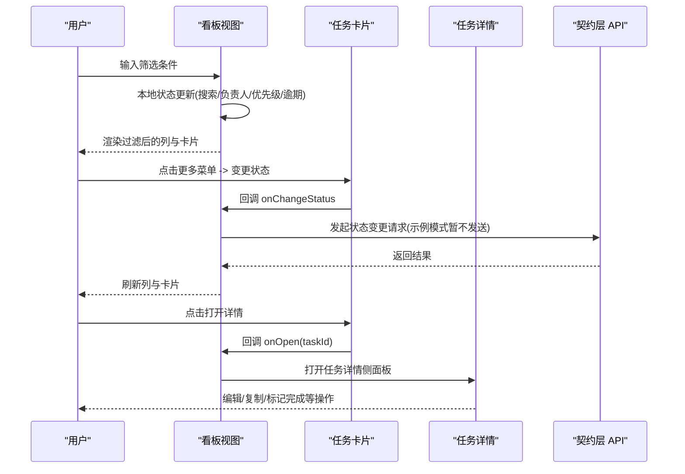
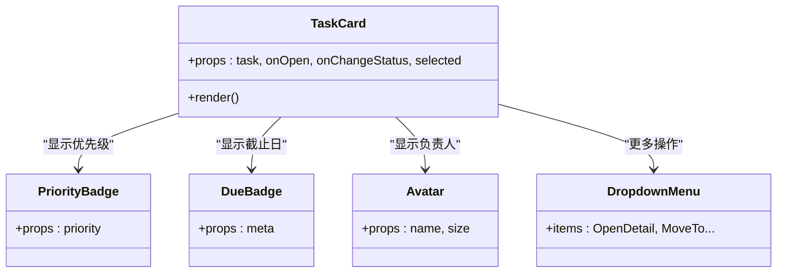
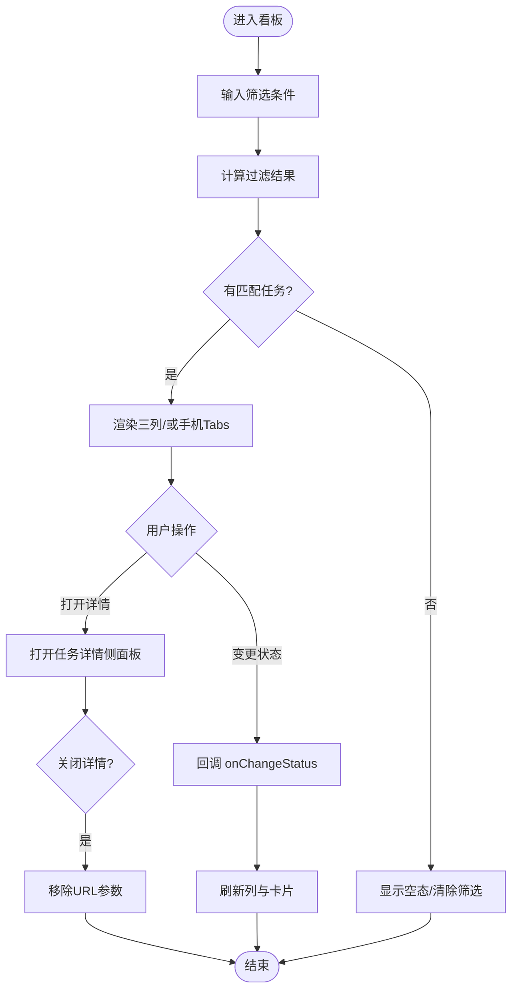
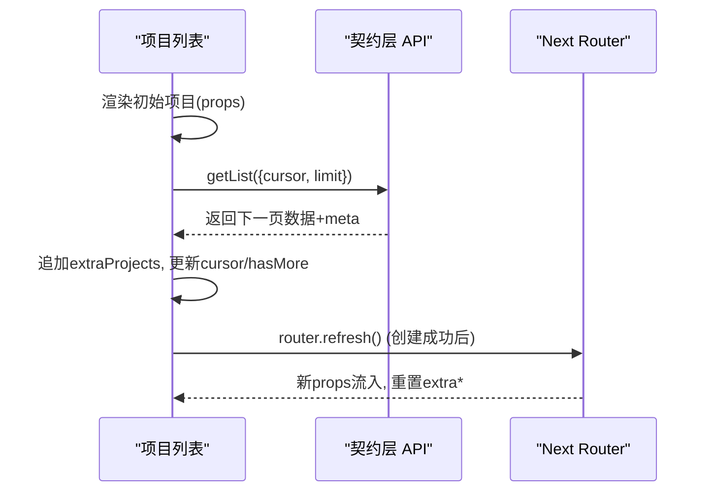
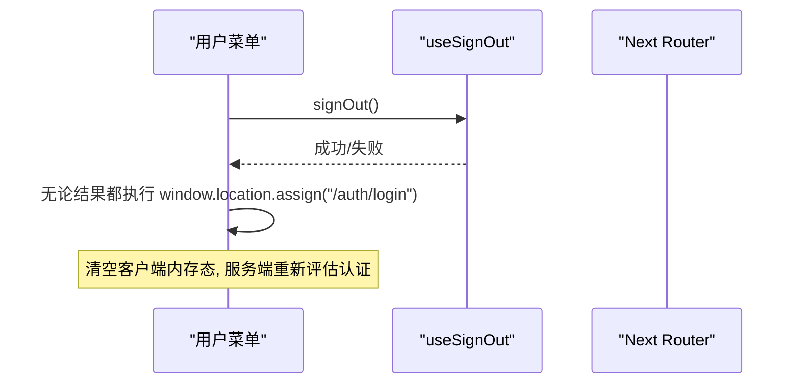
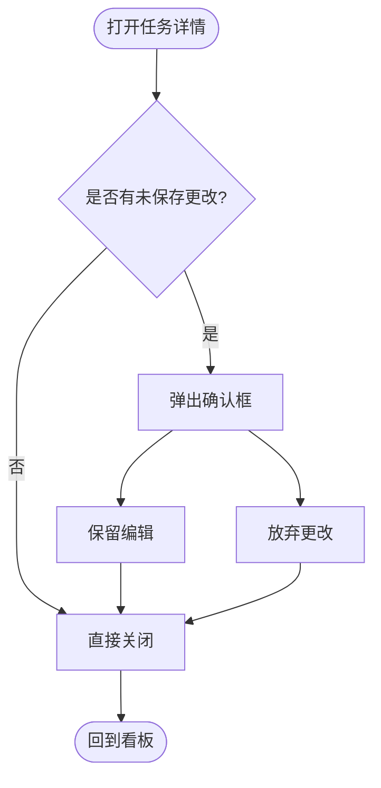
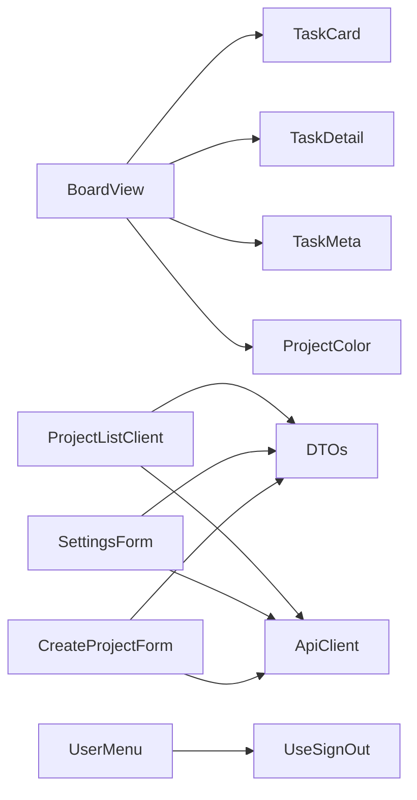

# 业务组件

<cite>
**本文引用的文件**
- [task-card.tsx](file://src/features/board/task-card.tsx)
- [board-view.tsx](file://src/features/board/board-view.tsx)
- [project-list-client.tsx](file://src/features/projects/project-list-client.tsx)
- [user-menu.tsx](file://src/features/shell/user-menu.tsx)
- [app-shell.tsx](file://src/features/shell/app-shell.tsx)
- [task-detail.tsx](file://src/features/tasks/task-detail.tsx)
- [priority-badge.tsx](file://src/features/tasks/priority-badge.tsx)
- [today-view.tsx](file://src/features/today/today-view.tsx)
- [settings-form.tsx](file://src/features/settings/settings-form.tsx)
- [project-create-form.tsx](file://src/features/projects/project-create-form.tsx)
- [task-meta.ts](file://src/features/tasks/task-meta.ts)
- [project-color.ts](file://src/lib/project-color.ts)
- [dto.ts](file://src/contracts/dto.ts)
</cite>

## 目录
1. [简介](#简介)
2. [项目结构](#项目结构)
3. [核心组件](#核心组件)
4. [架构总览](#架构总览)
5. [详细组件分析](#详细组件分析)
6. [依赖关系分析](#依赖关系分析)
7. [性能考量](#性能考量)
8. [故障排查指南](#故障排查指南)
9. [结论](#结论)
10. [附录：接口规范与扩展点](#附录接口规范与扩展点)

## 简介
本文件面向 Orbit 项目的业务组件，聚焦任务卡片、看板视图、项目列表、用户菜单等关键能力。文档从设计目标、状态管理、组合复用、通信机制、数据流、接口规范与扩展点等方面展开，帮助读者在不深入源码的情况下理解并正确使用这些组件，同时为后续接入真实后端提供清晰的集成路径。

## 项目结构
Orbit 的业务组件集中在 features 目录下，按领域划分：
- board：看板相关（任务卡片、看板视图）
- tasks：任务通用展示与详情（优先级/截止日徽章、任务详情）
- projects：项目列表与创建表单
- shell：应用外壳与用户菜单
- today：工作台视图
- settings：个人设置表单

UI 基础组件位于 components/ui，契约与类型定义位于 contracts，工具函数位于 lib。

图表来源
- [board-view.tsx:1-494](file://src/features/board/board-view.tsx#L1-L494)
- [task-card.tsx:1-146](file://src/features/board/task-card.tsx#L1-L146)
- [project-list-client.tsx:1-286](file://src/features/projects/project-list-client.tsx#L1-L286)
- [user-menu.tsx:1-135](file://src/features/shell/user-menu.tsx#L1-L135)
- [app-shell.tsx:1-389](file://src/features/shell/app-shell.tsx#L1-L389)
- [task-detail.tsx:1-561](file://src/features/tasks/task-detail.tsx#L1-L561)
- [priority-badge.tsx:1-77](file://src/features/tasks/priority-badge.tsx#L1-L77)
- [today-view.tsx:1-320](file://src/features/today/today-view.tsx#L1-L320)
- [settings-form.tsx:1-437](file://src/features/settings/settings-form.tsx#L1-L437)
- [project-create-form.tsx:1-355](file://src/features/projects/project-create-form.tsx#L1-L355)
- [task-meta.ts:1-133](file://src/features/tasks/task-meta.ts#L1-L133)
- [project-color.ts:1-34](file://src/lib/project-color.ts#L1-L34)
- [dto.ts:1-200](file://src/contracts/dto.ts#L1-L200)

章节来源
- [board-view.tsx:1-494](file://src/features/board/board-view.tsx#L1-L494)
- [project-list-client.tsx:1-286](file://src/features/projects/project-list-client.tsx#L1-L286)
- [user-menu.tsx:1-135](file://src/features/shell/user-menu.tsx#L1-L135)
- [app-shell.tsx:1-389](file://src/features/shell/app-shell.tsx#L1-L389)
- [task-detail.tsx:1-561](file://src/features/tasks/task-detail.tsx#L1-L561)
- [priority-badge.tsx:1-77](file://src/features/tasks/priority-badge.tsx#L1-L77)
- [today-view.tsx:1-320](file://src/features/today/today-view.tsx#L1-L320)
- [settings-form.tsx:1-437](file://src/features/settings/settings-form.tsx#L1-L437)
- [project-create-form.tsx:1-355](file://src/features/projects/project-create-form.tsx#L1-L355)
- [task-meta.ts:1-133](file://src/features/tasks/task-meta.ts#L1-L133)
- [project-color.ts:1-34](file://src/lib/project-color.ts#L1-L34)
- [dto.ts:1-200](file://src/contracts/dto.ts#L1-L200)

## 核心组件
- 任务卡片：负责单条任务的可视化与快捷操作（打开详情、变更状态），通过下拉菜单暴露“移动到”各列的能力。
- 看板视图：聚合筛选、列布局、移动端 Tabs、任务详情侧面板；使用本地状态驱动过滤与交互。
- 项目列表：服务端首屏数据 + 客户端分页追加；创建项目后刷新页面以同步最新列表。
- 用户菜单：账户信息与退出登录；退出采用硬跳转确保内存态清理。
- 任务详情：编辑标题/描述、修改状态/优先级、复制链接、删除等；支持面板与独立页两种形态。
- 工作台视图：统计入口与分组任务列表，基于截止日期与状态进行分组与筛选。
- 个人设置：姓名与时区编辑，保存后刷新页面以同步全局显示。
- 创建项目表单：字段校验、幂等键、错误映射与提示。

章节来源
- [task-card.tsx:1-146](file://src/features/board/task-card.tsx#L1-L146)
- [board-view.tsx:1-494](file://src/features/board/board-view.tsx#L1-L494)
- [project-list-client.tsx:1-286](file://src/features/projects/project-list-client.tsx#L1-L286)
- [user-menu.tsx:1-135](file://src/features/shell/user-menu.tsx#L1-L135)
- [task-detail.tsx:1-561](file://src/features/tasks/task-detail.tsx#L1-L561)
- [today-view.tsx:1-320](file://src/features/today/today-view.tsx#L1-L320)
- [settings-form.tsx:1-437](file://src/features/settings/settings-form.tsx#L1-L437)
- [project-create-form.tsx:1-355](file://src/features/projects/project-create-form.tsx#L1-L355)

## 架构总览
业务组件遵循“容器组件 + 展示组件”的组合模式：
- 容器组件（如 BoardView、ProjectListClient、SettingsForm）负责状态、API 调用、路由与副作用。
- 展示组件（如 TaskCard、PriorityBadge、DueBadge）仅接收 props 渲染 UI。
- 共享工具（task-meta、project-color）提供纯函数与映射，避免在组件中重复实现。

图表来源
- [board-view.tsx:1-494](file://src/features/board/board-view.tsx#L1-L494)
- [task-card.tsx:1-146](file://src/features/board/task-card.tsx#L1-L146)
- [task-detail.tsx:1-561](file://src/features/tasks/task-detail.tsx#L1-L561)

## 详细组件分析

### 任务卡片（TaskCard）
- 职责：展示任务编号、优先级、标题、子任务/评论/附件计数、截止日与负责人；提供“更多操作”下拉菜单用于打开详情与变更状态。
- 状态：无本地持久状态，所有行为通过 props 回调（onOpen、onChangeStatus）。
- 组合：复用优先级/截止日徽章、头像、下拉菜单等基础组件。
- 可访问性：按钮具备语义化标签，图标使用 aria-hidden，菜单项禁用当前状态。

图表来源
- [task-card.tsx:1-146](file://src/features/board/task-card.tsx#L1-L146)
- [priority-badge.tsx:1-77](file://src/features/tasks/priority-badge.tsx#L1-L77)

章节来源
- [task-card.tsx:1-146](file://src/features/board/task-card.tsx#L1-L146)

### 看板视图（BoardView）
- 职责：项目页头、二级导航、筛选行、三列固定布局（桌面）与按状态 Tabs（手机）、任务详情侧面板。
- 状态：本地状态包括搜索词、负责人、优先级、仅逾期、移动端状态 Tab；使用 useMemo 计算过滤结果。
- 数据流：M0 阶段使用 fixture；未来可替换为真实数据源。
- 路由：通过 URL 查询参数 ?task= 控制详情面板的打开与关闭。

图表来源
- [board-view.tsx:1-494](file://src/features/board/board-view.tsx#L1-L494)

章节来源
- [board-view.tsx:1-494](file://src/features/board/board-view.tsx#L1-L494)

### 项目列表（ProjectListClient）
- 职责：展示项目卡片网格，支持“加载更多”分页；创建项目后刷新页面以获取最新列表。
- 状态：本地状态包含额外加载的项目片段、游标、是否还有更多、创建表单展开、加载中标识、错误消息。
- 数据流：首屏由 Server Component 传入 props；后续分页通过契约层 getList 拉取并追加。
- 错误处理：401 跳转登录；网络错误与业务错误分别提示。

图表来源
- [project-list-client.tsx:1-286](file://src/features/projects/project-list-client.tsx#L1-L286)

章节来源
- [project-list-client.tsx:1-286](file://src/features/projects/project-list-client.tsx#L1-L286)

### 用户菜单（UserMenu）
- 职责：展示当前用户信息（姓名、邮箱、时区），提供“个人设置”与“退出登录”。
- 状态：退出流程使用 useSignOut hook；pending 状态用于禁用退出按钮。
- 安全：退出采用硬跳转，确保销毁客户端内存态与服务端会话；设置页软导航。

图表来源
- [user-menu.tsx:1-135](file://src/features/shell/user-menu.tsx#L1-L135)

章节来源
- [user-menu.tsx:1-135](file://src/features/shell/user-menu.tsx#L1-L135)

### 任务详情（TaskDetail）
- 职责：编辑标题/描述、修改状态/优先级、复制链接、删除、子任务/附件/评论展示与评论输入。
- 状态：本地草稿（标题/描述/评论）、确认框（未保存更改）、焦点恢复。
- 组合：支持 panel/page 两种形态；使用 Drawer/Dialog 等基础组件。

图表来源
- [task-detail.tsx:1-561](file://src/features/tasks/task-detail.tsx#L1-L561)

章节来源
- [task-detail.tsx:1-561](file://src/features/tasks/task-detail.tsx#L1-L561)

### 工作台视图（TodayView）
- 职责：顶部主张与时区日期、四个统计入口（逾期/今天/未来7天/进行中）、分组任务列表。
- 状态：本地 filters 数组控制多选筛选；emptyVariant 切换首次无任务/全部完成两种空态。
- 逻辑：基于截止日期与状态进行分组与筛选，复用优先级/截止日徽章与任务元信息工具。

章节来源
- [today-view.tsx:1-320](file://src/features/today/today-view.tsx#L1-L320)

### 个人设置（SettingsForm）
- 职责：编辑姓名与时区，右侧实时预览当地时刻与账户信息。
- 状态：draft/saved 双基线判断 dirty；提交后更新 saved 并刷新页面。
- 错误处理：400 fieldErrors 映射到字段 InlineError；401 会话失效引导重新登录。

章节来源
- [settings-form.tsx:1-437](file://src/features/settings/settings-form.tsx#L1-L437)

### 创建项目（ProjectCreateForm）
- 职责：项目名称/标识/描述/颜色选择；字段校验与错误映射。
- 幂等键：挂载生成一次，内容变更换新键；传输歧义失败保留原键以便重试命中 replay。
- 错误处理：409 PROJECT_KEY_TAKEN、422 LIMIT_EXCEEDED、400 fieldErrors 等。

章节来源
- [project-create-form.tsx:1-355](file://src/features/projects/project-create-form.tsx#L1-L355)

## 依赖关系分析
- 组件耦合：
  - BoardView 强依赖 TaskCard、TaskDetail、task-meta、project-color。
  - ProjectListClient 依赖契约层 DTOs 与 createApiClient。
  - UserMenu 依赖 useSignOut 与路由。
  - TaskDetail 依赖基础 UI 组件与任务元信息工具。
- 外部依赖：
  - Next Navigation（router、usePathname）。
  - 契约层（createApiClient、DTO schemas）。
  - 基础 UI（DropdownMenu、Select、Dialog、Drawer、Toast 等）。

图表来源
- [board-view.tsx:1-494](file://src/features/board/board-view.tsx#L1-L494)
- [project-list-client.tsx:1-286](file://src/features/projects/project-list-client.tsx#L1-L286)
- [user-menu.tsx:1-135](file://src/features/shell/user-menu.tsx#L1-L135)
- [settings-form.tsx:1-437](file://src/features/settings/settings-form.tsx#L1-L437)
- [project-create-form.tsx:1-355](file://src/features/projects/project-create-form.tsx#L1-L355)
- [dto.ts:1-200](file://src/contracts/dto.ts#L1-L200)

章节来源
- [board-view.tsx:1-494](file://src/features/board/board-view.tsx#L1-L494)
- [project-list-client.tsx:1-286](file://src/features/projects/project-list-client.tsx#L1-L286)
- [user-menu.tsx:1-135](file://src/features/shell/user-menu.tsx#L1-L135)
- [settings-form.tsx:1-437](file://src/features/settings/settings-form.tsx#L1-L437)
- [project-create-form.tsx:1-355](file://src/features/projects/project-create-form.tsx#L1-L355)
- [dto.ts:1-200](file://src/contracts/dto.ts#L1-L200)

## 性能考量
- 本地过滤与计算：
  - 看板视图使用 useMemo 对筛选结果进行缓存，减少重渲染开销。
  - 工作台视图将项目 Map 预构建，提升查找效率。
- 懒加载与分页：
  - 项目列表采用游标分页，避免一次性加载大量数据。
- 渲染优化：
  - 骨架屏与空态组件提升感知性能。
  - 移动端按状态 Tabs 减少首屏渲染压力。
- 资源复用：
  - 优先级/截止日徽章与任务元信息工具被多处复用，避免重复计算。

[本节为通用指导，不直接分析具体文件]

## 故障排查指南
- 看板加载失败：
  - 检查 state 是否为 error；查看 SampleError 提示信息；确认数据源（fixture 或 API）是否正常。
- 项目列表加载失败：
  - 检查网络与权限（401）；查看 InlineError 与 toast；必要时跳转到登录页。
- 创建项目失败：
  - 关注字段错误（InlineError）与表单错误（formError）；处理 409/422 等业务错误；幂等键策略确保重试安全。
- 用户退出异常：
  - 即使 signOut 失败也执行硬跳转；确保服务端会话清理；检查 /me 的缓存控制。
- 任务详情未保存更改：
  - 关闭前弹出确认框；焦点恢复使用 useFocusReturn；避免丢失编辑内容。

章节来源
- [board-view.tsx:1-494](file://src/features/board/board-view.tsx#L1-L494)
- [project-list-client.tsx:1-286](file://src/features/projects/project-list-client.tsx#L1-L286)
- [project-create-form.tsx:1-355](file://src/features/projects/project-create-form.tsx#L1-L355)
- [user-menu.tsx:1-135](file://src/features/shell/user-menu.tsx#L1-L135)
- [task-detail.tsx:1-561](file://src/features/tasks/task-detail.tsx#L1-L561)

## 结论
Orbit 的业务组件以清晰的分层与组合模式组织，容器组件管理状态与副作用，展示组件专注渲染与交互。通过共享工具与契约层 DTO，保证了前后端一致性与可维护性。当前 M0 阶段使用 fixture 演示交互，后续里程碑可平滑替换为真实后端。建议在接入后端时保持现有接口与状态管理模式，逐步增强数据流与错误处理。

[本节为总结，不直接分析具体文件]

## 附录：接口规范与扩展点

### 组件接口规范
- 任务卡片（TaskCard）
  - props：task（TaskSummaryDTO）、onOpen（打开详情）、onChangeStatus（变更状态）、selected（选中态）
  - 事件：onOpen、onChangeStatus
  - 扩展点：可在下拉菜单中添加更多操作（如移动到其他项目）
- 看板视图（BoardView）
  - props：projectId、state（SampleState）、openTaskId
  - 事件：openTask/closeTask（通过 URL 参数控制）
  - 扩展点：接入真实数据源替换 fixture；实现拖拽排序（M3）
- 项目列表（ProjectListClient）
  - props：initialProjects、nextCursor、hasMore
  - 方法：handleLoadMore（分页）、onCreated（创建后刷新）
  - 扩展点：增加搜索/排序/归档操作
- 用户菜单（UserMenu）
  - props：variant、user、side、align
  - 事件：handleSettings、handleSignOut
  - 扩展点：添加更多账户操作（如切换账号）
- 任务详情（TaskDetail）
  - props：task、variant、onClose、onCloseAutoFocus
  - 事件：copyLink、标记完成、删除
  - 扩展点：接入评论/附件上传的真实后端
- 工作台视图（TodayView）
  - props：state（SampleState）
  - 事件：toggleFilter（多选筛选）
  - 扩展点：接入真实任务数据与统计
- 个人设置（SettingsForm）
  - props：user
  - 事件：handleSubmit（PATCH /me）、handleReset
  - 扩展点：增加更多账户偏好（如通知设置）
- 创建项目（ProjectCreateForm）
  - props：onCreated、onCancelled、onUnauthorized
  - 事件：handleSubmit（POST /projects）
  - 扩展点：增加邀请成员/模板项目

章节来源
- [task-card.tsx:1-146](file://src/features/board/task-card.tsx#L1-L146)
- [board-view.tsx:1-494](file://src/features/board/board-view.tsx#L1-L494)
- [project-list-client.tsx:1-286](file://src/features/projects/project-list-client.tsx#L1-L286)
- [user-menu.tsx:1-135](file://src/features/shell/user-menu.tsx#L1-L135)
- [task-detail.tsx:1-561](file://src/features/tasks/task-detail.tsx#L1-L561)
- [today-view.tsx:1-320](file://src/features/today/today-view.tsx#L1-L320)
- [settings-form.tsx:1-437](file://src/features/settings/settings-form.tsx#L1-L437)
- [project-create-form.tsx:1-355](file://src/features/projects/project-create-form.tsx#L1-L355)

### 状态管理模式
- 本地状态：
  - 看板视图：搜索、负责人、优先级、仅逾期、移动端状态 Tab
  - 项目列表：extraProjects、extraCursor、extraHasMore、creating、loadingMore、listError
  - 任务详情：草稿（标题/描述/评论）、确认框、焦点恢复
  - 工作台视图：filters、emptyVariant
  - 个人设置：draft/saved 双基线、pending、fieldErrors、formError、sessionExpired
  - 创建项目：name/key/description/color、pending、fieldErrors、formError、idempotencyKey
- 与后端集成：
  - 项目列表：getList 分页追加；创建后 router.refresh 同步
  - 个人设置：PATCH /me 部分更新；成功后刷新页面
  - 创建项目：POST /projects 带幂等键；错误映射与提示
  - 看板/任务详情：当前为样例模式，预留 onChangeStatus 等回调用于后续接入

章节来源
- [board-view.tsx:1-494](file://src/features/board/board-view.tsx#L1-L494)
- [project-list-client.tsx:1-286](file://src/features/projects/project-list-client.tsx#L1-L286)
- [task-detail.tsx:1-561](file://src/features/tasks/task-detail.tsx#L1-L561)
- [today-view.tsx:1-320](file://src/features/today/today-view.tsx#L1-L320)
- [settings-form.tsx:1-437](file://src/features/settings/settings-form.tsx#L1-L437)
- [project-create-form.tsx:1-355](file://src/features/projects/project-create-form.tsx#L1-L355)

### 组合模式与复用策略
- 展示组件复用：
  - PriorityBadge/DueBadge 被看板、工作台、任务详情复用
  - Avatar、DropdownMenu、Select、Dialog/Drawer 等基础组件广泛复用
- 工具函数复用：
  - task-meta 提供状态/优先级标签、截止日计算、日期格式化
  - project-color 提供项目颜色映射与可访问文本
- 组合策略：
  - 容器组件组合多个展示组件与工具函数，形成复杂界面
  - 通过 props 与回调实现松耦合，便于替换数据源与扩展功能

章节来源
- [priority-badge.tsx:1-77](file://src/features/tasks/priority-badge.tsx#L1-L77)
- [task-meta.ts:1-133](file://src/features/tasks/task-meta.ts#L1-L133)
- [project-color.ts:1-34](file://src/lib/project-color.ts#L1-L34)
- [board-view.tsx:1-494](file://src/features/board/board-view.tsx#L1-L494)
- [today-view.tsx:1-320](file://src/features/today/today-view.tsx#L1-L320)
- [task-detail.tsx:1-561](file://src/features/tasks/task-detail.tsx#L1-L561)

### 组件间通信机制与数据流
- 父到子：props 传递数据（如 task、user、projectId）
- 子到父：回调函数（如 onOpen、onChangeStatus、onCreated）
- 路由通信：URL 查询参数（?task=）控制详情面板
- 全局状态：当前使用局部状态；未来可扩展为集中式状态管理（如 Zustand/Redux）
- 数据流：Server Component 首屏数据 -> Client Component 渲染 -> 用户交互 -> API 调用 -> 刷新/追加

章节来源
- [board-view.tsx:1-494](file://src/features/board/board-view.tsx#L1-L494)
- [project-list-client.tsx:1-286](file://src/features/projects/project-list-client.tsx#L1-L286)
- [settings-form.tsx:1-437](file://src/features/settings/settings-form.tsx#L1-L437)
- [project-create-form.tsx:1-355](file://src/features/projects/project-create-form.tsx#L1-L355)

### 实际使用场景与集成指南
- 看板视图集成真实数据：
  - 替换 BOARD_TASKS/BOARD_MEMBERS/BOARD_ASSIGNEES 为 API 数据
  - 实现 onChangeStatus 调用任务状态更新接口
  - 保持筛选逻辑与列顺序不变
- 项目列表接入后端：
  - 使用 createApiClient().getList 分页加载
  - 处理 401/400/422 错误并提示用户
  - 创建项目后 router.refresh 同步列表
- 任务详情接入后端：
  - 实现 copyLink、标记完成、删除等操作的 API 调用
  - 处理评论/附件上传与状态反馈
- 个人设置接入后端：
  - PATCH /me 更新姓名与时区
  - 成功后 router.refresh 同步全局显示
- 创建项目接入后端：
  - POST /projects 带幂等键
  - 处理字段错误与业务错误（409/422）
  - 成功后 router.refresh 同步列表

章节来源
- [board-view.tsx:1-494](file://src/features/board/board-view.tsx#L1-L494)
- [project-list-client.tsx:1-286](file://src/features/projects/project-list-client.tsx#L1-L286)
- [task-detail.tsx:1-561](file://src/features/tasks/task-detail.tsx#L1-L561)
- [settings-form.tsx:1-437](file://src/features/settings/settings-form.tsx#L1-L437)
- [project-create-form.tsx:1-355](file://src/features/projects/project-create-form.tsx#L1-L355)