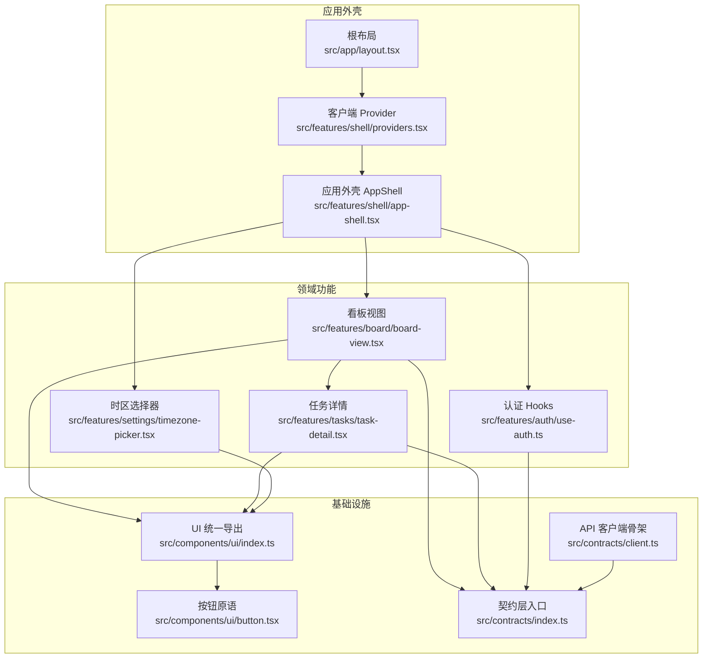
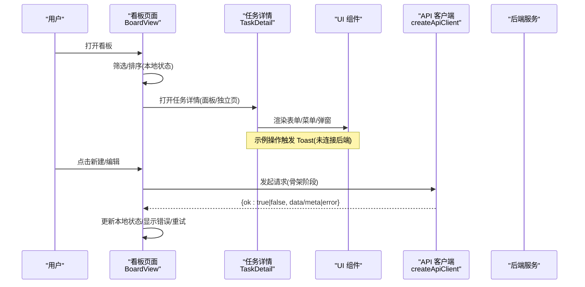
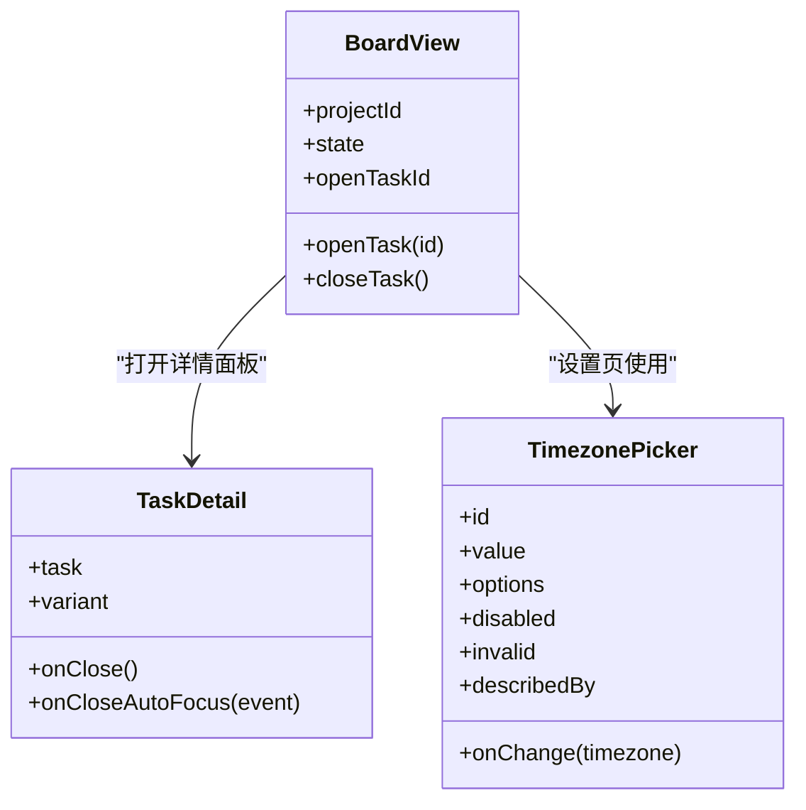
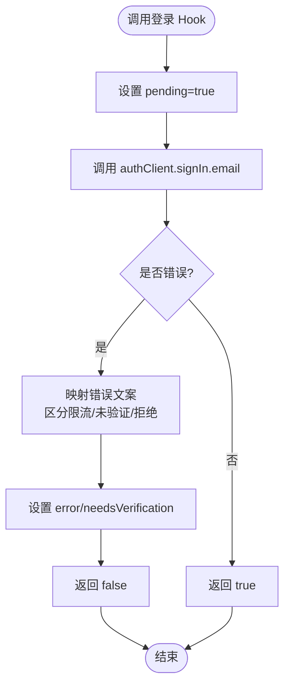
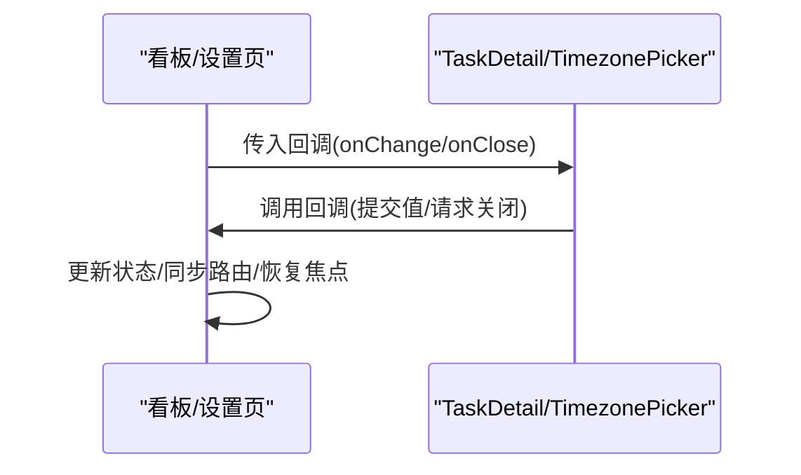
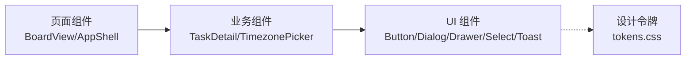
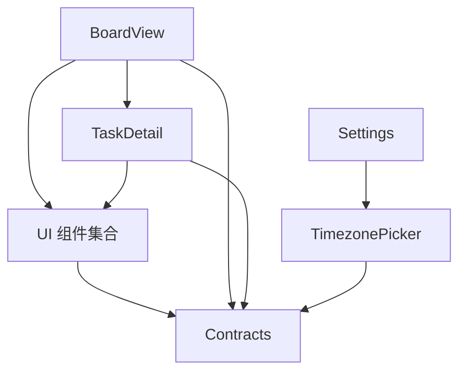

# 组件模式与架构

<cite>
**本文引用的文件**
- [src/app/layout.tsx](file://src/app/layout.tsx)
- [src/features/shell/app-shell.tsx](file://src/features/shell/app-shell.tsx)
- [src/features/shell/providers.tsx](file://src/features/shell/providers.tsx)
- [src/components/ui/index.ts](file://src/components/ui/index.ts)
- [src/components/ui/button.tsx](file://src/components/ui/button.tsx)
- [src/contracts/index.ts](file://src/contracts/index.ts)
- [src/contracts/client.ts](file://src/contracts/client.ts)
- [src/features/auth/use-auth.ts](file://src/features/auth/use-auth.ts)
- [src/features/board/board-view.tsx](file://src/features/board/board-view.tsx)
- [src/features/tasks/task-detail.tsx](file://src/features/tasks/task-detail.tsx)
- [src/features/settings/timezone-picker.tsx](file://src/features/settings/timezone-picker.tsx)
- [src/features/shell/sample-state.ts](file://src/features/shell/sample-state.ts)
- [src/features/shell/state-views.tsx](file://src/features/shell/state-views.tsx)
- [tests/ui/m0-review.spec.ts](file://tests/ui/m0-review.spec.ts)
</cite>

## 目录
1. [简介](#简介)
2. [项目结构](#项目结构)
3. [核心组件](#核心组件)
4. [架构总览](#架构总览)
5. [详细组件分析](#详细组件分析)
6. [依赖关系分析](#依赖关系分析)
7. [性能考量](#性能考量)
8. [故障排查指南](#故障排查指南)
9. [结论](#结论)
10. [附录](#附录)

## 简介
本文件面向 Orbit 项目的组件模式与架构，系统阐述以下主题：
- 容器组件与展示组件分离、高阶组件模式（Hook 封装）、渲染属性模式（以 props.children/回调驱动）在项目中的实践。
- 分层架构：页面组件（路由级）、业务组件（领域特性）、UI 组件（原子化基础控件）的职责边界与协作方式。
- 状态管理策略：客户端状态（组件内 useState/useMemo）、服务端状态（统一信封 + API 客户端骨架）、全局状态（Provider 上下文）。
- 生命周期与性能优化：响应式布局、焦点恢复、虚拟滚动/列表裁剪、骨架屏、错误态与空态复用。
- 测试与 Mock：UI 行为断言、可访问性断言、会话前置、跨断点交互验证。
- 开发规范与质量保证：契约优先、无服务端依赖的共享类型、统一的 UI 原语导出、错误与权限态统一视图。

## 项目结构
Orbit 采用“按领域 + 分层”的组织方式：
- src/app：Next.js App Router 页面与根布局，负责路由与最小外壳。
- src/features：按业务领域组织页面与业务组件（auth、board、tasks、settings、shell 等）。
- src/components/ui：通用 UI 原语（按钮、输入、抽屉、对话框、Toast、Tooltip 等），统一导出入口。
- src/contracts：契约层（DTO、枚举、错误码、信封、API 客户端骨架），前后端共享且无服务端依赖。
- src/server：服务端模块（认证、HTTP、领域模块等），与前端解耦。
- tests：单元、集成、E2E/UI 测试。

图表来源
- [src/app/layout.tsx:10-20](file://src/app/layout.tsx#L10-L20)
- [src/features/shell/providers.tsx:7-19](file://src/features/shell/providers.tsx#L7-L19)
- [src/features/shell/app-shell.tsx:23-40](file://src/features/shell/app-shell.tsx#L23-L40)
- [src/features/board/board-view.tsx:41-48](file://src/features/board/board-view.tsx#L41-L48)
- [src/features/tasks/task-detail.tsx:60-67](file://src/features/tasks/task-detail.tsx#L60-L67)
- [src/features/auth/use-auth.ts:7-22](file://src/features/auth/use-auth.ts#L7-L22)
- [src/features/settings/timezone-picker.tsx:21-33](file://src/features/settings/timezone-picker.tsx#L21-L33)
- [src/components/ui/index.ts:1-7](file://src/components/ui/index.ts#L1-L7)
- [src/components/ui/button.tsx:4-10](file://src/components/ui/button.tsx#L4-L10)
- [src/contracts/index.ts:1-9](file://src/contracts/index.ts#L1-L9)
- [src/contracts/client.ts:11-21](file://src/contracts/client.ts#L11-L21)

章节来源
- [src/app/layout.tsx:10-20](file://src/app/layout.tsx#L10-L20)
- [src/features/shell/providers.tsx:7-19](file://src/features/shell/providers.tsx#L7-L19)
- [src/components/ui/index.ts:1-7](file://src/components/ui/index.ts#L1-L7)
- [src/contracts/index.ts:1-9](file://src/contracts/index.ts#L1-L9)

## 核心组件
- 根布局与外壳
  - 根布局提供最小 HTML/Body 包装；AppShell 实现响应式侧栏/顶栏/内容区，并在真实数据页与样例页之间切换横幅提示。
- 客户端 Provider
  - TooltipProvider 与 ToastProvider 在 /app 布局挂载一次，为全应用提供无服务端依赖的上下文能力。
- UI 原语
  - 统一导出入口集中暴露基础控件；Button/IconButton 基于 tokens 样式，强制无障碍名称与触控目标尺寸。
- 契约层与 API 客户端
  - contracts 提供 DTO、枚举、错误码、信封解析与类型安全的 fetch 封装；createApiClient 将成功/失败结果收敛为判别联合，便于上层处理。
- 领域组件
  - 看板视图：筛选、列分组、移动端 Tabs、任务详情面板联动。
  - 任务详情：编辑草稿、确认关闭、复制链接、评论/附件/子任务展示。
  - 认证 Hooks：对 better-auth/react 薄封装，提供 pending/error/needsVerification 等客户端状态。
  - 时区选择器：可搜索组合框，完整键盘导航与 ARIA 语义。

章节来源
- [src/features/shell/app-shell.tsx:23-40](file://src/features/shell/app-shell.tsx#L23-L40)
- [src/features/shell/providers.tsx:7-19](file://src/features/shell/providers.tsx#L7-L19)
- [src/components/ui/button.tsx:4-10](file://src/components/ui/button.tsx#L4-L10)
- [src/contracts/client.ts:11-21](file://src/contracts/client.ts#L11-L21)
- [src/features/board/board-view.tsx:41-48](file://src/features/board/board-view.tsx#L41-L48)
- [src/features/tasks/task-detail.tsx:60-67](file://src/features/tasks/task-detail.tsx#L60-L67)
- [src/features/auth/use-auth.ts:7-22](file://src/features/auth/use-auth.ts#L7-L22)
- [src/features/settings/timezone-picker.tsx:21-33](file://src/features/settings/timezone-picker.tsx#L21-L33)

## 架构总览
Orbit 的前端架构遵循“契约优先 + 分层组件 + 客户端状态隔离”的原则：
- 契约层（contracts）定义传输结构与类型，前后端共享，确保端到端一致性。
- 客户端通过 createApiClient 发起请求，统一解析信封并返回 ApiResult/ApiListResult，业务层无需关心网络细节。
- 页面组件（如 BoardView）聚合领域逻辑与 UI 组装，使用本地状态与 URL 参数驱动视图。
- 业务组件（TaskDetail、TimezonePicker）聚焦单一职责，通过 props 与回调与父组件通信。
- UI 组件（Button、Dialog、Drawer、Toast 等）仅关注呈现与可访问性，不持有业务状态。

图表来源
- [src/features/board/board-view.tsx:59-124](file://src/features/board/board-view.tsx#L59-L124)
- [src/features/tasks/task-detail.tsx:82-135](file://src/features/tasks/task-detail.tsx#L82-L135)
- [src/contracts/client.ts:121-254](file://src/contracts/client.ts#L121-L254)

## 详细组件分析

### 容器组件与展示组件分离
- 容器组件
  - BoardView：负责筛选、列分组、URL 参数同步（?task=...）、状态分支（loading/empty/error/permission/long-content）与详情面板联动。
  - AppShell：负责全局导航、响应式布局、真实数据页判定与样例横幅控制。
- 展示组件
  - TaskDetail：接收 task 与 variant，专注详情编辑、草稿确认、评论/附件/子任务展示。
  - TimezonePicker：纯展示与交互，值由父组件控制，onChange 回调通知变更。
- 效果
  - 展示组件可被多容器复用；容器组件可自由组合不同展示组件，降低耦合度。

图表来源
- [src/features/board/board-view.tsx:53-124](file://src/features/board/board-view.tsx#L53-L124)
- [src/features/tasks/task-detail.tsx:75-135](file://src/features/tasks/task-detail.tsx#L75-L135)
- [src/features/settings/timezone-picker.tsx:35-49](file://src/features/settings/timezone-picker.tsx#L35-L49)

章节来源
- [src/features/board/board-view.tsx:53-124](file://src/features/board/board-view.tsx#L53-L124)
- [src/features/tasks/task-detail.tsx:75-135](file://src/features/tasks/task-detail.tsx#L75-L135)
- [src/features/settings/timezone-picker.tsx:35-49](file://src/features/settings/timezone-picker.tsx#L35-L49)

### 高阶组件模式（Hook 封装）
- useSession/useSignIn/useSignUp/useSignOut/useRequestPasswordReset/useResetPassword/useResendVerification
  - 对 auth-client 进行薄封装，统一 pending/error/needsVerification 状态，屏蔽底层差异。
  - 错误文案映射遵循安全原则（不泄露账户存在性），区分限流、未验证、Origin 拒绝等场景。
- 收益
  - 页面/表单只需调用 Hook，无需关心认证细节；错误处理一致化；易于单元测试与 Mock。

图表来源
- [src/features/auth/use-auth.ts:54-76](file://src/features/auth/use-auth.ts#L54-L76)
- [src/features/auth/use-auth.ts:78-104](file://src/features/auth/use-auth.ts#L78-L104)
- [src/features/auth/use-auth.ts:122-142](file://src/features/auth/use-auth.ts#L122-L142)
- [src/features/auth/use-auth.ts:144-162](file://src/features/auth/use-auth.ts#L144-L162)
- [src/features/auth/use-auth.ts:164-185](file://src/features/auth/use-auth.ts#L164-L185)

章节来源
- [src/features/auth/use-auth.ts:7-22](file://src/features/auth/use-auth.ts#L7-L22)
- [src/features/auth/use-auth.ts:54-76](file://src/features/auth/use-auth.ts#L54-L76)
- [src/features/auth/use-auth.ts:78-104](file://src/features/auth/use-auth.ts#L78-L104)
- [src/features/auth/use-auth.ts:122-142](file://src/features/auth/use-auth.ts#L122-L142)
- [src/features/auth/use-auth.ts:144-162](file://src/features/auth/use-auth.ts#L144-L162)
- [src/features/auth/use-auth.ts:164-185](file://src/features/auth/use-auth.ts#L164-L185)

### 渲染属性模式（回调驱动）
- TaskDetail 通过 onClose/onCloseAutoFocus 回调让父组件决定关闭时机与焦点恢复。
- BoardView 通过 onOpen/closeTask 与 URL 参数同步，保持状态与路由一致。
- TimezonePicker 通过 onChange 回调提交值，父组件负责持久化。
- 优势
  - 展示组件无副作用；父组件掌控流程；便于测试与组合。

图表来源
- [src/features/tasks/task-detail.tsx:75-135](file://src/features/tasks/task-detail.tsx#L75-L135)
- [src/features/board/board-view.tsx:98-124](file://src/features/board/board-view.tsx#L98-L124)
- [src/features/settings/timezone-picker.tsx:35-49](file://src/features/settings/timezone-picker.tsx#L35-L49)

章节来源
- [src/features/tasks/task-detail.tsx:75-135](file://src/features/tasks/task-detail.tsx#L75-L135)
- [src/features/board/board-view.tsx:98-124](file://src/features/board/board-view.tsx#L98-L124)
- [src/features/settings/timezone-picker.tsx:35-49](file://src/features/settings/timezone-picker.tsx#L35-L49)

### 分层架构：页面组件、业务组件、UI 组件
- 页面组件（路由级）
  - BoardView：聚合筛选、列视图、详情面板、状态分支。
  - AppShell：全局导航、响应式布局、真实数据页判定。
- 业务组件（领域级）
  - TaskDetail：任务编辑、草稿确认、评论/附件/子任务。
  - TimezonePicker：可搜索时区选择，完整键盘导航。
- UI 组件（原子级）
  - Button/IconButton、Dialog/Drawer、Select/Tabs、Toast/Tooltip、Avatar/Skeleton 等。
- 职责边界
  - UI 组件不持有业务状态；业务组件通过 props/回调与页面组件通信；页面组件协调路由与状态。

图表来源
- [src/features/board/board-view.tsx:41-48](file://src/features/board/board-view.tsx#L41-L48)
- [src/features/tasks/task-detail.tsx:60-67](file://src/features/tasks/task-detail.tsx#L60-L67)
- [src/features/settings/timezone-picker.tsx:21-33](file://src/features/settings/timezone-picker.tsx#L21-L33)
- [src/components/ui/index.ts:1-7](file://src/components/ui/index.ts#L1-L7)

章节来源
- [src/features/board/board-view.tsx:41-48](file://src/features/board/board-view.tsx#L41-L48)
- [src/features/tasks/task-detail.tsx:60-67](file://src/features/tasks/task-detail.tsx#L60-L67)
- [src/features/settings/timezone-picker.tsx:21-33](file://src/features/settings/timezone-picker.tsx#L21-L33)
- [src/components/ui/index.ts:1-7](file://src/components/ui/index.ts#L1-L7)

### 状态管理策略
- 客户端状态
  - useState：用于表单草稿、筛选条件、面板开关、加载/错误态。
  - useMemo：过滤与派生数据（看板筛选、时区选项高亮项）。
  - URL 参数：?task= 驱动详情面板开关；?state= 演示六态。
- 服务端状态
  - createApiClient：统一信封解析，返回 ApiResult/ApiListResult；M0 骨架阶段以 Toast 提示样例模式。
- 全局状态
  - Provider：TooltipProvider/ToastProvider 提供全局上下文；未来可扩展会话/主题等全局状态。
- 策略要点
  - 小范围状态尽量本地化；跨组件共享用回调或 URL；服务端数据通过 API 客户端获取并缓存于上层。

章节来源
- [src/features/board/board-view.tsx:68-124](file://src/features/board/board-view.tsx#L68-L124)
- [src/features/tasks/task-detail.tsx:89-135](file://src/features/tasks/task-detail.tsx#L89-L135)
- [src/features/shell/sample-state.ts:1-51](file://src/features/shell/sample-state.ts#L1-L51)
- [src/contracts/client.ts:121-254](file://src/contracts/client.ts#L121-L254)
- [src/features/shell/providers.tsx:7-19](file://src/features/shell/providers.tsx#L7-L19)

### 生命周期管理与性能优化
- 响应式布局
  - AppShell：桌面固定侧栏、平板收窄、手机抽屉导航；内容区骨架由各页负责。
- 焦点管理
  - useFocusReturn：打开/关闭弹窗/抽屉时捕获与恢复焦点，保障可访问性。
- 列表与渲染
  - 看板筛选使用 useMemo；时区选择器限制 MAX_RENDERED 避免渲染过多项；Skeleton 提升感知性能。
- 错误与空态
  - SampleError/NoAccess 统一错误与无权限态，局部错误保留草稿说明。
- 样例横幅
  - 非真实数据页显示 M0 布局样例横幅，明确标识未连接后端。

章节来源
- [src/features/shell/app-shell.tsx:23-40](file://src/features/shell/app-shell.tsx#L23-L40)
- [src/features/board/board-view.tsx:74-86](file://src/features/board/board-view.tsx#L74-L86)
- [src/features/settings/timezone-picker.tsx:51-90](file://src/features/settings/timezone-picker.tsx#L51-L90)
- [src/features/shell/state-views.tsx:16-49](file://src/features/shell/state-views.tsx#L16-L49)
- [src/features/shell/state-views.tsx:52-89](file://src/features/shell/state-views.tsx#L52-L89)

### 组件测试模式与 Mock 策略
- UI 测试（Playwright）
  - 会话前置：建立真实会话并注入 cookie，确保 /app/* 可访问。
  - 可访问性断言：导航区域、按钮名称、焦点顺序、Escape 关闭与焦点恢复。
  - 跨断点验证：390/768/1440 下面板/抽屉行为一致。
- Mock 策略
  - 样例模式：未连接后端时通过 Toast 提示，避免真实请求；后续接入 TanStack Query 后可替换为 Mock 数据。
  - API 客户端：createApiClient 支持注入 fetchImpl，便于单元测试替换网络层。

章节来源
- [tests/ui/m0-review.spec.ts:10-24](file://tests/ui/m0-review.spec.ts#L10-L24)
- [tests/ui/m0-review.spec.ts:26-35](file://tests/ui/m0-review.spec.ts#L26-L35)
- [tests/ui/m0-review.spec.ts:66-77](file://tests/ui/m0-review.spec.ts#L66-L77)
- [tests/ui/m0-review.spec.ts:79-131](file://tests/ui/m0-review.spec.ts#L79-L131)
- [tests/ui/m0-review.spec.ts:133-171](file://tests/ui/m0-review.spec.ts#L133-L171)
- [src/contracts/client.ts:23-44](file://src/contracts/client.ts#L23-L44)

## 依赖关系分析
- 组件间依赖
  - BoardView 依赖 TaskDetail、UI 组件与契约类型；TaskDetail 依赖 UI 组件与契约类型；Settings 依赖 TimezonePicker。
- 契约层依赖
  - 所有前端模块通过 contracts 共享类型与信封解析，保证前后端一致性。
- 外部依赖
  - Next.js 路由与导航；Radix primitives（Dialog/Drawer/Select 等）；lucide-react 图标。

图表来源
- [src/features/board/board-view.tsx:53-124](file://src/features/board/board-view.tsx#L53-L124)
- [src/features/tasks/task-detail.tsx:75-135](file://src/features/tasks/task-detail.tsx#L75-L135)
- [src/features/settings/timezone-picker.tsx:35-49](file://src/features/settings/timezone-picker.tsx#L35-L49)
- [src/contracts/index.ts:1-9](file://src/contracts/index.ts#L1-L9)

章节来源
- [src/features/board/board-view.tsx:53-124](file://src/features/board/board-view.tsx#L53-L124)
- [src/features/tasks/task-detail.tsx:75-135](file://src/features/tasks/task-detail.tsx#L75-L135)
- [src/features/settings/timezone-picker.tsx:35-49](file://src/features/settings/timezone-picker.tsx#L35-L49)
- [src/contracts/index.ts:1-9](file://src/contracts/index.ts#L1-L9)

## 性能考量
- 渲染优化
  - 使用 useMemo 计算筛选结果与派生数据；时区选择器限制最大渲染项数。
- 交互优化
  - 骨架屏提升加载感知；局部错误与重试避免整页刷新；焦点恢复减少重复定位。
- 资源优化
  - 按需导入 UI 组件；图标使用 lucide-react；样式消费 tokens，避免硬编码。
- 可维护性
  - 统一错误与权限态视图；契约层保证类型安全，减少运行时错误。

[本节为通用指导，不直接分析具体文件]

## 故障排查指南
- 常见问题
  - 未连接后端：样例模式会显示 Toast 提示；检查是否处于 fixture 页面。
  - 会话失效：NoAccess 视图提供“前往登录”入口；M1 接入后实现跳转。
  - 焦点丢失：确认使用 useFocusReturn 捕获与恢复焦点；检查弹窗/抽屉关闭逻辑。
- 调试建议
  - 使用 ?state= 切换演示态快速验证各状态；在浏览器控制台查看 API 请求与响应。
  - 通过 Playwright 用例复现问题，验证可访问性与跨断点行为。

章节来源
- [src/features/shell/state-views.tsx:16-49](file://src/features/shell/state-views.tsx#L16-L49)
- [src/features/shell/state-views.tsx:52-89](file://src/features/shell/state-views.tsx#L52-L89)
- [src/features/shell/app-shell.tsx:303-365](file://src/features/shell/app-shell.tsx#L303-L365)
- [tests/ui/m0-review.spec.ts:66-77](file://tests/ui/m0-review.spec.ts#L66-L77)

## 结论
Orbit 的组件架构以契约层为核心，结合分层组件与客户端状态隔离，实现了清晰的职责边界与良好的可维护性。通过容器与展示分离、Hook 封装与回调驱动，提升了复用性与可测试性。响应式布局、焦点管理、骨架屏与统一错误态进一步保障了用户体验与可访问性。后续里程碑可在此基础上逐步接入真实数据层与更复杂的全局状态管理。

## 附录
- 开发规范
  - 契约优先：新增字段/接口需先定义 contracts，再实现前后端。
  - 无服务端依赖：客户端模块不得引入 server-only/Prisma/@/server。
  - 统一 UI：优先使用 components/ui 提供的原语，避免自造不可访问控件。
- 质量保证
  - 单元测试：覆盖工具函数与业务逻辑。
  - 集成测试：验证领域模块与数据库交互。
  - E2E/UI 测试：验证关键用户流程与可访问性。

[本节为通用指导，不直接分析具体文件]