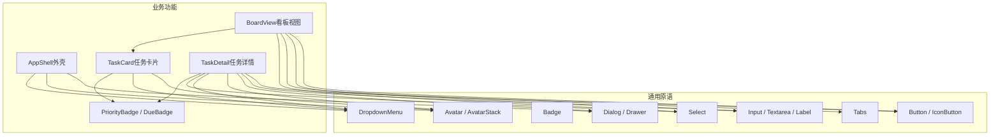
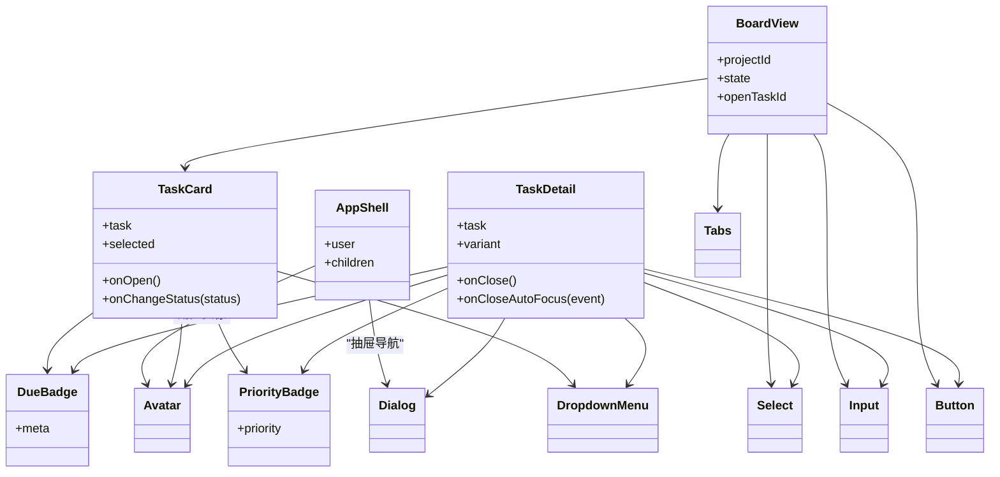
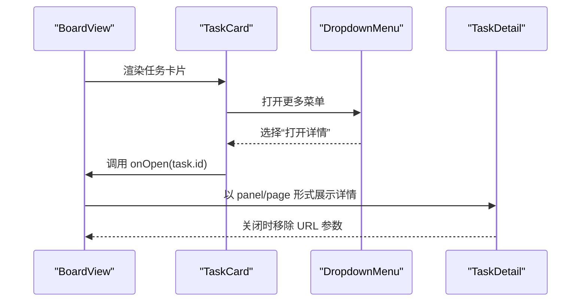
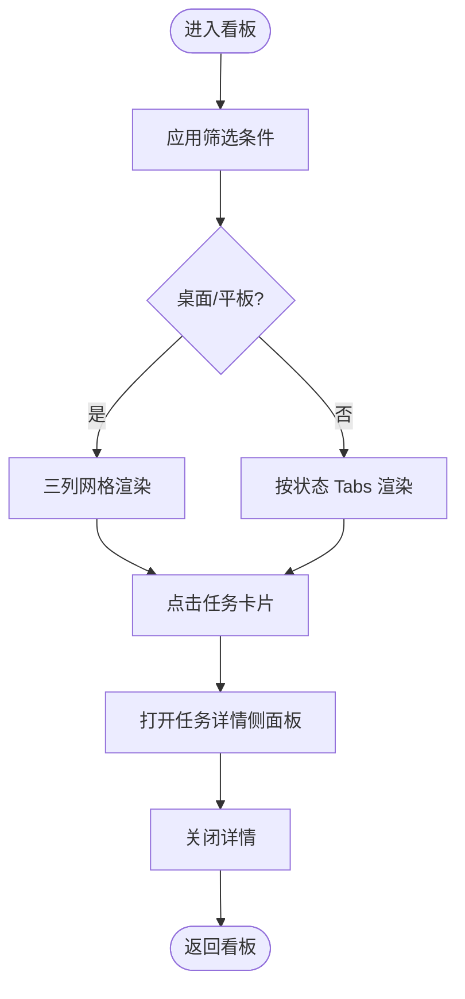
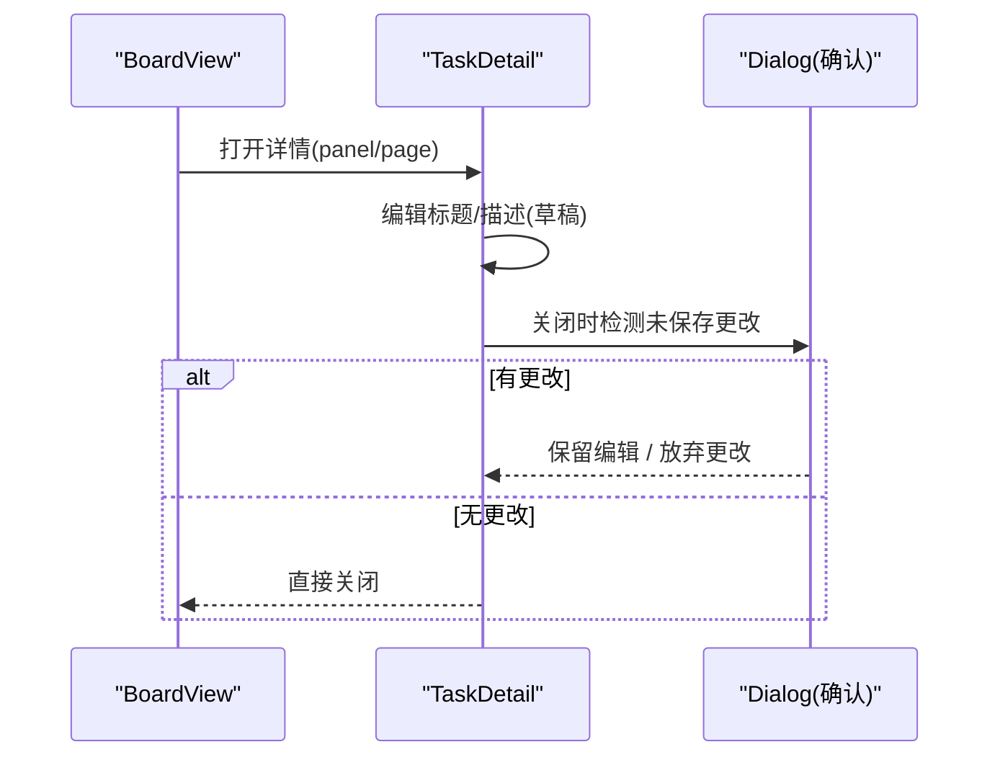
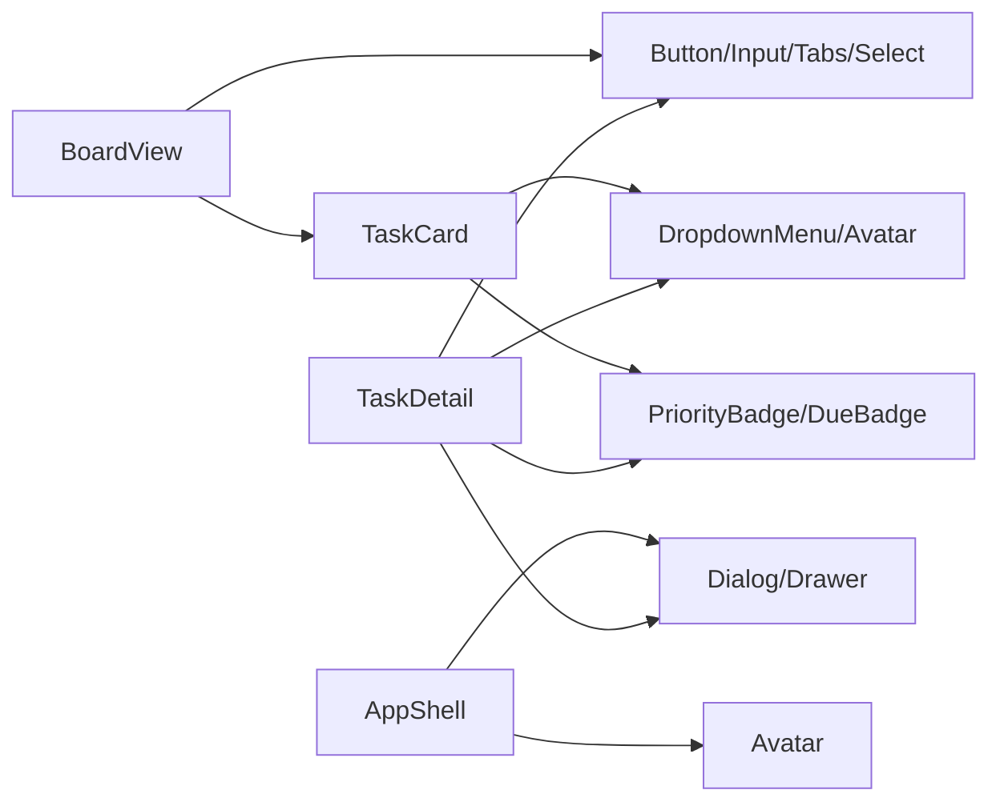

# 组件系统设计

<cite>
**本文引用的文件**
- [src/components/ui/README.md](file://src/components/ui/README.md)
- [src/components/ui/index.ts](file://src/components/ui/index.ts)
- [src/components/ui/button.tsx](file://src/components/ui/button.tsx)
- [src/components/ui/input.tsx](file://src/components/ui/input.tsx)
- [src/components/ui/badge.tsx](file://src/components/ui/badge.tsx)
- [src/components/ui/dialog.tsx](file://src/components/ui/dialog.tsx)
- [src/components/ui/avatar.tsx](file://src/components/ui/avatar.tsx)
- [src/components/ui/dropdown-menu.tsx](file://src/components/ui/dropdown-menu.tsx)
- [src/components/ui/tabs.tsx](file://src/components/ui/tabs.tsx)
- [src/components/ui/select.tsx](file://src/components/ui/select.tsx)
- [src/features/board/task-card.tsx](file://src/features/board/task-card.tsx)
- [src/features/board/board-view.tsx](file://src/features/board/board-view.tsx)
- [src/features/tasks/priority-badge.tsx](file://src/features/tasks/priority-badge.tsx)
- [src/features/tasks/task-meta.ts](file://src/features/tasks/task-meta.ts)
- [src/features/tasks/task-detail.tsx](file://src/features/tasks/task-detail.tsx)
- [src/features/shell/app-shell.tsx](file://src/features/shell/app-shell.tsx)
</cite>

## 目录
1. [简介](#简介)
2. [项目结构](#项目结构)
3. [核心组件](#核心组件)
4. [架构总览](#架构总览)
5. [详细组件分析](#详细组件分析)
6. [依赖关系分析](#依赖关系分析)
7. [性能考量](#性能考量)
8. [故障排查指南](#故障排查指南)
9. [结论](#结论)
10. [附录：组件开发指南与最佳实践](#附录组件开发指南与最佳实践)

## 简介
本设计文档面向 Orbit 项目的 UI 组件系统，目标是系统化说明基础组件、复合组件与布局组件的分层组织方式，解释业务组件（任务卡片、看板视图、表单等）的组件化设计，明确组件接口规范（props、事件、状态管理），并阐述可复用性与组合模式的应用。文档同时提供组件架构图与关系图，以及开发与排障的最佳实践，帮助团队在统一的设计原则下高效扩展与维护。

## 项目结构
Orbit 的前端采用“功能域 + 通用原语”的组织方式：
- 通用视觉原语位于 src/components/ui，基于 Radix primitives 与 Lucide，样式消费设计 tokens，确保一致的可访问性与主题一致性。
- 业务功能按领域划分于 src/features，如 board、tasks、shell、auth 等，每个领域内包含页面级视图、局部状态与展示型组件。
- 应用外壳与全局布局由 shell 模块提供，负责响应式导航、顶栏与内容区骨架。

图表来源
- [src/components/ui/index.ts:1-25](file://src/components/ui/index.ts#L1-L25)
- [src/features/shell/app-shell.tsx:1-389](file://src/features/shell/app-shell.tsx#L1-L389)
- [src/features/board/board-view.tsx:1-494](file://src/features/board/board-view.tsx#L1-L494)
- [src/features/board/task-card.tsx:1-146](file://src/features/board/task-card.tsx#L1-L146)
- [src/features/tasks/task-detail.tsx:1-561](file://src/features/tasks/task-detail.tsx#L1-L561)

章节来源
- [src/components/ui/README.md:1-7](file://src/components/ui/README.md#L1-L7)
- [src/components/ui/index.ts:1-25](file://src/components/ui/index.ts#L1-L25)

## 核心组件
本节聚焦基础组件与关键复合组件的职责、接口与使用要点。

- 按钮 Button / IconButton
  - 职责：统一的交互入口，支持多种变体与尺寸；IconButton 强制可访问名称。
  - 接口要点：variant、size、label（IconButton）、标准 button props。
  - 可访问性：通过 aria-label 与焦点环保证可用性。
  - 参考路径
    - [button.tsx:12-69](file://src/components/ui/button.tsx#L12-L69)
    - [button.tsx:72-118](file://src/components/ui/button.tsx#L72-L118)

- 输入 Input / Textarea / Label
  - 职责：表单控件与标签，统一边框、圆角、禁用态与错误态。
  - 接口要点：标准 input/textarea props；Label 用于关联控件。
  - 可访问性：aria-invalid 切换危险边界；焦点环由全局规则处理。
  - 参考路径
    - [input.tsx:12-32](file://src/components/ui/input.tsx#L12-L32)
    - [input.tsx:34-48](file://src/components/ui/input.tsx#L34-L48)
    - [input.tsx:50-64](file://src/components/ui/input.tsx#L50-L64)

- 徽章 Badge
  - 职责：优先级、状态、计数等小标签，语义配色 tone。
  - 接口要点：tone、icon、children。
  - 参考路径
    - [badge.tsx:11-30](file://src/components/ui/badge.tsx#L11-L30)
    - [badge.tsx:32-57](file://src/components/ui/badge.tsx#L32-L57)

- 对话框 Dialog
  - 职责：模态弹窗，封装 Overlay/Content/Header/Footer/Title/Description。
  - 接口要点：closeLabel、标准 Radix props。
  - 可访问性：Radix 提供焦点陷阱、初始焦点、恢复焦点、Escape 关闭。
  - 参考路径
    - [dialog.tsx:17-26](file://src/components/ui/dialog.tsx#L17-L26)
    - [dialog.tsx:28-74](file://src/components/ui/dialog.tsx#L28-L74)
    - [dialog.tsx:76-118](file://src/components/ui/dialog.tsx#L76-L118)

- 头像 Avatar / AvatarStack
  - 职责：用户头像与成员堆叠显示，无图时首字母占位。
  - 接口要点：name、src、size；AvatarStack 支持 names、max、size。
  - 参考路径
    - [avatar.tsx:14-65](file://src/components/ui/avatar.tsx#L14-L65)
    - [avatar.tsx:67-109](file://src/components/ui/avatar.tsx#L67-L109)

- 下拉菜单 DropdownMenu
  - 职责：上下文操作菜单，键盘与无障碍由 Radix 保障。
  - 接口要点：Trigger/Content/Item/Label/Separator。
  - 参考路径
    - [dropdown-menu.tsx:15-35](file://src/components/ui/dropdown-menu.tsx#L15-L35)
    - [dropdown-menu.tsx:37-80](file://src/components/ui/dropdown-menu.tsx#L37-L80)

- 选项卡 Tabs
  - 职责：二级导航与移动端列切换，方向键与选中态由 Radix 管理。
  - 接口要点：List/Trigger/Content。
  - 参考路径
    - [tabs.tsx:14-29](file://src/components/ui/tabs.tsx#L14-L29)
    - [tabs.tsx:31-60](file://src/components/ui/tabs.tsx#L31-L60)

- 选择器 Select
  - 职责：筛选与编辑场景的下拉选择，键盘导航与选中指示。
  - 接口要点：Root/Value/Trigger/Content/Item/Label/Separator。
  - 参考路径
    - [select.tsx:16-41](file://src/components/ui/select.tsx#L16-L41)
    - [select.tsx:43-86](file://src/components/ui/select.tsx#L43-L86)
    - [select.tsx:88-108](file://src/components/ui/select.tsx#L88-L108)

章节来源
- [src/components/ui/button.tsx:12-118](file://src/components/ui/button.tsx#L12-L118)
- [src/components/ui/input.tsx:12-64](file://src/components/ui/input.tsx#L12-L64)
- [src/components/ui/badge.tsx:11-57](file://src/components/ui/badge.tsx#L11-L57)
- [src/components/ui/dialog.tsx:17-118](file://src/components/ui/dialog.tsx#L17-L118)
- [src/components/ui/avatar.tsx:14-109](file://src/components/ui/avatar.tsx#L14-L109)
- [src/components/ui/dropdown-menu.tsx:15-80](file://src/components/ui/dropdown-menu.tsx#L15-L80)
- [src/components/ui/tabs.tsx:14-60](file://src/components/ui/tabs.tsx#L14-L60)
- [src/components/ui/select.tsx:16-108](file://src/components/ui/select.tsx#L16-L108)

## 架构总览
组件系统遵循分层与组合原则：
- 基础层（UI 原语）：提供最小粒度的可复用控件，不承载业务逻辑。
- 复合层（业务展示组件）：组合基础原语形成领域内展示单元（如 TaskCard、PriorityBadge）。
- 视图层（页面/面板）：聚合复合组件与局部状态，驱动路由与数据流（如 BoardView、TaskDetail）。
- 外壳层（AppShell）：提供全局布局、导航与响应式行为。

图表来源
- [src/features/shell/app-shell.tsx:296-369](file://src/features/shell/app-shell.tsx#L296-L369)
- [src/features/board/board-view.tsx:53-256](file://src/features/board/board-view.tsx#L53-L256)
- [src/features/board/task-card.tsx:28-136](file://src/features/board/task-card.tsx#L28-L136)
- [src/features/tasks/task-detail.tsx:75-510](file://src/features/tasks/task-detail.tsx#L75-L510)
- [src/features/tasks/priority-badge.tsx:21-77](file://src/features/tasks/priority-badge.tsx#L21-L77)

## 详细组件分析

### 任务卡片 TaskCard
- 职责：展示任务摘要（编号、优先级、标题、子任务/评论/附件计数、截止日、负责人），并提供更多操作菜单与打开详情。
- 接口规范：
  - props：task、onOpen、onChangeStatus、selected。
  - 事件：点击标题或菜单项触发 onOpen；菜单中状态变更调用 onChangeStatus。
- 可访问性：菜单项与图标按钮均提供可访问名称；hover/focus-within 控制可见性。
- 组合模式：组合 Avatar、DropdownMenu、IconButton、PriorityBadge、DueBadge。
- 参考路径
  - [task-card.tsx:28-41](file://src/features/board/task-card.tsx#L28-L41)
  - [task-card.tsx:44-136](file://src/features/board/task-card.tsx#L44-L136)

图表来源
- [src/features/board/board-view.tsx:107-111](file://src/features/board/board-view.tsx#L107-L111)
- [src/features/board/task-card.tsx:67-93](file://src/features/board/task-card.tsx#L67-L93)
- [src/features/tasks/task-detail.tsx:493-510](file://src/features/tasks/task-detail.tsx#L493-L510)

章节来源
- [src/features/board/task-card.tsx:28-146](file://src/features/board/task-card.tsx#L28-L146)

### 看板视图 BoardView
- 职责：项目页头、二级导航、筛选行、三列固定（桌面）与单列 Tabs（手机），任务详情侧面板。
- 状态管理：本地搜索、负责人、优先级、仅逾期、移动端状态 Tab；URL 参数同步 openTaskId。
- 交互流程：筛选过滤 → 列渲染 → 卡片打开详情 → 侧面板关闭后焦点回归。
- 参考路径
  - [board-view.tsx:53-124](file://src/features/board/board-view.tsx#L53-L124)
  - [board-view.tsx:126-256](file://src/features/board/board-view.tsx#L126-L256)
  - [board-view.tsx:309-396](file://src/features/board/board-view.tsx#L309-L396)
  - [board-view.tsx:400-474](file://src/features/board/board-view.tsx#L400-L474)

图表来源
- [src/features/board/board-view.tsx:74-86](file://src/features/board/board-view.tsx#L74-L86)
- [src/features/board/board-view.tsx:174-217](file://src/features/board/board-view.tsx#L174-L217)
- [src/features/board/board-view.tsx:107-111](file://src/features/board/board-view.tsx#L107-L111)

章节来源
- [src/features/board/board-view.tsx:1-494](file://src/features/board/board-view.tsx#L1-494)

### 任务详情 TaskDetail
- 职责：展示与编辑任务标题/描述、状态/优先级、负责人/截止日、子任务/附件/评论；提供复制链接、删除等操作。
- 状态管理：草稿编辑、未保存更改确认、评论草稿；面板与独立页共用同一组件。
- 交互流程：编辑标题/描述 → 保存/取消 → 关闭前检查脏状态 → 确认框保留/放弃。
- 参考路径
  - [task-detail.tsx:75-113](file://src/features/tasks/task-detail.tsx#L75-L113)
  - [task-detail.tsx:139-490](file://src/features/tasks/task-detail.tsx#L139-L490)
  - [task-detail.tsx:493-510](file://src/features/tasks/task-detail.tsx#L493-L510)

图表来源
- [src/features/tasks/task-detail.tsx:102-122](file://src/features/tasks/task-detail.tsx#L102-L122)
- [src/features/tasks/task-detail.tsx:472-489](file://src/features/tasks/task-detail.tsx#L472-L489)

章节来源
- [src/features/tasks/task-detail.tsx:1-561](file://src/features/tasks/task-detail.tsx#L1-L561)

### 应用外壳 AppShell
- 职责：响应式侧栏/顶栏/内容区，手机抽屉导航，样例横幅提示。
- 交互流程：汉堡按钮打开抽屉 → 记录焦点 → 关闭后恢复焦点。
- 参考路径
  - [app-shell.tsx:23-40](file://src/features/shell/app-shell.tsx#L23-L40)
  - [app-shell.tsx:296-369](file://src/features/shell/app-shell.tsx#L296-L369)

章节来源
- [src/features/shell/app-shell.tsx:1-389](file://src/features/shell/app-shell.tsx#L1-L389)

### 业务展示组件：优先级与截止日
- 职责：将任务优先级与截止日转换为可读且语义化的徽章。
- 接口规范：PriorityBadge 接收 priority；DueBadge 接收 meta（含 tone、short、overdue、label）。
- 参考路径
  - [priority-badge.tsx:14-38](file://src/features/tasks/priority-badge.tsx#L14-L38)
  - [priority-badge.tsx:40-77](file://src/features/tasks/priority-badge.tsx#L40-L77)
  - [task-meta.ts:11-22](file://src/features/tasks/task-meta.ts#L11-L22)
  - [task-meta.ts:31-47](file://src/features/tasks/task-meta.ts#L31-L47)
  - [task-meta.ts:76-123](file://src/features/tasks/task-meta.ts#L76-L123)

章节来源
- [src/features/tasks/priority-badge.tsx:1-77](file://src/features/tasks/priority-badge.tsx#L1-L77)
- [src/features/tasks/task-meta.ts:1-133](file://src/features/tasks/task-meta.ts#L1-L133)

## 依赖关系分析
- 组件耦合度
  - 基础原语低耦合、高内聚，被多个业务组件复用。
  - 复合组件（TaskCard、TaskDetail）对基础原语存在强依赖，但通过 props 解耦业务逻辑。
  - 视图层（BoardView、AppShell）聚合复合组件，承担路由与状态协调。
- 外部依赖
  - Radix primitives 提供可访问的交互能力（Dialog、Drawer、DropdownMenu、Tabs、Select、Avatar）。
  - Lucide 图标库提供一致的图标风格。
- 潜在循环依赖
  - 当前结构为单向依赖：视图 → 复合 → 基础原语，未见循环引用。

图表来源
- [src/features/shell/app-shell.tsx:296-369](file://src/features/shell/app-shell.tsx#L296-L369)
- [src/features/board/board-view.tsx:126-256](file://src/features/board/board-view.tsx#L126-L256)
- [src/features/board/task-card.tsx:44-136](file://src/features/board/task-card.tsx#L44-L136)
- [src/features/tasks/task-detail.tsx:139-490](file://src/features/tasks/task-detail.tsx#L139-L490)

章节来源
- [src/components/ui/index.ts:1-25](file://src/components/ui/index.ts#L1-L25)
- [src/features/board/board-view.tsx:1-494](file://src/features/board/board-view.tsx#L1-L494)
- [src/features/tasks/task-detail.tsx:1-561](file://src/features/tasks/task-detail.tsx#L1-L561)

## 性能考量
- 渲染优化
  - 看板筛选结果使用 useMemo 计算，避免重复过滤。
  - 列表渲染使用稳定 key（任务 id），减少重渲染。
- 交互体验
  - 骨架屏与空状态提升感知性能。
  - 移动端按状态 Tabs 降低一次性渲染压力。
- 可访问性
  - 所有交互元素具备合适的 role/aria 属性，键盘导航完整。
- 建议
  - 大数据量列表考虑虚拟滚动。
  - 图片与附件懒加载。
  - 将昂贵计算下沉到工具函数（如 task-meta）。

[本节为通用指导，无需特定文件引用]

## 故障排查指南
- 常见问题
  - 弹窗/抽屉焦点丢失：确保使用 Radix 提供的 onCloseAutoFocus 与 useFocusReturn 捕获/恢复焦点。
  - 表单验证反馈：利用 aria-invalid 与全局焦点环规则，确保错误态可见。
  - 菜单不可见：检查 hover/focus-within 条件与 z-index 层级。
- 定位方法
  - 查看组件 props 是否传递正确（如 variant、size、label）。
  - 检查 URL 参数与状态同步（如 ?task= 打开详情）。
  - 通过浏览器开发者工具检查 DOM 结构与 ARIA 属性。
- 参考路径
  - [dialog.tsx:28-74](file://src/components/ui/dialog.tsx#L28-L74)
  - [task-detail.tsx:99-122](file://src/features/tasks/task-detail.tsx#L99-L122)
  - [app-shell.tsx:296-369](file://src/features/shell/app-shell.tsx#L296-L369)

章节来源
- [src/components/ui/dialog.tsx:28-74](file://src/components/ui/dialog.tsx#L28-L74)
- [src/features/tasks/task-detail.tsx:99-122](file://src/features/tasks/task-detail.tsx#L99-L122)
- [src/features/shell/app-shell.tsx:296-369](file://src/features/shell/app-shell.tsx#L296-L369)

## 结论
Orbit 的组件系统以 Radix 为基础，结合设计 tokens 与 Lucide 图标，构建了清晰的分层与组合模型。基础原语保证一致性与可访问性，复合组件封装业务展示逻辑，视图层负责状态与路由协调。该体系具备良好的可扩展性与可维护性，适合在多里程碑迭代中持续演进。

[本节为总结，无需特定文件引用]

## 附录：组件开发指南与最佳实践
- 设计原则
  - 单一职责：基础原语只关注 UI，复合组件只关注展示，视图层负责状态与数据。
  - 可访问性优先：所有交互元素需具备正确的 role、aria 与键盘支持。
  - 主题一致：样式消费 tokens，避免硬编码颜色与尺寸。
- 接口规范
  - props 定义：明确类型与默认值，尽量使用联合类型与可选字段。
  - 事件处理：回调命名清晰（onOpen、onChangeStatus），避免副作用放在组件内部。
  - 状态管理：局部状态与 URL 同步，复杂状态考虑集中管理。
- 可复用性与组合
  - 通过组合基础原语构建复合组件，避免复制粘贴。
  - 使用插槽/children 提高灵活性。
- 开发流程
  - 先定义 props 与类型，再实现 UI，最后添加交互与可访问性。
  - 编写用例与测试，覆盖常见状态与边界情况。
- 参考路径
  - [button.tsx:12-69](file://src/components/ui/button.tsx#L12-L69)
  - [input.tsx:12-48](file://src/components/ui/input.tsx#L12-L48)
  - [badge.tsx:11-57](file://src/components/ui/badge.tsx#L11-L57)
  - [dialog.tsx:17-118](file://src/components/ui/dialog.tsx#L17-L118)
  - [avatar.tsx:14-109](file://src/components/ui/avatar.tsx#L14-L109)
  - [dropdown-menu.tsx:15-80](file://src/components/ui/dropdown-menu.tsx#L15-L80)
  - [tabs.tsx:14-60](file://src/components/ui/tabs.tsx#L14-L60)
  - [select.tsx:16-108](file://src/components/ui/select.tsx#L16-L108)