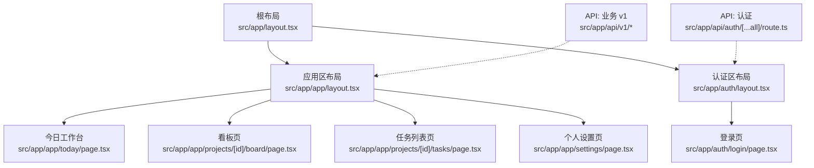
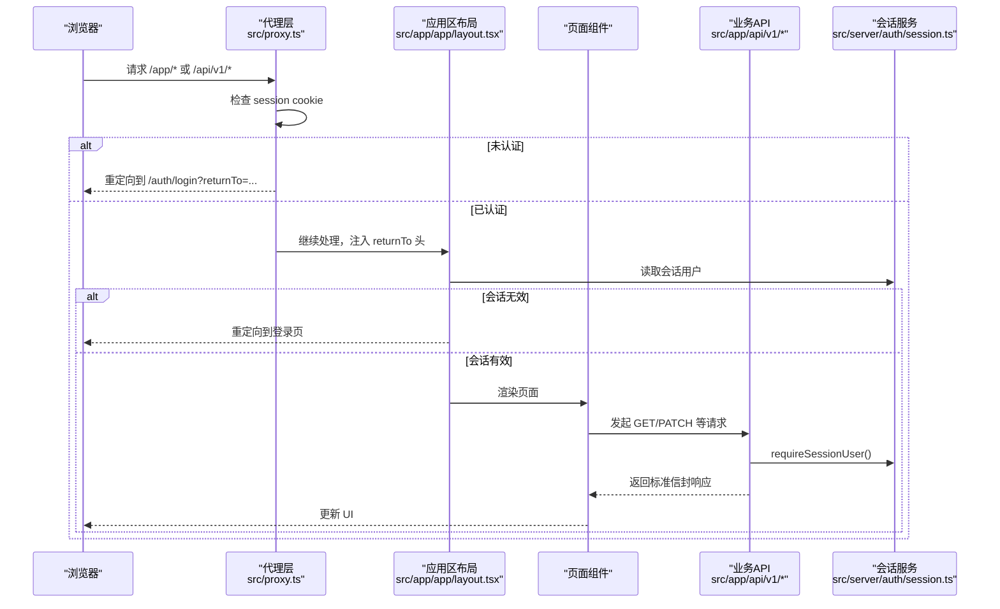
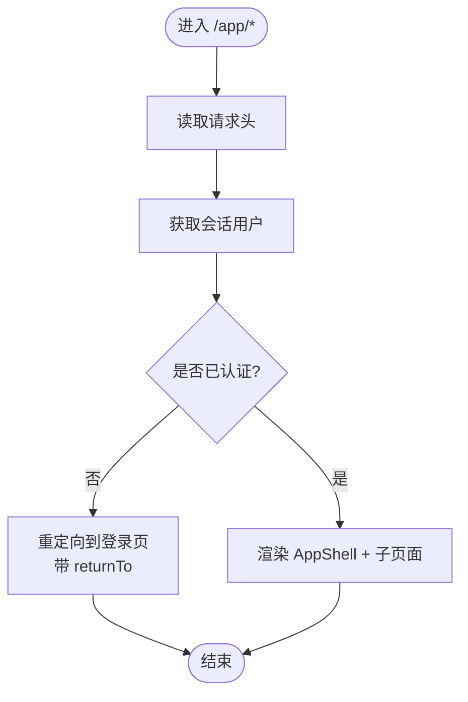
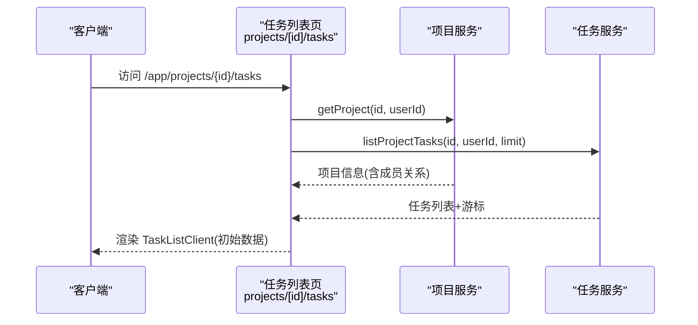
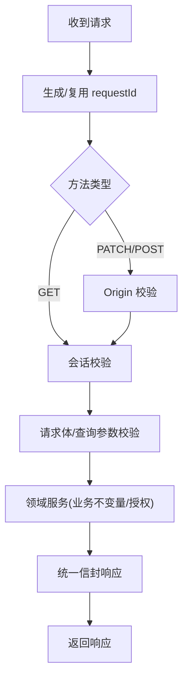
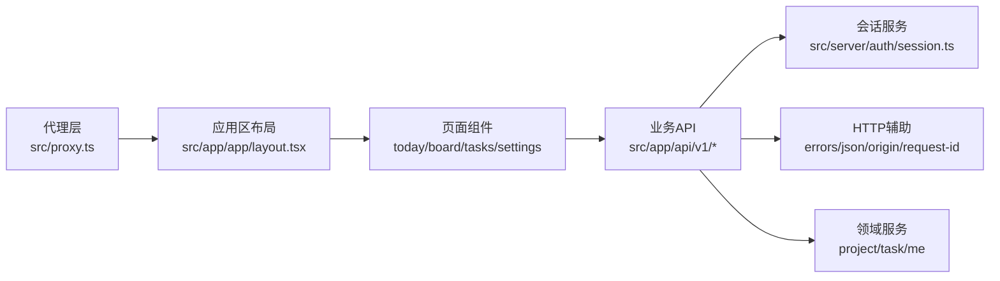

# 路由与页面架构

<cite>
**本文引用的文件**
- [src/app/layout.tsx](file://src/app/layout.tsx)
- [src/app/page.tsx](file://src/app/page.tsx)
- [src/app/app/layout.tsx](file://src/app/app/layout.tsx)
- [src/app/auth/layout.tsx](file://src/app/auth/layout.tsx)
- [src/app/auth/login/page.tsx](file://src/app/auth/login/page.tsx)
- [src/app/app/today/page.tsx](file://src/app/app/today/page.tsx)
- [src/app/app/projects/[id]/board/page.tsx](file://src/app/app/projects/[id]/board/page.tsx)
- [src/app/app/projects/[id]/tasks/page.tsx](file://src/app/app/projects/[id]/tasks/page.tsx)
- [src/app/app/settings/page.tsx](file://src/app/app/settings/page.tsx)
- [src/app/api/auth/[...all]/route.ts](file://src/app/api/auth/[...all]/route.ts)
- [src/app/api/v1/me/route.ts](file://src/app/api/v1/me/route.ts)
- [src/app/api/v1/projects/route.ts](file://src/app/api/v1/projects/route.ts)
- [src/proxy.ts](file://src/proxy.ts)
- [src/server/auth/session.ts](file://src/server/auth/session.ts)
</cite>

## 目录
1. [简介](#简介)
2. [项目结构](#项目结构)
3. [核心组件](#核心组件)
4. [架构总览](#架构总览)
5. [详细组件分析](#详细组件分析)
6. [依赖关系分析](#依赖关系分析)
7. [性能考量](#性能考量)
8. [故障排查指南](#故障排查指南)
9. [结论](#结论)
10. [附录](#附录)

## 简介
本文件聚焦 Orbit 项目的路由与页面架构，围绕 Next.js App Router 的组织方式展开，涵盖根布局、嵌套布局、动态路由的实现；说明应用外壳、认证页面与功能页面的分层组织；阐述 API 路由的设计原则与 RESTful 组织方式；解释路由守卫与权限控制机制；并提供从 URL 到组件渲染的流程图与时序图，以及最佳实践与性能优化建议。

## 项目结构
Orbit 采用 Next.js App Router 的文件系统路由：
- 根布局位于 src/app/layout.tsx，提供全局元数据与最小外壳。
- 受保护的应用区位于 src/app/app/*，由独立布局 src/app/app/layout.tsx 提供会话校验与应用外壳。
- 认证相关页面位于 src/app/auth/*，使用 src/app/auth/layout.tsx 作为统一元信息容器。
- API 路由位于 src/app/api/*，其中 /api/auth/* 由 Better Auth 接管，/api/v1/* 为业务 RESTful 接口。
- 入口首页 src/app/page.tsx 提供导航与开发环境下的布局样例入口。

**图示来源**
- [src/app/layout.tsx:1-21](file://src/app/layout.tsx#L1-L21)
- [src/app/app/layout.tsx:1-48](file://src/app/app/layout.tsx#L1-L48)
- [src/app/auth/layout.tsx:1-23](file://src/app/auth/layout.tsx#L1-L23)
- [src/app/app/today/page.tsx:1-25](file://src/app/app/today/page.tsx#L1-L25)
- [src/app/app/projects/[id]/board/page.tsx:1-38](file://src/app/app/projects/[id]/board/page.tsx#L1-L38)
- [src/app/app/projects/[id]/tasks/page.tsx:1-68](file://src/app/app/projects/[id]/tasks/page.tsx#L1-L68)
- [src/app/app/settings/page.tsx:1-65](file://src/app/app/settings/page.tsx#L1-L65)
- [src/app/auth/login/page.tsx:1-29](file://src/app/auth/login/page.tsx#L1-L29)
- [src/app/api/auth/[...all]/route.ts:1-22](file://src/app/api/auth/[...all]/route.ts#L1-L22)
- [src/app/api/v1/me/route.ts:1-91](file://src/app/api/v1/me/route.ts#L1-L91)
- [src/app/api/v1/projects/route.ts:1-93](file://src/app/api/v1/projects/route.ts#L1-L93)

**章节来源**
- [src/app/layout.tsx:1-21](file://src/app/layout.tsx#L1-L21)
- [src/app/page.tsx:1-101](file://src/app/page.tsx#L1-L101)
- [src/app/app/layout.tsx:1-48](file://src/app/app/layout.tsx#L1-L48)
- [src/app/auth/layout.tsx:1-23](file://src/app/auth/layout.tsx#L1-L23)

## 核心组件
- 根布局：定义站点元信息与最小 HTML 外壳，不承载业务逻辑。
- 应用区布局：强制动态渲染，读取请求头获取会话用户，未认证重定向至带 returnTo 的登录页；通过 AppShell 包裹子页面，并在开发环境附加状态切换工具。
- 认证区布局：仅声明元信息与 robots 策略，视觉外壳由各认证页通过共享壳组件承载。
- 页面组件：
  - 今日工作台：Server Component 解析 searchParams，渲染客户端视图。
  - 看板页：解析路由参数与查询参数，将状态与任务 ID 传递给客户端视图。
  - 任务列表页：服务端权威读取项目与任务，进行成员授权判定，并行加载数据并注入客户端组件。
  - 个人设置页：直接查库获取最新用户档案，避免缓存陈旧数据。
- API 路由：
  - 认证路由：Better Auth 全量挂载，Node 运行时，动态执行。
  - 业务 API：遵循请求 ID → Origin（写操作）→ 会话 → Schema 校验 → 领域服务 → DTO → 统一信封的生命周期。

**章节来源**
- [src/app/app/layout.tsx:1-48](file://src/app/app/layout.tsx#L1-L48)
- [src/app/app/today/page.tsx:1-25](file://src/app/app/today/page.tsx#L1-L25)
- [src/app/app/projects/[id]/board/page.tsx:1-38](file://src/app/app/projects/[id]/board/page.tsx#L1-L38)
- [src/app/app/projects/[id]/tasks/page.tsx:1-68](file://src/app/app/projects/[id]/tasks/page.tsx#L1-L68)
- [src/app/app/settings/page.tsx:1-65](file://src/app/app/settings/page.tsx#L1-L65)
- [src/app/api/auth/[...all]/route.ts:1-22](file://src/app/api/auth/[...all]/route.ts#L1-L22)
- [src/app/api/v1/me/route.ts:1-91](file://src/app/api/v1/me/route.ts#L1-L91)
- [src/app/api/v1/projects/route.ts:1-93](file://src/app/api/v1/projects/route.ts#L1-L93)

## 架构总览
下图展示从浏览器访问到页面渲染与 API 调用的整体流程，包括代理层的路由守卫、布局层的会话校验、页面与服务端模块的数据交互。

**图示来源**
- [src/proxy.ts:1-78](file://src/proxy.ts#L1-L78)
- [src/app/app/layout.tsx:1-48](file://src/app/app/layout.tsx#L1-L48)
- [src/server/auth/session.ts:1-43](file://src/server/auth/session.ts#L1-L43)
- [src/app/api/v1/me/route.ts:1-91](file://src/app/api/v1/me/route.ts#L1-L91)
- [src/app/api/v1/projects/route.ts:1-93](file://src/app/api/v1/projects/route.ts#L1-L93)

## 详细组件分析

### 根布局与首页
- 根布局负责站点标题与描述，保持最小化。
- 首页提供开发环境下的布局样例入口链接，引导进入 /app/* 示例页面。

**章节来源**
- [src/app/layout.tsx:1-21](file://src/app/layout.tsx#L1-L21)
- [src/app/page.tsx:1-101](file://src/app/page.tsx#L1-L101)

### 应用区布局与会话守卫
- 强制动态渲染，读取 headers() 获取会话用户。
- 未认证时重定向到登录页，携带 returnTo 以便登录后回跳。
- 通过 AppShell 包裹子页面，提供应用外壳与上下文。

**图示来源**
- [src/app/app/layout.tsx:1-48](file://src/app/app/layout.tsx#L1-L48)
- [src/server/auth/session.ts:1-43](file://src/server/auth/session.ts#L1-L43)

**章节来源**
- [src/app/app/layout.tsx:1-48](file://src/app/app/layout.tsx#L1-L48)
- [src/server/auth/session.ts:1-43](file://src/server/auth/session.ts#L1-L43)

### 认证区布局与登录页
- 认证区布局仅声明元信息与 robots 策略，确保不被搜索引擎索引。
- 登录页在服务端检查会话，若已登录则重定向至默认目标；否则渲染登录表单，并使用 Suspense 满足客户端搜索参数边界。

**章节来源**
- [src/app/auth/layout.tsx:1-23](file://src/app/auth/layout.tsx#L1-L23)
- [src/app/auth/login/page.tsx:1-29](file://src/app/auth/login/page.tsx#L1-L29)

### 动态路由与页面组织
- 看板页：解析路由参数 id 与查询参数 state/task，传递到客户端视图。
- 任务列表页：并行读取项目与任务，进行成员授权判定，非成员或不存在返回 404；首屏注入初始数据与分页游标。
- 个人设置页：直接查库获取最新用户档案，避免缓存陈旧数据；异常时回退到登录页。

**图示来源**
- [src/app/app/projects/[id]/tasks/page.tsx:1-68](file://src/app/app/projects/[id]/tasks/page.tsx#L1-L68)

**章节来源**
- [src/app/app/projects/[id]/board/page.tsx:1-38](file://src/app/app/projects/[id]/board/page.tsx#L1-L38)
- [src/app/app/projects/[id]/tasks/page.tsx:1-68](file://src/app/app/projects/[id]/tasks/page.tsx#L1-L68)
- [src/app/app/settings/page.tsx:1-65](file://src/app/app/settings/page.tsx#L1-L65)

### API 路由设计与 RESTful 组织
- 认证路由：Better Auth 全量挂载，Node 运行时，动态执行，不受 /app/* 门禁影响。
- 业务 API：
  - /api/v1/me：GET 返回当前用户档案；PATCH 修改姓名与时区，包含 Origin 校验、会话校验、Schema 校验、领域服务与统一信封。
  - /api/v1/projects：GET 列出项目（支持游标分页）；POST 创建项目（支持幂等键）。
  - 所有写操作需验证 Origin，读操作可省略；错误统一封装为标准信封。

**图示来源**
- [src/app/api/v1/me/route.ts:1-91](file://src/app/api/v1/me/route.ts#L1-L91)
- [src/app/api/v1/projects/route.ts:1-93](file://src/app/api/v1/projects/route.ts#L1-L93)

**章节来源**
- [src/app/api/auth/[...all]/route.ts:1-22](file://src/app/api/auth/[...all]/route.ts#L1-L22)
- [src/app/api/v1/me/route.ts:1-91](file://src/app/api/v1/me/route.ts#L1-L91)
- [src/app/api/v1/projects/route.ts:1-93](file://src/app/api/v1/projects/route.ts#L1-L93)

### 路由守卫与权限控制
- 代理层：对 /app/* 与 /api/v1/* 进行 Cookie 存在性快速门禁；未认证时对 API 返回 401 JSON，对页面重定向到登录页。
- 布局层：应用区布局通过 getSessionUser 做权威会话校验，失败即重定向。
- 页面层：如任务列表页在读取资源时进行成员关系判定，非成员返回 404，防止信息泄露。
- API 层：requireSessionUser 抛出统一领域错误，HTTP 层映射为标准信封；写操作额外校验 Origin。

**章节来源**
- [src/proxy.ts:1-78](file://src/proxy.ts#L1-L78)
- [src/app/app/layout.tsx:1-48](file://src/app/app/layout.tsx#L1-L48)
- [src/app/app/projects/[id]/tasks/page.tsx:1-68](file://src/app/app/projects/[id]/tasks/page.tsx#L1-L68)
- [src/server/auth/session.ts:1-43](file://src/server/auth/session.ts#L1-L43)

## 依赖关系分析
- 页面与布局依赖会话服务进行认证与授权。
- API 路由依赖会话服务、HTTP 辅助（错误、信封、请求体读取）、领域服务与契约校验。
- 代理层与布局层共同构成双重门禁：Cookie 快速拦截 + 会话权威校验。

**图示来源**
- [src/proxy.ts:1-78](file://src/proxy.ts#L1-L78)
- [src/app/app/layout.tsx:1-48](file://src/app/app/layout.tsx#L1-L48)
- [src/app/api/v1/me/route.ts:1-91](file://src/app/api/v1/me/route.ts#L1-L91)
- [src/app/api/v1/projects/route.ts:1-93](file://src/app/api/v1/projects/route.ts#L1-L93)
- [src/server/auth/session.ts:1-43](file://src/server/auth/session.ts#L1-L43)

**章节来源**
- [src/proxy.ts:1-78](file://src/proxy.ts#L1-L78)
- [src/app/app/layout.tsx:1-48](file://src/app/app/layout.tsx#L1-L48)
- [src/app/api/v1/me/route.ts:1-91](file://src/app/api/v1/me/route.ts#L1-L91)
- [src/app/api/v1/projects/route.ts:1-93](file://src/app/api/v1/projects/route.ts#L1-L93)
- [src/server/auth/session.ts:1-43](file://src/server/auth/session.ts#L1-L43)

## 性能考量
- 动态渲染：应用区布局与关键页面显式 force-dynamic，避免共享缓存污染私有数据。
- 并行读取：任务列表页并行获取项目与任务，减少首屏等待时间。
- 直接查库：设置页直接查库获取最新用户档案，避免会话快照陈旧导致刷新不一致。
- 客户端骨架与 Suspense：认证表单使用 Suspense 包裹，提升交互体验。
- 请求链路追踪：统一 requestId 贯穿代理、API 与响应头，便于定位性能瓶颈。

[本节为通用指导，无需特定文件引用]

## 故障排查指南
- 未认证访问 /app/*：检查代理层 Cookie 是否存在；确认布局层会话校验是否通过；查看重定向目标是否携带正确 returnTo。
- API 401：确认会话有效；检查代理层是否放行；查看 API 层 requireSessionUser 抛出的领域错误是否被正确映射为标准信封。
- 写操作 Origin 拒绝：确认请求来源合法；检查 Origin 校验逻辑与回调域名配置。
- 数据不一致：确认设置页是否直接查库；检查 API 写入后是否有缓存残留；验证响应头 Cache-Control 是否为 private, no-store。

**章节来源**
- [src/proxy.ts:1-78](file://src/proxy.ts#L1-L78)
- [src/app/app/layout.tsx:1-48](file://src/app/app/layout.tsx#L1-L48)
- [src/app/api/v1/me/route.ts:1-91](file://src/app/api/v1/me/route.ts#L1-L91)
- [src/app/app/settings/page.tsx:1-65](file://src/app/app/settings/page.tsx#L1-L65)

## 结论
Orbit 通过 App Router 的文件系统路由清晰划分了根布局、应用区与认证区；以代理层与布局层的双重门禁保障安全；页面与服务端模块职责明确，API 遵循统一的请求生命周期与信封规范。结合动态渲染、并行读取与直接查库等策略，在保证数据安全的同时提升了性能与用户体验。

[本节为总结性内容，无需特定文件引用]

## 附录
- 最佳实践
  - 始终在服务端进行会话与资源授权，组件重定向仅用于体验。
  - 对写操作启用 Origin 校验与幂等键，避免重放攻击。
  - 对私有数据强制 dynamic 与 no-store 缓存策略。
  - 使用统一错误与信封，保证前后端一致的错误处理。
  - 合理拆分 Server Component 与 Client Component，减少不必要的客户端代码。

[本节为通用指导，无需特定文件引用]