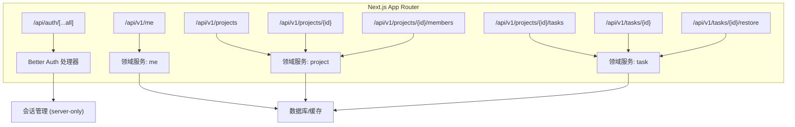
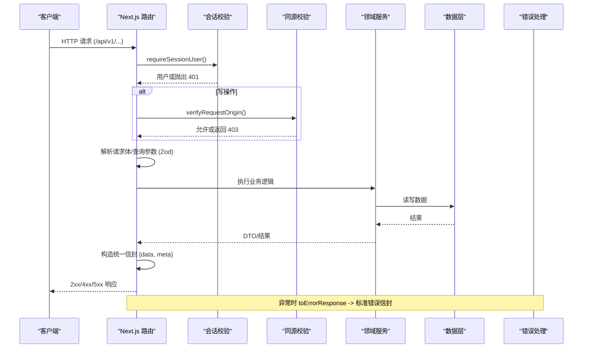
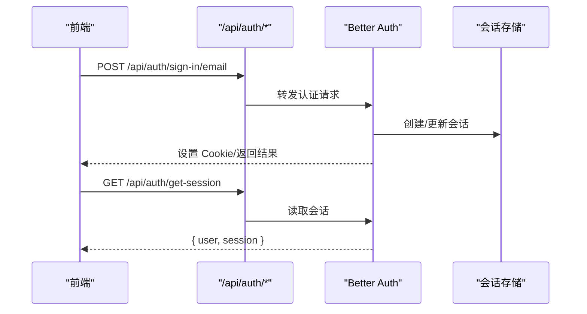
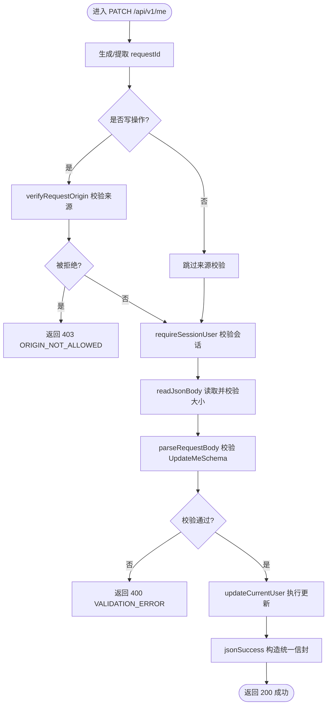
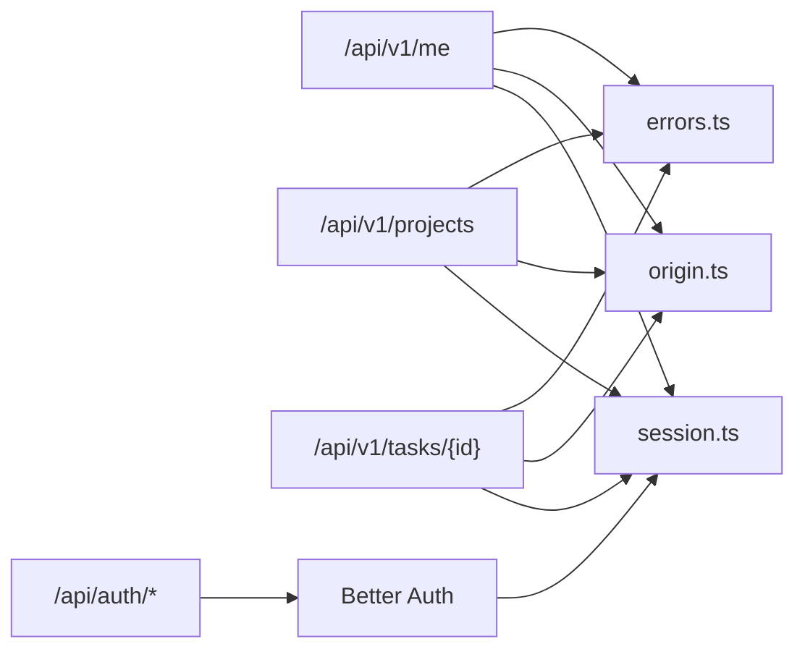

# API 路由设计

<cite>
**本文引用的文件**
- [src/app/api/auth/[...all]/route.ts](file://src/app/api/auth/[...all]/route.ts)
- [src/server/auth/index.ts](file://src/server/auth/index.ts)
- [src/server/auth/session.ts](file://src/server/auth/session.ts)
- [src/server/http/origin.ts](file://src/server/http/origin.ts)
- [src/server/http/errors.ts](file://src/server/http/errors.ts)
- [src/app/api/v1/me/route.ts](file://src/app/api/v1/me/route.ts)
- [src/app/api/v1/projects/route.ts](file://src/app/api/v1/projects/route.ts)
- [src/app/api/v1/projects/[projectId]/route.ts](file://src/app/api/v1/projects/[projectId]/route.ts)
- [src/app/api/v1/projects/[projectId]/members/route.ts](file://src/app/api/v1/projects/[projectId]/members/route.ts)
- [src/app/api/v1/projects/[projectId]/tasks/route.ts](file://src/app/api/v1/projects/[projectId]/tasks/route.ts)
- [src/app/api/v1/tasks/[taskId]/route.ts](file://src/app/api/v1/tasks/[taskId]/route.ts)
- [src/app/api/v1/tasks/[taskId]/restore/route.ts](file://src/app/api/v1/tasks/[taskId]/restore/route.ts)
- [contracts/openapi.json](file://contracts/openapi.json)
- [src/contracts/error-codes.ts](file://src/contracts/error-codes.ts)
</cite>

## 目录
1. [简介](#简介)
2. [项目结构](#项目结构)
3. [核心组件](#核心组件)
4. [架构总览](#架构总览)
5. [详细组件分析](#详细组件分析)
6. [依赖关系分析](#依赖关系分析)
7. [性能与一致性考虑](#性能与一致性考虑)
8. [故障排查指南](#故障排查指南)
9. [结论](#结论)
10. [附录：API 契约与示例](#附录api-契约与示例)

## 简介
本文件为 Orbit 项目的 API 路由设计文档，聚焦 Next.js App Router 的 /api 路由组织、RESTful 设计规范、认证集成（Better Auth）、版本化策略（v1）、请求处理链路、错误处理与状态码规范，以及测试与调试建议。目标是让读者在不深入源码的情况下也能理解并正确使用这些 API。

## 项目结构
Orbit 将 API 分为两类：
- 认证 API：/api/auth/*，由 Better Auth 接管，提供登录、注册、会话等能力。
- 业务 API：/api/v1/*，采用 RESTful 风格，按资源划分路由，统一信封响应与错误码。

图表来源
- [src/app/api/auth/[...all]/route.ts:1-22](file://src/app/api/auth/[...all]/route.ts#L1-L22)
- [src/app/api/v1/me/route.ts:1-91](file://src/app/api/v1/me/route.ts#L1-L91)
- [src/app/api/v1/projects/route.ts:1-93](file://src/app/api/v1/projects/route.ts#L1-L93)
- [src/app/api/v1/projects/[projectId]/route.ts:1-80](file://src/app/api/v1/projects/[projectId]/route.ts#L1-L80)
- [src/app/api/v1/projects/[projectId]/members/route.ts:1-38](file://src/app/api/v1/projects/[projectId]/members/route.ts#L1-L38)
- [src/app/api/v1/projects/[projectId]/tasks/route.ts:1-104](file://src/app/api/v1/projects/[projectId]/tasks/route.ts#L1-L104)
- [src/app/api/v1/tasks/[taskId]/route.ts:1-112](file://src/app/api/v1/tasks/[taskId]/route.ts#L1-L112)
- [src/app/api/v1/tasks/[taskId]/restore/route.ts:1-70](file://src/app/api/v1/tasks/[taskId]/restore/route.ts#L1-L70)

章节来源
- [src/app/api/auth/[...all]/route.ts:1-22](file://src/app/api/auth/[...all]/route.ts#L1-L22)
- [src/app/api/v1/me/route.ts:1-91](file://src/app/api/v1/me/route.ts#L1-L91)
- [src/app/api/v1/projects/route.ts:1-93](file://src/app/api/v1/projects/route.ts#L1-L93)
- [src/app/api/v1/projects/[projectId]/route.ts:1-80](file://src/app/api/v1/projects/[projectId]/route.ts#L1-L80)
- [src/app/api/v1/projects/[projectId]/members/route.ts:1-38](file://src/app/api/v1/projects/[projectId]/members/route.ts#L1-L38)
- [src/app/api/v1/projects/[projectId]/tasks/route.ts:1-104](file://src/app/api/v1/projects/[projectId]/tasks/route.ts#L1-L104)
- [src/app/api/v1/tasks/[taskId]/route.ts:1-112](file://src/app/api/v1/tasks/[taskId]/route.ts#L1-L112)
- [src/app/api/v1/tasks/[taskId]/restore/route.ts:1-70](file://src/app/api/v1/tasks/[taskId]/restore/route.ts#L1-L70)

## 核心组件
- 认证集成：Better Auth 通过 catch-all 路由挂载到 /api/auth/*，提供完整的 OAuth、会话、邮箱验证等能力。
- 会话校验：requireSessionUser 在服务端强制要求已认证用户，未认证返回 401。
- 同源校验：verifyRequestOrigin 对写操作进行 Origin 白名单校验，防止 CSRF。
- 错误体系：DomainError + errorResponse/toErrorResponse 统一错误信封与状态码映射。
- 请求体/查询解析：parseRequestBody/parseQueryParams 基于 Zod schema 校验输入。
- 幂等性：Idempotency-Key 头用于幂等创建/恢复等操作，避免重复提交。
- 版本化：所有业务 API 以 /api/v1 前缀暴露，便于未来演进。

章节来源
- [src/server/auth/index.ts:1-29](file://src/server/auth/index.ts#L1-L29)
- [src/server/auth/session.ts:1-43](file://src/server/auth/session.ts#L1-L43)
- [src/server/http/origin.ts:1-70](file://src/server/http/origin.ts#L1-L70)
- [src/server/http/errors.ts:1-136](file://src/server/http/errors.ts#L1-L136)
- [src/contracts/error-codes.ts:1-137](file://src/contracts/error-codes.ts#L1-L137)

## 架构总览
下图展示了从客户端发起请求到返回响应的完整链路，包括路由匹配、认证、同源校验、参数校验、领域服务调用、统一信封封装与错误处理。

图表来源
- [src/app/api/v1/me/route.ts:1-91](file://src/app/api/v1/me/route.ts#L1-L91)
- [src/app/api/v1/projects/route.ts:1-93](file://src/app/api/v1/projects/route.ts#L1-L93)
- [src/app/api/v1/projects/[projectId]/route.ts:1-80](file://src/app/api/v1/projects/[projectId]/route.ts#L1-L80)
- [src/app/api/v1/projects/[projectId]/tasks/route.ts:1-104](file://src/app/api/v1/projects/[projectId]/tasks/route.ts#L1-L104)
- [src/app/api/v1/tasks/[taskId]/route.ts:1-112](file://src/app/api/v1/tasks/[taskId]/route.ts#L1-L112)
- [src/app/api/v1/tasks/[taskId]/restore/route.ts:1-70](file://src/app/api/v1/tasks/[taskId]/restore/route.ts#L1-L70)
- [src/server/auth/session.ts:1-43](file://src/server/auth/session.ts#L1-L43)
- [src/server/http/origin.ts:1-70](file://src/server/http/origin.ts#L1-L70)
- [src/server/http/errors.ts:1-136](file://src/server/http/errors.ts#L1-L136)

## 详细组件分析

### 认证路由集成（Better Auth）
- 挂载方式：使用 catch-all 段将 Better Auth 的所有端点挂载到 /api/auth/*，包含 sign-up、sign-in、get-session、verify-email、reset-password 等。
- 运行时：设置为 nodejs，因为认证依赖 Node 加密与数据库驱动，不适合 Edge。
- 安全边界：认证路由不叠加自研 Origin 校验，避免破坏库内置的 CSRF/trustedOrigins 机制。
- 服务端会话：通过 requireSessionUser 在业务路由中获取当前用户；未认证抛 401。

图表来源
- [src/app/api/auth/[...all]/route.ts:1-22](file://src/app/api/auth/[...all]/route.ts#L1-L22)
- [src/server/auth/index.ts:1-29](file://src/server/auth/index.ts#L1-L29)
- [src/server/auth/session.ts:1-43](file://src/server/auth/session.ts#L1-L43)

章节来源
- [src/app/api/auth/[...all]/route.ts:1-22](file://src/app/api/auth/[...all]/route.ts#L1-L22)
- [src/server/auth/index.ts:1-29](file://src/server/auth/index.ts#L1-L29)
- [src/server/auth/session.ts:1-43](file://src/server/auth/session.ts#L1-L43)

### 版本化 API 策略（/api/v1）
- 所有业务 API 以 /api/v1 前缀暴露，便于后续 v2 演进与兼容。
- OpenAPI 服务器地址指向 /api/v1，契约集中定义于 contracts/openapi.json。
- 迁移方案：新增 v2 路由时保留 v1 稳定接口，逐步迁移客户端；废弃流程通过 deprecation header 与文档公告。

章节来源
- [contracts/openapi.json:1-800](file://contracts/openapi.json#L1-L800)

### 请求处理流程（以 PATCH /me 为例）

图表来源
- [src/app/api/v1/me/route.ts:1-91](file://src/app/api/v1/me/route.ts#L1-L91)
- [src/server/http/origin.ts:1-70](file://src/server/http/origin.ts#L1-L70)
- [src/server/auth/session.ts:1-43](file://src/server/auth/session.ts#L1-L43)

章节来源
- [src/app/api/v1/me/route.ts:1-91](file://src/app/api/v1/me/route.ts#L1-L91)

### 资源路由与 RESTful 约定
- 资源命名：小写复数名词（projects、tasks），子资源用路径嵌套（/projects/{id}/members、/projects/{id}/tasks）。
- HTTP 方法：
  - GET：读取资源或列表（支持分页游标、过滤、排序）。
  - POST：创建资源（支持 Idempotency-Key 幂等）。
  - PATCH：部分更新（支持乐观并发 expectedVersion）。
  - DELETE：删除或软删除（任务支持软删除与恢复）。
- URL 规范：
  - 路径参数为 UUID（如 projectId、taskId）。
  - 查询参数用于分页与过滤（cursor、limit、scope、archived）。
- 响应格式：统一信封 { data, meta }，meta 包含 requestId、nextCursor、hasMore 等。

章节来源
- [src/app/api/v1/projects/route.ts:1-93](file://src/app/api/v1/projects/route.ts#L1-L93)
- [src/app/api/v1/projects/[projectId]/route.ts:1-80](file://src/app/api/v1/projects/[projectId]/route.ts#L1-L80)
- [src/app/api/v1/projects/[projectId]/members/route.ts:1-38](file://src/app/api/v1/projects/[projectId]/members/route.ts#L1-L38)
- [src/app/api/v1/projects/[projectId]/tasks/route.ts:1-104](file://src/app/api/v1/projects/[projectId]/tasks/route.ts#L1-L104)
- [src/app/api/v1/tasks/[taskId]/route.ts:1-112](file://src/app/api/v1/tasks/[taskId]/route.ts#L1-L112)
- [src/app/api/v1/tasks/[taskId]/restore/route.ts:1-70](file://src/app/api/v1/tasks/[taskId]/restore/route.ts#L1-L70)

### 错误处理模式与状态码规范
- 统一错误类型：DomainError 携带 ErrorCode、message、fieldErrors、details。
- 状态码映射：ERROR_CODE_STATUS 将错误码映射到 HTTP 状态码，保证类型安全。
- 错误响应：errorResponse 与 toErrorResponse 统一构造标准错误信封，附带 requestId 与 no-store 缓存控制。
- 常见错误：
  - 400 VALIDATION_ERROR：请求体验证失败。
  - 401 UNAUTHENTICATED：未登录。
  - 403 FORBIDDEN/ORIGIN_NOT_ALLOWED：无权限或来源不受信任。
  - 404 NOT_FOUND：资源不存在。
  - 409 VERSION_CONFLICT/PROJECT_ARCHIVED：乐观并发冲突或归档限制。
  - 413 PAYLOAD_TOO_LARGE：请求体过大。
  - 422 LIMIT_EXCEEDED：超出配额。
  - 500 INTERNAL_ERROR：内部错误。

章节来源
- [src/server/http/errors.ts:1-136](file://src/server/http/errors.ts#L1-L136)
- [src/contracts/error-codes.ts:1-137](file://src/contracts/error-codes.ts#L1-L137)

### 幂等性与并发控制
- 幂等键：POST/恢复类操作需携带 Idempotency-Key（UUID），服务端在同一事务内去重，重放返回原结果。
- 乐观并发：PATCH/DELETE 通过 expectedVersion 字段检测并发冲突，不一致返回 409 并附带 currentVersion。

章节来源
- [src/app/api/v1/projects/route.ts:1-93](file://src/app/api/v1/projects/route.ts#L1-L93)
- [src/app/api/v1/projects/[projectId]/route.ts:1-80](file://src/app/api/v1/projects/[projectId]/route.ts#L1-L80)
- [src/app/api/v1/tasks/[taskId]/route.ts:1-112](file://src/app/api/v1/tasks/[taskId]/route.ts#L1-L112)
- [src/app/api/v1/tasks/[taskId]/restore/route.ts:1-70](file://src/app/api/v1/tasks/[taskId]/restore/route.ts#L1-L70)

## 依赖关系分析
- 路由层依赖：
  - 会话：requireSessionUser（来自 server/auth/session.ts）。
  - 同源校验：verifyRequestOrigin（来自 server/http/origin.ts）。
  - 错误处理：errorResponse/toErrorResponse（来自 server/http/errors.ts）。
  - 请求解析：parseRequestBody/parseQueryParams（来自 contracts）。
  - 领域服务：project/task/me 模块。
- 认证依赖：
  - Better Auth 单例（server/auth/index.ts）绑定 Prisma 与环境配置。
  - 认证路由直接导出 GET/POST/PATCH/PUT/DELETE 处理器。

图表来源
- [src/app/api/v1/me/route.ts:1-91](file://src/app/api/v1/me/route.ts#L1-L91)
- [src/app/api/v1/projects/route.ts:1-93](file://src/app/api/v1/projects/route.ts#L1-L93)
- [src/app/api/v1/tasks/[taskId]/route.ts:1-112](file://src/app/api/v1/tasks/[taskId]/route.ts#L1-L112)
- [src/server/auth/session.ts:1-43](file://src/server/auth/session.ts#L1-L43)
- [src/server/http/origin.ts:1-70](file://src/server/http/origin.ts#L1-L70)
- [src/server/http/errors.ts:1-136](file://src/server/http/errors.ts#L1-L136)
- [src/app/api/auth/[...all]/route.ts:1-22](file://src/app/api/auth/[...all]/route.ts#L1-L22)

章节来源
- [src/app/api/v1/me/route.ts:1-91](file://src/app/api/v1/me/route.ts#L1-L91)
- [src/app/api/v1/projects/route.ts:1-93](file://src/app/api/v1/projects/route.ts#L1-L93)
- [src/app/api/v1/tasks/[taskId]/route.ts:1-112](file://src/app/api/v1/tasks/[taskId]/route.ts#L1-L112)
- [src/server/auth/session.ts:1-43](file://src/server/auth/session.ts#L1-L43)
- [src/server/http/origin.ts:1-70](file://src/server/http/origin.ts#L1-L70)
- [src/server/http/errors.ts:1-136](file://src/server/http/errors.ts#L1-L136)
- [src/app/api/auth/[...all]/route.ts:1-22](file://src/app/api/auth/[...all]/route.ts#L1-L22)

## 性能与一致性考虑
- 运行时：所有 API 路由设置为 nodejs，确保数据库与加密能力可用。
- 动态渲染：force-dynamic 避免缓存导致的数据陈旧。
- 缓存控制：私有数据响应带 Cache-Control: private, no-store，防止共享缓存泄露。
- 幂等与锁：写操作通过 Idempotency-Key 与行级锁保障一致性与可重试性。
- 分页：使用游标分页减少大数据集传输与内存压力。

[本节为通用指导，不直接分析具体文件]

## 故障排查指南
- 401 未认证：检查会话 Cookie 是否正确传递，确认 requireSessionUser 是否被调用。
- 403 来源不受信任：确认 Origin 头是否在 AUTH_TRUSTED_ORIGINS 白名单内。
- 400 参数校验失败：检查请求体/查询参数是否符合 Zod schema。
- 409 并发冲突：检查 expectedVersion 是否与当前版本一致。
- 413 请求体过大：减小请求体或调整限制。
- 500 内部错误：查看服务端日志中的 requestId 与脱敏错误信息。

章节来源
- [src/server/http/errors.ts:1-136](file://src/server/http/errors.ts#L1-L136)
- [src/server/http/origin.ts:1-70](file://src/server/http/origin.ts#L1-L70)
- [src/server/auth/session.ts:1-43](file://src/server/auth/session.ts#L1-L43)

## 结论
Orbit 的 API 路由设计遵循清晰的层次分离与统一规范：认证与业务解耦、版本化前缀隔离、统一的请求/响应/错误模型、严格的同源与会话校验、幂等与并发控制。该设计既保证了安全性与一致性，也为未来的扩展与维护提供了坚实基础。

[本节为总结，不直接分析具体文件]

## 附录：API 契约与示例
- 基础路径：/api/v1
- 主要资源：
  - /me：GET 获取当前用户；PATCH 更新姓名/时区。
  - /projects：GET 列出项目（游标分页）；POST 创建项目（幂等）。
  - /projects/{projectId}：GET 读取项目；PATCH 更新/归档/恢复（owner-only）。
  - /projects/{projectId}/members：GET 列出成员。
  - /projects/{projectId}/tasks：GET 列出任务（过滤/排序/分页）；POST 创建任务（幂等）。
  - /tasks/{taskId}：GET 读取任务；PATCH 更新任务；DELETE 软删除任务。
  - /tasks/{taskId}/restore：POST 恢复软删除任务（幂等）。
- 请求头：
  - Idempotency-Key：创建/恢复类写操作必填（UUID）。
  - Origin：写操作需匹配可信源白名单。
- 响应信封：
  - 成功：{ data, meta }，meta 包含 requestId、nextCursor、hasMore 等。
  - 错误：{ code, message, fieldErrors?, details? }，HTTP 状态码由错误码映射。

章节来源
- [contracts/openapi.json:1-800](file://contracts/openapi.json#L1-L800)
- [src/app/api/v1/me/route.ts:1-91](file://src/app/api/v1/me/route.ts#L1-L91)
- [src/app/api/v1/projects/route.ts:1-93](file://src/app/api/v1/projects/route.ts#L1-L93)
- [src/app/api/v1/projects/[projectId]/route.ts:1-80](file://src/app/api/v1/projects/[projectId]/route.ts#L1-L80)
- [src/app/api/v1/projects/[projectId]/members/route.ts:1-38](file://src/app/api/v1/projects/[projectId]/members/route.ts#L1-L38)
- [src/app/api/v1/projects/[projectId]/tasks/route.ts:1-104](file://src/app/api/v1/projects/[projectId]/tasks/route.ts#L1-L104)
- [src/app/api/v1/tasks/[taskId]/route.ts:1-112](file://src/app/api/v1/tasks/[taskId]/route.ts#L1-L112)
- [src/app/api/v1/tasks/[taskId]/restore/route.ts:1-70](file://src/app/api/v1/tasks/[taskId]/restore/route.ts#L1-L70)