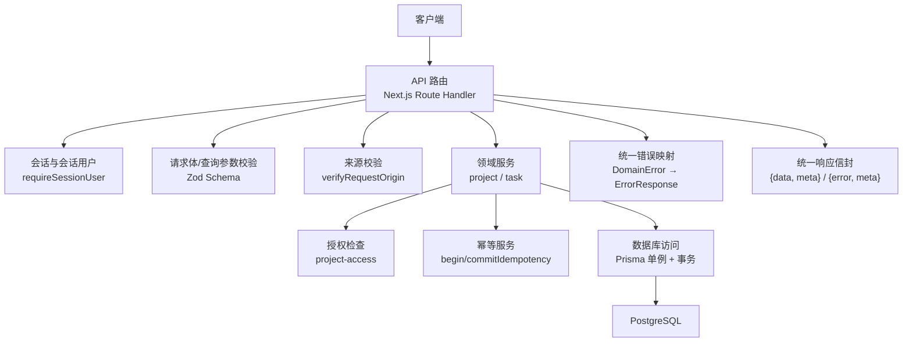
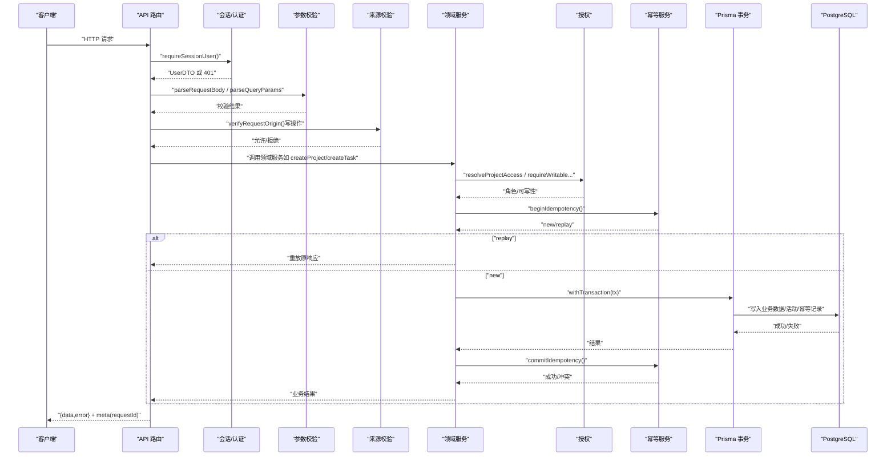
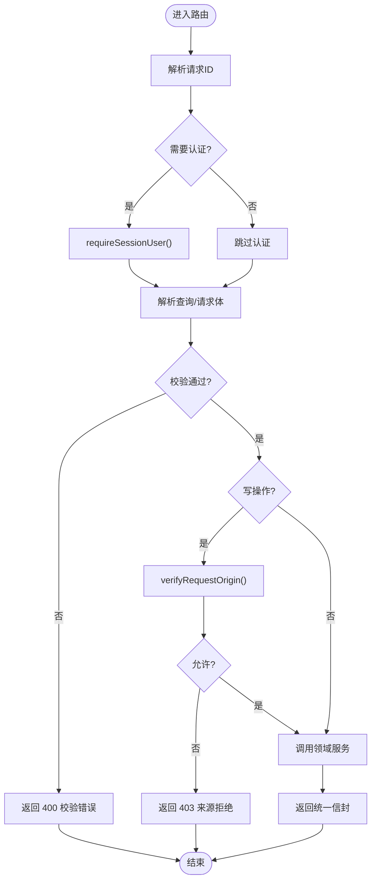
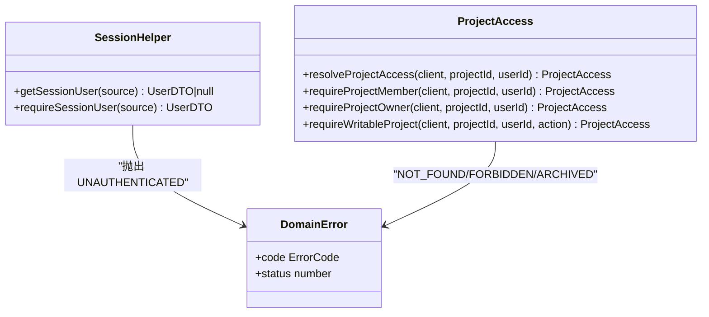
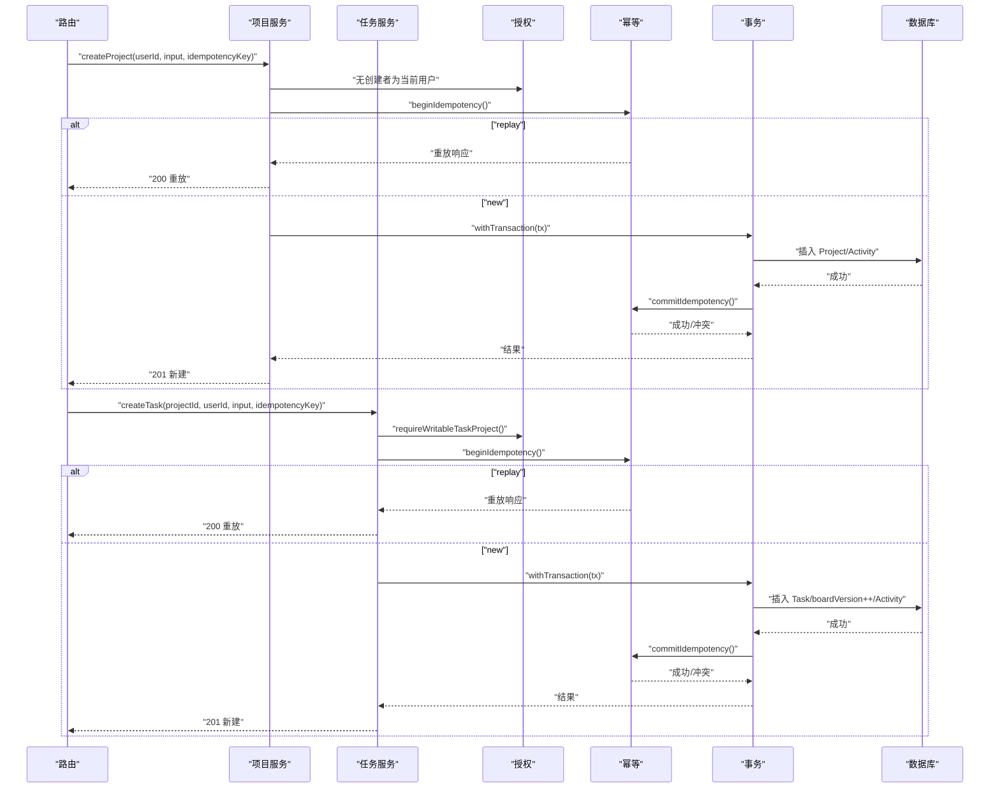
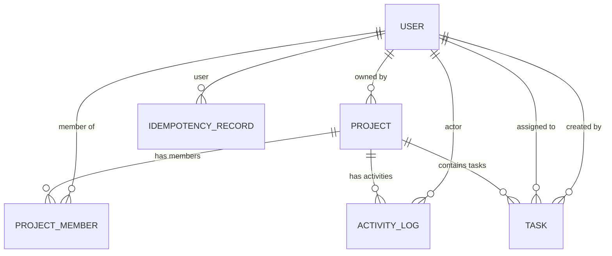
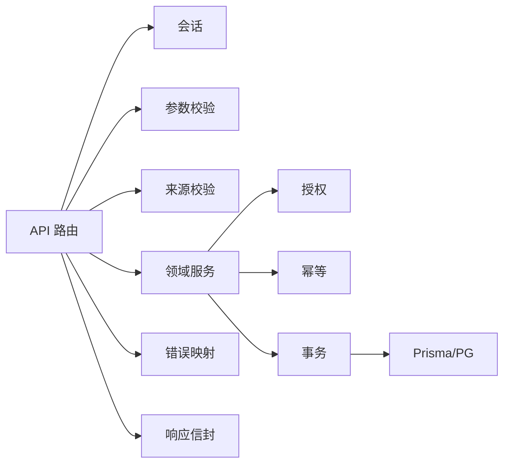

# 后端架构设计

<cite>
**本文引用的文件**
- [src/app/api/v1/projects/route.ts](file://src/app/api/v1/projects/route.ts)
- [src/app/api/v1/tasks/[taskId]/route.ts](file://src/app/api/v1/tasks/[taskId]/route.ts)
- [src/app/api/auth/[...all]/route.ts](file://src/app/api/auth/[...all]/route.ts)
- [src/server/auth/session.ts](file://src/server/auth/session.ts)
- [src/server/http/errors.ts](file://src/server/http/errors.ts)
- [src/contracts/envelope.ts](file://src/contracts/envelope.ts)
- [prisma/schema.prisma](file://prisma/schema.prisma)
- [src/server/modules/project/index.ts](file://src/server/modules/project/index.ts)
- [src/server/modules/project/create.ts](file://src/server/modules/project/create.ts)
- [src/server/modules/task/index.ts](file://src/server/modules/task/index.ts)
- [src/server/modules/task/create.ts](file://src/server/modules/task/create.ts)
- [src/server/modules/authorization/project-access.ts](file://src/server/modules/authorization/project-access.ts)
- [src/server/modules/idempotency/service.ts](file://src/server/modules/idempotency/service.ts)
- [src/server/db/prisma.ts](file://src/server/db/prisma.ts)
- [src/contracts/dto.ts](file://src/contracts/dto.ts)
</cite>

## 目录
1. [简介](#简介)
2. [项目结构](#项目结构)
3. [核心组件](#核心组件)
4. [架构总览](#架构总览)
5. [详细组件分析](#详细组件分析)
6. [依赖关系分析](#依赖关系分析)
7. [性能考量](#性能考量)
8. [故障排查指南](#故障排查指南)
9. [结论](#结论)
10. [附录](#附录)

## 简介
本文件面向 Orbit 项目的后端架构，聚焦于 API 路由与 RESTful 规范、服务层业务封装与领域模型、中间件机制（认证授权、请求验证、错误处理、日志）、数据库访问层（Prisma ORM）与安全架构。文档提供从 HTTP 请求到数据库操作的完整数据流图与代码级架构图，帮助读者快速理解系统设计与实现要点。

## 项目结构
Orbit 后端采用 Next.js App Router 的 Serverless Route Handler 组织 API：
- API 路由位于 src/app/api/v1/*，按资源划分（projects、tasks），认证相关路由挂载在 /api/auth/*。
- 领域服务位于 src/server/modules/*，按领域（project、task）与横切能力（authorization、idempotency、activity、pagination）拆分。
- 契约与 DTO 集中在 src/contracts/*，统一描述请求/响应结构与枚举。
- 数据库访问通过 Prisma 单例与事务封装在 src/server/db/*。
- HTTP 基础设施（错误信封、Origin 校验、请求 ID）位于 src/server/http/*。

图表来源
- [src/app/api/v1/projects/route.ts:21-30](file://src/app/api/v1/projects/route.ts#L21-L30)
- [src/app/api/v1/tasks/[taskId]/route.ts:10-25](file://src/app/api/v1/tasks/[taskId]/route.ts#L10-L25)
- [src/server/auth/session.ts:20-42](file://src/server/auth/session.ts#L20-L42)
- [src/server/http/errors.ts:10-16](file://src/server/http/errors.ts#L10-L16)
- [src/contracts/envelope.ts:4-18](file://src/contracts/envelope.ts#L4-L18)
- [prisma/schema.prisma:14-21](file://prisma/schema.prisma#L14-L21)

章节来源
- [src/app/api/v1/projects/route.ts:21-30](file://src/app/api/v1/projects/route.ts#L21-L30)
- [src/app/api/v1/tasks/[taskId]/route.ts:10-25](file://src/app/api/v1/tasks/[taskId]/route.ts#L10-L25)
- [src/server/auth/session.ts:20-42](file://src/server/auth/session.ts#L20-L42)
- [src/server/http/errors.ts:10-16](file://src/server/http/errors.ts#L10-L16)
- [src/contracts/envelope.ts:4-18](file://src/contracts/envelope.ts#L4-L18)
- [prisma/schema.prisma:14-21](file://prisma/schema.prisma#L14-L21)

## 核心组件
- API 路由层：负责 HTTP 编排、请求 ID 注入、Origin 校验、会话获取、参数校验、调用领域服务、返回统一信封或标准错误。
- 会话与认证：基于 Better Auth，统一通过 requireSessionUser 获取当前用户；认证路由由 toNextJsHandler 接管。
- 领域服务：project 与 task 两个核心域，封装创建、读取、更新、软删除等业务逻辑，并集成配额、幂等、活动记录与授权。
- 授权模块：以 project-access 为核心，判定角色与写权限，统一错误语义（NOT_FOUND/FORBIDDEN/PROJECT_ARCHIVED）。
- 幂等服务：在事务内 begin/commit，保证幂等键唯一性与重放一致性，并发冲突时在外层复查。
- 数据库层：Prisma 单例 + 事务封装，使用 PostgreSQL 适配器与连接池配置，设置语句锁超时保护。
- 错误与信封：DomainError 统一映射为 ErrorResponse，所有响应带 requestId 与 no-store 缓存策略。

章节来源
- [src/app/api/v1/projects/route.ts:21-30](file://src/app/api/v1/projects/route.ts#L21-L30)
- [src/app/api/v1/tasks/[taskId]/route.ts:10-25](file://src/app/api/v1/tasks/[taskId]/route.ts#L10-L25)
- [src/server/auth/session.ts:20-42](file://src/server/auth/session.ts#L20-L42)
- [src/server/modules/project/index.ts:1-24](file://src/server/modules/project/index.ts#L1-L24)
- [src/server/modules/task/index.ts:1-31](file://src/server/modules/task/index.ts#L1-L31)
- [src/server/modules/authorization/project-access.ts:12-23](file://src/server/modules/authorization/project-access.ts#L12-L23)
- [src/server/modules/idempotency/service.ts:6-25](file://src/server/modules/idempotency/service.ts#L6-L25)
- [src/server/db/prisma.ts:6-15](file://src/server/db/prisma.ts#L6-L15)
- [src/server/http/errors.ts:10-16](file://src/server/http/errors.ts#L10-L16)
- [src/contracts/envelope.ts:4-18](file://src/contracts/envelope.ts#L4-L18)

## 架构总览
下图展示从 HTTP 请求到数据库操作的完整链路，包括认证、校验、授权、幂等、事务与响应封装。

图表来源
- [src/app/api/v1/projects/route.ts:35-93](file://src/app/api/v1/projects/route.ts#L35-L93)
- [src/app/api/v1/tasks/[taskId]/route.ts:43-111](file://src/app/api/v1/tasks/[taskId]/route.ts#L43-L111)
- [src/server/auth/session.ts:20-42](file://src/server/auth/session.ts#L20-L42)
- [src/server/modules/project/create.ts:71-181](file://src/server/modules/project/create.ts#L71-L181)
- [src/server/modules/task/create.ts:77-202](file://src/server/modules/task/create.ts#L77-L202)
- [src/server/modules/authorization/project-access.ts:55-121](file://src/server/modules/authorization/project-access.ts#L55-L121)
- [src/server/modules/idempotency/service.ts:122-181](file://src/server/modules/idempotency/service.ts#L122-L181)
- [src/server/db/prisma.ts:16-45](file://src/server/db/prisma.ts#L16-L45)

## 详细组件分析

### API 路由与 RESTful 规范
- GET /api/v1/projects：列出当前用户拥有/参与的项目，支持游标分页与 scope/archived 过滤。
- POST /api/v1/projects：创建项目，要求 Idempotency-Key，成功后返回 201；幂等重放返回 200。
- GET /api/v1/tasks/{taskId}：读取任务详情，非成员/不存在/已软删除返回 404。
- PATCH /api/v1/tasks/{taskId}：更新任务字段，乐观并发（expectedVersion 不符返回 409）。
- DELETE /api/v1/tasks/{taskId}：软删除任务，仅 owner 或创建者可删，expectedVersion 必填。

请求生命周期（写操作）：请求 ID → Origin → 会话 → 参数校验 → 领域服务（配额/唯一性/幂等/授权）→ DTO → 统一信封。

图表来源
- [src/app/api/v1/projects/route.ts:35-93](file://src/app/api/v1/projects/route.ts#L35-L93)
- [src/app/api/v1/tasks/[taskId]/route.ts:43-111](file://src/app/api/v1/tasks/[taskId]/route.ts#L43-L111)

章节来源
- [src/app/api/v1/projects/route.ts:21-93](file://src/app/api/v1/projects/route.ts#L21-L93)
- [src/app/api/v1/tasks/[taskId]/route.ts:10-111](file://src/app/api/v1/tasks/[taskId]/route.ts#L10-L111)

### 认证与授权
- 认证：Better Auth 全路由挂载至 /api/auth/*，不叠加自制 Origin 层以避免破坏回调。
- 会话：requireSessionUser 从 Request/Headers 中解析会话，返回 UserDTO；未认证抛 UNAUTHENTICATED。
- 授权：project-access 根据是否存在、是否 owner、是否 member 判定角色与写权限，统一错误语义。

图表来源
- [src/server/auth/session.ts:20-42](file://src/server/auth/session.ts#L20-L42)
- [src/server/modules/authorization/project-access.ts:55-121](file://src/server/modules/authorization/project-access.ts#L55-L121)
- [src/server/http/errors.ts:35-61](file://src/server/http/errors.ts#L35-L61)

章节来源
- [src/app/api/auth/[...all]/route.ts:4-22](file://src/app/api/auth/[...all]/route.ts#L4-L22)
- [src/server/auth/session.ts:20-42](file://src/server/auth/session.ts#L20-L42)
- [src/server/modules/authorization/project-access.ts:12-23](file://src/server/modules/authorization/project-access.ts#L12-L23)

### 领域服务：项目与任务
- 项目服务：createProject/listProjects/getProject/updateProject，包含配额限制、key 唯一性、活动记录与幂等。
- 任务服务：createTask/listProjectTasks/getTask/updateTask/softDeleteTask/restoreTask，包含编号生成、位置追加、看板版本递增、活动记录与幂等。

图表来源
- [src/server/modules/project/create.ts:71-181](file://src/server/modules/project/create.ts#L71-L181)
- [src/server/modules/task/create.ts:77-202](file://src/server/modules/task/create.ts#L77-L202)
- [src/server/modules/authorization/project-access.ts:91-121](file://src/server/modules/authorization/project-access.ts#L91-L121)
- [src/server/modules/idempotency/service.ts:122-181](file://src/server/modules/idempotency/service.ts#L122-L181)

章节来源
- [src/server/modules/project/index.ts:1-24](file://src/server/modules/project/index.ts#L1-L24)
- [src/server/modules/project/create.ts:18-181](file://src/server/modules/project/create.ts#L18-L181)
- [src/server/modules/task/index.ts:1-31](file://src/server/modules/task/index.ts#L1-L31)
- [src/server/modules/task/create.ts:32-202](file://src/server/modules/task/create.ts#L32-L202)

### 中间件机制
- 认证授权：requireSessionUser 强制登录；project-access 判定角色与写权限。
- 请求验证：Zod schema 校验请求体与查询参数，非法返回 400。
- 错误处理：DomainError 统一映射为 ErrorResponse，附带 requestId 与 no-store 缓存策略。
- 日志记录：未预期错误记录脱敏信息（requestId、name/message），不泄露堆栈。

章节来源
- [src/server/auth/session.ts:20-42](file://src/server/auth/session.ts#L20-L42)
- [src/server/modules/authorization/project-access.ts:55-121](file://src/server/modules/authorization/project-access.ts#L55-L121)
- [src/server/http/errors.ts:10-136](file://src/server/http/errors.ts#L10-L136)

### 数据库访问层与查询优化
- Prisma 单例：使用 @prisma/adapter-pg，配置连接池大小、空闲回收、连接等待超时与语句/锁超时。
- 事务封装：withTransaction 包裹业务逻辑，确保原子性；结合行锁（lockUserRow/lockProjectRow）串行化关键路径。
- 索引与约束：Project/Task/Activity/IdempotencyRecord 定义复合索引与唯一约束，优化列表、排序与并发控制。
- 查询优化：列表使用游标分页；任务列尾追加 position；看板变更 bump boardVersion 而非 updatedAt。

图表来源
- [prisma/schema.prisma:27-268](file://prisma/schema.prisma#L27-L268)

章节来源
- [src/server/db/prisma.ts:6-45](file://src/server/db/prisma.ts#L6-L45)
- [prisma/schema.prisma:14-268](file://prisma/schema.prisma#L14-L268)

### 安全架构
- 输入验证：Zod strictObject 严格匹配契约，禁止未知字段，防止敏感字段泄露。
- SQL 注入防护：Prisma 参数化查询，避免拼接 SQL；CHECK 约束在迁移中手写兜底。
- XSS 防护：服务端输出统一 JSON 信封，前端渲染遵循安全策略；敏感字段不在 DTO 暴露。
- 安全头配置：错误响应携带 Cache-Control: private, no-store；请求来源校验（Origin）用于写操作。

章节来源
- [src/contracts/envelope.ts:4-18](file://src/contracts/envelope.ts#L4-L18)
- [src/contracts/dto.ts:27-38](file://src/contracts/dto.ts#L27-L38)
- [src/server/http/errors.ts:18-22](file://src/server/http/errors.ts#L18-L22)
- [prisma/schema.prisma:140-143](file://prisma/schema.prisma#L140-L143)

## 依赖关系分析
- 路由层依赖会话、校验、来源校验、领域服务与错误/信封工具。
- 领域服务依赖授权、幂等、活动、配额与 Prisma 事务。
- 授权模块依赖纯函数决策与数据库查询。
- 幂等服务依赖稳定序列化与哈希，处理并发冲突哨兵。
- 数据库层依赖 Prisma 单例与 PostgreSQL 适配器。

图表来源
- [src/app/api/v1/projects/route.ts:35-93](file://src/app/api/v1/projects/route.ts#L35-L93)
- [src/server/modules/project/create.ts:71-181](file://src/server/modules/project/create.ts#L71-L181)
- [src/server/modules/task/create.ts:77-202](file://src/server/modules/task/create.ts#L77-L202)
- [src/server/db/prisma.ts:16-45](file://src/server/db/prisma.ts#L16-L45)

章节来源
- [src/app/api/v1/projects/route.ts:35-93](file://src/app/api/v1/projects/route.ts#L35-L93)
- [src/server/modules/project/create.ts:71-181](file://src/server/modules/project/create.ts#L71-L181)
- [src/server/modules/task/create.ts:77-202](file://src/server/modules/task/create.ts#L77-L202)
- [src/server/db/prisma.ts:16-45](file://src/server/db/prisma.ts#L16-L45)

## 性能考量
- 连接池与超时：Prisma 连接池 max=15，空闲回收 30s，连接等待 5s；语句超时 5s，锁等待 3s，避免长事务拖垮并发。
- 行锁与序列化：项目/用户行锁串行化关键路径（编号、配额、position、boardVersion），减少竞争。
- 幂等与重放：同 key 同 body 直接重放，降低重复写入压力。
- 分页与索引：游标分页配合复合索引优化列表查询；任务列尾追加 position 提升看板性能。

[本节为通用指导，无需具体文件引用]

## 故障排查指南
- 401 未认证：检查会话是否有效，确认 requireSessionUser 是否被调用。
- 400 校验失败：核对 Zod schema 与请求体/查询参数格式。
- 403 权限不足：确认用户是否为项目成员或 owner，归档项目写操作将被拒绝。
- 409 冲突：检查 expectedVersion/boardVersion 是否正确；幂等键冲突需更换 Idempotency-Key。
- 500 内部错误：查看脱敏日志中的 requestId 与错误类型，定位异常点。

章节来源
- [src/server/http/errors.ts:108-136](file://src/server/http/errors.ts#L108-L136)
- [src/server/modules/authorization/project-access.ts:28-41](file://src/server/modules/authorization/project-access.ts#L28-L41)
- [src/server/modules/idempotency/service.ts:54-108](file://src/server/modules/idempotency/service.ts#L54-L108)

## 结论
Orbit 后端通过清晰的层次划分与严格的契约驱动，实现了高内聚、低耦合的服务端架构。API 路由专注 HTTP 编排，领域服务封装业务不变量，授权与幂等保障一致性与安全性，Prisma 事务与索引优化支撑高性能数据访问。统一错误与信封机制提升了可观测性与可维护性，适合持续演进与团队协作。

## 附录
- 契约与 OpenAPI：contracts/openapi.json 与各 DTO schema 保持一致，便于前后端协同。
- 迁移与模型：Prisma schema 定义业务实体与关系，迁移脚本补充 CHECK 约束与索引。
- 测试与验证：单元测试覆盖日期、位置、权限等核心逻辑；集成测试覆盖认证流程、并发不变量与幂等。

[本节为概览说明，无需具体文件引用]